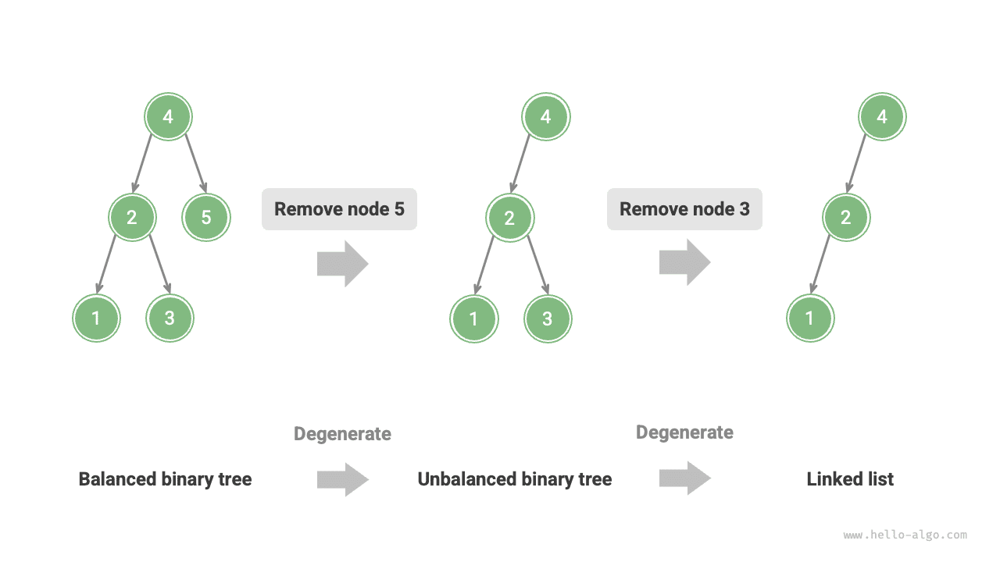
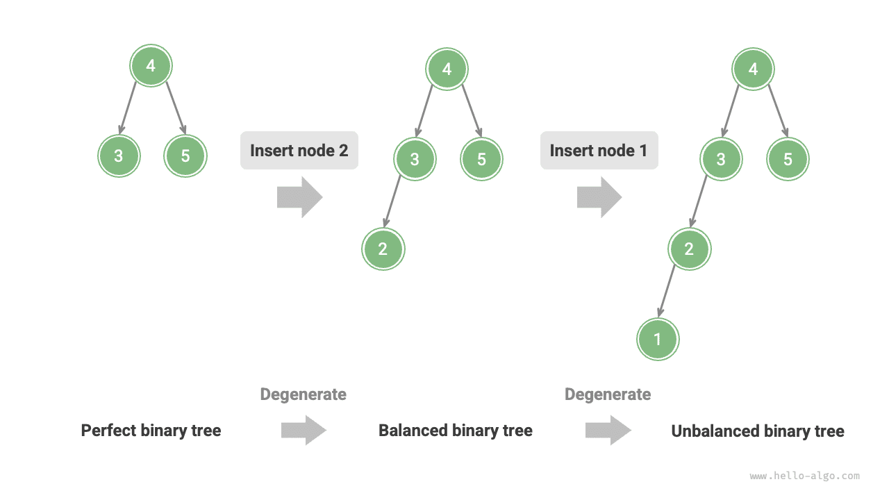
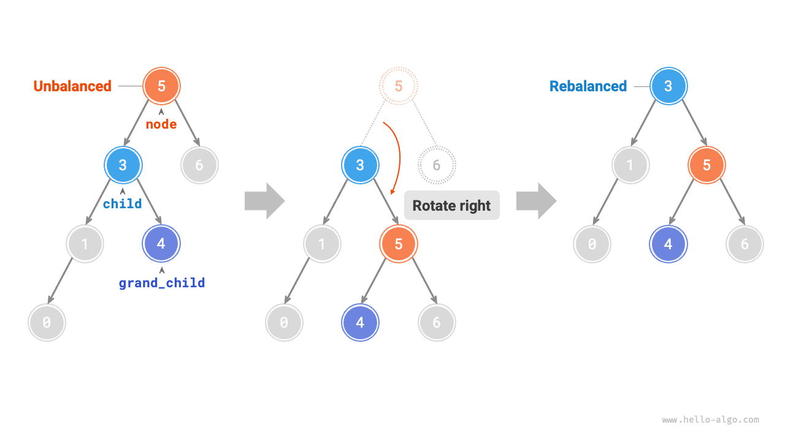
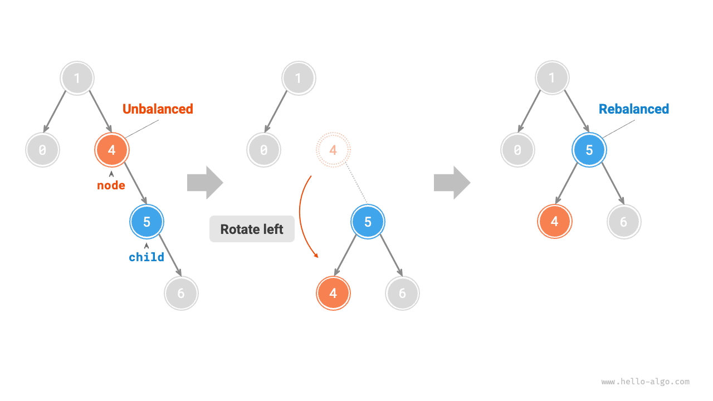
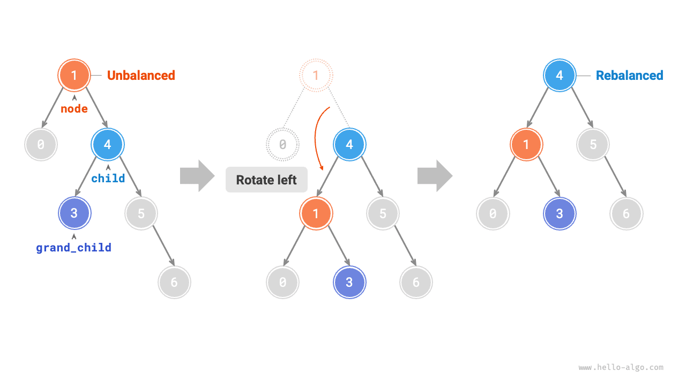
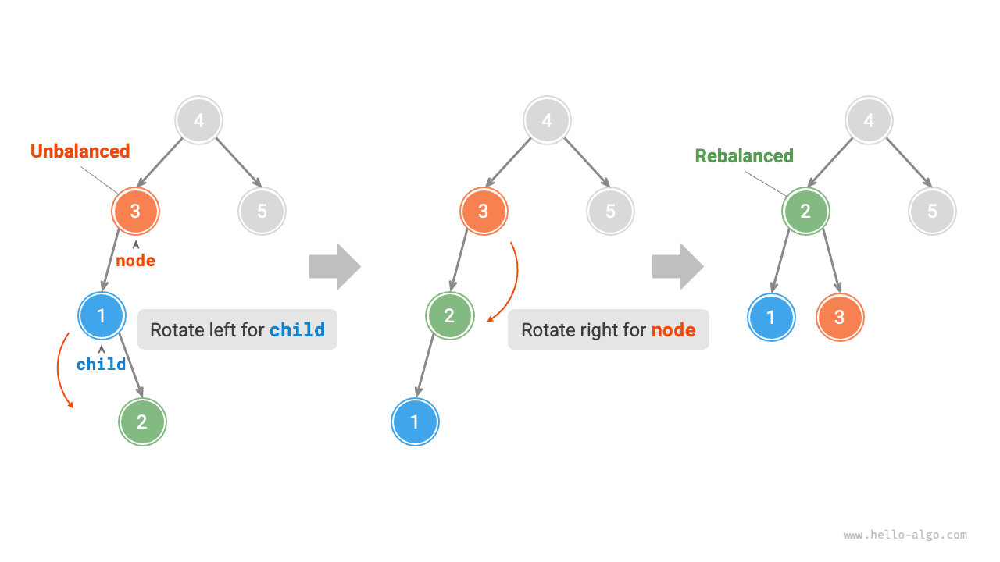
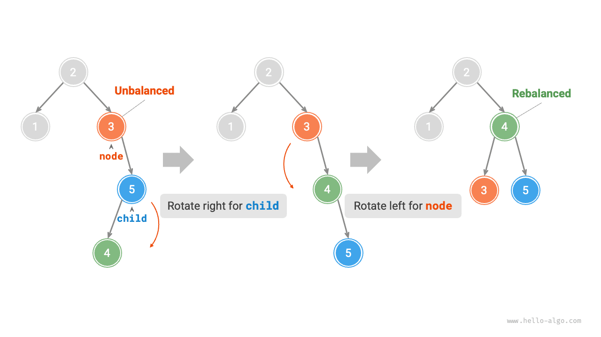
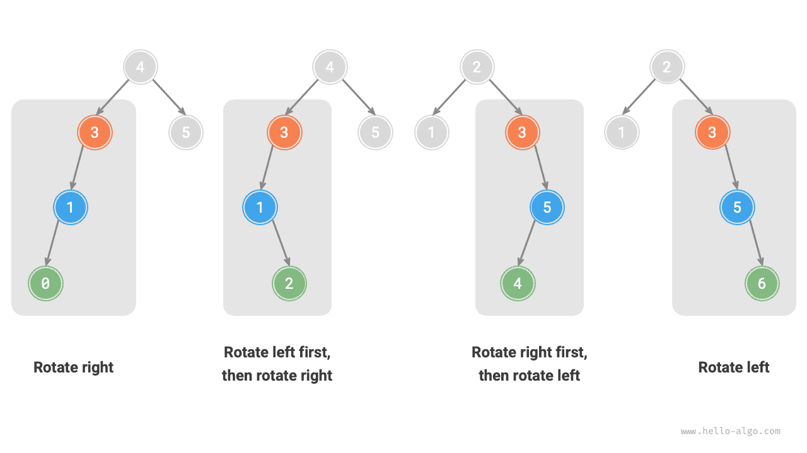

ذكرنا في قسم "شجرة البحث الثنائية" أنه بعد عمليات إدراج وحذف متعددة قد تتدهور شجرة البحث الثنائية إلى قائمة مترابطة. وفي هذه الحالة يتدهور التعقيد الزمني لجميع العمليات من $O(\log n)$ إلى $O(n)$.

وكما يوضح الشكل أدناه، بعد عمليتي حذف لعقدتين، تتدهور شجرة البحث الثنائية هذه إلى قائمة مترابطة.



على سبيل المثال، في الشجرة الثنائية التامة الموضحة في الشكل أدناه، بعد إدراج عقدتين ستميل الشجرة ميلاً شديداً إلى اليسار، وسيتدهور التعقيد الزمني لعمليات البحث أيضاً.



في عام 1962، اقترح G. M. Adelson-Velsky وE. M. Landis <u>شجرة AVL</u> في ورقيتهما "An algorithm for the organization of information". وتصف الورقة سلسلة من العمليات التي تمنع شجرة AVL من التدهور عند إدراج العقد وحذفها، مما يحافظ على التعقيد الزمني لمختلف العمليات عند $O(\log n)$. وبعبارة أخرى، في السيناريوهات التي تتطلب عمليات إدراج وحذف وبحث وتحديث متكررة، تستطيع أشجار AVL الحفاظ على أداء فعّال باستمرار، ولذلك لها قيمة عملية كبيرة.

## المصطلحات الشائعة في أشجار AVL

شجرة AVL هي في الوقت نفسه شجرة بحث ثنائية وشجرة ثنائية متوازنة، وتستوفي في آن واحد جميع خصائص هذين النوعين من الأشجار الثنائية، لذا فهي <u>شجرة بحث ثنائية متوازنة</u>.

### ارتفاع العقدة

بما أن العمليات المتعلقة بأشجار AVL تتطلب الحصول على ارتفاعات العقد، نحتاج إلى إضافة متغير `height` إلى صنف العقدة:

<div class="lang-tab">
<p class="lang-tab__label">Python</p>

```python title=""
class TreeNode:
    """AVL tree node"""
    def __init__(self, val: int):
        self.val: int = val                 # Node value
        self.height: int = 0                # Node height
        self.left: TreeNode | None = None   # Left child reference
        self.right: TreeNode | None = None  # Right child reference
```

</div>
يشير "ارتفاع العقدة" إلى المسافة من تلك العقدة إلى أبعد عقدة ورقة عنها، أي عدد الأضلاع على المسار. ومن المهم ملاحظة أن ارتفاع عقدة الورقة هو $0$، وارتفاع العقدة الفارغة هو $-1$. سننشئ دالتين مساعدتين للحصول على ارتفاع العقدة وتحديثه:

<div class="lang-tab">
<p class="lang-tab__label">Python</p>

```py
    def update_height(self, node: TreeNode | None):
        """Update the node height"""
        # The node height equals the height of its taller subtree + 1
        node.height = max([self.height(node.left), self.height(node.right)]) + 1
```

</div>
### معامل توازن العقدة

يُعرَّف <u>معامل التوازن</u> للعقدة بأنه ارتفاع الشجرة الفرعية اليسرى للعقدة مطروحاً منه ارتفاع شجرتها الفرعية اليمنى، ويُعرَّف معامل توازن العقدة الفارغة بأنه $0$. كما نغلّف دالة الحصول على معامل توازن العقدة لتسهيل استخدامها لاحقاً:

<div class="lang-tab">
<p class="lang-tab__label">Python</p>

```py
    def balance_factor(self, node: TreeNode | None) -> int:
        """Get the balance factor"""
        # An empty subtree has balance factor 0
        if node is None:
            return 0
        # Node balance factor = left subtree height - right subtree height
        return self.height(node.left) - self.height(node.right)
```

</div>
<div class="note">

ليكن معامل التوازن $f$، فيستوفي معامل توازن أي عقدة في شجرة AVL الشرط $-1 \le f \le 1$.

</div>

## الدورانات في أشجار AVL

تكمن خصوصية أشجار AVL في عملية "الدوران"، التي تستطيع إعادة التوازن إلى العقد غير المتوازنة دون التأثير في تسلسل الاجتياز الوسطي للشجرة الثنائية. وبعبارة أخرى، **تستطيع عمليات الدوران الحفاظ على خاصية "شجرة البحث الثنائية" وإعادة الشجرة إلى "شجرة ثنائية متوازنة" في آن واحد**.

نسمي العقد التي تكون القيمة المطلقة لمعامل توازنها $> 1$ "عقداً غير متوازنة". وتبعاً لحالة عدم التوازن، تنقسم عمليات الدوران إلى أربعة أنواع: الدوران الأيمن، والدوران الأيسر، والدوران الأيمن ثم الأيسر، والدوران الأيسر ثم الأيمن. وفيما يلي نصف عمليات الدوران هذه بالتفصيل.

### الدوران الأيمن

وكما يوضح الشكل أدناه، القيمة الواقعة أسفل العقدة هي معامل التوازن. ومن الأسفل إلى الأعلى، تكون أول عقدة غير متوازنة في الشجرة الثنائية هي "العقدة 3". نركّز على الشجرة الفرعية التي تكون هذه العقدة غير المتوازنة جذراً لها، ونرمز للعقدة بـ`node` ولابنها الأيسر بـ`child`، وننفّذ عملية "الدوران الأيمن". بعد اكتمال الدوران الأيمن، تستعيد الشجرة الفرعية توازنها وتبقى محافظة على خصائص شجرة البحث الثنائية.

وكما يوضح الشكل أدناه، عندما تكون للعقدة `child` عقدة ابنة يمنى (نرمز لها بـ`grand_child`)، يلزم إضافة خطوة في الدوران الأيمن: عيّن `grand_child` ابناً أيسر للعقدة `node`.



"الدوران الأيمن" تعبير مجازي؛ ومن الناحية العملية يُنفَّذ بتعديل مؤشرات العقد، كما في الشيفرة التالية:

<div class="lang-tab">
<p class="lang-tab__label">Python</p>

```py
    def right_rotate(self, node: TreeNode | None) -> TreeNode | None:
        """Right rotation"""
        child = node.left
        grand_child = child.right
        # Rotate node to the right around child
        child.right = node
        node.left = grand_child
        # Update the node height
        self.update_height(node)
        self.update_height(child)
        # Return the root of the rotated subtree
        return child
```

</div>
### الدوران الأيسر

وبالمقابل، إذا نظرنا إلى "المرآة" المقابلة للشجرة الثنائية غير المتوازنة السابقة، فيلزم تنفيذ عملية "الدوران الأيسر" الموضحة في الشكل أدناه.



وبالمثل، وكما يوضح الشكل أدناه، عندما تكون للعقدة `child` عقدة ابنة يسرى (نرمز لها بـ`grand_child`)، يلزم إضافة خطوة في الدوران الأيسر: عيّن `grand_child` ابناً أيمن للعقدة `node`.



يمكن ملاحظة أن **عمليتي الدوران الأيمن والدوران الأيسر متماثلتان مرآتياً في المنطق، وأن حالتي عدم التوازن اللتين تعالجانهما متماثلتان أيضاً**. واستناداً إلى هذا التماثل، يكفي أن نستبدل جميع `left` في شيفرة تنفيذ الدوران الأيمن بـ`right`، وجميع `right` بـ`left`، لنحصل على شيفرة تنفيذ الدوران الأيسر:

<div class="lang-tab">
<p class="lang-tab__label">Python</p>

```py
    def left_rotate(self, node: TreeNode | None) -> TreeNode | None:
        """Left rotation"""
        child = node.right
        grand_child = child.left
        # Rotate node to the left around child
        child.left = node
        node.right = grand_child
        # Update the node height
        self.update_height(node)
        self.update_height(child)
        # Return the root of the rotated subtree
        return child
```

</div>
### الدوران الأيسر ثم الدوران الأيمن

بالنسبة إلى العقدة غير المتوازنة 3 في الشكل أدناه، لا يمكن باستخدام الدوران الأيسر أو الدوران الأيمن وحده إعادة الشجرة الفرعية إلى التوازن. وفي هذه الحالة، يجب تنفيذ "دوران أيسر" على `child` أولاً، ثم "دوران أيمن" على `node`.



### الدوران الأيمن ثم الدوران الأيسر

وكما يوضح الشكل أدناه، في الحالة المرآتية للشجرة الثنائية غير المتوازنة السابقة، يجب تنفيذ "دوران أيمن" على `child` أولاً، ثم "دوران أيسر" على `node`.



### اختيار الدوران

تتوافق حالات عدم التوازن الأربع الموضحة في الشكل أدناه توافقاً واحداً لواحد مع الحالات السابقة، وتتطلب على التوالي عمليات: الدوران الأيمن، والدوران الأيسر ثم الأيمن، والدوران الأيمن ثم الأيسر، والدوران الأيسر.



وكما يوضح الجدول أدناه، نحدّد الحالة التي تنتمي إليها العقدة غير المتوازنة من خلال الحكم على إشارتي معامل توازن العقدة غير المتوازنة ومعامل توازن عقدتها الابنة في الجهة الأطول.

<p align="center"> الجدول <id> &nbsp; شروط الاختيار بين حالات الدوران الأربع </p>

| معامل توازن العقدة غير المتوازنة | معامل توازن العقدة الابنة | طريقة الدوران المطبَّقة          |
| -------------------------------------- | --------------------------------- | --------------------------------- |
| $> 1$ (شجرة مائلة لليسار)              | $\geq 0$                          | دوران أيمن                    |
| $> 1$ (شجرة مائلة لليسار)              | $<0$                              | دوران أيسر ثم دوران أيمن |
| $< -1$ (شجرة مائلة لليمين)            | $\leq 0$                          | دوران أيسر                     |
| $< -1$ (شجرة مائلة لليمين)            | $>0$                              | دوران أيمن ثم دوران أيسر |

لتسهيل الاستخدام، نغلّف عمليات الدوران في دالة واحدة. **وبهذه الدالة يمكننا تنفيذ الدورانات لمختلف حالات عدم التوازن، وإعادة التوازن إلى العقد غير المتوازنة**. والشيفرة كما يلي:

<div class="lang-tab">
<p class="lang-tab__label">Python</p>

```py
    def rotate(self, node: TreeNode | None) -> TreeNode | None:
        """Perform rotations to restore balance in this subtree"""
        # Get the balance factor of node
        balance_factor = self.balance_factor(node)
        # Left-heavy tree
        if balance_factor > 1:
            if self.balance_factor(node.left) >= 0:
                # Rotate right
                return self.right_rotate(node)
            else:
                # Rotate left, then right
                node.left = self.left_rotate(node.left)
                return self.right_rotate(node)
        # Right-heavy tree
        elif balance_factor < -1:
            if self.balance_factor(node.right) <= 0:
                # Rotate left
                return self.left_rotate(node)
            else:
                # Rotate right, then left
                node.right = self.right_rotate(node.right)
                return self.left_rotate(node)
        # The tree is balanced; return without rotating
        return node
```

</div>
## العمليات الشائعة في أشجار AVL

### إدراج عقدة

تتشابه عملية إدراج العقد في أشجار AVL من حيث المبدأ مع نظيرتها في أشجار البحث الثنائية. والفرق الوحيد هو أنه بعد إدراج عقدة في شجرة AVL، قد تظهر سلسلة من العقد غير المتوازنة على المسار من تلك العقدة إلى الجذر. لذلك **نحتاج إلى البدء من هذه العقدة وتنفيذ عمليات الدوران من الأسفل إلى الأعلى، لإعادة التوازن إلى جميع العقد غير المتوازنة**. والشيفرة كما يلي:

<div class="lang-tab">
<p class="lang-tab__label">Python</p>

```py
    def insert_helper(self, node: TreeNode | None, val: int) -> TreeNode:
        """Insert a node recursively (helper method)"""
        if node is None:
            return TreeNode(val)
        # 1. Find the insertion position and insert the node
        if val < node.val:
            node.left = self.insert_helper(node.left, val)
        elif val > node.val:
            node.right = self.insert_helper(node.right, val)
        else:
            # Return without inserting a duplicate node
            return node
        # Update the node height
        self.update_height(node)
        # 2. Perform rotations to restore balance in this subtree
        return self.rotate(node)
```

</div>
### حذف العقدة

وبالمثل، واستناداً إلى طريقة حذف العقد في شجرة البحث الثنائية، يجب تنفيذ عمليات الدوران من الأسفل إلى الأعلى لإعادة التوازن إلى جميع العقد غير المتوازنة. والشيفرة كما يلي:

<div class="lang-tab">
<p class="lang-tab__label">Python</p>

```py
    def remove_helper(self, node: TreeNode | None, val: int) -> TreeNode | None:
        """Remove a node recursively (helper method)"""
        if node is None:
            return None
        # 1. Find and remove the node
        if val < node.val:
            node.left = self.remove_helper(node.left, val)
        elif val > node.val:
            node.right = self.remove_helper(node.right, val)
        else:
            if node.left is None or node.right is None:
                child = node.left or node.right
                # Number of children = 0: remove node and return
                if child is None:
                    return None
                # Number of children = 1: remove node directly
                else:
                    node = child
            else:
                # Number of children = 2: remove the inorder successor and use its value to replace the current node value
                temp = node.right
                while temp.left is not None:
                    temp = temp.left
                node.right = self.remove_helper(node.right, temp.val)
                node.val = temp.val
        # Update the node height
        self.update_height(node)
        # 2. Perform rotations to restore balance in this subtree
        return self.rotate(node)
```

</div>
### البحث عن عقدة

تتوافق عملية البحث عن عقدة في أشجار AVL مع نظيرتها في أشجار البحث الثنائية، ولن نتوسع فيها هنا.

## التطبيقات النموذجية لأشجار AVL

- تنظيم البيانات واسعة النطاق وتخزينها، وتلائم السيناريوهات التي تكثر فيها عمليات البحث وتقلّ فيها عمليات الإدراج والحذف.
- تُستخدم لبناء أنظمة الفهارس في قواعد البيانات.
- الأشجار الحمراء السوداء أيضاً نوع شائع من أشجار البحث الثنائية المتوازنة. فمقارنة بأشجار AVL، تتمتع الأشجار الحمراء السوداء بشروط توازن أكثر تسامحاً، وتتطلب عمليات دوران أقل عند إدراج العقد وحذفها، كما أن كفاءتها المتوسطة في عمليات إضافة العقد وحذفها أعلى.
