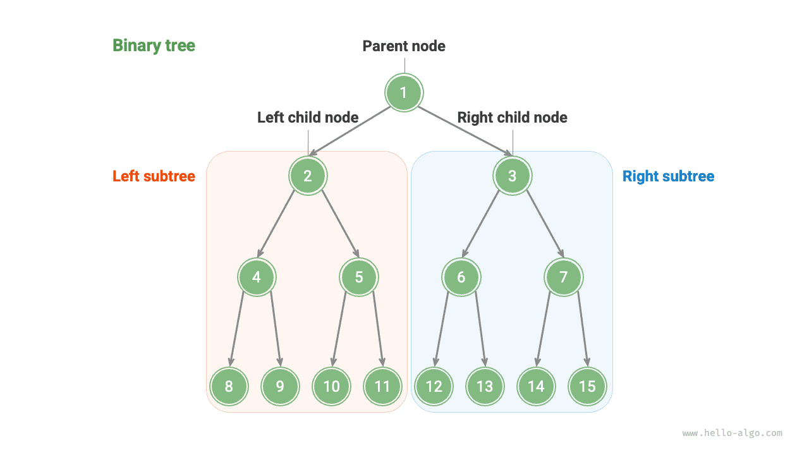
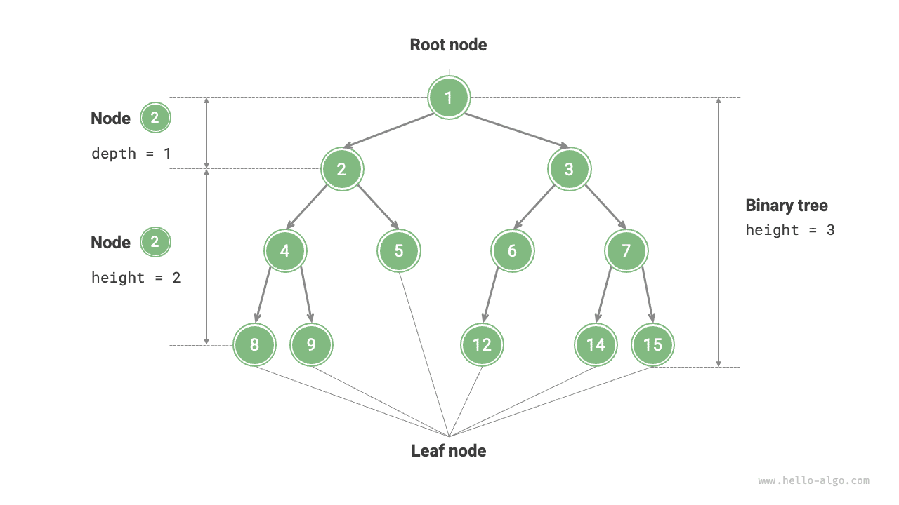
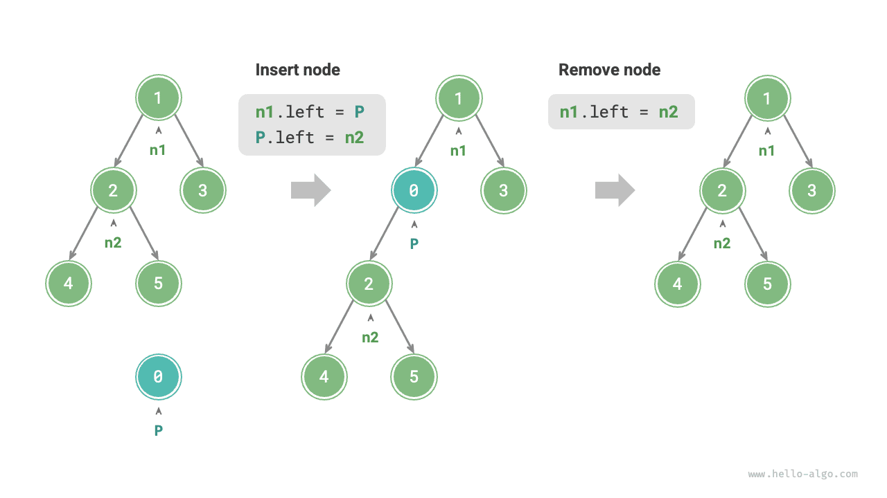
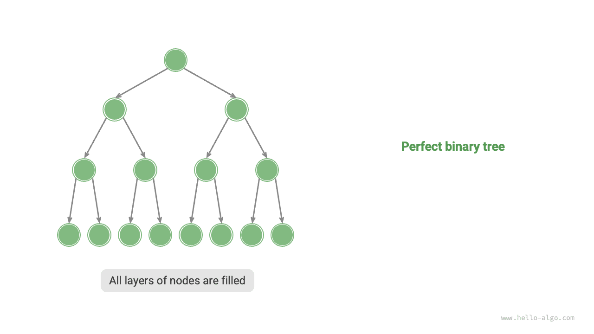
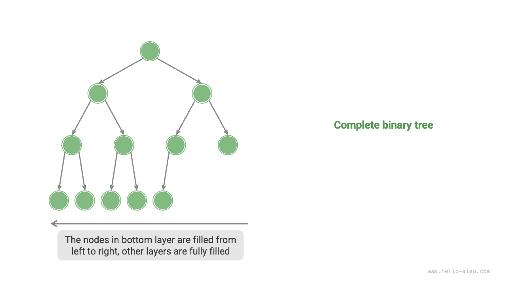
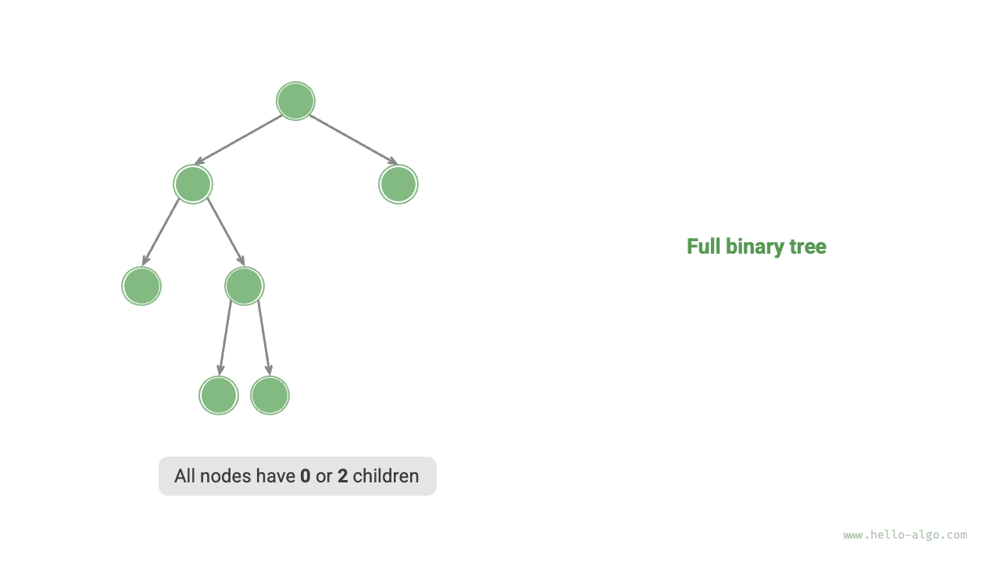
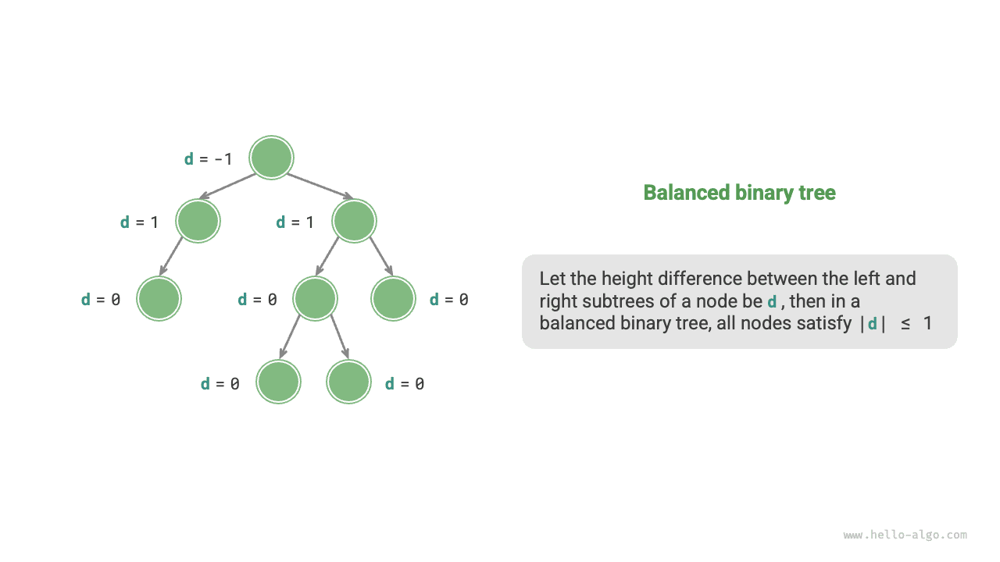
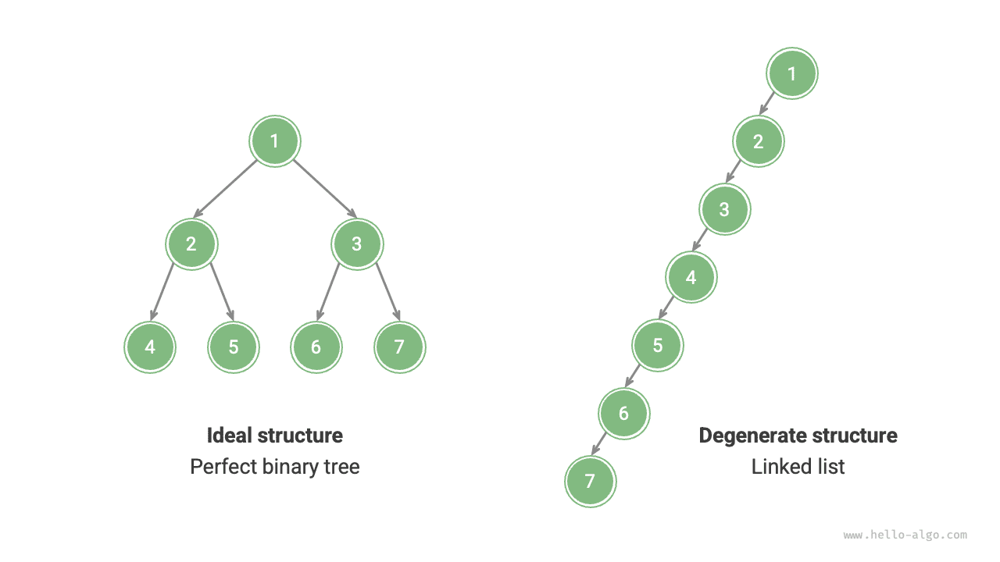

<u>الشجرة الثنائية</u> (binary tree) بنية بيانات غير خطية تصوّر العلاقة الهرمية بين «الأسلاف» و«الأحفاد»، وتتجسد فيها فكرة التقسيم والتغلب التي يتفرع فيها كل انقسام إلى اثنين. وعلى غرار القائمة المترابطة، فإن الوحدة الأساسية في الشجرة الثنائية هي العقدة، وتحتوي كل عقدة على قيمة، ومرجع إلى عقدة ابنها الأيسر، ومرجع إلى عقدة ابنها الأيمن.

<div class="lang-tab">
<p class="lang-tab__label">Python</p>

```python title=""
class TreeNode:
    """Binary tree node"""
    def __init__(self, val: int):
        self.val: int = val                # Node value
        self.left: TreeNode | None = None  # Reference to left child node
        self.right: TreeNode | None = None # Reference to right child node
```

</div>
تحتوي كل عقدة على مرجعين (مؤشرين) يشيران على التوالي إلى <u>عقدة الابن الأيسر</u> و<u>عقدة الابن الأيمن</u>. وتُسمى هذه العقدة <u>العقدة الأب</u> لهاتين العقدتين الابنتين. وعند إعطائنا عقدة من شجرة ثنائية، نسمي الشجرة المكوَّنة من ابن هذه العقدة الأيسر وجميع العقد الواقعة تحته <u>الشجرة الفرعية اليسرى</u> لهذه العقدة. وبالمثل، يمكن تعريف <u>الشجرة الفرعية اليمنى</u>.

**في الشجرة الثنائية، تمتلك كل عقدة غير ورقية عقداً ابنة، ومن ثم أشجاراً فرعية غير فارغة.** وكما يوضح الشكل أدناه، إذا اعتُبرت «العقدة 2» عقدة أب، فإن عقدتي ابنيها الأيسر والأيمن هما «العقدة 4» و«العقدة 5» على التوالي. وتتكون الشجرة الفرعية اليسرى من «العقدة 4» وجميع العقد الواقعة تحتها، بينما تتكون الشجرة الفرعية اليمنى من «العقدة 5» وجميع العقد الواقعة تحتها.



## المصطلحات الشائعة للأشجار الثنائية

تظهر المصطلحات الشائعة للأشجار الثنائية في الشكل أدناه.

- <u>عقدة الجذر</u> (root node): العقدة في المستوى الأعلى من الشجرة الثنائية، وهي لا تمتلك عقدة أب.
- <u>العقدة الورقية</u> (leaf node): عقدة لا تمتلك أي عقد ابنة، ويشير مؤشراها معاً إلى `None`.
- <u>الضلع</u> (edge): قطعة مستقيمة تربط عقدتين، وتمثل مرجعاً (مؤشراً) بين العقدتين.
- <u>مستوى</u> العقدة: يزداد من الأعلى إلى الأسفل، وتكون عقدة الجذر في المستوى 1.
- <u>درجة</u> العقدة: عدد عقد الابن التي تمتلكها العقدة. وفي الشجرة الثنائية، يمكن أن تكون الدرجة 0 أو 1 أو 2.
- <u>ارتفاع</u> الشجرة الثنائية: عدد الأضلاع من عقدة الجذر إلى أبعد عقدة ورقية.
- <u>عمق</u> العقدة: عدد الأضلاع من عقدة الجذر إلى العقدة.
- <u>ارتفاع</u> العقدة: عدد الأضلاع من أبعد عقدة ورقية إلى العقدة.



<div class="note">

نُعرِّف عادةً «الارتفاع» و«العمق» بعدد الأضلاع المجتازة، لكن بعض الكتب المدرسية ونصوص المسائل تعرّفهما بعدد العقد على المسار. وفي هذه الحالة تكون القيمتان أكبر بمقدار 1.

</div>

## العمليات الأساسية على الأشجار الثنائية

### تهيئة شجرة ثنائية

على غرار القائمة المترابطة، تتضمن تهيئة الشجرة الثنائية أولاً إنشاء العقد ثم إقامة المراجع (المؤشرات) بينها.

<div class="lang-tab">
<p class="lang-tab__label">Python</p>

```python title="binary_tree.py"
# Initializing a binary tree
# Initializing nodes
n1 = TreeNode(val=1)
n2 = TreeNode(val=2)
n3 = TreeNode(val=3)
n4 = TreeNode(val=4)
n5 = TreeNode(val=5)
# Linking references (pointers) between nodes
n1.left = n2
n1.right = n3
n2.left = n4
n2.right = n5
```

</div>
### إدراج العقد وحذفها

على غرار القائمة المترابطة، يمكن تحقيق إدراج العقد وحذفها في الشجرة الثنائية بتعديل المؤشرات. ويقدم الشكل أدناه مثالاً على ذلك.



<div class="lang-tab">
<p class="lang-tab__label">Python</p>

```python title="binary_tree.py"
# Inserting and removing nodes
p = TreeNode(0)
# Inserting node P between n1 -> n2
n1.left = p
p.left = n2
# Removing node P
n1.left = n2
```

</div>
<div class="note">

ضع في ذهنك أن إدراج عقدة قد يغيّر البنية المنطقية الأصلية للشجرة الثنائية، بينما يستلزم حذف عقدة عادةً إزالتها مع شجرتها الفرعية بأكملها. لذلك يُنفَّذ الإدراج والحذف في الأشجار الثنائية عملياً عادةً كسلسلة منسقة من العمليات لتحقيق نتيجة ذات معنى.

</div>

## الأنواع الشائعة للأشجار الثنائية

### الشجرة الثنائية التامة

كما يوضح الشكل أدناه، تكون جميع المستويات في <u>الشجرة الثنائية التامة</u> (perfect binary tree) ممتلئة بالكامل. وفي الشجرة الثنائية التامة، تكون درجة العقد الورقية $0$، بينما تكون درجة جميع العقد الأخرى $2$. وإذا كان ارتفاع الشجرة $h$، فإن العدد الإجمالي للعقد هو $2^{h+1} - 1$، وفق نمط أسي معياري يحاكي ظاهرة انقسام الخلايا الشائعة في الطبيعة.

<div class="note">

يرجى ملاحظة أنه في المجتمع الصيني، يُشار غالباً إلى الشجرة الثنائية التامة باسم <u>الشجرة الثنائية الممتلئة</u>.

</div>



### الشجرة الثنائية الكاملة

كما يوضح الشكل أدناه، لا تسمح <u>الشجرة الثنائية الكاملة</u> (complete binary tree) إلا بأن يكون المستوى السفلي غير ممتلئ امتلاءً كاملاً، ويجب ملء عقد المستوى السفلي باستمرار من اليسار إلى اليمين. ولاحظ أن الشجرة الثنائية التامة هي أيضاً شجرة ثنائية كاملة.



### الشجرة الثنائية الممتلئة

كما يوضح الشكل أدناه، في <u>الشجرة الثنائية الممتلئة</u> (full binary tree)، تمتلك جميع العقد باستثناء العقد الورقية عقدتي ابن.



### الشجرة الثنائية المتوازنة

كما يوضح الشكل أدناه، في <u>الشجرة الثنائية المتوازنة</u> (balanced binary tree)، لا يتجاوز الفرق المطلق بين ارتفاع الشجرتين الفرعيتين اليسرى واليمنى لأي عقدة 1.



## تدهور الأشجار الثنائية

يقابل الشكل أدناه البنى المثالية والبنى المتدهورة للأشجار الثنائية. فعندما يمتلئ كل مستوى، تصبح الشجرة «شجرة ثنائية تامة»؛ وعندما تنحرف جميع العقد إلى جهة واحدة، تتدهور الشجرة الثنائية إلى «قائمة مترابطة».

- الشجرة الثنائية التامة هي الحالة المثالية، إذ تستفيد استفادة كاملة من مزايا التقسيم والتغلب في الأشجار الثنائية.
- تمثل القائمة المترابطة الطرف الآخر، حيث تصبح جميع العمليات عمليات خطية يتدهور تعقيدها الزمني إلى $O(n)$.



وكما يوضح الجدول أدناه، تحقق الشجرة الثنائية في أفضل البنى وأسوأها إما قيماً عظمى أو قيماً دنيا لعدد العقد الورقية والعدد الإجمالي للعقد والارتفاع.

<p align="center"> جدول <id> &nbsp; أفضل بنى الأشجار الثنائية وأسوأها </p>

|                                                 | شجرة ثنائية تامة    | قائمة مترابطة |
| ----------------------------------------------- | ------------------- | ----------- |
| عدد العقد في المستوى $i$                        | $2^{i-1}$           | $1$         |
| عدد العقد الورقية في شجرة ارتفاعها $h$          | $2^h$               | $1$         |
| العدد الإجمالي للعقد في شجرة ارتفاعها $h$       | $2^{h+1} - 1$       | $h + 1$     |
| ارتفاع شجرة عدد عقدها الإجمالي $n$              | $\log_2 (n+1) - 1$  | $n - 1$     |
