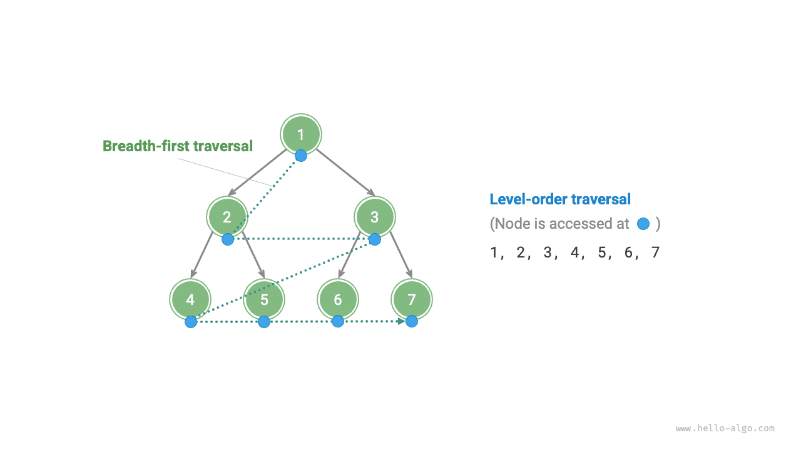
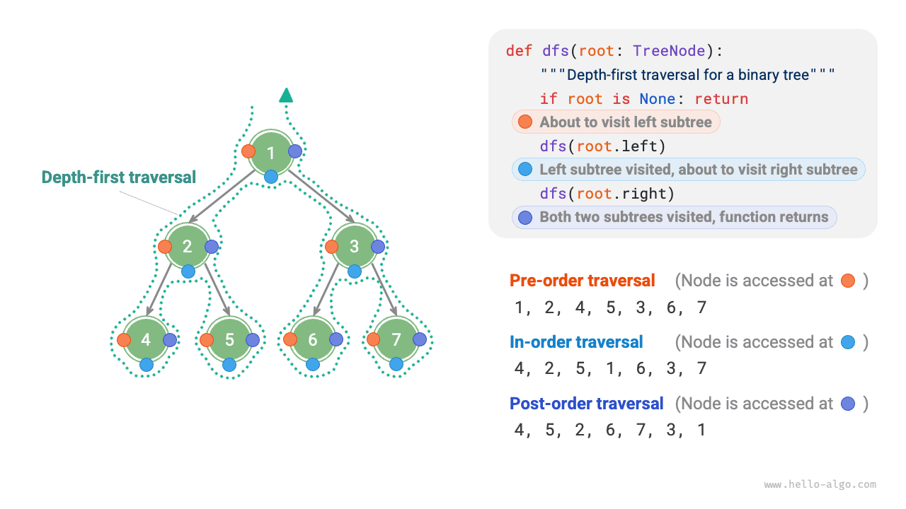

من منظور البنية الفيزيائية، الشجرة بنية بيانات قائمة على القوائم المترابطة. ومن ثم فإن أسلوب اجتيازها يتضمن الوصول إلى العقد واحدة تلو الأخرى عبر المؤشرات. غير أن الشجرة بنية بيانات غير خطية، وهذا يجعل اجتياز الشجرة أكثر تعقيداً من اجتياز قائمة مترابطة، ويتطلب الاستعانة بخوارزميات البحث.

تشمل أساليب الاجتياز الشائعة للأشجار الثنائية: الاجتياز بالمستويات، والاجتياز المسبق، والاجتياز الوسطي، والاجتياز اللاحق.

## الاجتياز بالمستويات

كما يوضح الشكل أدناه، فإن <u>الاجتياز بالمستويات</u> (level-order traversal) يجتاز الشجرة الثنائية من الأعلى إلى الأسفل، طبقةً طبقة. وفي كل مستوى، يزور العقد من اليسار إلى اليمين.

الاجتياز بالمستويات هو في جوهره <u>الاجتياز بالعرض أولاً</u> (breadth-first traversal)، ويُعرف أيضاً باسم <u>البحث بالعرض أولاً (BFS)</u>، حيث يتقدم نحو الخارج مستوى تلو الآخر.



### تنفيذ الشيفرة

يُنفَّذ الاجتياز بالعرض أولاً عادةً بمساعدة «الطابور». فالطابور يتبع قاعدة «أول ما يدخل يخرج أولاً»، بينما يتبع الاجتياز بالعرض أولاً قاعدة «التقدم طبقةً طبقة»؛ والفكرتان الكامنتان وراءهما متطابقتان. وشيفرة التنفيذ كما يلي:

<div class="lang-tab">
<p class="lang-tab__label">Python</p>

```py
def level_order(root: TreeNode | None) -> list[int]:
    """Level-order traversal"""
    # مهّد طابورًا وأدخل الجذر إليه
    queue: deque[TreeNode] = deque()
    queue.append(root)
    # مهّد قائمة لتخزين تتابع الاجتياز
    res = []
    while queue:
        node: TreeNode = queue.popleft()  # أخرج من الطابور
        res.append(node.val)  # خزّن قيمة العقدة
        if node.left is not None:
            queue.append(node.left)  # أدخل الابن الأيسر إلى الطابور
        if node.right is not None:
            queue.append(node.right)  # أدخل الابن الأيمن إلى الطابور
    return res
```

</div>### تحليل التعقيد

- **التعقيد الزمني هو $O(n)$**: تُزار جميع العقد مرة واحدة، مستخدماً زمن $O(n)$، حيث $n$ هو عدد العقد.
- **التعقيد المكاني هو $O(n)$**: في أسوأ الحالات، أي في شجرة ثنائية تامة، وقبل الاجتياز إلى المستوى السفلي، يحتوي الطابور في الوقت نفسه على $(n + 1) / 2$ عقدة على الأكثر، شاغلاً مساحة $O(n)$.

## الاجتياز المسبق والوسطي واللاحق

وبالمقابل، تنتمي الاجتيازات المسبق والوسطي واللاحق جميعها إلى <u>الاجتياز بالعمق أولاً</u> (depth-first traversal)، ويُعرف أيضاً باسم <u>البحث بالعمق أولاً (DFS)</u>، حيث يتعمق قدر الإمكان ثم يتراجع.

ويوضح الشكل أدناه كيفية عمل الاجتياز بالعمق أولاً على شجرة ثنائية. **الاجتياز بالعمق أولاً أشبه بـ«المشي» حول محيط الشجرة الثنائية بأكملها**، حيث نصادف عند كل عقدة ثلاثة مواضع تقابل الاجتياز المسبق والوسطي واللاحق.



### تنفيذ الشيفرة

يُنفَّذ البحث بالعمق أولاً عادةً استناداً إلى التعاود:

<div class="lang-tab">
<p class="lang-tab__label">Python</p>

```py
def post_order(root: TreeNode | None):
    """Postorder traversal"""
    if root is None:
        return
    # ترتيب الزيارة: الشجرة الجزئية اليسرى -> اليمنى -> الجذر
    post_order(root=root.left)
    post_order(root=root.right)
    res.append(root.val)
```

</div><div class="note">

يمكن أيضاً تنفيذ البحث بالعمق أولاً تكرارياً، ويمكن للقارئ المهتم أن يستكشف ذلك بنفسه.

</div>

يوضح الشكل أدناه العملية التعاودية للاجتياز المسبق لشجرة ثنائية، ويمكن تقسيمها إلى مرحلتين متعاكستين: «النزول» و«العودة».

1. «النزول» يعني إجراء استدعاء تعاودي جديد، يزور البرنامج خلاله العقدة التالية.
2. «العودة» تعني عودة استدعاء الدالة، ما يشير إلى أن العقدة الحالية قد اكتملت معالجتها.

### تحليل التعقيد

- **التعقيد الزمني هو $O(n)$**: تُزار جميع العقد مرة واحدة، مستخدماً زمن $O(n)$.
- **التعقيد المكاني هو $O(n)$**: في أسوأ الحالات، أي عندما تتدهور الشجرة إلى قائمة مترابطة، يبلغ عمق التعاود $n$، ويشغل النظام مساحة إطار مكدس $O(n)$.
