# الفصل 1: الأساس

**Larry Peterson and Bruce Davie**

> لا بدّ لي من أن أصنع نظامًا، وإلّا استعبدني نظام رجل آخر؛ لن أُعمل العقل والمقارنة: عملي أن أصنع. *—William Blake*

## المسألة: بناء شبكة

لنفترض أنك تريد بناء شبكة حاسوب، شبكة يمكن أن تنمو إلى أبعاد عالمية وأن تدعم تطبيقات متنوعة مثل المؤتمرات عن بُعد، والفيديو عند الطلب، والتجارة الإلكترونية، والحوسبة الموزّعة، والمكتبات الرقمية. أيّ التقنيات المتاحة ستكون لبنات البناء الأساسية، وأيّ معمارية برمجية ستُصمّم لدمج هذه اللبنات في خدمة اتصال فعّالة؟ الإجابة عن هذا السؤال هي الهدف الأسمى لهذا الكتاب: وصف مواد البناء المتاحة، ثم إظهار كيف يمكن استخدامها لبناء شبكة من الصفر.

قبل أن نفهم كيف نصمّم شبكة حاسوب، يجدر أن نتفق أولًا على ما هي شبكة الحاسوب بالضبط. في وقت ما، كان مصطلح *الشبكة* يعني مجموعة الخطوط التسلسلية المستخدمة لوصل الطرفيات الصمّاء بحواسيب كبيرة. ومن الشبكات المهمة الأخرى شبكة الهاتف الصوتي وشبكة التلفاز الكبلي المستخدمة لنشر إشارات الفيديو. والقاسم المشترك الرئيسي بين هذه الشبكات أنها متخصّصة في التعامل مع نوع واحد بعينه من البيانات (ضغطات المفاتيح أو الصوت أو الفيديو)، وأنها تتصل عادةً بأجهزة ذات غرض خاص (طرفيات، وسمّاعات يد، وأجهزة تلفاز).

ما الذي يميّز شبكة الحاسوب عن هذه الأنواع الأخرى من الشبكات؟ ربما أهم خصيصة لشبكة الحاسوب هي عموميتها. فشبكات الحواسيب تُبنى أساسًا من عتاد قابل للبرمجة عام الغرض، وهي ليست مُحسّنة لتطبيق بعينه كإجراء المكالمات الهاتفية أو بثّ إشارات التلفاز. بل هي قادرة على حمل أنواع كثيرة مختلفة من البيانات، وتدعم طائفة واسعة ومتنامية من التطبيقات. وقد استولت شبكات الحواسيب اليوم إلى حدّ كبير على الوظائف التي كانت تؤدّيها الشبكات أحادية الاستخدام. ينظر هذا الفصل في بعض التطبيقات النموذجية لشبكات الحواسيب، ويناقش المتطلبات التي يجب أن يدركها مصمّم الشبكة الذي يرغب في دعم مثل هذه التطبيقات.

وحين نفهم المتطلبات، كيف نمضي؟ لحسن الحظ، لن نبني أول شبكة. فقد سبقنا إليها آخرون، وأبرزهم جماعة الباحثين المسؤولون عن الإنترنت. وسنستعين بثروة الخبرة المتولّدة عن الإنترنت لتوجيه تصميمنا. وتتجسّد هذه الخبرة في *معمارية شبكة* تحدّد مكوّنات العتاد والبرمجيات المتاحة، وتبيّن كيف يمكن ترتيبها لتكوين نظام شبكة كامل.

وإلى جانب فهم كيف تُبنى الشبكات، يزداد أهمية فهم كيف تُشغَّل أو تُدار، وكيف تُطوَّر تطبيقات الشبكة. فجميعنا تقريبًا لديه اليوم شبكات حاسوب في منزله ومكتبه، وفي بعض الحالات في سيارته، فلم تعد إدارة الشبكات عملًا لقلّة من المتخصصين. ومع انتشار الهواتف الذكية، صار عدد أكبر بكثير من أبناء هذا الجيل يطوّرون تطبيقات شبكية مقارنةً بالماضي. لذا علينا أن ننظر إلى الشبكات من هذه المنظورات المتعددة: البانِين، والمشغّلين، ومطوّري التطبيقات.

ولنمضي معًا على طريق فهم كيف نبني شبكة ونشغّلها ونبرمجها، يفعل هذا الفصل أربعة أشياء. أولًا، يستكشف المتطلبات التي تفرضها تطبيقات مختلفة وجماعات مختلفة من الناس على الشبكة. ثانيًا، يقدّم فكرة معمارية الشبكة، التي تضع الأساس لما بقي من الكتاب. ثالثًا، يقدّم بعض العناصر الأساسية في تنفيذ شبكات الحواسيب. وأخيرًا، يحدّد المقاييس الأساسية المستخدمة لتقييم أداء شبكات الحواسيب.

## 1.1 التطبيقات

يعرف معظم الناس الإنترنت عبر تطبيقاته: الشبكة العنكبوتية العالمية، والبريد الإلكتروني، ووسائل التواصل الاجتماعي، وبثّ الموسيقى أو الأفلام، ومؤتمرات الفيديو، والرسائل الفورية، ومشاركة الملفات، على سبيل المثال لا الحصر. أي أننا نتفاعل مع الإنترنت بوصفنا *مستخدمين* للشبكة. ومستخدمو الإنترنت يمثّلون أكبر فئة من الناس الذين يتفاعلون معه بشكل ما، لكن هناك دوائر مهمة أخرى.

هناك جماعة من الناس *تنشئ* التطبيقات، وهي جماعة توسّعت توسعًا كبيرًا في السنوات الأخيرة مع ظهور منصّات برمجية قوية وأجهزة جديدة كالهواتف الذكية، ما خلق فرصًا جديدة لتطوير التطبيقات بسرعة وإيصالها إلى سوق واسع.

ثم هناك من *يشغّل* الشبكات أو *يديرها*، وهو عمل خلف الكواليس في معظمه، لكنه بالغ الأهمية وغالبًا شديد التعقيد. ومع شيوع الشبكات المنزلية، صار عدد متزايد من الناس، ولو بقدر ضئيل، مشغّلي شبكات.

وأخيرًا، هناك من *يصمّم* الأجهزة والبروتوكولات التي تشكّل الإنترنت مجتمعةً ويبنيها. وهذه الدائرة الأخيرة هي الجمهور التقليدي لكتب الشبكات مثل هذا الكتاب، وستبقى محور اهتمامنا الرئيسي. غير أننا سننظر في الكتاب كله أيضًا إلى منظورَي مطوّري التطبيقات ومشغّلي الشبكات.

وإدراك هذه المنظورات سيمكّننا من فهم المتطلبات المتنوعة التي يجب أن تلبيها الشبكة فهمًا أفضل. وسيتمكّن مطوّرو التطبيقات أيضًا من صناعة تطبيقات تعمل على نحو أفضل إن فهموا كيف تعمل التقنية الكامنة وكيف تتفاعل مع التطبيقات. لذا، قبل أن نبدأ في معرفة كيف نبني شبكة، لننظر عن قرب إلى أنواع التطبيقات التي تدعمها شبكات اليوم.

### 1.1.1 أصناف التطبيقات

الشبكة العنكبوتية العالمية هي تطبيق الإنترنت الذي قذف بالإنترنت من أداة غامضة إلى حدّ ما يستخدمها العلماء والمهندسون في الغالب إلى الظاهرة السائدة التي هو عليها اليوم. وقد صارت الشبكة العنكبوتية نفسها منصّة قوية إلى حدّ أن كثيرًا من الناس يخلطون بينها وبين الإنترنت، ومن قبيل التجوّز أن نقول إن الشبكة العنكبوتية تطبيق واحد.

في صورتها الأساسية، تقدّم الشبكة العنكبوتية واجهة بسيطة حدسيًا. يشاهد المستخدمون صفحات مليئة بالكائنات النصية والرسومية، وينقرون على الكائنات التي يريدون معرفة المزيد عنها، فتظهر صفحة جديدة مناظرة. ويعرف معظم الناس أيضًا أن كل كائن قابل للاختيار في الصفحة مرتبط، تحت الغطاء، بمعرّف للصفحة أو الكائن التالي الذي سيُعرض. وهذا المعرّف، ويُسمّى محدّد الموارد الموحّد (URL)، يوفّر طريقة لتحديد جميع الكائنات الممكن عرضها من متصفحك. مثلًا،

```html
http://www.cs.princeton.edu/~llp/index.html
```

هو عنوان URL لصفحة تقدّم معلومات عن أحد مؤلّفي هذا الكتاب: فالسلاسل http تشير إلى أنه ينبغي استخدام بروتوكول نقل النص التشعّبي (HTTP) لتنزيل الصفحة، وwww.cs.princeton.edu اسم الآلة التي تخدم الصفحة، و/~llp/index.html يحدّد بصفة فريدة الصفحة الرئيسية لLarry في هذا الموقع.

غير أن ما لا يعرفه معظم مستخدمي الويب أن النقر على عنوان واحد كهذا قد يعني تبادل أكثر من دستة رسالة عبر الإنترنت، وأكثر من ذلك بكثير إذا كانت صفحة الويب معقّدة بكائنات مضمّنة كثيرة. ويشمل هذا التبادل ما يصل إلى ست رسائل لترجمة اسم الخادم (www.cs.princeton.edu) إلى عنوانه في بروتوكول الإنترنت (IP) وهو 128.112.136.35، وثلاث رسائل لإقامة اتصال بروتوكول التحكّم في النقل (TCP) بين متصفحك وهذا الخادم، وأربع رسائل ليرسل متصفحك طلب HTTP «GET» ويستجيب الخادم بالصفحة المطلوبة (وليتأكّد كل طرف من استلام تلك الرسالة)، وأربع رسائل لتفكيك اتصال TCP. وهذا بالطبع لا يشمل ملايين الرسائل التي تتبادلها عُقد الإنترنت على مدار اليوم، فقط لتُعلم بعضها بعضًا بأنها موجودة وجاهزة لخدمة صفحات الويب، وترجمة الأسماء إلى عناوين، وتوجيه الرسائل نحو مقصدها النهائي.

وثمّة صنف تطبيقات واسع الانتشار آخر في الإنترنت هو بثّ الصوت والفيديو «المتدفق». وتستخدم هذه التقنية خدمات كالفيديو عند الطلب وراديو الإنترنت. ومع أننا نبدأ غالبًا من موقع ويب لبدء جلسة بث، فإن بثّ الصوت والفيديو يختلف اختلافات مهمة عن جلب صفحة ويب بسيطة من نص وصور. فمثلًا، كثيرًا ما لا تريد تنزيل ملف فيديو بأكمله — وهي عملية قد تستغرق دقائق — قبل مشاهدة المشهد الأول. وبثّ الصوت والفيديو يعني نقلًا أكثر توقيتًا للرسائل من المرسل إلى المستقبل، ويعرض المستقبل الفيديو أو يشغّل الصوت إلى حدّ كبير وهو يصل.

لاحظ أن الفرق بين تطبيقات البث والنقل التقليدي للنص والرسوم والصور هو أن البشر يستهلكون تدفقات الصوت والفيديو على نحو متصل، والانقطاع — بصورة أصوات مفقودة أو فيديو متوقّف — غير مقبول. وفي المقابل، يمكن تسليم صفحة عادية (غير متدفقة) وقراءتها على قطع صغيرة. وهذا الفرق يؤثّر في كيفية دعم الشبكة لهذه الأصناف المختلفة من التطبيقات.

وثمّة صنف تطبيقات مختلف بمكر هو الصوت والفيديو *اللحظيان*. فلهذه التطبيقات قيود توقيت أضيق بكثير من تطبيقات البث. وعند استخدام تطبيق صوت عبر IP مثل Skype أو تطبيق مؤتمرات فيديو، يجب أن تكون التفاعلات بين المشاركين في وقتها. فحين يومئ شخص في أحد الطرفين، يجب عرض ذلك الفعل في الطرف الآخر بأسرع ما يمكن.

وحين يحاول شخص مقاطعة آخر، يحتاج الشخص المقاطَع إلى سماع ذلك بأسرع ما يمكن، وأن يقرّر أينعم بالمقاطعة أم يواصل الكلام متجاوزًا صوت المقاطِع. والتأخير المفرط في بيئة كهذه يجعل النظام غير صالح للاستخدام. قارن ذلك بالفيديو عند الطلب حيث لا يزال الخدمة مقبولة إن استغرق الأمر عدة ثوانٍ من بدء المستخدم الفيديو حتى عرض الصورة الأولى. كذلك، تستتبع التطبيقات التفاعلية عادةً تدفقات صوت و/أو فيديو في الاتجاهين، بينما يرسل تطبيق البث الفيديو أو الصوت في اتجاه واحد على الأرجح.

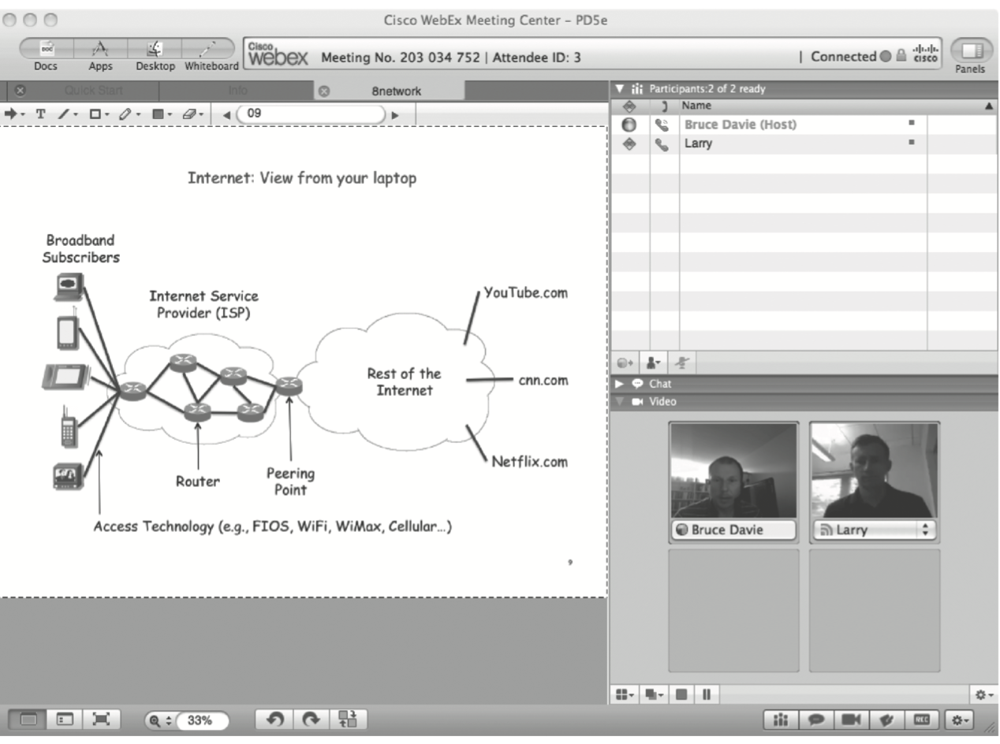

**الشكل 1.1.** تطبيق وسائط متعددة يشمل مؤتمرات الفيديو.

ظلّت أدوات مؤتمرات الفيديو التي تعمل عبر الإنترنت موجودة منذ أوائل التسعينيات، لكنها بلغت استخدامًا واسعًا في السنوات الأخيرة، مع عدة منتجات تجارية في السوق. ويعرض الشكل 1.1 مثالًا على نظام كهذا. فكما أن تنزيل صفحة ويب يتضمّن أكثر مما يبدو للعين، فكذلك تطبيقات الفيديو. فمثلًا، إدخال محتوى الفيديو في شبكة ذات نطاق ترددي منخفض نسبيًا، أو ضمان بقاء الصوت والفيديو متزامنين ووصولهما في الوقت المناسب لتجربة مستخدم جيدة، كلها مشكلات على مصمّمي الشبكات والبروتوكولات أن يقلقوا بشأنها. وسننظر في هذه المسائل وفي كثير غيرها من المسائل المتصلة بتطبيقات الوسائط المتعددة لاحقًا في الكتاب.

ومع أنهما مثالان فقط، فإن تنزيل صفحات من الويب والمشاركة في مؤتمر فيديو يُظهران تنوّع التطبيقات التي يمكن بناؤها فوق الإنترنت، ويلمّحان إلى تعقيد تصميم الإنترنت. وسنطوّر لاحقًا في الكتاب تصنيفًا أكمل لأنواع التطبيقات ليساعدنا في توجيه مناقشتنا لقرارات التصميم الأساسية ونحن نسعى إلى بناء الشبكات وتشغيلها واستخدامها. ويُختم الكتاب بعودة إلى هذين التطبيقين بعينهما، وإلى عدة تطبيقات أخرى تُظهر اتّساع ما هو ممكن على إنترنت اليوم.

وإلى أن نصل إلى ذلك، تكفي هذه النظرة السريعة إلى بضعة تطبيقات نموذجية لنبدأ النظر في المشكلات التي يجب معالجتها إذا أردنا بناء شبكة تدعم هذا التنوّع في التطبيقات.

## 1.2 المتطلبات

وضعنا لأنفسنا هدفًا طموحًا: فهم كيف نبني شبكة حاسوب من الصفر. وسيكون نهجنا في تحقيق هذا الهدف أن نبدأ من المبادئ الأولى ثم نطرح الأنواع نفسها من الأسئلة التي نطرحها طبيعيًا لو كنا نبني شبكة فعلية. وفي كل خطوة، سنستخدم بروتوكولات اليوم لتوضيح خيارات التصميم المختلفة المتاحة، لكننا لن نقبل هذه المصنوعات القائمة كنصوص مقدّسة. بل سنطرح (ونجيب) عن سؤال *لماذا* صُمّمت الشبكات على ما هي عليه. ومع أن من المُغري أن نكتفي بفهم الطريقة التي يُعمل بها اليوم، فمن المهم إدراك المفاهيم الكامنة لأن الشبكات تتغيّر باستمرار مع تطوّر التقنية واختراع تطبيقات جديدة. ومن خبرتنا أنك متى فهمت الأفكار الجوهرية، صار أيّ بروتوكول جديد تواجهه سهل الهضم نسبيًا.

### 1.2.1 أصحاب المصلحة

كما ذكرنا أعلاه، يستطيع دارس الشبكات أن يتّخذ عدة منظورات. وحين كتبنا الطبعة الأولى من هذا الكتاب، لم يكن أكثر السكان يملكون أيّ وصول إلى الإنترنت، ومن كان يملكه حصل عليه في العمل أو في الجامعة أو عبر مودم طلب هاتفي في المنزل. وكانت مجموعة التطبيقات الشائعة تُعدّ على الأصابع. لذا، كمعظم كتب ذلك الوقت، ركّز كتابنا على منظور من يصمّم معدات الشبكة وبروتوكولاتها. ولا نزال نركّز على هذا المنظور، وأملنا أن تعرف بعد قراءة هذا الكتاب كيف تصمّم معدات الشبكة وبروتوكولاتها في المستقبل.

غير أننا نريد أيضًا أن نغطّي منظورَي صاحبَي مصلحة إضافيين: من يطوّرون تطبيقات الشبكة، ومن يديرون الشبكات أو يشغّلونها. ولننظر كيف قد يسرد هؤلاء الثلاثة متطلباتهم من الشبكة:

- *مبرمج التطبيقات* سيسرد الخدمات التي يحتاجها تطبيقه: مثلًا ضمان تسليم كل رسالة يرسلها التطبيق دون خطأ خلال مقدار معيّن من الوقت، أو القدرة على الانتقال بسلاسة بين اتصالات مختلفة بالشبكة مع تحرّك المستخدم.
- *مشغّل الشبكة* سيسرد خصائص نظام يسهل إدارته والإشراف عليه: مثلًا نظام يمكن فيه عزل الأعطال بسهولة، وإضافة أجهزة جديدة إلى الشبكة وتهيئتها على نحو صحيح، ويُسهّل فيه حساب الاستخدام.
- *مصمّم الشبكة* سيسرد خصائص تصميم فعّال الكلفة: مثلًا أن تُستغل موارد الشبكة بكفاءة وتُخصّص بعدل بين المستخدمين المختلفين. ومن المرجّح أيضًا أن تكون مسائل الأداء مهمة.

يحاول هذا القسم تقطير متطلبات أصحاب المصلحة المختلفين في مقدّمة رفيعة المستوى للاعتبارات الكبرى التي تقود تصميم الشبكة، وبتحديد التحديات التي يعالجها بقية الكتاب.

### 1.2.2 الاتصال القابل للتوسّع

نبدأ من الواضح: يجب أن توفّر الشبكة اتصالًا بين مجموعة من الحواسيب. وأحيانًا يكفي بناء شبكة محدودة تصل آلات قليلة مختارة فقط. بل إن كثيرًا من الشبكات الخاصة (الشركات) لها، لأسباب الخصوصية والأمن، هدف صريح هو تحديد مجموعة الآلات الموصولة. وفي المقابل، صُمّمت شبكات أخرى (والإنترنت مثالها الأبرز) لتنمو على نحو يمنحها القدرة على وصل كل حواسيب العالم. ويُقال عن نظام صُمّم لدعم النمو إلى حجم كبير اعتباطًا إنه *قابل للتوسّع*. وباتخاذ الإنترنت نموذجًا، يعالج هذا الكتاب تحدّي قابلية التوسّع.

ولفهم متطلبات الاتصال فهمًا أكمل، نحتاج إلى نظرة أقرب إلى كيفية وصل الحواسيب في الشبكة. ويحدث الاتصال على مستويات كثيرة مختلفة. فعلى أدنى مستوى، يمكن أن تتكوّن الشبكة من حاسوبين أو أكثر موصولة مباشرة بوسط فيزيائي ما، ككبيل محوري أو ليف بصري. ونسمّي هذا الوسط الفيزيائي *رابطًا*، ونشير غالبًا إلى الحواسيب التي يصلها باسم *العقد*. (أحيانًا تكون العقدة قطعة عتاد أكثر تخصّصًا لا حاسوبًا، لكننا نتجاوز هذا التمييز لأغراض هذه المناقشة.) وكما يوضّح الشكل 1.2، تُقتصر الروابط الفيزيائية أحيانًا على زوج من العقد (ويُقال إن هذا الرابط *نقطة إلى نقطة*)، بينما في حالات أخرى قد يتشارك أكثر من عقدتين رابطًا فيزيائيًا واحدًا (ويُقال إن هذا الرابط *متعدد الوصول*). والروابط اللاسلكية، كتلك التي توفّرها شبكات الهاتف الخلوي وشبكات Wi-Fi، صنف مهم من الروابط متعددة الوصول. ومن الثابت دائمًا أن الروابط متعددة الوصول محدودة الحجم، من حيث المسافة الجغرافية التي تغطّيها ومن حيث عدد العقد التي تصلها. ولهذا السبب تنفّذ غالبًا ما يُسمّى *الميل الأخير*، فتصل المستخدمين النهائيين ببقية الشبكة.

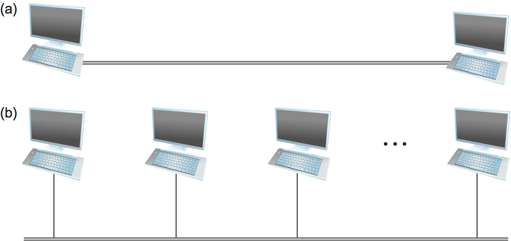

**الشكل 1.2.** الروابط المباشرة: (أ) نقطة إلى نقطة؛ (ب) متعددة الوصول.

لو كانت شبكات الحواسيب محصورة في الحالات التي تكون فيها كل العقد موصولة مباشرة ببعضها عبر وسط فيزيائي مشترك، لكانت الشبكات إمّا محدودة جدًا في عدد الحواسيب التي تصلها، أو لصار عدد الأسلاك الخارجة من مؤخرة كل عقدة غير قابل للإدارة ومكلفًا جدًا بسرعة. لحسن الحظ، لا يستلزم الاتصال بين عقدتين بالضرورة اتصالًا فيزيائيًا مباشرًا بينهما؛ إذ يمكن تحقيق اتصال غير مباشر بين مجموعة من العقد المتعاونة. ولنتأمّل المثالين الآتيين لكيفية وصل مجموعة من الحواسيب على نحو غير مباشر.

يعرض الشكل 1.3 مجموعة من العقد، كلٌّ منها موصول برابط أو أكثر من الروابط نقطة إلى نقطة. وتلك العقد الموصولة برابطين على الأقل تشغّل برمجيات تُمرّر البيانات المستلمة على رابط إلى رابط آخر. وإذا نُظّمت على نحو منهجي، كوّنت هذه العقد المُمرِّرة *شبكة تبديلية*. وهناك أنواع كثيرة من الشبكات التبديلية، وأكثر نوعين شيوعًا منها *تبديل الدارات* و*تبديل الحزم*. فالأول يستخدمه نظام الهاتف أبرز استخدام، بينما يُستخدم الثاني في الأغلبية الساحقة من شبكات الحواسيب وسيكون محور هذا الكتاب. (لكن تبديل الدارات يعود قليلًا إلى الساحة في عالم الشبكات البصرية، وهذا أمر مهم إذ يتزايد الطلب على سعة الشبكة باستمرار.) والخصيصة المهمة في الشبكات المبدّلة للحزم أن العقد فيها ترسل إلى بعضها كتلًا منفصلة من البيانات. فكّر في كتل البيانات هذه على أنها تقابل قطعة من بيانات تطبيق كملف أو رسالة بريد أو صورة. ونسمّي كل كتلة بيانات إمّا *حزمة* أو *رسالة*، ونستخدم المصطلحين الآن بالتبادل.

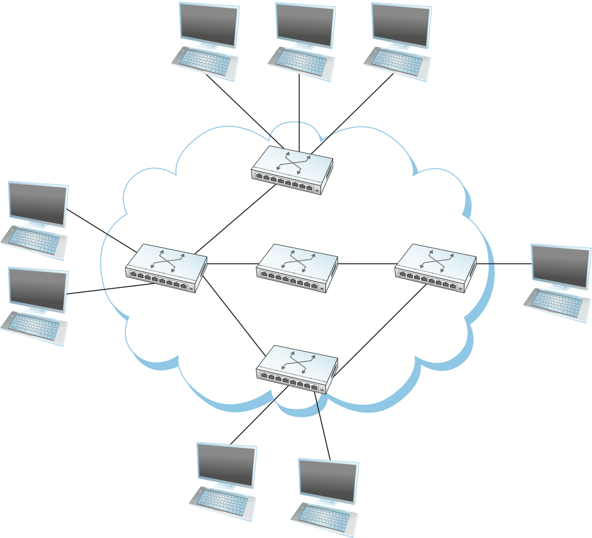

**الشكل 1.3.** شبكة تبديلية.

تستخدم الشبكات المبدّلة للحزم عادةً استراتيجية تُسمّى *التخزين والتمرير*. وكما يوحي الاسم، تتلقّى كل عقدة في شبكة تخزين وتمرير حزمة كاملة عبر رابط ما، وتخزّن الحزمة في ذاكرتها الداخلية، ثم تمرّر الحزمة كاملة إلى العقدة التالية. وفي المقابل، تقيم الشبكة المبدّلة للدارات أولًا دارة مخصّصة عبر سلسلة من الروابط، ثم تسمح للعقدة المصدر بإرسال تدفق من البتات عبر هذه الدارة إلى العقدة الهدف. والسبب الرئيسي لاستخدام تبديل الحزم بدل تبديل الدارات في شبكة حاسوب هو الكفاءة، وهو موضوع القسم الفرعي التالي.

وتميّز السحابة في الشكل 1.3 بين العقد الداخلية التي *تنفّذ* الشبكة (وتُسمّى عادةً *مُبدّلات*، ووظيفتها الأساسية تخزين الحزم وتمريرها) والعقد الخارجية للسحابة التي *تستخدم* الشبكة (وتُسمّى تقليديًا *مضيفين*، وتدعم المستخدمين وتشغّل برامج التطبيقات). ولاحظ أيضًا أن السحابة واحدة من أهم أيقونات شبكات الحواسيب. فعمومًا نستخدم السحابة للدلالة على أيّ نوع من الشبكات، سواء كان رابطًا واحدًا نقطة إلى نقطة، أو رابطًا متعدد الوصول، أو شبكة تبديلية. لذا، متى رأيت سحابة في شكل، فاعلم أنها عنصر نائب عن أيّ من تقنيات الشبكة التي يغطّيها هذا الكتاب.

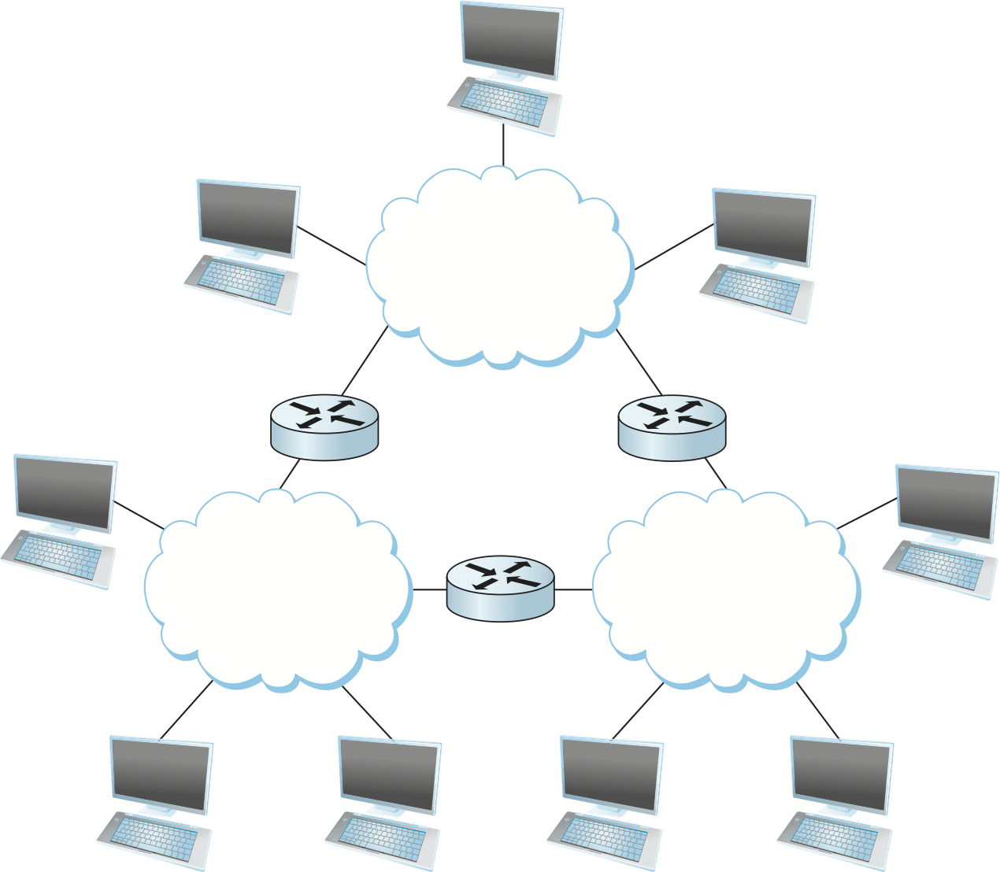

**الشكل 1.4.** ترابط الشبكات.

والطريقة الثانية التي يمكن بها وصل مجموعة من الحواسيب على نحو غير مباشر معروضة في الشكل 1.4. وفي هذه الحالة، تتّرابط مجموعة من الشبكات المستقلة (السحابات) لتكوين *شبكة بينية*، أو شبكة بينية اختصارًا. ونتبنّى هنا عرف الإنترنت في الإشارة إلى أيّ شبكة بينية عامة بحرف صغير «شبكة بينية»، وإلى إنترنت TCP/IP التي نستخدمها جميعًا كل يوم بحرف كبير «الإنترنت». والعقدة الموصولة بشبكتين أو أكثر تُسمّى عادةً *موجّهًا* أو *بوّابة*، وهي تؤدّي دورًا شبيهًا جدًا بدور المبدّل: تمرّر الرسائل من شبكة إلى أخرى. ولاحظ أن الشبكة البينية نفسها يمكن النظر إليها كنوع آخر من الشبكات، ما يعني أنه يمكن بناء شبكة بينية من مجموعة شبكات بينية. وهكذا يمكننا، على نحو تكراري، بناء شبكات كبيرة اعتباطًا بربط السحابات لتكوين سحابات أكبر. ويمكن الاحتجاج بمعقولية بأن فكرة ربط الشبكات المتغايرة الواسعة كانت الابتكار الجوهري للإنترنت، وأن نجاحه في النمو إلى حجم عالمي ومليارات العقد كان نتيجة قرارات تصميم جيدة جدًا اتّخذها معماريو الإنترنت الأوائل، وسنناقشها لاحقًا.

وكون مجموعة من المضيفين موصولة ببعضها مباشرة أو غير مباشرة لا يعني أننا نجحنا في توفير اتصال مضيف بمضيف. فالمتطلب الأخير أن تستطيع كل عقدة أن تقول مع أيّ من العقد الأخرى في الشبكة تريد التواصل. ويُفعل ذلك بإسناد *عنوان* لكل عقدة. والعنوان سلسلة بايتات تحدّد عقدة؛ أي أن الشبكة تستطيع استخدام عنوان عقدة لتمييزها عن العقد الأخرى الموصولة بها. وحين تريد عقدة مصدر أن تسلّم الشبكة رسالة إلى عقدة هدف معيّنة، تحدّد عنوان عقدة الهدف. وإذا لم تكن العقدتان المرسلة والمستقبلة موصولتين مباشرة، استخدمت مُبدّلات الشبكة وموجّهاتها هذا العنوان لتقرّر كيفية تمرير الرسالة نحو الهدف. وتُسمّى عملية تحديد كيفية تمرير الرسائل نحو عقدة الهدف بناءً على عنوانها *التوجيه*.

وقد افترضت هذه المقدّمة القصيرة إلى العنونة والتوجيه أن العقدة المصدر تريد إرسال رسالة إلى عقدة هدف واحدة (*إرسال أحادي*). ومع أن هذا السيناريو هو الأكثر شيوعًا، فمن الممكن أيضًا أن تريد العقدة المصدر أن *تبثّ* رسالة إلى كل عقد الشبكة. أو قد تريد إرسال رسالة إلى مجموعة جزئية من العقد الأخرى دون كلها، وهي حالة تُسمّى *الإرسال المتعدّد*. لذا، إلى جانب العناوين الخاصة بكل عقدة، من متطلبات الشبكة أيضًا أن تدعم عناوين الإرسال المتعدّد والبثّ.

> **الخلاصة الرئيسية**
>
> الفكرة الرئيسية التي نخرج بها من هذه المناقشة أننا نستطيع تعريف *الشبكة* تعرّفًا تكراريًا على أنها تتكوّن من عقدتين أو أكثر موصولة برابط فيزيائي، أو من شبكتين أو أكثر موصولة بعقدة. بعبارة أخرى، يمكن بناء شبكة من تداخل الشبكات، حيث تُنفَّذ الشبكة على أدنى مستوى بوسط فيزيائي ما. ومن التحديات الكبرى في توفير اتصال الشبكة تعريف عنوان لكل عقدة يمكن الوصول إليها في الشبكة (سواء كان منطقيًا أو فيزيائيًا)، واستخدام هذه العناوين لتمرير الرسائل نحو عقدة الهدف أو العقد المناسبة.

### 1.2.3 مشاركة الموارد الفعّالة الكلفة

كما ذُكر أعلاه، يركّز هذا الكتاب على الشبكات المبدّلة للحزم. ويشرح هذا القسم المتطلب الرئيسي لشبكات الحواسيب — الكفاءة — الذي يقودنا إلى تبديل الحزم كاستراتيجية الاختيار.

بمعلومية مجموعة من العقد الموصولة على نحو غير مباشر بتداخل من الشبكات، يمكن لأيّ زوج من المضيفين أن يتبادل الرسائل عبر سلسلة من الروابط والعقد. وبالطبع نريد أكثر من دعم زوج واحد من المضيفين المتواصلين: نريد توفير القدرة على تبادل الرسائل لكل أزواج المضيفين. والسؤال إذن: كيف تتقاسم كل المضيفين التي تريد التواصل الشبكةَ، خصوصًا إذا أرادوا استخدامها في الوقت نفسه؟ وأكثر من ذلك، كيف تتقاسم عدة مضيفين *الرابط* نفسه حين يريدون جميعًا استخدامه في الوقت نفسه؟

ولفهم كيف تتقاسم المضيفون شبكة، علينا تقديم مفهوم جوهري: *تعدّد الإرسال*، ويعني أن موردًا من موارد النظام يُتقاسم بين عدة مستخدمين. وعلى المستوى الحدسي، يمكن شرح تعدّد الإرسال بمقارنته بنظام حاسوبي متقاسم للزمن، حيث يُتقاسَم معالج فيزيائي واحد (يُعدَّد) بين عدة مهام، كلٌّ منها تظن أن لديها معالجها الخاص. وعلى المنوال نفسه، يمكن تعديد البيانات التي يرسلها مستخدمون متعددون على الروابط الفيزيائية التي تكوّن الشبكة.

ولنرى كيف يمكن أن يعمل ذلك، لننظر إلى الشبكة البسيطة المعروضة في الشكل 1.5، حيث ترسل المضيفات الثلاثة على الجانب الأيسر (المرسلات S1–S3) بيانات إلى المضيفات الثلاثة على اليمين (المستقبلات R1–R3) متقاسمةً شبكة تبديلية تحتوي رابطًا فيزيائيًا واحدًا فقط. (وللتبسيط، افترض أن المضيف S1 يرسل إلى R1، وهكذا.) وفي هذه الحالة، تُعدَّد ثلاثة تدفقات بيانات — تقابل أزواج المضيفين الثلاثة — على رابط فيزيائي واحد بواسطة المبدّل 1، ثم *تُفصل* ثانيةً إلى تدفقات منفصلة بواسطة المبدّل 2. ولاحظ أننا نتعمّد الغموض بشأن ما يقابله «تدفق البيانات» بالضبط. ولأغراض هذه المناقشة، افترض أن لكل مضيف على اليسار مخزونًا كبيرًا من البيانات يريد إرساله إلى نظيره على اليمين.

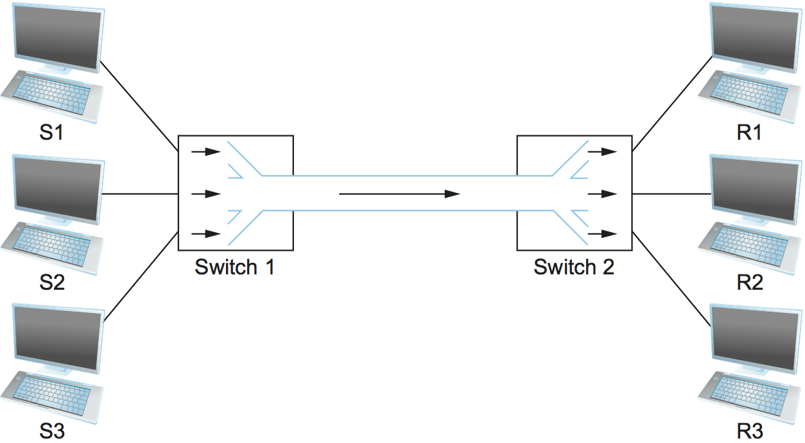

**الشكل 1.5.** تعديد عدة تدفقات منطقية على رابط فيزيائي واحد.

هناك طرق مختلفة لتعديد تدفقات متعددة على رابط فيزيائي واحد. ومن الطرق الشائعة *تعدّد الإرسال المتزامن بتقسيم الزمن* (STDM). وفكرة STDM تقسيم الزمن إلى حصص متساوية الحجم، ومنح كل تدفق فرصة لإرسال بياناته على الرابط الفيزيائي على نحو دوري. بعبارة أخرى، خلال الحصة الزمنية 1 تُرسَل بيانات S1 إلى R1؛ وخلال الحصة 2 تُرسَل بيانات S2 إلى R2؛ وفي الحصة 3 يرسل S3 بياناته إلى R3. وعند هذه النقطة تعود الفرصة للتدفق الأول (S1 إلى R1)، وتتكرّر العملية. وثمّة طريقة أخرى هي *تعدّد الإرسال بتقسيم التردد* (FDM). وفكرة FDM نقل كل تدفق على الرابط الفيزيائي بتردد مختلف، على نحو شبيه جدًا بنقل إشارات محطات التلفاز المختلفة بترددات مختلفة عبر الأثير أو على رابط تلفاز كبلي محوري.

ومع سهولة فهم STDM وFDM، فكلاهما محدود من وجهين. أولًا، إذا لم يكن لأحد التدفقات (أزواج المضيفين) بيانات يرسلها، بقيت حصته من الرابط الفيزيائي — أي حصته الزمنية أو تردده — عاطلة، حتى لو كان لأحد التدفقات الأخرى بيانات يرسلها. فمثلًا، كان على S3 أن ينتظر دوره خلف S1 وS2 في الفقرة السابقة، حتى لو لم يكن لدى S1 وS2 ما يرسلانه. وللتواصل الحاسوبي، يمكن أن يكون مقدار الوقت الذي يبقى فيه الرابط عاطلًا كبيرًا جدًا؛ فمثلًا فكّر في الوقت الذي تقضيه في قراءة صفحة ويب (تاركًا الرابط عاطلًا) مقابل الوقت الذي تقضيه في جلبها. ثانيًا، يقتصر STDM وFDM على الحالات التي يكون فيها الحدّ الأقصى لعدد التدفقات ثابتًا ومعروفًا مسبقًا. فليس من العملي تغيير حجم الحصة أو إضافة حصص في حالة STDM، أو إضافة ترددات جديدة في حالة FDM.

وصورة تعدّد الإرسال التي تعالج هذه النقائص، والتي نستخدمها أكثر ما نستخدم في هذا الكتاب، تُسمّى *تعدّد الإرسال الإحصائي*. ومع أن الاسم ليس بذاك العون لفهم المفهوم، فتعدّد الإرسال الإحصائي بسيط جدًا في الحقيقة، وله فكرتان أساسيتان. أولًا، هو شبيه بـSTDM في أن الرابط الفيزيائي يُتقاسَم عبر الزمن: تُرسَل أولًا بيانات تدفق ما على الرابط الفيزيائي، ثم بيانات تدفق آخر، وهكذا. غير أنه، بخلاف STDM، تُرسَل البيانات من كل تدفق عند الطلب لا خلال حصة زمنية معدّة سلفًا. وبالتالي، إذا كان لتدفق واحد فقط بيانات يرسلها، فإنه يرسلها دون انتظار دور حصته، ومن ثم دون أن يرى الحصص المخصّصة للتدفقات الأخرى تمرّ غير مستخدمة. وهذا التجنّب للوقت العاطل هو ما يمنح تبديل الحزم كفاءته.

غير أن تعدّد الإرسال الإحصائي، كما عُرِّف حتى الآن، لا يملك آلية لضمان أن تحصل كل التدفقات في النهاية على دورها للإرسال على الرابط الفيزيائي. أي أنه متى بدأ تدفق في إرسال البيانات، نحتاج إلى طريقة ما لتحديد الإرسال، لتأخذ التدفقات الأخرى دورها. ولتغطية هذه الحاجة، يعرّف تعدّد الإرسال الإحصائي حدًّا أعلى لحجم كتلة البيانات المسموح لكل تدفق بإرسالها في وقت معيّن. وتُشار عادةً إلى كتلة البيانات محدودة الحجم هذه باسم *حزمة*، لتمييزها عن *الرسالة* الكبيرة اعتباطًا التي قد يريد برنامج تطبيق إرسالها. ولأن الشبكة المبدّلة للحزم تحدّد الحدّ الأقصى لحجم الحزم، فقد لا يتمكّن المضيف من إرسال رسالة كاملة في حزمة واحدة. وقد يحتاج المصدر إلى تجزئة الرسالة إلى عدة حزم، مع إعادة المستقبل تجميع الحزم في الرسالة الأصلية.

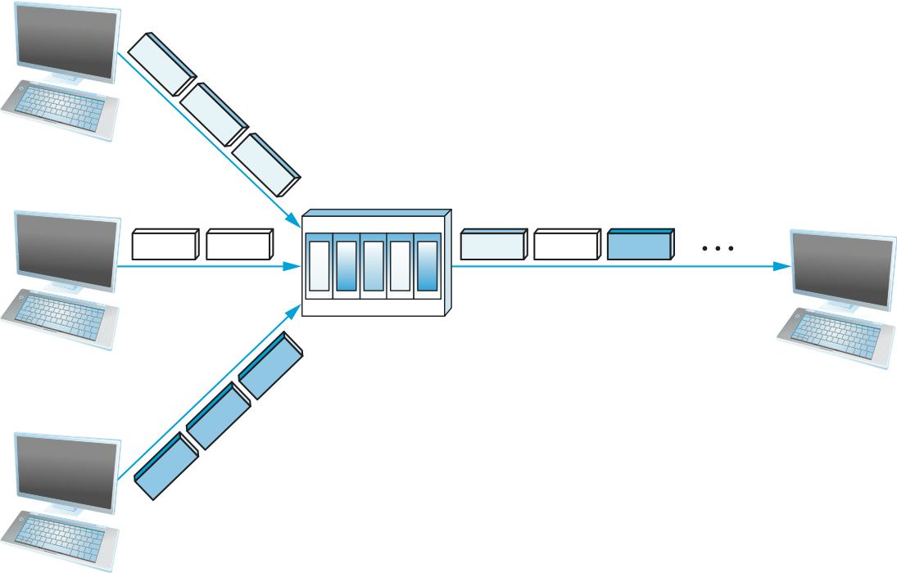

**الشكل 1.6.** مُبدّل يعدّد حزمًا من مصادر متعددة إلى رابط مشترك واحد.

بعبارة أخرى، يرسل كل تدفق سلسلة من الحزم على الرابط الفيزيائي، مع اتخاذ قرار حزمةً بحزمة أيّ تدفق تُرسَل حزمته التالية. ولاحظ أنه إن كان لتدفق واحد فقط بيانات يرسلها، أمكنه إرسال سلسلة حزم متتالية؛ أما إن كان لأكثر من تدفق بيانات يرسلها، تداخلت حزمهم على الرابط. ويعرض الشكل 1.6 مُبدّلًا يعدّد حزمًا من مصادر متعددة إلى رابط مشترك واحد.

ويمكن اتخاذ قرار أيّ حزمة تُرسَل تاليًا على رابط مشترك بعدة طرق مختلفة. فمثلًا، في شبكة من مُبدّلات مترابطة بروابط كتلك في الشكل 1.5، يتّخذ المبدّل الذي يرسل الحزم إلى الرابط المشترك هذا القرار. (وكما سنرى لاحقًا، ليست كل الشبكات المبدّلة للحزم تتضمّن مُبدّلات فعلًا، وقد تستخدم آليات أخرى لتحديد حزمة من تُرسَل تاليًا إلى الرابط.) وكل مبدّل في شبكة مبدّلة للحزم يتّخذ هذا القرار باستقلال، على أساس حزمة بحزمة. ومن المسائل التي تواجه مصمّم الشبكة كيفية اتخاذ هذا القرار على نحو عادل. فمثلًا، يمكن تصميم المبدّل لخدمة الحزم على أساس الأسبقية في الوصول (FIFO). وثمّة نهج آخر هو إرسال حزم كل من التدفقات المختلفة التي تُرسل بياناتها عبر المبدّل حاليًا على نحو دوري. وقد يُفعل ذلك لضمان حصول تدفقات معيّنة على حصة بعينها من نطاق التردد للرابط، أو لضمان ألّا تتأخّر حزمهم في المبدّل أكثر من مدة معيّنة. ويُقال أحيانًا عن شبكة تحاول تخصيص نطاق ترددي لتدفقات بعينها إنها تدعم *جودة الخدمة* (QoS).

ولاحظ أيضًا في الشكل 1.6 أنه، بما أن المبدّل عليه أن يعدّد ثلاثة تدفقات حزم داخلة على رابط خارج واحد، فمن الممكن أن يستقبل المبدّل حزمًا أسرع مما يستوعبه الرابط المشترك. وفي هذه الحالة يُضطر المبدّل إلى تخزين هذه الحزم مؤقتًا في ذاكرته. وإذا استقبل المبدّل حزمًا أسرع مما يستطيع إرسالها لمدة ممتدة، فسينفد مخزونه المؤقت في النهاية، وستُسقَط بعض الحزم. وعندما يعمل المبدّل في هذه الحالة يُقال إنه *مزدحم*.

> **الخلاصة الرئيسية**
>
> الخلاصة أن تعدّد الإرسال الإحصائي يعرّف طريقة فعّالة الكلفة لمستخدمين متعددين (كالتدفقات المضيفية) لتقاسم موارد الشبكة (الروابط والعقد) على نحو دقيق الحبيبات. وهو يعرّف الحزمة باعتبارها حبيبة تخصيص روابط الشبكة للتدفقات المختلفة، حيث يستطيع كل مبدّل أن يجدول استخدام الروابط الفيزيائية الموصولة به أساسًا حزمةً بحزمة. والتخصيص العادل لسعة الرابط بين التدفقات المختلفة، والتعامل مع الازدحام عند حدوثه، هما التحديان الرئيسيان في تعدّد الإرسال الإحصائي.

### 1.2.4 دعم الخدمات المشتركة

ركّزت المناقشة السابقة على التحديات المتعلّقة بتوفير اتصال فعّال الكلفة بين مجموعة من المضيفين، لكن من التبسيط المفرط النظر إلى شبكة الحاسوب كمجرّد تسليم حزم بين مجموعة من الحواسيب. فالأدقّ أن ننظر إلى الشبكة كمزوّدة الوسيلة لمجموعة من عمليات التطبيقات الموزّعة على تلك الحواسيب للتواصل. بعبارة أخرى، المتطلب التالي لشبكة الحاسوب أن تتفاهم برامج التطبيقات العاملة على المضيفين الموصولين بالشبكة تفاهمًا ذا معنى. ومن منظور مطوّر التطبيقات، تحتاج الشبكة إلى أن تُسهّل حياته.

وحين يحتاج برنامجان تطبيقيان إلى التواصل، يجب أن تحدث أشياء معقّدة كثيرة تتجاوز مجرّد إرسال رسالة من مضيف إلى آخر. وأحد الخيارات أن يبني مصمّمو التطبيقات كل هذه الوظائف المعقّدة في كل برنامج تطبيقي. غير أنه، بما أن تطبيقات كثيرة تحتاج إلى خدمات مشتركة، فمن المنطقي أكثر بكثير تنفيذ تلك الخدمات المشتركة مرة واحدة، ثم ترك مصمّم التطبيق يبني تطبيقه باستخدام هذه الخدمات. والتحدّي أمام مصمّم الشبكة هو تحديد المجموعة الصحيحة من الخدمات المشتركة. والهدف إخفاء تعقيد الشبكة عن التطبيق دون تقييد مصمّم التطبيق تقييدًا مفرطًا.

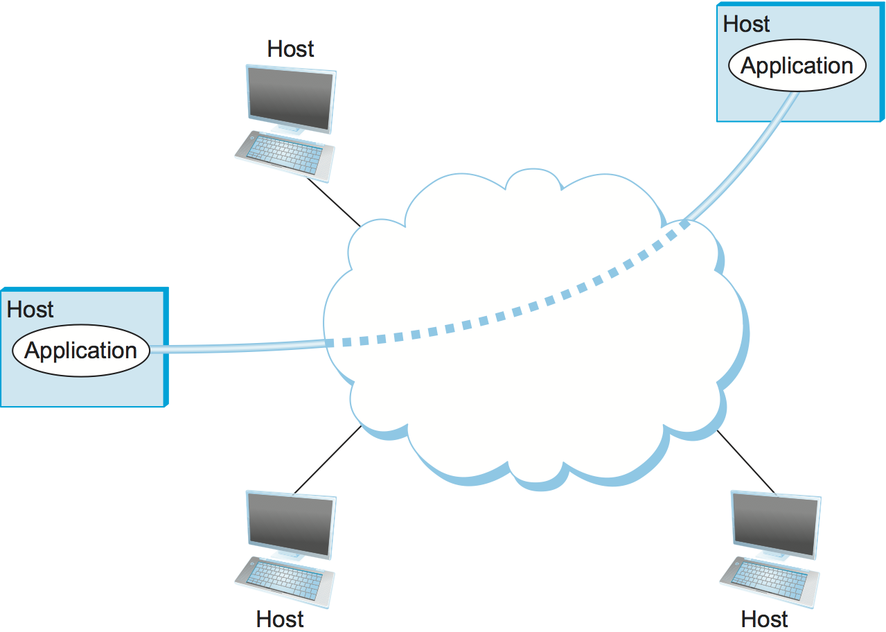

**الشكل 1.7.** عمليات تتواصل عبر قناة مجرّدة.

حدسيًا، ننظر إلى الشبكة كمزوّدة *قنوات* منطقية يمكن لعمليات مستوى التطبيق أن تتواصل عبرها، وكل قناة توفّر مجموعة الخدمات التي يحتاجها ذلك التطبيق. بعبارة أخرى، كما نستخدم سحابة لتمثيل الاتصال بين مجموعة من الحواسيب تمثيلًا مجرّدًا، صرنا ننظر إلى القناة كواصلة بين عملية وأخرى. ويعرض الشكل 1.7 زوجًا من عمليات مستوى التطبيق يتواصلان عبر قناة منطقية منفّذة بدورها فوق سحابة تصل مجموعة من المضيفين. ويمكننا أن نفكّر في القناة كأنبوب يصل تطبيقين، فيضع التطبيق المرسل البيانات في أحد طرفيه ويتوقّع أن تسلّمها الشبكة إلى التطبيق في الطرف الآخر من الأنبوب.

وكأيّ تجريد، تُنفَّذ القنوات المنطقية بين العمليات فوق مجموعة من القنوات الفيزيائية بين المضيفين. وهذا هو جوهر التطبيق بالطبقات، وهو حجر الزاوية في معماريات الشبكات التي سنناقشها في القسم التالي.

والتحدّي أن ندرك أية وظائف ينبغي أن توفّرها القنوات لبرامج التطبيقات. فمثلًا: هل يحتاج التطبيق إلى ضمان تسليم الرسائل المرسلة عبر القناة، أم أنه يقبل ألّا يصل بعض الرسائل؟ هل يلزم أن تصل الرسائل إلى العملية المستقبلة بالترتيب نفسه الذي أُرسلت به، أم لا يهمّ المستقبِل ترتيب وصولها؟ هل تحتاج الشبكة إلى ضمان ألّا يتمكّن طرف ثالث من التنصّت على القناة، أم أن الخصوصية ليست محلّ اهتمام؟ عمومًا، توفّر الشبكة أنواعًا مختلفة من القنوات، ويختار كل تطبيق النوع الذي يلائم حاجاته أفضل ملاءمة. ويعرض بقية هذا القسم التفكير المتضمَّن في تعريف قنوات مفيدة.

#### تحديد أنماط التواصل الشائعة

يتضمّن تصميم القنوات المجرّدة أولًا فهم احتياجات التواصل لمجموعة تمثيلية من التطبيقات، ثم استخلاص متطلباتها المشتركة، وأخيرًا إدماج الوظائف التي تلبي هذه المتطلبات في الشبكة.

من أقدم التطبيقات المدعومة على أيّ شبكة برنامج الوصول إلى الملفات، كبروتوكول نقل الملفات (FTP) أو نظام ملفات الشبكة (NFS). ومع أن تفاصيل كثيرة تختلف — مثلًا هل تُنقل الملفات كاملة عبر الشبكة أم تُقرأ أو تُكتب كتل فردية منها في وقت معيّن — فإن مكوّن التواصل في الوصول إلى الملفات عن بُعد يتّسم بزوج من العمليات: واحدة تطلب قراءة ملف أو كتابته، وثانية تلبي هذا الطلب. وتُسمّى العملية التي تطلب الوصول إلى الملف *العميل*، والعملية التي تدعم الوصول إليه *الخادم*.

تتضمّن قراءة الملف أن يرسل العميل رسالة طلب صغيرة إلى الخادم، ويستجيب الخادم برسالة كبيرة تحتوي بيانات الملف. والكتابة تسير في الاتجاه المقابل: يرسل العميل رسالة كبيرة تحتوي البيانات المطلوب كتابتها إلى الخادم، ويستجيب الخادم برسالة صغيرة تؤكّد حدوث الكتابة إلى القرص.

والمكتبة الرقمية تطبيق أكثر تطوّرًا من نقل الملفات، لكنها تحتاج خدمات تواصل مشابهة. فمثلًا، تدير *جمعية آلات الحوسبة* (ACM) مكتبة رقمية كبيرة لأدبيات علوم الحاسوب على

```html
http://portal.acm.org/dl.cfm
```

ولهذه المكتبة طائفة واسعة من ميزات البحث والتصفّح لمساعدة المستخدمين على إيجاد المقالات التي يريدونها، لكن كثيرًا مما تفعله في النهاية هو الاستجابة لطلبات المستخدمين للملفات، كنسخ إلكترونية من مقالات الدوريات.

وباتخاذ الوصول إلى الملفات والمكتبة الرقمية وتطبيقي الفيديو الموصوفين في المقدّمة (مؤتمرات الفيديو والفيديو عند الطلب) عيّنةً تمثيلية، قد نقرّر توفير نوعين من القنوات: قنوات *الطلب/الردّ* وقنوات *تدفق الرسائل*. وتُستخدم قناة الطلب/الردّ في تطبيقَي نقل الملفات والمكتبة الرقمية. وهي تضمن أن كل رسالة يرسلها طرف يستقبلها الطرف الآخر، وأن تُسلَّم نسخة واحدة فقط من كل رسالة. وقد تحمي قناة الطلب/الردّ أيضًا خصوصية البيانات المتدفقة عبرها وسلامتها، بحيث لا يستطيع أطراف غير مصرّح لهم قراءة البيانات المتبادلة بين عمليتي العميل والخادم أو تعديلها.

أما قناة تدفق الرسائل فقد يستخدمها تطبيقا الفيديو عند الطلب ومؤتمرات الفيديو، شرط أن تُعامَل بمعاملات تدعم الحركة في اتجاه واحد وفي الاتجاهين، وتدعم خصائص تأخير مختلفة. وقد لا تحتاج قناة تدفق الرسائل إلى ضمان تسليم كل الرسائل، لأن تطبيق الفيديو يمكن أن يعمل على نحو مقبول حتى إذا لم تُستقبل بعض إطارات الفيديو. لكنها تحتاج إلى ضمان أن الرسائل التي تُسلَّم تصل بالترتيب نفسه الذي أُرسلت به، لتجنّب عرض الإطارات خارج تسلسلها. وكقناة الطلب/الردّ، قد ترغب قناة تدفق الرسائل في ضمان خصوصية بيانات الفيديو وسلامتها. وأخيرًا، قد تحتاج قناة تدفق الرسائل إلى دعم الإرسال المتعدّد، ليتمكّن عدة أطراف من المشاركة في المؤتمر عن بُعد أو مشاهدة الفيديو.

ومع شيوع سعي مصمّم الشبكة إلى أقلّ عدد من أنواع القنوات المجرّدة يخدم أكبر عدد من التطبيقات، ففي محاولة الاكتفاء بقنوات مجرّدة قليلة جدًا خطر. فالقول المأثور: إن كان لديك مطرقة، بدا كل شيء مسمارًا. فمثلًا، إن لم يكن لديك سوى قنوات تدفق الرسائل والطلب/الردّ، فمن المُغري استخدامها في التطبيق التالي الذي يظهر، حتى لو لم يوفّر أيّ منهما الدلالات التي يحتاجها التطبيق بالضبط. لذا، من المرجّح أن يظلّ مصمّمو الشبكات يبتكرون أنواعًا جديدة من القنوات — ويضيفون خيارات إلى القنوات القائمة — ما دام مبرمجو التطبيقات يبتكرون تطبيقات جديدة.

ولاحظ أيضًا أنه، بمعزل عن *ما* توفّره قناة معيّنة من وظائف، يبقى سؤال *أين* تُنفَّذ تلك الوظائف. ففي حالات كثيرة، الأسهل النظر إلى الاتصال بين المضيفين في الشبكة الكامنة كأنه مجرّد *أنبوب بتات*، مع توفير أيّ دلالات تواصل عالية المستوى في المضيفين الطرفيين. وميزة هذا النهج أنه يُبقي المبدّلات في وسط الشبكة بسيطة قدر الإمكان — فهي تمرّر الحزم فقط — لكنه يُحمّل المضيفين الطرفيين كثيرًا من عبء دعم قنوات غنية الدلالات بين العمليات. والبديل هو دفع وظائف إضافية إلى المبدّلات، فيُسمح للمضيفين الطرفيين بأن يكونوا أجهزة «صمّاء» (كسمّاعات الهاتف). وسنرى هذه المسألة — كيف تُقسَّم خدمات الشبكة المختلفة بين مبدّلات الحزم والمضيفين (الأجهزة) الطرفيين — مسألةً متكرّرة في تصميم الشبكات.

#### تسليم الرسائل الموثوق

كما توحي الأمثلة التي نظرنا إليها للتوّ، تسليم الرسائل الموثوق من أهم الوظائف التي يمكن أن توفّرها الشبكة. غير أنه يصعب تحديد كيفية توفير هذه الموثوقية دون فهم أولًا كيف يمكن أن تفشل الشبكات. وأول ما يجب إدراكه أن شبكات الحواسيب لا توجد في عالم مثالي. فالآلات تتعطّل ثم يُعاد تشغيلها، والألياف تُقطع، والتداخل الكهربائي يُفسد بتات في البيانات المرسلة، والمبدّلات ينفد مخزونها المؤقت، وكأن هذه المشكلات الفيزيائية لا تكفي للقلق، فقد تحتوي البرمجيات التي تدير العتاد على عيوب، وتمرّر الحزم أحيانًا إلى العدم. لذا، من متطلبات الشبكة الكبرى أن تتعافى من أنواع معيّنة من الأعطال، حتى لا تُضطر برامج التطبيقات إلى التعامل معها أو حتى العلم بها.

وثمّة ثلاثة أصناف عامة من الأعطال على مصمّمي الشبكات أن يقلقوا بشأنها. أولًا، عند إرسال حزمة على رابط فيزيائي، قد تُدخَل *أخطاء بتات* في البيانات؛ أي يتحوّل 1 إلى 0 أو *العكس*. وأحيانًا تُفسَد بتات منفردة، لكن *خطأ الرشقة* يحدث أكثر في الغالب، حيث تُفسَد عدة بتات متتالية. وتحدث أخطاء البتات عادةً لأن قوى خارجية، كالصواعق وارتفاعات الطاقة وأفران الميكروويف، تتداخل مع إرسال البيانات. والخبر السار أن هذه الأخطاء نادرة نسبيًا، إذ تؤثّر في المتوسط في بتة واحدة فقط من كل 10⁶ إلى 10⁷ بتة على كبل نحاسي نموذجي، ومن كل 10¹² إلى 10¹⁴ بتة على ليف بصري نموذجي. وكما سنرى، هناك تقنيات تكشف هذه الأخطاء باحتمال عالٍ. ومتى كُشفت، أمكن أحيانًا تصحيحها — فإذا عرفنا أيّ بتة أو بتات أُفسدت، أمكننا ببساطة قلبها — بينما في حالات أخرى يكون الضرر بالغًا بحيث يلزم إسقاط الحزمة كلها. وفي هذه الحالة، قد يُتوقّع من المرسل إعادة إرسال الحزمة.

والصنف الثاني من الأعطال على مستوى الحزمة لا البتة؛ أي تُفقد حزمة كاملة في الشبكة. وأحد أسباب ذلك أن الحزمة تحتوي خطأ بتة غير قابل للتصحيح، فلا بدّ من إسقاطها. لكن السبب الأرجح أن إحدى العقد التي عليها التعامل مع الحزمة — كمبدّل يمرّرها من رابط إلى آخر — محمّلة فوق طاقتها بحيث لا تجد مكانًا لتخزين الحزمة، فتُضطر إلى إسقاطها. وهذه هي مشكلة الازدحام التي نوقشت للتوّ. وأقل شيوعًا أن ترتكب البرمجيات العاملة على إحدى العقد التي تتعامل مع الحزمة خطأً. فمثلًا، قد تمرّر حزمة خطأً على الرابط الخاطئ، فلا تجد الحزمة طريقها إلى الهدف النهائي. وكما سنرى، من الصعوبات الكبرى في التعامل مع الحزم المفقودة التمييز بين حزمة فُقدت فعلًا وحزمة تأخّرت فقط في الوصول إلى الهدف.

والصنف الثالث من الأعطال على مستوى العقدة والرابط؛ أي يُقطع رابط فيزيائي، أو يتعطّل الحاسوب الموصول به. وقد يسبّب ذلك برمجية تتعطّل، أو انقطاع طاقة، أو مشغّل جرافة متهوّر. والأعطال بسبب سوء تهيئة جهاز شبكة شائعة أيضًا. ومع أن أيًّا من هذه الأعطال يمكن تصحيحه في النهاية، فقد يكون لها أثر جسيم في الشبكة لمدة ممتدة. غير أنها لا يلزم أن تُعطّل الشبكة كليًا. ففي شبكة مبدّلة للحزم، مثلًا، يمكن أحيانًا التوجيه حول عقدة أو رابط معطّل. ومن صعوبات التعامل مع هذا الصنف الثالث التمييز بين حاسوب معطّل وحاسوب بطيء فقط، أو — في حالة الرابط — بين رابط قُطع ورابط شديد التذبذب يُدخل عددًا كبيرًا من أخطاء البتات.

> **الخلاصة الرئيسية**
>
> الفكرة الأساسية التي نخرج بها من هذه المناقشة أن تعريف القنوات المفيدة يتضمّن فهم متطلبات التطبيقات وإدراك حدود التقنية الكامنة معًا. والتحدّي أن نسدّ الفجوة بين ما يتوقّعه التطبيق وما تستطيع التقنية الكامنة توفيره. ويُسمّى ذلك أحيانًا *الفجوة الدلالية*.

### 1.2.5 قابلية الإدارة

وثمّة متطلب أخير يبدو أنه يُغفل أو يُؤجّل إلى آخر القائمة أكثر مما ينبغي (كما نفعل هنا)، وهو أن الشبكات تحتاج إلى إدارة. ويشمل إدارة الشبكة ترقية المعدات مع نمو الشبكة لحمل مزيد من الحركة أو الوصول إلى مزيد من المستخدمين، وتشخيص أعطال الشبكة حين تسوء الأمور أو لا يكون الأداء كما يُراد، وإضافة ميزات جديدة دعمًا لتطبيقات جديدة. وقد كانت إدارة الشبكات تاريخيًا جانبًا كثيف الاعتماد على البشر، ومع أنه ليس مرجّحًا أن نُخرج الناس من الحلقة تمامًا، فالأمر يعالَج بصورة متزايدة بالأتمتة وتصاميم الشفاء الذاتي.

ويرتبط هذا المتطلب جزئيًا بمسألة قابلية التوسّع التي نوقشت أعلاه: فمع توسّع الإنترنت لدعم مليارات المستخدمين ومئات الملايين على الأقل من المضيفين، صارت تحديات إبقاء الأمر كله يعمل على نحو صحيح وتهيئة الأجهزة الجديدة عند إضافتها مشكلات متزايدة. فتهيئة موجّه واحد في شبكة كثيرًا ما تكون مهمة لخبير مدرَّب؛ أما تهيئة آلاف الموجّهات ومعرفة لماذا لا تتصرف شبكة بهذا الحجم كما هو متوقّع فقد تصير مهمة تتجاوز أيّ إنسان بمفرده. ولهذا تزداد أهمية الأتمتة.

ومن طرق تيسير إدارة الشبكة تجنّب التغيير. فمتى عملت الشبكة، ببساطة *لا تلمسها!* وهذه العقلية تكشف التوتّر الجوهري بين *الاستقرار* و*سرعة الميزات*: أي معدّل إدخال قدرات جديدة إلى الشبكة. وتفضيل الاستقرار هو النهج الذي تبنّته صناعة الاتصالات (ناهيك عن مديري أنظمة الجامعات وأقسام تقنية المعلومات في الشركات) لسنوات طويلة، فجعلتها من أبطأ الصناعات حركة وأكثرها نفورًا من المخاطرة. لكن انفجار السحابة الأخير غيّر هذا الديناميكي، فصار لزامًا موازنة الاستقرار وسرعة الميزات على نحو أفضل. وأثر السحابة على الشبكة موضوع يتكرّر في الكتاب مرارًا، ونوليه عناية خاصة في قسم *المنظورات* في نهاية كل فصل. ويكفي الآن أن نقول إن إدارة شبكة سريعة التطوّر هي بحقّ التحدّي المحوري في الشبكات اليوم.

## 1.3 المعمارية

أرسى القسم السابق مجموعة كبيرة من متطلبات تصميم الشبكة: يجب أن توفّر شبكة الحاسوب اتصالًا عامًا وفعّال الكلفة وعادلًا ومتينًا بين عدد كبير من الحواسيب. وكأن هذا لا يكفي، فالشبكات لا تبقى ثابتة عند نقطة زمنية واحدة، بل يجب أن تتطوّر لتستوعب التغيّرات في التقنيات الكامنة التي تقوم عليها والتغيّرات في المطالب التي تفرضها عليها برامج التطبيقات. وفضلًا عن ذلك، يجب أن تكون الشبكات قابلة للإدارة من بشر متفاوتي المهارة. وليس تصميم شبكة تلبّي هذه المتطلبات بمهمة صغيرة.

ولمعالجة هذا التعقيد، طوّر مصمّمو الشبكات مخططات عامة — تُسمّى عادةً *معماريات الشبكات* — توجّه تصميم الشبكات وتنفيذها. ويعرّف هذا القسم بمزيد من العناية ما نعنيه بمعمارية الشبكة، بتقديم الأفكار المركزية المشتركة بين كل معماريات الشبكات. كما يقدّم اثنتين من أكثر المعماريات المرجعية انتشارًا: معمارية OSI (ذات الطبقات السبع) ومعمارية الإنترنت.

### 1.3.1 التطبيق بالطبقات والبروتوكولات

التجريد — أي إخفاء تفاصيل التنفيذ خلف واجهة محدّدة تحديدًا جيدًا — هو الأداة الأساسية التي يستخدمها مصمّمو الأنظمة لإدارة التعقيد. وفكرة التجريد أن تُعرَّف نماذج تلتقط جانبًا مهمًا من النظام، وتُغلَّف هذه النماذج في كائن يوفّر واجهة يمكن لمكوّنات النظام الأخرى التعامل معها، وتُخفى تفاصيل تنفيذ الكائن عن مستخدميه. والتحدّي أن نحدّد التجريدات التي توفّر في الوقت نفسه خدمةً تُثبت نفعها في مواقف كثيرة، وتكون فعّالة التنفيذ في النظام الكامن. وهذا بالضبط ما كنا نفعله حين قدّمنا فكرة القناة في القسم السابق: كنا نوفّر تجريدًا للتطبيقات يُخفي تعقيد الشبكة عن كاتبي التطبيقات.

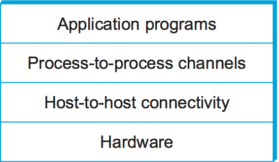

**الشكل 1.8.** مثال على نظام شبكي مطبّق بالطبقات.

تقود التجريدات طبيعيًا إلى التطبيق بالطبقات، خصوصًا في أنظمة الشبكات. والفكرة العامة أن تبدأ بالخدمات التي يوفّرها العتاد الكامن، ثم تضيف سلسلة من الطبقات، كلٌّ منها يوفّر مستوى أعلى (أكثر تجريدًا) من الخدمة. وتُنفَّذ الخدمات الموفَّرة في الطبقات العليا من حيث الخدمات الموفَّرة في الطبقات الدنيا. واستنادًا إلى مناقشة المتطلبات في القسم السابق، قد نتخيّل مثلًا شبكة بسيطة لها طبقتا تجريد محشورتان بين برنامج التطبيق والعتاد الكامن، كما يوضّح الشكل 1.8. والطبقة التي تعلو العتاد مباشرةً في هذه الحالة قد توفّر الاتصال بين المضيفين، فتُجرّد حقيقة وجود طوبولوجيا شبكة معقّدة اعتباطًا بين أيّ مضيفين. والطبقة التالية تبني على خدمة التواصل المتاحة بين المضيفين وتوفّر دعمًا لقنوات التواصل بين العمليات، فتُجرّد مثلًا حقيقة أن الشبكة تُفقد الرسائل أحيانًا.

ويوفّر التطبيق بالطبقات ميزتين مفيدتين. أولًا، يحلّل مسألة بناء الشبكة إلى مكوّنات أيسر إدارة. فبدلًا من تنفيذ قطعة برمجية واحدة متجانسة تفعل كل ما قد تريده يومًا، يمكنك تنفيذ عدة طبقات، كلٌّ منها يحلّ جزءًا من المسألة. ثانيًا، يوفّر تصميمًا أكثر معيارية. فإذا قرّرت إضافة خدمة جديدة، فقد لا تحتاج إلا إلى تعديل الوظائف في طبقة واحدة، مع إعادة استخدام الوظائف الموفَّرة في كل الطبقات الأخرى.

غير أن التفكير في النظام كسلسلة خطية من الطبقات تبسيط مفرط. فكثيرًا ما توجد تجريدات متعددة في أيّ مستوى معيّن من النظام، كلٌّ منها يوفّر خدمة مختلفة للطبقات الأعلى لكنه يبني على التجريدات الدنيا نفسها. ولنرى ذلك، لننظر إلى نوعَي القنوات المذكورَين في القسم السابق. إحداهما توفّر خدمة الطلب/الردّ، والأخرى تدعم خدمة تدفق الرسائل. وقد تكون هاتان القناتان عرضين بديلين في مستوى ما من نظام شبكي متعدد المستويات، كما يوضّح الشكل 1.9.

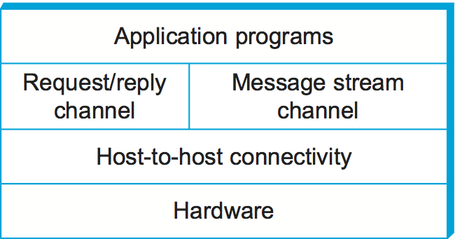

**الشكل 1.9.** نظام مطبّق بالطبقات فيه تجريدات بديلة متاحة في مستوى معيّن.

وباتخاذ هذه المناقشة للتطبيق بالطبقات أساسًا، صرنا جاهزين لمناقشة معمارية الشبكة بمزيد من الدقة. فبدايةً، تُسمّى الكائنات المجرّدة التي تكوّن طبقات النظام الشبكي *بروتوكولات*. أي أن البروتوكول يوفّر خدمة تواصل تستخدمها كائنات أعلى مستوى (كعمليات التطبيقات، أو ربما بروتوكولات أعلى مستوى) لتبادل الرسائل. فمثلًا، يمكننا تخيّل شبكة تدعم بروتوكول طلب/ردّ وبروتوكول تدفق رسائل، يقابلان قناتَي الطلب/الردّ وتدفق الرسائل المذكورتين أعلاه.

ويعرّف كل بروتوكول واجهتين مختلفتين. أولًا، يعرّف *واجهة خدمة* للكائنات الأخرى على الحاسوب نفسه التي تريد استخدام خدماته التواصلية. وتعرّف واجهة الخدمة هذه العمليات التي يمكن للكائنات المحلية القيام بها على البروتوكول. فمثلًا، يدعم بروتوكول الطلب/الردّ عمليات يمكن للتطبيق أن يرسل بها الرسائل ويستقبلها. ويمكن لتنفيذ بروتوكول HTTP أن يدعم عملية جلب صفحة نص تشعّبي من خادم بعيد. ويستدعي تطبيق كمتصرّح الويب هذه العملية متى احتاج إلى الحصول على صفحة جديدة (مثلًا حين ينقر المستخدم رابطًا في الصفحة المعروضة حاليًا).

ثانيًا، يعرّف البروتوكول *واجهة نظير* لنظيره على آلة أخرى. وتعرّف هذه الواجهة الثانية صيغة الرسائل المتبادلة بين نظراء البروتوكول ومعناها، لتنفيذ خدمة التواصل. وهي تحدّد طريقة تواصل بروتوكول طلب/ردّ على آلة مع نظيره على آلة أخرى. وفي حالة HTTP، مثلًا، يحدّد مواصفة البروتوكول بالتفصيل كيفية تنسيق أمر *GET*، وأيّ وسائط يمكن استخدامها معه، وكيف ينبغي لخادم الويب أن يستجيب حين يتلقّى أمرًا كهذا.

وخلاصةً، يعرّف البروتوكول خدمة تواصل يصدّرها محليًا (واجهة الخدمة)، مع مجموعة قواعد تحكم الرسائل التي يتبادلها البروتوكول مع نظيره أو نظرائه لتنفيذ هذه الخدمة (واجهة النظير). ويعرض الشكل 1.10 هذه الحالة.

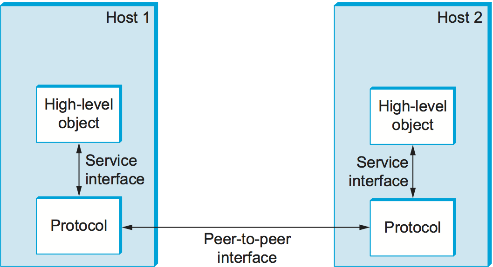

**الشكل 1.10.** واجهات الخدمة وواجهات النظير.

فيما عدا مستوى العتاد، حيث يتواصل النظراء مباشرةً عبر وسط فيزيائي، فالتواصل بين النظيرين غير مباشر: فكل بروتوكول يتواصل مع نظيره بتمرير الرسائل إلى بروتوكول أدنى مستوى، يسلّمها بدوره إلى *نظيره*. وفضلًا عن ذلك، قد يوجد أكثر من بروتوكول واحد في أيّ مستوى معيّن، كلٌّ منها يوفّر خدمة تواصل مختلفة. ولذا نمثّل مجموعة البروتوكولات التي تكوّن نظامًا شبكيًا بـ*مخطّط بروتوكولات*. تقابل عُقد المخطّط بروتوكولات، وتمثّل الحواف علاقة *يعتمد على*. فمثلًا، يعرض الشكل 1.11 مخطّط بروتوكولات للنظام المطبّق بالطبقات الافتراضي الذي نناقشه: فالبروتوكولان RRP (بروتوكول الطلب/الردّ) وMSP (بروتوكول تدفق الرسائل) ينفّذان نوعين مختلفين من قنوات التواصل بين العمليات، وكلاهما يعتمد على بروتوكول المضيف إلى المضيف (HHP) الذي يوفّر خدمة الاتصال بين المضيفين.

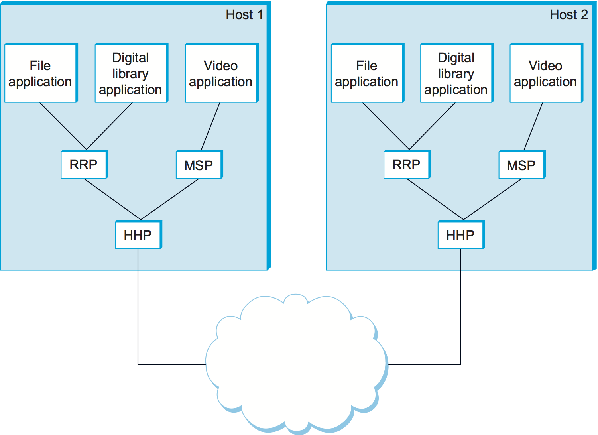

**الشكل 1.11.** مثال على مخطّط بروتوكولات.

وفي هذا المثال، افترض أن برنامج الوصول إلى الملفات على المضيف 1 يريد إرسال رسالة إلى نظيره على المضيف 2 باستخدام خدمة التواصل التي يوفّرها RRP. وفي هذه الحالة، يطلب تطبيق الملفات من RRP أن يرسل الرسالة نيابةً عنه. وللتواصل مع نظيره، يستدعي RRP خدمات HHP، الذي يرسل الرسالة بدوره إلى نظيره على الآلة الأخرى. ومتى وصلت الرسالة إلى نسخة HHP على المضيف 2، يمرّرها HHP إلى RRP، الذي يسلّمها بدوره إلى تطبيق الملفات. ويُقال في هذه الحالة إن التطبيق يستخدم خدمات *مكدّس البروتوكولات* RRP/HHP.

ولاحظ أن مصطلح *بروتوكول* يُستخدم بطريقتين مختلفتين. فأحيانًا يشير إلى الواجهات المجرّدة، أي العمليات المعرَّفة بواجهة الخدمة وصيغة الرسائل المتبادلة بين النظراء ومعناها، وأحيانًا يشير إلى الوحدة التي تنفّذ هاتين الواجهتين فعلًا. وللتمييز بين الواجهتين والوحدة التي تنفّذهما، نشير عمومًا إلى الأولى باسم *مواصفة البروتوكول*. وتُعبَّر المواصفات عمومًا بمزيج من النثر والشيفرة الزائفة ومخطّطات انتقال الحالات وصور صيغ الحزم وغيرها من الترميزات المجرّدة. وينبغي أن يكون بوسع مبرمجين مختلفين تنفيذ بروتوكول معيّن بطرق مختلفة، ما دام كلٌّ منهم يتقيّد بالمواصفة. والتحدّي أن نضمن أن تنفيذين مختلفين للمواصفة نفسها يستطيعان تبادل الرسائل بنجاح. ويُقال عن وحدتَي بروتوكول أو أكثر تنفّذان مواصفة بروتوكول تنفيذًا دقيقًا إنهما *تتعاملان* إحداهما مع الأخرى.

ويمكننا تخيّل بروتوكولات ومخطّطات بروتوكولات كثيرة مختلفة تلبّي متطلبات التواصل لمجموعة من التطبيقات. لحسن الحظ، توجد هيئات للمعايير، كفرقة هندسة الإنترنت (IETF) والمنظمة الدولية للمعايير (ISO)، تضع سياسات لمخطّط بروتوكولات معيّن. ونسمّي مجموعة القواعد التي تحكم صيغة مخطّط البروتوكولات ومحتواه *معمارية شبكة*. ومع أن ذلك يتجاوز نطاق هذا الكتاب، فقد وضعت هيئات المعايير إجراءات محدّدة جيدًا لإدخال البروتوكولات في معمارياتها والتحقّق منها ثم اعتمادها. وسنصف قريبًا المعماريتين اللتين تحدّدهما IETF وISO وصفًا موجزًا، لكن هناك أمرين إضافيين يجب أن نشرحهما أولًا عن آليات التطبيق بالطبقات.

### 1.3.2 التغليف

لننظر فيما يحدث في الشكل 1.11 حين يرسل أحد برامج التطبيقات رسالة إلى نظيره بتمريرها إلى RRP. فمن منظور RRP، الرسالة التي يعطيه إياها التطبيق سلسلة بايتات غير مُفسَّرة. ولا يهمّ RRP أن هذه البايتات تمثّل مصفوفة أعداد صحيحة أو رسالة بريد إلكتروني أو صورة رقمية أو أيًّا كان؛ فما هو مكلّف به سوى إرسالها إلى نظيره. غير أن على RRP أن يوصل معلومات تحكّم إلى نظيره، يرشده بها كيف يتعامل مع الرسالة عند استلامها. ويفعل RRP ذلك بإرفاق *ترويسة* بالرسالة. وعمومًا، الترويسة بنية بيانات صغيرة — من بضعة بايتات إلى بضعة عشرات منها — تُستخدم بين النظراء للتواصل. وكما يوحي الاسم، تُرفق الترويسات عادةً بمقدّمة الرسالة. وفي بعض الحالات، تُرسَل معلومات التحكّم بين النظراء هذه في آخر الرسالة، وتُسمّى حينئذٍ *مذيَّلًا*. والصيغة الدقيقة للترويسة التي يرفقها RRP محدّدة بمواصفة بروتوكوله. ويُسمّى بقية الرسالة — أي البيانات المرسلة نيابةً عن التطبيق — *جسم* الرسالة أو *حمولتها*. ونقول إن بيانات التطبيق *مغلَّفة* في الرسالة الجديدة التي ينشئها RRP.

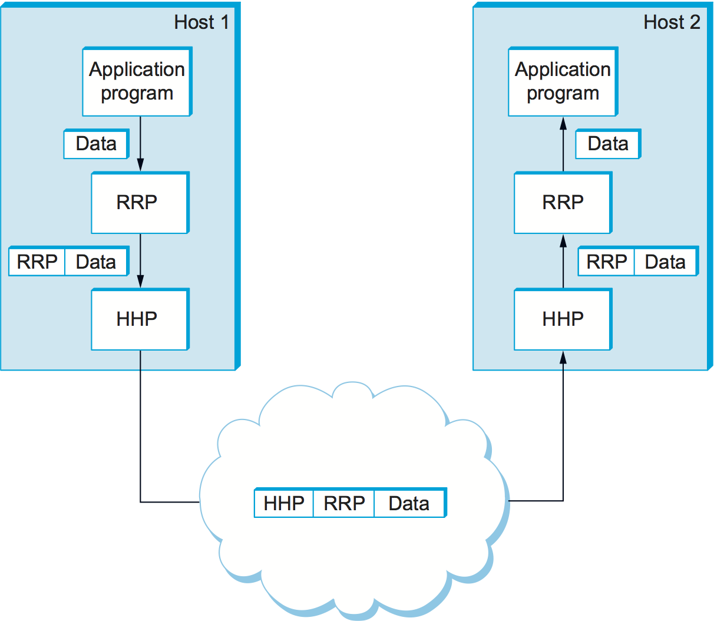

**الشكل 1.12.** الرسائل عالية المستوى تُغلَّف داخل رسائل منخفضة المستوى.

ثم تتكرّر عملية التغليف هذه في كل مستوى من مخطّط البروتوكولات؛ فمثلًا، يغلّف HHP رسالة RRP بإرفاق ترويسة من عنده. وإذا افترضنا الآن أن HHP يرسل الرسالة إلى نظيره عبر شبكة ما، فحين تصل الرسالة إلى المضيف الهدف تُعالَج بالترتيب المعاكس: يفسّر HHP أولًا ترويسة HHP في مقدّمة الرسالة (أي يتّخذ ما يلزم من إجراء بحسب محتوى الترويسة) ويمرّر جسم الرسالة (دون ترويسة HHP) إلى RRP، الذي يتّخذ ما تشير إليه ترويسة RRP التي أرفقها نظيره ويمرّر جسم الرسالة (دون ترويسة RRP) إلى برنامج التطبيق. والرسالة المارّة من RRP إلى التطبيق على المضيف 2 هي الرسالة نفسها بالضبط التي مرّرها التطبيق إلى RRP على المضيف 1؛ فلا يرى التطبيق أيًّا من الترويسات التي أُرفقت به لتنفيذ خدمات التواصل الدنيا. ويعرض الشكل 1.12 هذه العملية كلها. ولاحظ في هذا المثال أن عقد الشبكة (كمُبدّلات وموجّهات) قد تفحص ترويسة HHP في مقدّمة الرسالة.

ولاحظ أننا حين نقول إن بروتوكولًا أدنى لا يفسّر الرسالة التي يعطيه إياها بروتوكول أعلى، نعني أنه لا يعرف كيف يستخلص أيّ معنى من البيانات التي تحتويها الرسالة. غير أن البروتوكول الأدنى يطبّق أحيانًا تحويلًا بسيطًا على البيانات التي أُعطيها، كضغطها أو تشفيرها. وفي هذه الحالة يحوّل البروتوكول جسم الرسالة كله، بما فيه بيانات التطبيق الأصلية وكل الترويسات المرفقة بتلك البيانات من بروتوكولات أعلى.

### 1.3.3 التعديد والفصل

تذكّر أن فكرة أساسية في تبديل الحزم هي تعديد تدفقات بيانات متعددة على رابط فيزيائي واحد. والفكرة نفسها تنطبق صعودًا ونزولًا على مخطّط البروتوكولات، لا على عقد التبديل وحدها. فمثلًا، في الشكل 1.11، يمكننا النظر إلى RRP كأنه ينفّذ قناة تواصل منطقية تُعدَّد عليها رسائل تطبيقين مختلفين في المضيف المصدر، ثم تُفصل ثانيةً إلى التطبيق المناسب في المضيف الهدف.

ومن الناحية العملية، يعني ذلك ببساطة أن الترويسة التي يرفقها RRP برسائله تحتوي معرّفًا يسجّل التطبيق الذي تنتمي إليه الرسالة. ونسمّي هذا المعرّف *مفتاح فصل* RRP، أو *مفتاح الفصل* اختصارًا. وفي المضيف المصدر، يُضمّن RRP مفتاح الفصل المناسب في ترويسته. وحين تُسلَّم الرسالة إلى RRP على المضيف الهدف، ينزع ترويسته، ويفحص مفتاح الفصل، ويفصل الرسالة إلى التطبيق الصحيح.

وليس RRP وحده في دعم التعديد؛ فكل بروتوكول تقريبًا ينفّذ هذه الآلية. فمثلًا، لـHHP مفتاح فصل خاص به لتحديد أيّ الرسائل يمرّرها إلى RRP وأيّها يمرّرها إلى MSP. غير أنه لا يوجد اتفاق موحّد بين البروتوكولات — حتى داخل معمارية شبكة واحدة — على ماهية مفتاح الفصل بالضبط. فبعض البروتوكولات تستخدم حقلًا من 8 بتات (أي أنها تدعم 256 بروتوكولًا أعلى فقط)، وأخرى تستخدم حقولًا من 16 أو 32 بتة. كذلك، لبعض البروتوكولات حقل فصل واحد في ترويستها، بينما لبعضها الآخر زوج من حقول الفصل. وفي الحالة الأولى يُستخدم مفتاح الفصل نفسه في طرفَي التواصل، بينما في الثانية يستخدم كل طرف مفتاحًا مختلفًا لتحديد البروتوكول الأعلى (أو برنامج التطبيق) الذي ستُسلَّم إليه الرسالة.

### 1.3.4 نموذج OSI

كانت ISO من أول المنظمات التي عرّفت رسميًا طريقة مشتركة لوصل الحواسيب. ومعماريتها، وتُسمّى معمارية *الترابط بين الأنظمة المفتوحة* (OSI) والمعروضة في الشكل 1.13، تعرّف تقسيم وظائف الشبكة إلى سبع طبقات، حيث ينفّذ بروتوكول أو أكثر الوظائف المسندة إلى طبقة معيّنة. وبهذا المعنى، فالمخطّط المعطى في الشكل 1.13 ليس مخطّط بروتوكولات *بذاته*، بل *نموذج مرجعي* لمخطّط بروتوكولات. وكثيرًا ما يُشار إليه بنموذج الطبقات السبع. ومع أنه لا توجد اليوم شبكة قائمة على OSI، فالمصطلحات التي عرّفتها لا تزال مستخدمة على نطاق واسع، فيبقى من الجدير إلقاء نظرة عابرة عليها.

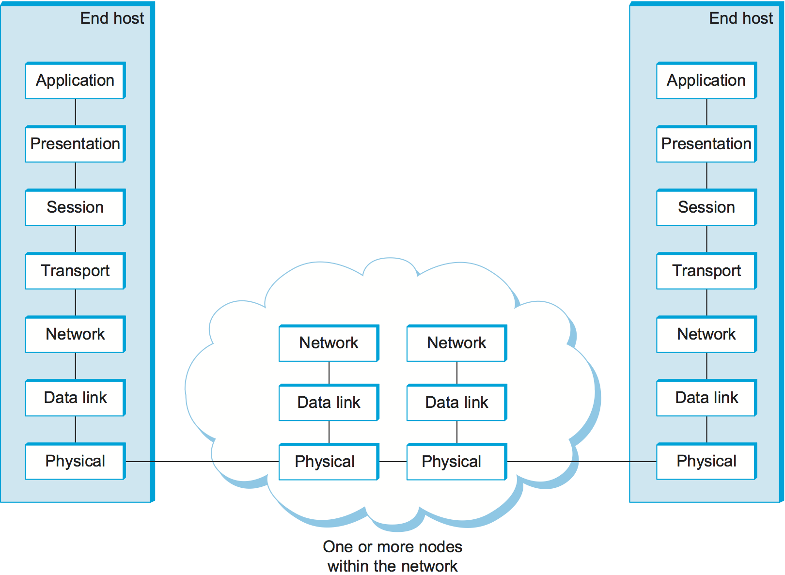

**الشكل 1.13.** نموذج OSI ذو الطبقات السبع.

بدءًا من الأسفل وصعودًا، تتولّى الطبقة *الفيزيائية* إرسال البتات الخام على رابط اتصال. ثم تجمع طبقة *ربط البيانات* تدفقًا من البتات في وحدة أكبر تُسمّى *إطارًا*. ومهايئات الشبكة، مع مشغّلات الأجهزة العاملة في نظام تشغيل العقدة، تنفّذ عادةً مستوى ربط البيانات. وهذا يعني أن ما يُسلَّم إلى المضيفين فعلًا إطارات لا بتات خام. وتتولّى طبقة *الشبكة* التوجيه بين العقد داخل شبكة مبدّلة للحزم. وفي هذه الطبقة تُسمّى وحدة البيانات المتبادلة بين العقد عادةً *حزمة* لا إطارًا، مع أنهما في الجوهر شيء واحد. والطبقات الثلاث الدنيا تُنفَّذ في كل عقد الشبكة، بما فيها المبدّلات داخل الشبكة والمضيفون الموصولون بخارجها. ثم تنفّذ طبقة *النقل* ما كنا نسمّيه حتى الآن *قناة التواصل بين العمليات*. وهنا تُسمّى وحدة البيانات المتبادلة عادةً *رسالة* لا حزمة ولا إطارًا. وطبقة النقل والطبقات الأعلى تعمل عادةً في المضيفين الطرفيين فقط، لا في المبدّلات أو الموجّهات الوسيطة.

وبالانتقال سریعًا إلى الطبقة العليا (السابعة) والعودة نزولًا، نجد طبقة *التطبيقات*. وتشمل بروتوكولات طبقة التطبيقات أشياء كبروتوكول نقل النص التشعّبي (HTTP)، وهو أساس الشبكة العنكبوتية العالمية وما يمكّن متصفحات الويب من طلب صفحات من خوادمها. وتحتها، تُعنى طبقة *التقديم* بصيغة البيانات المتبادلة بين النظراء — مثلًا هل العدد الصحيح بطول 16 أو 32 أو 64 بتة، وهل يُرسَل البايت الأكثر أهمية أولًا أم أخيرًا، وكيف تُنسَّق تدفقات الفيديو. وأخيرًا، توفّر طبقة *الجلسة* فضاء أسماء يُستخدم لربط تدفقات النقل المختلفة المحتملة التي تكون جزءًا من تطبيق واحد. فمثلًا، قد تدير تدفق صوت وتدفق فيديو يُدمجان في تطبيق مؤتمرات عن بُعد.

### 1.3.5 معمارية الإنترنت

تُصوَّر معمارية الإنترنت، وتُسمّى أحيانًا معمارية TCP/IP نسبةً إلى بروتوكوليها الرئيسيين، في الشكل 1.14. ويُعطى تمثيل بديل في الشكل 1.15. وقد تطوّرت معمارية الإنترنت من خبرات شبكة مبدّلة للحزم أقدم تُسمّى ARPANET. وكانت الإنترنت وARPANET كلتاهما ممولتين من وكالة مشاريع البحث المتقدم (ARPA)، إحدى وكالات تمويل البحث والتطوير في وزارة الدفاع الأميركية. وقد سبقت الإنترنت وARPANET معمارية OSI، وكانت الخبرة المستفادة من بنائهما مؤثّرًا كبيرًا في النموذج المرجعي OSI.

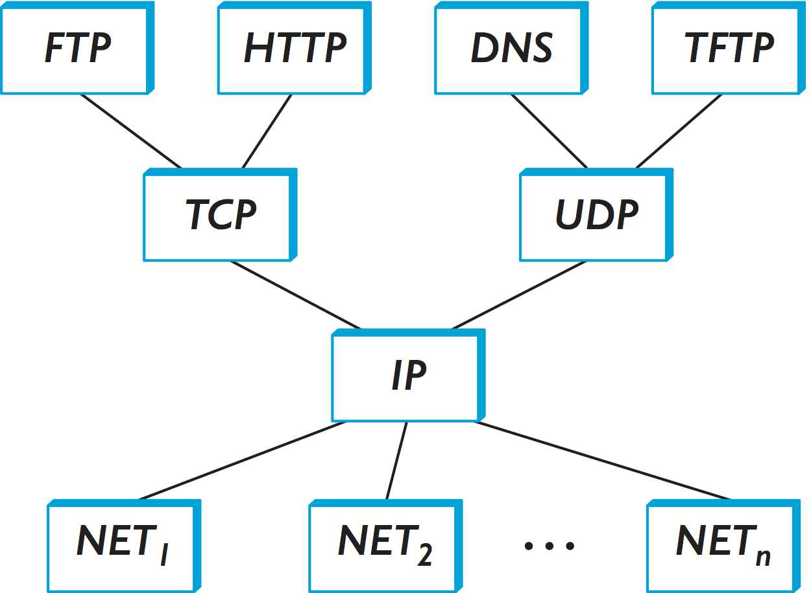

**الشكل 1.14.** مخطّط بروتوكولات الإنترنت.

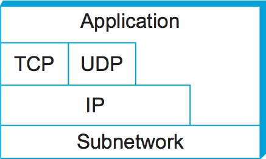

**الشكل 1.15.** نظرة بديلة إلى معمارية الإنترنت. كانت طبقة «الشبكة الفرعية» تُسمّى تاريخيًا طبقة «الشبكة»، وصارت تُسمّى الآن غالبًا «الطبقة 2» (بتأثير من نموذج OSI).

ومع أنه يمكن، بشيء من الخيال، تطبيق نموذج OSI ذي الطبقات السبع على الإنترنت، فكثيرًا ما يُستخدم مكدّس أبسط بدلًا منه. فعلى أدنى مستوى طائفة واسعة من بروتوكولات الشبكة، تُرمَز NET₁ وNET₂ وهكذا. وفي الممارسة، تُنفَّذ هذه البروتوكولات بمزيج من العتاد (كمهايئ شبكة) والبرمجيات (كمشغّل جهاز شبكة). فمثلًا، قد تجد بروتوكولات Ethernet أو البروتوكولات اللاسلكية (كمعايير Wi-Fi 802.11) في هذه الطبقة. (وهذه البروتوكولات قد تتضمن بدورها عدة طبقات فرعية، لكن معمارية الإنترنت لا تفترض شيئًا عنها.) وتتكوّن الطبقة التالية من بروتوكول واحد هو *بروتوكول الإنترنت* (IP). وهو البروتوكول الذي يدعم ترابط تقنيات شبكة متعددة في شبكة بينية منطقية واحدة. وتحتوي الطبقة التي تعلو IP على بروتوكولين رئيسيين: *بروتوكول التحكّم في النقل* (TCP) و*بروتوكول بيانات المستخدم* (UDP). ويوفّر TCP وUDP قناتين منطقيتين بديلتين لبرامج التطبيقات: فTCP يوفّر قناة موثوقة لتدفق البايتات، وUDP يوفّر قناة غير موثوقة لتسليم البيانات الحزمية (ويمكن عدّ *الحزمة البيانية* مرادفًا للرسالة). وفي لغة الإنترنت، يُسمّى TCP وUDP أحيانًا بروتوكولَي *الطرف إلى الطرف*، مع صحة تسميتهما أيضًا بروتوكولَي *النقل*.

وفوق طبقة النقل طائفة من بروتوكولات التطبيقات، كHTTP وFTP وTelnet (الدخول عن بُعد) وبروتوكول البريد البسيط (SMTP)، تمكّن تعامل التطبيقات الشائعة بعضها مع بعض. ولفهم الفرق بين بروتوكول طبقة التطبيقات والتطبيق، فكّر في كل متصفحات الويب المختلفة التي هي أو كانت متاحة (مثل Firefox وChrome وSafari وNetscape وMosaic وInternet Explorer). وثمّة عدد كبير مماثل من تنفيذات خوادم الويب المختلفة. والسبب في أنك تستطيع استخدام أيّ من هذه البرامج للوصول إلى موقع معيّن على الويب هو أنها كلها تتقيّد ببروتوكول طبقة تطبيقات واحد: HTTP. وبتشويش، يُطبَّق المصطلح نفسه أحيانًا على التطبيق وعلى بروتوكول طبقة التطبيقات الذي يستخدمه (فمثلًا كثيرًا ما يُستخدم FTP اسمًا لتطبيق ينفّذ بروتوكول FTP).

ومعظم من يعملون فعليًا في مجال الشبكات يعرفون معمارية الإنترنت ومعمارية OSI ذات الطبقات السبع، وثمّة اتفاق عام على كيفية تقابل الطبقات بين المعماريتين. فطبقة تطبيقات الإنترنت تُعدّ في الطبقة 7، وطبقة نقلها في الطبقة 4، وطبقة IP (التشبيك البيني أو الشبكة فقط) في الطبقة 3، وطبقة الربط أو الشبكة الفرعية تحت IP في الطبقة 2.

> **IETF والمعايير**
>
> مع أننا نسمّيها «معمارية الإنترنت» لا «معمارية IETF»، من الإنصاف القول إن IETF هي هيئة المعايير الأساسية المسؤولة عن تعريفها، وعن توصيف كثير من بروتوكولاتها كTCP وUDP وIP وDNS وBGP. لكن معمارية الإنترنت تحتضن أيضًا بروتوكولات كثيرة تحدّدها منظمات أخرى، منها معيارا Ethernet 802.3 وWi-Fi 802.11 لدى IEEE، ومواصفات الويب HTTP/HTML لدى W3C، ومعايير شبكات الهاتف الخلوي 4G و5G لدى 3GPP، ومعيار ترميز الفيديو H.264 لدى ITU-T، على سبيل المثال لا الحصر.
>
> وإلى جانب تعريف المعماريات وتوصيف البروتوكولات، توجد منظمات أخرى تدعم الهدف الأكبر المتمثّل في التعامل البيني. ومن الأمثلة عليها IANA (هيئة الأرقام المخصّصة للإنترنت)، وهي، كما يوحي اسمها، مسؤولة عن منح المعرّفات الفريدة اللازمة لعمل البروتوكولات. وIANA بدورها إدارة داخل ICANN (شركة الإنترنت للأسماء والأرقام المخصّصة)، وهي منظمة غير ربحية مسؤولة عن الإشراف العام على الإنترنت.

ولمعمارية الإنترنت ثلاث خصائص تجدر الإشارة إليها. أولًا، وكما يوضّح الشكل 1.15 أفضل توضيح، لا تستلزم معمارية الإنترنت تطبيقًا صارمًا بالطبقات. فالتطبيق حرّ في تجاوز طبقات النقل المعرَّفة واستخدام IP أو إحدى الشبكات الكامنة مباشرة. بل إن المبرمجين أحرار في تعريف تجريدات قنوات جديدة أو تطبيقات تعمل فوق أيّ من البروتوكولات القائمة.

ثانيًا، إن نظرت عن قرب إلى مخطّط البروتوكولات في الشكل 1.14 لاحظت شكل الساعة الرملية: عريض في الأعلى، ضيّق في الوسط، عريض في الأسفل. وهذا الشكل يعكس في الحقيقة الفلسفة المركزية للمعمارية. أي أن IP نقطة الارتكاز في المعمارية: فهو يعرّف طريقة مشتركة لتبادل الحزم بين طائفة واسعة من الشبكات. وفوق IP يمكن أن توجد بروتوكولات نقل كثيرة اعتباطًا، كلٌّ منها يعرض تجريد قناة مختلفًا لبرامج التطبيقات. وهكذا تنفصل مسألة تسليم الرسائل من مضيف إلى مضيف انفصالًا تامًا عن مسألة توفير خدمة تواصل مفيدة بين العمليات. وتحت IP تسمح المعمارية بعدد اعتباطي من تقنيات الشبكة المختلفة، من Ethernet إلى اللاسلكي إلى الروابط المفردة نقطة إلى نقطة.

وخاصية أخيرة لمعمارية الإنترنت (أو، بدقة أكبر، لثقافة IETF) أن ضمّ بروتوكول جديد رسميًا إلى المعمارية يستلزم وجود مواصفة بروتوكول وتنفيذ تمثيلي واحد على الأقل (ويُفضّل اثنان) للمواصفة. فوجود تنفيذات عاملة شرط لتبنّي IETF المعايير. وهذا الافتراض الثقافي في جماعة التصميم يساعد على ضمان إمكان تنفيذ بروتوكولات المعمارية بكفاءة. وربما يكون أفضل تجسيد لقيمة الثقافة الإنترنتية للبرمجيات العاملة اقتباسٌ على قمصان تُلبس كثيرًا في اجتماعات IETF:

> *نرفض الملوك والرؤساء والتصويت. نؤمن بالإجماع التقريبي والشيفرة العاملة.* **(David Clark)**

> **الخلاصة الرئيسية**
>
> من بين هذه الخصائص الثلاث لمعمارية الإنترنت، تستحق فلسفة تصميم الساعة الرملية أن تُكرَّر. فخصر الساعة الرملية يمثّل مجموعة دنيا مختارة بعناية من القدرات العالمية التي تسمح للتطبيقات الأعلى ولتقنيات التواصل الأدنى بالتعايش وتقاسم القدرات والتطوّر السريع. والنموذج ضيّق الخصر حاسم في قدرة الإنترنت على التكيّف مع مطالب المستخدمين الجديدة والتقنيات المتغيّرة.

## 1.4 البرمجيات

المعماريات الشبكية ومواصفات البروتوكولات أمور جوهرية، لكن المخطّط الجيد لا يكفي لتفسير النجاح الباهر للإنترنت: فقد نما عدد الحواسيب الموصولة به نموًا أُسّيًا أكثر من ثلاثة عقود (وإن كانت الأرقام الدقيقة عسيرة). وقُدّر عدد مستخدمي الإنترنت بنحو 4.1 مليار في نهاية 2018، أي نحو نصف سكان العالم.

ما الذي يفسّر نجاح الإنترنت؟ ثمّة بالطبع عوامل كثيرة مساهمة (منها معمارية جيدة)، لكن ما جعل الإنترنت نجاحًا منفلتًا هو أن قدرًا كبيرًا من وظائفه توفّره برمجيات تعمل على حواسيب عامة الغرض. وأهمية ذلك أن الوظائف الجديدة يمكن إضافتها بسهولة بـ«مجرد مسألة برمجة صغيرة». ونتيجةً لذلك، ظهرت تطبيقات وخدمات جديدة بوتيرة مذهلة.

وثمّة عامل متصل هو الزيادة الهائلة في قوة الحوسبة المتاحة في الآلات الرائجة. فمع أن شبكات الحواسيب كانت قادرة دائمًا من حيث المبدأ على نقل أيّ نوع من المعلومات، كعينات الصوت الرقمية والصور المُرقمنة وغيرها، لم تكن هذه الإمكانية ذات شأن كبير إن كانت الحواسيب المرسلة والمستقبلة لتلك البيانات بطيئة جدًا بحيث لا تفعل شيئًا مفيدًا بها. وكل حواسيب اليوم تقريبًا قادرة على تشغيل الصوت والفيديو المُرقمنين بسرعة ودقة مستخدمتين فعلًا.

وفي السنوات التي تلت ظهور الطبعة الأولى من هذا الكتاب، صار كتابة تطبيقات الشبكة نشاطًا سائدًا لا عمل قلّة من المتخصصين. وقد ساهمت في ذلك عوامل كثيرة، منها تحسّن الأدوات التي تسهّل العمل وانفتاح أسواق جديدة كتطبيقات الهواتف الذكية.

والنقطة التي تجدر الإشارة إليها أن معرفة كيف تنفّذ برمجيات الشبكة جزء جوهري من فهم شبكات الحواسيب، ومع أن الأرجح ألّا تُوكَل إليك مهمة تنفيذ بروتوكول أدنى كIP، فمن المحتمل جدًا أن تجد سببًا لتنفيذ بروتوكول على مستوى التطبيقات — «التطبيق القاتل» المنشود الذي سيقودك إلى شهرة وثروة لا تُخيَّلان. ولكي نضعك على الطريق، يقدّم هذا القسم بعض المسائل المتضمَّنة في تنفيذ تطبيق شبكة فوق الإنترنت. وعادةً تكون هذه البرامج في الوقت نفسه تطبيقًا (أي مصمَّمة للتفاعل مع المستخدمين) وبروتوكولًا (أي تتواصل مع نظرائها عبر الشبكة).

### 1.4.1 واجهة المقبس (Socket API)

المكان الذي نبدأ منه في تنفيذ تطبيق شبكة هو الواجهة التي تصدّرها الشبكة. ولأن معظم بروتوكولات الشبكة برمجيات (وخصوصًا العالية في مكدّس البروتوكولات)، ولأن كل أنظمة الحواسيب تقريبًا تنفّذ بروتوكولات شبكتها كجزء من نظام التشغيل، فحين نشير إلى الواجهة «التي تصدّرها الشبكة» نشير عمومًا إلى الواجهة التي يوفّرها نظام التشغيل لنظامه الفرعي للشبكة. وكثيرًا ما تُسمّى هذه الواجهة *واجهة برمجة التطبيقات* الشبكية (API).

ومع أن لكل نظام تشغيل الحرية في تعريف واجهة شبكته الخاصة (ولمعظمها واجهته)، فقد صار بعض هذه الواجهات مدعومًا على نحو واسع مع الزمن؛ أي صار منقولًا إلى أنظمة تشغيل غير نظامه الأصلي. وهذا ما حدث مع *واجهة المقبس* التي وفّرها توزيع Berkeley من Unix أصلًا، وهي مدعومة اليوم في كل أنظمة التشغيل الشائعة تقريبًا، وهي أساس الواجهات الخاصة بكل لغة، كمكتبة المقابس في Java أو Python. ونستخدم Linux ولغة C في كل أمثلة الشيفرة في هذا الكتاب: Linux لأنه مفتوح المصدر، وC لأنها لا تزال لغة الاختيار لداخليات الشبكة. (ولC أيضًا ميزة عرض كل التفاصيل الدنيا، وهي عون في فهم الأفكار الكامنة.)

> **المقابس فجّرت انفجار التطبيقات**
>
> يصعب المبالغة في أهمية واجهة المقبس. فهي تحدّد نقطة الفصل بين التطبيقات العاملة فوق الإنترنت وتفاصيل تنفيذ الإنترنت. ونتيجةً لتوفير المقابس واجهة محدّدة تحديدًا جيدًا ومستقرّة، انفجرت كتابة تطبيقات الإنترنت إلى صناعة بعشرات مليارات الدولارات. فبدءًا من البدايات المتواضعة لنموذج العميل/الخادم وحفنة برامج بسيطة كالبريد الإلكتروني ونقل الملفات والدخول عن بُعد، صار لكل أحد اليوم أمداد لا تنتهي من تطبيقات السحابة من هاتفه الذكي.
>
> ويرسي هذا القسم الأساس بعودة إلى بساطة برنامج عميل يفتح مقبسًا ليتبادل الرسائل مع برنامج خادم، لكن نظامًا بيئيًا برمجيًا غنيًا اليوم مطبّق فوق واجهة المقبس. وتشمل هذه الطبقة عددًا هائلًا من الأدوات السحابية التي تخفّض عتبة تنفيذ التطبيقات القابلة للتوسّع. وسنعود إلى التفاعل بين السحابة والشبكة في كل فصل، بدءًا من قسم *المنظور* في نهاية الفصل 1.

وقبل وصف واجهة المقبس، من المهم أن تُبقي في ذهنك مسألتين منفصلتين. فكل بروتوكول يوفّر مجموعة معيّنة من *الخدمات*، وتوفّر الواجهة *صياغة* تُستدعى بها تلك الخدمات في نظام حاسوبيّ معيّن. ثم يكون التنفيذ مسؤولًا عن إسقاط مجموعة العمليات والكائنات الملموسة التي تحدّدها الواجهة على مجموعة الخدمات المجرّدة التي يحدّدها البروتوكول. وإن كنت قد أحسنت تعريف الواجهة، أمكنك استخدام صياغتها لاستدعاء خدمات بروتوكولات كثيرة مختلفة. وقد كانت هذه العمومية هدفًا لواجهة المقبس بلا شك، مع أنها بعيدة عن الكمال.

والتجريد الرئيسي في واجهة المقبس هو، بلا مفاجأة، *المقبس*. والطريقة الجيدة للتفكير في المقبس أنه نقطة اتصال عملية تطبيق محلية بالشبكة. وتعرّف الواجهة عمليات إنشاء مقبس، وربط المقبس بالشبكة، وإرسال الرسائل عبره واستقبالها، وإغلاق المقبس. ولتبسيط المناقشة، سنقتصر على إظهار كيفية استخدام المقابس مع TCP.

والخطوة الأولى إنشاء مقبس، ويُفعل بالعملية التالية:

```c
int socket(int domain, int type, int protocol);
```

وسبب أخذ هذه العملية ثلاثة وسائط أن واجهة المقبس صُمّمت عامة بما يكفي لدعم أيّ مجموعة بروتوكولات كامنة. فتحدّد الوسيطة domain *عائلة* البروتوكول التي ستُستخدم: PF_INET تدل على عائلة الإنترنت، وPF_UNIX تدل على مرفق أنابيب Unix، وPF_PACKET تدل على الوصول المباشر إلى واجهة الشبكة (أي تجاوز مكدّس TCP/IP). وتشير الوسيطة type إلى دلالات التواصل: SOCK_STREAM تدل على تدفق بايتات، وSOCK_DGRAM بديل يدل على خدمة موجّهة بالرسائل كالتي يوفّرها UDP. وتحدّد الوسيطة protocol البروتوكول المعيّن الذي سيُستخدم. وفي حالتنا هي UNSPEC لأن اجتماع PF_INET وSOCK_STREAM يستلزم TCP. وأخيرًا، القيمة المعادة من socket *مقبض* للمقبس المنشأ حديثًا، أي معرّف نستطيع به الرجوع إلى المقبس لاحقًا. وتُعطى وسيطةً للعمليات اللاحقة على هذا المقبس.

والخطوة التالية تتوقف على كونك عميلًا أم خادمًا. فعلى آلة الخادم، تُجري عملية التطبيق فتحًا *سلبيًا*: يقول الخادم إنه مستعدّ لقبول الاتصالات، لكنه لا يقيم اتصالًا فعلًا. ويفعل الخادم ذلك باستدعاء العمليات الثلاث التالية:

```c
int bind(int socket, struct sockaddr *address, int addr_len);
int listen(int socket, int backlog);
int accept(int socket, struct sockaddr *address, int *addr_len);
```

وعملية bind، كما يوحي اسمها، تربط المقبس المنشأ حديثًا بالعنوان المحدّد. وهذا هو عنوان الشبكة للمشارك *المحلي*، أي الخادم. ولاحظ أنه، عند استخدامها مع بروتوكولات الإنترنت، تكون address بنية بيانات تتضمّن عنوان IP للخادم ورقم منفذ TCP. وتُستخدم المنافذ لتحديد العمليات على نحو غير مباشر، وهي صورة من *مفاتيح الفصل*. ورقم المنفذ عادةً رقم معروف خاص بالخدمة المعروضة؛ فمثلًا تقبل خوادم الويب عادةً الاتصالات على المنفذ 80.

ثم تحدّد عملية listen عدد الاتصالات التي يمكن أن تكون معلّقة على المقبس المحدّد. وأخيرًا تنفّذ عملية accept الفتح السلبي. وهي عملية حاجزة لا تعود حتى يقيم مشارك بعيد اتصالًا، وحين تكتمل تعيد مقبسًا *جديدًا* يقابل هذا الاتصال المنشأ للتوّ، وتحتوي الوسيطة address عنوان المشارك *البعيد*. ولاحظ أن المقبس الأصلي المعطى وسيطةً لا يزال موجودًا عند عودة accept ولا يزال يقابل الفتح السلبي؛ ويُستخدم في استدعاءات accept التالية.

وعلى آلة العميل، تُجري عملية التطبيق فتحًا *نشطًا*؛ أي تقول مع من تريد التواصل باستدعاء العملية الواحدة التالية:

```c
int connect(int socket, struct sockaddr *address, int addr_len);
```

ولا تعود هذه العملية حتى يقيم TCP اتصالًا بنجاح، وعندئذٍ يتحرّر التطبيق لبدء إرسال البيانات. وفي هذه الحالة تحتوي address عنوان المشارك البعيد. وفي الممارسة، يحدّد العميل عادةً عنوان المشارك البعيد فقط ويترك النظام يملأ المعلومات المحلية. فبينما يستمع الخادم عادةً للرسائل على منفذ معروف، لا يهمّ العميل عادةً أيّ منفذ يستخدم لنفسه؛ إذ يختار نظام التشغيل منفذًا غير مستخدم.

ومتى أُقيم الاتصال، تستدعي عمليات التطبيق العمليتين التاليتين لإرسال البيانات واستقبالها:

```c
int send(int socket, char *message, int msg_len, int flags);
int recv(int socket, char *buffer, int buf_len, int flags);
```

فالعملية الأولى ترسل الرسالة المعطاة على المقبس المحدّد، والثانية تستقبل رسالة من المقبس المحدّد في المخزن المؤقت المعطى. وتأخذ كلتاهما مجموعة رايات تتحكّم في تفاصيل معيّنة من العملية.

### 1.4.2 مثال عميل/خادم

نعرض الآن تنفيذ برنامج عميل/خادم بسيط يستخدم واجهة المقبس لإرسال الرسائل عبر اتصال TCP. ويستخدم البرنامج أيضًا مرافق شبكة أخرى في Linux، نقدّمها في حينها. ويتيح تطبيقنا لمستخدم على آلة أن يكتب نصًا ويرسله إلى مستخدم على آلة أخرى. وهو نسخة مبسّطة من برنامج talk في Linux، الشبيه بالبرنامج الذي في قلب تطبيقات المراسلة الفورية.

#### العميل

نبدأ بالجانب العميلي، الذي يأخذ اسم الآلة البعيدة وسيطةً. ويستدعي مرفق Linux لترجمة هذا الاسم إلى عنوان IP للمضيف البعيد. والخطوة التالية بناء بنية بيانات العنوان (sin) التي تتوقّعها واجهة المقبس. ولاحظ أن بنية البيانات هذه تحدّد أننا سنستخدم المقبس للاتصال بالإنترنت (AF_INET). وفي مثالنا نستخدم منفذ TCP رقم 5432 منفذًا معروفًا للخادم؛ وهو منفذ لم يُخصَّص لأيّ خدمة إنترنت أخرى. والخطوة الأخيرة في إعداد الاتصال استدعاء socket وconnect. ومتى عادت العملية، أُقيم الاتصال ودخل برنامج العميل حلقة رئيسية تقرأ نصًا من الدخل القياسي وترسله عبر المقبس.

```c
#include <stdio.h>
#include <sys/types.h>
#include <sys/socket.h>
#include <netinet/in.h>
#include <netdb.h>
#include <stdlib.h>
#include <unistd.h>
#include <string.h>

#define SERVER_PORT 5432
#define MAX_LINE 256

int
main(int argc, char * argv[])
{
 FILE *fp;
 struct hostent *hp;
 struct sockaddr_in sin;
 char *host;
 char buf[MAX_LINE];
 int s;
 int len;

 if (argc==2) {
   host = argv[1];
 }
 else {
   fprintf(stderr, "usage: simplex-talk host\n");
   exit(1);
 }

 /* translate host name into peer's IP address */
 hp = gethostbyname(host);
 if (!hp) {
   fprintf(stderr, "simplex-talk: unknown host: %s\n", host);
   exit(1);
 }

 /* build address data structure */
 bzero((char *)&sin, sizeof(sin));
 sin.sin_family = AF_INET;
 bcopy(hp->h_addr, (char *)&sin.sin_addr, hp->h_length);
 sin.sin_port = htons(SERVER_PORT);

 /* active open */
 if ((s = socket(PF_INET, SOCK_STREAM, 0)) < 0) {
   perror("simplex-talk: socket");
   exit(1);
 }
 if (connect(s, (struct sockaddr *)&sin, sizeof(sin)) < 0)
 {
   perror("simplex-talk: connect");
   close(s);
   exit(1);
 }
 /* main loop: get and send lines of text */
 while (fgets(buf, sizeof(buf), stdin)) {
   buf[MAX_LINE-1] = '\0';
   len = strlen(buf) + 1;
   send(s, buf, len, 0);
 }
}
```
#### الخادم

الخادم بسيط بالقدر نفسه. فهو يبني أولًا بنية بيانات العنوان بملء رقم المنفذ الخاص به (SERVER_PORT). وبعدم تحديد عنوان IP، يُعلن برنامج التطبيق قبوله للاتصالات على أي من عناوين IP للمضيف المحلي. ثم يقوم الخادم بالخطوات التمهيدية للفتح السلبي: ينشئ المقبس، ويربطه بالعنوان المحلي، ويضبط الحدّ الأقصى لعدد الاتصالات المعلّقة المسموح بها. أخيرًا تنتظر الحلقة الرئيسية أن يحاول مضيف بعيد الاتصال، وحين يفعل، تستقبل الحروف الواردة على الاتصال وتطبعها.

```c
#include <stdio.h>
#include <sys/types.h>
#include <sys/socket.h>
#include <netinet/in.h>
#include <netdb.h>
#include <stdlib.h>
#include <unistd.h>
#include <string.h>

#define SERVER_PORT  5432
#define MAX_PENDING  5
#define MAX_LINE     256

int
main()
{
 struct sockaddr_in sin;
 char buf[MAX_LINE];
 int buf_len;
 socklen_t addr_len;
 int s, new_s;

 /* build address data structure */
 bzero((char *)&sin, sizeof(sin));
 sin.sin_family = AF_INET;
 sin.sin_addr.s_addr = INADDR_ANY;
 sin.sin_port = htons(SERVER_PORT);

 /* setup passive open */
 if ((s = socket(PF_INET, SOCK_STREAM, 0)) < 0) {
   perror("simplex-talk: socket");
   exit(1);
 }
 if ((bind(s, (struct sockaddr *)&sin, sizeof(sin))) < 0) {
   perror("simplex-talk: bind");
   exit(1);
 }
 listen(s, MAX_PENDING);

/* wait for connection, then receive and print text */
 while(1) {
   if ((new_s = accept(s, (struct sockaddr *)&sin, &addr_len)) < 0) {
     perror("simplex-talk: accept");
     exit(1);
   }
   while (buf_len = recv(new_s, buf, sizeof(buf), 0))
     fputs(buf, stdout);
   close(new_s);
 }
}
```

## 1.5 الأداء

ركّزنا حتى هذه اللحظة على الجوانب الوظيفية للشبكات أساسًا. غير أن الشبكات الحاسوبية، كأي نظام حاسوبي، يُنتظر منها أن تؤدّي أداءً جيدًا أيضًا. والسبب أن فعالية الحسابات الموزّعة على الشبكة تعتمد غالبًا اعتمادًا مباشرًا على كفاءة الشبكة في إيصال بيانات تلك الحسابات. ومع أن القول البرمجي القديم «أنجزه صحيحًا أولًا ثم اجعله سريعًا» ما زال صحيحًا، فكثيرًا ما يكون لازمًا في الشبكات أن «تُصمّم من أجل الأداء». لذلك من المهم فهم العوامل المختلفة التي تؤثّر في أداء الشبكة.

### 1.5.1 عرض النطاق والكمون

يُقاس أداء الشبكة بطريقتين جوهريتين: *عرض النطاق* (ويُسمّى أيضًا *الإنتاجية*) و*الكمون* (ويُسمّى أيضًا *التأخير*). ويُعطى عرض نطاق الشبكة بعدد البتات التي يمكن إرسالها عبر الشبكة في مدة زمنية معيّنة. فمثلًا، قد يكون لشبكة ما عرض نطاق 10 ملايين بت/ثانية (Mbps)، أي أنها قادرة على إيصال 10 ملايين بت كل ثانية. ويُفيد أحيانًا التفكير في عرض النطاق بمعنى المدة اللازمة لإرسال كل بت من البيانات. فعلى شبكة بعرض 10 Mbps، يستغرق إرسال كل بت 0.1 ميكروثانية (μs).

وعرض النطاق والإنتاجية مصطلحان مختلفان اختلافًا دقيقًا. فقبل كل شيء، عرض النطاق حرفيًا مقياس لعرض حزمة ترددية. فمثلًا، كانت خطوط الهاتف الصوتية القديمة تدعم حزمة ترددية من 300 إلى 3300 هرتز، ويُقال إن عرض نطاقها 3300 هرتز − 300 هرتز = 3000 هرتز. وإذا رأيت كلمة *عرض النطاق* مستخدمة في سياق يُقاس فيه بالهرتز، فهي على الأرجح تشير إلى مدى الإشارات التي يمكن استيعابها.

وحين نتحدّث عن عرض نطاق رابط اتصال، نشير عادةً إلى عدد البتات في الثانية التي يمكن إرسالها على الرابط. ويُسمّى هذا أحيانًا *معدّل البيانات*. فقد نقول إن عرض نطاق رابط إيثرنت هو 10 Mbps. غير أنه يمكن أيضًا التمييز المفيد بين أقصى معدّل بيانات متاح على الرابط وعدد البتات في الثانية التي نستطيع إرسالها فعليًا على الرابط في الممارسة. ونميل إلى استخدام كلمة *الإنتاجية* للإشارة إلى *الأداء المقيس* لنظام ما. فبسبب أوجه قصور تنفيذية مختلفة، قد يحقّق زوج من العقدين موصولين برابط عرض نطاقه 10 Mbps إنتاجية لا تتجاوز 2 Mbps. وهذا يعني أن تطبيقًا على أحد المضيفين يستطيع إرسال البيانات إلى المضيف الآخر بمعدّل 2 Mbps.

وأخيرًا، كثيرًا ما نتحدّث عن *متطلّبات* عرض النطاق لتطبيق ما. وهي عدد البتات في الثانية التي يحتاج إلى إرسالها عبر الشبكة ليؤدّي أداءً مقبولًا. وقد يكون هذا لبعض التطبيقات «ما يتيسّر لي»، ولأخرى رقمًا ثابتًا (يُفضّل ألا يتجاوز عرض النطاق المتاح للرابط)، ولأخرى رقمًا يتغيّر مع الزمن. وسنوفّر مزيدًا عن هذا الموضوع لاحقًا في هذا القسم.

وفي حين يمكنك الحديث عن عرض نطاق الشبكة ككل، تريد أحيانًا أن تكون أدقّ، فتركّز مثلًا على عرض نطاق رابط فيزيائي واحد أو قناة منطقية بين عمليتين. فعلى المستوى الفيزيائي، عرض النطاق في تحسّن دائم بلا نهاية تُرى. وحدسيًا، إن تصوّرت ثانية من الزمن مسافةً يمكن قياسها بمسطرة، وعرض النطاق عددَ البتات التي تتّسع في تلك المسافة، فحينئذٍ يمكنك تصوّر كل بت نبضةً بعرض ما. فمثلًا، كل بت على رابط بعرض 1 Mbps عرضه 1 μs، بينما كل بت على رابط بعرض 2 Mbps عرضه 0.5 μs، كما يوضّح الشكل 1.16. وكلما زاد تطوّر تقنية الإرسال والاستقبال، أمكن أن يصبح كل بت أضيق، وبالتالي يرتفع عرض النطاق. وفي القنوات المنطقية بين عمليتين، يتأثّر عرض النطاق أيضًا بعوامل أخرى، منها عدد المرات التي تضطر فيها البرمجيات المنفّذة للقناة إلى معالجة كل بت من البيانات، وربما تحويله.

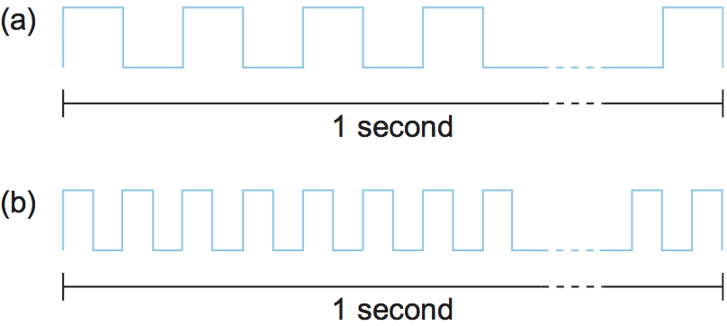

**الشكل 1.16.** البتات المرسلة بعرض نطاق معيّن يمكن اعتبارها ذات عرض ما: (أ) بتات مرسلة بعرض 1 Mbps (كل بت عرضه 1 ميكروثانية)؛ (ب) بتات مرسلة بعرض 2 Mbps (كل بت عرضه 0.5 ميكروثانية).

أما المقياس الثاني للأداء، الكمون، فيقابل المدة التي تستغرقها رسالة لتنتقل من طرف الشبكة إلى طرفها الآخر. (وكما في عرض النطاق، يمكن أن نركّز على كمون رابط واحد أو على كمون قناة من الطرف إلى الطرف.) ويُقاس الكمون بالزمن حصرًا. فمثلًا، قد يكون لشبكة عابرة للقارة كمون 24 ميليثانية (ms)، أي أن الرسالة تستغرق 24 ms لتنتقل من ساحل أمريكا الشمالية إلى الآخر. وفي مواقف كثيرة يكون الأهم معرفة المدة التي تستغرقها رسالة لتنتقل من طرف الشبكة إلى الطرف الآخر ثم تعود، لا الكمون في اتجاه واحد. ونسمّي هذا *زمن الذهاب والعودة* (RTT) للشبكة.

كثيرًا ما نتصوّر الكمون مكوّنًا من ثلاثة أجزاء. أولًا، تأخير الانتشار بسرعة الضوء. ويحدث هذا التأخير لأن لا شيء، بما في ذلك بت على سلك، يستطيع الانتقال أسرع من الضوء. وإذا عرفت المسافة بين نقطتين، أمكنك حساب كمون سرعة الضوء، لكن عليك الحذر لأن الضوء ينتقل في الأوساط المختلفة بسرعات مختلفة: فهو ينتقل بسرعة 3.0 × 10⁸ م/ث في الفراغ، و2.3 × 10⁸ م/ث في كابل نحاسي، و2.0 × 10⁸ م/ث في ليف بصري. ثانيًا، المدة اللازمة لإرسال وحدة بيانات. وهذا دالة في عرض نطاق الشبكة وحجم الحزمة التي تحمل البيانات. ثالثًا، قد توجد تأخيرات صفّ داخل الشبكة، لأن مفاتيح الحزم تحتاج عمومًا إلى تخزين الحزم مدةً ما قبل تمريرها على رابط خارج. لذا يمكن تعريف الكمون الكلي كالآتي:

```text
Latency = Propagation + Transmit + Queue
Propagation =  Distance/SpeedOfLight
Transmit = Size/Bandwidth
```

حيث Distance طول السلك الذي ستنتقل عليه البيانات، وSpeedOfLight سرعة الضوء الفعّالة على ذلك السلك، وSize حجم الحزمة، وBandwidth عرض النطاق الذي تُرسَل به الحزمة. لاحظ أنه إذا كانت الرسالة تحتوي بتًا واحدًا فقط وكنا نتحدّث عن رابط واحد (لا شبكة كاملة)، فإن حدّي Transmit وQueue غير ذوي صلة، ويقابل الكمون تأخير الانتشار وحده.

يتّحد عرض النطاق والكمون في تعريف خصائص أداء رابط أو قناة معيّنة. غير أن أهميتهما النسبية تعتمد على التطبيق. ففي بعض التطبيقات يغلب الكمون على عرض النطاق. فمثلًا، العميل الذي يرسل رسالة بحجم بايت واحد إلى خادم ويتلقّى رسالة بحجم بايت في المقابل محدود بالكمون. وبافتراض عدم وجود حساب جادّ في إعداد الردّ، سيؤدّي التطبيق أداءً مختلفًا جدًا على قناة عابرة للقارة زمن ذهابها وعودتها 100 ms عمّا يؤدّيه على قناة داخل الغرفة زمن ذهابها وعودتها 1 ms. أما إن كانت القناة بعرض 1 Mbps أو 100 Mbps فأمر غير ذي شأن نسبيًا، لأن الأول يعني أن زمن إرسال بايت (Transmit) هو 8 μs والثاني يعني Transmit = 0.08 μs.

وفي المقابل، خذ برنامج مكتبة رقمية يُطلب منه جلب صورة بحجم 25 ميغابايت (MB): فكلما توفّر عرض نطاق أكبر، أسرع في إعادة الصورة إلى المستخدم. هنا يغلب عرض نطاق القناة الأداء. ولترى ذلك، افترض أن عرض نطاق القناة 10 Mbps. سيستغرق إرسال الصورة 20 ثانية (25 × 10⁶ × 8 بت / 10 × 10⁶ بت/ث = 20 ثانية)، وهذا يجعل من غير المهم نسبيًا أن تكون الصورة على الجانب الآخر من قناة زمنها 1 ms أو 100 ms؛ فالفرق بين زمن استجابة 20.001 ثانية وزمن 20.1 ثانية ضئيل.

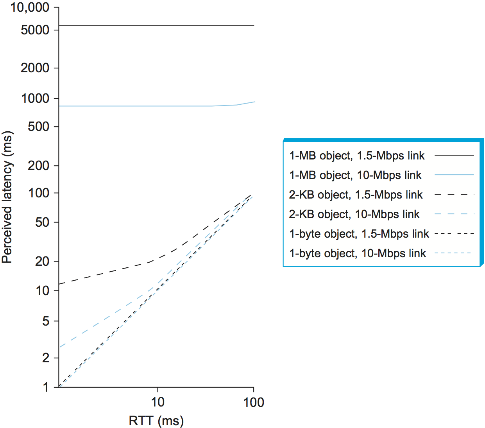

**الشكل 1.17.** الكمون المُدرَك (زمن الاستجابة) مقابل زمن الذهاب والعودة لأحجام كائنات وسرعات روابط مختلفة.

يعطيك الشكل 1.17 إحساسًا بكيفية تغلّب الكمون أو عرض النطاق على الأداء في ظروف مختلفة. يبيّن الرسم المدة اللازمة لنقل كائنات بأحجام مختلفة (بايت واحد، و2 KB، و1 MB) عبر شبكات أزمنة ذهابها وعودتها من 1 إلى 100 ms وسرعات روابط 1.5 أو 10 Mbps. ونستخدم مقاييس لوغاريتمية لإظهار الأداء النسبي. فلكائن بحجم بايت واحد (كضغطة مفتاح مثلًا)، يبقى الكمون مساويًا لزمن الذهاب والعودة تقريبًا، فلا تستطيع التمييز بين شبكة بعرض 1.5 Mbps وشبكة بعرض 10 Mbps. ولكائن بحجم 2 KB (ك رسالة بريد إلكتروني مثلًا)، تُحدث سرعة الرابط فرقًا كبيرًا على شبكة زمنها 1 ms، لكن فرقًا ضئيلًا على شبكة زمنها 100 ms. ولكائن بحجم 1 MB (كصورة رقمية مثلًا)، لا يُحدث زمن الذهاب والعودة أي فرق: فسرعة الرابط هي التي تغلب الأداء في كل مدى أزمنة الذهاب والعودة.

لاحظ أننا نستخدم في هذا الكتاب مصطلحي *الكمون* و*التأخير* استخدامًا عامًا للدلالة على المدة اللازمة لأداء وظيفة معيّنة، كإيصال رسالة أو نقل كائن. وحين نشير إلى المدة المحدّدة التي تستغرقها إشارة لتنتشر من طرف رابط إلى آخر، نستخدم مصطلح *تأخير الانتشار*. كما نوضّح في سياق الحديث ما إذا كنا نشير إلى الكمون في اتجاه واحد أم إلى زمن الذهاب والعودة.

وعلى سبيل الاستطراد، أصبحت الحواسيب سريعة إلى حدّ أننا حين نوصلها بالشبكات يفيدنا أحيانًا التفكير، مجازيًا على الأقل، بمقياس *التعليمات لكل ميل*. تخيّل ما يحدث حين يرسل حاسوب قادر على تنفيذ 100 مليار تعليمة في الثانية رسالة على قناة زمن ذهابها وعودتها 100 ms. (ولتسهيل الحساب، افترض أن الرسالة تقطع مسافة 5000 ميل.) فإذا ظلّ ذلك الحاسوب خاملًا طوال الـ100 ms منتظرًا رسالة الردّ، فقد أضاع القدرة على تنفيذ 10 مليارات تعليمة، أي مليونَي تعليمة لكل ميل. والأفضل أن يكون الخروج إلى الشبكة قد استحق هذه الإضاعة.

### 1.5.2 جداء التأخير × عرض النطاق

يفيد أيضًا الحديث عن حاصل ضرب هذين المقياسين، ويُسمّى غالبًا *جداء التأخير × عرض النطاق*. وحدسيًا، إن تصوّرنا القناة بين زوج من العمليتين أنبوبًا أجوف (انظر الشكل 1.18)، حيث يقابل الكمون طول الأنبوب ويعطي عرض النطاق قطر الأنبوب، فإن جداء التأخير × عرض النطاق يعطي حجم الأنبوب: أقصى عدد من البتات التي يمكن أن تكون في أثناء العبور داخل الأنبوب في أي لحظة معيّنة. وبعبارة أخرى، إذا كان الكمون (المقاس بالزمن) يقابل طول الأنبوب، أمكنك، بمعرفة عرض كل بت (المقاس بالزمن أيضًا)، حساب عدد البتات التي تتّسع في الأنبوب. فمثلًا، قناة عابرة للقارة كمونها في اتجاه واحد 50 ms وعرض نطاقها 45 Mbps قادرة على أن تحمل

50 × 10⁻³ × 45 × 10⁶ *بت/ث* = 2.25 × 10⁶ *بت*

أي نحو 280 KB من البيانات. بعبارة أخرى، تحمل هذه القناة (الأنبوب) في المثال عددًا من البايتات بقدر ما كانت تحمله ذاكرة حاسوب شخصي من مطلع الثمانينيات.

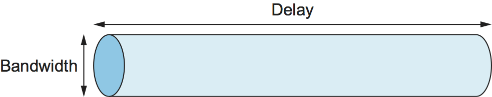

**الشكل 1.18.** الشبكة أنبوبًا.

من المهم معرفة جداء التأخير × عرض النطاق عند بناء شبكات عالية الأداء، لأنه يقابل عدد البتات التي يجب أن يرسلها المرسل قبل أن يصل أول بت إلى المستقبل. فإذا كان المرسل يتوقّع أن يشير المستقبل بطريقة ما إلى أن البتات بدأت تصل، واستغرق ذلك كمون قناة آخر لينتشر هذا الإشارة عائدًا إلى المرسل، فإن المرسل يستطيع إرسال ما يعادل *RTT × عرض النطاق* من البيانات قبل أن يسمع من المستقبل أن كل شيء على ما يرام. ويُقال إن البتات في الأنبوب «في رحلة»، أي أنه إذا طلب المستقبل من المرسل التوقّف عن الإرسال فقد يتلقّى ما يعادل RTT × عرض النطاق من البيانات قبل أن يتمكّن المرسل من الاستجابة. وفي مثالنا أعلاه، يقابل ذلك 5.5 × 10⁶ بت (671 KB) من البيانات. ومن ناحية أخرى، إذا لم يملأ المرسل الأنبوب، أي لم يرسل ما يعادل جداء RTT × عرض النطاق كاملًا قبل أن يتوقّف منتظرًا إشارة، فلن يستغلّ الشبكة استغلالًا كاملًا.

لاحظ أننا في معظم الوقت مهتمّون بسيناريو زمن الذهاب والعودة، ونسمّيه ببساطة جداء التأخير × عرض النطاق دون أن نقول صراحة إن «التأخير» هو زمن الذهاب والعودة (أي أن نضرب تأخير الاتجاه الواحد في اثنين). وعادةً يوضّح السياق ما إذا كان «التأخير» في جداء التأخير × عرض النطاق يعني الكمون في اتجاه واحد أم زمن الذهاب والعودة. ويعرض الجدول 1.1 أمثلة على جداءات زمن الذهاب والعودة × عرض النطاق لبعض روابط الشبكات النموذجية.

**الجدول 1.1.** أمثلة على جداءات التأخير × عرض النطاق.

| نوع الرابط | عرض النطاق | المسافة في اتجاه واحد | زمن الذهاب والعودة | زمن الذهاب والعودة × عرض النطاق |
| --- | --- | --- | --- | --- |
| شبكة محلية لاسلكية | 54 Mbps | 50 م | 0.33 μs | 18 بتًا |
| قمر صناعي | 1 Gbps | 35,000 كم | 230 ms | 230 Mb |
| ليف عابر للبلاد | 10 Gbps | 4,000 كم | 40 ms | 400 Mb |

### 1.5.3 الشبكات عالية السرعة

إن الزيادة المتواصلة الظاهرة في عرض النطاق تدفع مصمّمي الشبكات إلى التفكير في ما يحدث في الحدّ الأقصى، أو بعبارة أخرى، في أثر توفّر عرض نطاق لا نهائي على تصميم الشبكة.

ومع أن الشبكات عالية السرعة تُحدث تغيّرًا هائلًا في عرض النطاق المتاح للتطبيقات، فإن أثرها في طريقة تفكيرنا في التشبيك يأتي في كثير من الوجوه من ما *لا* يتغيّر بازدياد عرض النطاق: سرعة الضوء. ولمقتطف من شخصية Scotty في *Star Trek*: «لا تستطيعوا تغيير قوانين الفيزياء». بعبارة أخرى، «السرعة العالية» لا تعني أن الكمون يتحسّن بالمعدّل نفسه الذي يتحسّن به عرض النطاق؛ فزمن الذهاب والعودة العابر للقارة لرابط بعرض 1 Gbps هو نفسه 100 ms كما هو لرابط بعرض 1 Mbps.

ولتقدير مغزى عرض النطاق المتزايد باستمرار في مواجهة كمون ثابت، تخيّل ما يلزم لإرسال ملف بحجم 1 MB عبر شبكة بعرض 1 Mbps مقابل شبكة بعرض 1 Gbps، وكلتاهما زمن ذهابها وعودتها 100 ms. ففي حالة شبكة الـ1 Mbps، يستغرق إرسال الملف 80 زمن ذهاب وعودة؛ ويُرسَل في كل زمن ذهاب وعودة 1.25% من الملف. وفي المقابل، لا يقترب الملف نفسه بحجم 1 MB من ملء ما يعادل زمن ذهاب وعودة واحد على رابط الـ1 Gbps، الذي جداء التأخير × عرض النطاق فيه 12.5 MB.

يوضّح الشكل 1.19 الفرق بين الشبكتين. ففي الواقع، يبدو الملف بحجم 1 MB كتيّار بيانات يلزم إرساله عبر شبكة بعرض 1 Mbps، بينما يبدو حزمة واحدة على شبكة بعرض 1 Gbps. ولتوصيل هذه الفكرة، اعتبر أن ملفًا بحجم 1 MB بالنسبة إلى شبكة بعرض 1 Gbps كـ*حزمة* بحجم 1 KB بالنسبة إلى شبكة بعرض 1 Mbps.

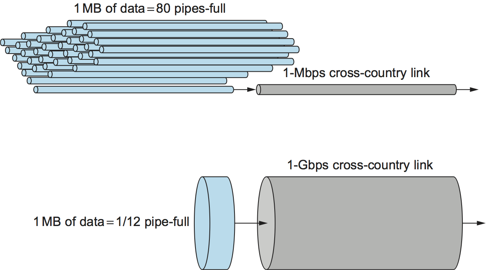

**الشكل 1.19.** العلاقة بين عرض النطاق والكمون: ملف بحجم 1 MB يملأ رابط الـ1 Mbps ثمانين مرة، لكنه يملأ 1/12 فقط من رابط بعرض 1 Gbps.

وثمة طريقة أخرى للتفكير في الموقف، وهي أنه يمكن إرسال بيانات أكثر في كل زمن ذهاب وعودة على شبكة عالية السرعة، إلى حدّ يصبح فيه زمن ذهاب وعودة واحد مدةً معتبرة. وهكذا، بينما لا تفكّر مرتين في الفرق بين نقل ملف يستغرق 101 زمن ذهاب وعودة بدلًا من 100 (فرق نسبي 1% فقط)، يصبح الفرق بين زمن ذهاب وعودة واحد وزمنين فجأة معتبرًا: زيادة بنسبة 100%. بعبارة أخرى، يبدأ الكمون، لا الإنتاجية، بالغلبة على تفكيرنا في تصميم الشبكة.

ولعلّ أفضل طريقة لفهم العلاقة بين الإنتاجية والكمون هي العودة إلى الأساسيات. فالإنتاجية الفعّالة من الطرف إلى الطرف التي يمكن تحقيقها عبر شبكة تُعطى بالعلاقة البسيطة

Throughput = TransferSize / TransferTime

حيث يتضمّن TransferTime لا عناصر الكمون في اتجاه واحد المحدّدة سابقًا في هذا القسم فحسب، بل أيضًا أي وقت إضافي يُنفق في طلب النقل أو إعداده. وبوجه عام، نمثّل هذه العلاقة كالآتي

TransferTime = RTT + 1/Bandwidth x TransferSize

ونستخدم RTT في هذا الحساب لمراعاة إرسال رسالة طلب عبر الشبكة ثم إرسال البيانات عائدة. فمثلًا، تخيّل موقفًا يريد فيه مستخدم جلب ملف بحجم 1 MB عبر رابط بعرض 1 Gbps زمن ذهاب وعوده 100 ms. ويشمل ذلك زمن إرسال الـ1 MB (1 / 1 Gbps × 1 MB = 8 ms) وزمن الذهاب والعودة البالغ 100 ms، فيكون زمن النقل الكلي 108 ms. وهذا يعني أن الإنتاجية الفعّالة ستكون

1 MB / 108 ms = 74.1 Mbps

لا 1 Gbps. ومن الواضح أن نقل كمية أكبر من البيانات سيساعد في تحسين الإنتاجية الفعّالة، حيث يؤدي حجم نقل لا نهائي في الحدّ إلى اقتراب الإنتاجية الفعّالة من عرض نطاق الشبكة. ومن ناحية أخرى، فإن تحمّل أكثر من زمن ذهاب وعودة واحد، لإعادة إرسال حزم مفقودة مثلًا، سيضرّ بالإنتاجية الفعّالة لأي نقل محدود الحجم، وسيكون أبرز ما يكون في عمليات النقل الصغيرة.

### 1.5.4 متطلّبات التطبيقات

اتّخذ النقاش في هذا القسم منظورًا إلى الأداء محوره الشبكة، أي أننا تحدّثنا بمنطق ما سيدعمه رابط أو قناة معيّنة. وكان الافتراض غير المعلن أن لبرامج التطبيقات حاجات بسيطة: تريد أكبر عرض نطاق تستطيع الشبكة تقديمه. وهذا صحيح بالتأكيد في برنامج المكتبة الرقمية المذكور آنفًا الذي يجلب صورة بحجم 250 MB؛ فكلما توفّر عرض نطاق أكبر، أسرع البرنامج في إعادة الصورة إلى المستخدم.

غير أن بعض التطبيقات قادرة على تحديد حدّ أعلى لما تحتاجه من عرض نطاق. وتطبيقات الفيديو مثال بارز. افترض أن المرء يريد بثّ فيديو بحجم ربع شاشة تلفاز قياسية، أي بدقة 352 في 240 بكسلًا. فإذا مُثّل كل بكسل بـ24 بت من المعلومات، كما هي الحال في الألوان ذات 24 بت، فسيكون حجم كل إطار (352 × 240 × 24) / 8 = 247.5 KB. وإذا احتاج التطبيق إلى دعم معدّل 30 إطارًا في الثانية، فقد يطلب معدّل إنتاجية 75 Mbps. وقدرة الشبكة على تقديم عرض نطاق أكبر لا تعني هذا التطبيق شيئًا لأنه لا يملك إلا قدرًا محدودًا من البيانات لإرساله في مدة زمنية معيّنة.

ولسوء الحظ، ليس الموقف بهذه البساطة التي يوحي بها هذا المثال. فلأن الفرق بين أي إطارين متجاورين في تيّار فيديو يكون غالبًا صغيرًا، يمكن ضغط الفيديو بإرسال الفروق بين الإطارات المتجاورة فقط. ويمكن أيضًا ضغط كل إطار لأن العين البشرية لا تدرك كل تفاصيل الصورة بسهولة. والفيديو المضغوط لا يتدفّق بمعدّل ثابت، بل يتغيّر مع الزمن بحسب عوامل منها مقدار الحركة والتفاصيل في الصورة وخوارزمية الضغط المستخدمة. ولذلك يمكن القول ما سيكون عليه متطلّب عرض النطاق المتوسط، لكن المعدّل اللحظي قد يكون أكثر أو أقل.

والمسألة الأساسية هي الفاصل الزمني الذي يُحسب عليه المتوسط. افترض أن تطبيق الفيديو في المثال يمكن ضغطه إلى حدّ لا يحتاج فيه إلا إلى 2 Mbps في المتوسط. فإذا أرسل ميغابتًا في فاصل ثانية واحدة و3 ميغابت في فاصل الثانية التالية، فإنه يرسل على مدى الفاصل الزمني البالغ ثانيتين بمعدّل متوسط 2 Mbps؛ غير أن هذا لن يواسي كثيرًا قناة صُمّمت لتدعم ما لا يزيد على ميغابتين في أي ثانية واحدة. ومن الواضح أن مجرّد معرفة متطلّبات عرض النطاق المتوسطة لتطبيق ما لن تكفي دائمًا.

غير أنه يمكن بوجه عام وضع حدّ أعلى لحجم الرشقة التي يُرجّح أن يرسلها تطبيق كهذا. وقد تُوصف الرشقة بمعدّل ذروة ما يُحافظ عليه مدةً ما. أو قد تُوصف بعدد البايتات التي يمكن إرسالها بمعدّل الذروة قبل العودة إلى المعدّل المتوسط أو إلى معدّل أدنى. فإذا كان معدّل الذروة هذا أعلى من سعة القناة المتاحة، وجب تخزين البيانات الزائدة في مكان ما مؤقتًا لتُرسَل لاحقًا. ومعرفة حجم الرشقة المحتملة تتيح لمصمّم الشبكة تخصيص سعة تخزين مؤقت كافية لاستيعاب الرشقة.

وعلى غرار كون متطلّبات عرض النطاق لتطبيق ما قد تكون شيئًا غير «كل ما يمكن الحصول عليه»، فإن متطلّبات التأخير قد تكون أعقد من مجرّد «أقل تأخير ممكن». ففي حالة التأخير، قد لا يهمّ كثيرًا ما إذا كان الكمون في اتجاه واحد 100 ms أم 500 ms بقدر ما يهمّ مقدار تغيّر الكمون من حزمة إلى أخرى. ويُسمّى تغيّر الكمون *الاهتزاز*.

تخيّل موقفًا يرسل فيه المصدر حزمة كل 33 ms، كما في تطبيق فيديو يرسل الإطارات 30 مرة في الثانية. فإذا وصلت الحزم إلى الوجهة متباعدة 33 ms بالضبط، أمكننا أن نستنتج أن التأخير الذي عانته كل حزمة في الشبكة كان متساويًا بالضبط. أما إذا كان التباعد بين وصول الحزم إلى الوجهة، ويُسمّى أحيانًا *الفجوة بين الحزم*، متغيّرًا، فلا بدّ أن التأخير الذي عانته سلسلة الحزم كان متغيّرًا أيضًا، ويُقال إن الشبكة أدخلت اهتزازًا في تيّار الحزم، كما في الشكل 1.20. وهذا التغيّر لا يُدخل عادةً في رابط فيزيائي واحد، لكنه قد يحدث حين تعاني الحزم تأخيرات صفّ مختلفة في شبكة تبديل حزم متعددة القفزات. ويقابل تأخير الصفّ هذا مكوّن الكمون المحدّد سابقًا في هذا القسم، وهو يتغيّر مع الزمن.

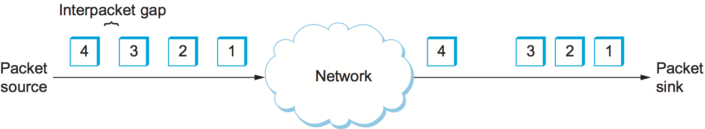

**الشكل 1.20.** الاهتزاز الذي تُدخله الشبكة.

ولفهم صلة الاهتزاز بالموضوع، افترض أن الحزم المرسلة عبر الشبكة تحتوي إطارات فيديو، وأن المستقبل يحتاج، لعرض هذه الإطارات على الشاشة، إلى استقبال إطار جديد كل 33 ms. فإذا وصل إطار مبكّرًا، أمكن للمستقبل أن يحفظه ببساطة إلى حين موعد عرضه. ولسوء الحظ، إذا وصل إطار متأخرًا، فلن يكون لدى المستقبل الإطار الذي يحتاجه في الوقت المناسب لتحديث الشاشة، وستتضرّر جودة الفيديو؛ فلن يكون سلسًا. لاحظ أنه لا يلزم إزالة الاهتزاز، بل معرفة مدى سوئه فقط. والسبب في ذلك أن المستقبل، إذا عرف الحدّين الأعلى والأدنى للكمون الذي قد تعانيه حزمة، أمكنه تأخير موعد بدء تشغيل الفيديو (أي عرض الإطار الأول) بما يكفي لضمان أن يكون لديه دائمًا إطار يعرضه حين يحتاج إليه. ويؤخّر المستقبل الإطار، فيُنعّم الاهتزاز فعليًا، بتخزينه في مخزن مؤقت.

## منظور: سرعة الميزات

يعرّف هذا الفصل بعض الأطراف المعنيّة في شبكات الحاسوب — مصمّمو الشبكات، ومطوّرو التطبيقات، والمستخدمون النهائيون، ومشغّلو الشبكات — للمساعدة في تحفيز المتطلّبات التقنية التي تُشكّل كيفية تصميم الشبكات وبنائها. وهذا يفترض أن كل قرارات التصميم تقنية بحتة، لكن هذا ليس هو الحال عادةً بالطبع. فثمة عوامل أخرى كثيرة، من قوى السوق إلى السياسات الحكومية إلى الاعتبارات الأخلاقية، تؤثّر أيضًا في كيفية تصميم الشبكات وبنائها.

ومن بين هذه العوامل، السوق هو الأكثر تأثيرًا، ويقابل التفاعل بين مشغّلي الشبكات (مثل AT&T وComcast وVerizon وDT وNTT وChina Unicom)، ومورّدي معدّات الشبكات (مثل Cisco وJuniper وEricsson وNokia وHuawei وNEC)، ومقدّمي التطبيقات والخدمات (مثل Facebook وGoogle وAmazon وMicrosoft وApple وNetflix وSpotify)، وبالطبع المشتركون والعملاء (أي الأفراد، ولكن أيضًا المؤسسات والأعمال). والحدود بين هؤلاء الفاعلين ليست واضحة دائمًا، وكثير من الشركات تؤدّي أدوارًا متعددة. وأبرز الأمثلة على ذلك مقدّمو السحابة الكبار، الذين (أ) يبنون معدّات تشبيكهم الخاصة من مكوّنات جاهزة، و(ب) ينشرون شبكاتهم الخاصة ويشغّلونها، و(ج) يقدّمون خدمات وتطبيقات للمستخدم النهائي فوق شبكاتهم.

وحين تأخذ هذه العوامل الأخرى في الحسبان في عملية التصميم التقني، تدرك أن ثمة افتراضين ضمنيين في نسخة الكتاب المدرسي من القصة يحتاجان إلى إعادة تقييم. أحدهما أن تصميم شبكة نشاط يُنجز مرة واحدة: يُبنى مرة ويُستخدم إلى الأبد (باستثناء ترقيات العتاد ليستمتع المستخدمون بمزايا أحدث تحسينات الأداء). والثاني أن مهمة بناء الشبكة منفصلة إلى حدّ كبير عن مهمة تشغيلها. وليس أي من هذين الافتراضين صحيحًا تمامًا.

فمن الواضح أن تصميم الشبكة يتطوّر، وقد وثّقنا هذه التغيّرات مع كل طبعة جديدة من الكتاب على مرّ السنين. وقد كان ذلك كافيًا تاريخيًا على خطّ زمني يُقاس بالسنوات، لكن أي شخص حمّل أحدث تطبيق هاتف ذكي واستخدمه يعرف كم يبدو أي شيء يُقاس بالسنوات بطيئًا بطءًا جليديًا بمعايير اليوم. ولا بدّ أن يكون التصميم من أجل التطوّر جزءًا من عملية اتخاذ القرار.

أما النقطة الثانية، فالشركات التي تبني الشبكات هي نفسها تقريبًا دائمًا التي تشغّلها. وتُعرف مجتمعةً باسم *مشغّلي الشبكات*، وتشمل الشركات المذكورة أعلاه. ولكن إذا نظرنا مرة أخرى إلى السحابة ملهمًا، نجد أن مبدأ «طوّر وشغّل» ليس صحيحًا على مستوى الشركة فحسب، بل هو أيضًا كيفية تنظيم أسرع شركات السحابة لفِرقها الهندسية: حول نموذج *DevOps*. (وإن لم تكن تعرف DevOps، نوصي بقراءة *Site Reliability Engineering: How Google Runs Production Systems* لترى كيف يُمارَس.)

وما يعنيه هذا كله أن شبكات الحاسوب الآن في خضمّ تحوّل كبير، إذ يحاول مشغّلو الشبكات أن يعجّلوا في الوقت نفسه وتيرة الابتكار (وتُسمى أحيانًا سرعة الميزات) وأن يواصلوا تقديم خدمة موثوقة (أي الحفاظ على الاستقرار). وهم يفعلون ذلك بصورة متزايدة بتبنّي أفضل ممارسات مقدّمي السحابة، ويمكن تلخيصها في محورين كبيرين: (1) الاستفادة من العتاد الجاهز ونقل كل الذكاء إلى البرمجيات، و(2) تبنّي عمليات هندسية رشيقة تُفكّك الحواجز بين التطوير والتشغيل.

ويُسمّى هذا التحوّل أحيانًا «سحابة» الشبكة أو «برمجنة» الشبكة، ومع أن الإنترنت كان دائمًا يملك منظومة برمجية متينة، فقد كانت محدودة تاريخيًا بالتطبيقات التي تعمل *فوق* الشبكة (باستخدام واجهة المقبس الموصوفة في القسم 1.4 مثلًا). وما تغيّر أنه اليوم تُطبّق هذه الممارسات الهندسية المستوحاة من السحابة نفسها على *داخل* الشبكة. وهذا النهج الجديد، المعروف باسم *الشبكات المعرَّفة بالبرمجيات* (SDN)، يغيّر قواعد اللعبة، لا من حيث كيفية معالجتنا للتحدّيات التقنية الجذرية كالتأطير والتوجيه والتقطيع وإعادة التجميع وجدولة الحزم والتحكّم في الازدحام والأمن وغيرها، بل من حيث سرعة تطوّر الشبكة لدعم ميزات جديدة.

وهذا التحوّل مهم إلى حدّ أننا نعود إليه في قسم *المنظور* في نهاية كل فصل. وكما ستستكشف هذه المناقشات، فإن ما يحدث في صناعة التشبيك يتعلّق جزئيًا بالتقنية، لكنه يتعلّق جزئيًا أيضًا بعوامل عديدة غير تقنية، وكل ذلك شاهد على عمق تجذّر الإنترنت في حياتنا.

> **منظور أوسع**
>
> لمواصلة القراءة عن «سحابة» الإنترنت، انظر Perspective: Race to the Edge.
>
> ولمعرفة المزيد عن DevOps، نوصي بـ: [Site Reliability Engineering: How Google Runs Production Systems](https://www.amazon.com/Site-Reliability-Engineering-Production-Systems/dp/149192912X/ref=pd_bxgy_14_img_2/131-5109792-2268338?_encoding=UTF8&pd_rd_i=149192912X&pd_rd_r=4b77155f-234d-11e9-944e-278ce23a35b5&pd_rd_w=qIfxg&pd_rd_wg=12dE2&pf_rd_p=6725dbd6-9917-451d-beba-16af7874e407&pf_rd_r=5GN656H9VEG4WEVGB728&psc=1&refRID=5GN656H9VEG4WEVGB728)، 2016.

[^1]: ليس «في أسرع وقت ممكن» تمامًا… تشير أبحاث العوامل البشرية إلى أن 300 ms حدّ أعلى معقول لمقدار تأخير الذهاب والعودة الذي يمكن تحمّله في مكالمة هاتفية قبل أن يشتكي البشر، وأن تأخير 100 ms يبدو جيدًا جدًا.

[^2]: استخدام السحب لتمثيل الشبكات يسبق مصطلح *الحوسبة السحابية* بعقدين على الأقل، لكن الصلة بين الاستخدامين تزداد ثراءً، ونستكشفها في مناقشة *المنظور* في نهاية كل فصل.
