# الفصل 7: البيانات بين الطرفين

**Larry Peterson and Bruce Davie**

> إنه خطأ جسيم أن تنظّر قبل أن تكون لديك بيانات. *—السير آرثر كونان دويل*

## المسألة: ماذا نفعل بالبيانات؟

من منظور الشبكة، ترسل برامج التطبيقات رسائل بعضها إلى بعض. وكل رسالة من هذه الرسائل مجرد سلسلة بايتات غير مفسَّرة. غير أن هذه الرسائل، من منظور التطبيق، تحتوي أنواعًا مختلفة من *البيانات* — مصفوفات من الأعداد الصحيحة، وإطارات فيديو، وأسطر نص، وصورًا رقمية، وهكذا. وبعبارة أخرى، لهذه البايتات معنى. وننظر الآن في مسألة كيف نرمّز على أفضل وجه الأنواع المختلفة من البيانات التي تريد برامج التطبيقات تبادلها في سلاسل بايتات. وهذا شبيه في وجوه كثيرة بمسألة ترميز سلاسل البايتات في إشارات كهرمغنطيسية، التي رأيناها في فصل سابق.

وبالعودة إلى مناقشتنا للترميز، فثمّة هاجسان جوهريان. الأول أن يكون المستقبِل قادرًا على استخلاص الرسالة نفسها من الإشارة التي أرسلها المرسل؛ وهذه هي مسألة التأطير. والثاني جعل الترميز فعّالًا قدر الإمكان. وكلا الهاجسين حاضران أيضًا عند ترميز بيانات التطبيق في رسائل شبكية.

ولكي يستخلص المستقبِل الرسالة التي أرسلها المرسل، يحتاج الجانبان إلى الاتفاق على صيغة للرسالة تُسمّى غالبًا *صيغة العرض*. فإن أراد المرسل أن يرسل إلى المستقبِل مصفوفة من الأعداد الصحيحة، مثلًا، فعلى الجانبين أن يتفقا على شكل كل عدد صحيح (طول بتاته، وترتيب بايتاته، وهل تأتي البتة الأكثر دلالة أولًا أم أخيرًا، مثلًا) وعلى عدد العناصر في المصفوفة. ويصف القسم الأول ترميزات مختلفة لبيانات الحاسوب التقليدية، كالأعداد الصحيحة وأعداد الفاصلة العائمة وسلاسل المحارف والمصفوفات والبنى. وثمّة أيضًا صيغ راسخة للبيانات الوسائطية: فالفيديو، مثلًا، يُنقل عادةً بإحدى الصيغ التي أنشأتها *مجموعة خبراء الصور المتحركة* (MPEG)، والصور الثابتة تُنقل عادةً بصيغة *مجموعة خبراء التصوير المشتركة* (JPEG). وتُناقش المسائل الخاصة التي تنشأ في ترميز البيانات الوسائطية في القسم التالي.

وأنواع البيانات الوسائطية تستلزم منا التفكير في العرض و*الضغط* معًا. فالصيغ المعروفة لنقل الصوت والفيديو وتخزينهما تعالج هذين الهاجسين: التأكد من أن ما سُجّل أو صُوّر أو سُمِع عند المرسل يمكن تفسيره تفسيرًا صحيحًا عند المستقبِل، وفعل ذلك على نحو لا يُغرق الشبكة بكمّيات هائلة من البيانات الوسائطية.

وللضغط، وبوجه أعمّ لكفاءة الترميز، تاريخ غنيّ يعود إلى عمل شانون الرائد في نظرية المعلومات في أربعينيات القرن الماضي. وفي الواقع، ثمّة قوتان متعارضتان تعملان هنا. ففي اتجاه، تريد أكبر قدر ممكن من التكرار في البيانات حتى يستطيع المستقبِل استخلاص البيانات الصحيحة حتى إن دخلت أخطاء على الرسالة. وشيفرات كشف الأخطاء وتصحيحها التي رأيناها في فصل سابق تضيف معلومات مكرّرة إلى الرسائل لهذا الغرض بالضبط. وفي الاتجاه الآخر، نريد إزالة أكبر قدر ممكن من التكرار من البيانات حتى نرمّزها بأقلّ عدد ممكن من البتات. وقد تبيّن أن البيانات الوسائطية تتيح فرصًا وفيرة للضغط بسبب طريقة معالجة حواسّنا وأدمغتنا للإشارات البصرية والسمعية. فنحن لا نسمع الترددات العالية جيدًا كالمنخفضة، ولا نلاحظ التفاصيل الدقيقة مثلما نلاحظ الصورة الأكبر في الصورة، خصوصًا إن كانت الصورة متحركة.

والضغط مهم لمصمّمي الشبكات لأسباب كثيرة، لا لمجرد أننا قلّما نجد عرض نطاق وفيرًا في كل مكان من الشبكة. فمثلًا، طريقة تصميمنا لخوارزمية ضغط تؤثر في حساسيتنا للبيانات المفقودة أو المتأخرة، ومن ثمّ قد تؤثر في تصميم آليات تخصيص الموارد وبروتوكولات الطرف إلى الطرف. وبالمقابل، إن لم تكن الشبكة الكامنة قادرة على ضمان مقدار ثابت من عرض النطاق مدة مؤتمر فيديو، فقد نختار تصميم خوارزميات ضغط قادرة على التكيّف مع أحوال الشبكة المتغيّرة.

وأخيرًا، فمن الجوانب المهمة في تنسيق العرض وضغط البيانات معًا أنهما يستلزمان من المضيف المرسل والمستقبِل معالجة كل بايت من البيانات في الرسالة. ولهذا السبب تُسمّى دالة تنسيق العرض والضغط أحيانًا دوال *معالجة البيانات*. وهذا يقابل معظم البروتوكولات التي رأيناها حتى هذه النقطة، وهي تعالج رسالة دون أن تنظر في محتواها أبدًا. وبسبب هذه الحاجة إلى قراءة كل بايت من البيانات في الرسالة والحساب عليه وكتابته، تؤثر معالجة البيانات في الإنتاجية من الطرف إلى الطرف عبر الشبكة. وقد تكون هذه المعالجة في بعض الأحوال العامل المحدِّد.

## 7.1 تنسيق العرض

من أشيع تحويلات بيانات الشبكة التحويل من التمثيل الذي يستخدمه برنامج التطبيق إلى صيغة تصلح للنقل عبر الشبكة و*العكس*. ويُسمّى هذا التحويل عادةً *تنسيق العرض*. وكما يوضّح الشكل 7.1، يترجم البرنامج المرسل البيانات التي يريد نقلها من التمثيل الذي يستخدمه داخليًا إلى رسالة يمكن نقلها عبر الشبكة؛ أي إن البيانات *تُرمَّز* في رسالة. وفي جانب الاستقبال، يترجم التطبيق هذه الرسالة الواصلة إلى تمثيل يستطيع معالجته بعد ذلك؛ أي إن الرسالة *تُفكّ*. وتُسمّى هذه العملية أحيانًا *حشو المعاملات* أو *التسلسل*. وهذا المصطلح يأتي من عالم استدعاء الإجراء عن بعد (RPC)، حيث يظن العميل أنه يستدعي إجراءً بمجموعة من المعاملات، ثم «تُجمع هذه المعاملات وتُرتَّب بطريقة مناسبة وفعّالة» لتكوّن رسالة شبكية.

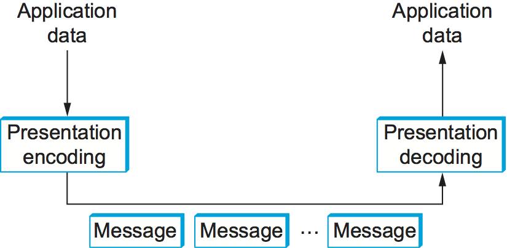

**الشكل 7.1.** تنسيق العرض يستلزم ترميز بيانات التطبيق وفكّ ترميزها.

وقد تسأل ما الذي يجعل هذه المسألة صعبة. أحد الأسباب أن الحواسيب تمثّل البيانات بطرق مختلفة. فمثلًا تمثّل بعض الحواسيب أعداد الفاصلة العائمة بصيغة معيار IEEE 754، بينما تستخدم بعض الآلات الأقدم صيغة خاصة بها غير معيارية. وحتى في أمر بسيط كالأعداد الصحيحة، تستخدم المعماريات المختلفة أحجامًا مختلفة (16 بتة و32 بتة و64 بتة، مثلًا). والأسوأ من ذلك أن الأعداد الصحيحة تُمثَّل في بعض الآلات بصيغة *الطرف الكبير* (تكون البتة الأكثر دلالة في الكلمة — «الطرف الكبير» — في البايت ذي العنوان الأدنى)، بينما تُمثَّل في آلات أخرى بصيغة *الطرف الصغير* (تكون البتة الأقل دلالة — «الطرف الصغير» — في البايت ذي العنوان الأدنى). فمثلًا معالجات PowerPC آلات ذات طرف كبير، وعائلة Intel x86 معمارية ذات طرف صغير. واليوم تدعم معماريات كثيرة (كـARM) التمثيلين (فتُسمّى *ثنائية الطرف*)، لكن المقصود أنه لا يمكنك أبدًا أن تتأكد كيف يخزّن المضيف الذي تتواصل معه الأعداد الصحيحة. ويُعرض تمثيل العدد الصحيح 34,677,374 بصيغتي الطرف الكبير والطرف الصغير في الشكل 7.2.

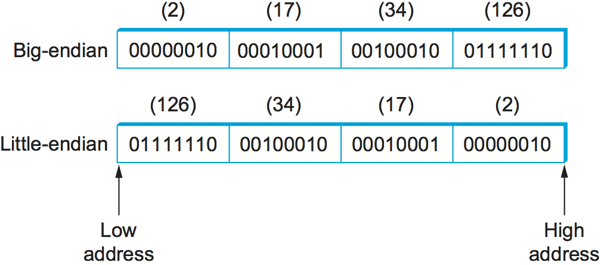

**الشكل 7.2.** ترتيب بايتات الطرف الكبير والطرف الصغير للعدد الصحيح 34,677,374

وسبب آخر لصعوبة الحشو أن برامج التطبيقات مكتوبة بلغات مختلفة، وحتى حين تستخدم لغة واحدة فقد يكون هناك أكثر من مصنِّف واحد. فمثلًا للمصنِّفات قدر معتبر من الحرية في كيفية تخطيط البنى (السجلات) في الذاكرة، ككم الحشو الذي تضعانه بين الحقول التي تكوّن البنية. ومن ثمّ لا تستطيع أن تنقل بنية ببساطة من آلة إلى أخرى، حتى إن كانت الآلتان من المعمارية نفسها والبرنامج مكتوبًا باللغة نفسها، لأن المصنِّف على الآلة الهدف قد يحاذي الحقول في البنية محاذاة مختلفة.

### 7.1.1 تصنيف

مع أن حشو المعاملات ليس علم صواريخ — إنه مسألة صغيرة من التلاعب بالبتات — فثمّة عدد مفاجئ من خيارات التصميم التي عليك معالجتها. نبدأ بإعطاء تصنيف بسيط لنظم حشو المعاملات. وما يلي ليس التصنيف الوحيد الصالح بأي حال، لكنه كافٍ لتغطية معظم البدائل المثيرة للاهتمام.

#### أنواع البيانات

السؤال الأول أي أنواع البيانات سيدعمها النظام. وبوجه عام يمكننا تصنيف الأنواع التي تدعمها آلية حشو المعاملات في ثلاثة مستويات. ويُعقّد كل مستوى المهمة التي تواجه نظام الحشو.

في أدنى مستوى، يعمل نظام الحشو على مجموعة من *الأنواع الأساسية*. والأنواع الأساسية تتضمن عادةً الأعداد الصحيحة وأعداد الفاصلة العائمة والمحارف. وقد يدعم النظام أيضًا الأنواع الترتيبية والقيم المنطقية. وكما وصفنا أعلاه، فإن معنى مجموعة الأنواع الأساسية أن عملية الترميز يجب أن تكون قادرة على تحويل كل نوع أساسي من تمثيل إلى آخر — كتحويل عدد صحيح من الطرف الكبير إلى الطرف الصغير.

وفي المستوى التالي *الأنواع المسطّحة* — البنى والمصفوفات. ومع أن الأنواع المسطّحة قد لا تبدو للوهلة الأولى معقِّدة لحشو المعاملات، فالواقع أنها كذلك. والمسألة أن المصنِّفات المستخدمة لتجميع برامج التطبيقات تُدخل أحيانًا حشوًا بين الحقول التي تكوّن البنية كي تحاذي هذه الحقول على حدود الكلمات. ونظام الحشو *يحزم* البنى عادةً بحيث لا تحتوي حشوًا.

وفي أعلى مستوى، قد يضطر نظام الحشو إلى التعامل مع *الأنواع المعقّدة* — تلك الأنواع المبنية باستخدام المؤشرات. أي إن بنية البيانات التي يريد برنامج أن يرسلها إلى آخر قد لا تكون محتواة في بنية واحدة، بل قد تتضمن مؤشرات من بنية إلى أخرى. والشجرة مثال جيد على نوع معقّد يتضمن مؤشرات. ومن الواضح أن مرمّز البيانات يجب أن يهيّئ بنية البيانات للنقل عبر الشبكة، لأن المؤشرات تُنفَّذ بعناوين الذاكرة، ولمجرد أن بنية تسكن عند عنوان ذاكرة معيّن على آلة ما لا يعني أنها ستسكن عند العنوان نفسه على آلة أخرى. وبعبارة أخرى، يجب على نظام الحشو أن *يسلسل* (يمسّط) بنى البيانات المعقّدة.

وخلاصةً، فبحسب مدى تعقيد نظام الأنواع، تستلزم مهمة حشو المعاملات عادةً تحويل الأنواع الأساسية، وحزم البنى، وخطّية بنى البيانات المعقّدة، وكل ذلك لتكوين رسالة متجاورة يمكن نقلها عبر الشبكة. ويوضّح الشكل 7.3 هذه المهمة.

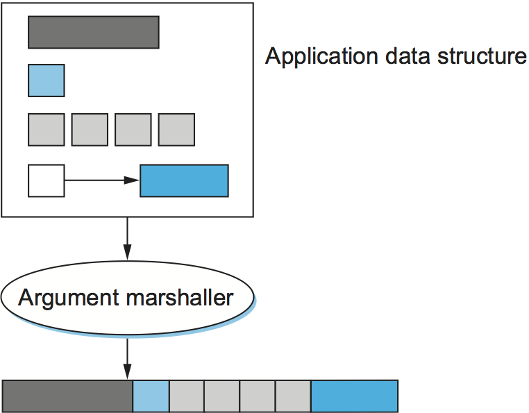

**الشكل 7.3.** حشو المعاملات: التحويل والحزم والخطّية

#### استراتيجية التحويل

متى ثبت نظام الأنواع، فالمسألة التالية أي استراتيجية تحويل سيستخدمها حاشي المعاملات. وثمّة خياران عامّان: *الصيغة الوسيطة المعيارية* و*المستقبِل يصحّح*. وننظر في كل منهما بدوره.

فكرة الصيغة الوسيطة المعيارية أن نستقرّ على تمثيل خارجي لكل نوع؛ فيترجم المضيف المرسل من تمثيله الداخلي إلى هذا التمثيل الخارجي قبل إرسال البيانات، ويترجم المستقبِل من هذا التمثيل الخارجي إلى تمثيله المحلي عند استقبال البيانات. ولتوضيح الفكرة، لننظر في البيانات الصحيحة؛ وتُعالَج الأنواع الأخرى معالجة مشابهة. قد تعلن أن صيغة الطرف الكبير ستُستخدم تمثيلًا خارجيًا للأعداد الصحيحة. فعلى المضيف المرسل أن يترجم كل عدد صحيح يرسله إلى صيغة الطرف الكبير، وعلى المضيف المستقبِل أن يترجم الأعداد الصحيحة ذات الطرف الكبير إلى أي تمثيل يستخدمه. (وهذا ما يُفعل في الإنترنت لترويسات البروتوكولات.) وبالطبع قد يكون مضيف معيّن يستخدم صيغة الطرف الكبير أصلًا، وفي هذه الحالة لا يلزم أي تحويل.

أما البديل، أي المستقبِل يصحّح، فيرسل فيه المرسل البيانات بصيغته الداخلية؛ فلا يحوّل المرسل الأنواع الأساسية، لكن عليه عادةً أن يحزم بنى البيانات الأكثر تعقيدًا ويمسّطها. ثم يكون المستقبِل مسؤولًا عن ترجمة البيانات من صيغة المرسل إلى صيغته المحلية. ومسألة هذه الاستراتيجية أن على كل مضيف أن يكون مستعدًّا لتحويل البيانات من كل معماريات الآلات الأخرى. وهذا يُعرف في الشبكات بـ*حلّ N بـN*: فعلى كل معمارية من N معمارية أن تكون قادرة على التعامل مع كل المعماريات الـN. وفي المقابل، في نظام يستخدم صيغة وسيطة معيارية، يحتاج كل مضيف إلى معرفة كيفية التحويل بين تمثيله وتمثيل آخر واحد فقط — التمثيل الخارجي.

فاستخدام صيغة خارجية مشتركة هو الشيء الصحيح بجلاء، أليس كذلك؟ لقد كان ذلك بالتأكيد الحكمة التقليدية في مجتمع الشبكات أكثر من 30 سنة. غير أن الجواب ليس محسومًا. فقد تبيّن أنه ليس هناك تمثيلات كثيرة مختلفة للأصناف الأساسية المختلفة، أو بعبارة أخرى، N ليست كبيرة إلى ذلك الحد. وفضلًا عن ذلك، فالحالة الأكثر شيوعًا أن تتواصل آلتان من النوع نفسه. وفي هذه الحالة يبدو سخيفًا ترجمة البيانات من تمثيل تلك المعمارية إلى تمثيل خارجي غريب، ثم إعادة ترجمتها إلى تمثيل المعمارية نفسها عند المستقبِل.

وثمّة خيار ثالث، مع أننا لا نعرف نظامًا قائمًا يستفيد منه، هو استخدام استراتيجية المستقبِل يصحّح إن علم المرسل أن الهدف من البنية نفسها؛ ويستخدم المرسل بعض الصيغ الوسيطة المعيارية إن كانت الآلتان من معماريتين مختلفتين. وكيف يتعلّم المرسل معمارية المستقبِل؟ يمكنه تعلّم هذه المعلومة من خادم أسماء أو باستخدام حالة اختبار بسيطة أولًا ليرى هل تحدث النتيجة المناسبة.

#### الوسوم

المسألة الثالثة في حشو المعاملات كيف يعرف المستقبِل نوع البيانات المحتواة في الرسالة التي يستقبلها. وثمّة نهجان شائعان: البيانات *الموسومة* وغير الموسومة. والنهج الموسوم أكثر بداهة، فوصفه أولًا.

الوسم أي معلومة إضافية تُضمَّن في رسالة — علاوةً على التمثيل الملموس للأنواع الأساسية — تساعد المستقبِل على فكّ الرسالة. وثمّة وسوم ممكنة عدة قد تُضمَّن في رسالة. فمثلًا قد يُعزَّز كل بند من البيانات بـ*وسم نوع*. ويدل وسم النوع على أن القيمة التالية عدد صحيح أو عدد فاصلة عائمة أو أي شيء آخر. ومثال آخر *وسم الطول*. ويُستخدم وسم كهذا للدلالة على عدد العناصر في مصفوفة أو على حجم عدد صحيح. ومثال ثالث *وسم المعمارية*، وقد يُستخدم مع استراتيجية المستقبِل يصحّح لتحديد المعمارية التي تولّدت فيها البيانات المحتواة في الرسالة. ويعرض الشكل 7.4 كيف يمكن ترميز عدد صحيح بسيط من 32 بتة في رسالة موسومة.

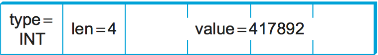

**الشكل 7.4.** عدد صحيح من 32 بتة مرمَّز في رسالة موسومة.

والبديل بالطبع ألّا تُستخدم الوسوم. فكيف يعرف المستقبِل كيفية فكّ البيانات في هذه الحالة؟ يعرف لأنه بُرِمج ليعرف. وبعبارة أخرى، إن استدعيت إجراءً بعيدًا يأخذ معاملين صحيحين وعدد فاصلة عائمة، فلا سبب لأن يفحص الإجراء البعيد الوسوم ليعرف ما استقبله للتوّ. إنه يفترض ببساطة أن الرسالة تحتوي عددين صحيحين وعدد فاصلة عائمة ويفكّها وفق ذلك. ولاحظ أن ذلك يعمل في معظم الأحوال، والمكان الوحيد الذي يفشل فيه هو إرسال مصفوفات متغيّرة الطول. وفي حالة كهذه يُستخدم وسم طول عادةً للدلالة على طول المصفوفة.

وتجدر الإشارة أيضًا إلى أن النهج غير الموسوم يعني أن تنسيق العرض من الطرف إلى الطرف حقًّا. فلا يمكن لوكيل وسيط أن يفسّر الرسالة إلا إن كانت البيانات موسومة. وقد تسأل لماذا يحتاج وكيل وسيط إلى تفسير رسالة؟ لقد حدثت أمور أغرب من ذلك، ناشئة في معظمها عن حلول *مرتجلة* لمشاكل غير متوقّعة لم يُهندَس النظام للتعامل معها. وسوء تصميم الشبكات يخرج عن نطاق هذا الكتاب.

#### الأجسام الوسيطة

الجسم الوسيط قطعة الشيفرة التي تنفّذ حشو المعاملات. وتُستخدم الأجسام الوسيطة عادةً لدعم RPC. ففي جانب العميل يحشو الجسم الوسيط معاملات الإجراء في رسالة يمكن نقلها ببروتوكول RPC. وفي جانب الخادم يحوّل الجسم الوسيط الرسالة رجوعًا إلى مجموعة من المتغيّرات يمكن استخدامها معاملات لاستدعاء الإجراء البعيد. ويمكن أن تكون الأجسام الوسيطة مفسَّرة أو مجمَّعة.

وفي نهج قائم على التجميع يكون لكل إجراء جسم وسيط مخصَّص للعميل وآخر للخادم. ومع أن كتابة الأجسام الوسيطة باليد ممكنة، فهي تُولَّد عادةً بمصنِّف أجسام وسيطة بناءً على وصف الواجهة البرمجية للإجراء. ويوضّح الشكل 7.5 هذه الحالة. ولأن الجسم الوسيط مجمَّع، فهو فعّال جدًا عادةً. وفي نهج قائم على التفسير يوفّر النظام أجسامًا وسيطة عامة للعميل والخادم تُضبط معاملاتها بوصف للواجهة البرمجية للإجراء. ولأن تغيير هذا الوصف سهل، فللأجسام الوسيطة المفسَّرة ميزة المرونة. والأجسام الوسيطة المجمَّعة أشيع في الممارسة.

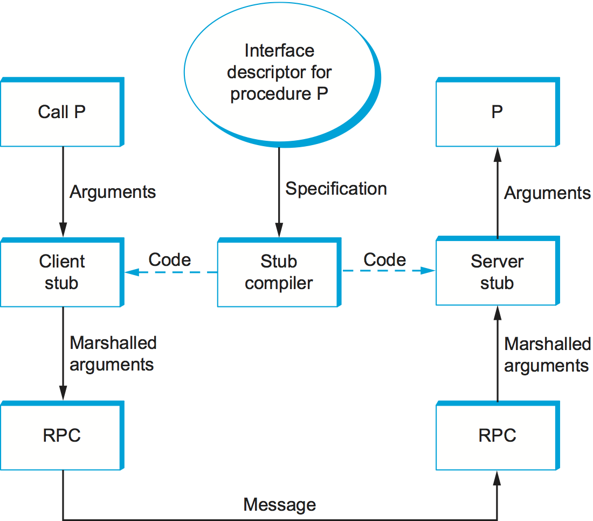

**الشكل 7.5.** مصنِّف الأجسام الوسيطة يأخذ وصف الواجهة مدخلًا ويُخرج أجسامًا وسيطة للعميل والخادم.

### 7.1.2 أمثلة (XDR وASN.1 وNDR وProtoBufs)

نصف الآن بإيجاز أربعة تمثيلات شائعة لبيانات الشبكة وفق هذا التصنيف. ونستخدم نوع العدد الصحيح الأساسي لتوضيح كيف يعمل كل نظام.

#### XDR

تمثيل البيانات الخارجي (XDR) هو صيغة الشبكة المستخدمة مع SunRPC. وفي التصنيف الذي قدّمناه للتوّ، فإن XDR

- يدعم نظام أنواع C كله ما عدا مؤشرات الدوال
- يعرّف صيغة وسيطة معيارية
- لا يستخدم وسومًا (إلا للدلالة على أطوال المصفوفات)
- يستخدم أجسامًا وسيطة مجمَّعة

والعدد الصحيح في XDR بند بيانات من 32 بتة يرمّز عددًا صحيحًا في C. ويُمثَّل بمتمّم الاثنين، مع البايت الأكثر دلالة من العدد الصحيح في C في البايت الأول من العدد الصحيح في XDR، والبايت الأقل دلالة من العدد الصحيح في C في البايت الرابع من العدد الصحيح في XDR. أي إن XDR يستخدم صيغة الطرف الكبير للأعداد الصحيحة. ويدعم XDR الأعداد الصحيحة الموقَّعة وغير الموقَّعة، كما يفعل C.

ويمثّل XDR المصفوفات المتغيّرة الطول بأن يحدّد أولًا عددًا صحيحًا غير موقَّع (4 بايتات) يعطي عدد العناصر في المصفوفة، ثم يتبع ذلك هذا العدد من العناصر من النوع المناسب. ويرمّز XDR مكوّنات البنية بترتيب إعلانها في البنية. وفي المصفوفات والبنى معًا يُمثَّل حجم كل عنصر/مكوّن بمضاعف لـ4 بايتات. وتُحشى أنواع البيانات الأصغر إلى 4 بايتات بالأصفار. والاستثناء من قاعدة «الحشو إلى 4 بايتات» هذه يُصنع للمحارف، وتُرمَّز محرفًا واحدًا لكل بايت.

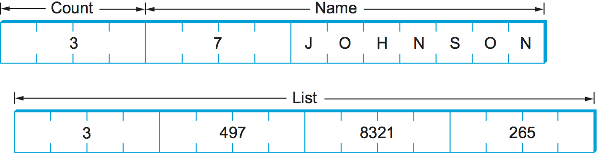

**الشكل 7.6.** مثال على ترميز بنية في XDR.

ويُعطي مقطع الشيفرة الآتي مثالًا على بنية C (item) وعلى روتين XDR الذي يرمّز هذه البنية ويفكّها (xdr_item). ويعرض الشكل 7.6 عرضًا تخطيطيًا تمثيل XDR للبنية على السلك حين يكون طول حقل الاسم سبعة محارف وتحتوي مصفوفة list ثلاثة قيم.

وفي هذا المثال، xdr_array وxdr_int وxdr_string ثلاث دوال أوّلية يوفّرها XDR لترميز المصفوفات والأعداد الصحيحة وسلاسل المحارف وفكّ ترميزها على التوالي. والمعامل xdrs متغيّر سياق يستخدمه XDR ليتتبّع موضعه في الرسالة التي يعالجها؛ ويتضمن راية تدلّ على هل يُستخدم هذا الروتين لترميز الرسالة أم لفكّها. وبعبارة أخرى، تُستخدم روتينات كـxdr_item في العميل والخادم معًا. ولاحظ أن مبرمج التطبيق يستطيع إما كتابة الروتين xdr_item باليد وإما استخدام مصنِّف أجسام وسيطة يُسمى rpcgen (غير معروض) لتوليد روتين الترميز/فكّ الترميز هذا. وفي الحالة الأخيرة يأخذ rpcgen الإجراء البعيد الذي يعرّف بنية البيانات item مدخلًا ويُخرج الجسم الوسيط المقابل.

```c
#define MAXNAME 256;
#define MAXLIST 100;

struct item {
  int     count;
  char    name[MAXNAME];
  int     list[MAXLIST];
};

bool_t
xdr_item(XDR *xdrs, struct item *ptr)
{
   return(xdr_int(xdrs, &ptr->count) &&
      xdr_string(xdrs, &ptr->name, MAXNAME) &&
      xdr_array(xdrs, &ptr->list, &ptr->count, MAXLIST,
                sizeof(int), xdr_int));
}
```

ومدى أداء XDR يعتمد بالطبع على تعقيد البيانات. ففي حالة بسيطة كمصفوفة أعداد صحيحة، حيث يجب تحويل كل عدد صحيح من ترتيب بايتات إلى آخر، يلزم في المتوسط ثلاث تعليمات لكل بايت، ومعناه أن تحويل المصفوفة كلها مرجّح أن يكون محدودًا بعرض نطاق الذاكرة في الآلة. أما التحويلات الأكثر تعقيدًا التي تستلزم تعليمات أكثر بكثير لكل بايت فستكون محدودة بالمعالج، ومن ثمّ ستؤدي بمعدّل بيانات أقلّ من عرض نطاق الذاكرة.

#### ASN.1

تدوين الصيغة المجرَّدة واحد (ASN.1) معيار ISO يعرّف، بين أمور أخرى، تمثيلًا للبيانات المرسلة عبر شبكة. ويُسمّى الجزء الخاص بالتمثيل في ASN.1 *قواعد الترميز الأساسية* (BER). ويدعم ASN.1 نظام أنواع C بلا مؤشرات الدوال، ويعرّف صيغة وسيطة معيارية، ويستخدم وسوم الأنواع. ويمكن أن تكون أجسامه الوسيطة مفسَّرة أو مجمَّعة. ومن أسباب شهرة ASN.1 BER أنه يستخدمه معيار الإنترنت البسيط لإدارة الشبكات (SNMP).

ويمثّل ASN.1 كل بند من البيانات بثلاثية من الشكل

```text
(tag, length, value)
```

والوسم عادةً حقل من 8 بتات، وإن كان ASN.1 يتيح تعريف وسوم متعددة البايتات. ويحدّد حقل الطول كم بايتًا يكوّن القيمة؛ ونناقش الطول أكثر أدناه. ويمكن بناء الأنواع المركّبة، كالبنى، بتعشيش الأنواع الأوّلية، كما يوضّح الشكل 7.7.

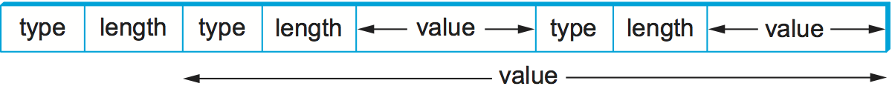

**الشكل 7.7.** أنواع مركّبة تُنشأ بالتعشيش في ASN.1 BER.

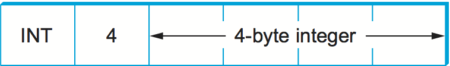

**الشكل 7.8.** تمثيل ASN.1 BER لعدد صحيح من 4 بايتات.

فإن كانت القيمة طولها 127 بايتًا أو أقل، حُدِّد الطول في بايت واحد. وهكذا، مثلًا، يُرمَّز عدد صحيح من 32 بتة بنوع من بايت واحد، وطول من بايت واحد، والأربعة بايتات التي ترمّز العدد الصحيح، كما يوضّح الشكل 7.8. والقيمة نفسها، في حالة عدد صحيح، تُمثَّل بمتمّم الاثنين وبصيغة الطرف الكبير، كما في XDR. وأبقِ في ذهنك أنه مع أن قيمة العدد الصحيح تُمثَّل بالطريقة نفسها تمامًا في XDR وASN.1، فتمثيل XDR ليس فيه وسم النوع ولا وسم الطول المرتبطان بذلك العدد الصحيح. وهذان الوسمان يشغلان مساحة في الرسالة، والأهم أنهما يستلزمان معالجة أثناء الحشو وفكّ الحشو. وهذا أحد أسباب عدم كفاءة ASN.1 كفاءة XDR. وسبب آخر أن مجرد وجود حقل طول قبل كل قيمة بيانات يعني أن قيمة البيانات غير مرجّح أن تقع على حدّ بايت طبيعي (كعدد صحيح يبدأ على حدّ كلمة). وهذا يعقّد عملية الترميز وفكّ الترميز.

وإن كانت القيمة طولها 128 بايتًا أو أكثر، استُخدمت بايتات متعددة لتحديد طولها. وعند هذه النقطة قد تسأل لماذا يستطيع بايت واحد تحديد طول يصل إلى 127 بايتًا لا 256. والسبب أن بتة واحدة من حقل الطول تُستخدم للدلالة على طول حقل الطول. فالصفر في البتة الثامنة يدلّ على حقل طول من بايت واحد. ولتحديد طول أطول تُضبط البتة الثامنة على 1، وتدلّ البتات السبع الأخرى على كم بايتًا إضافيًا يكوّن الطول. ويوضّح الشكل 7.9 طولًا بسيطًا من بايت واحد وطولًا متعدّد البايتات.

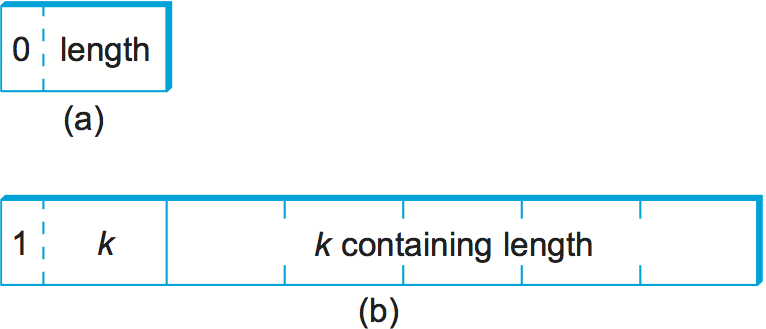

**الشكل 7.9.** تمثيل ASN.1 BER للطول: (أ) بايت واحد؛ (ب) متعدّد البايتات.

#### NDR

تمثيل بيانات الشبكة (NDR) معيار ترميز البيانات المستخدم في بيئة الحوسبة الموزّعة (DCE). وخلافًا لـXDR وASN.1، يستخدم NDR استراتيجية المستقبِل يصحّح. ويفعل ذلك بإدخال وسم معمارية في مقدّمة كل رسالة؛ وبنود البيانات الفردية غير موسومة. ويستخدم NDR مصنِّفًا لتوليد الأجسام الوسيطة. ويأخذ هذا المصنِّف وصفًا لبرنامج مكتوب بلغة تعريف الواجهات (IDL) ويولّد الأجسام الوسيطة اللازمة. وتشبه IDL لغة C إلى حدّ بعيد، فتسند نظام أنواع C في جوهره.

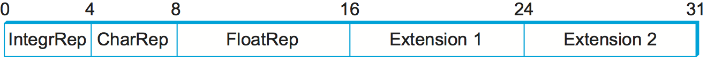

**الشكل 7.10.** وسم معمارية NDR.

ويوضّح الشكل 7.10 وسم تعريف المعمارية ذا الأربعة بايتات الذي يُضمَّن في مقدّمة كل رسالة مرمَّزة بـNDR. ويحتوي البايت الأول حقلين من 4 بتات. فالحقل الأول، IntegrRep، يعرّف صيغة كل الأعداد الصحيحة المحتواة في الرسالة. والصفر في هذا الحقل يدلّ على أعداد صحيحة بالطرف الكبير، والواحد على أعداد صحيحة بالطرف الصغير. ويدل حقل CharRep على صيغة المحارف المستخدمة: الصفر يعني ASCII (*الشيفرة الأمريكية الموحّدة لتبادل المعلومات*) والواحد يعني EBCDIC (بديل أقدم عرّفته IBM لـASCII). وبعد ذلك يعرّف بايت FloatRep أي تمثيل للفاصلة العائمة يُستخدم: الصفر يعني IEEE 754، والواحد يعني VAX، والاثنان يعنيان Cray، والثلاثة تعني IBM. والبايتان الأخيران محجوزان للاستخدام المستقبلي. ولاحظ أن NDR، في حالات بسيطة كمصفوفات الأعداد الصحيحة، يؤدّي مقدار العمل نفسه الذي يؤدّيه XDR، ومن ثمّ يستطيع بلوغ الأداء نفسه.

#### ProtoBufs

توفّر مخازن البروتوكول (ProtoBufs اختصارًا) طريقة محايدة تجاه اللغة والمنصّة لتسلسل البيانات المهيكلة، وتُستخدم عادةً مع gRPC. وهي تستخدم استراتيجية موسومة مع صيغة وسيطة معيارية، حيث يُولَّد الجسم الوسيط في الجانبين من ملف .proto مشترك. ويستخدم هذا الوصف صيغة بسيطة شبيهة بـC، كما يوضّح المثال الآتي:

```c
message Person {
   required string name = 1;
   required int32 id = 2;
   optional string email = 3;

   enum PhoneType {
       MOBILE = 0;
       HOME = 1;
       WORK = 2;
   }

   message PhoneNumber {
       required string number = 1;
       optional PhoneType type = 2 [default = HOME];
   }

   required PhoneNumber phone = 4;
}
```

حيث يمكن تفسير message تقريبًا على أنها مكافئة لـtypedef struct في C. وبقية المثال بديهية إلى حدّ بعيد، إلا أن كل حقل يُعطى معرّفًا عدديًا يكفل فرادته إن تغيّر الوصف مع الوقت، ويمكن وسم كل حقل بأنه إما مطلوب أو اختياري.

وطريقة ترميز ProtoBufs للأعداد الصحيحة مبتكرة. فهي تستخدم تقنية تُسمّى *الأعداد الصحيحة متغيّرة الطول* (varints) يستخدم فيها كل بايت من 8 بتات البتة الأكثر دلالة للدلالة على هل هناك مزيد من البايتات في العدد الصحيح، والبتات السبع الأقل دلالة لترميز تمثيل متمّم الاثنين للمجموعة التالية من سبع بتات في القيمة. والمجموعة الأقل دلالة تأتي أولًا في التسلسل.

ومعنى ذلك أن عددًا صحيحًا صغيرًا (أقلّ من 128) يمكن ترميزه في بايت واحد (فمثلًا يُرمَّز العدد الصحيح 2 بالشكل 0000 0010)، بينما يلزم لعدد صحيح أكبر من 128 مزيد من البايتات. فمثلًا يرمَّز 365 بالشكل

```text
1110 1101 0000 0010
```

ولترى ذلك، أسقط أولًا البتة الأكثر دلالة من كل بايت، لأنها موجودة لتخبرنا هل بلغنا نهاية العدد الصحيح. وفي هذا المثال تدلّ الـ1 في البتة الأكثر دلالة من البايت الأول على أن في العدد متغيّر الطول أكثر من بايت واحد:

```text
1110 1101 0000 0010
→ 110 1101  000 0010
```

ولأن الأعداد متغيّرة الطول تخزّن الأعداد بالمجموعة الأقل دلالة أولًا، فتعكس بعد ذلك مجموعتَي البتات السبع. ثم تصل بينهما لتحصل على قيمتك النهائية:

```text
000 0010  110 1101
→  000 0010 || 110 1101
→  101101101
→  256 + 64 + 32 + 8 + 4 + 1 = 365
```

وفي وصف الرسالة الأكبر، يمكنك التفكير في تدفّق البايتات المسلسل كمجموعة من أزواج مفتاح/قيمة، حيث للمفتاح (أي الوسم) جزءان فرعيان: المعرّف الفريد للحقل (تلك الأعداد الإضافية في ملف .proto المثال) و*نوع السلك* للقيمة (فمثلًا Varint هو نوع السلك الوحيد الذي رأيناه حتى الآن). ومن أنواع السلك المدعومة الأخرى 32-بت و64-بت (للأعداد الصحيحة ثابتة الطول)، ومحدَّد الطول (للسلاسل والرسائل المضمَّنة). وهذا الأخير يخبرك كم بايتًا يبلغ طول الرسالة المضمَّنة (البنية)، لكن وصف رسالة آخر في ملف .proto هو الذي يخبرك كيف تفسّر تلك البايتات.

### 7.1.3 لغات التوصيف (XML)

مع أننا كنا نناقش مسألة تنسيق العرض من منظور RPC — أي كيف يرمّز المرء أنواع البيانات الأوّلية وبنى البيانات المركّبة حتى يمكن إرسالها من برنامج عميل إلى برنامج خادم — فالمسألة الأساسية نفسها تحدث في سياقات أخرى. فمثلًا كيف يصف خادم ويب صفحة ويب بحيث يعرف أي عدد من المتصفحات المختلفة ما يعرضه على الشاشة؟ في هذه الحالة بعينها الجواب *لغة التوصيف فوق النصية* (HTML)، وهي تدلّ على أن سلاسل محارف معيّنة ينبغي عرضها بخط عريض أو مائل، وأي نوع خط وحجم يُستخدمان، وأين تُوضع الصور.

وقد أوجد توافر كل أنواع تطبيقات الويب وبياناتها حالةً تحتاج فيها تطبيقات ويب مختلفة إلى التواصل بعضها مع بعض وفهم بيانات بعضها. فمثلًا قد يحتاج موقع تجارة إلكترونية إلى التحدث إلى موقع شركة شحن ليتيح لعميل تتبّع طرد دون أن يغادر موقع التجارة الإلكترونية أبدًا. وهذا يبدأ سريعًا في الظهور شبيهًا جدًا بـRPC، والنهج المتبع في الويب اليوم لتمكين هذا التواصل بين خوادم الويب قائم على *لغة التوصيف القابلة للتوسّع* (XML) — وهي طريقة لوصف البيانات المتبادلة بين تطبيقات الويب.

ولغات التوصيف، ومنها HTML وXML، تأخذ نهج البيانات الموسومة إلى أقصاه. فالبيانات تُمثَّل نصًّا، وتُخلط وسوم نصية تُسمّى *توصيفًا* بنص البيانات للتعبير عن معلومات عن البيانات. وفي حالة HTML يدل التوصيف على كيفية عرض النص؛ ولغات توصيف أخرى كـXML تستطيع التعبير عن نوع البيانات وبناها.

وXML في الحقيقة إطار لتعريف لغات توصيف مختلفة لأنواع مختلفة من البيانات. فمثلًا استُخدمت XML لتعريف لغة توصيف مكافئة إلى حدّ ما لـHTML تُسمّى *لغة التوصيف فوق النصية القابلة للتوسّع* (XHTML). وتعرّف XML صيغة أساسية لخلط التوصيف بنص البيانات، لكن على مصمّم لغة توصيف معيّنة أن يسمّي توصيفها ويعرّفه. ومن الممارسات الشائعة الإشارة إلى اللغات القائمة على XML، كل على حدة، بـXML ببساطة، لكننا سنشدّد التمييز في هذه المادة التمهيدية.

وصيغة XML تشبه HTML كثيرًا. فمثلًا قد يبدو سجل موظف في لغة افتراضية قائمة على XML كالـ*مستند* الآتي، وقد يُخزَّن في ملف يُسمّى employee.xml. ويدل السطر الأول على إصدار XML المستخدم، وتمثّل الأسطر الباقية أربعة حقول تكوّن سجل الموظف، وآخرها (hiredate) يحتوي ثلاثة حقول فرعية. وبعبارة أخرى، تتوفر صيغة XML لبنية متعشّشة من أزواج وسم/قيمة، وهي مكافئة لبنية شجرية للبيانات الممثَّلة (وجذرها employee). وهذا شبيه بقدرة XDR وASN.1 وNDR على تمثيل الأنواع المركّبة، لكن بصيغة يمكن أن تعالجها البرامج ويقرأها البشر معًا. والأهم من ذلك أن برامج كالمحلِّلات يمكن استخدامها عبر لغات مختلفة قائمة على XML، لأن تعريفات تلك اللغات نفسها معبَّر عنها بيانات قابلة للقراءة بالآلة يمكن إدخالها إلى البرامج.

```xml
<?xml version="1.0"?>
<employee>
  <name>John Doe</name>
  <title>Head Bottle Washer</title>
  <id>123456789</id>
  <hiredate>
     <day>5</day>
     <month>June</month>
     <year>1986</year>
  </hiredate>
</employee>
```

ومع أن التوصيف والبيانات في هذا المستند موحية جدًا للقارئ البشري، فتعريف لغة سجل الموظف هو الذي يحدّد فعلًا أي الوسوم قانونية، وما تعنيه، وأي أنواع البيانات تدلّ عليها. فبلا تعريف رسمي ما للوسوم، لا يستطيع قارئ بشري (ولا حاسوب) أن يعرف هل 1986 في حقل year، مثلًا، سلسلة أم عدد صحيح أم عدد صحيح غير موقَّع أم عدد فاصلة عائمة.

وتُعطى تعريفات لغة معيّنة قائمة على XML بـ*مخطّط*، وهو مصطلح من قواعد البيانات يعني مواصفة لكيفية تفسير مجموعة بيانات. وقد عُرِّفت لغات مخطّطات عدة لـXML؛ وسنركّز هنا على المعيار الرائد المعروف باسم غير المفاجئ كثيرًا *مخطّط XML*. ويُعرف المخطّط الفردي المعرَّف باستخدام مخطّط XML بـ*مستند مخطّط XML* (XSD). وما يلي مواصفة XSD للمثال؛ أي إنها تعرّف اللغة التي يطابقها المستند المثال. وقد تُخزَّن في ملف يُسمّى employee.xsd.

```xml
<?xml version="1.0"?>
<schema xmlns="http://www.w3.org/2001/XMLSchema">
 <element name="employee">
   <complexType>
     <sequence>
       <element name="name" type="string"/>
       <element name="title" type="string"/>
       <element name="id" type="string"/>
       <element name="hiredate">
         <complexType>
           <sequence>
             <element name="day" type="integer"/>
             <element name="month" type="string"/>
             <element name="year" type="integer"/>
           </sequence>
         </complexType>
       </element>
     </sequence>
   </complexType>
 </element>
</schema>
```

وهذا الـXSD يبدو في الظاهر شبيهًا بمستند مثالنا employee.xml، ولسبب وجيه: فمخطّط XML نفسه لغة قائمة على XML. وثمّة علاقة جلية بين هذا الـXSD والمستند المعرَّف أعلاه. فمثلًا،

```xml
<element name="title" type="string"/>
```

تدلّ على أن القيمة المحاطة بالتوصيف title تُفسَّر سلسلةً. وتسلسل ذلك السطر وتعشيشه في الـXSD يدلّان على أن حقل title يجب أن يكون البند الثاني في سجل الموظف.

وخلافًا لبعض لغات المخطّطات، يوفّر مخطّط XML أنواع بيانات كالسلسلة والعدد الصحيح والعشري والقيمة المنطقية. ويتيح دمج أنواع البيانات في تسلسلات أو تعشيشها، كما في employee.xsd، لإنشاء أنواع بيانات مركّبة. فمخطّط XSD يعرّف أكثر من صيغة؛ إنه يعرّف نموذج بياناته المجرَّد الخاص. والمستند الذي يطابق الـXSD يمثّل مجموعة بيانات تطابق نموذج البيانات.

وأهمية أن يعرّف الـXSD نموذج بيانات مجرَّدًا لا صيغة فقط أن ثمة طرقًا أخرى غير XML لتمثيل البيانات التي تطابق النموذج. وXML، بعد كل شيء، له بعض المآخذ كتمثيل على السلك: فهو ليس مضغوطًا كغيره من تمثيلات البيانات، وهو بطيء نسبيًا في التحليل. وثمّة عدد من التمثيلات البديلة الموصوفة بأنها ثنائية قيد الاستخدام. فقد نشرت المنظمة الدولية للمعايير (ISO) واحدًا يُسمّى *Fast Infoset*، بينما أنتج اتحاد الويب العالمي (W3C) مقترح *تبادل XML الفعّال* (EXI). والتمثيلات الثنائية تضحّي بقراءة البشر لأجل ضغط أكبر وتحليل أسرع.

#### فضاءات أسماء XML

على XML أن يحلّ مسألة شائعة، هي تعارض الأسماء. وتنشأ المسألة لأن لغات المخطّطات كمخطّط XML تدعم التعديلية بمعنى أن المخطّط يمكن إعادة استخدامه جزءًا من مخطّط آخر. لنفترض أن مخطّطي XSD عُرِّفا استقلالًا، وجاء أن كليهما يعرّف اسم التوصيف *idNumber*. فلعلّ أحدهما يستخدم ذلك الاسم لتحديد موظفي شركة، والآخر يستخدمه لتحديد حواسيب محمولة تملكها الشركة. وقد نرغب في إعادة استخدام هذين المخطّطين في مخطّط XSD ثالث لوصف أي الأصول مرتبطة بأي الموظفين، لكن لفعل ذلك نحتاج آلية ما لتمييز أرقام هوية الموظفين من أرقام هوية الحواسيب المحمولة.

وحلّ XML لهذه المسألة هو *فضاءات أسماء XML*. وفضاء الأسماء مجموعة من الأسماء. ويُحدَّد كل فضاء أسماء XML بمعرّف مورد موحَّد (URI). وستُوصف المعرّفات URIs بقدر من التفصيل في فصل لاحق؛ ويكفي الآن أن تعرف أنها شكل من أشكال المعرّف الفريد عالميًا. (ومسار HTTP URL نوع خاص من URI.) ويمكن إضافة اسم توصيف بسيط كـ*idNumber* إلى فضاء أسماء ما ما دام فريدًا في ذلك الفضاء. ولأن فضاء الأسماء فريد عالميًا والاسم البسيط فريد داخل الفضاء، فاجتماعهما *اسم مؤهَّل* فريد عالميًا ولا يمكن أن يتعارض.

ويحدّد الـXSD عادةً *فضاء أسماء هدفًا* بسطر كالآتي:

```xml
targetNamespace="http://www.example.com/employee"
```

وهو معرّف مورد موحَّد يحدّد فضاء أسماء مصطنعًا. وكل التوصيف الجديد المعرَّف في ذلك الـXSD سينتمي إلى ذلك الفضاء.

والآن، إن أراد XSD أن يشير إلى أسماء عُرِّفت في مخطّطات XSD أخرى، فبوسعه ذلك بأن يؤهّل تلك الأسماء بسابقة فضاء أسماء. وهذه السابقة اختصار قصير للمعرّف URI الكامل الذي يحدّد فضاء الأسماء فعلًا. فمثلًا يعيّن السطر الآتي emp سابقةً لفضاء أسماء الموظفين:

```xml
xmlns:emp="http://www.example.com/employee"
```

وأي توصيف من ذلك الفضاء يُؤهَّل بأن تُسبق بـemp: ، كما في title في السطر الآتي:

```xml
<emp:title>Head Bottle Washer</emp:title>
```

وبعبارة أخرى، emp:title اسم مؤهَّل، ولن يتعارض مع الاسم title من فضاء أسماء آخر.

ومن اللافت كم يُستخدم XML اليوم على نطاق واسع في تطبيقات تتراوح من التواصل على نمط RPC بين الخدمات القائمة على الويب إلى أدوات إنتاجية المكاتب إلى المراسلة الفورية. وهو بالتأكيد أحد البروتوكولات الجوهرية التي تعتمد عليها اليوم الطبقات العليا من الإنترنت.

## 7.2 البيانات الوسائطية

صار للبيانات الوسائطية، المؤلفة من الصوت والفيديو والصور الثابتة، حصة الأغلبية من الحركة على الإنترنت اليوم. ومن الأمور التي جعلت انتقال الوسائط على نطاق واسع عبر الشبكات ممكنًا التقدّم في تقنيات الضغط. ولأن البيانات الوسائطية يستهلكها في الأغلب بشر باستخدام حواسّهم — البصر والسمع — ويعالجها الدماغ البشري، فثمّة تحديات فريدة في ضغطها. فتريد أن تحاول إبقاء المعلومات الأكثر أهمية للإنسان، والتخلّص من كل ما لا يحسّن إدراك الإنسان للتجربة البصرية أو السمعية. ومن ثمّ تدخل علوم الحاسوب ودراسة الإدراك البشري معًا في المسألة. وفي هذا القسم سننظر في بعض الجهود الكبرى في تمثيل البيانات الوسائطية وضغطها.

واستخدامات الضغط ليست مقصورة على البيانات الوسائطية بالطبع؛ فمثلًا ربما استخدمت أداة كـzip أو compress لتضغط ملفات قبل إرسالها عبر شبكة، أو لفكّ ضغط ملف بعد تنزيله. وقد تبيّن أن التقنيات المستخدمة في ضغط البيانات — وهي عادةً *بلا فقد*، لأن معظم الناس لا يحبّون فقد بيانات من ملف — تظهر أيضًا جزءًا من الحل في ضغط الوسائط. وفي المقابل، فالضغط *بالفقد*، وهو الشائع في البيانات الوسائطية، لا يعِد بأن البيانات المستلمة هي البيانات المرسلة نفسها بالضبط. وهذا، كما ذُكر أعلاه، لأن البيانات الوسائطية تحتوي كثيرًا ما معلومة قليلة الفائدة للإنسان الذي يستقبلها. فحواسّنا وأدمغتنا لا تستطيع إدراك إلا قدرًا محدودًا من التفصيل. وهي أيضًا بارعة جدًا في ملء القطع الناقصة وحتى تصحيح بعض الأخطاء في ما نراه أو نسمعه. وخوارزميات الضغط بالفقد تحقّق عادةً نسب ضغط أفضل بكثير من نظيراتها بلا فقد؛ فقد تكون أحسن بمرتبة قدر أو أكثر.

ولتكوين فكرة عن أهمية الضغط في انتشار الوسائط عبر الشبكات، لننظر في المثال الآتي. فشاشة تلفاز عالي الدقة لها نحو 1080 × 1920 بكسل، ولكل منها 24 بتة من معلومات اللون، فيكون كل إطار

1080 × 1920 × 24 = 50 ميجابت

فإن أردت إرسال 24 إطارًا في الثانية، لكان ذلك أكثر من 1 جيجابت/ثانية. وهذا أكثر مما يستطيع معظم مستخدمي الإنترنت الوصول إليه. وفي المقابل، تستطيع تقنيات الضغط الحديثة إنزال إشارة تلفاز عالي الدقة ذي جودة عالية معقولة إلى نطاق 10 ميجابت/ثانية، أي إنقاصًا بمرتبتَي قدر، وهو في متناول معظم مستخدمي النطاق العريض. وتنطبق مكاسب ضغط مشابهة على فيديو أقل جودة كمقاطع YouTube؛ ففيديو الويب ما كان ليبلغ شعبيته الحالية دون ضغط يجعل كل تلك المقاطع الترفيهية تسع داخل عرض نطاق شبكات اليوم.

وقد كانت تقنيات الضغط كما تُطبَّق على الوسائط مجالًا خصبًا للابتكار، خصوصًا الضغط بالفقد. غير أن للتقنيات بلا فقد دورًا مهمًا أيضًا. والحقيقة أن معظم تقنيات الضغط بالفقد تتضمن خطوات بلا فقد، فنببدأ مناقشتنا بلمحة عامة عن الضغط بلا فقد.

### 7.2.1 تقنيات الضغط بلا فقد

الضغط من وجوه كثيرة غير منفصل عن ترميز البيانات. فحين تفكّر في كيفية ترميز قطعة بيانات في مجموعة بتات، فقد تفكّر كذلك في كيفية ترميز البيانات في أصغر مجموعة بتات ممكنة. فمثلًا إن كانت لديك كتلة بيانات مكوَّنة من الرموز الـ26 من A إلى Z، وكان لكل هذه الرموز فرصة متساوية في الحدوث في كتلة البيانات التي ترمّزها، فترميز كل رمز في 5 بتات هو أفضل ما يمكنك فعله (لأن 2⁵ = 32 هي أقل قوة للعدد 2 فوق 26). غير أنه إن حدث الرمز R بنسبة 50% من الوقت، فسيكون من الجيد استخدام بتات أقل لترميز R من أي رمز آخر. وبوجه عام، إن عرفت الاحتمال النسبي لحدوث كل رمز في البيانات، فيمكنك إسناد عدد مختلف من البتات إلى كل رمز ممكن على نحو يقلّل عدد البتات اللازمة لترميز كتلة بيانات معيّنة. وهذه هي الفكرة الجوهرية لـ*شيفرات هوفمان*، إحدى التطوّرات المبكّرة المهمة في ضغط البيانات.

#### ترميز طول التكرار

ترميز طول التكرار (RLE) تقنية ضغط ببساطة ساذجة. والفكرة أن تُستبدل التكرارات المتتالية لرمز معيّن بنسخة واحدة من الرمز علاوةً على عدد مرات حدوث ذلك الرمز — ومن هنا الاسم *طول التكرار*. فمثلًا تُرمَّز السلسلة AAABBCDDDD بالشكل 3A2B1C4D.

وقد تبيّن أن RLE مفيد في ضغط بعض أصناف الصور. ويمكن استخدامه في هذا السياق بمقارنة قيم البكسلات المتجاورة ثم ترميز التغيّرات فقط. وللصور ذات المناطق المتجانسة الكبيرة تكون هذه التقنية فعّالة إلى حدّ بعيد. فمثلًا ليس نادرًا أن يبلغ RLE نسب ضغط في حدود 8 إلى 1 لصور النص الممسوحة. ويعمل RLE حسنًا على ملفات كهذه لأنها تحتوي كثيرًا ما مقدارًا كبيرًا من البياض الذي يمكن إزالته. ولمن هم في السنّ التي تتيح لهم تذكّر تلك التقنية، فـRLE كان خوارزمية الضغط المفتاحية المستخدمة في نقل الفاكسات. غير أنه للصور التي فيها حتى درجة صغيرة من التغيّر المحلي، فليس نادرًا أن يزيد الضغط حجم الصورة بالبايتات فعلًا، لأن تمثيل رمز واحد يستلزم بايتين حين لا يتكرّر ذلك الرمز.

#### تعديل نبضي تفريقي مرمَّز

ثمّة خوارزمية بسيطة أخرى للضغط بلا فقد هي تعديل النبضة التفريقي المرمَّز (DPCM). والفكرة هنا أن تُخرج أولًا رمزًا مرجعيًا، ثم تُخرج لكل رمز في البيانات الفرق بين ذلك الرمز والرمز المرجعي. فمثلًا باستخدام الرمز A رمزًا مرجعيًا، تُرمَّز السلسلة AAABBCDDDD بالشكل A0001123333 لأن A هو الرمز المرجعي نفسه، والفرق بين B والرمز المرجعي 1، وهكذا. ولاحظ أن هذا المثال البسيط لا يوضّح الفائدة الحقيقية من DPCM، وهي أنه حين تكون الفروق صغيرة يمكن ترميزها ببتات أقل من الرمز نفسه. ففي هذا المثال يمكن تمثيل نطاق الفروق، من 0 إلى 3، ببتّتين لكل فرق لا بالبتات السبع أو الثماني التي يستلزمها المحرف الكامل. ومتى صار الفرق كبيرًا جدًا اختير رمز مرجعي جديد.

ويعمل DPCM أفضل من RLE لمعظم الصور الرقمية، لأنه يستفيد من كون البكسلات المتجاورة متشابهة عادةً. وبسبب هذا الارتباط، فقد يكون المدى الديناميكي للفروق بين قيم البكسلات المتجاورة أقلّ بكثير من المدى الديناميكي للصورة الأصلية، ومن ثمّ يمكن تمثيل ذلك المدى ببتات أقل. وباستخدام DPCM قسنا نسب ضغط من 1.5 إلى 1 على الصور الرقمية. ويعمل DPCM على الصوت أيضًا، لأن العينات المتجاورة من موجة صوتية مرجّح أن تكون متقاربة القيمة.

وثمّة نهج مختلف قليلًا، يُسمّى *الترميز التفريقي*، يرمّز الرمز ببساطة على أنه الفرق من الرمز السابق. فمثلًا تُمثَّل AAABBCDDDD بالشكل A001011000. ولاحظ أن الترميز التفريقي مرجّح أن يعمل حسنًا في ترميز الصور التي تتشابه فيها البكسلات المتجاورة. ومن الممكن أيضًا إجراء RLE بعد الترميز التفريقي، إذ قد نجد سلاسل طويلة من الأصفار إن وُجدت رموز متشابهة كثيرة متجاورة.

#### الطرق القائمة على القواميس

آخر طريقة ضغط بلا فقد ننظر فيها هي النهج القائم على القاموس، وأشهره خوارزمية ضغط لِمبل-زيف (LZ). ويستخدم أمرا compress وgzip في يونكس صيغتين مختلفتين من خوارزمية LZ.

وفكرة خوارزمية ضغط قائمة على القاموس بناء قاموس (جدول) من سلاسل متغيّرة الطول (فكّر فيها كعبارات شائعة) تتوقّع أن تجدها في البيانات، ثم استبدال كل سلسلة من هذه السلاسل متى ظهرت في البيانات بالفهرس المقابل لها في القاموس. فمثلًا بدلًا من العمل على المحارف الفردية في بيانات نصية، يمكنك معاملة كل كلمة سلسلةً وإخراج فهرس تلك الكلمة في القاموس. ولنُوسّع هذا المثال: فكلمة *compression* لها الفهرس 4978 في قاموس معيّن؛ إنها الكلمة 4978 في /usr/share/dict/words. ولضغط متن نصي، فكل مرة تظهر السلسلة «compression» تُستبدل بـ4978. ولأن هذا القاموس بعينه فيه ما يزيد قليلًا على 25,000 كلمة، فترميز الفهرس يستلزم 15 بتة، ومعناه أن السلسلة «compression» يمكن تمثيلها في 15 بتة لا في 77 بتة التي يستلزمها ASCII ذو 7 بتات. وهذه نسبة ضغط 5 إلى 1! وفي نقطة بيانات أخرى، استطعنا بلوغ نسبة ضغط 2 إلى 1 حين طبّقنا أمر compress على الشيفرة المصدرية للبروتوكولات الموصوفة في هذا الكتاب.

وهذا بالطبع يترك مسألة من أين يأتي القاموس. أحد الخيارات تعريف قاموس ساكن، يُفضَّل أن يكون مفصَّلًا على البيانات التي تُضغط. والحل الأعمّ، وهو الذي تستخدمه خوارزمية LZ، تعريف القاموس تكيُّفيًا بناءً على محتويات البيانات التي تُضغط. غير أنه في هذه الحالة يجب إرسال القاموس المبني أثناء الضغط مع البيانات، ليستطيع نصف الخوارزمية الخاص بفكّ الضغط أداء مهمته. وكيفية بناء قاموس تكيُّفي بالضبط كانت موضوع بحث واسع.

### 7.2.2 تمثيل الصور وضغطها (GIF وJPEG)

بالنظر إلى الاستخدام الشائع للصور الرقمية — وهذا الاستخدام نشأ عن اختراع شاشات الرسم لا عن الشبكات عالية السرعة — صارت الحاجة إلى صيغ تمثيل قياسية وخوارزميات ضغط لبيانات الصور الرقمية حاجة جوهريًا. واستجابةً لهذه الحاجة، عرّفت ISO صيغة صورة رقمية تُعرف بـ*JPEG*، على اسم *مجموعة خبراء التصوير المشتركة* التي صمّمتها. («المشتركة» في JPEG تعني جهدًا مشتركًا بين ISO وITU.) وJPEG هي أشيع صيغة للصور الثابتة المستخدمة اليوم. وفي قلب تعريف الصيغة خوارزمية ضغط نصفها أدناه. وكثير من التقنيات المستخدمة في JPEG يظهر أيضًا في MPEG، وهي مجموعة المعايير لضغط الفيديو ونقله التي أنشأتها *مجموعة خبراء الصور المتحركة*.

وقبل الخوض في تفاصيل JPEG، نلاحظ أن ثمّة خطوات كثيرة للانتقال من صورة رقمية إلى تمثيل مضغوط لتلك الصورة يمكن نقله وفكّ ضغطه وعرضه عرضًا صحيحًا عند مستقبِل. وربما تعرف أن الصور الرقمية مكوَّنة من بكسلات (ومن هنا الميجابكسل المعلن عنها في إعلانات كاميرات الهواتف). ويمثّل كل بكسل موضعًا واحدًا في الشبكة ثنائية الأبعاد التي تكوّن الصورة، ولكل بكسل في الصور الملوّنة قيمة عددية تمثّل لونًا. وثمّة طرق كثيرة لتمثيل الألوان تُسمّى *فضاءات الألوان*؛ وأشهرها لدى معظم الناس RGB (أحمر، أخضر، أزرق). ويمكنك التفكير في اللون ككمية ثلاثية الأبعاد: يمكنك صنع أي لون من ضوء أحمر وأخضر وأزرق بمقادير مختلفة. وفي فضاء ثلاثي الأبعاد توجد طرق صحيحة كثيرة مختلفة لوصف نقطة معيّنة (فكّر في الإحداثيات الديكارتية والقطبية، مثلًا). وبالمثل توجد طرق مختلفة لوصف لون بثلاث كمّيات، والبديل الأشيع لـRGB هو YUV. فالـY هو الإضاءة، أي السطوع الكلي للبكسل تقريبًا، ويحتوي U وV على التلازم اللوني، أي معلومات اللون. ومن المربك أن ثمّة صيغًا مختلفة قليلًا لفضاء الألوان YUV أيضًا. والمزيد عن ذلك بعد قليل.

ومغزى هذه المناقشة أن ترميز الصور الملوّنة (الثابتة أو المتحركة) ونقلها يستلزمان اتفاق الطرفين على فضاء الألوان. وإلا انتهيت بالطبع إلى عرض المستقبِل ألوانًا مختلفة عن التي التقطها المرسل. ومن ثمّ فالاتفاق على تعريف فضاء ألوان (وربما على طريقة لإبلاغ أي فضاء بعينه يُستخدم) جزء من تعريف أي صيغة صورة أو فيديو.

لننظر في مثال صيغة تبادل الرسوميات (GIF). فـGIF يستخدم فضاء الألوان RGB ويبدأ بـ8 بتات لتمثيل كل بُعد من أبعاد اللون الثلاثة، أي 24 بتة في المجموع. غير أنه بدلًا من إرسال تلك البتات الـ24 لكل بكسل، يختزل GIF أولًا الصور الملوّنة بـ24 بتة إلى صور ملوّنة بـ8 بتات. ويُفعل ذلك بتحديد الألوان المستخدمة في الصورة، وستكون عادةً أقلّ بكثير من 2²⁴، ثم اختيار الألوان الـ256 التي تقارب على أقرب وجه الألوان المستخدمة في الصورة. غير أنه قد يكون فيها أكثر من 256 لونًا، فالحيلة في محاولة عدم تشويه اللون تشويهًا مفرطًا باختيار 256 لونًا بحيث لا يتغيّر لون أي بكسل تغيّرًا كبيرًا.

وتُخزَّن الألوان الـ256 في جدول يمكن فهرسته بعدد من 8 بتات، وتُستبدل لكل بكسل قيمته بالفهرس المناسب. ولاحظ أن هذا مثال على الضغط بالفقد لأي صورة فيها أكثر من 256 لونًا. ثم يشغّل GIF صيغة لـLZ على الناتج، بمعاملة تسلسلات البكسلات الشائعة السلاسل التي تكوّن القاموس — وهي عملية بلا فقد. وبهذا النهج يستطيع GIF أحيانًا بلوغ نسب ضغط في حدود 10 إلى 1، لكن فقط حين تتكوّن الصورة من عدد صغير نسبيًا من الألوان المنفصلة. فالشعارات الرسومية، مثلًا، يتعامل معها GIF حسنًا. أما صور المشاهد الطبيعية، التي تتضمن غالبًا طيفًا أكثر اتصالًا من الألوان، فلا يمكن ضغطها بهذه النسبة باستخدام GIF. وليس صعبًا كثيرًا على العين البشرية أن تكشف التشويه الناشئ عن اختزال الألوان بالفقد في GIF في بعض الحالات.

وصيغة JPEG أنسب بكثير للصور الفوتوغرافية، كما تتوقّع من اسم المجموعة التي أنشأتها. فـJPEG لا يقلّل عدد الألوان كما يفعل GIF. بل يبدأ بتحويل ألوان RGB (وهي ما تحصل عليه عادةً من كاميرا رقمية) إلى فضاء YUV. والسبب في ذلك يتصل بطريقة إدراك العين للصور. ففي العين مستقبلات للسطوع ومستقبلات منفصلة للون. ولأننا بارعون جدًا في إدراك تباينات السطوع، فمن المنطقي إنفاق بتات أكثر في نقل معلومات السطوع. ولأن مكوّن Y في YUV هو سطوع البكسل تقريبًا، فيمكننا ضغط ذلك المكوّن على حدة وضغطه بشراسة أقل من المكوّنين الآخرين (التلازم اللوني).

وكما ذُكر أعلاه، فـYUV وRGB طريقتان بديلتان لوصف نقطة في فضاء ثلاثي الأبعاد، ومن الممكن التحويل من فضاء ألوان إلى آخر بمعادلات خطية. ولأحد فضاءات YUV الشائعة في تمثيل الصور الرقمية تكون المعادلات:

```text
Y = 0.299R + 0.587G + 0.114B
U = (B-Y) x 0.565
V =  (R-Y) x 0.713
```

والقيم الدقيقة للثوابت هنا ليست مهمة، ما دام المرمّز وفاكّ الترميز متفقين عليها. (وسيلزم فاكّ الترميز تطبيق التحويلات العكسية لاسترجاع مكوّنات RGB اللازمة لدفع شاشة عرض.) غير أن الثوابت اختيرت بعناية بناءً على الإدراك البشري للون. وتستطيع أن ترى أن Y، أي الإضاءة، مجموع المكوّنات الحمراء والخضراء والزرقة، بينما U وV مكوّنان فروق لونية. فـU يمثّل الفرق بين الإضاءة والأزرق، وV الفرق بين الإضاءة والأحمر. وقد تلاحظ أن ضبط R وG وB على قيمها القصوى (أي 255 في التمثيلات ذات 8 بتات) ينتج أيضًا قيمة Y = 255 بينما تكون U وV في هذه الحالة صفرًا. أي إن بكسلة بيضاء تمامًا هي (255،255،255) في فضاء RGB و(255،0،0) في فضاء YUV.

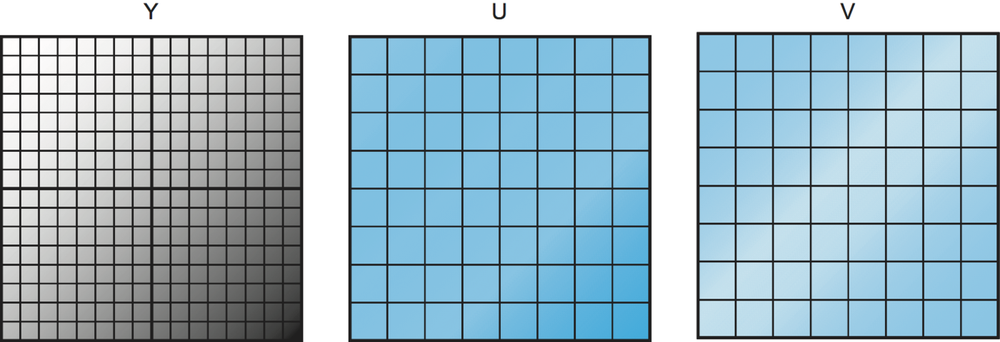

**الشكل 7.11.** أخذ عينات فرعية من مكوّني U وV في صورة.

ومتى حُوّلت الصورة إلى فضاء YUV، يمكننا الآن التفكير في ضغط كل مكوّن من المكوّنات الثلاثة على حدة. ونريد أن نكون أكثر شراسة في ضغط مكوّني U وV، فعين الإنسان أقلّ حساسية لهما. وإحدى طرق ضغط مكوّني U وV *أخذ عينات فرعية* منهما. والفكرة الأساسية لأخذ العينات الفرعية أن نأخذ عددًا من البكسلات المتجاورة، ونحسب متوسط قيمة U أو V لتلك المجموعة من البكسلات، ونرسل ذلك لا قيمة كل بكسل. ويوضّح الشكل 7.11 الفكرة. فمكوّن الإضاءة (Y) لا يُؤخذ منه عينات فرعية، فتُرسل قيمة Y لكل البكسلات، كما تدل شبكة البكسلات 16 × 16 على اليسار. أما في حالة U وV، فنعامل كل مجموعة من أربع بكسلات متجاورة مجموعةً واحدة، ونحسب متوسط قيمة U أو V لتلك المجموعة ونرسله. ومن ثمّ ننتهي إلى شبكة 8 × 8 من قيم U وV نرسلها. وهكذا نرسل في هذا المثال، لكل أربع بكسلات، ست قيم (أربع Y وواحدة لكل من U وV) لا القيم الاثنتي عشرة الأصلية (أربع لكل من المكوّنات الثلاثة)، أي تقليلًا للمعلومات بنسبة 50%.

ويجدر الذكر أنه يمكنك أن تكون أكثر أو أقلّ شراسة في أخذ العينات الفرعية، مع زيادات مقابلة في الضغط وانخفاضات في الجودة. والنهج المعروض هنا، الذي يُؤخذ فيه من التلازم اللوني عينات فرعية بمعامل اثنين في الاتجاهين الأفقي والعمودي (ويُعرف بالمعرّف 4:2:0)، يصادف أنه يطابق النهج الأشيع المستخدم في JPEG وMPEG معًا.

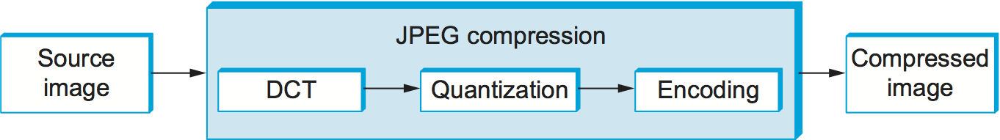

**الشكل 7.12.** المخطط الصندوقي لضغط JPEG.

ومتى انتهى أخذ العينات الفرعية، صار لدينا ثلاث شبكات من البكسلات نتعامل معها، وتُعالَج كل واحدة على حدة. ويحدث ضغط JPEG لكل مكوّن في ثلاث مراحل، كما يوضّح الشكل 7.12. فعلى جانب الضغط تُمرَّر الصورة عبر هذه المراحل الثلاث كتلةً من 8 × 8 في المرة. وتطبّق المرحلة الأولى تحويل الجيب التمام المتقطّع (DCT) على الكتلة. فإن فكّرت في الصورة إشارةً في الفضاء المكاني، فـDCT يحوّل هذه الإشارة إلى إشارة مكافئة في فضاء *الترددات المكانية*. وهذه عملية بلا فقد، لكنها سابقة ضرورية للخطوة التالية التي هي بالفقد. وبعد DCT تطبّق المرحلة الثانية تكميمًا (quantization) على الإشارة الناتجة، فتفقد بذلك أقلّ المعلومات دلالة في تلك الإشارة. وتُرمّز المرحلة الثالثة الناتج النهائي، لكنها تضيف بذلك أيضًا عنصر ضغط بلا فقد إلى الضغط بالفقد الذي حقّقته المرحلتان الأوليان. ويتبع فكّ الضغط هذه المراحل الثلاث نفسها لكن بالترتيب المعاكس.

#### مرحلة DCT

DCT تحويل وثيق الصلة بتحويل فورييه السريع (FFT). يأخذ مصفوفة 8 × 8 من قيم البكسلات مدخلًا ويُخرج مصفوفة 8 × 8 من معاملات التردد. ويمكنك التفكير في مصفوفة الدخل إشارةً ذات 64 نقطة معرَّفة في بُعدين مكانيين (*x* و*y*)؛ ويكسر DCT هذه الإشارة إلى 64 ترددًا مكانيًا. ولكي تكوّن إحساسًا حدسيًا بالتردد المكاني، تخيّل نفسك تتحرك عبر صورة في اتجاه *x* مثلًا. فسترى قيمة كل بكسل تتغيّر كدالة ما في *x*. فإن تغيّرت هذه القيمة ببطء مع زيادة *x*، فترددها المكاني منخفض؛ وإن تغيّرت بسرعة، فترددها المكاني مرتفع. فالترددات المنخفضة تقابل الملامح الإجمالية للصورة، والترددات المرتفعة تقابل التفصيل الدقيق. والفكرة وراء DCT فصل الملامح الإجمالية، وهي جوهرية لرؤية الصورة، عن التفصيل الدقيق، وهو أقلّ جوهرية وقد يكون في بعض الحالات بالكاد مدرَكًا بالعين.

وDCT معكوسه، الذي يسترجع البكسلات الأصلية أثناء فكّ الضغط، معرَّفان بالمعادلتين الآتيتين:

DCT(i, j) = (1/√(2N)) C(i) C(j) Σₓ₌₀^(N−1) Σᵧ₌₀^(N−1) pixel(x, y) cos[(2x+1)iπ/2N] cos[(2y+1)jπ/2N]

pixel(x, y) = (1/√(2N)) Σᵢ₌₀^(N−1) Σⱼ₌₀^(N−1) C(i) C(j) DCT(i, j) cos[(2x+1)iπ/2N] cos[(2y+1)jπ/2N]

حيث C(x) = 1/√2 حين x = 0 و1 حين x > 0، وpixel(x, y) قيمة التدرّج الرمادي للبكسل في الموضع *(x, y)* في الكتلة 8 × 8 التي تُضغط؛ وN = 8 في هذه الحالة.

ويُسمّى معامل التردد الأول، في الموضع (0,0) من مصفوفة الخرج، *معامل DC*. وحدسيًا نرى أن معامل DC مقياس لمتوسط قيمة البكسلات الـ64 الداخلة. وتُسمّى العناصر الـ63 الأخرى من مصفوفة الخرج *معاملات AC*. وهي تضيف إلى هذا المتوسط معلومات الترددات المكانية الأعلى. وهكذا، كلما انتقلت من معامل التردد الأول نحو معامل التردد الرابع والستين، فأنت تنتقل من معلومات التردد المنخفض إلى معلومات التردد المرتفع، ومن الضربات العريضة في الصورة إلى تفصيل أدقّ فأدقّ. وهذه المعاملات الأعلى ترددًا تصير أقلّ أهمية على نحو متزايد للجودة المدركة للصورة. والمرحلة الثانية من JPEG هي التي تقرّر أي جزء من أي معاملات يُطرح.

#### مرحلة التكميم

المرحلة الثانية من JPEG هي حيث يصير الضغط بالفقد. فـDCT لا يفقد معلومات بنفسه؛ إنه يحوّل الصورة فقط إلى صورة يسهل بها معرفة أي المعلومات تُزال. (ومع أنه ليس بالفقد *بحد ذاته*، فثمّة بالطبع بعض فقد الدقة في مرحلة DCT بسبب استخدام حساب النقطة الثابتة.) والتكميم سهل الفهم: إنه ببساطة مسألة طرح البتات غير ذات الدلالة من معاملات التردد.

ولترى كيف تعمل مرحلة التكميم، تخيّل أنك تريد ضغط بعض الأعداد الصحيحة التي تقلّ عن 100، كـ45 و98 و23 و66 و1. فإن قرّرت أن معرفة هذه الأعداد مقرَّبة إلى أقرب مضاعف للعدد 10 كافية لأغراضك، أمكنك قسمة كل عدد على الكمّة 10 بحساب الأعداد الصحيحة، فتحصل على 4 و9 و2 و6 و0. ويمكن ترميز كل من هذه الأعداد في 4 بتات لا في البتات السبع اللازمة لترميز الأعداد الأصلية.

**الجدول 7.1.** مثال جدول تكميم JPEG.

| الكمّة |  |  |  |  |  |  |  |
| --- | --- | --- | --- | --- | --- | --- | --- |
| 3 | 5 | 7 | 9 | 11 | 13 | 15 | 17 |
| 5 | 7 | 9 | 11 | 13 | 15 | 17 | 19 |
| 7 | 9 | 11 | 13 | 15 | 17 | 19 | 21 |
| 9 | 11 | 13 | 15 | 17 | 19 | 21 | 23 |
| 11 | 13 | 15 | 17 | 19 | 21 | 23 | 25 |
| 13 | 15 | 17 | 19 | 21 | 23 | 25 | 27 |
| 15 | 17 | 19 | 21 | 23 | 25 | 27 | 29 |
| 17 | 19 | 21 | 23 | 25 | 27 | 29 | 31 |

وبدلًا من استخدام الكمّة نفسها للمعاملات الـ64 كلها، يستخدم JPEG جدول تكميم يعطي الكمّة التي تُستخدم لكل معامل، كما تحدّدها الصيغة المعطاة أدناه. ويمكنك التفكير في هذا الجدول (الكمّة) معاملًا يمكن ضبطه للتحكّم في مقدار المعلومات المفقودة، ومقدار الضغط المتحقق وفقًا لذلك. وفي الممارسة، يحدّد معيار JPEG مجموعة جداول تكميم ثبتت فعاليتها في ضغط الصور الرقمية؛ ويُعطى مثال جدول تكميم في الجدول 7.1. وفي جداول كهذا الجدول، للمعاملات المنخفضة كمّة قريبة من 1 (بمعنى أن قليلًا من معلومات التردد المنخفض يُفقد)، وللمعاملات العالية قيم أكبر (بمعنى أن مزيدًا من معلومات التردد المرتفع يُفقد). ولاحظ أنه نتيجة لجداول تكميم كهذه يُضبط كثير من معاملات التردد المرتفع على 0 بعد التكميم، فتكون مهيّأة لمزيد من الضغط في المرحلة الثالثة.

ومعادلة التكميم الأساسية هي

```text
QuantizedValue(i,j) = IntegerRound(DCT(i,j)/Quantum(i,j))
```

حيث

```text
IntegerRound(x) =
    Floor(x + 0.5) if x >= 0
    Floor(x - 0.5) if x < 0
```

ويُعرَّف فكّ الضغط عندئذ ببساطة بأن

```text
DCT(i,j) = QuantizedValue(i,j) x Quantum(i,j)
```

فمثلًا لو كان معامل DC (أي DCT(0,0)) لكتلة معيّنة يساوي 25، لكن تكميم هذه القيمة باستخدام الجدول 7.1 ناتجًا

```text
Floor(25/3+0.5) = 8
```

ثم يُستعاد هذا المعامل أثناء فكّ الضغط على أنه 8 × 3 = 24.

#### مرحلة الترميز

ترمّز المرحلة الأخيرة من JPEG معاملات التردد المكمَّمة في صورة مضغوطة. وهذا يحقّق ضغطًا إضافيًا، لكنه ضغط بلا فقد. فبدءًا بمعامل DC في الموضع (0,0)، تُعالَج المعاملات بالتسلسل المتعرّج المعروض في الشكل 7.13. وعلى طول هذا التعريج يُستخدم شكل من ترميز طول التكرار — فيُطبَّق RLE على المعاملات الصفرية فقط، وهذا مهم لأن كثيرًا من المعاملات المتأخرة صفر. ثم تُرمَّز قيم المعاملات الفردية بشيفرة هوفمان. (ويتيح معيار JPEG للمنفّذ استخدام ترميز حسابي بدل شيفرة هوفمان.)

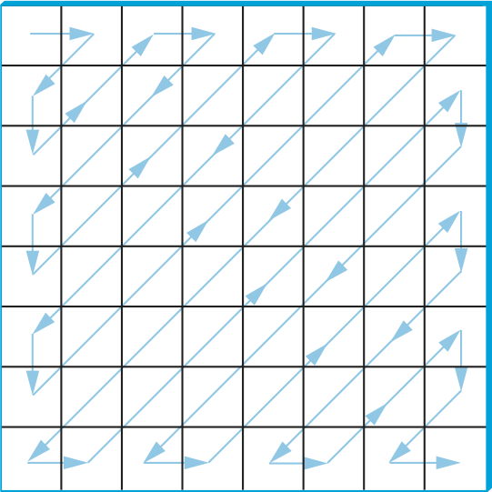

**الشكل 7.13.** التجوّل المتعرّج في معاملات التردد المكمَّمة.

وبالإضافة إلى ذلك، ولأن معامل DC يحتوي نسبة كبيرة من المعلومات عن الكتلة 8 × 8 من الصورة المصدر، والصور تتغيّر عادةً ببطء من كتلة إلى أخرى، فكل معامل DC يُرمَّز على أنه الفرق من معامل DC السابق. وهذا هو نهج الترميز التفريقي الموصوف في قسم لاحق.

ويتضمن JPEG عددًا من التنويعات التي تتحكّم في مقدار الضغط المحقق مقابل وفاء الصورة. ويمكن فعل ذلك، مثلًا، باستخدام جداول تكميم مختلفة. وهذه التنويعات، مع كون الصور المختلفة لها خصائص مختلفة، تجعل من المستحيل أن نقول بدقة أي نسب ضغط يمكن بلوغها بـJPEG. والنسب من 30 إلى 1 شائعة، والنسب الأعلى ممكنة بالتأكيد، لكن *الآثار* (التشويه الملحوظ بسبب الضغط) تصير أشدّ عند النسب الأعلى.

### 7.2.3 ضغط الفيديو (MPEG)

نوجّه الآن اهتمامنا إلى صيغة MPEG، على اسم *مجموعة خبراء الصور المتحركة* التي عرّفتها. وبتقريب أول، الصورة المتحركة (أي الفيديو) مجرد تتابع من صور ثابتة — تُسمّى أيضًا *إطارات* أو *صورًا* — تُعرض بمعدّل فيديو ما. ويمكن ضغط كل إطار من هذه الإطارات بالتقنية نفسها القائمة على DCT المستخدمة في JPEG. غير أن التوقف عند هذه النقطة خطأ، لأنه يفشل في إزالة التكرار بين الإطارات الموجود في تسلسل فيديو. فمثلًا يحتوي إطاران متتاليان من الفيديو معلومات متطابقة تقريبًا إن لم يكن في المشهد حركة كبيرة، فيكون إرسال المعلومة نفسها مرتين غير ضروري. وحتى عند وجود حركة قد يكون التكرار وفيرًا لأن جسمًا متحركًا قد لا يتغيّر من إطار إلى آخر؛ وقد يتغيّر موضعه فقط في بعض الحالات. ويأخذ MPEG هذا التكرار بين الإطارات في الحساب. ويعرّف MPEG أيضًا آلية لترميز إشارة صوتية مع الفيديو، لكننا ننظر في هذا القسم في الجانب الفيديوي من MPEG وحده.

#### أنواع الإطارات

يأخذ MPEG تتابعًا من إطارات الفيديو مدخلًا ويضغطها في ثلاثة أنواع من الإطارات تُسمّى *إطارات I* (داخلية الصورة) و*إطارات P* (متوقَّعة) و*إطارات B* (متوقَّعة ثنائي الاتجاه). ويُضغط كل إطار دخل في أحد هذه الأنواع الثلاثة. ويمكن التفكير في إطارات I إطاراتٍ مرجعية؛ فهي مكتفية بذاتها لا تعتمد على إطارات سابقة ولا لاحقة. وبتقريب أول، إطار I مجرد النسخة المضغوطة بـJPEG من الإطار المقابل في مصدر الفيديو. أما إطارات P وB فليست مكتفية بذاتها؛ إنها تحدّد فروقًا نسبية من إطار مرجعي ما. وبمزيد من التحديد، يحدّد إطار P الفروق من إطار I السابق، بينما يعطي إطار B استيفاءً بين إطارَي I أو P السابق واللاحق.

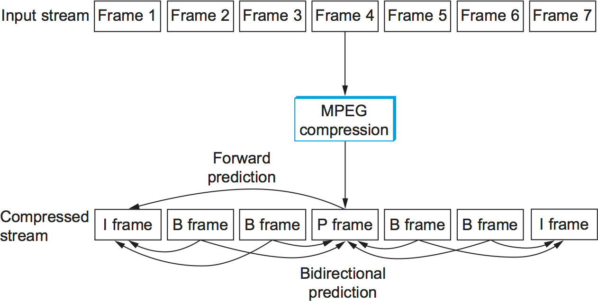

**الشكل 7.14.** تتابع إطارات I وP وB التي يولّدها MPEG.

ويوضّح الشكل 7.14 تتابعًا من سبعة إطارات فيديو ينتج بعد ضغطها بـMPEG تتابعًا من إطارات I وP وB. وإطارا I يقفان وحدهما؛ ويمكن فكّ ضغط كل منهما عند المستقبِل استقلالًا عن أي إطارات أخرى. أما إطار P فيعتمد على إطار I السابق؛ ولا يمكن فكّ ضغطه عند المستقبِل إلا إن وصل إطار I السابق أيضًا. وكل إطار من إطارات B يعتمد على إطارَي I أو P السابق واللاحق معًا. ويجب أن يصل الإطاران المرجعيان إلى المستقبِل قبل أن يستطيع MPEG فكّ ضغط إطار B لإعادة إنتاج إطار الفيديو الأصلي.

ولاحظ أن الإطارات المضغوطة لا تُرسَل بالترتيب التسلسلي، لأن كل إطار B يعتمد على إطار لاحق في التتابع. فبدلًا من ذلك يُرسَل التتابع I B B P B B I المعروض في الشكل 7.14 بالشكل I P B B I B B. كذلك لا يحدّد MPEG نسبة إطارات I إلى إطارات P وB؛ فقد تتغيّر هذه النسبة بحسب الضغط المطلوب وجودة الصورة. فمثلًا يجوز إرسال إطارات I وحدها. ويكون ذلك شبيهًا باستخدام JPEG لضغط الفيديو.

وخلافًا للمناقشة السابقة عن JPEG، فالذي يلي يركّز على *فكّ ترميز* تدفّق MPEG. وهو أسهل قليلًا في الوصف، وهو العملية التي تُنفَّذ أكثر في أنظمة الشبكات اليوم، لأن ترميز MPEG مكلف إلى حدّ أنه يُجرى كثيرًا دون اتصال (أي لا في الزمن الحقيقي). فمثلًا في نظام فيديو عند الطلب، يُرمَّز الفيديو ويُخزَّن على القرص مسبقًا. وحين يريد مشاهد مشاهدة الفيديو، يُرسَل تدفّق MPEG إلى آلته، التي تفكّ ترميز التدفّق وتعرضه في الزمن الحقيقي.

ولننظر عن قرب أكبر في أنواع الإطارات الثلاثة. وكما ذُكر أعلاه، فإطارات I تساوي تقريبًا النسخة المضغوطة بـJPEG من الإطار المصدر. والفرق الرئيس أن MPEG يعمل بوحدات من *الكتل الكبرى* بمقاس 16 × 16. ولفيديو ملوّن ممثَّل في YUV، تُؤخذ من مكوّني U وV في كل كتلة كبرى عينات فرعية في كتلة 8 × 8، كما ناقشنا أعلاه في سياق JPEG. فتُعطى كل كتلة فرعية 2 × 2 في الكتلة الكبرى قيمة U واحدة وقيمة V واحدة — متوسط قيم البكسلات الأربع. ولا تزال للكتلة الفرعية أربع قيم Y. والعلاقة بين الإطار والكتل الكبرى المقابلة له معروضة في الشكل 7.15.

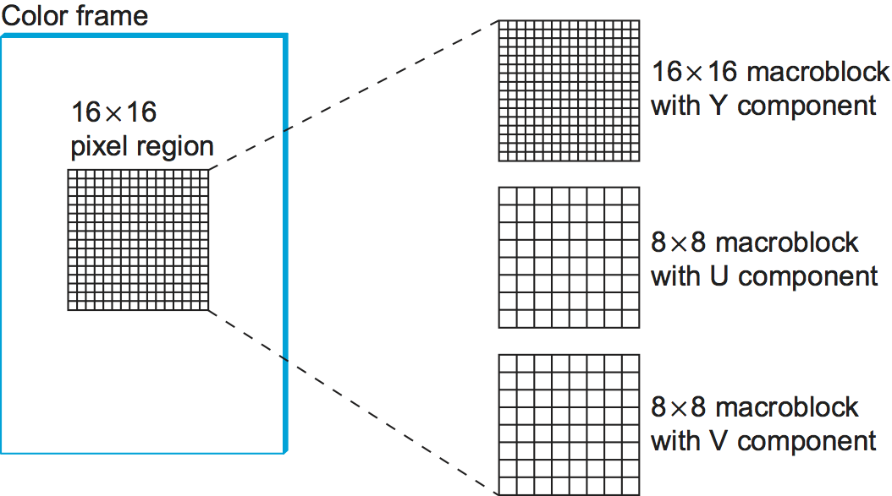

**الشكل 7.15.** كل إطار مجموعة من الكتل الكبرى.

وتُعالَج إطارات P وB أيضًا بوحدات من الكتل الكبرى. وحدسيًا نرى أن المعلومة التي تحملها لكل كتلة كبرى تلتقط الحركة في الفيديو؛ أي إنها تُظهر في أي اتجاه وبأي مقدار تحركت الكتلة الكبرى قياسًا إلى الإطار أو الإطارات المرجعية. وفيما يلي وصف لكيفية استخدام إطار B لإعادة إنشاء إطار أثناء فكّ الضغط؛ وتُعالَج إطارات P بطريقة مشابهة، إلا أنها تعتمد على إطار مرجعي واحد لا اثنين.

وقبل الخوض في تفاصيل كيف يُفكّ ضغط إطار B، نلاحظ أولًا أن كل كتلة كبرى في إطار B لا تُعرَّف بالضرورة قياسًا إلى إطار سابق وإطار لاحق معًا كما أوحينا أعلاه، بل قد تُحدَّد ببساطة قياسًا إلى أحدهما فقط. بل إن كتلة كبرى معيّنة في إطار B يمكن أن تستخدم الترميز الداخلي نفسه المستخدم في إطار I. وهذا المرونة موجودة لأنه إن كانت الصورة المتحركة تتغيّر بسرعة مفرطة، فقد يكون من المنطقي أحيانًا إعطاء الترميز الداخلي للصورة لا ترميزًا متوقَّعًا إلى الأمام أو إلى الخلف. ومن ثمّ تتضمن كل كتلة كبرى في إطار B حقل نوع يدلّ على الترميز المستخدم لتلك الكتلة. غير أننا ننظر في المناقشة التالية في الحالة العامة وحدها التي تستخدم فيها الكتلة الكبرى الترميز التنبؤي ثنائي الاتجاه.

وفي هذه الحالة تُمثَّل كل كتلة كبرى في إطار B برباعية: (1) إحداثي الكتلة الكبرى في الإطار، (2) متجه حركة قياسًا إلى الإطار المرجعي السابق، (3) متجه حركة قياسًا إلى الإطار المرجعي اللاحق، (4) قيمة دلتا (δ) لكل بكسل في الكتلة الكبرى (أي مقدار تغيّر كل بكسل قياسًا إلى البكسلين المرجعيين). ولكل بكسل في الكتلة الكبرى، فالمهمة الأولى إيجاد البكسل المرجعي المقابل في الإطارين المرجعيين الماضي والمستقبلي. ويُفعل ذلك باستخدام متجهَي الحركة المرتبطين بالكتلة الكبرى. ثم تُضاف دلتا البكسل إلى متوسط هذين البكسلين المرجعيين. وبعبارة أدقّ، إن رمزنا إلى الإطارين المرجعيين الماضي والمستقبلي بـF_p وF_f على التوالي، وأعطينا متجهَي الحركة الماضي والمستقبلي بالشكل (x_p, y_p) و(x_f, y_f)، فإن البكسل عند الإحداثي *(x,y)* في الإطار الحالي (المرمز إليه بـF_c) يُحسب بالشكل

F_c(x,y) = (F_p(x+x_p, y+y_p) + F_f(x+x_f, y+y_f))/2 + δ(x,y)

حيث δ هي دلتا البكسل كما تحدّدها في إطار B. وتُرمَّز هذه الدلتات بالطريقة نفسها التي تُرمَّز بها البكسلات في إطارات I؛ أي تُمرَّر عبر DCT ثم تُكمَّم. ولأن الدلتات صغيرة عادةً، فمعظم معاملات DCT صفر بعد التكميم؛ ومن ثمّ يمكن ضغطها بفعالية.

وينبغي أن يكون واضحًا إلى حدّ بعيد من المناقشة السابقة كيف يُجرى الترميز، باستثناء واحد. فحين يولّد MPEG إطار B أو P أثناء الضغط، عليه أن يقرّر أين يضع الكتل الكبرى. وتذكّر أن كل كتلة كبرى في إطار P، مثلًا، تُعرَّف قياسًا إلى كتلة كبرى في إطار I، لكن الكتلة الكبرى في إطار P لا يلزم أن تكون في الجزء نفسه من الإطار الذي فيه الكتلة الكبرى المقابلة له في إطار I — فالفرق في الموضع يعطيه متجه الحركة. وتريد أن تختار متجه حركة يجعل الكتلة الكبرى في إطار P أشبه ما يمكن بالكتلة الكبرى المقابلة لها في إطار I، حتى تكون دلتات تلك الكتلة أصغر ما يمكن. وهذا يعني أنك تحتاج إلى استنباط أين تحركت الأجسام في الصورة من إطار إلى آخر. وهذه مسألة *تقدير الحركة*، وقد عُرفت لها تقنيات (استدلالية) عدة للحل. (ونناقش أوراقًا بحثية تعالج هذه المسألة في آخر هذا الفصل.) وصعوبة هذه المسألة أحد أسباب كون ترميز MPEG يستغرق وقتًا أطول من فكّ ترميزه على العتاد المكافئ. ولا يحدّد MPEG أي تقنية بعينها؛ إنه يحدّد صيغة ترميز هذه المعلومة في إطارات B وP والخوارزمية لإعادة إنشاء البكسل أثناء فكّ الضغط فقط، كما أُعطي أعلاه.

#### الفعالية والأداء

يحقّق MPEG عادةً نسبة ضغط 90 إلى 1، وإن كانت نسب تبلغ 150 إلى 1 ليست مجهولة. ومن حيث أنواع الإطارات الفردية، يمكننا أن نتوقّع نسبة ضغط تقارب 30 إلى 1 لإطارات I (وهذا متّسق مع النسب المتحققة باستخدام JPEG حين يُختزل اللون ذو 24 بتة أولًا إلى لون ذي 8 بتات)، بينما نسب ضغط إطارات P وB أصغر عادةً بثلاث إلى خمس مرات من نسب إطار I. وبدون اختزال الـ24 بتة من اللون إلى 8 بتات أولًا، يكون الضغط الممكن بـMPEG عادةً بين 30 إلى 1 و50 إلى 1.

وينطوي MPEG على حساب مكلف. فعلى جانب الضغط يُجرى عادةً دون اتصال، وهذا ليس مشكلة في إعداد أفلام لخدمة فيديو عند الطلب. ويمكن ضغط الفيديو في الزمن الحقيقي بالعتاد اليوم، لكن التنفيذات البرمجية تسدّ الفجوة بسرعة. وعلى جانب فكّ الضغط توجد بطاقات فيديو MPEG منخفضة الكلفة، لكنها لا تفعل أكثر من البحث عن الألوان في YUV، وهو لحسن الحظ الخطوة الأكثر كلفة. ومعظم فكّ ترميز MPEG الفعلي يُجرى بالبرمجيات. وفي السنوات الأخيرة صارت المعالجات سريعة بما يكفي لمواكبة معدّلات فيديو 30 إطارًا في الثانية عند فكّ ترميز تدفّقات MPEG بالبرمجيات فحسب — بل تستطيع المعالجات الحديثة فكّ ترميز تدفّقات MPEG لفيديو عالي الدقة (HDTV).

#### معايير ترميز الفيديو

نختم بالملاحظة بأن MPEG معيار متطوّر ذو تعقيد كبير. وهذا التعقيد يأتي من الرغبة في إعطاء خوارزمية الترميز كل درجات الحرية الممكنة في كيفية ترميز تدفّق فيديو معيّن، فينتج عن ذلك معدّلات نقل فيديو مختلفة. ويأتي أيضًا من تطوّر المعيار بمرور الزمن، مع عمل مجموعة خبراء الصور المتحركة بجدّ للحفاظ على التوافق الخلفي (كـMPEG-1 وMPEG-2 وMPEG-4). والذي نصفه في هذا الكتاب الأفكار الجوهرية الكامنة وراء الضغط القائم على MPEG، لكنه بالتأكيد ليس كل التعقيدات المتصلة بمعيار دولي.

وفضلًا عن ذلك، فليس MPEG المعيار الوحيد المتاح لترميز الفيديو. فمثلًا عرّفت ITU-T أيضًا *سلسلة H* لترميز بيانات الوسائط الزمنية الحقيقية. وبوجه عام تتضمن سلسلة H معايير للفيديو والصوت والتحكّم والمضاعفة (كمزج الصوت والفيديو والبيانات في تدفّق بتّي واحد). وضمن السلسلة كان H.261 وH.263 معياري ترميز الفيديو في الجيلين الأول والثاني. ومن حيث المبدأ يشبه H.261 وH.263 الـMPEG كثيرًا: فهما يستخدمان DCT والتكميم والضغط بين الإطارات. والفروق بين H.261/H.263 وMPEG في التفاصيل.

واليوم أدّت شراكة بين ITU-T ومجموعة MPEG إلى معيار H.264/MPEG-4 المشترك، الذي يُستخدم لأقراص Blu-ray ولمصادر بثّ شائعة كثيرة (كـYouTube وVimeo).

### 7.2.4 نقل MPEG عبر الشبكة

كما لاحظنا، فـMPEG وJPEG ليسا معياري ضغط فقط بل تعريفان لصيغة الفيديو والصور على التوالي. وبالتركيز على MPEG، فأول ما يجب إبقاؤه في الذهن أنه يحدّد صيغة *تدفّق* فيديو؛ ولا يحدّد كيف يُكسَر هذا التدفّق إلى حزم شبكية. ومن ثمّ يمكن استخدام MPEG لأفيديوهات مخزَّنة على القرص، وكذا لأفيديوهات تُنقَل عبر اتصال شبكي موجّه بالتدفّق، كالذي يوفّره TCP.

والذي نصفه أدناه يُسمّى *الملف الرئيس* لتدفّق فيديو MPEG يُرسَل عبر شبكة. ويمكنك التفكير في ملف MPEG كأنه نظير لـ«إصدار»، إلا أن الملف لا يُحدَّد صراحةً في ترويسة MPEG؛ فعلى المستقبِل أن يستنتج الملف من تركيب حقول الترويسة التي يراها.

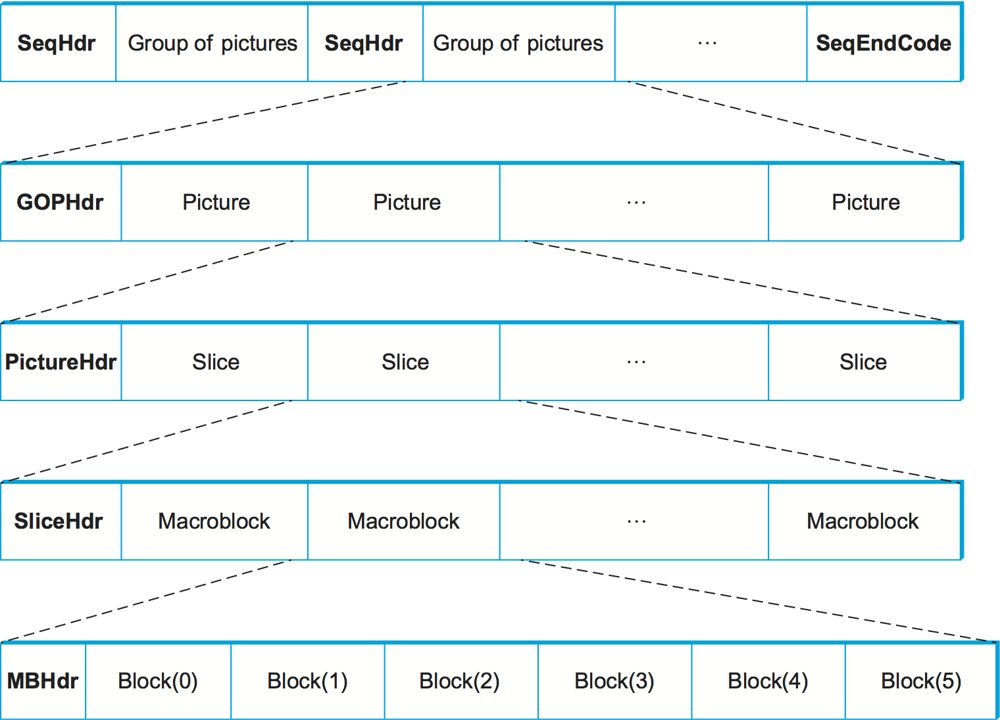

**الشكل 7.16.** صيغة تدفّق فيديو مضغوط بـMPEG.

ولتدفّق MPEG بالملف الرئيس بنية متعشّشة، كما يوضّح الشكل 7.16. (وأبقِ في ذهنك أن هذا الشكل يخفي قدرًا *كبيرًا* من التفاصيل الفوضوية.) ففي المستوى الأبعد يحتوي الفيديو على تتابع من *مجموعات الصور* (GOP) تفصل بينها ترويسة تسلسل SeqHdr. وينتهي التتابع بشيفرة نهاية تسلسل SeqEndCode (0xb7). وترويسة SeqHdr التي تسبق كل مجموعة صور تحدّد — بين أمور أخرى — حجم كل صورة (إطار) في المجموعة (بالبكسلات والكتل الكبرى معًا)، والفاصل بين الصور (بالميكروثانية)، ومصفوفتَي تكميم للكتل الكبرى داخل هذه المجموعة: واحدة للكتل الكبرى المرمَّزة داخليًا (كتل I) وأخرى للكتل الكبرى المرمَّزة بينيًا (كتل B وP). ولأن هذه المعلومة تُعطى لكل مجموعة صور لا مرة واحدة لتدفّق الفيديو كله كما قد تتوقّع، فمن الممكن تغيير جدول التكميم ومعدّل الإطارات عند حدود مجموعات الصور على طول الفيديو. وهذا يتيح تكييف تدفّق الفيديو بمرور الزمن، كما نناقش أدناه.

وتُعطى كل مجموعة صور بترويسة GOPHdr تليها مجموعة الصور التي تكوّن المجموعة. وتحدّد GOPHdr عدد الصور في المجموعة، ومعلومات تزامن للمجموعة (أي متى ينبغي أن تُشغَّل المجموعة قياسًا إلى بداية الفيديو). وكل صورة بدورها تُعطى بترويسة PictureHdr ومجموعة من *الشرائح* التي تكوّن الصورة. (والشريحة منطقة من الصورة، كسطر أفقي واحد.) وتحدّد PictureHdr نوع الصورة (I أو B أو P) وتعرّف جدول تكميم خاصًا بالصورة. وتعطي SliceHdr الموضع العمودي للشريحة، وفرصة أخرى لتغيير جدول التكميم — هذه المرة بمعامل قياس ثابت لا بإعطاء جدول جديد بالكامل. ثم تلي SliceHdr سلسلة من الكتل الكبرى. وأخيرًا يتضمن كل كتلة كبرى ترويسة تحدّد عنوان الكتلة داخل الصورة، مع بيانات الكتل الست داخل الكتلة الكبرى: واحدة لمكوّن U وواحدة لمكوّن V وأربع لمكوّن Y. (وتذكّر أن مكوّن Y مقاسه 16 × 16 بينما مكوّنا U وV مقاسهما 8 × 8.)

وينبغي أن يكون واضحًا أن إحدى قدرات صيغة MPEG أنها تعطي المرمّز فرصة تغيير الترميز بمرور الزمن. فيمكنه تغيير معدّل الإطارات والدقة ومزيج أنواع الإطارات التي تحدّد مجموعة الصور وجدول التكميم والترميز المستخدم للكتل الكبرى الفردية. ونتيجةً لذلك يمكن تكييف المعدّل الذي يُنقل به فيديو عبر شبكة بمقايضة جودة الصورة بعرض النطاق الشبكي. وكيف يمكن لبروتوكول شبكي أن يستغل هذه القابلية بالضبط مسألة بحثية حاليًا (انظر الشريط الجانبي).

وثمّة جانب آخر مثير للاهتمام في إرسال تدفّق MPEG عبر الشبكة، هو كيف يُكسَر التدفّق إلى حزم بالضبط. فإن أُرسل عبر اتصال TCP فمسألة التقسيم إلى حزم ليست مطروحة؛ فـTCP يقرّر متى تكون لديه بايتات كافية لإرسال حزمة IP التالية. غير أنه عند استخدام الفيديو تفاعليًا، فنادرًا ما يُنقل عبر TCP، لأن لـTCP خصائص عدة غير ملائمة للتطبيقات الشديدة الحساسية للكمون (كتغيّرات المعدّل المفاجئة بعد فقد حزمة وإعادة إرسال الحزم المفقودة). وإن كنا ننقل الفيديو باستخدام UDP مثلًا، فيكون من المنطقي كسر التدفّق عند نقاط مختارة بعناية، كحدود الكتل الكبرى. والسبب أننا نريد حصر آثار حزمة مفقودة في كتلة كبرى واحدة، لا إفساد عدة كتل كبرى بفقد واحد. وهذا مثال على التأطير على مستوى التطبيق، الذي نوقش في فصل سابق.

وتقسيم التدفّق إلى حزم أول مسألة فقط في إرسال فيديو مضغوط بـMPEG عبر شبكة. والتعقيد التالي التعامل مع فقد الحزم. فمن ناحية، إن أُسقط إطار B في الشبكة، فمن الممكن ببساطة إعادة عرض الإطار السابق دون مساس جدّي بالفيديو؛ فإطار واحد من 30 ليس مشكلة كبيرة. ومن ناحية أخرى، لفقد إطار I عواقب خطيرة — فلا يمكن معالجة أي من إطارات B وP اللاحقة بدونه. ومن ثمّ يؤدي فقد إطار I إلى فقد عدة إطارات من الفيديو. ومع أنك تستطيع إعادة إرسال إطار I المفقود، فالتأخير الناتج على الأرجح غير مقبول في مؤتمر فيديو زمني حقيقي. وأحد حلول هذه المسألة استخدام تقنيات الخدمات المتمايزة الموصوفة في الفصل السابق لوسم الحزم المحتوية على إطارات I باحتمال إسقاط أقلّ من الحزم الأخرى.

وثمّة ملاحظة أخيرة هي أن اختيارك كيفية ترميز الفيديو يعتمد على أكثر من عرض النطاق الشبكي المتاح. فهو يعتمد أيضًا على قيود الكمون في التطبيق. ومرة أخرى، تطبيق تفاعلي كمؤتمرات الفيديو يحتاج إلى كمونات صغيرة. والعامل الحاسم تركيب إطارات I وP وB في مجموعة الصور. لننظر في مجموعة الصور الآتية:

I B B B B P B B B B I

والمشكلة التي تخلقها هذه المجموعة لتطبيق مؤتمرات فيديو أن على المرسل تأخير إرسال إطارات B الأربعة حتى يتوفّر إطار P أو I الذي يليها. والسبب أن كل إطار B يعتمد على إطار P أو I اللاحق. فإن كان الفيديو يُعرض بمعدّل 15 إطارًا في الثانية (أي إطار كل 67 ملليثانية)، فهذا يعني أن أول إطار B يتأخّر 4 × 67 ملليثانية، أي أكثر من ربع ثانية. وهذا التأخير إضافةً إلى أي تأخير انتشار تفرضه الشبكة. وربع ثانية أكبر بكثير من عتبة الـ100 ملليثانية التي يستطيع البشر إدراكها. ولهذا السبب ترمّز تطبيقات مؤتمرات فيديو كثيرة الفيديو باستخدام JPEG، ويُسمّى ذلك كثيرًا JPEG المتحرك. (ويعالج JPEG المتحرك أيضًا مشكلة إسقاط إطار مرجعي لأن كل الإطارات قادرة على الوقوف وحدها.) غير أن لاحظ أن الترميز بين الإطارات الذي يعتمد على إطارات سابقة لا لاحقة ليس مشكلة. ومن ثمّ فمجموعة صور كالآتية

I P P P P I

ستعمل جيدًا لمؤتمرات الفيديو التفاعلية.

#### البثّ المتكيّف

ولأن مخططات الترميز كـMPEG تتيح مقايضة بين عرض النطاق المستهلَك وجودة الصورة، فثمّة فرصة لتكييف تدفّق فيديو ليطابق عرض النطاق الشبكي المتاح. وهذا فعليًا ما تفعله خدمات بثّ الفيديو كـNetflix اليوم.

فلنبدأ بافتراض أن لدينا طريقة ما لقياس مقدار السعة الحرة ومستوى الازدحام على مسار، كأن نلاحظ معدّل وصول الحزم بنجاح إلى الوجهة. ومع تذبذب عرض النطاق المتاح، يمكننا تغذية تلك المعلومة رجوعًا إلى المرمّز ليضبط معاملات ترميزه فيتراجع وقت الازدحام ويرسل بشراسة أكبر (بجودة صورة أعلى) حين تكون الشبكة خاملة. وهذا نظير سلوك TCP، إلا أننا في حالة الفيديو نعدّل فعلًا مجموع البيانات المرسلة لا المدة التي نستغرقها في إرسال مقدار ثابت من البيانات، لأننا لا نريد إدخال تأخير في تطبيق فيديو.

وفي حالة خدمات الفيديو عند الطلب كـNetflix، لا نكيّف الترميز أثناء العمل، بل نرمّز عددًا قليلًا من مستويات جودة الفيديو مسبقًا، ونحفظها في ملفات مسمّاة وفقًا لذلك. ويكتفي المستقبِل بتغيير اسم الملف الذي يطلبه ليطابق الجودة التي تدلّ قياساته على أن الشبكة ستستطيع تسليمها. فالمستقبِل يراقب صفّ تشغيله، ويطلب ترميزًا أعلى جودة حين يمتلئ الصفّ امتلاءً مفرطًا وترميزًا أدنى جودة حين يفرغ إفراغًا مفرطًا.

وكيف يعرف هذا النهج إلى أي موضع في الفيلم يقفز إن تغيّرت الجودة المطلوبة؟ في الواقع، لا يطلب المستقبِل من المرسل أبدًا بثّ الفيلم كله، بل يطلب سلسلة من مقاطع فيلم قصيرة، طول كل منها عادةً بضع ثوان (وعلى حدود مجموعات الصور دومًا). وكل مقطع فرصة لتغيير مستوى الجودة ليطابق ما تستطيع الشبكة تسليمه. (وقد تبيّن أن طلب قطع الفيلم يسهّل أيضًا تنفيذ *التشغيل الحِيَلي*، أي القفز من موضع إلى آخر في الفيلم.) وبعبارة أخرى، يُخزَّن الفيلم عادةً مجموعة من N × M من القطع (الملفات): N مستوى جودة لكل مقطع من المقاطع M.

وثمّة تفصيل أخير. ولأن المستقبِل يطلب فعليًا سلسلة من قطع الفيديو المتفرقة بالاسم، فالنهج الأشيع لإصدار هذه الطلبات استخدام HTTP. فكل قطعة طلب GET منفصل بـHTTP يكون فيه الـURL معرّفًا للقطعة المحدّدة التي يريدها المستقبِل بعد ذلك. وحين تبدأ تنزيل فيلم، ينزّل مشغّل الفيديو لديك أولًا ملف *بيان* لا يحتوي أكثر من الـURLs لقطع الفيلم الـ N × M، ثم يصدر سلسلة من طلبات HTTP بالـURL المناسب للحالة. ويُسمّى هذا النهج العام *البثّ المتكيّف بـHTTP*، مع أنه وُحّد بطرق مختلفة قليلًا في منظمات شتّى، وأبرزها DASH التابعة لـMPEG (*البثّ المتكيّف الديناميكي عبر HTTP*) وHLS التابعة لـApple (*البثّ الحيّ بـHTTP*).

### 7.2.5 ضغط الصوت (MP3)

لا يحدّد MPEG كيفية ضغط الفيديو فقط، بل يحدّد أيضًا معيارًا لضغط الصوت. ويمكن استخدام هذا المعيار لضغط الجزء الصوتي من فيلم (وفي هذه الحالة يحدّد معيار MPEG كيف تُداخل البيانات الصوتية المضغوطة مع الفيديو المضغوط في تدفّق MPEG واحد) أو لضغط صوت مستقل (كقرص صوتي). ومعيار ضغط الصوت في MPEG واحد من معايير كثيرة لضغط الصوت، لكن الدور المحوري الذي أدّاه يعني أن MP3 (وهو اختصار MPEG الطبقة الثالثة — انظر أدناه) صار تقريبًا مرادفًا لضغط الصوت.

ولفهم ضغط الصوت، نحتاج إلى البدء من البيانات. فصوت القرص المضغوط، وهو التمثيل الرقمي الواقعي للصوت عالي الجودة، يُؤخذ منه عينات بمعدّل 44.1 كيلوهيرتز (أي تُجمع عينة واحدة تقريبًا كل 23 ميكروثانية). وكل عينة 16 بتة، ومعناه أن تدفّق صوت ستيريو (قناتين) يعطي معدّل بتات قدره

2 × 44.1 × 1000 × 16 = 1.41 ميجابت/ثانية

وفي المقابل، يُؤخذ من الصوت الهاتفي التقليدي عينات بمعدّل 8 كيلوهيرتز بعينات من 8 بتات، فينتج معدّل بتات قدره 64 كيلوبت/ثانية.

ومن الواضح أن بعض الضغط سيُستلزم لنقل صوت بجودة القرص المضغوط عبر شبكة محدودة عرض النطاق. (تأمّل أن بثّ صوت MP3 صار شائعًا في عصر كانت فيه اتصالات الإنترنت المنزلية بـ1.5 ميجابت/ثانية بدعة.) ولكي تزيد الطين بلّة، فقد ضخّمت أعباء التزامن وتصحيح الأخطاء عدد البتات المخزَّنة على القرص المضغوط بمعامل ثلاثة، فإن قرأت البيانات من القرص ببساطة وأرسلتها عبر الشبكة لكنت تحتاج إلى 4.32 ميجابت/ثانية.

وكما في الفيديو، ففي الصوت تكرار كثير، والضغط يستفيد منه. وتحدّد معايير MPEG ثلاثة مستويات من الضغط، كما هو مسرود في الجدول 7.2. ومنها كان المستوى الثالث، المعروف على نطاق أوسع بـMP3، الأشيع استخدامًا لسنوات كثيرة. وفي السنوات الأخيرة كثُرت مرمّزات أعلى عرض نطاق مع صيرورة بثّ الصوت الطريقة المهيمنة التي يستهلك بها كثير من الناس الموسيقى.

**الجدول 7.2.** معدّلات ضغط MP3.

| الترميز | معدّلات البتات | معامل الضغط |
| --- | --- | --- |
| الطبقة الأولى | 384 كيلوبت/ثانية | 14 |
| الطبقة الثانية | 192 كيلوبت/ثانية | 18 |
| الطبقة الثالثة | 128 كيلوبت/ثانية | 12 |

ولبلوغ نسب الضغط هذه، يستخدم MP3 تقنيات شبيهة بتلك التي يستخدمها MPEG لضغط الفيديو. فأولًا يقسّم تدفّق الصوت إلى عدد من نطاقات التردد الفرعية، وهي نظير مرتخٍ لطريقة معالجة MPEG لمكوّنات Y وU وV في تدفّق الفيديو على حدة. وثانيًا يُكسَر كل نطاق فرعي إلى سلسلة من الكتل، وهي شبيهة بكتل MPEG الكبرى إلا أن طولها يمكن أن يتغيّر من 64 إلى 1024 عينة. (ويمكن لخوارزمية الترميز تغيير حجم الكتلة بحسب آثار تشويه معيّنة تخرج عن مناقشتنا.) وأخيرًا يُحوَّل كل كتلة بخوارزمية DCT معدَّلة، وتُكمَّم، وتُرمَّز بهوفمان، كما في فيديو MPEG.

والحيلة في MP3 في عدد النطاقات الفرعية التي يختار استخدامها وعدد البتات التي يخصّصها لكل نطاق فرعي، مع إبقائه في ذهنه أنه يحاول إنتاج أعلى جودة صوت ممكنة لمعدّل البتات المستهدف. وكيف يُجرى هذا التخصيص بالضبط تحكمه نماذج سيكوصوتية تخرج عن نطاق هذا الكتاب، لكن لتوضيح الفكرة تأمّل أن من المنطقي تخصيص بتات أكثر للنطاقات الفرعية المنخفضة التردد عند ضغط صوت رجل، وبتات أكثر للنطاقات المرتفعة عند ضغط صوت امرأة. وعمليًا يغيّر MP3 جداول التكميم المستخدمة لكل نطاق فرعي تغييرًا ديناميكيًا لبلوغ الأثر المطلوب.

ومتى ضُغطت النطاقات الفرعية، حُزمت في إطارات ثابتة الحجم، وأُلحقت بها ترويسة. وتتضمن هذه الترويسة معلومات تزامن، ومعلومات تخصيص البتات التي يحتاجها فاكّ الترميز ليحدّد كم بتة تُستخدم في ترميز كل نطاق فرعي. وكما ذُكر أعلاه، يمكن بعد ذلك تداخل إطارات الصوت هذه مع إطارات الفيديو لتكوين تدفّق MPEG كامل. وثمّة ملاحظة جانبية مثيرة للاهتمام، هي أنه مع أن إسقاط إطارات B في الشبكة عند حدوث ازدحام قد يعمل، فالتجربة تعلّمنا أنه ليس فكرة جيدة إسقاط إطارات الصوت، لأن المستخدمين أقدر على تحمّل فيديو سيئ من صوت سيئ.

## منظور: البيانات الضخمة والتحليلات

هذا الفصل عن البيانات، ولأن لا موضوع في علوم الحاسوب يلقى اهتمامًا أكثر من *البيانات الضخمة* (أو *تحليلات البيانات*)، فالسؤال الطبيعي: أي علاقة قد تكون بين البيانات الضخمة وشبكات الحاسوب؟ ومع أن الصحافة الشائعة تستخدم المصطلح استخدامًا غير رسمي غالبًا، فالتعريف العملي بسيط إلى حدّ بعيد: تُجمع بيانات المستشعرات بمراقبة نظام فيزيائي أو مصنوع، ثم تُحلَّل لاستخلاص بصائر بالطرق الإحصائية في تعلّم الآلة. ولأن مقدار البيانات الخام المجمَّعة وفير غالبًا، يُطبَّق وصف «الضخمة». فهل ثمّة تبعات على الشبكات؟

للوهلة الأولى، الشبكات مصمَّمة عمدًا لتكون محايدة تجاه البيانات. فإن جمعتها وأردت شحنها إلى مكان ما للتحليل، فالشبكة سعيدة بفعل ذلك لك. وقد تضغط البيانات لتقليل عرض النطاق اللازم لنقلها، لكن عدا ذلك فالبيانات الضخمة لا تختلف عن البيانات العادية القديمة. غير أن ذلك يتجاهل عاملين مهمّين.

الأول أن الشبكة، مع أنها لا تعنى بمعنى البيانات (أي بما تمثّله البتات)، فهي تعنى بحجم البيانات. وهذا يؤثر في شبكة الوصول بوجه خاص، وهي مهندَسة لتُفضّل سرعات التنزيل على سرعات الرفع. وهذا التحيّز معقول حين تكون حالة الاستخدام المهيمنة فيديو يتدفّق إلى المستخدمين النهائيين، لكن في عالم تبلّغ فيه سيارتك وكل جهاز في بيتك والطائرات المسيّرة فوق مدينتك ببياناتها رجوعًا إلى الشبكة (مرفوعة إلى السحابة)، فالحالة معكوسة. والحقيقة أن مقدار البيانات التي تولّدها *المركبات الذاتية* و*إنترنت الأشياء* (IoT) قد يكون طاغيًا.

ومع أن المرء يستطيع تخيّل التعامل مع هذه المسألة باستخدام إحدى خوارزميات الضغط الموصوفة في القسم 7.2، فالناس يفكّرون بدلًا من ذلك خارج الصندوق، ويسعون إلى تطبيقات جديدة تسكن عند حافة الشبكة. وهذه *التطبيقات الأصيلة إلى الحافة* توفّر زمن استجابة أقلّ من الملليثانية، وتقلّل تخفيضًا هائلًا حجم البيانات التي يلزم رفعها في النهاية إلى السحابة. ويمكنك التفكير في هذا التقليل للبيانات ضغطًا خاصًا بالتطبيق، لكن الأدقّ القول إن تطبيق الحافة يحتاج إلى كتابة ملخّصات للبيانات لا البيانات الخام رجوعًا إلى السحابة.

وقد قدّمنا تقنية سحابة حافة الوصول اللازمة لدعم التطبيقات الأصيلة إلى الحافة في آخر الفصل 2، لكن الأكثر إثارة للاهتمام ربما النظر في بعض أمثلة التطبيقات الأصيلة إلى الحافة. ومن هذه الأمثلة أن مؤسسات في مجالات السيارات والمصانع والمستودعات تريد على نحو متزايد نشر شبكات 5G خاصة لطائفة من حالات استخدام *الأتمتة الفيزيائية*. ومنها مرآب يوقف فيه خادم سيارات عن بعد سيارتك، أو أرضية مصنع تستخدم روبوتات أتمتة. والخيط المشترك اتصال عالي عرض النطاق منخفض الكمون من الروبوت إلى ذكاء يجلس قريبًا في سحابة حافة. وهذا يدفع كلفة الروبوتات إلى الانخفاض (فلا حاجة إلى وضع حساب ثقيل في كل واحد منها) ويتيح أسراب الروبوتات والتنسيق على نحو أكثر قابلية للتوسّع.

وثمّة مثال توضيحي آخر هو *المساعدة الإدراكية القابلة للارتداء*. والفكرة تعميم ما يفعله برنامج الملاحة لنا: فهو يستخدم مستشعرًا واحدًا (GPS)، ويعطينا إرشادًا خطوة بخطوة في مهمة معقّدة (التنقّل في مدينة مجهولة)، ويلتقط أخطاءنا فورًا، ويساعدنا على التعافي. فهل نستطيع تعميم هذه الاستعارة؟ أفيمكن توجيه شخص يرتدي جهازًا (كـGoogle Glass أو Microsoft Hololens) خطوة بخطوة في مهمة معقّدة، وربما للمرة الأولى؟ سيتصرّف النظام فعليًا كـ«ملاك على كتفك». فكل مستشعرات الجهاز (الفيديو والصوت والمقياس التسارعي والجيروسكوب) تُبَثّ لاسلكيًا (وربما بعد بعض المعالجة المسبقة في الجهاز) إلى سحابة حافة قريبة تؤدّي العمل الشاق. وهذه استعارة بإنسان في الحلقة، بـ«مظهر وإحساس الواقع المعزّز» لكنها منفَّذة بخوارزميات الذكاء الاصطناعي (كالرؤية الحاسوبية والتعرّف على اللغة الطبيعية).

والعامل الثاني أن الشبكة، لأنها كأنظمة أخرى كثيرة من صنع الإنسان، فمن الممكن جمع بيانات عن سلوكها (كالأداء والأعطال وأنماط الحركة)، وتطبيق برامج تحليلات على تلك البيانات، واستخدام البصائر المستخلصة لتحسين الشبكة. ولا ينبغي أن يكون مفاجئًا أن هذا مجال بحث نشط، هدفه بناء حلقة تحكّم مغلقة. وبصرف النظر عن التحليلات نفسها، التي تخرج تمامًا عن نطاق هذا الكتاب، فالسؤالان المثيران للاهتمام: (1) أي بيانات مفيدة نستطيع جمعها، (2) وأي جوانب الشبكة أكثر جدوى للتحكّم فيها؟ لننظر في جوابين واعدين.

أحدهما شبكات 5G الخلوية، وهي معقّدة بحكم طبيعتها. ففيها طبقات متعددة من الوظائف الظاهرية، وأصول RAN ظاهرية وفيزيائية، واستخدام الطيف، وكما ناقشنا للتوّ، عقد حوسبة حافة. ويُتوقَّع على نطاق واسع أن تكون تحليلات الشبكة جوهرية لبناء شبكة 5G مرنة. وسيتضمن ذلك تخطيط الشبكة، الذي سيحتاج إلى تقرير أين تُوسَّع وظائف شبكية معيّنة وخدمات تطبيقات معيّنة بناءً على خوارزميات تعلّم آلة تحلّل أنماط استخدام الشبكة وبيانات الحركة.

والثاني هو *القياس الشبكي داخل النطاق* (INT)، وهو إطار لجمع حالة الشبكة وإبلاغها مباشرةً في مستوى البيانات. وهذا خلافًا للإبلاغ التقليدي الذي يقوم به مستوى تحكّم الشبكة، كما تمثّله الأنظمة المثالية الموصوفة في القسم 9.3. ففي معمارية INT تحتوي الحزم حقول ترويسة تفسّرها أجهزة الشبكة كـ«تعليمات قياس». وهذه التعليمات تخبر الجهاز القادر على INT أي حالة يجمع ويكتب في الحزمة وهي تعبر الشبكة. و*مصادر حركة* INT (كالتطبيقات ومكدّسات الشبكات في المضيف الطرفي ومراقبات الأجهزة الظاهرية) تستطيع تضمين التعليمات إما في حزم بيانات عادية وإما في حزم استقصاء خاصة. وبالمثل تسترجع *مصارف حركة* INT (وتُبلِّغ اختياريًا) النتائج المجمَّعة لهذه التعليمات، فيتيح ذلك للمصارف مراقبة حالة مستوى البيانات بالضبط التي «لاحظتها» الحزم أثناء تمريرها. وINT ما زال في مرحلة مبكّرة، وهو يستفيد من الأنابيب القابلة للبرمجة الموصوفة في القسم 3.5، لكنه قادر على تقديم بصائر أعمق نوعيًا في أنماط الحركة والأسباب الجذرية لأعطال الشبكة.

> **منظور أوسع**
>
> لمعرفة المزيد عن التطبيقات الأصيلة إلى الحافة الواعدة، نوصي بـ: [Open Edge Computing Initiative](http://openedgecomputing.org)، 2019.
>
> ولمعرفة المزيد عن القياس الشبكي داخل النطاق، نوصي بـ: [In-band Network Telemetry via Programmable Dataplanes](https://pdfs.semanticscholar.org/a3f1/9dc8520e2f42673be7cbd8d80cd96e3ec0c1.pdf)، أغسطس 2015.
