# الفصل 8: أمن الشبكات

**Larry Peterson and Bruce Davie**

> عظمة حقيقية حقًّا أن يجتمع في المرء هشاشة الإنسان وأمن الإله. *—سينيكا*

## المسألة: هجمات الأمن

شبكات الحاسوب مورد مشترك يستخدمه عادةً كثير من التطبيقات التي تمثّل مصالح مختلفة. والإنترنت مشاع على نطاق واسع بوجه خاص، إذ تستخدمه أعمال متنافسة وحكومات متعادية وشخصيات إجرامية انتهازية. وما لم تُتَّخذ تدابير أمنية، فقد تُخترق محادثة شبكية أو تطبيق موزّع على يد خصم.

لننظر، مثلًا، في بعض الأخطار التي تهدّد الاستخدام الآمن للويب. افترض أنك عميل يستخدم بطاقة ائتمان ليطلب سلعة من موقع ويب. وخطر جليّ أن يتنصّت خصم على تواصلك الشبكي فيقرأ رسائلك ليحصل على معلومات بطاقتك الائتمانية. وكيف قد يتم ذلك التنصّت؟ هو أمر تافه على شبكة بثّ كإيثرنت أو Wi-Fi، حيث يمكن تهيئة أي عقدة لاستقبال كل حركة الرسائل على تلك الشبكة. ومن النهوج الأعقد التنصّت السلكي وزرع برمجيات تجسّس في أي عقدة من سلسلة العقد المعنية. ولا تُتَّخذ تدابير جدّية تمنع مثل هذه المراقبة إلا في أقصى الحالات (كالأمن القومي)، والإنترنت ليس من تلك الحالات. غير أنه ممكن وعملي أن تُشفَّر الرسائل حتى يمنع الخصم من فهم محتواها. ويُقال إن بروتوكولًا يفعل ذلك يوفّر *السرّية*. وبأخذ المفهوم خطوة أبعد، يُسمّى إخفاء كمّية التواصل أو وجهته *سرّية الحركة* — لأن مجرد معرفة كمّ التواصل وإلى أين يذهب قد يفيد خصمًا في بعض الأحوال.

وحتى مع السرّية تبقى أخطار على عميل موقع الويب. فالخصم الذي لا يستطيع قراءة محتوى رسالتك المشفَّرة قد يستطيع رغم ذلك تغيير بضع بتات فيها، فينتج عن ذلك طلب صالح لسلعة مختلفة تمامًا، أو لـ1000 وحدة من السلعة. وتوجد تقنيات لكشف هذا التلاعب إن لم تمنعه. ويُقال إن بروتوكولًا يكشف تلاعبًا كهذا بالرسالة يوفّر *السلامة*.

وخطر آخر على العميل أن يُوجَّه دون علمه إلى موقع ويب مزيف. وقد ينتج ذلك عن هجوم على نظام أسماء النطاقات (DNS)، تُدخَل فيه معلومات كاذبة في خادم DNS أو في مخزن خدمة الأسماء في حاسوب العميل. ويؤدي ذلك إلى ترجمة URL صحيح إلى عنوان IP غير صحيح — عنوان موقع ويب مزيف. ويُقال إن بروتوكولًا يضمن أنك فعلًا تتحدث إلى من تظن أنك تتحدث إليه يوفّر *المصادقة*. والمصادقة تستلزم السلامة، لأنه لا معنى للقول إن رسالة جاءت من مشارك معيّن إن لم تكن الرسالة نفسها بعد.

ويمكن أن يُهاجَم مالك موقع الويب أيضًا. فقد شُوِّهت بعض مواقع الويب؛ إذ أُوصل إلى الملفات التي تكوّن محتوى الموقع وعدّلت عن بعد بلا إذن. وذلك مسألة *التحكّم في الوصول*: إنفاذ القواعد المتعلقة بمن يُسمح له بفعل ماذا. وقد تعرّضت مواقع ويب أيضًا لهجمات حجب الخدمة (DoS)، لا يستطيع فيها العملاء المحتملون الوصول إلى الموقع لأنه يُغرق بطلبات زائفة. وضمان درجة من الوصول يُسمّى *التوافر*.

وعلاوةً على هذه المسائل، استُخدم الإنترنت استخدامًا ملحوظًا وسيلةً لنشر شيفرة خبيثة تُسمّى عمومًا *البرمجيات الخبيثة*، تستغل ثغرات في الأنظمة الطرفية. ومنها *الديدان*، وهي قطع شيفرة ذاتية التكرار تنتشر عبر الشبكات، وقد عُرفت عدة عقود وما زالت تسبب مشاكل، وكذلك أقاربها *الفيروسات* التي تنتشر بنقل ملفات مصابة. ويمكن بعد ذلك ترتيب الآلات المصابة في *شبكات الروبوتات*، التي يمكن استخدامها لإيقاع أذى إضافي كشنّ هجمات حجب الخدمة.

## 8.1 الثقة والأخطار

قبل أن نعالج كيف ولماذا نبني شبكات آمنة، من المهم أن نثبّت حقيقة واحدة بسيطة: سنفشل حتمًا. والسبب أن الأمن في نهاية المطاف تمرين في وضع افتراضات عن الثقة، وتقييم الأخطار، وتخفيف المخاطر. ولا وجود لشيء يُسمّى أمنًا كاملًا.

والثقة والأخطار وجهان لعملة واحدة. فالخطر سيناريو فشل محتمل تُصمّم نظامك لتجنّبه، والثقة افتراض تضعَه عن كيف سيتصرّف الفاعلون الخارجيون والمكوّنات الداخلية التي تبني عليها. فمثلًا إن كنت ترسل رسالة عبر Wi-Fi في حرم جامعي مفتوح، فسترجّح أن تحدّد متنصّتًا يستطيع اعتراض الرسالة خطرًا (وتتخذ بعض الأساليب الموصوفة في هذا الفصل إجراءً مضادًّا)، لكن إن كنت ترسل رسالة عبر رابط ليفي بين آلتين في مركز بيانات مغلق، فقد تثق بأن تلك القناة آمنة فلا تتخذ خطوات إضافية.

وقد تجادل بأنه بما أن لديك أصلًا طريقة لحماية التواصل القائم على Wi-Fi فبوسعك استخدامها لحماية القناة الليفية أيضًا، لكن ذلك يفترض نتيجة تحليل كلفة/منفعة. لنفترض أن حماية أي رسالة، سواء أُرسلت عبر Wi-Fi أم ليف، تُبطئ التواصل بنسبة 10% بسبب عبء التشفير. فإن كنت تحتاج إلى استخراج كل أونصة من الأداء من حساب علمي (كأنك تحاول نمذجة إعصار)، وكانت احتمالات اقتحام مركز البيانات واحدًا في المليون (وحتى إن اقتحموه، فللبيانات المنقولة قيمة ضئيلة)، فستكون محقًّا تمامًا في عدم تأمين قناة التواصل الليفية.

وتحدث هذه الحسابات كلها في كل وقت، وإن كانت ضمنية وغير مصرَّح بها في الغالب. فمثلًا قد تشغّل خوارزمية تشفير أقوى ما في العالم على رسالة قبل إرسالها، لكنك وثقت ضمنًا بأن الخادم الذي تعمل عليه ينفّذ تلك الخوارزمية تنفيذًا أمينًا ولا يسرّب نسخة من رسالتك غير المشفَّرة إلى خصم. أفهل تعدّ ذلك خطرًا أم تثق بأن الخادم لا يسئ التصرّف؟ وفي نهاية المطاف، أفضل ما يمكنك فعله تخفيف المخاطر: تحديد الأخطار التي تستطيع إزالتها بطريقة مجدية الكلفة، وأن تكون صريحًا في افتراضات الثقة التي تضعها حتى لا تفاجئك ظروف متغيّرة، كخصم أشدّ عزيمة أو أعلى مهارة.

وفي هذا المثال بعينه، صار خطر أن يعبث خصم بخادم أمرًا واقعًا إلى حدّ بعيد مع انتقال كثير من حساباتنا من خوادم محلية إلى السحابة، فثمّة بحث الآن في بناء *قاعدة حوسبة موثوقة* (TCB)، وهو موضوع مشوق لكنه في نطاق معمارية الحاسوب لا شبكات الحاسوب. ولأغراض هذا الفصل، توصيتنا أن تتنبّه لكلمتَي *الثقة* و*الخطر* (أو الخصم)، لأنهما مفتاح فهم السياق الذي تُقدَّم فيه ادّعاءات الأمن.

وثمّة ملاحظة تاريخية أخيرة تساعد في تمهيد هذا الفصل. فقد مُوِّل الإنترنت (والأربانت قبله) من وزارة الدفاع الأمريكية، وهي مؤسسة تفهم تحليل الأخطار بلا شك. وكان التقييم الأصلي يهيمن عليه القلق على بقاء الشبكة في وجه تعطّل الموجّهات والشبكات (أو تدميرها)، وهو ما يفسّر كون خوارزميات التوجيه لامركزية بلا نقطة فشل مركزية. ومن ناحية أخرى، افترض التصميم الأصلي أن كل الفاعلين *داخل* الشبكة موثوقون، فلم يُولَ إلا قليل من الانتباه أو لا انتباه لحقيقة ما نسمّيه اليوم الأمن السيبراني (هجمات من فاعلين سيئين قادرين على الاتصال بالشبكة). ومعنى ذلك أن كثيرًا من الأدوات الموصوفة في هذا الفصل يمكن أن يُنظر إليه على أنه رُقَع. فهي راسخة رسوخًا شديدًا في التشفير، لكنها «إضافات» مع ذلك. ولو جرى إعادة تصميم شاملة للإنترنت، لكان دمج الأمن على الأرجح العامل المحرّك الأول.

## 8.2 لبنات التشفير البنائية

نقدّم مفاهيم الأمن القائم على التشفير خطوةً خطوة. والخطوة الأولى هي خوارزميات التشفير — الشيفرات ومِبعَثَرات التشفير — المقدَّمة في هذا القسم. وهي ليست حلًّا في نفسها، بل لبنات بنائية يُبنى منها الحل. وتُعامَل خوارزميات التشفير بمَعلَمات هي *المفاتيح*، ثم يعالج قسم لاحق مسألة توزيع المفاتيح. وفي الخطوة التالية نصف كيف ندمج لبنات التشفير البنائية في بروتوكولات توفّر تواصلًا آمنًا بين مشاركين يملكون المفاتيح الصحيحة. ثم يفحص قسم أخير عدة بروتوكولات وأنظمة أمنية كاملة قيد الاستخدام اليوم.

### 8.2.1 مبادئ الشيفرات

التشفير يحوّل رسالة على نحو تصير به غير مفهومة لأي طرف لا يملك سرّ كيفية عكس التحويل. فيطبّق المرسل دالة *تشفير* على رسالة *النص الصريح* الأصلية، فينتج رسالة *نص مشفَّر* تُرسَل عبر الشبكة، كما يوضّح الشكل 8.1. ويطبّق المستقبِل دالة *فكّ تشفير* سرّية — هي عكس دالة التشفير — ليستعيد النص الصريح الأصلي. والنص المشفَّر المنقول عبر الشبكة غير مفهوم لأي متنصّت، بافتراض أن المتنصّت لا يعرف دالة فكّ التشفير. ويُسمّى التحويل الذي تمثّله دالة تشفير ودالة فكّ تشفيرها المقابلة *شيفرة*.

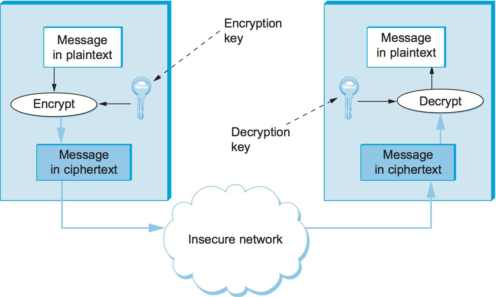

**الشكل 8.1.** التشفير وفكّ التشفير بمفتاح سرّي.

وقد قاد علماء التشفير إلى مبدأ أُعلن أول مرة في عام 1883، هو أن دالّتَي التشفير وفكّ التشفير ينبغي أن تكونا مُعامَلتين بـ*مفتاح*، وفضلًا عن ذلك ينبغي أن تُعدّ الدوال معرفة عامة — ولا يلزم أن يكون سرًّا إلا المفتاح. ومن ثمّ فالنص المشفَّر الناتج لرسالة نصها الصريح معيّن يعتمد على دالة التشفير والمفتاح معًا. وأحد أسباب هذا المبدأ أنه إن اعتمدت على إبقاء الشيفرة سرًّا، لزمك أن تُحيل الشيفرة (لا المفاتيح فقط) متى اعتقدت أنها لم تبقَ سرًّا. وهذا يعني تغييرات محتملة متواترة للشيفرة، وهو مشكل لأنه يستلزم عملًا كبيرًا لتطوير شيفرة جديدة. وفضلًا عن ذلك، فمن أفضل طرق معرفة أن شيفرة آمنة استخدامُها مدة طويلة — فإن لم يكسرها أحد فهي آمنة على الأرجح. (ولحسن الحظ ثمّة كثيرون سيسعون إلى كسر الشيفرات وسيُعلنون على نطاق واسع متى نجحوا، فعدم الأخبار خبر طيب عمومًا.) ومن ثمّ فثمّة كلفة وخطر معتبران في نشر شيفرة جديدة. وأخيرًا، فتعميل الشيفرة بالمفاتيح يمنحنا ما هو فعليًا عائلة ضخمة جدًا من الشيفرات؛ فبتغيير المفاتيح نغيّر الشيفرات فعليًا، فنحدّ بذلك من كمية البيانات التي يستطيع *محلّل الشيفرات* (كاسر الشيفرة) استخدامَها ليكسر مفتاحنا/شيفرتنا ومن مقدار ما يستطيع قراءته إن نجح.

والمتطلب الأساسي لخوارزمية تشفير أن تحوّل النص الصريح إلى نص مشفَّر على نحو يستطيع به المستقبِل المقصود وحده — أي حامل مفتاح فكّ التشفير — استعادة النص الصريح. ومعنى ذلك أن الرسائل المشفَّرة لا يستطيع قراءتها من لا يحمل المفتاح.

ومن المهم أن تدرك أن المهاجم المحتمل حين يستقبل قطعة نص مشفَّر فقد يكون لديه من المعلومات أكثر من النص المشفَّر نفسه. فمثلًا قد يعرف أن النص الصريح مكتوب بالإنجليزية، ومعنى ذلك أن الحرف *e* يحدث في النص الصريح أكثر من أي حرف آخر؛ وكذلك يمكن التنبّؤ بتكرار حروف كثيرة أخرى وبتوليفات حروف شائعة. وهذه المعلومة قد تبسّط مهمة إيجاد المفتاح تبسيطًا كبيرًا. وبالمثل قد يعرف شيئًا عن المحتوى المرجَّح للرسالة؛ فمثلًا كلمة «login» مرجَّح أن تظهر في بداية جلسة دخول عن بعد. وقد يتيح ذلك هجوم *نص صريح معلوم*، وهو أعلى احتمال نجاحًا بكثير من هجوم *نص مشفَّر فقط*. وأفضل من ذلك هجوم *نص صريح مختار*، وقد يتاح بإدخال بعض المعلومات إلى المرسل تعلم أنه مرجَّح أن يرسلها — وقد حدثت أمور كهذه في زمن الحرب، مثلًا.

ولذلك فأفضل خوارزميات التشفير تستطيع منع المهاجم من استنباط المفتاح حتى حين يعرف الفرد النص الصريح والنص المشفَّر معًا. وهذا لا يترك للمهاجم إلا أن يجرب كل المفاتيح الممكنة — بحث شامل بالقوة الغاشمة. فإن كانت للمفاتيح *n* من البتات، فثمّة 2ⁿ قيمة ممكنة للمفتاح (فكل بتة من البتات *n* يمكن أن تكون صفرًا أو واحدًا). وقد يكون المهاجم محظوظًا فيجرب القيمة الصحيحة فورًا، أو سيّئ الحظ فيجرب كل قيمة خاطئة قبل أن يجرب القيمة الصحيحة أخيرًا بعد تجربة كل القيم 2ⁿ الممكنة؛ ومتوسط عدد التخمينات لاكتشاف القيمة الصحيحة يقع في منتصف المسافة بين الطرفين، أي 2ⁿ⁻¹. ويمكن جعل ذلك غير عملي حسابيًا باختيار فضاء مفاتيح كبير بما يكفي وبجعل عملية التحقق من مفتاح مكلفة إلى حدّ معقول. والذي يجعل ذلك صعبًا أن سرعات الحوسبة تستمر في الزيادة، فتجعَل حسابات كانت مستحيلة ممكنة. وفضلًا عن ذلك، مع أننا نركّز على أمن البيانات وهي تتحرك عبر الشبكة — أي إن البيانات تكون معرَّضة للخطر مدة قصيرة فقط في بعض الأحيان — فعلى أهل الأمن عمومًا أن ينظروا في تعرّض بيانات يلزم حفظها في أرشيفات لعشرات السنين. وهذا يدعو إلى حجم مفتاح سخيّ كبير. ومن ناحية أخرى، فالمفاتيح الأكبر تجعل التشفير وفكّ التشفير أبطأ.

ومعظم الشيفرات *شيفرات كتلية*؛ وهي معرَّفة لتأخذ مدخلًا كتلة نص صريح بحجم ثابت معيّن، يتراوح عادةً بين 64 و128 بتة. واستخدام شيفرة كتلية لتشفير كل كتلة استقلالًا — ويُعرف بـتشفير *دفتر الشيفرة الإلكتروني* (ECB) — فيه ضعف هو أن قيمة كتلة نص صريح معيّنة ستؤدي دائمًا إلى الكتلة نفسها من النص المشفَّر. ومن ثمّ يمكن التعرّف على قيم الكتل المتكرّرة في النص الصريح في النص المشفَّر، فيصير كسر الشيفرة أسهل بكثير على محلّل الشيفرات.

ولمنع ذلك تُعزَّز الشيفرات الكتلية دائمًا لتصير الكتلة الواحدة من النص المشفَّر متغيّرة بحسب السياق. والطرق التي تُعزَّز بها الشيفرة الكتلية تُسمّى *أنماط التشغيل*. ومن أنماط التشغيل الشائعة *تسلسل كتل الشيفرة* (CBC)، حيث تُخضع كل كتلة نص صريح لعملية XOR مع النص المشفَّر للكتلة السابقة قبل تشفيرها. والنتيجة أن النص المشفَّر لكل كتلة يعتمد في جزء منه على الكتل السابقة (أي على سياقه). ولأن الكتلة الأولى من النص الصريح ليس لها كتلة سابقة، تُخضع لعملية XOR مع عدد عشوائي. وذلك العدد العشوائي، ويُسمّى *متجه التهيئة* (IV)، يُضمَّن مع سلسلة كتل النص المشفَّر لتُفكّ الكتلة الأولى من النص المشفَّر. ويُوضَّح هذا النمط في الشكل 8.2. ومن أنماط التشغيل الأخرى *نمط العدّاد*، تُدمَج فيه قيم متتالية لعدّاد (كـ1 و2 و3 …) في تشفير كتل النص الصريح المتتالية.

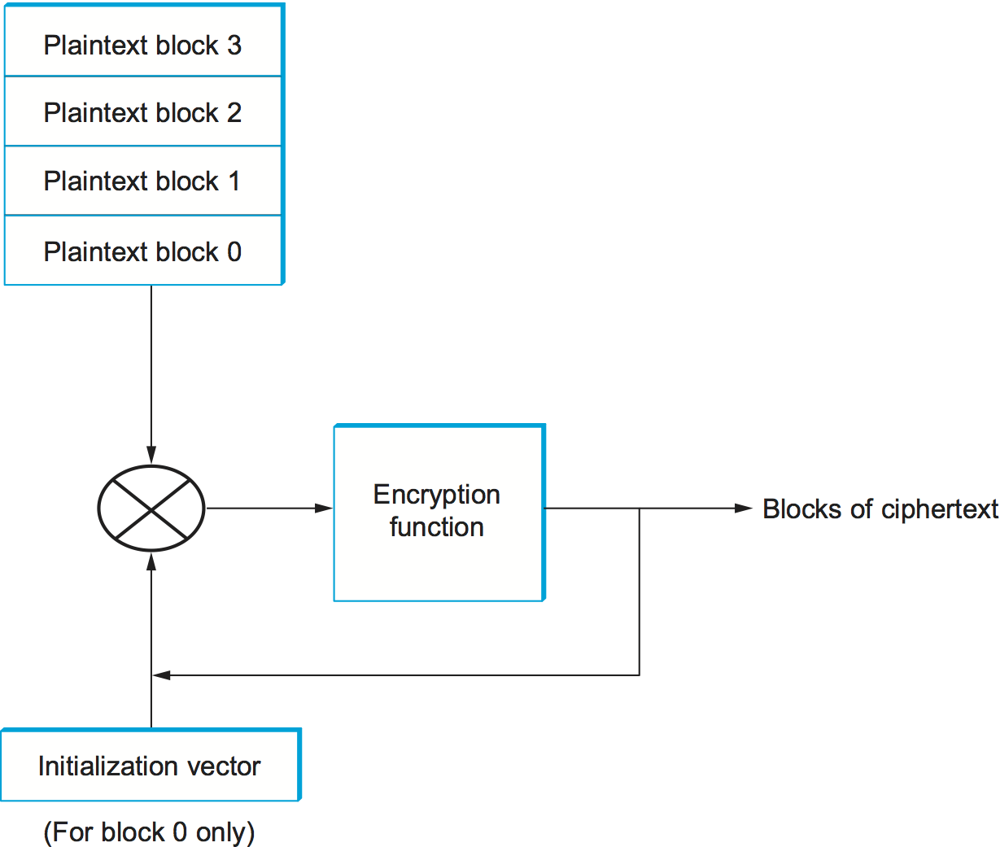

**الشكل 8.2.** تسلسل كتل الشيفرة.

### 8.2.2 شيفرات المفتاح السرّي

في شيفرة المفتاح السرّي يتقاسم المشاركان في التواصل المفتاح نفسه. وبعبارة أخرى، إن شُفّرت رسالة بمفتاح معيّن فالمفتاح نفسه لازم لفكّ تشفيرها. فلو كانت الشيفرة المعروضة في الشكل 8.1 شيفرة مفتاح سرّي، لكان مفتاح التشفير ومفتاح فكّ التشفير متطابقين. وتُعرف شيفرات المفتاح السرّي أيضًا بالشيفرات المتناظرة المفتاح لأن السرّ متقاسم بين المشاركين. وسننظر بعد قليل في البديل، أي شيفرات المفتاح العام. (وتُعرف شيفرات المفتاح العام أيضًا بالشيفرات غير المتناظرة المفتاح، لأن المشاركين، كما سنرى، يستخدمان مفتاحين مختلفين.)

وقد أصدر المعهد الوطني الأمريكي للمعايير والتقنية (NIST) معايير لسلسلة من شيفرات المفتاح السرّي. وكان *معيار تشفير البيانات* (DES) الأول، وقد صمد أمام اختبار الزمن من حيث إنه لم يُكتشف هجوم تحليل شيفرات أفضل من البحث بالقوة الغاشمة. غير أن البحث بالقوة الغاشمة صار أسرع. ومفاتيح DES (56 بتة مستقلة) صغيرة اليوم جدًا بمقياس سرعات المعالجات الحالية. ولمفاتيح DES 56 بتة مستقلة (وإن كانت 64 بتة في المجموع؛ فالبتة الأخيرة من كل بايت بتة تكافؤ). وكما ذُكر أعلاه، سيلزمك في المتوسط بحث نصف فضاء المفاتيح 2⁵⁶ الممكنة لإيجاد المفتاح الصحيح، أي 2⁵⁵ = 3.6 × 10¹⁶ مفتاحًا. وقد يبدو ذلك عددًا كبيرًا، لكن بحثًا كهذا قابل للتوازي بدرجة عالية، فيمكن إلقاء ما تستطيع الحصول عليه من حواسيب على المهمة — وهذه الأيام يسهل الحصول على آلاف الحواسيب. (ستؤجرها لك Amazon بقروش قليلة في الساعة.) وبأواخر التسعينيات صار ممكنًا استعادة مفتاح DES بعد ساعات قليلة. ومن ثمّ حدّث NIST معيار DES في عام 1999 ليدلّ على أنه لا ينبغي استخدام DES إلا في الأنظمة القديمة.

وكذلك قنّن NIST الشيفرة *ثلاثية DES* (3DES)، التي تستفيد من مقاومة DES لتحليل الشيفرات بينما تزيد حجم المفتاح فعليًا. لمفتاح 3DES 168 بتة (= 3 × 56) مستقلة، ويُستخدم ثلاثةَ مفاتيح DES؛ ولنسمّها DES-key1 وDES-key2 وDES-key3. ويُجري تشفير 3DES لكتلة بتشفير الكتلة أولًا بـDES باستخدام DES-key1، ثم *فكّ* تشفير الناتج بـDES باستخدام DES-key2، وأخيرًا تشفير ذلك الناتج بـDES باستخدام DES-key3. وفكّ التشفير يستلزم فكّ التشفير باستخدام DES-key3، ثم التشفير باستخدام DES-key2، ثم فكّ التشفير باستخدام DES-key1.

وسبب استخدام تشفير 3DES لفكّ التشفير بـDES باستخدام DES-key2 هو التوافق مع أنظمة DES القديمة. فإن استخدم نظام DES قديم مفتاحًا واحدًا، فيمكن لنظام 3DES أداء دالة التشفير نفسها باستخدام ذلك المفتاح لكل من DES-key1 وDES-key2 وDES-key3؛ ففي الخطوتين الأوليين نشفّر ثم نفكّ التشفير بالمفتاح نفسه، فنحصل على النص الصريح الأصلي، ثم نشفّره من جديد.

ومع أن 3DES يحلّ مسألة طول مفتاح DES، فهو يرث بعض عيوبه الأخرى. فتنفيذات DES/3DES البرمجية بطيئة لأنه صُمّم أصلًا في IBM للتنفيذ بالعتاد. وكذلك يستخدم DES/3DES حجم كتلة 64 بتة؛ وحجم كتلة أكبر أكفأ وأكثر أمنًا.

وقد صار 3DES يُستبدل بمعيار *معيار التشفير المتقدّم* (AES) الصادر عن NIST. والشيفرة الكامنة وراء AES (بتعديلات طفيفة قليلة) كانت تُسمّى أصلًا Rijndael (تُلفظ تقريبًا «راين دال») نسبةً إلى مخترعيها ديمن ورِجمن. ويدعم AES أطوال مفاتيح 128 أو 192 أو 256 بتة، وطول الكتلة 128 بتة. ويتيح AES تنفيذات سريعة في البرمجيات والعتاد معًا. وهو لا يستلزم ذاكرة كثيرة، فيصلح للأجهزة المتنقّلة الصغيرة. ولـAES خصائص أمنية مثبَتة رياضيًا، ولم يتعرّض وقت الكتابة لهجمات ناجحة معتبرة.

### 8.2.3 شيفرات المفتاح العام

البديل من شيفرات المفتاح السرّي شيفرات المفتاح العام. فبدلًا من مفتاح واحد يتقاسمه مشاركان، تستخدم شيفرة المفتاح العام زوجًا من المفاتيح المترابطة، أحدهما للتشفير والآخر المختلف لفكّ التشفير. والزوج «يملكه» مشارك واحد فقط. ويُبقي المالك مفتاح فكّ التشفير سرًّا حتى لا يكون قادرًا على فكّ تشفير الرسائل إلا المالك؛ ويُسمّى ذلك المفتاح *المفتاح الخاص*. ويعلن المالك مفتاح التشفير للناس فيستطيع أي أحد تشفير رسائل للمالك؛ ويُسمّى ذلك المفتاح *المفتاح العام*. ومن الواضح أنه لكي ينجح مخطط كهذا يجب ألّا يكون ممكنًا استنباط المفتاح الخاص من المفتاح العام. ومن ثمّ يستطيع أي مشارك الحصول على المفتاح العام وإرسال رسالة مشفَّرة إلى مالك المفاتيح، ولا يملك المفتاح الخاص اللازم لفكّ تشفيرها إلا المالك. ويُعرض هذا السيناريو في الشكل 8.3.

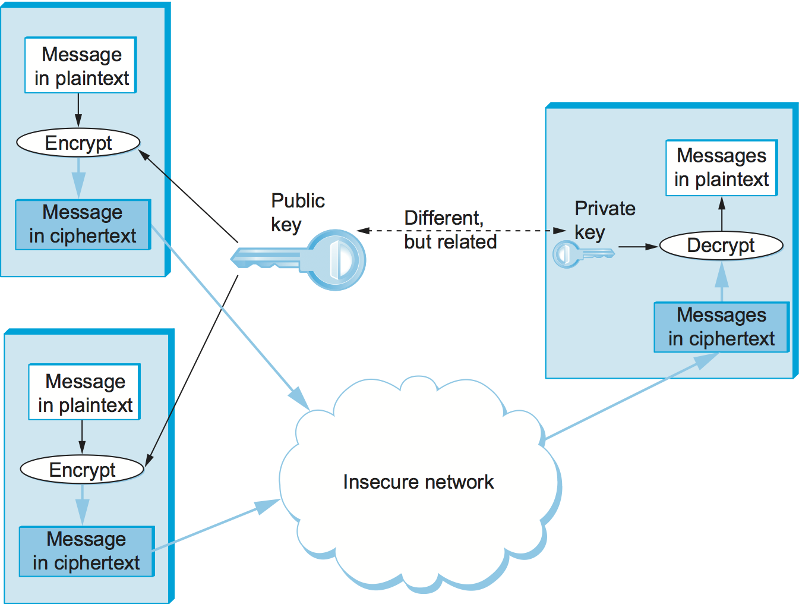

**الشكل 8.3.** التشفير بالمفتاح العام.

ولأن الأمر غير بديهي إلى حدّ ما، نشدّد على أن مفتاح التشفير العام عديم الفائدة في فكّ تشفير رسالة — فلن تستطيع حتى فكّ تشفير رسالة شفّرتها أنت للتوّ إلا إن كان لديك مفتاح فكّ التشفير الخاص. وإن فكّرنا في المفاتيح كأنها تعرّف قناة تواصل بين المشاركين، فثمّة فرق آخر بين شيفرات المفتاح العام وشيفرات المفتاح السرّي هو طوبولوجيا القنوات. فمفتاح شيفرة مفتاح سرّي يوفّر قناة ثنائية الاتجاه بين مشاركين — يملك كل مشارك المفتاح المتناظر نفسه الذي يستطيع أي منهما استخدامه لتشفير الرسائل في أي اتجاه أو فكّ تشفيرها. أما زوج المفتاح العام/الخاص فيوفّر، في المقابل، قناة أحادية الاتجاه ومتعدّدة إلى واحد: من كل من يملك المفتاح العام إلى المالك الوحيد للمفتاح الخاص، كما يوضّح الشكل 8.3.

ومن الخصائص الإضافية المهمة لشيفرات المفتاح العام أن المفتاح الخاص «لفكّ التشفير» يمكن استخدامه مع خوارزمية التشفير لتشفير رسائل بحيث لا يمكن فكّ تشفيرها إلا بالمفتاح العام «للتشفير». وهذه الخصيصة لا تفيد في السرّية بجلاء، لأن أي من يملك المفتاح العام يستطيع فكّ تشفير رسالة كهذه. (وفي الحقيقة، للسرّية ثنائية الاتجاه بين مشاركين يحتاج كل مشارك زوجه الخاص من المفاتيح، ويشفّر كل منهما الرسائل بالمفتاح العام للآخر.) غير أن هذه الخصيصة مفيدة في المصادقة، لأنها تخبر مستقبِل رسالة كهذه أنها لم يكن ممكنًا أن ينشئها إلا مالك المفاتيح (رهنًا بافتراضات معيّنة سنتناولها لاحقًا). ويوضّح ذلك الشكل 8.4. وينبغي أن يكون جليًا من الشكل أن أي من يملك المفتاح العام يستطيع فكّ تشفير الرسالة المشفَّرة، وبافتراض أن نتيجة فكّ التشفير تطابق النتيجة المتوقّعة، فيمكن استنتاج أنه لابد أن المفتاح الخاص استُخدم في أداء التشفير. وكيف يُستخدم هذا العمل بالضبط لتوفير المصادقة هو موضوع قسم لاحق. وكما سنرى، تُستخدم شيفرات المفتاح العام أساسًا للمصادقة ولتوزيع المفاتيح السرّية (المتناظرة) توزيعًا سريًّا، وتُترك بقية السرّية لشيفرات المفتاح السرّي.

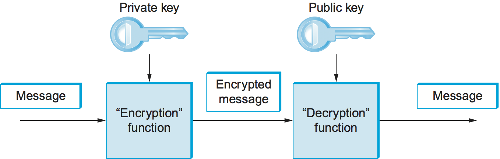

**الشكل 8.4.** المصادقة باستخدام المفاتيح العامة.

وثمّة قليل من التاريخ المشوق: نُشر مفهوم شيفرات المفتاح العام أول مرة في عام 1976 على يد ديفي وهلمان. غير أن وثائق ظهرت بعد ذلك تُثبت أن مجموعة أمن الإلكترونيات والاتصالات البريطانية كانت قد اكتشفت شيفرات المفتاح العام بحلول عام 1970، وتزعم وكالة الأمن القومي الأمريكية (NSA) أنها اكتشفتها في منتصف الستينيات.

وأشهر شيفرات المفتاح العام RSA، المسمّاة بأسماء مخترعيها: ريفست وشمير وأدلمان. ويعتمد RSA على الكلفة الحسابية العالية لتحليل الأعداد الكبيرة إلى عواملها. ومسألة إيجاد طريقة كفؤة لتحليل الأعداد مسألة عمل عليها الرياضيون بلا نجاح منذ زمن طويل قبل ظهور RSA في عام 1978، ومقاومة RSA اللاحقة لتحليل الشيفرات زادت الثقة في أمنها. ولسوء الحظ، يحتاج RSA إلى مفاتيح كبيرة نسبيًا، 1024 بتة على الأقل، ليكون آمنًا. وهذا أكبر من مفاتيح شيفرات المفتاح السرّي لأن كسر مفتاح RSA الخاص بتحليل العدد الكبير الذي يقوم عليه زوج المفاتيح أسرع من البحث الشامل في فضاء المفاتيح.

وثمّة شيفرة مفتاح عام أخرى هي ElGamal. وهي، كـRSA، تعتمد على مسألة رياضية، هي مسألة اللوغاريتم المتقطّع، لم يُوجد لها حلّ كفؤ، وتستلزم مفاتيح لا تقلّ عن 1024 بتة. وثمّة صيغة من مسألة اللوغاريتم المتقطّع تنشأ حين يكون المدخل منحنى إهليلجيًا، ويُظنّ أنها أعقد حسابيًا؛ ويُشار إلى المخططات التشفيرية القائمة على هذه المسألة بـ*التشفير بالمنحنيات الإهليلجية*.

ولسوء الحظ، فشيفرات المفتاح العام أبطأ من شيفرات المفتاح السرّي بعدة مراتب قدر. ومن ثمّ تُستخدم شيفرات المفتاح السرّي للأغلبية الساحقة من التشفير، بينما تُحفظ شيفرات المفتاح العام للاستخدام في المصادقة وإقامة مفاتيح الجلسة.

### 8.2.4 المصادِقات

التشفير وحده لا يوفّر سلامة البيانات. فمثلًا مجرد تعديل رسالة نص مشفَّر عشوائيًا قد يحوّلها إلى شيء يفكّ تشفيره إلى نص صريح يبدو صالحًا، وفي هذه الحالة لا يستطيع المستقبِل كشف التلاعب. وكذلك لا يوفّر التشفير وحده المصادقة. فليس ذا فائدة كبيرة أن نقول إن رسالة جاءت من مشارك معيّن إن كان محتوى الرسالة قد عُدِّل بعد أن أنشأها ذلك المشارك. وبمعنى ما، فالسلامة والمصادقة لا تنفصلان في الجوهر.

و*المصادِق* قيمة تُضمَّن في رسالة منقولة يمكن استخدامها للتحقق من أصالة الرسالة وسلامة بياناتها في وقت واحد. وسنرى كيف يمكن استخدام المصادِقات في البروتوكولات. ونركّز الآن على الخوارزميات التي تنتج المصادِقات.

وقد تتذكّر أن مجاميع التحقق والتحقّقات الدورية بالحشو (CRCs) قطع من المعلومات تُضاف إلى رسالة ليتمكّن المستقبِل من كشف متى عُدِّلت الرسالة عن غير قصد بأخطاء بتات. ويُطبَّق مفهوم مشابه على المصادِقات، مع تحدٍّ إضافي هو أن إفساد الرسالة مرجّح أن يُجريه عمدًا من يريد ألّا يُكشف الإفساد. ولدعم المصادقة، يتضمن المصادِق بعض الدليل على أن من أنشأه يعرف سرًّا لا يعرفه إلا المرسل المزعوم للرسالة؛ فمثلًا قد يكون السرّ مفتاحًا، وقد يكون الدليل قيمة مشفَّرة بالمفتاح. وثمّة تبعية متبادلة بين شكل المعلومة المكرّرة وشكل دليل معرفة السرّ. ونناقش عدة توليفات عملية.

ونفترض أولًا أن الرسالة الأصلية لا يلزم أن تكون سرّية — أي إن الرسالة المنقولة ستتكوّن من النص الصريح للرسالة الأصلية إضافةً إلى مصادِق. وسننظر لاحقًا في حالة الرغبة في السرّية.

ومن أنواع المصادِقات نوع يجمع التشفير و*دالة مبعثرة تشفيرية*. وتُعامَل خوارزميات المبعثرة التشفيرية معرفةً عامة، كما هي خوارزميات الشيفرة. ودالة المبعثرة التشفيرية (وتُعرف أيضًا بـ*مجموع تحقّق تشفيري*) دالة تُخرج معلومات مكرّرة كافية عن رسالة لتكشف أي تلاعب. فكما يكشف مجموع التحقق أو CRC أخطاء البتات التي تدخلها روابط مشوّشة، صُمّم مجموع تحقق تشفيري لكشف الإفساد المتعمّد للرسائل على يد خصم. والقيمة التي يخرجها تُسمّى *ملخّص الرسالة*، وتُلحق بالرسالة كمجموع تحقق عادي. ولكل ملخّصات الرسائل التي تنتجها دالة مبعثرة معيّنة العدد نفسه من البتات أيًّا كان طول الرسالة الأصلية. ولأن فضاء رسائل المدخل الممكنة أكبر من فضاء ملخّصات الرسائل الممكنة، فستوجد رسائل مدخل مختلفة تنتج ملخّص الرسالة نفسه، كالتصادمات في جدول مبعثر.

ويمكن إنشاء مصادِق بتشفير ملخّص الرسالة. ويحسب المستقبِل ملخّصًا لجزء النص الصريح من الرسالة ويقارنه بملخّص الرسالة المفكوك التشفير. فإن تساويا، استنتج المستقبِل أن الرسالة فعلًا من مرسلها المزعوم (إذ لابد أن تكون شُفّرت بالمفتاح الصحيح) وأنه لم يُتلاعب بها. ولا خصم يستطيع الإفلات بإرسال رسالة زائفة بملخّص زائف مطابق، لأنه لن يملك المفتاح لتشفير الملخّص الزائف تشفيرًا صحيحًا. غير أن الخصم قد يحصل على الرسالة الأصلية الصريحة وملخّصها المشفَّر بالتنصّت. ويمكنه بعد ذلك (لأن دالة المبعثرة معرفة عامة) حساب ملخّص الرسالة الأصلية وتوليد رسائل بديلة باحثًا عن واحدة لها ملخّص الرسالة نفسه. فإن وجد واحدة، أمكنه إرسال الرسالة الجديدة مع المصادِق القديم بلا كشف. ومن ثمّ فالأمن يستلزم أن تكون لدالة المبعثرة خاصية *الاتجاه الواحد*: يجب أن يكون غير ممكن حسابيًا أن يجد خصم أي رسالة نص صريح لها الملخّص نفسه الذي للرسالة الأصلية.

ولكي تحقق دالة مبعثرة هذا المتطلب، يجب أن تكون مخرجاتها موزَّعة عشوائيًا إلى حدّ بعيد. فمثلًا لو كانت الملخّصات طولها 128 بتة وموزَّعة عشوائيًا، فستحتاج إلى تجربة 2¹²⁷ رسالة في المتوسط قبل أن تجد رسالة ثانية يطابق ملخّصها ملخّص رسالة معيّنة. وإن لم تكن المخرجات موزَّعة عشوائيًا — أي إن بعض المخرجات أرجح بكثير من غيرها — فقد تجد لبعض الرسائل رسالة أخرى لها الملخّص نفسه بسهولة أكبر بكثير من ذلك، وهو ما يقلّل أمن الخوارزمية. وإن كنت بدلًا من ذلك تحاول أن تجد أي *تصادم* — أي رسالتين تنتجان الملخّص نفسه — فستحتاج إلى حساب ملخّصات 2⁶⁴ رسالة فقط في المتوسط. وهذه الحقيقة المفاجئة أساس «هجوم عيد الميلاد» — انظر التمارين لمزيد من التفاصيل.

وقد وُجدت عدة خوارزميات مبعثرة تشفيرية شائعة على مرّ السنين، منها ملخّص الرسالة 5 (MD5) وعائلة الخوارزمية المبعثرة الآمنة (SHA). وقد عُرفت نقاط ضعف MD5 والإصدارات الأقدم من SHA منذ زمن، وهو ما دفع NIST إلى تطوير عائلة خوارزميات تُعرف بـSHA-3 والتوصية بها في عام 2015.

وعند توليد ملخّص رسالة مشفَّر، قد يستخدم تشفير الملخّص شيفرة مفتاح سرّي أو شيفرة مفتاح عام. فإن استُخدمت شيفرة مفتاح عام، فسيُشفَّر الملخّص بالمفتاح الخاص للمرسل (ذلك الذي نعتقد عادةً أنه يُستخدم لفكّ التشفير)، ويستطيع المستقبِل — أو أي أحد آخر — فكّ تشفير الملخّص بالمفتاح العام للمرسل.

ويُسمّى الملخّص المشفَّر بخوارزمية مفتاح عام لكن باستخدام المفتاح الخاص *توقيعًا رقميًا*، لأنه يوفّر عدم الإنكار كالتوقيع المكتوب. ويستطيع مستقبِل رسالة تحمل توقيعًا رقميًا أن يثبت لأي طرف ثالث أن المرسل فعلًا أرسل تلك الرسالة، لأن الطرف الثالث يستطيع استخدام المفتاح العام للمرسل ليتحقق بنفسه. (أما التشفير بمفتاح سرّي للملخّص فلا يملك هذه الخصيصة لأن المشاركين وحدهما يعرفان المفتاح؛ وفضلًا عن ذلك، فلأن المشاركين يعرفان المفتاح، فقد يكون المستقبِل المزعوم هو من أنشأ الرسالة.) ويمكن استخدام أي شيفرة مفتاح عام للتوقيعات الرقمية. و*معيار التوقيع الرقمي* (DSS) صيغة توقيع رقمي قنّنها NIST. وقد تستخدم توقيعات DSS أي شيفرة من ثلاث شيفرات مفتاح عام، إحداها قائمة على RSA، وأخرى على ElGamal، والثالثة تُسمّى *خوارزمية التوقيع الرقمي بالمنحنيات الإهليلجية*.

وثمّة نهج بديل شائع الاستخدام لتشفير دالة مبعثرة هو استخدام دالة مبعثرة تأخذ قيمة سرّية (مفتاحًا لا يعرفه إلا المرسل والمستقبِل) معاملًا مدخلًا علاوةً على نص الرسالة. وتُخرج دالة كهذه شيفرة مصادقة رسالة تكون دالة في المفتاح السرّي ومحتوى الرسالة معًا. ويلحق المرسل شيفرة مصادقة الرسالة المحسوبة برسالة النص الصريح. ويعيد المستقبِل حساب شيفرة المصادقة باستخدام النص الصريح والقيمة السرّية، ويقارن الشيفرة المحسوبة من جديد بالشيفرة المستلمة في الرسالة. وأشيع النهوج لتوليد هذه الشيفرات تُسمّى HMAC، أي شيفرات مصادقة الرسائل بالمبعثرة المُفتَّحة.

ويمكن أن تستخدم HMAC أي دالة مبعثرة من النوع الموصوف أعلاه، لكنها تتضمن المفتاح أيضًا جزءًا من المادة المبعثَرة، حتى تكون HMAC دالة في المفتاح ونص المدخل معًا. وقد قنّن NIST نهجًا لحساب HMAC يأخذ الشكل الآتي:

HMAC = H((K⊕opad) || H((K⊕ipad) || text))

والـH دالة المبعثرة، والـK المفتاح، وopad (حشوة الإخراج) وipad (حشوة المدخل) سلسلتان معروفتان تُخضعان لعملية XOR (⊕) مع المفتاح. والرمز || يمثّل التسلسل.

وشرح هذا الـHMAC شرحًا عميقًا يخرج عن نطاق هذا الكتاب. غير أن هذا النهج أُثبت أنه آمن ما دامت دالة المبعثرة الكامنة H لها خصائص مقاومة التصادم المناسبة الموصوفة أعلاه. ولاحظ أن HMAC يأخذ دالة مبعثرة *H* غير مُفتَّحة ويحوّلها إلى مبعثرة مُفتَّحة باستخدام المفتاح (مُخضَعًا لعملية XOR مع سلسلة أخرى، *ipad*) كتلةً أولى تُغذّى بها دالة المبعثرة. ويُخضَع ناتج المبعثرة المُفتَّحة بعد ذلك لمبعثرة مُفتَّحة أخرى (بإخضاع المفتاح مرة أخرى لعملية XOR مع سلسلة واستخدام ذلك كتلةً أولى تُغذّى بها المبعثرة). ومرورا دالة المبعثرة المُفتَّحة مهمّان لإثبات أمن بناء HMAC هذا.

وحتى هذه النقطة كنا نفترض أن الرسالة غير سرّية، فيمكن نقل الرسالة الأصلية نصًا صريحًا. ولإضافة السرّية إلى رسالة تحمل شيفرة مصادقة، يكفي تشفير تسلسل الرسالة كلها بما في ذلك شيفرة مصادقتها. وتذكّر أنه في الممارسة تُنفَّذ السرّية باستخدام شيفرات المفتاح السرّي لأنها أسرع بكثير من شيفرات المفتاح العام. وفضلًا عن ذلك، فإدراج المصادِق في التشفير قليل الكلفة، ويزيد الأمن.

وقد كسبت في السنوات الأخيرة فكرة استخدام خوارزمية واحدة لدعم المصادقة والتشفير معًا تأييدًا لأسباب تتصل بالأداء وبساطة التنفيذ. ويُشار إلى ذلك بـ*التشفير المصادَق* أو *التشفير المصادَق ببيانات مرافقة*. ويُتيح المصطلح الأخير نقل بعض حقول البيانات (كترويسات الحزم) نصًا صريحًا — وهي البيانات المرافقة — بينما يُشفَّر بقية الرسالة، ويُصادَق على كل شيء بما فيه الترويسات. ولن ندخل في التفاصيل هنا، لكن ثمّة الآن مجموعة خوارزميات مدمجة تنتج النص المشفَّر وشيفرات المصادقة معًا باستخدام تركيب من الشيفرات ودوال المبعثرة.

ومع أن المصادِقات قد تبدو وكأنها تحلّ مسألة المصادقة، فسنرى في قسم لاحق أنها ليست إلا أساس الحل. غير أننا نعالج أولًا مسألة كيف يحصل المشاركون على المفاتيح في المقام الأول.

## 8.3 التوزيع المسبق للمفاتيح

لاستخدام الشيفرات والمصادِقات، يحتاج المشاركون المتواصلون إلى معرفة المفاتيح التي يستخدمونها. ففي حالة شيفرة مفتاح سرّي، كيف يحصل مشاركان على المفتاح الذي يتقاسمانه؟ وفي حالة شيفرة مفتاح عام، كيف يعرف المشاركون أي مفتاح عام يخص مشاركًا معيّنًا؟ والجواب يختلف بحسب ما إذا كانت المفاتيح *مفاتيح جلسة* قصيرة العمر أم *مفاتيح موزَّعة مسبقًا* أطول عمرًا.

ومفتاح الجلسة مفتاح يُستخدم لتأمين حلقة تواصل واحدة قصيرة نسبيًا: جلسة. وكل جلسة متميّزة بين مشاركين تستخدم مفتاح جلسة جديدًا، وهو مفتاح سرّي دائمًا لأجل السرعة. ويحدّد المشاركان مفتاح الجلسة الذي يستخدمانه ببروتوكول هو بروتوكول إقامة مفاتيح الجلسة. ويحتاج بروتوكول إقامة مفاتيح الجلسة إلى أمنه الخاص (حتى لا يستطيع خصم، مثلًا، تعلّم مفتاح الجلسة الجديد)؛ وذلك الأمن يستند إلى المفاتيح الموزَّعة مسبقًا الأطول عمرًا.

وثمّة دافعان رئيسان لهذا التقسيم للعمل بين مفاتيح الجلسة والمفاتيح الموزَّعة مسبقًا:

- تحديد مقدار الزمن الذي يُستخدم فيه المفتاح يؤدي إلى زمن أقل للهجمات الكثيفة حسابيًا، ونص مشفَّر أقل لتحليل الشيفرات، ومعلومات أقل تعرّضًا إن كُسر المفتاح.
- شيفرات المفتاح العام أفضل عمومًا للمصادقة وإقامة مفاتيح الجلسة، لكنها أبطأ من أن تُستخدم لتشفير الرسائل كلها لأجل السرّية.

ويشرح هذا القسم كيف تُوزَّع المفاتيح الموزَّعة مسبقًا، وسيشرح القسم التالي كيف تُقام مفاتيح الجلسة بعد ذلك. وسنستخدم من الآن فصاعدًا «أليس» و«بوب» للدلالة على المشاركين، كما هو شائع في أدبيات التشفير. وضع في ذهنك أنه مع نزوعنا إلى الإشارة إلى المشاركين بعبارات تشبيهية إنسانية، فنحن نعنى في الغالب بتواصل كيانات برمجية أو عتادية كالعملاء والخوادم، وهي كثيرًا ما لا تكون بينها وبين أي شخص معيّن علاقة مباشرة.
### 8.3.1 توزيع المفاتيح العامة مسبقًا

خوارزميات توليد زوج متطابق من المفتاحين العام والخاص معروفة علنًا، والبرمجيات التي تفعل ذلك متاحة على نطاق واسع. فإن أرادت أليس أن تستخدم شيفرة مفتاح عام، أمكنها أن تولّد زوجها الخاص من المفتاحين العام والخاص، وتُخفي المفتاح الخاص، وتُعلن المفتاح العام. لكن كيف تُعلن مفتاحها العام — أي تُؤكّد أنه لها — على نحو يستطيع به المشاركون الآخرون التأكد من أنه لها فعلًا؟ لا عبر البريد الإلكتروني ولا عبر الويب، لأن عدوًّا يستطيع أن يزوّر ادّعاءً معقولًا بالقدر نفسه بأن المفتاح *x* لأليس بينما *x* في الحقيقة للعدو.

ويُسمّى المخطط الكامل لتوثيق الروابط بين المفاتيح العامة والهويات — أي أي مفتاح لمن — *البنية التحتية للمفتاح العام* (PKI). وتبدأ البنية التحتية للمفتاح العام بالقدرة على التحقّق من الهويات وربطها بالمفاتيح *خارج النطاق*. ونعني بـ«خارج النطاق» شيئًا خارج الشبكة والحواسيب التي تكوّنها، كالأمثلة الآتية. فإن كانت أليس وبوب فردين يعرف أحدهما الآخر، أمكنهما أن يجتمعا في الغرفة نفسها وتعطي أليس مفتاحها العام لبوب مباشرةً، على بطاقة عمل ربما. وإن كان بوب مؤسسة، أمكن لأليس الفرد أن تقدّم هوية تقليدية، تتضمن صورة فوتوغرافية أو بصمات أصابع ربما. وإن كانت أليس وبوب حاسوبين تملكهما الشركة نفسها، أمكن لمسؤول نظام أن يهيّئ بوب بالمفتاح العام لأليس.

وإقامة المفاتيح خارج النطاق لا تبدو كأنها تتوسّع توسّعًا حسنًا، لكنها تكفي لتأسيس بنية تحتية للمفتاح العام. فمعلومة بوب بأن مفتاح أليس هو *x* يمكن نشرها على نطاق واسع وقابل للتوسّع باستخدام تركيب من التوقيعات الرقمية ومفهوم الثقة. فمثلًا لنفترض أنك استلمت المفتاح العام لبوب خارج النطاق وأنك تعرف عن بوب ما يكفي لتثق به في مسائل المفاتيح والهويات. فيستطيع بوب عندئذ أن يرسل إليك رسالة تؤكّد أن مفتاح أليس هو *x*، ولأنك تعرف المفتاح العام لبوب أصلًا، أمكنك أن تصادق على أن الرسالة جاءت من بوب. (وتذكّر أنه لتوقيع العبارة رقميًا كان بوب سيُلحق بها تجزئة تشفيرية مشفَّرة بمفتاحه الخاص.) ولأنك تثق ببوب في أن يقول الحق، فستعرف الآن أن مفتاح أليس هو *x*، حتى إن لم تلقها قطّ ولم تتبادل معها رسالة واحدة. وباستخدام التوقيعات الرقمية، لن يضطر بوب حتى إلى إرسال رسالة إليك؛ بل يكفيه أن ينشئ عبارة موقَّعة رقميًا بأن مفتاح أليس هو *x* وينشرها. وتُسمّى عبارة موقَّعة رقميًا كهذه تربط مفتاحًا عامًا *شهادة مفتاح عام*، أو *شهادة* ببساطة. ويستطيع بوب أن يرسل إلى أليس نسخة من الشهادة أو ينشرها على موقع ويب. ومتى احتاج أحد إلى التحقّق من مفتاح أليس العام، أمكنه ذلك بالحصول على نسخة من الشهادة، من أليس مباشرةً ربما، ما دام يثق ببوب ويعرف مفتاحه العام. وترى كيف يمكنك، بدءًا من عدد صغير جدًا من المفاتيح (مفتاح بوب وحده في هذه الحالة)، أن تبني على مرّ الزمن مجموعة كبيرة من المفاتيح الموثوقة. وبوب في هذه الحالة يؤدي الدور الذي يُشار إليه غالبًا بـ*جهة إصدار الشهادات* (CA)، ويعتمد كثير من أمن الإنترنت اليوم على جهات إصدار الشهادات. وVeriSign إحدى جهات إصدار الشهادات التجارية المعروفة. ونعود إلى هذا الموضوع أدناه.

وأحد المعايير الكبرى للشهادات يُعرف بـX.509. ويترك هذا المعيار تفاصيل كثيرة مفتوحة، لكنه يحدّد بنية أساسية. والشهادة يجب أن تتضمن بوضوح:

- هوية الكيان المُوثَّق
- المفتاح العام للكيان المُوثَّق
- هوية الموقِّع
- التوقيع الرقمي
- معرّف خوارزمية التوقيع الرقمي (أي تجزئة تشفيرية وأي شيفرة)

ومن مكوّناته الاختيارية وقت انتهاء الشهادة. وسنرى استخدامًا خاصًا لهذه الخصيصة أدناه.

ولأن الشهادة تُنشئ رابطًا بين هوية ومفتاح عام، فمن الحريّ أن ننظر عن قرب أكبر في ما نعنيه بـ«الهوية». فمثلًا شهادة تقول «هذا المفتاح العام لجون سميث» قد لا تكون مفيدة كثيرًا إن لم تستطع أن تعرف أي جون سميث من آلاف الجونات سميث المقصود. ومن ثمّ يجب أن تستخدم الشهادات فضاء أسماء محدَّدًا تعريفًا حسنًا للهويات المُوثَّقة؛ فمثلًا تُصدَر الشهادات غالبًا لعناوين البريد الإلكتروني ونطاقات DNS.

وثمّة طرق مختلفة يمكن أن تُقنّن بها بنية تحتية للمفتاح العام مفهوم الثقة. ونناقش النهجين الرئيسين.

#### جهات إصدار الشهادات

في هذا النموذج من الثقة، الثقة ثنائية؛ فإما أن تثق بشخص ثقة تامة وإما ألا تثق به أبدًا. ومع الشهادات، يتيح ذلك بناء *سلاسل ثقة*. فإن وثّقت X أن مفتاحًا عامًا معيّنًا لـY، ثم وثّقت Y بدورها أن مفتاحًا عامًا آخر لـZ، فثمّة سلسلة شهادات من X إلى Z، حتى إن لم يلتقِ X وZ قطّ. فإن كنت تعرف مفتاح X، وتثق بـX وبـY، أمكنك أن تصدّق الشهادة التي تعطي مفتاح Z. وبعبارة أخرى، كل ما تحتاجه سلسلة شهادات موقَّعة كلها من كيانات تثق بها، ما دامت تعود إلى كيان تعرف مفتاحه أصلًا.

و*جهة إصدار الشهادات* (CA) كيان يدّعي (أحدهم) أنه موثوق للتحقّق من الهويات وإصدار شهادات المفاتيح العامة. وثمّة جهات إصدار تجارية وحكومية وحتى مجانية. ولكي تستخدم جهة إصدار، يجب أن تعرف مفتاحها هي. ويمكنك تعلّم مفتاح تلك الجهة إن استطعت الحصول على سلسلة شهادات موقَّعة من جهات إصدار تبدأ بجهة تعرف مفتاحها أصلًا. ثم تستطيع أن تصدّق أي شهادة توقّعها تلك الجهة الجديدة.

ومن الطرق الشائعة لبناء سلاسل كهذه ترتيبها في هرمية شجرية البنية، كما يوضّح الشكل 8.5. فإن كان المفتاح العام للجهة الجذرية عند الجميع، أمكن لأي مشارك أن يوفّر سلسلة شهادات لمشارك آخر ويعرف أنها ستكفي لبناء سلسلة ثقة لذلك المشارك.

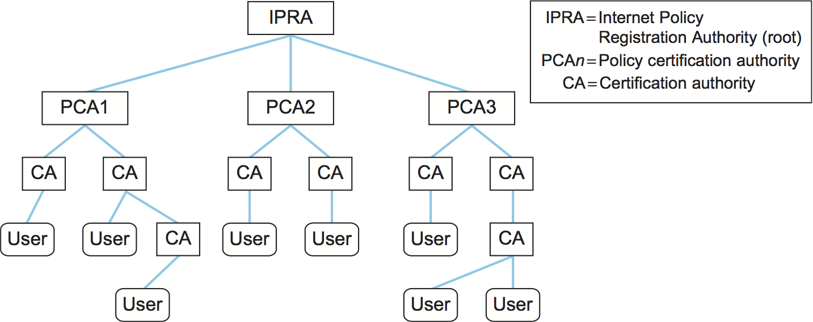

**الشكل 8.5.** هرمية جهات إصدار الشهادات الشجرية البنية.

وثمّة مسائل مهمة في بناء سلاسل الثقة. والأهم أنه حتى إن كنت واثقًا من أنك تملك المفتاح العام للجهة الجذرية، فأنت بحاجة إلى التأكد من أن كل جهة إصدار من الجذر نزولًا تؤدّي عملها أداءً صحيحًا. فإن كانت جهة إصدار واحدة فقط في السلسلة مستعدة لإصدار شهادات لكيانات دون التحقّق من هوياتها، فما يبدو سلسلة شهادات صالحة يصير عديم المعنى. فمثلًا قد تُصدر جهة جذرية شهادة لجهة إصدار من الطبقة الثانية وتتحقّق تمامًا من أن الاسم على الشهادة يطابق الاسم التجاري لتلك الجهة، لكن تلك الجهة من الطبقة الثانية قد تكون مستعدة لبيع شهادات لكل من يطلبها دون التحقّق من هويته. وتزداد هذه المسألة سوءًا كلما طالت سلسلة الثقة. وتوفّر شهادات X.509 خيار تحديد مجموعة الكيانات التي يُوثَق في أن موضوع الشهادة بدوره يوثّقها.

ويمكن أن تكون لشجرة إصدار الشهادات أكثر من جذر واحد، وهذا شائع في تأمين معاملات الويب اليوم، مثلًا. فمتصفحات الويب كـFirefox وInternet Explorer تأتي مزوَّدة سلفًا بشهادات لمجموعة من جهات إصدار الشهادات؛ ومن ثمّ قرّر منتج المتصفح فعليًا أن هذه الجهات ومفاتيحها جديرة بالثقة. ويستطيع المستخدم أيضًا أن يضيف جهات إصدار إلى ما يعترف به متصفحه موثوقًا. وتُقبل هذه الشهادات من طبقة المقابس الآمنة (SSL) وأمن طبقة النقل (TLS)، وهو البروتوكول الأكثر استخدامًا لتأمين معاملات الويب، ونناقشه في قسم لاحق. (وإن كنت فضوليًا، يمكنك أن تتجوّل في إعدادات التفضيلات في متصفحك وتجد خيار «عرض الشهادات» لترى كم جهة إصدار مُهيَّأ متصفحك ليثق بها.)

#### شبكة الثقة

وثمّة نموذج بديل للثقة هو *شبكة الثقة* التي تمثّلها الخصوصية الجيدة جدًا (PGP)، وتُناقش بمزيد من التفصيل في قسم لاحق. فـPGP نظام أمني للبريد الإلكتروني، فعناوين البريد الإلكتروني هي الهويات التي تُربَط بها المفاتيح والتي تُوقَّع بها الشهادات. واتساقًا مع جذور PGP كحماية من التطفّل الحكومي، لا توجد جهات إصدار شهادات. بل يقرّر كل فرد بمن يثق وكم يثق به — فالو ثقة في هذا النموذج مسألة درجات. وفضلًا عن ذلك، يمكن أن تتضمن شهادة المفتاح العام مستوى ثقة يدلّ على مقدار ثقة الموقِّع بالرابط المدّعى في الشهادة، فقد يحتاج مستخدم معيّن إلى عدة شهادات تشهد بالرابط نفسه قبل أن يكون مستعدًّا ليثق به.

فمثلًا لنفترض أن لديك شهادة لبوب قدّمتها أليس؛ فيمكنك أن تسند إلى تلك الشهادة مستوى ثقة معتدلًا. غير أنك إن كانت لديك شهادات إضافية لبوب قدّمها C وD، وكل منهما موثوق بدرجة معتدلة أيضًا، فقد يزيد ذلك كثيرًا مستوى ثقتك في أن المفتاح العام الذي لديك لبوب صالح. وبإيجاز، يعترف PGP بأن مسألة إقامة الثقة مسألة شخصية إلى حدّ بعيد، فيمنح المستخدمين المادة الخام لاتخاذ قراراتهم بأنفسهم، لا أن يفترض أنهم جميعًا مستعدون للثقة ببنية هرمية واحدة من جهات إصدار الشهادات. ونقتبس من فيل زيمرمان، مطوّر PGP: «PGP لمن يفضّلون أن يحزموا مظلاتهم بأنفسهم.»

وقد صار PGP شائعًا إلى حدّ بعيد في مجتمع الشبكات، وحفلات توقيع مفاتيح PGP ميزة منتظمة في أحداث شبكية متنوعة، كاجتماعات IETF. وفي هذه اللقاءات يستطيع الفرد أن

- يجمع المفاتيح العامة من آخرين يعرف هويتهم.
- يقدّم مفتاحه العام إلى آخرين.
- يجعل مفتاحه العام يوقَّعه آخرون، فيجمع بذلك شهادات تكون مقنعة لمجموعة متزايدة الاتساع من الناس.
- يوقّع المفتاح العام لأفراد آخرين، فيساعدهم بذلك على بناء مجموعة شهادات يستطيعون استخدامها لنشر مفاتيحهم العامة.
- يجمع شهادات من أفراد آخرين يثق بهم بما يكفي لتوقيع المفاتيح.

وبهذا يجمع المستخدم بمرور الزمن مجموعة شهادات بدرجات متفاوتة من الثقة.

#### إبطال الشهادات

من المسائل التي تنشأ مع الشهادات كيف تُبطَل شهادة، أي كيف يُلغى مفعولها. ولماذا هذا مهم؟ لنفترض أنك تشك في أن أحدهم اكتشف مفتاحك الخاص. وقد يوجد أي عدد من الشهادات في العالم تؤكّد أنك مالك المفتاح العام المقابل لذلك المفتاح الخاص. فمن اكتشف مفتاحك الخاص صار لديه كل ما يحتاجه ليتقمّصك: شهادات صالحة ومفتاحك الخاص. ولحلّ هذه المسألة، يحسن أن يكون ممكنًا إبطال الشهادات التي تربط مفتاحك القديم المكشوف بهويتك، حتى لا يستطيع المتقمّص بعد ذلك أن يقنع آخرين بأنه أنت.

والحلّ الأساسي للمسألة بسيط بما يكفي. فكل جهة إصدار شهادات تستطيع أن تُصدر *قائمة إبطال الشهادات* (CRL)، وهي قائمة موقَّعة رقميًا بالشهادات التي أُبطلت. وتُحدَّث القائمة دوريًا وتُتاح علنًا. ولأنها موقَّعة رقميًا، فيكفي نشرها على موقع ويب. والآن، متى استلمت أليس شهادة لبوب تريد التحقّق منها، راجعت أولًا أحدث قائمة إبطال أصدرتها الجهة. وما دامت الشهادة لم تُبطَل فهي صالحة. ولاحظ أنه لو كانت كل الشهادات بلا أجل محدود لصار طول القائمة يزداد دائمًا، إذ لن يمكنك أبدًا أن تنزع شهادة من القائمة خشية أن تُستخدم نسخة من الشهادة المبَطلة. ولهذا السبب يُلحق وقت انتهاء بالشهادة عادةً حين تُصدر. وهكذا يمكننا أن نحدّ المدة التي تحتاج فيها الشهادة المبَطلة إلى البقاء في القائمة. فمتى تجاوزت تاريخ انتهائها الأصلي، أمكن نزعها من القائمة.

### 8.3.2 توزيع المفاتيح السرّية مسبقًا

إن أرادت أليس أن تستخدم شيفرة مفتاح سرّي للتواصل مع بوب، فلا يمكنها أن تختار مفتاحًا ببساطة وتُرسله إليه، لأنهما، بلا مفتاح مشترك أصلًا، لا يستطيعان تشفير هذا المفتاح لإبقائه سرًّا ولا مصادقة أحدهما الآخر. وكما في المفاتيح العامة، يلزم مخطط توزيع مسبق. لكن التوزيع المسبق أصعب للمفاتيح السرّية منه للمفاتيح العامة لسببين جليين:

- بينما يكفي مفتاح عام واحد لكل كيان للمصادقة والسرّية، فلابد من مفتاح سرّي لكل زوج من الكيانات التي تريد التواصل. فإن كان هناك N من الكيانات، فمعنى ذلك N(N-1)/2 من المفاتيح.
- وخلافًا للمفاتيح العامة، يجب أن تبقى المفاتيح السرّية سرًّا.

وخلاصةً، ثمة مفاتيح أكثر بكثير يجب توزيعها، ولا يمكنك استخدام شهادات يقرأها الجميع.

والحلّ الأكثر شيوعًا استخدام *مركز توزيع المفايتح* (KDC). فمركز توزيع المفاتيح كيان موثوق يتقاسم مفتاحًا سرّيًا مع كل كيان آخر. وهذا يخفض عدد المفاتيح إلى N-1، وهو عدد أقدر على الإدارة، وقليل بما يكفي لإقامته خارج النطاق في بعض التطبيقات. ومتى أرادت أليس التواصل مع بوب، لا يمرّ ذلك التواصل عبر مركز توزيع المفاتيح. بل يشارك المركز في بروتوكول يصادق على أليس وبوب — باستخدام المفاتيح التي يتقاسمها المركز مع كل منهما أصلًا — ويولّد لهما مفتاح جلسة جديدًا يستخدمانه. ثم تتواصل أليس وبوب مباشرةً بمفتاح جلستهما. وKerberos نظام مستخدم على نطاق واسع قائم على هذا النهج. ونصف Kerberos (وهو يوفّر المصادقة أيضًا) في القسم التالي. ويصف القسم الفرعي التالي بديلًا قويًا.

### 8.3.3 تبادل مفاتيح ديفي-هلمان

وثمّة نهج آخر لإقامة مفتاح سرّي مشترك هو استخدام بروتوكول تبادل مفاتيح ديفي-هلمان، وهو يعمل دون استخدام أي مفاتيح موزَّعة مسبقًا. فالرسائل المتبادلة بين أليس وبوب يمكن أن يقرأها أي قادر على التنصّت، ومع ذلك لن يعرف المتنصّت المفتاح السرّي الذي ينتهي إليه أليس وبوب.

وديفي-هلمان لا يصادق على المشاركين. ولأنه قلّما يكون مفيدًا أن تتواصل تواصلًا آمنًا دون التأكد ممن تتواصل معه، فيُعزَّز ديفي-هلمان عادةً بطريقة ما لتوفير المصادقة. ومن الاستخدامات الرئيسة له في بروتوكول تبادل المفاتيح في الإنترنت (IKE)، وهو جزء مركزي من معمارية أمن IP (IPsec).

ولبروتوكول ديفي-هلمان معاملان، *p* و*g*، وكلاهما علني ويمكن أن يستخدمه كل المستخدمين في نظام معيّن. ويجب أن يكون المعامل *p* عددًا أوّليًا. والأعداد الصحيحة بقياس p (اختصارًا للباقي بعد القسمة على *p*) هي من 0 إلى *p-1*، لأن x بقياس p هو الباقي بعد قسمة *x* على *p*، وهي تكوّن ما يسمّيه الرياضيون *زمرة* تحت الضرب. ويجب أن يكون المعامل *g* (ويُسمّى عادةً مولّدًا) *جذرًا أوّليًا* لـ*p*: فلابد لكل عدد *n* من 1 إلى *p-1* من قيمة *k* بحيث n = gᵏ mod p. فمثلًا لو كان *p* هو العدد الأوّلي 5 (والنظام الحقيقي سيستخدم عددًا أكبر بكثير)، فقد نختار 2 مولّدًا *g* لأن:

1 = 2⁰ mod p

2 = 2¹ mod p

3 = 2³ mod p

4 = 2² mod p

ولنفترض أن أليس وبوب يريدان الاتفاق على مفتاح سرّي مشترك. وأليس وبوب وكل شخص آخر يعرفون أصلًا قيمتي *p* و*g*. فتولّد أليس قيمة خاصة عشوائية *a* ويولّد بوب قيمة خاصة عشوائية *b*. وكل من *a* و*b* يُسحبان من مجموعة الأعداد الصحيحة {1,…, p-1}. ويستنتج أليس وبوب قيمتهما العامة المقابلة — أي القيمتين التي سيتبادلانها غير مشفَّرتين — كما يلي. فالقيمة العامة لأليس هي

gᵃ mod p

والقيمة العامة لبوب هي

gᵇ mod p

ثم يتبادلان قيمتيهما العامة. وأخيرًا تحسب أليس

gᵃᵇ mod p = (gᵇ mod p)ᵃ mod p

ويحسب بوب

gᵇᵃ mod p = (gᵃ mod p)ᵇ mod p.

وصار عند أليس وبوب الآن gᵃᵇ mod p (وهي تساوي gᵇᵃ mod p) مفتاحًا سرّيًا مشتركًا بينهما.

وأي متنصّت سيعرف *p* و*g* والقيمتين العامتين gᵃ mod p وgᵇ mod p. ولو استطاع المتنصّت وحده أن يحدّد *a* أو *b*، لأمكنه بسهولة حساب المفتاح الناتج. غير أن تحديد *a* أو *b* من تلك المعلومات مستحيل حسابيًا حين تكون *p* و*a* و*b* كبيرة بالقدر المناسب؛ ويُعرف ذلك بـ*مسألة اللوغاريتم المتقطّع*.

فمثلًا، باستخدام *p = 5* و*g = 2* من المثال أعلاه، لنفترض أن أليس اختارت العدد العشوائي *a = 3* واختار بوب العدد العشوائي *b = 4*. فترسل أليس إلى بوب القيمة العامة

2³ mod 5 = 3

ويرسل بوب إلى أليس القيمة العامة

2⁴ mod 5 = 1

وتستطيع أليس بعد ذلك أن تحسب

gᵃᵇ mod p = (2ᵇ mod 5)³ mod 5 = (1)³ mod 5 = 1

بتعويض القيمة العامة لبوب في (2ᵇ mod 5). وبالمثل يستطيع بوب أن يحسب

gᵇᵃ mod p = (gᵃ mod 5)⁴ mod 5 = (3)⁴ mod 5 = 1.

بتعويض القيمة العامة لأليس في (2ᵃ mod 5). وقد اتفق أليس وبوب الآن على أن المفتاح السرّي هو 1.

وثمّة مسألة نقص المصادقة في ديفي-هلمان. ومن الهجمات التي تستفيد من ذلك *هجمة الرجل في الوسط*. فلنفترض أن مالوري عدو قادر على اعتراض الرسائل. ومالوري تعرف *p* و*g* أصلًا لأنهما علنيان، وتولّد قيمتين خاصتين عشوائيتين c وd تستخدمهما مع أليس وبوب على التوالي. فحين يرسل أليس وبوب قيمتيهما العامة أحدهما إلى الآخر، تعترضهما مالوري وترسل قيمتيها العامتين، كما في الشكل 8.6. والنتيجة أن أليس وبوب ينتهي كل منهما إلى تقاسم مفتاح مع مالوري لا مع الآخر دون أن يعلم.

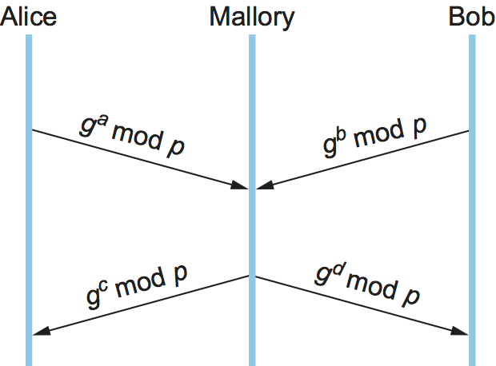

**الشكل 8.6.** هجمة الرجل في الوسط.

وثمّة تنويعة على ديفي-هلمان تُسمّى أحيانًا *ديفي-هلمان الثابت* تدعم مصادقة أحد المشاركين أو كليهما. وهي تعتمد على شهادات شبيهة بشهادات المفتاح العام، لكنها توثّق المعاملات العامة لديفي-هلمان لكيان ما. فمثلًا تقول شهادة كهذه إن معاملات ديفي-هلمان لأليس هي *p* و*g* وgᵃ mod p (ولاحظ أن قيمة *a* ستظل معروفة لأليس وحدها). وتُطمئن شهادة كهذه بوب بأن المشارك الآخر في ديفي-هلمان هو أليس، وإلا فالمشارك الآخر لن يستطيع حساب المفتاح السرّي لأنه لن يعرف *a*. فإن كانت عند المشاركين كليهما شهادات لمعاملات ديفي-هلمان، أمكنهما أن يصادق أحدهما على الآخر. وإن كانت عند أحدهما فقط شهادة، فأمكن مصادقة ذلك الواحد فقط. وهذا مفيد في بعض الأحوال؛ فمثلًا حين يكون أحد المشاركين خادم ويب والآخر عميلًا اعتباطيًا، يستطيع العميل أن يصادق على خادم الويب ويقيم مفتاحًا سرّيًا للسرّية قبل إرسال رقم بطاقة ائتمانية إلى خادم الويب.

## 8.4 بروتوكولات المصادقة

وصفنا حتى الآن كيف نشفّر الرسائل، ونبني المصادِقات، ونوزّع المفاتيح اللازمة مسبقًا. ويبدو كأن كل ما علينا فعله لجعل بروتوكول آمنًا هو إلحاق مصادِق بكل رسالة، وتشفير الرسالة إن أردنا السرّية.

وثمّة سببان رئيسان لعدم بساطة الأمر إلى هذا الحد. الأول مسألة *هجمة الإعادة*: أن يعيد عدو إرسال نسخة من رسالة أُرسلت سابقًا. فإن كانت الرسالة طلبًا أجريته في موقع ويب، مثلًا، فستظهر الرسالة المُعادة للموقع كأنك طلبت المزيد من الشيء نفسه. ومع أن الرسالة ليست نسختها الأصلية في الزمن، فمصادِقها سيظل صالحًا؛ فالرسالة بعد كل شيء أنشأتها أنت ولم تُعدَّل. ومن الواضح أننا نحتاج إلى حلّ يكفل *الأصالة*.

وفي تنويعة على هذه الهجمة تُسمّى *هجمة الكتم والإعادة*، قد يؤخّر عدو رسالتك فقط (باعتراضها وإعادة إرسالها لاحقًا)، بحيث تُستلَم في وقت لم تبقَ فيه مناسبة. فمثلًا قد يؤخّر عدو طلبك لشراء أسهم من وقت مؤاتٍ إلى وقت لم تكن تريد الشراء فيه. ومع أن هذه الرسالة ستكون أصيلة بمعنى ما، فلن تكون في حينها. ومن ثمّ نحتاج أيضًا إلى كفالة *التوقيت المناسب*. وقد تُعدّ الأصالة والتوقيت المناسبين وجهين للنزاهة. وكفالتهما ستستلزم في معظم الأحوال بروتوكولًا غير تافهين ذا ذهاب وإياب.

والمسألة الثانية التي لم نحلّها بعد كيف نقيم مفتاح جلسة. ومفتاح الجلسة مفتاح شيفرة سرّي يولّد في الطلب ويُستخدم لجلسة واحدة فقط. وهذا أيضًا يستلزم بروتوكولًا غير تافه.

والقاسم المشترك بين هاتين المسألتين هو المصادقة. فإن لم تكن الرسالة أصيلة ومناسبة التوقيت، فنريد من وجهة عملية أن نعدّها غير صحيحة، أي غير صادرة ممن تدّعي أنها منه. ومن الواضح أنك، وأنت ترتّب تقاسم مفتاح جلسة جديد مع أحد، تريد أن تعرف أنك تتقاسمه مع الشخص الصحيح. وعادةً تقيم بروتوكولات المصادقة مفتاح جلسة في الوقت نفسه، بحيث ينتهي البروتوكول بأليس وبوب مصادَقًا أحدهما على الآخر ولديهما مفتاح سرّي جديد يستخدمانه. فبلا مفتاح جلسة جديد، لن يصادق البروتوكول أليس وبوب إلا في لحظة واحدة؛ ومفتاح الجلسة يتيح لهما مصادقة الرسائل التالية مصادقة كفؤة. وبوجه عام تؤدي بروتوكولات إقامة مفتاح الجلسة المصادقة. ومن الاستثناءات البارزة ديفي-هلمان، كما هو موصوف أدناه، فيكاد يكون مصطلح *بروتوكول المصادقة* و*بروتوكول إقامة مفتاح الجلسة* مترادفين.

وثمّة مجموعة أساسية من التقنيات تُستخدم لكفالة الأصالة والتوقيت المناسبين في بروتوكولات المصادقة. ونصف تلك التقنيات قبل أن نمضي إلى بروتوكولات بعينها.

### 8.4.1 تقنيات الأصالة والتوقيت

رأينا أن المصادِقات وحدها لا تمكّننا من كشف الرسائل غير الأصيلة أو غير المناسبة التوقيت. وأحد النهوج تضمين طابع زمني في الرسالة. ومن الواضح أن الطابع الزمني نفسه يجب أن يكون محميًا من العبث، فلابد أن يغطّيه المصادِق. والعيب الأساسي في الطوابع الزمنية أنها تستلزم تزامن ساعات موزّعًا. ولأن نظامنا سيعتمد عندئذ على التزامن، فسيصير تزامن الساعات نفسه بحاجة إلى حماية من التهديدات الأمنية، علاوةً على تحديات تزامن الساعات المعتادة. والمسألة الأخرى أن الساعات الموزّعة تتزامن بدرجة معيّنة فقط — بهامش معيّن من الخطأ. ومن ثمّ فنزاهة التوقيت التي توفّرها الطوابع الزمنية ليست أفضل من درجة التزامن.

وثمّة نهج آخر هو تضمين *عدد عشوائي استعمالي* (nonce) في الرسالة، وهو عدد عشوائي يُستخدم مرة واحدة فقط. ويستطيع المشاركون عندئذ كشف هجمات الإعادة بأن يفحصوا هل استُخدم العدد من قبل. وللأسف يستلزم ذلك تتبّع الأعداد الاستعمالية السابقة، وقد يتراكم منها كثير جدًا. وأحد الحلول تركيب استخدام الطوابع الزمنية والأعداد الاستعمالية، بحيث يُشترَط أن تكون الأعداد الاستعمالية فريدة في مدة زمنية معيّنة فقط. وهذا يجعل كفالة فرادة الأعداد الاستعمالية قابلة للإدارة مع استلزام تزامن ساعات غير محكم فقط.

وحلّ آخر لنقائص الطوابع الزمنية والأعداد الاستعمالية استخدام أحدهما أو كليهما في بروتوكول *تحدٍّ واستجابة*. ولنفترض أننا نستخدم طابعًا زمنيًا. ففي بروتوكول تحدٍّ واستجابة ترسل أليس إلى بوب طابعًا زمنيًا، متحديةً بوب أن يشفّره في رسالة استجابة (إن كانا يتقاسمان مفتاحًا سرّيًا) أو أن يوقّعه رقميًا في رسالة استجابة (إن كان عند بوب مفتاح عام، كما في الشكل 8.7). والطابع الزمني المشفَّر شبيه بمصادِق يثبت التوقيت المناسب علاوةً على ذلك. وتستطيع أليس التحقّق بسهولة من توقيت الطابع الزمني في استجابة من بوب، لأن ذلك الطابع يأتي من ساعة أليس نفسها، فلا حاجة إلى تزامن ساعات موزّع. ولنفترض بدلًا من ذلك أن البروتوكول يستخدم أعدادًا استعمالية. فعندئذ لا تحتاج أليس إلا إلى تتبّع تلك الأعداد التي لا تزال استجاباتها معلّقة ولم تبقَ معلّقة مدة طويلة جدًا؛ وأي استجابة مدّعاة بعدد استعمالي غير معروف يجب أن تكون زائفة.

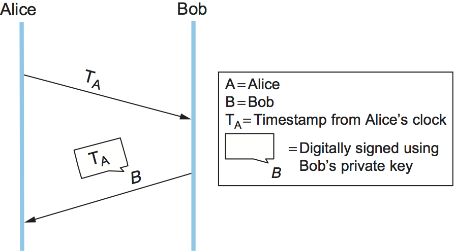

**الشكل 8.7.** بروتوكول تحدٍّ واستجابة.

وجمال بروتوكول التحدّي والاستجابة، الذي قد يبدو بخلاف ذلك معقّدًا مفرطًا، أنه يجمع التوقيت المناسب والمصادقة؛ فبوب وحده (وربما أليس، إن كانت شيفرة مفتاح سرّي) يعرف المفتاح اللازم لتشفير الطابع الزمني أو العدد الاستعمالي الذي لم يُرَ من قبل. وتُستخدم الطوابع الزمنية أو الأعداد الاستعمالية في معظم بروتوكولات المصادقة التي تلي.

### 8.4.2 بروتوكولات المصادقة بالمفتاح العام

في المناقشة التالية نفترض أن المفتاحين العامين لأليس وبوب وُزّعا مسبقًا أحدهما إلى الآخر بوسيلة ما كبنية تحتية للمفتاح العام. ونقصد بذلك أن يشمل الحالة التي تُضمّن فيها أليس شهادتها في رسالتها الأولى إلى بوب، والحالة التي يبحث فيها بوب عن شهادة عن أليس حين يستلم رسالتها الأولى.

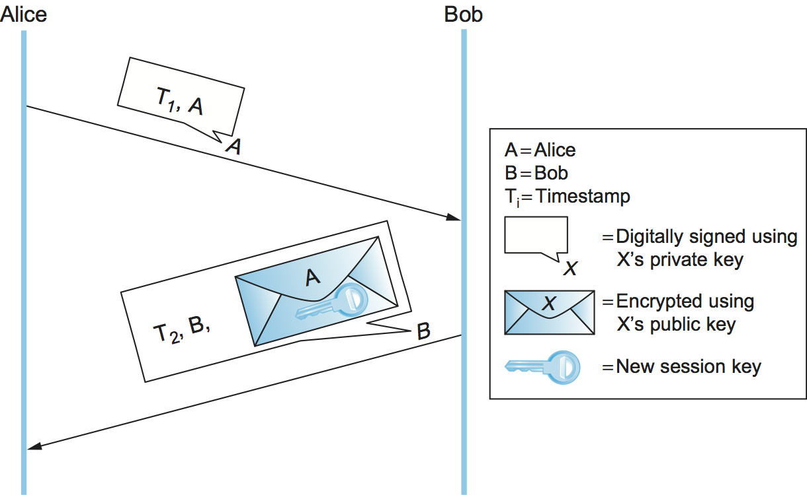

**الشكل 8.8.** بروتوكول مصادقة بالمفتاح العام يعتمد على التزامن.

وهذا البروتوكول الأول (الشكل 8.8) يعتمد على أن ساعتي أليس وبوب متزامنتان. فترسل أليس إلى بوب رسالة تحمل طابعًا زمنيًا وهوية صريحة وتوقيعها الرقمي. ويستخدم بوب التوقيع الرقمي لمصادقة الرسالة والطابع الزمني للتحقّق من حداثتها. ويرسل بوب رجوعًا رسالة تحمل طابعًا زمنيًا وهويته صريحة، ومفتاح جلسة جديدًا مشفَّرًا (للسرّية) بالمفتاح العام لأليس، وكلها موقَّعة رقميًا. وتستطيع أليس التحقّق من صحة الرسالة وحداثتها، فتعرف أنها تستطيع الثقة بمفتاح الجلسة الجديد. ولمعالجة تزامن الساعات غير التام، يمكن تعزيز الطوابع الزمنية بأعداد استعمالية.

والبروتوكول الثاني (الشكل 8.9) مشابه لكنه لا يعتمد على تزامن الساعات. وفيه ترسل أليس مرة أخرى إلى بوب رسالة موقَّعة رقميًا تحمل طابعًا زمنيًا وهويته. ولأن ساعتيهما غير متزامنتين، لا يستطيع بوب التأكد من حداثة الرسالة. فيرسل رجوعًا رسالة موقَّعة رقميًا تحمل طابع أليس الزمني الأصلي وطابعه الزمني الجديد وهويته. وتستطيع أليس التحقّق من حداثة ردّ بوب بمقارنة وقتها الحالي بالطابع الزمني الذي نشأ منها. ثم ترسل إلى بوب رسالة موقَّعة رقميًا تحمل طابعه الزمني الأصلي ومفتاح جلسة جديدًا مشفَّرًا بالمفتاح العام لبوب. ويستطيع بوب التحقّق من حداثة الرسالة لأن الطابع الزمني جاء من ساعته، فيعرف أنه يستطيع الثقة بمفتاح الجلسة الجديد. والطوابع الزمنية تؤدي هنا فعليًا دور أعداد استعمالية ملائمة، والحال أن هذا البروتوكول كان يمكن أن يستخدم أعدادًا استعمالية بدلًا منها.

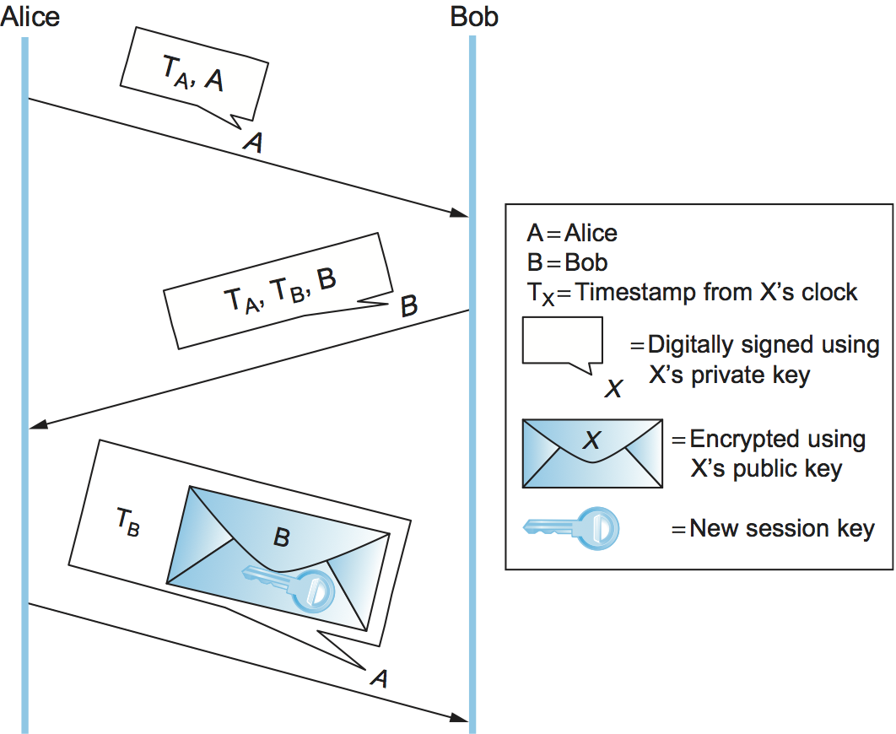

**الشكل 8.9.** بروتوكول مصادقة بالمفتاح العام لا يعتمد على التزامن. تتحقّق أليس من طابعها الزمني بساعتها هي، وكذلك بوب.

### 8.4.3 بروتوكولات المصادقة بالمفتاح السرّي

لا يكون توزيع المفاتيح السرّية مسبقًا على كل زوج من الكيانات عمليًا إلا في أنظمة صغيرة إلى حدّ بعيد. ونركّز هنا على أنظمة أكبر، يكون فيها لكل كيان *مفتاح رئيسي* خاص به يتقاسمه مع مركز توزيع المفاتيح وحده. وفي هذه الحالة تشمل بروتوكولات المصادقة القائمة على المفتاح السرّي ثلاثة أطراف: أليس وبوب ومركز توزيع المفاتيح. والناتج النهائي لبروتوكول المصادقة مفتاح جلسة يتقاسمه أليس وبوب ويستخدمانه للتواصل مباشرةً دون إشراك مركز توزيع المفاتيح.

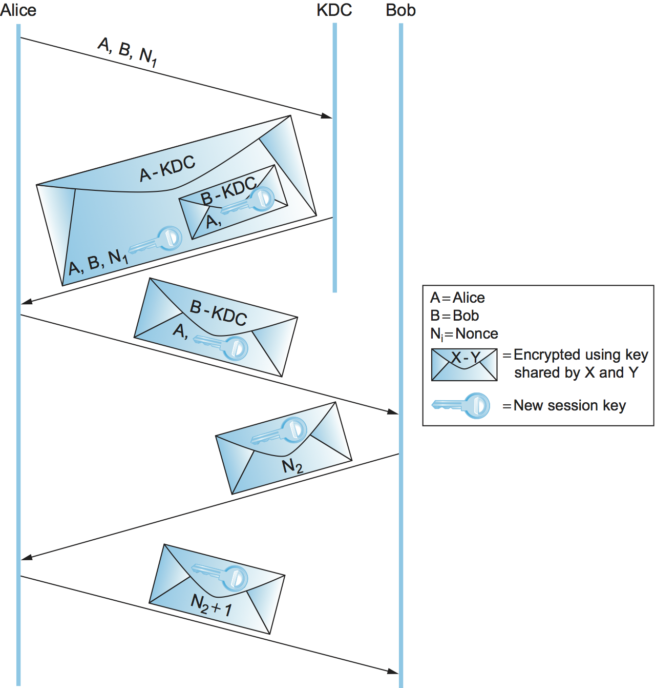

**الشكل 8.10.** بروتوكول المصادقة نيدهام-شرويدر.

ويُعرض بروتوكول المصادقة نيدهام-شرويدر في الشكل 8.10. ولاحظ أن مركز توزيع المفاتيح لا يصادق فعليًا على رسالة أليس الأولى ولا يتواصل مع بوب إطلاقًا. بل يستخدم المركز معرفته بالمفتاحين الرئيسيين لأليس وبوب ليبني ردًّا لا يفيد أحدًا غير أليس (لأن أليس وحدها تستطيع فكّه) ويحتوي المكوّنات اللازمة لتؤدّي أليس وبوب بقية بروتوكول المصادقة بأنفسهما.

والعدد الاستعمالي في الرسالتين الأولى والثانية لتأكيد أليس أن ردّ مركز توزيع المفاتيح حديث. وتتضمن الرسالتان الثانية والثالثة مفتاح الجلسة الجديد ومعرّف أليس، مشفَّرين معًا بالمفتاح الرئيسي لبوب. وهو ضرب من نسخة المفتاح السرّي لشهادة المفتاح العام؛ فهو فعليًا عبارة موقَّعة من مركز توزيع المفاتيح (لأن المركز هو الكيان الوحيد عدا بوب الذي يعرف المفتاح الرئيسي لبوب) بأن مفتاح الجلسة المرفق مملوك لأليس وبوب. ومع أن العدد الاستعمالي في الرسالتين الأخيرتين القصد منه تأكيد بوب أن الرسالة الثالثة حديثة، فثمّة خلل في هذا الاستدلال.

#### Kerberos

Kerberos نظام مصادقة قائم على بروتوكول نيدهام-شرويدر ومخصَّص لبيئات العميل/الخادم. طُوّر أصلًا في MIT، ووحّدته IETF، وهو متاح مصدرًا مفتوحًا ومنتجًا تجاريًا. وسنركّز هنا على بعض ابتكارات Kerberos المثيرة للاهتمام.

وعملاء Kerberos مستخدمون بشريون عمومًا، ويصادق المستخدمون على أنفسهم بكلمات السر. فالمفتاح الرئيسي لأليس، المتقاسم مع مركز توزيع المفاتيح، مشتقّ من كلمة سرها: فإن عرفت كلمة السر أمكنك حساب المفتاح. ويفترض Kerberos أن أي أحد يمكنه الوصول فيزيائيًا إلى أي آلة عميل؛ ومن ثمّ فمن المهم تقليل تعرّض كلمة سر أليس أو مفتاحها الرئيسي لا في الشبكة فحسب بل على أي آلة تسجّل الدخول منها أيضًا. ويستفيد Kerberos من نيدهام-شرويدر لبلوغ ذلك. ففي نيدهام-شرويدر، المرة الوحيدة التي تحتاج فيها أليس إلى استخدام كلمة سرها حين تفكّ ردّ مركز توزيع المفاتيح. وتنتظر برمجيات العميل في Kerberos حتى يصل ردّ المركز، ثم تطلب من أليس إدخال كلمة سرها، وتحسب المفتاح الرئيسي وتفكّ ردّ المركز، ثم تمحو كل المعلومات المتعلقة بكلمة السر والمفتاح الرئيسي لتقليل تعرّضها. ولاحظ أيضًا أن العلامة الوحيدة التي يراها المستخدم لـKerberos هي عندما يُطلب منه إدخال كلمة سر.

وفي نيدهام-شرويدر، يؤدي ردّ مركز توزيع المفاتيح إلى أليس دورين: يمنحها وسيلة لإثبات هويتها (فأليس وحدها تستطيع فكّ الردّ)، ويمنحها ضربًا من شهادة مفتاح سرّي أو «تذكرة» تقدّمها إلى بوب — أي مفتاح الجلسة ومعرّف أليس مشفَّرين بالمفتاح الرئيسي لبوب. وفي Kerberos تُفصَل هاتان الوظيفتان (ومركز توزيع المفاتيح نفسه فعليًا) (الشكل 8.11). فخادم موثوق يُسمّى *خادم المصادقة* (AS) يؤدي دور المركز الأول فيزوّد أليس بما تستطيع استخدامه لإثبات هويتها، لا لبوب هذه المرة بل لخادم موثوق ثانٍ يُسمّى *خادم منح التذاكر* (TGS). ويؤدي خادم منح التذاكر دور المركز الثاني فيردّ على أليس بتذكرة تستطيع تقديمها إلى بوب. وجاذبية هذا المخطط أن أليس، إن احتاجت إلى التواصل مع عدة خوادم لا مع بوب فقط، تستطيع الحصول على تذكرة لكل منها من خادم منح التذاكر دون العودة إلى خادم المصادقة.

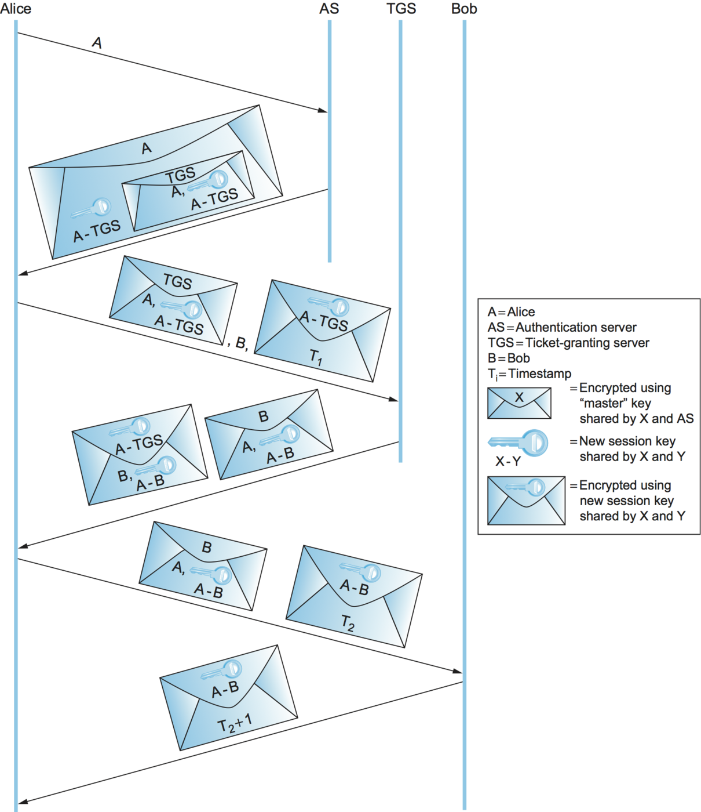

**الشكل 8.11.** مصادقة Kerberos.

وفي مجال تطبيقات العميل/الخادم الذي يستهدفه Kerberos، من المعقول افتراض درجة من تزامن الساعات. وهذا يتيح لـKerberos استخدام الطوابع الزمنية وأعمار الصلاحية بدل الأعداد الاستعمالية في نيدهام-شرويدر، فيزيل بذلك ضعف نيدهام-شرويدر الأمني. ويدعم Kerberos اختيارًا من دوال التجزئة وشيفرات المفتاح السرّي، فيستطيع أن يجاري أحدث ما في خوارزميات التشفير.

## 8.5 أنظمة أمثلة

رأينا الآن كثيرًا من المكوّنات اللازمة لتوفير جانب أو جانبين من الأمن. وتشمل هذه المكوّنات خوارزميات التشفير وآليات التوزيع المسبق للمفاتيح وبروتوكولات المصادقة. ونفحص في هذا القسم بعض الأنظمة الكاملة التي تستخدم هذه المكوّنات.

ويمكن تصنيف هذه الأنظمة تصنيفًا تقريبيًا بحسب طبقة البروتوكول التي تعمل عندها. فالأنظمة التي تعمل عند طبقة التطبيق تشمل الخصوصية الجيدة جدًا (PGP)، التي توفّر أمن البريد الإلكتروني، والصدفة الآمنة (SSH)، وهي مرفق آمن لتسجيل الدخول عن بعد. وعند طبقة النقل يوجد معيار أمن طبقة النقل (TLS) لـIETF والبروتوكول الأقدم الذي اشتُقّ منه، طبقة المقابس الآمنة (SSL). أما بروتوكولات أمن IP (IPsec)، كما يدل اسمها، فتعمل عند طبقة IP (الشبكة). ويوفّر 802.11i الأمن عند طبقة الربط في الشبكات اللاسلكية. ويصف هذا القسم الخصائص البارزة لكل من هذه النهوج.

وقد تتساءل بحق لماذا يجب توفير الأمن عند طبقات مختلفة كثيرة إلى هذا الحد. وأحد الأسباب أن تهديدات مختلفة تستلزم تدابير دفاعية مختلفة، وهذا يُترجَم غالبًا إلى تأمين طبقة بروتوكول مختلفة. فمثلًا إن كان همّك الرئيس أن يتنصّت شخص في المبنى المجاور على حركتك وهي تمرّ بين حاسوبك المحمول ونقطة الوصول 802.11، فالأرجح أنك تريد الأمن عند طبقة الربط. أما إن أردت أن تتأكد حقًّا من أنك متصل بموقع بنكك ومن أن كل البيانات التي ترسلها إلى البنك لا يقرأها موظفون فضوليون في مقدّم خدمة إنترنت ما، فالشيء الذي يمتد من آلتك إلى خادم البنك — كطبقة النقل — قد يكون الموضع الصحيح لتأمين الحركة. وكما هي الحال غالبًا، لا يوجد حلّ «مقاس واحد يناسب الجميع».

والأنظمة الأمنية الموصوفة أدناه قادرة على تنويع الخوارزميات التشفيرية التي تستخدمها. وفكرة جعل نظام أمني مستقلًا عن الخوارزمية فكرة جيدة جدًا، لأنك لا تعرف أبدًا متى قد يثبت أن خوارزميتك التشفيرية المفضلة غير قوية بما يكفي لأغراضك. ويحسن أن تستطيع الانتقال سريعًا إلى خوارزمية جديدة دون أن تضطر إلى تغيير مواصفة البروتوكول أو تنفيذه. ولاحظ القياس على القدرة على تغيير المفاتيح دون تغيير الخوارزمية؛ فإن تبيّن أن إحدى خوارزمياتك التشفيرية معيبة، فسيكون رائعًا ألا تحتاج معماريتك الأمنية كلها إلى إعادة تصميم فورية.

### 8.5.1 الخصوصية الجيدة جدًا (PGP)

الخصوصية الجيدة جدًا (PGP) نهج مستخدم على نطاق واسع لتوفير الأمن للبريد الإلكتروني. وهي توفّر المصادقة والسرّية ونزاهة البيانات وعدم الإنكار. وقد ابتكرها فيل زيمرمان أصلًا، ثم تطوّرت إلى معيار IETF يُعرف بـOpenPGP. وكما رأينا في قسم سابق، PGP جديرة بالذكر لاستخدامها نموذج «شبكة الثقة» لتوزيع المفاتيح لا هرمية شجرية البنية.

وتعتمد سرّية PGP ومصادقة المستقبِل على أن يكون عند مستقبِل رسالة بريد إلكتروني مفتاح عام يعرفه المرسل. ولاستيفاء مصادقة المرسل وعدم الإنكار، يجب أن يكون عند المرسل مفتاح عام يعرفه المستقبِل. وتُوزَّع هذه المفاتيح العامة مسبقًا باستخدام الشهادات وبنية تحتية للمفتاح العام قائمة على شبكة الثقة. وتدعم PGP خوارزميتَي RSA وDSS لشهادات المفاتيح العامة. وقد تحدّد هذه الشهادات علاوةً على ذلك أي الخوارزميات التشفيرية يدعمها مالك المفتاح أو يفضّلها. وتوفّر الشهادات روابط بين عناوين البريد الإلكتروني والمفاتيح العامة.

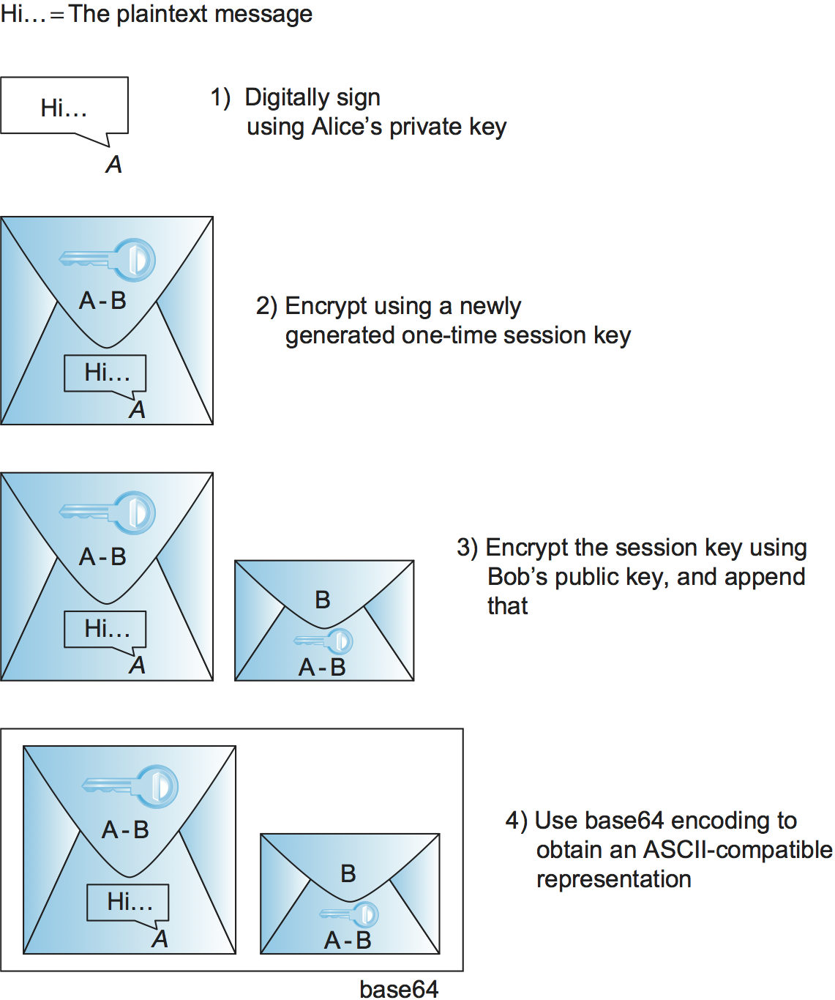

**الشكل 8.12.** خطوات PGP لتهيئة رسالة لإرسالها بالبريد من أليس إلى بوب.

لننظر في المثال الآتي لاستخدام PGP لتوفير مصادقة المرسل والسرّية معًا. لنفترض أن عند أليس رسالة تريد إرسالها بالبريد إلى بوب. فيمرّ تطبيق PGP عند أليس بالخطوات المعروضة في الشكل 8.12. أولًا تُوقَّع الرسالة رقميًا من أليس؛ ومن دوال التجزئة التي يمكن استخدامها في التوقيع الرقمي MD5 وSHA-1 وعائلة SHA-2. ثم يولّد تطبيق PGP عندها مفتاح جلسة جديدًا لهذه الرسالة الواحدة؛ ومن شيفرات المفتاح السرّي المدعومة AES و3DES. وتُشفَّر الرسالة الموقَّعة رقميًا بمفتاح الجلسة، ثم يُشفَّر مفتاح الجلسة نفسه بالمفتاح العام لبوب ويُلحق بالرسالة. ويذكّر تطبيق PGP عند أليس بمستوى الثقة الذي أسندته سابقًا إلى المفتاح العام لبوب، بناءً على عدد الشهادات التي لديها عنه ومدى جدارة الأفراد الذين وقّعوا الشهادات بالثقة. وأخيرًا، لا لأجل الأمن بل لأن رسائل البريد الإلكتروني يجب أن تُرسَل بترميز ASCII، يُطبَّق على الرسالة ترميز base64 لتحويلها إلى تمثيل متوافق مع ASCII. ومتى استلم بوب رسالة PGP في بريده، عكس تطبيق PGP عنده هذه العملية خطوةً خطوة للحصول على الرسالة النصية الأصلية والتأكد من التوقيع الرقمي لأليس، وذكّر بوب بمستوى ثقته في المفتاح العام لأليس.

والبريد الإلكتروني له خصائص معيّنة تتيح لـPGP أن تدمج بروتوكول مصادقة مناسبًا في بروتوكول نقل البيانات أحادي الرسالة هذا، فتتفادى الحاجة إلى أي تبادل رسائل سابق (وتتفادى بعض التعقيدات الموصوفة في القسم السابق). فالتوقيع الرقمي لأليس يكفي لمصادقتها. ومع أنه لا دليل على أن الرسالة مناسبة التوقيت، فالبريد الإلكتروني المشروع ليس مضمون التوقيت المناسب أيضًا. ولا دليل أيضًا على أن الرسالة أصيلة، لكن بوب مستخدم بريد إلكتروني وإنسان متحمّل للأخطاء على الأرجح، يستطيع التعافي من رسائل مكرّرة (وهي، مرة أخرى، ليست مستبعدة في التشغيل العادي على أي حال). وتستطيع أليس أن تتأكد من أن بوب وحده استطاع قراءة الرسالة لأن مفتاح الجلسة شُفّر بمفتاحه العام. ومع أن هذا البروتوكول لا يثبت لأليس أن بوب موجود فعلًا واستلم البريد، فرسالة بريد مصادَق عليها من بوب إلى أليس تستطيع ذلك.

والمناقشة السابقة تعطي مثالًا جيدًا على لماذا قد تكون آليات الأمن عند طبقة التطبيق مفيدة. فبمعرفة كاملة بكيفية عمل التطبيق وحدها تستطيع أن تتخذ الخيارات الصحيحة في أي الهجمات تدافع عنها (كبريد إلكتروني مزوَّر) وأيها تتجاهل (كبريد إلكتروني مؤخَّر أو مُعاد).

### 8.5.2 الصدفة الآمنة (SSH)

يُستخدم بروتوكول الصدفة الآمنة (SSH) لتوفير خدمة تسجيل الدخول عن بعد، فيحلّ محل Telnet الأقل أمنًا المستخدم في أيام الإنترنت الأولى. (ويمكن استخدام SSH أيضًا لتنفيذ أوامر عن بعد ونقل الملفات، لكننا سنركّز أولًا على كيف يدعم SSH تسجيل الدخول عن بعد.) ويُستخدم SSH في الأغلب لتوفير مصادقة قوية بين العميل والخادم ونزاهة للرسائل — حيث يعمل عميل SSH على آلة المستخدم المكتبية ويعمل خادم SSH على آلة بعيدة يريد المستخدم تسجيل الدخول إليها — لكنه يدعم السرّية أيضًا. وTelnet لا يوفّر أيًّا من هذه القدرات. ولاحظ أن «SSH» تُستخدم غالبًا للإشارة إلى بروتوكول SSH وإلى التطبيقات التي تستخدمه معًا؛ وعليك أن تستنبط أيّهما من السياق.

ولتقدير أهمية SSH في إنترنت اليوم تقديرًا أفضل، انظر في حالين من الحالات التي تُستخدم فيها. فالعاملون عن بعد، مثلًا، يشتركون غالبًا في مقدّمي خدمة إنترنت يقدّمون الألياف السريعة حتى المنزل، ويستخدمون هؤلاء المقدّمين (مع سلسلة من مقدّمي خدمة آخرين) للوصول إلى آلات يشغّلها صاحب العمل. ومعنى ذلك أن العامل عن بعد حين يسجّل الدخول إلى آلة داخل مركز بيانات صاحب عمله، فكلمات السر وكل البيانات المرسلة أو المستلمة تمرّ محتملةً عبر أي عدد من الشبكات غير الموثوقة. ويوفّر SSH طريقة لتشفير البيانات المرسلة عبر هذه الاتصالات وتحسين قوة آلية المصادقة المستخدمة لتسجيل الدخول. (وتحدث حالة مشابهة حين يتصل ذلك الموظف بالعمل عبر شبكة Wi-Fi عامة في مقهى.) ومن استخدامات SSH الأخرى تسجيل الدخول عن بعد إلى موجّه، لتغيير تهيئته أو لقراءة ملفات سجلاته ربما؛ فمن الواضح أن مسؤول شبكة يريد أن يتأكد من أنه يستطيع تسجيل الدخول إلى موجّه تسجيلًا آمنًا وأن أطرافًا غير مخوَّلة لا تستطيع تسجيل الدخول ولا اعتراض الأوامر المرسلة إلى الموجّه ولا الخرج المرسل رجوعًا إلى المسؤول.

وأحدث إصدار من SSH، الإصدار 2، يتكوّن من ثلاثة بروتوكولات:

- SSH-TRANS، بروتوكول عند طبقة النقل
- SSH-AUTH، بروتوكول مصادقة
- SSH-CONN، بروتوكول اتصال

ونركّز على الأولين، إذ يشاركان في تسجيل الدخول عن بعد. ونناقش بإيجاز غرض SSH-CONN في آخر القسم.

ويوفّر SSH-TRANS قناة مشفَّرة بين آلتَي العميل والخادم. وهو يعمل فوق اتصال TCP. ومتى استخدم مستخدم تطبيق SSH ليسجّل الدخول إلى آلة بعيدة، فالخطوة الأولى إقامة قناة SSH-TRANS بين الآلتين. وتقيم الآلتان هذه القناة الآمنة بأن يصادق العميل أولًا على الخادم باستخدام RSA. ومتى تمّت المصادقة، يقيم العميل والخادم مفتاح جلسة يستخدمانه لتشفير أي بيانات تُرسَل عبر القناة. وهذا الوصف رفيع المستوى يتجاوز تفاصيل عدة، منها أن بروتوكول SSH-TRANS يتضمن تفاوضًا على خوارزمية التشفير التي سيستخدمها الجانبان. فمثلًا تُختار AES عادةً. ويتضمن SSH-TRANS أيضًا تحقّقًا من نزاهة الرسائل لكل البيانات المتبادلة عبر القناة.

والمسألة الوحيدة التي لا يمكننا تجاوزها كيف صار عند العميل المفتاح العام للخادم الذي يحتاجه لمصادقة الخادم. وكما قد يبدو غريبًا، يُخبر الخادم العميل بمفتاحه العام وقت الاتصال. فأول مرة يتصل فيها عميل بخادم معيّن، يحذّر تطبيق SSH المستخدم بأنه لم يتحدث إلى هذه الآلة من قبل ويسأله هل يريد المتابعة. ومع أن ذلك فعل محفوف بالمخاطر، لأن SSH فعليًا غير قادر على مصادقة الخادم، فالمستخدمون يقولون «نعم» لهذا السؤال غالبًا. ثم يتذكّر تطبيق SSH المفتاح العام للخادم، وفي المرة التالية التي يتصل فيها المستخدم بالآلة نفسها يقارن هذا المفتاح المحفوظ بالمفتاح الذي يردّ به الخادم. فإن تطابقا صادق SSH على الخادم. أما إن اختلفا، فيحذّر تطبيق SSH المستخدم مرة أخرى بأن ثمة خللًا ما، وتُتاح له الفرصة لإلغاء الاتصال. وبدلًا من ذلك يمكن للمستخدم الحصيف أن يتعلّم المفتاح العام للخادم بآلية خارج النطاق، ويحفظه على آلة العميل، فيتفادى بذلك مخاطرة «المرة الأولى» تمامًا.

ومتى وُجدت قناة SSH-TRANS، فالخطوة التالية أن يسجّل المستخدم الدخول إلى الآلة فعلًا، أو بعبارة أدق أن يصادق على نفسه للخادم. ويتيح SSH ثلاث آليات مختلفة لذلك. الأولى أنه، بما أن الآلتين تتواصلان عبر قناة آمنة، فلا بأس في أن يرسل المستخدم كلمة سرّه إلى الخادم ببساطة. وهذا ليس فعلًا آمنًا عند استخدام Telnet، لأن كلمة السر ستُرسَل صريحة، لكنها في حالة SSH مشفَّرة داخل قناة SSH-TRANS. والآلية الثانية تستخدم تشفير المفتاح العام. وتستلزم أن يكون المستخدم قد وضع مفتاحه العام على الخادم. والآلية الثالثة، وتُسمّى *المصادقة القائمة على المضيف*، تقول أساسًا إن أي مستخدم يدّعي أنه فلان من مجموعة معيّنة من المضيفين الموثوقين يُصدَّق تلقائيًا على أنه المستخدم نفسه على الخادم. وتستلزم المصادقة القائمة على المضيف أن يصادق *مضيف* العميل على نفسه للخادم حين يتصلان أول مرة؛ وSSH-TRANS المعياري يصادق على الخادم فقط افتراضيًا.

والشيء الرئيس الذي يجب أن تخرج به من هذه المناقشة أن SSH تطبيق مباشر إلى حدّ بعيد للبروتوكولات والخوارزميات التي رأيناها في هذا الفصل. غير أن ما يجعل SSH تحديًا للفهم أحيانًا هو كل المفاتيح التي على المستخدم إنشاؤها وإدارتها، حيث تعتمد الواجهة الدقيقة على نظام التشغيل. فمثلًا تدعم حزمة OpenSSH التي تعمل على معظم آلات يونكس أمرًا يمكن استخدامه لإنشاء أزواج المفاتيح العامة/الخاصة. ثم تُخزَّن هذه المفاتيح في ملفات متنوعة في دليل في دليل المستخدم الرئيسي. فمثلًا يسجّل الملف ~/.ssh/known_hosts مفاتيح كل المضيفين الذين سجّل المستخدم الدخول إليها، ويحتوي الملف ~/.ssh/authorized_keys المفاتيح العامة اللازمة لمصادقة المستخدم حين يسجّل الدخول إلى هذه الآلة (أي إنها تُستخدم في جانب الخادم)، ويحتوي الملف ~/.ssh/id_rsa المفاتيح الخاصة اللازمة لمصادقة المستخدم على الآلات البعيدة (أي إنها تُستخدم في جانب العميل).

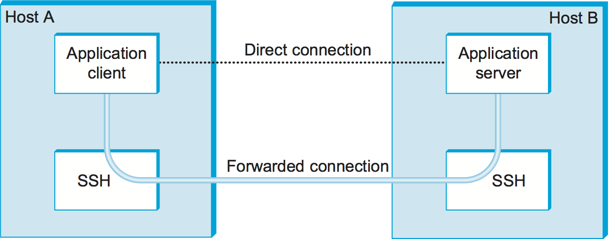

**الشكل 8.13.** استخدام تمرير منافذ SSH لتأمين تطبيقات أخرى قائمة على TCP.

وأخيرًا، ثبت أن SSH مفيد كونه نظامًا لتأمين تسجيل الدخول عن بعد، فمُدَّ ليدعم تطبيقات أخرى، كإرسال البريد الإلكتروني واستقباله. والفكرة تشغيل هذه التطبيقات عبر «نفق SSH» آمن. وتُسمّى هذه القدرة *تمرير المنافذ*، وهي تستخدم بروتوكول SSH-CONN. وتُوضَّح الفكرة في الشكل 8.13، حيث نرى عميلًا على المضيف A يتواصل تواصلًا غير مباشر مع خادم على المضيف B بتمرير حركته عبر اتصال SSH. وتُسمّى الآلية *تمرير المنافذ* لأنه حين تصل الرسائل إلى منفذ SSH الشهير على الخادم، يفكّ SSH تشفير المحتويات أولًا ثم «يمرّر» البيانات إلى المنفذ الفعلي الذي يستمع عليه الخادم. وهذا مجرد نوع آخر من الأنفاق، وهو يوفّر في هذه الحالة السرّية والمصادقة. ومن الممكن توفير ضرب من الشبكة الخاصة الظاهرية (VPN) باستخدام أنفاق SSH بهذه الطريقة.

### 8.5.3 أمن طبقة النقل (TLS وSSL وHTTPS)

لفهم أهداف تصميم معيار أمن طبقة النقل (TLS) وطبقة المقابس الآمنة (SSL) التي يقوم عليها TLS، يفيد أن ننظر في إحدى المسائل الرئيسة التي يُنشَأ لإحلالها. فمتى صار الويب شائعًا وبدأت المؤسسات التجارية تبدي اهتمامًا به، صار واضحًا أن مستوى من الأمن سيلزم لمعاملات الويب. والمثال المعياري على ذلك الشراء ببطاقة الائتمان. وثمّة مسائل عدة تبعث على القلق عند إرسال معلومات بطاقة ائتمانك إلى حاسوب على الويب. فأولًا قد تقلق من أن تُعترَض المعلومات في الطريق ثم تُستخدم لشراء مشتريات غير مصرَّح بها. وقد تقلق أيضًا من أن تُعدَّل تفاصيل معاملة ما، كتغيير مقدار الشراء. وستريد بالتأكيد أن تعرف أن الحاسوب الذي ترسل إليه معلومات بطاقتك هو فعلًا حاسوب البائع المعني لا طرف آخر. وهكذا نرى فورًا حاجة إلى السرّية والنزاهة والمصادقة في معاملات الويب. وكان أول حلّ مستخدم على نطاق واسع لهذه المسألة هو SSL، الذي طوّرته Netscape أصلًا ثم صار أساس معيار TLS لـIETF.

وقد أدرك مصمّمو SSL وTLS أن هذه المسائل ليست خاصة بمعاملات الويب (أي تلك التي تستخدم HTTP)، فبنوا بدلًا من ذلك بروتوكولًا عام الغرض يجلس بين بروتوكول تطبيق كـHTTP وبروتوكول نقل كـTCP. وسبب تسمية ذلك «أمن طبقة النقل» أن هذه الطبقة البروتوكولية تبدو، من منظور التطبيق، كبروتوكول نقل عادي إلا من كونها آمنة. أي إن المرسل يستطيع فتح اتصالات وتسليم بايتات للنقل، وطبقة النقل الآمنة ستوصلها إلى المستقبِل بالسرّية والنزاهة والمصادقة اللازمة. وبتشغيل طبقة النقل الآمنة فوق TCP، تُوفَّر للتطبيق كل خصائص TCP المعتادة (الموثوقية والتحكّم في التدفق والتحكّم في الازدحام، وهكذا). ويُعرض هذا الترتيب للطبقات البروتوكولية في الشكل 8.14.

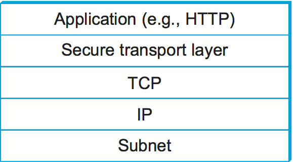

**الشكل 8.14.** طبقة نقل آمنة تُدخَل بين طبقتي التطبيق وTCP.

وحين يُستخدم HTTP بهذه الطريقة يُعرف بـHTTPS (HTTP الآمن). وفي الحقيقة HTTP نفسه لم يتغيّر؛ فهو ببساطة يسلّم البيانات إلى طبقة SSL/TLS ويستلم منها بدل TCP. وللتيسير خُصِّص منفذ TCP افتراضي لـHTTPS هو 443. أي إنك إن حاولت الاتصال بخادم على منفذ TCP 443، فستجد نفسك على الأرجح تتحدث إلى بروتوكول SSL/TLS الذي سيمرّر بياناتك إلى HTTP بشرط أن يمضي كل شيء حسنًا في المصادقة وفكّ التشفير. ومع أن تنفيذات مستقلة لـSSL/TLS متاحة، فالأشيع أن تُحزَم التنفيذات مع التطبيقات التي تحتاجها، والمتصفحات أساسًا.

وفي بقية مناقشتنا لأمن طبقة النقل نركّز على TLS. ومع أن SSL وTLS للأسف غير متوافقين، فهما يختلفان في وجوه طفيفة فقط، فينطبق هذا الوصف كله تقريبًا على SSL.

#### بروتوكول المصافحة

يتفاوض زوج من مشاركي TLS وقت التشغيل على أي التشفير سيُستخدم. ويتفاوضان على اختيار:

- تجزئة نزاهة البيانات (MD5 وSHA-1 وهكذا)، تُستخدم لتنفيذ HMAC
- شيفرة مفتاح سرّي للسرّية (ومن الاحتمالات DES و3DES وAES)
- نهج إقامة مفتاح الجلسة (ومن الاحتمالات ديفي-هلمان، وبروتوكولات المصادقة بالمفتاح العام باستخدام DSS)

والمثير للاهتمام أن المشاركين قد يتفاوضان أيضًا على استخدام خوارزمية ضغط، لا لأن ذلك يوفّر أي منافع أمنية، بل لأنه سهل حين تتفاوض على كل هذه الأمور الأخرى وقد قرّرت أصلًا إجراء بعض العمليات المكلِّفة لكل بايت على البيانات.

وفي TLS تستخدم شيفرة السرّية مفتاحين، واحدًا لكل اتجاه، وكذلك متجهَي تهيئة. وبالمثل تُفتَح HMAC بمفاتيح مختلفة للمشاركين. ومن ثمّ يستلزم جلسة TLS، أيًّا كانت الشيفرة ودالة التجزئة المختارة، ستة مفاتيح فعليًا. ويستنتج TLS كلها من *سرّ رئيسي* واحد متقاسم. والسرّ الرئيسي قيمة من 384 بتة (48 بايتًا) تُستنتج بدورها جزئيًا من «مفتاح الجلسة» الناتج من بروتوكول إقامة مفتاح الجلسة في TLS.

ويُسمّى الجزء من TLS الذي يتفاوض على الخيارات ويقيم السرّ الرئيسي المتقاسم *بروتوكول المصافحة*. (ونقل البيانات الفعلي يؤدّيه *بروتوكول السجل* في TLS.) وبروتوكول المصافحة في جوهره بروتوكول إقامة مفتاح جلسة، بسرّ رئيسي بدل مفتاح جلسة. ولأن TLS يدعم اختيارًا من نهوج إقامة مفتاح الجلسة، فهي تستدعي تنويعة بروتوكولية مختلفة تقابل كلًّا منها. وفضلًا عن ذلك، يدعم بروتوكول المصافحة الاختيار بين المصادقة المتبادلة للمشاركين كليهما، أو مصادقة أحد المشاركين فقط (وهذه الحالة الأشيع، كمصادقة موقع ويب لا مستخدم)، أو عدم المصادقة إطلاقًا (ديفي-هلمان المجهول). وهكذا يحبك بروتوكول المصافحة عدة بروتوكولات لإقامة مفتاح الجلسة في بروتوكول واحد.

ويعرض الشكل 8.15 بروتوكول المصافحة على مستوى رفيع. فيرسل العميل أولًا قائمة بالتركيبات التي يدعمها من خوارزميات التشفير، تنازليًا بحسب تفضيله. ويردّ الخادم معطيًا التركيبة الواحدة التي اختارها من بين ما أدرجه العميل. وتحتوي هاتان الرسالتان أيضًا *عددًا استعماليًا للعميل* و*عددًا استعماليًا للخادم* على التوالي، سيُدمجان في توليد السرّ الرئيسي لاحقًا.

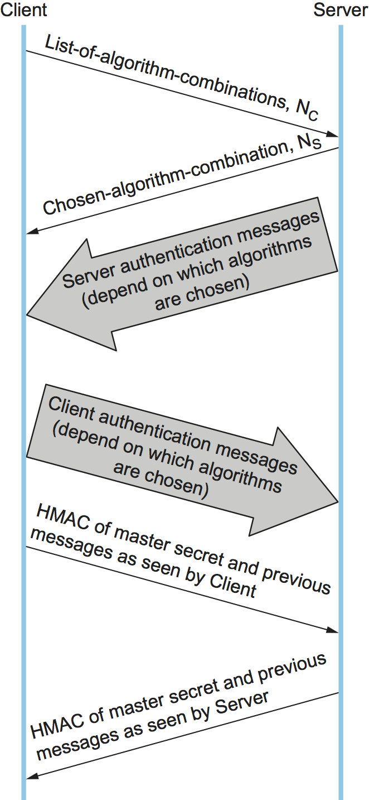

**الشكل 8.15.** بروتوكول المصافحة لإقامة جلسة TLS.

وعند هذه النقطة تكتمل مرحلة التفاوض. ويرسل الخادم الآن رسائل إضافية بناءً على بروتوكول إقامة مفتاح الجلسة المتفاوض عليه. وقد يستلزم ذلك إرسال شهادة مفتاح عام أو مجموعة من معاملات ديفي-هلمان. وإن كان الخادم يستلزم مصادقة العميل، أرسل رسالة منفصلة تدلّ على ذلك. ثم يردّ العميل بجزئه من بروتوكول تبادل المفاتيح المتفاوض عليه.

وصار عند العميل والخادم الآن المعلومات اللازمة لتوليد السرّ الرئيسي. و«مفتاح الجلسة» الذي تبادلاه ليس في الحقيقة مفتاحًا، بل ما يسمّيه TLS *سرًّا قبل الرئيسي*. ويُحسب السرّ الرئيسي (بخوارزمية منشورة) من هذا السرّ قبل الرئيسي والعدد الاستعمالي للعميل والعدد الاستعمالي للخادم. ثم يرسل العميل، بالمفاتيح المستنتجة من السرّ الرئيسي، رسالة تتضمن تجزئة لكل رسائل المصافحة السابقة، فيردّ الخادم برسالة مشابهة. وهذا يمكّنهما من كشف أي اختلاف بين رسائل المصافحة المرسلة والمستلمة، كالذي ينتج مثلًا لو عدّل رجل في الوسط رسالة العميل الأولى غير المشفَّرة ليُضعف اختياراته للخوارزميات التشفيرية.

#### بروتوكول السجل

داخل جلسة تُقيمها مصافحة، يضيف بروتوكول السجل في TLS السرّية والنزاهة إلى خدمة النقل الكامنة. فالرسائل المسلَّمة من طبقة التطبيق:

1. تُجزَّأ أو تُدمج في كتل بحجم ملائم للخطوات التالية
2. تُضغط اختياريًا
3. تُحمى نزاهتها باستخدام HMAC
4. تُشفَّر بشيفرة مفتاح سرّي
5. تُسلَّم إلى طبقة النقل (TCP عادةً) للنقل

ويستخدم بروتوكول السجل HMAC مصادِقًا. ويستخدم HMAC أية دالة تجزئة (MD5 أو SHA-1 وهكذا) تفاوض عليها المشاركون. وللعميل والخادم مفتاحان مختلفان يستخدمانهما عند حساب HMAC، وهذا يجعل كسرهما أصعب. وفضلًا عن ذلك، يُسند إلى كل رسالة من رسائل بروتوكول السجل رقم تسلسل يُضمَّن عند حساب HMAC — مع أن رقم التسلسل لا يظهر صريحًا في الرسالة أبدًا. ورقم التسلسل الضمني هذا يمنع إعادة الرسائل أو إعادة ترتيبها. وهذا لازم لأنه، مع أن TCP يستطيع تسليم رسائل متسلسلة غير مكرّرة للطبقة فوقه في الافتراضات العادية، فافتراضاته لا تشمل عدوًّا يستطيع اعتراض رسائل TCP أو تعديلها أو إرسال رسائل زائفة. ومن ناحية أخرى، فضمانات التسليم في TCP هي ما يتيح لـTLS الاعتماد على أن رسالة TLS المشروعة تحمل رقم التسلسل الضمني التالي بالترتيب.

وثمّة خصيصة أخرى مثيرة للاهتمام في بروتوكول TLS هي القدرة على استئناف جلسة. ولفهم الدافع الأصلي إلى ذلك، يفيد أن تفهم كيف كان HTTP يستفيد أصلًا من اتصالات TCP. (وتُعرض تفاصيل HTTP في الفصل التالي.) فكانت كل عملية HTTP، كجلب صفحة من خادم، تستلزم فتح اتصال TCP جديد. واسترجاع صفحة واحدة فيها عدد من الأجسام الرسومية المضمَّنة قد يستغرق اتصالات TCP كثيرة. وفتح اتصال TCP يستلزم مصافحة ثلاثية قبل أن يبدأ نقل البيانات. ومتى صار اتصال TCP مستعدًّا لقبول البيانات، احتاج العميل عندئذ إلى بدء بروتوكول مصافحة TLS، الذي يستغرق على الأقل زمنَي ذهاب وعودة آخرين (ويستهلك مقدارًا من موارد المعالجة وعرض النطاق الشبكي) قبل أن تُرسَل بيانات التطبيق الفعلية. وقد صُمّمت قدرة الاستئناف في TLS لتخفيف هذه المشكلة.

وفكرة استئناف الجلسة تحسين المصافحة إزالةً في الحالات التي يكون فيها العميل والخادم قد أقاما بعض الحالة المشتركة في الماضي. فما على العميل إلا أن يضمّن معرّف جلسة من جلسة أُقيمت سابقًا في رسالة مصافحته الأولى. فإن وجد الخادم أنه ما زال يحتفظ بحالة لتلك الجلسة، وكان خيار الاستئناف قد تفاوض عليه حين أُنشئت تلك الجلسة أصلًا، أمكنه أن يردّ على العميل ببيان نجاح، ويبدأ نقل البيانات بالخوارزميات والمعاملات المتفاوض عليها سابقًا. وإن لم يطابق معرّف الجلسة أي حالة جلسة مخزَّنة مؤقتًا عند الخادم، أو إن لم يكن الاستئناف مسموحًا للجلسة، رجع الخادم إلى عملية المصافحة العادية.

وسبب تأكيد المناقشة السابقة على الدافع *الأصلي* أن الحاجة إلى مصافحة TCP لكل جسم مضمَّن في صفحة ويب أدّت إلى عبء كبير جدًا، مستقلًا عن TLS، حتى حُسِّن HTTP في النهاية ليدعم *الاتصالات المستمرة* (وتُناقش أيضًا في الفصل التالي). ولأن تحسين HTTP خفّف من قيمة استئناف الجلسة في TLS (مع إدراك أن إعادة استخدام معرّفات الجلسة نفسها والمفتاح السري الرئيسي نفسه في سلسلة من الجلسات المستأنفة خطر أمني)، فقد غيّر TLS نهجه في الاستئناف في أحدث إصدار له (1.3).

وفي TLS 1.3 يرسل العميل عند الاستئناف *تذكرة جلسة* معتمة مشفَّرة من الخادم. وتحتوي هذه التذكرة كل المعلومات اللازمة لاستئناف الجلسة. ويُستخدم السرّ الرئيسي نفسه في المصافحات كلها، لكن السلوك الافتراضي إجراء تبادل مفتاح جلسة عند الاستئناف.

> **خلاصة مفتاحية**
>
> نلفت الانتباه إلى هذا التغيير في TLS لأنه يوضّح تحدي معرفة أي طبقة ينبغي أن تحلّ مسألة معيّنة. فبمعزل عن السياق، يبدو استئناف الجلسة كما نُفِّذ في الإصدار الأقدم من TLS فكرة جيدة، لكنه يحتاج إلى نظر في سياق حالة الاستخدام المهيمنة، وهي HTTP. ومتى عولج عبء إجراء اتصالات TCP كثيرة في HTTP، تغيّرت معادلة كيف ينبغي لـTLS أن ينفّذ الاستئناف. والدرس الأكبر أن علينا أن نتفادى التفكير الجامد في الطبقة الصحيحة لتنفيذ وظيفة معيّنة — فالجواب يتغيّر بمرور الزمن مع تطوّر الشبكة — حيث يلزم تحليل كُلّي/عابر للطبقات للوصول إلى التصميم الصحيح.

### 8.5.4 أمن IP (IPsec)

لعلّ أطمح كل المساعي إلى إدماج الأمن في الإنترنت يحدث عند طبقة IP. ودعم IPsec، كما تُسمّى المعمارية، اختياري في IPv4 وإلزامي في IPv6.

وIPsec في الحقيقة إطار (لا بروتوكولًا واحدًا أو نظامًا) لتوفير كل الخدمات الأمنية التي ناقشناها في هذا الفصل. ويوفّر IPsec ثلاث درجات من الحرية. أولًا، هو شديد التركيبية النمطية، فيتيح للمستخدمين (أو الأرجح لمسؤولي الأنظمة) الاختيار من طائفة من الخوارزميات التشفيرية والبروتوكولات الأمنية المتخصّصة. وثانيًا، يتيح IPsec للمستخدمين الاختيار من قائمة واسعة من الخصائص الأمنية، منها التحكّم في الوصول والنزاهة والمصادقة والأصالة والسرّية. وثالثًا، يمكن استخدام IPsec لحماية تدفّقات ضيّقة (كالحزم المنتمية إلى اتصال TCP معيّن تُرسَل بين زوج من المضيفين) أو تدفّقات عريضة (ككل الحزم المتدفقة بين زوج من الموجّهات).

ومتى نُظر إليه من مستوى رفيع، يتكوّن IPsec من جزأين. الجزء الأول زوج من البروتوكولات ينفّذ الخدمات الأمنية المتاحة. وهما *ترويسة المصادقة* (AH)، التي توفّر التحكّم في الوصول ونزاهة الرسائل بلا اتصال والمصادقة والحماية من الإعادة، و*حمولة الأمن المُغلِّف* (ESP)، التي تدعم هذه الخدمات نفسها علاوةً على السرّية. ونادرًا ما يُستخدم AH، فنركّز هنا على ESP. والجزء الثاني دعم إدارة المفاتيح، وهو يندرج تحت بروتوكول مظلّة يُعرف بـ*بروتوكول رابطة الأمن وإدارة المفاتيح في الإنترنت* (ISAKMP).

والتجريد الذي يربط هاتين القطعتين *رابطة الأمن* (SA). ورابطة الأمن اتصال أحادي الاتجاه (بسيط) بخاصية أمنية أو أكثر من الخصائص المتاحة. وتأمين تواصل ثنائي الاتجاه بين زوج من المضيفين — يقابل اتصال TCP مثلًا — يستلزم رابطتَي أمن، واحدة في كل اتجاه. ومع أن IP بروتوكول بلا اتصال، فالأمن يعتمد على معلومات حالة الاتصال كمفاتيح وأرقام تسلسل. ومتى أُنشئت رابطة أمن، تُسند إليها الآلة المستقبِلة رقم معرّف يُسمّى *مؤشّر معاملات الأمن* (SPI). وتركيب هذا المؤشّر وعناوين IP للهدف يحدّد رابطة الأمن تحديدًا فريدًا. وتتضمن ترويسة ESP المؤشّر SPI ليستطيع المضيف المستقبِل تحديد رابطة الأمن التي تنتمي إليها حزمة واردة، ومن ثمّ أي الخوارزميات والمفاتيح يطبّقها على الحزمة.

وتُقام روابط الأمن ويُتفاوض عليها وتُعدَّل وتُحذف باستخدام ISAKMP. وهو يعرّف صيغ حزم لتبادل بيانات توليد المفاتيح والمصادقة. وهذه الصيغ ليست مثيرة للاهتمام كثيرًا لأنها توفّر إطارًا فقط — فالشكل الدقيق للمفاتيح وبيانات المصادقة يعتمد على تقنية توليد المفاتيح والشيفرة وآلية المصادقة المستخدمة. وفضلًا عن ذلك، لا يحدّد ISAKMP بروتوكول تبادل مفاتيح بعينه، وإن كان يقترح تبادل المفاتيح في الإنترنت (IKE) أحد الاحتمالات، وIKE الإصدار 2 هو ما يُستخدم في الممارسة.

وESP البروتوكول المستخدم لنقل البيانات نقلًا آمنًا عبر رابطة أمن قائمة. ففي IPv4 تلي ترويسة ESP ترويسة IP؛ وفي IPv6 هي ترويسة امتداد. وتستخدم صيغتها ترويسة ومذيلًا، كما يوضّح الشكل 8.16. وحقل SPI يتيح للمضيف المستقبِل تحديد رابطة الأمن التي تنتمي إليها الحزمة. وحقل SeqNum يحمي من هجمات الإعادة. وتحتوي PayloadData الحزمة البيانات الموصوفة بحقل NextHdr. وإن اختيرت السرّية، شُفّرت البيانات بأي شيفرة ارتبطت برابطة الأمن. ويسجّل حقل PadLength مقدار الحشو المضاف إلى البيانات؛ والحشو لازم أحيانًا لأن الشيفرة تتطلّب أن يكون النص الصريح مضاعفًا لعدد معيّن من البايتات، مثلًا، أو لضمان أن ينتهي النص المشفَّر الناتج على حدّ 4 بايتات. وأخيرًا يحمل AuthenticationData المصادِق.

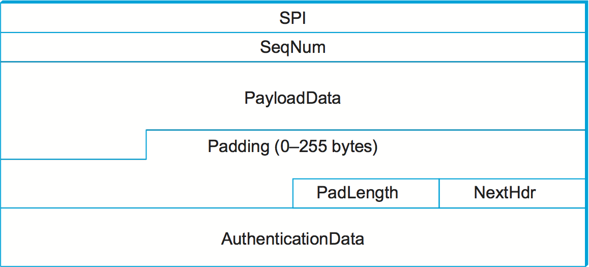

**الشكل 8.16.** صيغة ESP في IPsec.

ويدعم IPsec *نمط النفق* علاوةً على *نمط النقل* الأكثر مباشرة. وتعمل كل رابطة أمن في أحد النمطين. فرابطة الأمن في نمط النقل تكون بيانات حمولة ESP فيها مجرد رسالة لطبقة أعلى كـUDP أو TCP. وفي هذا النمط يعمل IPsec كطبقة بروتوكول وسيطة، شبيهًا كثيرًا بما يفعله SSL/TLS بين TCP وطبقة أعلى. ومتى استُلمت رسالة ESP، مُرّرت حمولتها إلى البروتوكول الأعلى.

أما في رابطة الأمن في نمط النفق، فبيانات حمولة ESP نفسها حزمة IP، كما في الشكل 8.17. وقد يختلف مصدر حزمة IP الداخلية هذه وهدفها عن مصدر حزمة IP الخارجية وهدفها. ومتى استُلمت رسالة ESP، مُرّرت حمولتها كحزمة IP عادية. والطريقة الأكثر شيوعًا لاستخدام ESP بناء «نفق IPsec» بين موجّهين، جدران نارية عادةً. فمثلًا يمكن لشركة تريد ربط موقعين باستخدام الإنترنت أن تفتح رابطتَي أمن في نمط النفق بين موجّه في أحد الموقعين وموجّه في الموقع الآخر. فحزمة IP خارجة من أحد الموقعين تصير عند الموجّه الخارج حمولة رسالة ESP مرسلة إلى موجّه الموقع الآخر. ويفكّ الموجّه المستقبِل تغليف حزمة IP الحمولة ويمرّرها إلى هدفها الحقيقي.

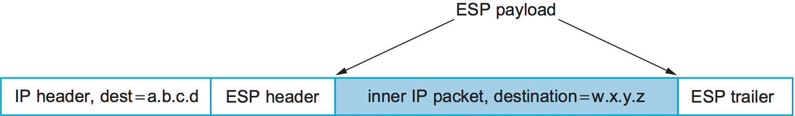

**الشكل 8.17.** حزمة IP فيها حزمة IP متعشّشة مُغلَّفة باستخدام ESP في نمط النفق. ولاحظ أن الحزمتين الداخلية والخارجية لها عنوانان مختلفان.

ويمكن أيضًا تهيئة هذه الأنفاق لتستخدم ESP مع السرّية والمصادقة، فتمنع بذلك الوصول غير المصرَّح به إلى البيانات العابرة لهذا الرابط الظاهري وتضمن ألّا تُستلَم بيانات زائفة في طرف النفق البعيد. وفضلًا عن ذلك تستطيع الأنفاق أن توفّر سرّية الحركة، إذ يحجب مضاعفة تدفّقات متعددة عبر نفق واحد معلومات عن مقدار الحركة المارّة بين نقاط طرفية معيّنة. ويمكن استخدام شبكة من هذه الأنفاق لتنفيذ شبكة خاصة ظاهرية كاملة. والمضيفون المتواصلون عبر شبكة خاصة ظاهرية لا يلزمهم حتى أن يكونوا على وعي بوجودها.

### 8.5.5 الأمن اللاسلكي (802.11i)

الروابط اللاسلكية معرَّضة للتهديدات الأمنية تعرّضًا خاصًا لغياب أي أمن فيزيائي على الوسيط. ومع أن راحة 802.11 دفعت إلى قبول هذه التقنية قبولًا واسعًا، فغياب الأمن مشكلة متكرّرة. فمثلًا من السهل جدًا أن يصل موظف في شركة نقطة وصول 802.11 بشبكة الشركة. ولأن الموجات الراديوية تمر عبر معظم الجدران، فإذا خلت نقطة الوصول من تدابير الأمن الصحيحة، أمكن لمهاجم أن يصل الآن إلى شبكة الشركة من خارج المبنى. وبالمثل يمكن لحاسوب فيه مهايئ شبكة لاسلكية داخل المبنى أن يتصل بنقطة وصول خارج المبنى، فيعرّض نفسه للهجوم محتملًا، فضلًا عن بقية شبكة الشركة إن كان للحاسوب نفسه وصلة إيثرنت أيضًا.

ومن ثمّ جرى عمل كبير على تأمين روابط Wi-Fi. ومن المثير للدهشة بعض الشيء أن إحدى التقنيات الأمنية المبكّرة التي طُوّرت لـ802.11، وتُعرف بـ*الخصوصية المكافئة للأسلاك* (WEP)، تبيّن أنها معيبة بخطورة وأنها سهلة الكسر جدًا.

ويوفّر معيار IEEE 802.11i المصادقة ونزاهة الرسائل والسرّية لـ802.11 (Wi-Fi) عند طبقة الربط. و*WPA3* (الوصول المحمي Wi-Fi 3) تُستخدم غالبًا مرادفًا لـ802.11i، وإن كانت تقنيًا علامة تجارية لتحالف Wi-Fi تشهد بامتثال المنتجات لـ802.11i.

وللتوافق مع الإصدارات السابقة، يتضمن 802.11i تعريفات خوارزميات الأمن من الجيل الأول — ومنها WEP — التي ثبت الآن أنها ذات عيوب أمنية كبرى. وسنركّز هنا على الخوارزميات الأحدث والأقوى في 802.11i.

وتدعم مصادقة 802.11i نمطين. وفي أي من النمطين، النتيجة النهائية للمصادقة الناجحة مفتاح رئيسي مزدوج متقاسم. و*النمط الشخصي*، ويُعرف أيضًا بـ*نمط المفتاح المشترك مسبقًا* (PSK)، يوفّر أمنًا أضعف لكنه أكثر راحة واقتصادًا في أحوال كشبكة 802.11 منزلية. فتُهيَّأ الجهاز اللاسلكي ونقطة الوصول سلفًا بعبارة سرّ *متقاسم* — وهي في جوهرها كلمة سر طويلة جدًا — يُستنتج منها المفتاح الرئيسي المزدوج استنتاجًا تشفيريًا.

ونمط المصادقة الأقوى في 802.11i قائم على إطار IEEE 802.1X للتحكّم في الوصول إلى شبكة محلية، وهو يستخدم خادم مصادقة (AS) كما في الشكل 8.18. ويجب أن يكون خادم المصادقة ونقطة الوصول موصولين بقناة آمنة، وقد يُنفَّذان حتى في صندوق واحد، لكنهما منفصلان منطقيًا. وتُمرّر نقطة الوصول رسائل المصادقة بين الجهاز اللاسلكي وخادم المصادقة. ويُسمّى البروتوكول المستخدم للمصادقة *بروتوكول المصادقة القابل للتوسّع* (EAP). وقد صُمّم EAP لدعم طرق مصادقة متعددة — البطاقات الذكية وKerberos وكلمات السر لمرة واحدة والمصادقة بالمفتاح العام، وهكذا — وكذلك المصادقة من جانب واحد والمصادقة المتبادلة. فالأفضل إذن التفكير في EAP كإطار مصادقة لا كبروتوكول. والبروتوكولات المحدّدة الممتثلة لـEAP، وهي كثيرة، تُسمّى *طرق EAP*. فمثلًا EAP-TLS طريقة EAP قائمة على مصادقة TLS.

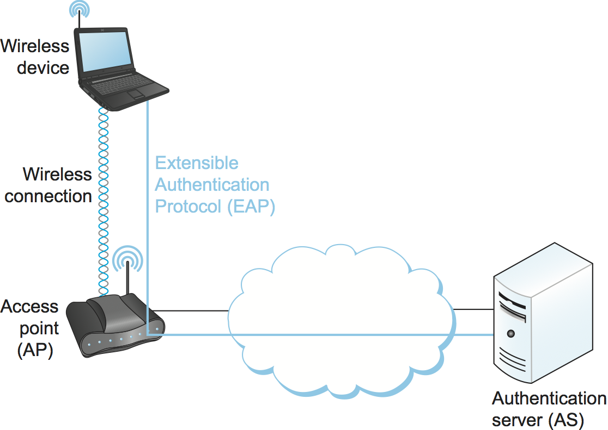

**الشكل 8.18.** استخدام خادم مصادقة في 802.11i.

ولا يفرض 802.11i أي قيود على ما يمكن أن تستخدمه طريقة EAP أساسًا للمصادقة. غير أنه يستلزم طريقة EAP تؤدّي مصادقة *متبادلة*، لأننا لا نريد فقط منع عدو من الوصول إلى الشبكة عبر نقطة وصولنا، بل نريد أيضًا منع عدو من خداع أجهزتنا اللاسلكية بنقطة وصول زائفة خبيثة. والنتيجة النهائية للمصادقة الناجحة مفتاح رئيسي مزدوج متقاسم بين الجهاز اللاسلكي وخادم المصادقة، ينقله الخادم بعد ذلك إلى نقطة الوصول.

ومن الفروق الرئيسة بين النمط الأقوى القائم على خادم المصادقة والنمط الشخصي الأضعف أن الأول يدعم بسهولة مفتاحًا فريدًا لكل عميل. وهذا بدوره ييسّر تغيير مجموعة العملاء الذين يستطيعون مصادقة أنفسهم (كإبطال وصول عميل واحد) دون الحاجة إلى تغيير السرّ المخزَّن في كل عميل.

ومتى صار المفتاح الرئيسي المزدوج في اليد، ينفّذ الجهاز اللاسلكي ونقطة الوصول بروتوكول إقامة مفتاح جلسة يُسمّى *المصافحة الرباعية* لإقامة مفتاح عابر مزدوج. وهذا المفتاح العابر المزدوج في الحقيقة مجموعة مفاتيح تتضمن مفتاح جلسة يُسمّى *مفتاحًا زمنيًا*. ويستخدم هذا المفتاح البروتوكول المسمّى *CCMP*، الذي يوفّر سرّية بيانات 802.11i ونزاهتها.

وCCMP اختصار لبروتوكول نمط العدّاد مع تسلسل كتل الشيفرة برمز مصادقة الرسائل. ويستخدم CCMP خوارزمية AES في نمط العدّاد للتشفير لأجل السرّية. وتذكّر أن التشفير في نمط العدّاد تُدمج فيه قيم عدّاد متتالية في تشفير كتل النص الصريح المتتالية.

ويستخدم CCMP *رمز مصادقة رسائل* (MAC) مصادِقًا. وخوارزمية MAC قائمة على التسلسل، مع أن CCMP لا يستخدم التسلسل في تشفير السرّية. فهو فعليًا يُجري تسلسل الكتل دون إرسال أي من كتل التسلسل المشفَّرة، فقط ليُستخدم من كتلة التسلسل الأخيرة رمزُ MAC (ولا يُستخدم منها إلا أول 8 بايتات فعلًا). ويدور متجه التهيئة دور كتلة أولى مبنية بناءً خاصًا تتضمن رقم حزمة من 48 بتة — أي رقم تسلسل. (ويُدمج رقم الحزمة أيضًا في تشفير السرّية، ويخدم كشف هجمات الإعادة.) ثم يُشفَّر رمز MAC مع النص الصريح لمنع هجمات عيد الميلاد، التي تعتمد على إيجاد رسائل مختلفة لها المصادِق نفسه.

### 8.5.6 الجدرانات النارية

مع أن هذا الفصل ركّز كثيرًا على استخدامات التشفير لتوفير خصائص أمنية كالمصادقة والسرّية، فثمّة طائفة كاملة من المسائل الأمنية لا تُعالَج بالتشفير معالجة سهلة. فمثلًا تنتشر الديدان والفيروسات باستغلال ثغرات في أنظمة التشغيل وبرامج التطبيقات (وأحيانًا في سذاجة البشر أيضًا)، ولا يفيدك أي مقدار من التشفير إن كانت آلتك فيها ثغرات لم تُرقَّع. ومن ثمّ تُستخدم نهوج أخرى غالبًا لإبعاد أشكال مختلفة من الحركة المحتملة الضرر. والجدرانات النارية من أكثر الطرق شيوعًا لذلك.

والجدار الناري نظام يجلس عادة في نقطة اتصال ما بين موقع يحميه وبقية الشبكة، كما يوضّح الشكل 8.19. ويُنفَّذ عادةً كـ«تجهيزة» أو كجزء من موجّه، وإن كان «الجدار الناري الشخصي» قد يُنفَّذ على آلة مستخدم نهائي. ويعتمد الأمن القائم على الجدار الناري على أن يكون الجدار الناري نقطة الاتصال الوحيدة للموقع من الخارج؛ فينبغي ألا تكون هناك طريقة لتجاوز الجدار الناري عبر بوّابات أخرى أو اتصالات لاسلكية أو اتصالات هاتفية. واستعارة الجدار مضلّلة إلى حدّ ما في سياق الشبكات، لأن قدرًا كبيرًا من الحركة يمرّ عبر الجدار الناري. ومن طرق التفكير في الجدار الناري أنه يحجب الحركة افتراضيًا إلا إن سُمح لتلك الحركة بالمرور صراحةً. فمثلًا قد يُرشّح كل الرسائل الواردة إلا تلك المتوجهة إلى مجموعة معيّنة من عناوين IP أو إلى أرقام منافذ TCP معيّنة.

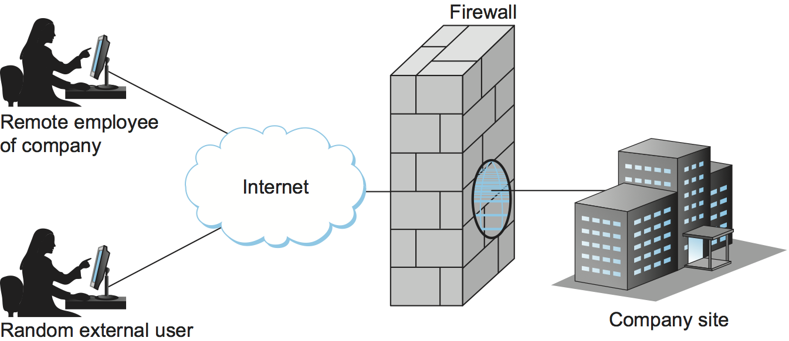

**الشكل 8.19.** الجدار الناري يرشّح الحزم المتدفقة بين موقع وبقية الإنترنت.

والجدار الناري فعليًا يقسم الشبكة إلى منطقة أكثر موثوقية داخلية للجدار الناري ومنطقة أقل موثوقية خارجه. وهذا مفيد إن كنت لا تريد لمستخدمين خارجيين الوصول إلى مضيف أو خدمة معيّنة داخل موقعك. ويأتي كثير من التعقيد من أنك تريد السماح بوصول أنواع مختلفة لمستخدمين خارجيين مختلفين، تتراوح من الجمهور العام إلى شركاء العمل إلى أعضاء مؤسستك الموجودين عن بعد. وقد يفرض الجدار الناري قيودًا على الحركة الخارجة أيضًا لمنع هجمات معيّنة وللحدّ من الخسائر إن نجح عدو في الوصول إلى داخل الجدار الناري.

وغالبًا ما يكون موضع الجدار الناري أيضًا خطّ الفصل بين المناطق القابلة للعنونة عالميًا وتلك التي تستخدم عناوين محلية. ومن ثمّ توجد وظيفة ترجمة عناوين الشبكة (NAT) ووظيفة الجدار الناري في الجهاز نفسه غالبًا، مع أنهما منفصلتان منطقيًا.

ويمكن استخدام الجدرانات النارية لإنشاء *مناطق ثقة* متعددة، كهرمية من مناطق يتزايد اعتمادها. ومن الترتيبات الشائعة ثلاث مناطق ثقة: الشبكة الداخلية، و*المنطقة المنزوعة السلاح* (DMZ)، وبقية الإنترنت. وتُستخدم المنطقة المنزوعة السلاح لاحتواء خدمات كخوادم DNS والبريد الإلكتروني التي تحتاج إلى أن تكون متاحة للخارج. فالوصول إلى المنطقة المنزوعة السلاح متاح للشبكة الداخلية والعالم الخارجي معًا، لكن المضيفين في المنطقة المنزوعة السلاح لا يستطيعون الوصول إلى الشبكة الداخلية؛ ومن ثمّ فعدو ينجح في اختراق مضيف في المنطقة المكشوفة لا يستطيع الوصول إلى الشبكة الداخلية. ويمكن استعادة المنطقة المنزوعة السلاح إلى حالة نظيفة دوريًا.

وترشّح الجدرانات النارية بناءً على معلومات IP وTCP وUDP، بين أمور أخرى. وتُهيَّأ بجدول عناوين يميّز الحزم التي ستمرّرها والتي لن تمرّرها. ونعني بالعناوين أكثر من مجرد عنوان IP للهدف، وإن كان ذلك أحد الاحتمالات. وبوجه عام يكون كل مدخل في الجدول رباعيًا: يعطي عنوان IP ورقم منفذ TCP (أو UDP) للمصدر والهدف معًا.

فمثلًا قد يُهيَّأ جدار ناري ليرشّح (أي لا يمرّر) كل الحزم التي تطابق الوصف الآتي:

```c
(192.12.13.14, 1234, 128.7.6.5, 80)
```

هذا النمط يقول إنه يجب إسقاط كل الحزم من المنفذ 1234 على المضيف 192.12.13.14 المتوجهة إلى المنفذ 80 على المضيف 128.7.6.5. (والمنفذ 80 منفذ TCP الشهير لـHTTP.) ومن الواضح أنه ليس عمليًا في كثير من الأحوال تسمية كل مضيف مصدر تريد ترشيح حزمه، فتُقبل الأنماط أحرف بدلًا عامّة. فمثلًا،

```c
(*,  *, 128.7.6.5, 80)
```

تعني ترشيح كل الحزم المتوجهة إلى المنفذ 80 على 128.7.6.5، أيًّا كان المضيف المصدر أو المنفذ الذي أرسل الحزمة. ولاحظ أن أنماط العناوين كهذه تستلزم أن يتخذ الجدار الناري قرارات التمرير/الترشيح بناءً على أرقام منافذ المستوى الرابع، علاوةً على عناوين المضيفين من المستوى الثالث. ولهذا السبب تُسمّى الجدرانات النارية عند طبقة الشبكة *مبدّلات المستوى الرابع* أحيانًا.

وفي المناقشة السابقة يمرّر الجدار الناري كل شيء إلا حيث يُوجَّه صراحةً إلى ترشيح أنواع معيّنة من الحزم. وقد يرشّح الجدار الناري أيضًا كل شيء إلا ما يُوجَّه صراحةً إلى تمريره، أو يستخدم مزيجًا من الاستراتيجيتين. فمثلًا بدلًا من حجب الوصول إلى المنفذ 80 على المضيف 128.7.6.5، قد يُوجَّه الجدار الناري إلى السماح بالوصول إلى المنفذ 25 (منفذ البريد SMTP) على خادم بريد معيّن فقط، كـ

```c
(*,  *, 128.19.20.21, 25)
```

لكن إلى حجب كل حركة أخرى. وقد أظهرت التجربة أن الجدرانات النارية تُهيَّأ تهيئة خاطئة في كثير من الأحيان جدًا، فتسمح بوصول غير آمن. وجزء من المشكلة أن قواعد الترشيح قد تتداخل تداخلًا معقّدًا، فيصعب على مسؤول النظام التعبير عن الترشيح المقصود تعبيرًا صحيحًا. ومن مبادئ التصميم التي تعظّم الأمن تهيئة الجدار الناري لإسقاط كل الحزم عدا التي سُمح بها صراحةً. ومن الواضح أن هذا يعني أن بعض التطبيقات الصالحة قد تُعطَّل بالخطأ؛ ويُفترض أن مستخدمي تلك التطبيقات يلاحظون ذلك في النهاية ويطلبون من مسؤول النظام التغيير المناسب.

وكثير من تطبيقات العميل/الخادم تُسند منفذًا للعميل إسنادًا ديناميكيًا. فإن بدأ عميل داخل جدار ناري الوصول إلى خادم خارجي، فسيُوجَّه ردّ الخادم إلى المنفذ المسنَد ديناميكيًا. وهذا يطرح مسألة: كيف يُهيَّأ جدار ناري ليسمح بحزمة ردّ خادم اعتباطي ويمنع حزمة مشابهة لم يكن لها طلب من عميل؟ وهذا غير ممكن في *جدار ناري بلا حالة*، يقيّم كل حزمة بمعزل عن غيرها. وهو يستلزم *جدارًا ناريًا ذا حالة* يتتبّع حالة كل اتصال. فتُسمح عندئذ بحزمة واردة متوجهة إلى منفذ مسنَد ديناميكيًا فقط إن كانت ردًّا صالحًا في الحالة الحالية لاتصال على ذلك المنفذ.

وتفهم الجدرانات النارية الحديثة أيضًا كثيرًا من البروتوكولات الخاصة عند مستوى التطبيق، كـHTTP وTelnet وFTP، وترشّح بناءً عليها. وتستخدم معلومات خاصة بذلك البروتوكول، كالمعرّفات URIs في حالة HTTP، لتقرير هل تُسقط رسالة ما.

#### قوة الجدرانات النارية وضعفها

في أفضل الأحوال يحمي الجدار الناري شبكة من وصول غير مرغوب فيه من بقية الإنترنت؛ لكنه لا يستطيع توفير الأمن للتواصل المشروع بين داخل الجدار الناري وخارجه. وفي المقابل، آليات الأمن القائمة على التشفير الموصوفة في هذا الفصل قادرة على توفير تواصل آمن بين أي مشاركين في أي مكان. وإذا كان الأمر كذلك، فلماذا تكون الجدرانات النارية شائعة إلى هذا الحد؟ أحد الأسباب أن الجدرانات النارية يمكن نشرها من طرف واحد باستخدام منتجات تجارية ناضجة، بينما يستلزم الأمن القائم على التشفير دعمًا عند طرفي التواصل. وسبب أكثر جوهرية لهيمنة الجدرانات النارية أنها تحصر الأمن في موضع مركزي، فتُخرج الأمن فعليًا من بقية الشبكة. فيستطيع مسؤول نظام إدارة الجدار الناري لتوفير الأمن، ويعفي بذلك المستخدمين والتطبيقات داخل الجدار الناري من الهواجس الأمنية — بعض الهواجس الأمنية على الأقل.

وللأسف للجدرانات النارية قيود خطيرة. فبما أن الجدار الناري لا يقيّد التواصل بين المضيفين داخل الجدار الناري، فالعدو الذي يتمكّن فعلًا من تشغيل شيفرة داخل موقع ما يستطيع الوصول إلى كل المضيفين المحليين. وكيف قد يدخل عدو إلى داخل الجدار الناري؟ قد يكون العدو موظفًا ساخطًا له وصول مشروع، أو قد تكون برمجياته مخفية في برنامج ما مُثبَّت من قرص أو منزَّل من الويب. وقد يكون ممكنًا تجاوز الجدار الناري باستخدام تواصل لاسلكي أو اتصالات هاتفية.

والمشكلة الأخرى أن أي أطراف يُمنحون وصولًا عبر جدارك الناري، كشركاء العمل أو الموظفين الموجودين خارجًا، يصيرون ثغرة أمنية. فإن لم يكن أمنهم بأمانك، أمكن لعدو أن ينفذ إلى أمنك بالنفاذ إلى أمنهم.

ومن أخطر مشاكل الجدرانات النارية تعرّضها لاستغلال ثغرات في الآلات داخل الجدار الناري. وتُكتشف ثغرات كهذه بانتظام، فعلى مسؤول النظام أن يراقب إعلاناتها باستمرار. ويفشل المسؤولون في ذلك كثيرًا، لأن خروقات أمن الجدرانات النارية تستغل عادةً عيوبًا أمنية معروفة منذ وقت ما ولها حلول مباشرة.

و*البرمجيات الخبيثة* (malware، اختصارًا للبرمجيات المؤذية) مصطلح للبرمجيات المصمَّمة لتعمل على حاسوب بطرق خفية عن المستخدم وغير مرغوبة له. والفيروسات والديدان وبرمجيات التجسّس من أنواع البرمجيات الخبيثة الشائعة. (*الفيروس* يُستخدم أحيانًا مرادفًا لـ*البرمجيات الخبيثة*، لكننا سنستخدمه بمعنى أضيق يشير إلى نوع خاص فقط من البرمجيات الخبيثة.) وشيفرة البرمجيات الخبيثة لا يلزم أن تكون شيفرة كائن قابلة للتنفيذ أصلًا؛ فقد تكون شيفرة مفسَّرة كسكربت أو ماكرو قابلًا للتنفيذ كتلك التي يستخدمها Microsoft Word.

و*الفيروسات* و*الديدان* تتّصف بالقدرة على إنشاء نسخ من نفسها ونشرها؛ والفرق بينها أن الدودة برنامج كامل ينسخ نفسه، بينما الفيروس قطعة شيفرة تُدرَج (وتُدرج نسخًا من نفسها) في قطعة برمجيات أخرى أو ملف، فتنفّذ كجزء من تنفيذ تلك القطعة أو نتيجةً لفتح الملف. والديدان والفيروسات تسبب عادةً مشاكل كاستهلاك عرض النطاق الشبكي كأثر جانبي لمجرد محاولة نشر نسخ من نفسها. والأسوأ أنها تستطيع أيضًا أن تتلف نظامًا أو تقوّض أمنه بطرق متنوعة عن قصد. فقد تُثبّت مثلًا *بابًا خلفيًا* — برمجية تتيح الوصول إلى النظام عن بعد دون المصادقة العادية. وهذا قد يؤدي إلى أن يعرّض جدار ناري خدمةً كان ينبغي أن توفّر إجراءات مصادقتها الخاصة لكن بابًا خلفيًا قوّضها.

وبرمجيات التجسّس برمجيات تجمع دون تصريح معلومات خاصة عن نظام حاسوبي أو مستخدميه وترسلها. وهي تُدرَج عادةً خفية في برنامج نافع في ما عدا ذلك، وتنتشر بتثبيت المستخدمين نسخًا منها عمدًا. ومشكلتها بالنسبة إلى الجدرانات النارية أن إرسال المعلومات الخاصة يبدو كتواصل مشروع.

والسؤال الطبيعي الذي يُطرح هل تستطيع الجدرانات النارية (أو الأمن التشفيري) إبعاد البرمجيات الخبيثة عن النظام من الأصل. فمعظم البرمجيات الخبيثة تُنقل فعلًا عبر الشبكات، وإن كانت قد تُنقل أيضًا عبر وسائط تخزين محمولة كالأقراص المدمجة وعصيّات الذاكرة. وهذا بالتأكيد حجة لصالح نهج «احجب كل شيء غير مسموح به صراحةً» الذي يتخذه كثير من المسؤولين في تهيئة جدراناتهم النارية.

ومن النهوج المستخدمة لكشف البرمجيات الخبيثة البحث عن مقاطع شيفرة من برمجيات خبيثة معروفة، وتُسمّى أحيانًا *بصمة*. ولهذا النهج تحدياته، إذ تستطيع البرمجيات الخبيثة المصمَّمة بذكاء أن تعدّل تمثيلها بطرق متنوعة. وثمّة أيضًا تأثير محتمل على أداء الشبكة عند إجراء فحص مفصّل كهذا للبيانات الداخلة إلى الشبكة. والأمن التشفيري لا يستطيع إزالة المشكلة أيضًا، وإن كان يوفّر وسيلة لمصادقة مصدر قطعة برمجيات وكشف أي عبث بها، كأن يُدرج فيروس نسخة من نفسه.

ويتصل بالجدرانات النارية أنظمة تُعرف بـ*أنظمة كشف التسلّل* (IDS) و*أنظمة منع التسلّل* (IPS). وهذه الأنظمة تحاول البحث عن نشاط شاذ، ككمّية غير معتادة الكبر من الحركة تستهدف مضيفًا أو رقم منفذ معيّنًا مثلًا، وتولّد إنذارات لمسؤولي الشبكة أو ربما تتخذ إجراءً مباشرًا للحدّ من هجوم محتمل. ومع أن هناك منتجات تجارية في هذا المجال اليوم، فهو ما زال مجالًا في طور التطوّر.

## منظور: هل الأمن يسوء أم يتحسّن؟

صار الخرق الأمني اليوم خطرًا معتادًا في وصل أي نظام بالإنترنت، وقلّما يمرّ أسبوع بلا أخبار هجوم جديد. وتُجري Verizon، وهي شركة اتصالات كبرى، مراجعة سنوية لحالة الهجمات السيبرانية؛ وفي 2024 بلغت علامة فارقة بأكثر من 10,000 حادثة، كالهجمات بالفدية وهجمات التصيّد، مشمولة في التقرير. فبمقياس عدد الهجمات إذن يبدو أن الأمور تسوء. وفي المقابل، جادلت تحليلات أجرتها مجلة *الإيكونومست* لتأثير الهجمات السيبرانية الاقتصادي بأن أيام ذروة الهجمات السيبرانية قد تكون خلفنا. وكان أسوأ عهد للهجمات في تحليلهم الاقتصادي هو 2003–2004 بفارق كبير.

وثمّة بالتأكيد وجوه يتحسّن فيها الأمن. ويمكن أن يُعزى ذلك إلى ازدياد الوعي بالحاجة إلى أمن قوي كلما عولجت معلومات مهمة، وإلى تطوير تقنيات جديدة تتيح ممارسات أمنية أفضل.

ومن أمثلة التطوّر التقني الذي حسّن تنفيذات الأمن الشبكات المعرَّفة بالبرمجيات (SDN). فقد أتاحت SDN نهجًا جديدًا نسبيًا لتوفير العزل بين الأنظمة يُعرف بـ*التجزئة الدقيقة*.

والتجزئة الدقيقة تقابل النهوج التقليدية لتجزئة الشبكات، حيث تتصل مجموعات كبيرة من الآلات بـ«منطقة» وتُستخدم جدرانات نارية لترشيح الحركة المارّة بين المناطق. ومع أن ذلك يجعل تهيئة الشبكة بسيطة نسبيًا، فمعناه أن آلات كثيرة تكون في المنطقة نفسها حتى إن لم تكن بحاجة إلى التواصل. وفضلًا عن ذلك ينمو تعقيد قواعد الجدرانات النارية بمرور الزمن كلما لزمت إضافة قواعد أكثر وأكثر لوصف الحركة المسموح بمرورها من منطقة إلى أخرى.

وفي المقابل، تتيح SDN إنشاء شبكات ظاهرية محدَّدة التعريف بدقّة — أي التجزئات الدقيقة — تحدّد أي الآلات تستطيع التواصل بعضها مع بعض وكيف تفعل ذلك. فمثلًا يمكن لتطبيق من ثلاث طبقات أن تكون له سياسة تجزئة دقيقة خاصة به تقول: الآلات في طبقة التطبيق المواجهة للويب تستطيع التحدث إلى الآلات في طبقة التطبيق على مجموعة منافذ محدَّدة، لكن الآلات المواجهة للويب لا تستطيع التحدث بعضها إلى بعض. وهذه سياسة كانت صعبة التنفيذ في الماضي؛ إذ كانت الآلات المواجهة للويب كلها تجلس بدلًا من ذلك على مقطع الشبكة نفسه، حرة في التواصل بعضها مع بعض.

وتعقيد تهيئة المقاطع كان سبب أن آلات من تطبيقات كثيرة تجلس على الأرجح على المقطع نفسه، فتخلق فرصًا لهجوم لينتشر من تطبيق إلى آخر. وقد وُثِّق جيدًا أن الحركة الجانبية للهجمات داخل مراكز البيانات استراتيجية مفتاحية في الهجمات السيبرانية الناجحة على مرّ سنوات كثيرة.

ولننظر في ترتيب الآلات الظاهرية والجدار الناري في الشكل 8.20. لنفترض أننا أردنا وضع الآلة الظاهرية A والآلة الظاهرية B في مقطعين مختلفين وتطبيق قاعدة جدار ناري على الحركة الذاهبة من A إلى B. فعلينا منع A من إرسال الحركة إلى B مباشرةً. ولفعل ذلك أمكننا تهيئة شبكتَي VLAN في الشبكة الفيزيائية، ووصل A إحداهما وB الأخرى، ثم تهيئة التوجيه بحيث يمرّ المسار من شبكة VLAN الأولى إلى الثانية عبر الجدار الناري. وإن نُقلت A في وقت ما إلى خادم آخر، لزمنا عندئذ التأكد من وصول شبكة VLAN المناسبة إلى *ذلك* الخادم، ووصل A بها، والتأكد من أن تهيئة التوجيه ما زالت تُجبر الحركة على المرور عبر الجدار الناري. وقد تبدو هذه الحالة مصطنعة قليلًا، لكنها تبيّن لماذا كانت التجزئة الدقيقة صعبة التنفيذ قبل مجيء SDN. وفي المقابل، تتيح SDN تنفيذ وظيفة الجدار الناري في كل مبدّل ظاهري (vS في الشكل). وهكذا تمرّ الحركة من A إلى B عبر الجدار الناري دون أي تهيئة توجيه خاصة. ومهمة متحكّم SDN إنشاء قاعدة الجدار الناري المناسبة لفرض العزل المرغوب بين A وB (ومعالجة انتقال A وB إن حدث). ولا سحر في الأمر، لكن SDN تعطينا أداة جديدة تجعل درجة أدقّ من العزل أسهل إدارة بكثير.

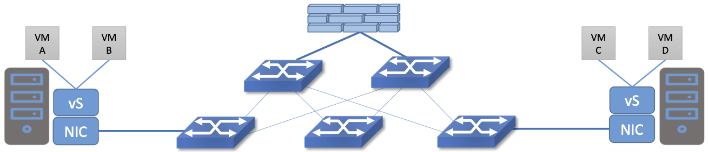

**الشكل 8.20.** مجموعة من الآلات الظاهرية تتواصل عبر جدار ناري

وقد كان تطوّر التجزئة الدقيقة في العقد الأخير من أكبر دوافع تبنّي SDN في المؤسسات. وصار أساسًا لممارسة فضلى في الأمن تُعرف بشبكات «الثقة الصفرية». وتعني الثقة الصفرية أنه يُفترض، بأقصى ما يمكن، أن كل نظام في الشبكة غير موثوق، ومن ثمّ ينبغي عزله عن كل الأنظمة الأخرى عدا الأنظمة التي يحتاج إلى الوصول إليها بالضبط لأداء عمله المكلَّف به.

وأهمية الإنترنت في تشغيل الأنظمة الحرجة وكدعامة لكثير من تجارة العالم جعلته هدفًا جاذبًا للمخترقين. وفي الوقت نفسه تفرض ذلك بقوة الحاجة إلى تطوير ممارسات فضلى كشبكات الثقة الصفرية وتبنّيها. وحين نقرأ عن خروقات اليوم، فالحال غالبًا أن ممارسة فضلى ما لم تُتَّبع. وتقرير Verizon للأمن السيبراني، بتوثيقه ما جرى من أخطاء في آلاف الهجمات، يوفّر معلومات مفيدة عن كم من تلك الهجمات كان يمكن الوقاية منه باستخدام تقنيات النظافة السيبرانية الراسخة.

> **منظور أوسع**
>
> يمكن الحصول على تقرير Verizon لخروقات البيانات من [تقرير تحقيقات خروقات البيانات](https://www.verizon.com/business/resources/reports/dbir/).
>
> وتحلّل مجلة *الإيكونومست* الأثر الاقتصادي للهجمات السيبرانية في هذا المقال: [على غير المتوقع، تنخفض كلفة الهجمات السيبرانية الكبرى](https://www.economist.com/graphic-detail/2024/05/17/unexpectedly-the-cost-of-big-cyber-attacks-is-falling)، مايو 2024.
>
> وتُقدَّم مناقشة أعمق لاستخدام تقنيات SDN لتحسين الأمن في الفصل 8 من كتابنا [الشبكات المعرَّفة بالبرمجيات: نهج الأنظمة](https://sdn.systemsapproach.org/).

[^1]: نستخدم مصطلح *مشارك* للأطراف المنخرطة في تواصل آمن، لأن ذلك هو المصطلح الذي استخدمناه في الكتاب كله لتحديد طرفي قناة. وفي عالم الأمن يُسمّون عادةً *أصولاء*.
