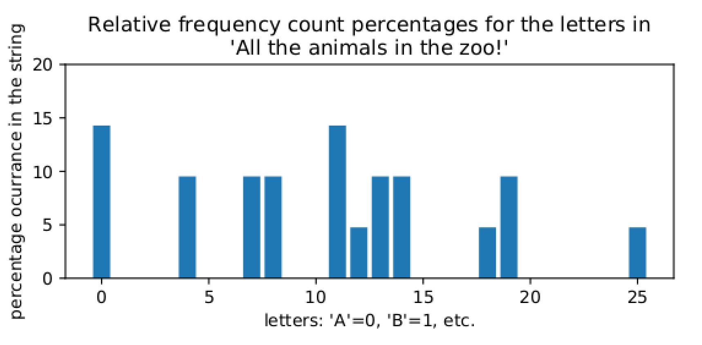
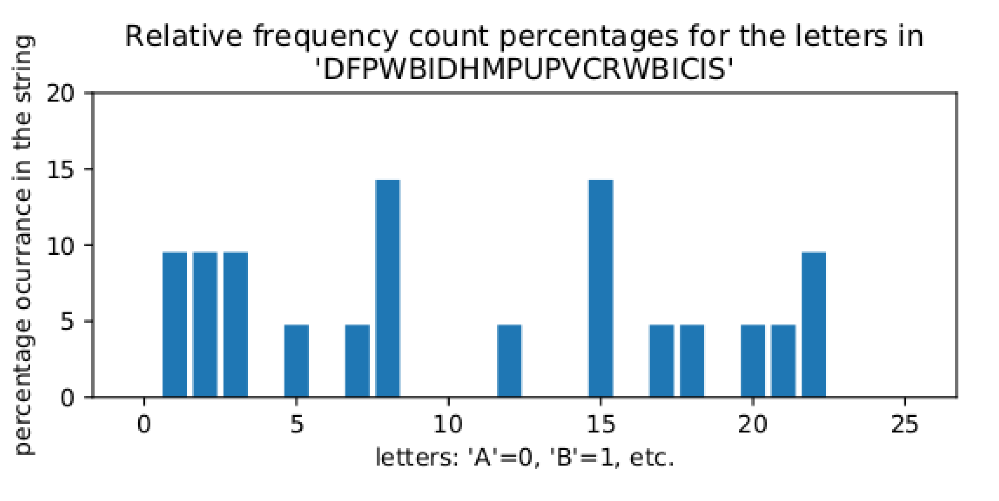
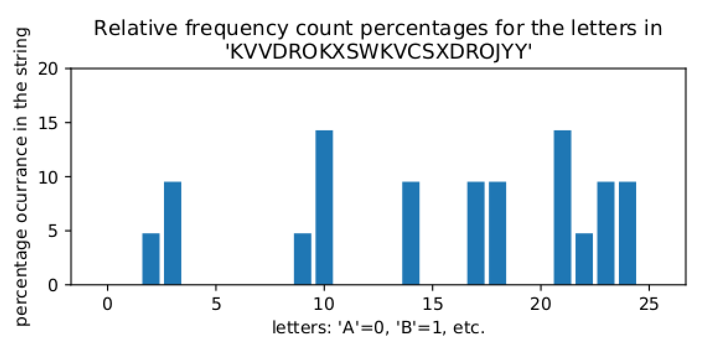

# الفصل 1: مقدّمات

**Jonathan A. Poritz**

هذه بعض الجذور اليونانية:

- ***kryptos*، κρυπτος** سرّي، مخفي
- ***logos*، λογος** كلمة، دراسة، كلام
- ***graph*، γραφω** يكتب، مكتوب
- ***analysis*، αναλυση** تحليل

ومن هذه الجذور (وغيرها) تستمد الإنجليزية الحديثة (التقنية) الكلمات الآتية:

- ***نظام التشفير (cryptosystem)*** مجموعة من الخوارزميات لحماية الأسرار، ولإخفاء المعلومات بحيث لا يصل إليها إلا الأشخاص المقصودون
- ***التشفير (cryptography)*** العمل الذي يُنجَز لصنع أنظمة التشفير
- ***تحليل الشيفرة (cryptanalysis)*** العمل الذي يُنجَز للتغلّب على حمايات أنظمة التشفير، أي «كسر» نظام تشفير
- ***علم التشفير (cryptology)*** اجتماع التشفير وتحليل الشيفرة، ويُختصر غالبًا إلى *crypto*.

احذر أن كلمة *cryptography* تُستخدم على نطاق واسع (استخدامًا غير لائق!) للدلالة على *cryptology* بالمَجاز المرسل. وسنستخدم هذه الكلمات بعناية أكبر، إلا حين لا تكون الفروق بينها مهمة، وحينها نستخدم كلمة *crypto* اختصارًا لأيٍّ من علم التشفير أو التشفير أو تحليل الشيفرة، بحسب الأنسب[^1].

## بعض التاريخ الظنّي

لعلّ ضربًا من الخداع سبق اللغة، فلا شك أن كثيرًا من حيوانات المنازل تتصنّع البراءة رغم الأدلة الواضحة على ضلوعها في سرقة المكافآت. وربما لا يعرف عالم النحل نفسه إن كانت بعض النحلات الكسولة تلفّق حكاية عن رحلة طويلة إلى رقعة أزهار جديدة حين تطلب الملكة حسابًا.

لكن بين *الإنسان العاقل*، وحالما وُجدت اللغة على الأرجح، وُجد الكذب. وبالطبع، حين يكون إنسانان وجهًا لوجه، فلكل طرف شيء من التحكّم: فيمكن للمستمع أن يحاول تقدير مدى جدارة المتحدّث بالثقة، ويمكن لكليهما تكوين حكمه الخاص عن هوية الآخر وبالتالي اختيار ما يريد مشاركته، كما تنتقل كلمات المتحدّث من شفتيه إلى أذني المستمع مباشرة دون احتمال تغيّر المعنى في الطريق (باستثناء اعتبارات الضجيج المحيط وما شابه).

وقد تغيّر الكثير جدًا باختراع الكتابة قبل أكثر من 5000 سنة. فالكلمات المجمّدة في صورة مادية، والأفكار التي تمثّلها، يمكن أن تُؤخذ وتُشارَك مع طائفة واسعة من الأطراف غير الذين أراد المؤلف الأصلي التواصل معهم. وإضافة إلى ذلك، إذا لم يستطع المؤلف أن يسلّم عمله مباشرة إلى القارئ المقصود، بل بقيت الكلمات المكتوبة في العالم وحدها لبعض الوقت، فإن كلا الطرفين المقصودين بالتواصل لم يعد بإمكانه التأكد من أن الآخر هو من تدّعي الكتابة أنه، ولا من أن الكتابة ما زالت الرموز نفسها دون تغيير التي أرادها الطرف الآخر أصلًا.

ولنُصغ هذه المسائل الخاصة بـ*أمن المعلومات* (كما يُسمّى الآن) في صورة منظّمة، في سياق رسالة تُرسَل من شخص يُدعى *أليس* إلى شخص يُدعى *بوب*. ويقوم بدور المحيط المزعج والمتطفّل المفرط في مسرحيتنا الصغيرة *إيف*. (جرت العادة على الانتقال مباشرة إلى شخصية يبدأ اسمها بحرف *E* لترمز إلى *البيئة (environment)* وإلى من قد يكون *متنصّتًا (eavesdropper)*[^2].) ولاحظ أن طريقة أخرى للتفكير في ما تفعله إيف هي أنها تستمع إلى ما يمرّ على *قناة اتصال* مؤسفة (وربما عير مقصودة) عامة يستخدمها أليس وبوب.

وهذه بعض المصطلحات الأساسية:

**التعريف 0.1.1.** **السرّية** تعني أن المستلم المقصود وحده يستطيع استخراج مضمون الرسالة، أي إن أليس تريد أن يحصل بوب وحده على رسالتها لا إيف، سواء تنصّتت هي على المحادثة أو اعترضت الرسالة وهي تنتقل بشكل ما من أليس إلى بوب.

**التعريف 0.1.2.** **سلامة** الرسالة تعني أن المستلم يستطيع التأكد من أن الرسالة لم تُبدَّل، أي إن بوب يريد أن يعرف أن ما يصله هو ما كتبته أليس، لا ما أرادت إيف المشاكسة تغييره إليه.

**التعريف 0.1.3.** **توثيق** المرسِل يعني أن المستلم يستطيع أن يستدلّ من الرسالة على هوية المرسِل، أي إن بوب يريد أن يتأكد من أن هذه الرسالة صدرت فعلًا عن أليس.

**التعريف 0.1.4.** **عدم الإنكار** من جهة المرسِل يعني ألا يكون بوسع المرسِل إنكار أنه أرسل تلك الرسالة، أي إن بوب يريد أن يُلزم أليس بوعودها.

ولاحظ أن أليس وبوب قد يكونان في الحقيقة الشخص نفسه يرسل رسالة من ذاته الماضية إلى ذاته المستقبلية. فمثلًا، قد يريد أحدهم الاحتفاظ بسجلات يجب أن تكون *سرّية* ويجب أن تكون *سلامتها* موثوقة، حتى لو حدث اقتحام للموقع الذي يحتفظ بتلك السجلات.

والحقيقة أن تخزين المعلومات يمكن أن يُنظر إليه دائمًا، بهذه الطريقة، على أنه محاولة تواصل من الماضي إلى المستقبل عبر قناة قد تصبح عامة على نحو غير متوقّع، إذا سُرِق حاسوبك المحمول مثلًا أو اقتحم أحدهم عملك وسرق القرص الصلب من خادمك. وما لم تكن متأكدًا تمامًا من أنه لن يكون لأي فاعل سيئ، في أي مستقبل ممكن، وصول مادي إلى حاسوبك، فمن الحكمة دائمًا أن تشفّر كل بياناتك على أجهزتك الشخصية!

وقبل أن نمضي، بعض المصطلحات التقنية الأخرى:

**التعريف 0.1.5.** الرسالة التي تريد أليس إرسالها إلى بوب، في صورتها الأصلية الفعلية، تُسمّى **النص الصريح**.

**التعريف 0.1.6.** الخوارزمية التي تستخدمها أليس لتحويل النص الصريح (بخلطه وتعميته) إلى صورة تبقى سرّية حتى لو رصدتها إيف أثناء انتقالها تُسمّى **الشيفرة (cipher)**. ونقول أيضًا إن أليس **تشفّر** الرسالة (الصريحة).

**التعريف 0.1.7.** الصورة المشفَّرة من رسالة النص الصريح تُسمّى **النص المشفَّر**.

**التعريف 0.1.8.** حين يتلقّى بوب النص المشفَّر، يطبّق خوارزمية أخرى **لفكّ تشفيره** واستعادة النص الصريح.

**مصطلحات التشفير الأساسية، في صورة بيانية:**

|  | (حيث **إيف** تراقب) |  |
| --- | --- | --- |
| الرسالة m |  |  |
| **تُشفّر** m إلى c |  |  |
| يُرسَل c | ↣**النص المشفَّر** c ↣ | يستقبل c |
|  |  | **يفكّ تشفير** c إلى |
|  |  | يستعيد النص الصريح m |

ومرة أخرى، فإن نظام تشفير يتصوّره شخص ما، ظنًّا منه أنه اخترع نظامًا بأمان رائع القوة، قد يسقط بسهولة أمام تحليل شيفرة يجريه شخص آخر. لذا صار مفهومًا تدريجيًا أن أفضل طريقة للتأكد من استخدام نظام تشفير متين حقًا هي نشر خوارزمياته على نطاق واسع وعلى الملأ، حتى يحاول آخرون في المجتمع كسرها. وكما يُقال في مجتمع البرمجيات الحرة ومفتوحة المصدر[^3]: *مع وجود عيون كافية، تصبح كل العلل سطحية*. ولذلك ينبغي ألا نثق بنظام تشفير إلا إذا بقي أمنه قويًا حتى بعد أن بذل الجميع أفضل ما لديهم لكسره!

وإذا كانت الخوارزمية عامة، فكيف توفّر أي أمان أصلًا؟ الجواب أن الخوارزمية قد تكون عامة، لكنها مصمّمة لتأخذ مدخلًا إضافيًا من المعلومات، يتجاوز النص الصريح المراد تشفيره أو النص المشفَّر المراد فكّ تشفيره:

**التعريف 0.1.9.** المعلومات الإضافية التي تُستخدم (بعضها) في التشفير ويلزم (بعضها) لفكّ التشفير بنجاح تُسمّى **مفتاحًا**.

فكّر في المفتاح كشيء تستخدمه أليس لتقفل رسالتها في صندوق، والصندوق هو الرسالة وهي تنتقل عبر شبكة عامة وربما تراها إيف، ثم يستخدمه بوب لفتح الصندوق ومعرفة ما كانت الرسالة الفعلية التي أرادت أليس إرسالها. ومن الواضح أن المفاتيح يجب أن تبقى سرّية بعناية كي يؤدّي نظام التشفير عمله في حماية اتصالات أليس وبوب من إيف المتنصّتة!

وهذه الفكرة، أي أن أمن نظام التشفير ينبغي أن يقوم على سرّية المفتاح لا على سرّية الخوارزمية، صارت تُسمّى **مبدأ Kerckhoff**، على اسم مجموعة أفكار في تصميم أنظمة التشفير دوّنها عالِم تشفير عسكري فرنسي سنة 1883. ونقيض النظام المصمّم على مبدأ Kerckhoff هو نظام تُحفظ خوارزمياته سرًّا فحسب، ويُعدّ وضع أي ثقة فيه حماقة بالغة: ويُقال إن هذه الأنظمة الضعيفة تعتمد على النمط غير السديد المسمّى **الأمن بالتعمية**.

> **استجابة القراءة.**
>
> هل هذا كله مفهوم؟ ما كان جديدًا أو مثيرًا للاهتمام، وما كان قديمًا وغير مثير؟

> **استجابة القراءة.**
>
> هل يمكنك التفكير في مثال لم يُذكر أعلاه يمكن أن تُستخدم فيه مصطلحات مثل **السرّية** و**السلامة** و**التوثيق** و/أو **عدم الإنكار** لوصف شيء قرأت عنه أو جريت به؟ أو، هل يمكنك التفكير في موقف تنطبق فيه هذه المفاهيم الأمنية المعلوماتية على نسخة ما من **أليس** و**بوب** و**إيف** و**قناة عامة**؟ إن كان الأمر كذلك، فقل ما كان ذلك الموقف وما قابل كلًّا من تلك الشخصيات.

## شيفرة قيصر ومتغيّراتها

ثمة نظام تشفير يعود إلى العصور القديمة يُقال إن يوليوس قيصر استخدمه.

**التعريف 0.2.1.** تأخذ أليس رسالتها، وتزيل منها كل المسافات وعلامات الترقيم، وتضعها كلها بحالة واحدة (ربما الحالة الصغيرة). ثم تُحرّك كل حرف k موضعًا نحو نهاية الأبجدية، مع الالتفاف من **z** إلى **a** عند الحاجة، حيث k عدد صحيح ثابت يعرفه كل من أليس وبوب ولا يعرفه أحد سواهما، ويُسمّى **المفتاح**. (كثيرًا ما يُكتب النص المشفَّر كله بحروف كبيرة، ليسهل التمييز بين النص الصريح والنص المشفَّر.)

ولفكّ التشفير، تُحرّك بوب ببساطة كل حرف k موضعًا نحو بداية الأبجدية، مع الالتفاف من **A** إلى **Z** عند الحاجة: بعبارة أخرى، *تشفّر* بوب النص المشفَّر بالمفتاح -k لتحصل على النص الصريح.

ويُسمّى هذا **نظام شيفرة قيصر** أو **شيفرة قيصر**.

وكان يوليوس قيصر يستخدم عادةً، على ما يبدو، قيمة المفتاح k=3. أما ابن أخته أوكتافيان، الذي صار لاحقًا الإمبراطور أغسطس، فقد كان يحب استخدام k=-1.

وعند استخدام ما يُسمّى الأبجدية اللاتينية (وهي ليست ما استُخدم في روما القديمة!) بحروفها الستة والعشرين، ثمة قيمة مفتاح جميلة خصوصًا: 13. والجميل في هذه القيمة أن التشفير وفكّ التشفير تحويل واحد بعينه. وفي العصر الحديث يُسمّى هذا التحويل **ROT13**، وله دور صغير في التاريخ الحديث للإنترنت. فمنشورات غرف المحادثة ولوحات الإعلانات القديمة كانت تريد أحيانًا أن تحتوي محتوى لا ينبغي أن يكون متاحًا تلقائيًا لكل من ينظر إلى المنشور، لكنه يبقى موجودًا للقارئ العازم (كأن يكون مثلًا حرقًا لأحداث لعبة أو كتاب أو فيلم جديد شهير). وكان ذلك يُضمَّن في المنشور كثيرًا، لكن بعد تمريره عبر ROT13 فقط.

وقد استخدمت بضعة منتجات تجارية ROT13 لأمان حقيقي، مع أنه غير آمن على الإطلاق في الحقيقة، كأجزاء معيّنة من بعض إصدارات نظام التشغيل Windows.

> **استجابة القراءة.**
>
> هل سمعت بشيفرة قيصر من قبل؟ وهل طريقة استخدامها واضحة لك؟

### المفاتيح لا تهم إلا «بمعيار 26»

لاحظ أنه إذا استخدمت أليس شيفرة قيصر بالمفتاح k_(rmAlice)=1، فإن تشفيرها يفعل الشيء نفسه بالضبط الذي يفعله آن التي تستخدم قيصر بالمفتاح k_(rmAnn)=27، بسبب ذلك الجزء من تعريف نظام شيفرة قيصر الذي يقول «الالتفاف من **z** إلى **a**»: فآن ستدور حول الأبجدية دورة كاملة، ثم تنتهي عند الموضع نفسه الذي تنتهي عنده أليس. والسبب أن 27=26+1، والتشفير بالمفتاح 27 يدور حول الأبجدية مرة واحدة (من الـ26) ثم يخطو خطوة أخرى. والشيء نفسه يحدث لو استخدمت آن المفتاح k_(rmAnn)=53=2*26+1، إذ تدور عملية تشفيرها حول الأبجدية دورتين في هذه الحالة (من الـ2*26) ثم تنتهي عند الموضع نفسه الذي تنتهي عنده أليس.

والحقيقة أنه إذا كان الفرق بين مفتاح أليس ومفتاح آن أي عدد من الـ26، فسيكون تشفيرهما متطابقًا تمامًا! ولدى الرياضيين بعض المصطلحات والرموز لهذا:

**التعريف 0.2.2.** لنفترض أن a وb وn ثلاثة أعداد صحيحة. فنقول إن **a تساوي b بمعيار n** إذا كان a-b من مضاعفات n؛ أي إذا وُجد عدد صحيح آخر k بحيث a-b=k*n. والرمز لذلك هو a≅b (mod n).

**المثال 0.2.3.** كما لاحظنا للتوّ، 1≅27 (mod 26).

**المثال 0.2.4.** كانت ROT13 مريحة جدًا لأن تطبيقها مرتين يعادل عدم فعل شيء، لأن 13+13≅0 (mod 26). أو، بتفكير آخر، بما أن -13≅13 (mod 26)، فإن تشفير ROT13 (قيصر بالمفتاح 13) هو الشيء نفسه بالضبط الذي يفعله فكّ تشفير ROT13 (قيصر بالمفتاح -13).

> **استجابة القراءة.**
>
> هل هذا كله مفهوم؟ ما كان جديدًا أو مثيرًا للاهتمام، وما كان قديمًا وغير مثير؟
>
> إن كنت مرتاحًا إلى هذا المصطلح والرمز الجديدين، فحاول الإجابة عن السؤال الآتي: إذا كان لديك عدد صحيح x وتعلم أن x≅0 (mod 2)، فما الطريقة الأكثر شيوعًا للحديث عن ذلك العدد؟ *أي* ستقول إن «x هو.»

لغات الحاسوب عادةً فيها طريقة للعمل بالأعداد بمعيار n. فمثلًا، في **Python** عملية حسابية مدمجة مفيدة هنا: `a%n` تعطي أصغر عدد صحيح غير سالب يساوي `a` بمعيار `n`.

**المثال 0.2.5.** من ملاحظاتنا أعلاه، في **Python**

```text
>>> 27 % 26
1
```

و

```text
>>> -13 % 26
13
```

أولًا، لاحظ أننا لا نستطيع أن نضيف مفتاحًا إلى حرف مباشرة، لأن الأنواع لا تتوافق:

```text
>>> 'a'+2
Traceback (most recent call last):
  File "<stdin>", line 1, in <module>
TypeError: must be str, not int
```

فلابدّ أولًا من تحويل الحرف إلى `int` ثم إعادته حرفًا:

```text
>>> chr(ord('a')+3)
'c'
```

ولاحظ أن `ord()` تأخذ حرفًا واحدًا وتحوّله إلى `int`، بينما `chr()` تأخذ `int` وتحوّله إلى حرف واحد. وليس مهمًا كثيرًا تفصيل كيفية عمل ذلك، سوى ملاحظة أن الترميز يضم كل الحروف الصغيرة، بترتيب أبجدي، في كتلة عددية واحدة من قيمة `ord('a')` إلى قيمة `ord('z')`، ويضم كل الحروف الكبيرة، بترتيب أبجدي، في كتلة عددية أخرى من `ord('A')` إلى `ord('Z')`.

والحقيقة أن هذا لن يعمل مع حرف قريب جدًا من نهاية الأبجدية، *مثلًا*:

```text
>>> chr(ord('y')+3)
'|'
```

فماذا لو أخذنا حرفًا في متغير `x` وفعلنا ما يلي:

1. نحوّله إلى عدد باستخدام `ord()`
2. نزيحه بحيث يصير في المدى من `0` إلى `25` بطرح `ord('a')`
3. نطبّق قيصر بإضافة القيمة `k`
4. نعيده إلى المدى `0` إلى `25` بإجراء `%26`
5. نجعله في المدى من `ord('A')` إلى `ord('Z')` بإضافة `ord('A')`
6. نعيده حرفًا باستخدام `chr()`

*مثلًا*، إذا كان `x='y'` و`k=4` فسنحصل على

```text
>>> chr((ord(x)-ord('a')+k)%26+ord('A'))
'C'
```

ولنُنفّذ الآن شيفرة قيصر في **Python**، على خطوات. أولًا، ينبغي تنظيف سلسلة النص الصريح.

> **مهمة برمجية.**
>
> اكتب دالة **Python** تأخذ سلسلة مدخلة وتعيد سلسلة مماثلة إلا أن كل المحارف غير الأبجدية قد أُزيلت وكل الحروف قد صارت بحالة صغيرة.

قد يفيدك أن تعرف أنك تستطيع المرور على محارف سلسلة `s` بكتابة

```text
for x in s:
```

مع

```text
o=''
```

وإضافة الحرف `t` إلى نهاية `o` بكتابة

```text
o=o+t
```

وثمة نهج آخر أكثر «بَيثونية» هو بناء قائمة بالتركيب

```text
[ c for c in s ]
```

على السلسلة `s`. ولاحظ أنه يمكنك أيضًا أن تفعل شيئًا بالمحارف وأنت تضعها في القائمة، وأن تضيف شرطًا إلى جزء التكرار، مثل

```text
[ ord(c) for c in s if c.isalpha()]
```

> **مهمة برمجية.**
>
> **تشفير قيصر:** اكتب دالة **Python** `Caesar_encrypt(s, k)` تأخذ سلسلة مدخلة `s`، هي النص الصريح، وعددًا صحيحًا `k`، وتعيد النص المشفَّر من ذلك النص الصريح بشيفرة قيصر بالمفتاح `k`.

> **مهمة برمجية.**
>
> مثلًا، إذا كتبت
>  `Caesar_encrypt('All the animals at the zoo!', 3)`
>  فينبغي أن يكون الخرج
>  `'DOOWKHDQLPDOVDWWKHCRR'`.

> **مهمة برمجية.**
>
> **فكّ تشفير قيصر:** اكتب دالة **Python** `Caesar_decrypt(s, k)` تأخذ سلسلة مدخلة `s`، هي النص المشفَّر، وعددًا صحيحًا `k`، وتعيد النص الصريح من ذلك النص المشفَّر بشيفرة قيصر بالمفتاح `k`.

> **مهمة برمجية.**
>
> مثلًا، إذا كتبت
>  `Caesar_decrypt('DOOWKHDQLPDOVDWWKHCRR', 3)`
>  فينبغي أن يكون الخرج
>  `'alltheanimalsatthezoo'`.

> **مهمة برمجية.**
>
> قد ترغب في إجراء اختبار سلامة على مدخلك وإرجاع خطأ أو سلسلة فارغة إذا لم يكن المدخل نصًّا مشفَّرًا سليم البنية، *أي* سلسلة تتكوّن من حروف كبيرة فقط.

### تحديث شيفرة قيصر

يبدو من المؤسف أن شيفرة قيصر، كما استخدمناها، تُفقد الرسائل علامات الترقيم وحالة الحروف. وطريقة للتحايل على ذلك أن نتخيّل كل حروف الحالتين وكل رموز الترقيم جزءًا من أبجدية أكبر بكثير، ثم نستخدم قيصر القديمة نفسها مع هذه الأبجدية الأكبر بكثير، مستخدمين بالمقابل `%N` حيث N حجم الأبجدية الجديدة، بدلًا من `%26` التي كنا نستخدمها.

وتقنيًا، في **Python 3**، تتكوّن السلاسل من محارف، والمحارف مرمّزة بـ**Unicode**. وUnicode طريقة لتحويل الأعداد، الممثَّلة ببايت واحد أو اثنين أو أربعة، إلى رموز خاصة كثيرة فضلًا عن حروف من نظم كتابة كثيرة تُستخدم حول العالم.

وأول 128 رمزًا في Unicode، وهي التي تتّسع لها بايت واحدة (بحيث يكون البت الأعلى رتبةً صفرًا في الحقيقة)، ليست إلا مخطط ترميز ASCII القديم، الذي يعود إلى سنة 1963، للأبجدية الإنجليزية إضافة إلى بعض علامات الترقيم والرموز وحتى رموز غير مطبوعة مثل «EOF». واسم مخطط الترميز الخاص بالمجموعة الفرعية من Unicode التي تتّسع لها 8 بتات هو «UTF-8»، ويضم مخطط ASCII القديم كله.

وUnicode الكامل في بايتين أو أربع يتضمّن أبجديات كثيرة غير لاتينية (كاليونانية والسيريلية والهانغول *وغيرها*) وحتى نظم كتابة غير أبجدية كالصينية واليابانية (بل إن جزءًا من اليابانية غير أبجدي، ويُسمّى «كانجي»، لكن اليابانية فيها أيضًا نظاما كتابة مختلفان يقومان على أصوات المقاطع، ويُسمّيان «هيراغانا» و«كاتاكانا»، ولكل منهما 49 رمزًا)، بآلاف من الإيديوغرامات.

> **استجابة القراءة.**
>
> هل سمعت بـUnicode؟

> **استجابة القراءة.**
>
> إن لم تكن قد سمعت به، فربما تقرأ، أو تتصفّح على الأقل، [صفحة ويكيبيديا عن Unicode](https://en.wikipedia.org/wiki/Unicode) وتقول ما رأيك فيه.

> **استجابة القراءة.**
>
> هل عملت يومًا بـUnicode في **Python**؟

> **استجابة القراءة.**
>
> إن كنت قد عملت به، فما رأيك فيه؟ وإن لم تكن، فربما تقرأ، أو تتصفّح على الأقل، إمّا توثيق **Python** المسنّى [Unicode HOWTO](https://docs.python.org/3/howto/unicode.html) أو الدليل الأكثر تفصيلًا [Unicode & Character Encodings in Python: A Painless Guide](https://realpython.com/python-encodings-guide/) وتقول ما رأيك فيه.

> **مهمة إضافية.**
>
> نفّذ في **Python** تشفيرًا وفكّ تشفير على نمط قيصر يعمل لأبجدية غير الإنجليزية. ربما الإسبانية (حرف زائد واحد: ñ) أو الألمانية (أربعة حروف زائدة: ä وö وü وß)....

> **مهمة إضافية.**
>
> **أو** ربما نفّذ قيصر بالأبجدية الإنجليزية، لكن جد طريقة للحفاظ على علامات الترقيم كذلك. يبدو أن إبقاء المسافات وعلامات الترقيم كما هي في النص المشفَّر قد يفشي معلومات كثيرة جدًا، لكن هل تستطيع أن تفعل بها شيئًا مثيرًا للاهتمام؟

> **مهمة إضافية.**
>
> **أو** ربما نفّذ نظام تشفير على نمط قيصر يعالج ASCII كله، أو UTF-8، أو Unicode كله!

## تحليل شيفرة قيصر

لنفكّر في تحليل شيفرة قيصر؛ أي لنكتشف كيف نستعيد نصًّا صريحًا من نص مشفَّر بشيفرة قيصر دون أن نعرف المفتاح.

وأول ما ينبغي ملاحظته هو أنه، كما رأينا في §0.2، لا يهم المفتاح إلا «بمعيار 26». لكن كل عدد صحيح ممكن k للمفتاح يساوي بمعيار 26 عددًا صحيحًا في المدى من 0 إلى 25: فقط جرّب تشغيل

```text
for i in range(100):
  print(i%26)
```

وبذلك، عمليًا، ليس في شيفرة قيصر إلا 26 مفتاحًا ممكنًا! والحقيقة أنه سيكون سخيفًا جدًا استخدام المفتاح k=0، لأن النص المشفَّر سيكون حينها مطابقًا تمامًا للنص الصريح (حسنًا، دون المحارف غير الأبجدية، وبحروف كبيرة كلها). فليس هناك في الحقيقة إلا 25 مفتاحًا معقولًا لشيفرة قيصر. ويبدو أن هذا النوع من الأمور مهم بما يكفي ليكون له اسمه الخاص:

**التعريف 0.3.1.** مجموعة المفاتيح الممكنة لنظام تشفير ما تُسمّى **فضاء المفاتيح** لذلك النظام.

وما رأيناه للتوّ هو أن فضاء مفاتيح شيفرة قيصر ليس إلا الأعداد الصحيحة من 1 إلى 25. وفي **Python**، هو عناصر القائمة `range(1,25)`.

وعدوّ لقيصر اعترض نصًّا مشفَّرًا له وأراد معرفة ما فيه كان يستطيع أن يجمع فريقًا من 25 شخصًا يعرفون القراءة (وربما كان العثور عليهم صعبًا حينها؟) ويحسنون العدّ (وهذا أيضًا صعب؟)، ويستخدمهم لصنع *حاسوب كسر شيفرة قيصر* على النحو الآتي:

- يُسنَد إلى كل شخص أحد الأعداد من 1 إلى 25
- يكتب كل شخص فكّ تشفير النص المعترَض، مستخدمًا العدد المسنَد إليه مفتاحًا
- إذا حصل أحدهم على شيء يبدو مكتوبًا بلاتينية سليمة، صاح «نجحنا!» وقرأ فكّ تشفيره بصوت عالٍ

وسيكون هذا طريقة سريعة واقتصادية إلى حد بعيد لكسر نظام شيفرة قيصر **فقط لأن فضاء المفاتيح صغير جدًا**. ولهذا النوع من الهجوم اسم:

**التعريف 0.3.2.** محاولة تحليل شيفرة نظام تشفير بتجربة كل القيم الممكنة لبعض معاملاته (ككل المفاتيح الممكنة أو كل الرسائل الممكنة) تُسمّى **هجوم القوة الغاشمة**.

> **استجابة القراءة.**
>
> هل هذا كله مفهوم؟ ما كان جديدًا أو مثيرًا للاهتمام، وما كان قديمًا وغير مثير؟

> **استجابة القراءة.**
>
> هل يمكنك التفكير في مثال على **هجوم القوة الغاشمة** استُخدم في سياق أمن معلوماتي تعرفه من صفوف أو قراءات أخرى أو من حياتك فحسب؟

> **مهمة برمجية.**
>
> اكتب دالة **Python** `CaesarBF(s)` تنفّذ هجوم قوة غاشمة على نظام شيفرة قيصر. فبالنظر إلى نص مشفَّر مدخل، ينبغي أن تجرّب كل المفاتيح الممكنة لفكّ التشفير وتطبع المفتاح المجرَّب وفكّ التشفير المقابل له.

> **مهمة برمجية.**
>
> *مثلًا*، ينبغي أن يكون خرج `CaesarBF('DOOWKHDQLPDOVDWWKHCRR')` هو

```text
1:   cnnvjgcpkocnucvvjgbqq
2:   bmmuifbojnbmtbuuifapp
3:   alltheanimalsatthezoo
4:   zkksgdzmhlzkrzssgdynn
5:   yjjrfcylgkyjqyrrfcxmm
6:   xiiqebxkfjxipxqqebwll
7:   whhpdawjeiwhowppdavkk
8:   vggoczvidhvgnvooczujj
9:   uffnbyuhcgufmunnbytii
10:   teemaxtgbfteltmmaxshh
11:   sddlzwsfaesdksllzwrgg
12:   rcckyvrezdrcjrkkyvqff
13:   qbbjxuqdycqbiqjjxupee
14:   paaiwtpcxbpahpiiwtodd
15:   ozzhvsobwaozgohhvsncc
16:   nyygurnavznyfnggurmbb
17:   mxxftqmzuymxemfftqlaa
18:   lwwesplytxlwdleespkzz
19:   kvvdrokxswkvckddrojyy
20:   juucqnjwrvjubjccqnixx
21:   ittbpmivquitaibbpmhww
22:   hssaolhupthszhaaolgvv
23:   grrznkgtosgrygzznkfuu
24:   fqqymjfsnrfqxfyymjett
25:   eppxliermqepwexxlidss
```

وهذا كله حسن وجيد، لكن لدينا مشكلة ضخمة: ثمة حاجة إلى تدخّل بشري هنا، لاختيار أيّ فكّ تشفير ممكن في هجوم القوة الغاشمة هو الصحيح!

فمثلًا، لنفترض أن فاعلين سيئين اقتحموا شبكة مؤسستك وشفرّوا كل ملفاتك بشيفرة قيصر، لكنهم اختاروا مفتاحًا مختلفًا لكل ملف. ومن المرجّح أن في مؤسستك مئات الآلاف من الملفات، ومع أن أي ملف بمفرده يمكن فكّ تشفيره بسهولة، فإن فكّ تشفير شبكتك كلها سيستغرق عددًا مجنونًا من ساعات العمل البشري، وربما تكون مستعدًا لدفع فدية كبيرة إلى حد بعيد لاستعادة كل ملفاتك دون استثمار كل تلك الحياة البشرية في فكّ التشفير بالقوة الغاشمة.

### تحليل التكرارات

لنفكّر في كيفية أتمتة اختيار فكّ التشفير الصحيح في هجوم القوة الغاشمة على شيفرة قيصر.

الفكرة الأساسية هنا هي مجرّد حقيقة رصدية: *التكرارات النسبية للحروف المختلفة في الإنجليزية مستقرة نسبيًا في كل نصوص الإنجليزية تقريبًا*. وعلى وجه الخصوص، في الإنجليزية، الحرف الأكثر شيوعًا هو «e» عادةً، والثاني شيوعًا هو «t» عادةً، *وهكذا*.

وهذا يوحي بنهج لاكتشاف فكّ التشفير الصحيح في هجوم القوة الغاشمة تلقائيًا: أعلِن الانتصار حين يجد نهج القوة الغاشمة فكّ تشفير ممكنًا يكون فيه الحرف الأكثر شيوعًا هو «e».

> **مهمة برمجية.**
>
> اكتب دالة **Python** `freq_table(s)` تصنع *جدول التكرارات* لحروف سلسلة `s`. أي نظّف أولًا `s` بإزالة كل غير الحروف وجعل الحروف الباقية كلها بحالة صغيرة. ثم ينبغي أن تعيد `freq_table()` قائمة من 26 عددًا صحيحًا تكون فيها القيمة عند الموضع `i` عدد مرات ورود الحرف `chr(i+ord('a'))` في السلسلة المدخلة المنظَّفة.

> **مهمة برمجية.**
>
> مثلًا، ينبغي أن يعيد تنفيذ
>  `freq_table('alltheanimalsinthezoo')`
>  القائمة
>  `[3,0,0,0,2,0,0,2,2,0,0,3,1,2,2,0,0,0,1,2,0,0,0,0,0,1]`.

> **مهمة برمجية.**
>
> اكتب دالة **Python** `CaesarBF_findE(s)` تستخدم دالتك السابقة `CaesarBF(s)` لكنها لا تطبع فكّ التشفير الممكن إلا إذا كان الحرف «e» هو الأكثر تكرارًا في النص الصريح المقترح. أي في كل مرة تحسب دالتك نصًّا صريحًا ممكنًا، ينبغي أن تحصل على جدول التكرارات `freqs` من تلك السلسلة باستخدام دالتك `freq_table()`. ثم نفّذ الاختبار `freqs[4]==max(freqs)` لترى إن كان الحرف عند الموضع 4، وهو «e»، هو الأكثر تكرارًا. ولن تطبع ذلك النص الصريح الممكن إلا إذا نجح الاختبار.

ومن الواضح أن هذه الاستراتيجية لا تبدو ناجحة كثيرًا، لأنها ستجد أن السلسلة `'teemaxtgbfteltmmaxshh'` من المفتاح `10` والسلسلة `'eppxliermqepwexxlidss'` من المفتاح `25` هما كلتاهما فكّا تشفير ممكنان للنص `'DOOWKHDQLPDOVDWWKHCRR'`، وليس أيّ منهما صحيحًا!

والمشكلة أن الحرف الواحد الأكثر تكرارًا قطعة معلومات خشنة جدًا عن سلسلة ما لتكون نافعة في تحديد إن كانت السلسلة بإنجليزية سليمة. غير أن جدول التكرارات كله يؤدي عملًا أفضل بكثير. ولننفّذ ذلك في **Python** الآن، على عدة خطوات.

> **مهمة برمجية.**
>
> عدّل دالتك **Python** `freq_table(s)` لتصنع دالة تُسمّى `rel_freq_table(s)` تحسب *جدول التكرارات النسبية* لسلسلة مدخلة `s`: جدولًا يحسب نسبة حروف `s` التي هي كل حرف بعينه. فإذا كانت القائمة التي تحسبها `freq_table()` هي `f`، فستكون النسخة النسبية بأعداد عشرية (`float`) لا أعداد صحيحة، بقيم هي قيم `f` مقسومة على `sum(f)` (أو، وهو ما ينبغي أن يكون الشيء نفسه، مقسومة على `len` السلسلة المدخلة).

> **مهمة برمجية.**
>
> مثلًا، ينبغي أن يعيد تنفيذ `rel_freq_table('zbazb')` القائمة `[0.2,0.4,0.0,0.0,0.0,0.0,0.0,0.0,0.0,0.0,0.0,0.0,0.0,` ` 0.0,0.0,0.0,0.0,0.0,0.0,0.0,0.0,0.0,0.0,0.0,0.0,0.4]`.

> **مهمة برمجية.**
>
> شغّل دالتك `rel_freq_table()` على قطع طويلة جدًا من نص إنجليزي، لتحصل على جدول التكرارات النسبية النموذجي للغة الإنجليزية.

> **مهمة برمجية.**
>
> ربما تقارن القيم التي تحصل عليها بما تقول ويكيبيديا إنه الجدول الصحيح للتكرارات النسبية في [مقالة تكرار الحروف](https://en.wikipedia.org/wiki/Letter_frequency). هل حصلت على جواب مماثل؟ وإن لم يكن، فهل لديك تخمين للسبب؟

> **مهمة برمجية.**
>
> ستحتاج بعد قليل إلى أداة تحسب «المسافة» بين جدولي تكرارات نسبية. وتلك الجداول قوائم أعداد طولها 26. حسنًا، إذا كانت لديك قائمة من عددين، فيمكنك التفكير في هذين العددين كإحداثيتين في فضاء ثنائي الأبعاد. وإذا كانت لديك قائمة من ثلاثة أعداد، فيمكنك التفكير فيها كإحداثيات في فضاء ثلاثي الأبعاد. إذن فقائمة من 26 عددًا يمكن التفكير فيها كإحداثيات في فضاء ذي 26 بعدًا. غريب، نعم، لكن امضِ معه....

> **مهمة برمجية.**
>
> في البعدين أو الأبعاد الثلاثة، تُعطى المسافة بين نقطتين بالجذر التربيعي لمجموع مربّعات الفروق بين الإحداثيات. أي إن المسافة في بعدين بين نقطتين إحداثيتاهما (x₁,y₁) و(x₂,y₂) تُعطى، بمبرهنة فيثاغورس، بالصيغة √((x₁-x₂)²+(y₁-y₂)²). والشيء نفسه يعمل أيضًا في ثلاثة أبعاد... أو في 26 بعدًا: فذلك مجرّد مبرهنة فيثاغورس 25 مرة!

> **مهمة برمجية.**
>
> فاكتب دالة **Python** تأخذ مدخلًا قائمتين من الأعداد بالطول نفسه، ولنقل إنهما `a` و`b`. ثم ينبغي أن تأخذ العنصر الأول من `a` ناقص العنصر الأول من `b` وتربّع ذلك الفرق. وينبغي أن تضيف إلى ذلك المربّع مربّع فرق العنصرين الثانيين، وهكذا حتى تنفد كل العناصر. وأخيرًا ينبغي أن تعيد الجذر التربيعي لذلك المجموع، وهو قيمة `freq_table_dist(a,b)`.

> **مهمة برمجية.**
>
> نفّذ الآن دالة **Python** `CaesarBF_rel_freq(s)` تجرّب كل فكوك تشفير قيصر الممكنة لسلسلة النص المشفَّر المدخلة `(s)`، وتختار التي يقلّ اختلاف جدول تكراراتها النسبية عن جدول التكرارات النسبية القياسي للإنجليزية الذي وجدته للتوّ.

> **مهمة برمجية.**
>
> وهذه الخطوات: اتبع نهج `CaesarBF(s)` من قبل، واحسب جدول التكرارات النسبية لكل فكّ تشفير ممكن. ثم احسب «مسافة جدول التكرارات»، بمعنى المهمة البرمجية السابقة، بين جدول التكرارات النسبية لهذا الفكّ الممكن وجدول التكرارات النسبية القياسي للإنجليزية.

> **مهمة برمجية.**
>
> وحين تفرغ، جد أصغر مسافة بين كل تلك الفكوك الممكنة وأعلن ذلك الفكّ أفضل تخمين لفكّ التشفير الحقيقي للنص المشفَّر المدخل.

> **مهمة إضافية.**
>
> لنختبر الآن اختبار إجهاد لكاسر شيفرة قيصر بالقوة الغاشمة الذي يستخدم تحليل التكرارات.

> **مهمة إضافية.**
>
> أولًا، جرّب أخذ قطعة كبيرة من نص بلغة أخرى، وشفرها بشيفرة قيصر وبمفتاح عشوائي، ثم استخدم دالتك `CaesarBF_rel_freq(s)` لمحاولة فكّ تشفيرها تلقائيًا. فمثلًا، ربما تأخذ بعضًا من [النص الإسباني للرواية الشهيرة دون كيخوته](https://www.gutenberg.org/files/2000/2000-0.txt) أو ببساطة تقصّ وتلصق من [صحيفة *Le Monde* الفرنسية](https://www.lemonde.fr/) أو [صحيفة *Deutsche Tageszeitung* الألمانية](https://www.deutschetageszeitung.de/). **ملاحظة:** في لغات أخرى، قد تواجه مشكلة في الأبجدية! فالحروف ذات العلامات قد تُفسد تركيباتك في **Python** التي تفترض أن الأبجدية مرتَّبة تتابعيًا من 0 إلى 25 حين تأخذ كل حرف `c` وتفعل `ord(c)-ord('a')`. اكتشف كيف تتعامل مع هذا الوضع (وربما بتحويل كل حرف خاص إلى حرف في الأبجدية الإنجليزية، كأن تجعل «ñ» مجرّد «n»).

> **مهمة إضافية.**
>
> أو يمكنك أن تجرّب فكّ تشفير نص كان أصله لاتينيًا، مثل [النص اللاتيني الأصلي لكتاب إسحاق نيوتن الشهير *Philosophiae Naturalis Principia*](https://www.gutenberg.org/cache/epub/28233/pg28233.txt) [*Mathematica*](https://www.gutenberg.org/cache/epub/28233/pg28233.txt).

> **مهمة إضافية.**
>
> ومن الأمور الأخرى التي يمكن فعلها أن تجرّب نصًّا غير معتاد جدًا، لكن بالإنجليزية. فمثلًا، نشر رجل يُدعى Ernest Wright كتابًا عنوانه *Gadsby* سنة 1939 ليس فيه حرف «e» في أي موضع. وبما أن «e» هو الحرف الأكثر شيوعًا في الإنجليزية العادية، فلا بدّ أن تكرارات الحروف النسبية في هذه الرواية مختلفة تمامًا عن نظيراتها في الإنجليزية العادية. جرّب تشفير بعض [نص *Gadsby*](https://www.gutenberg.org/cache/epub/47342/pg47342.txt) ثم فكّ تشفيره تلقائيًا (لكن تأكد من النزول في ذلك الملف مسافة كافية لتصل إلى نص الرواية: فالمادة التمهيدية فيها حرف «e»).

## الدفاع عن قيصر أمام تحليل التكرارات: Vigenère والقرص الواحد

أحيانًا تكون رسالة قصيرة جدًا مهمة جدًا: «نعم» أو «لا» فرق كبير في مواقف كثيرة! لكن هجمات تحليل التكرارات على شيفرة قيصر تعتمد على وجود جدول تكرارات نسبية تقارنه بجدول التكرارات النسبية للإنجليزية... ودون نص مشفَّر طويل بما يكفي، لن يكون هناك جدول تكرارات يُذكر أصلًا.

ولا بدّ أن يكون هناك حدّ ما k بحيث لا يعطي جدول التكرارات النسبية، حين تكون سلسلة النص المشفَّر بطول k أو أقل، معلومات كافية لتحليل شيفرة ناجح. وينبغي أن يكون هناك أيضًا حدّ آخر K بحيث ينجح، حين تكون سلسلة النص المشفَّر بطول K أو أكثر، تحليل شيفرة قيصر بجداول التكرارات النسبية عادةً.

أما الرسائل التي يقع طولها بين k وK، فمن المفترض أن النهج القائم على جداول التكرارات النسبية ينجح معها أحيانًا ويفشل أحيانًا.

> **مهمة إضافية.**
>
> لنحاول أن نكتشف ما هذان الحدّان k وK.

> **مهمة إضافية.**
>
> نفّذ حلقة كبيرة بحيث يأخذ عدد ما `l` القيم من 1 إلى 150 (أو نحو ذلك). ولكل قيمة من `l`، ستكتشف كم مرة ينجح كاسر شيفرة قيصر القائم على جدول التكرارات النسبية `CaesarBF_rel_freq` على سلاسل بطول `l`.

> **مهمة إضافية.**
>
> اصنع سلسلة طويلة جدًا `big_string` ببعض النص. وستحتاج على الأرجح إلى إزالة كل غير الحروف من `big_string` وجعل كل حروفها بحالة صغيرة.

> **مهمة إضافية.**
>
> والآن اصنع حلقة لتجربة فكّ تشفير 100 سلسلة مختارة عشوائيًا من `big_string` مثلًا. وفي كل مرة تمرّ فيها الحلقة، اختر سلسلة فرعية عشوائية من `big_string` بطول `l`، والطريقة لذلك أن تكتب
>  `from random import *`
>  مرة واحدة قرب بداية برنامجك، ثم في هذه الحلقة تضبط
>  `rand_start = randint(0,len(big_string)-l)`
>  لتكون نقطة البداية العشوائية للسلسلة الفرعية، و
>  `rand_cleartext = big_string[rand_start:rand_start+l]`
>  لتكون السلسلة الفرعية المقابلة بطول `l`.

> **مهمة إضافية.**
>
> والآن اختر مفتاح قيصر عشوائيًا `k=randint(1,26)`، وشفّر `rand_cleartext` إلى `rand_ciphertext` بذلك المفتاح، وجرّب كاسر شيفرة قيصر القائم على جدول التكرارات النسبية على `rand_ciphertext`. فإن كان فكّ التشفير المقترح مساويًا لـ`rand_cleartext` فاحسب ذلك نجاحًا، وإلا فاحسبه فشلًا.

> **مهمة إضافية.**
>
> انظر كم مرة من أصل 100 (*أي* النسبة المئوية) نجحت في هذه الحلقة الداخلية.

> **مهمة إضافية.**
>
> وبإتمام الحلقة الخارجية، ينبغي أن تكون لديك الآن قائمة بنسب النجاح لكل طول سلسلة ممكن من 1 إلى 150، ربما في قائمة `successes`.

> **مهمة إضافية.**
>
> ارسم تلك القائمة مقابل الأعداد من 1 إلى 150. ويمكن فعل ذلك بالحصول أولًا على حزمة الرسم بـ`import matplotlib.pyplot as plt`، ثم صنع الرسم بـ`plt.plot(x,successes)` حيث `x=[i+1 for i in range(149)]`. وستحتاج أيضًا إلى تشغيل `plt.show()` لعرض الرسم.

وطريقة منع الهجمات القائمة على جدول التكرارات النسبية على شيفرة قيصر هي استخدامها فقط لتشفير رسائل قصيرة (أقصر من ذلك الحدّ k الذي ذكرناه للتوّ). وهذه مشكلة إن كان مهمًا تشفير رسالة أطول.

والنهج الذي يُستخدم مع الرسائل الأطول هو ببساطة تغيير مفتاح شيفرة قيصر بوتيرة متكررة، بحيث لا يُشفَّر نص صريح كثير جدًا بكل قيمة مفتاح بعينها. فمثلًا، لجعل السلسلة نصف الطول بحيث تصير طرق جدول التكرارات النسبية نصف جيدة فقط، يمكننا استخدام مفتاحين a وb، وتشفير النصف الأول من الرسالة بقيصر بالمفتاح a والنصف الثاني بقيصر بالمفتاح b.

وتاريخيًا، نُفّذ هذا النهج بطريقة مختلفة قليلًا: فبدلًا من استخدام a للنصف الأول من الرسالة وb للنصف الثاني، استخدم الناس a للحروف في المواضع الأول والثالث والخامس *وما إلى ذلك* من الرسالة، وb للحروف في المواضع الثاني والرابع والسادس *وما إلى ذلك*.

ولتقليص قطع الرسالة أكثر فأكثر، يمكن استخدام مفاتيح أكثر من مفتاحين. ولهذا النظام اسم:

**التعريف 0.4.1.** ثبّت ℓ عددًا k₁,k₂,…,kℓ. و**نظام تشفير Vigenère** يشفّر على النحو الآتي: بالنظر إلى نص صريح c، شفّر الحرف الأول من c بشيفرة قيصر بالمفتاح k₁، والحرف الثاني من c بقيصر بالمفتاح k₂، *وهكذا*. وحين تُستنفَد قيم المفاتيح الـℓ كلها، ابدأ من جديد بـk₁ للحرف التالي، ثم k₂، *وهكذا*. ويعمل فكّ التشفير في Vigenère بالطريقة نفسها، إلا أنه يستخدم فكّ تشفير قيصر في كل خطوة.

فمثلًا، تشفير Vigenère للعبارة «All the animals in the zoo» بثلاثة مفاتيح 3 و20 و4 هو «DFPWBIDHMPUPVCRWBICIS»، لأن

- 3 محارف بعد «a» في الأبجدية هو «D»،
- 20 محرفًا بعد «l» في الأبجدية، بالالتفاف إلى بداية الأبجدية عند السقوط من نهايتها، هو «F»،
- 4 محارف بعد «l» هو «P»،
- 3 محارف بعد «t» هو «W»،
- 20 محرفًا بعد «h» في الأبجدية، بالالتفاف إلى بدايتها عند السقوط من نهايتها، هو «B»،
- *وهكذا*

ولاحظ أننا حققنا هدف إفساد نهوج تحليل التكرارات في كسر نظام تشفيرنا: فمثلًا، الحرف المكرر «l» في كلمة النص الصريح «all» شُفِّر إلى الحرفين المختلفين «F» و«P»، لكن «l» الأبعد في النص الصريح، في كلمة «animal»، شُفِّر أيضًا إلى «P»... وهكذا فقد اختلطت جداول التكرارات اختلاطًا تامًا! والواقع أننا نرى ذلك بالنظر إلى مخططات التكرارات النسبية للحروف في النص الصريح



**الشكل 0.4.1.** التكرارات النسبية لحروف النص الصريح



**الشكل 0.4.2.** التكرارات النسبية للحروف نفسها بعد تشفيرها بـVigenère

ثم مخطط التكرارات لتشفير قيصر (بالمفتاح 10) للنص الصريح نفسه



**الشكل 0.4.3.** التكرارات النسبية بعد تشفير قيصر بالمفتاح 10 للنص الصريح، مُزاحة أفقيًا.

> **استجابة القراءة.**
>
> هل هذا كله مفهوم؟ ما كان جديدًا أو مثيرًا للاهتمام، وما كان قديمًا وغير مثير؟ وهل تشعر أنك تفهم نظام تشفير Vigenère؟

> **استجابة القراءة.**
>
> لإظهار أنك تفهم Vigenère، هل تستطيع أن تقول ما فضاء المفاتيح في نظام تشفير Vigenère حين يستخدم ℓ من قيم المفاتيح؟ وما حجم ذلك الفضاء؟ (وحجمه سيعطينا بعض المعلومات عن مدى صعوبة تنفيذ هجوم قوة غاشمة على هذا النظام.)

> **مهمة برمجية.**
>
> اكتب دالة **Python** `Vigenere_encrypt(s, k)` تأخذ نصًّا صريحًا `s` وقائمة `k` من قيم المفاتيح وتنفّذ تشفير Vigenère.

> **مهمة برمجية.**
>
> وكذلك نفّذ دالة **Python** `Vigenere_decrypt(s, k)` تنفّذ فكّ التشفير لنص مشفَّر `s` وقائمة `k` من قيم المفاتيح.

واستخدام شيفرة Vigenère بـℓ من المفاتيح يقسّم النص الصريح عمليًا إلى ℓ قطع مختلفة ويستخدم شيفرة قيصر على كل من هذه القطع المختلفة، بمفتاح مختلف في كل مرة. وما دامت هذه القطع طويلة بما يكفي، يمكننا استخدام كاسر شيفرة قيصر الآلي القائم على التكرارات النسبية على كل قطعة على حدة، ونكتشف ما مفاتيح قيصر المنفصلة، ثم نفكّ تشفير Vigenère بتلك المفاتيح الـℓ التي اكتشفناها.

ولاحظ أن قطع النص الصريح الـℓ التي يقسمها نظام Vigenère كلها بالحجم نفسه، وهو `len(s)`/ℓ إذا كان النص الصريح `s`. وبما أن الهجوم على نظام Vigenère يقوم على هجمات قائمة على التكرارات النسبية على شيفرات قيصر في تلك القطع، وبما أن هذه الهجمات القائمة على التكرارات النسبية لا تنجح إلا إذا كانت هناك بيانات كافية لصنع جدول تكرارات نسبية جيد، فإن الهجوم سيفشل إذا كان `len(s)`/ℓ عددًا صغيرًا.

وعلى وجه الخصوص، إذا كان ℓ=`len(s)`، فسيكون في تلك القطع الـℓ محرف واحد فقط، وستفشل الهجمات القائمة على التكرارات النسبية فشلًا بائسًا. بعبارة أخرى، إذا استخدمت نظام Vigenère بـℓ من المفاتيح على نص صريح طوله ℓ، فإنه آمن تمامًا! وهذا أمر مهم إلى حدّ أن هذا النظام يستحق اسمًا خاصًا به:

**التعريف 0.4.2.** كل نظام تشفير هو Vigenère حيث عدد المفاتيح بعدد حروف النص الصريح يُسمّى **نظام تشفير القرص الواحد**، و**القرص** في هذا النظام هو الاسم المستخدم لمجموعة كل مفاتيح Vigenère تلك.

ومن المهم جدًا عند استخدام قرص واحد ألا يُعاد استخدام القرص أبدًا، ولهذا يُسمّى قرصًا *للمرة الواحدة*، لأن إيف لو حزرت أن القرص قد أُعيد استخدامه، لاستطاعت كسر كل الرسائل التي أُرسلت بذلك القرص. ولن نتناول هنا كيفية عمل ذلك الهجوم على التشفير بقرص واحد معاد استخدامه، ويكفي القول إن الهجوم يقوم، مرة أخرى، على تحليل التكرارات.

وملاحظة أخيرة عن الأقراص الواحدة: عادةً، عند استخدام قرص واحد، تُختار المفاتيح عشوائيًا خالصًا. وميزة فعل ذلك أنه ليس لإيف أي سبيل لتوقّع ما قد تكون عليه مفاتيح القرص، حتى لو كانت تعرف أليس وبوب معرفة جيدة. ومع قرص واحد مختار عشوائيًا، يُسمّى هذا النظام *آمنًا من حيث نظرية المعلومات*، بمعنى أنه آمن مهما كانت القدرة الحسابية التي تستطيع إيف تكريسها للمسألة.

> **استجابة القراءة.**
>
> هل هذا كله مفهوم؟ ما كان جديدًا أو مثيرًا للاهتمام، وما كان قديمًا وغير مثير؟ وهل تشعر أنك تفهم كيف تعمل الأقراص الواحدة؟

> **مهمة برمجية.**
>
> اكتب دالة **Python** `OTP_keygen(n)` تولّد قرصًا واحدًا بحجم `n`. وكما قلنا أعلاه، من الأفضل أن تكون هذه الأقراص عشوائية قدر الإمكان، فقد ترغب في كتابة
>  `from random import *`
>  ثم استخدام الأمر `randint(a,b)` الذي يعيد عددًا صحيحًا عشوائيًا في المدى من `a` إلى `b` (بما في ذلك الطرفان، وهذا غير معتاد في **Python**!).

> **مهمة برمجية.**
>
> كمثال على استخدام `OTP_keygen(n)` الجديدة، أرسل إلى مدرّسك بريدًا إلكترونيًا فيه قرص واحد لا يقلّ عن 100 عنصر.

> **مهمة برمجية.**
>
> اكتب دالة **Python** `OTP_encrypt(s,k)` تأخذ نصًّا صريحًا `s` وقرصًا واحدًا `k` وتنفّذ التشفير.

> **مهمة برمجية.**
>
> واكتب أيضًا دالة **Python** `OTP_decrypt(s,k)` تأخذ نصًّا مشفَّرًا `s` وقرصًا واحدًا `k` وتنفّذ فكّ التشفير.

> **مهمة برمجية.**
>
> كمثال على استخدام `OTP_encrypt(s,k)` الجديدة، أرسل إلى مدرّسك بريدًا إلكترونيًا فيه أول **استجابة قراءة** لك في المقرّر، لكن مشفَّرة بالقرص الواحد الذي أرسلته للمهمة البرمجية. (وإن كانت **استجابة القراءة** تلك أطول من 100 محرف، فسيتعيّن عليك اقتطاعها إلى أول 100 محرف حتى يكون لديك من القرص الواحد ما يكفي للتشفير.)

> **مهمة إضافية.**
>
> بما أن جودة العشوائية في القرص الواحد قد تكون مهمة فعلًا إن كنت تنوي تشفير بيانات حساسة جدًا، فقد تفكّر في استخدام مولّد أعداد عشوائية أكثر تطوّرًا من `randint(a,b)` الأساسي من حزمة `random`... وهو جيد لكثير من الاستخدامات، لكنه ربما ليس جيدًا بما يكفي إن كنت تحاول إبقاء مستند كبير سرًّا عن خصم قوي.

> **مهمة إضافية.**
>
> في **Python** دالة `urandom` في حزمة `os` تولّد عشوائية أقوى بكثير. ولسوء الحظ، فإنها تعيد مجرّد سلسلة من البايتات العشوائية، ويلزمك تحويلها إلى أعداد صحيحة باستخدام دالة **Python** `unpack` في حزمة `struct`. [وهذه صفحة على الشبكة تبيّن كيفية استخدام هاتين الدالتين](https://pynative.com/cryptographically-secure-random-data-in-python/).

> **مهمة إضافية.**
>
> اكتب دالة **Python** `OTP_keygenCS(n)` تولّد قرصًا واحدًا بحجم `n` بعشوائية *آمنة تشفيريًا*.

> **مهمة برمجية.**
>
> اكتب دالة **Python** `OTP_key_finder(s, t)` تأخذ سلسلة `s` تتكوّن من حروف صغيرة فقط وسلسلة `t` تتكوّن من حروف كبيرة فقط، حيث `len(s)` يساوي `len(t)`، وتحسب ما يجب أن يكون القرص الواحد الذي استُخدم للحصول على `t` نصًّا مشفَّرًا من `s` بنظام تشفير القرص الواحد.

> **مهمة برمجية.**
>
> وكونك تستطيع فعل ذلك يعني أن إيف حين ترى نصًّا مشفَّرًا من نظام قرص واحد، لا تستطيع أن تستنتج شيئًا عن النص الصريح الأصلي غير طوله. ولهذا يكون هذا النظام آمنًا من حيث نظرية المعلومات.

> **مهمة برمجية.**
>
> *تلميح:* إذا كنت تنظر إلى حرف `x` من النص الصريح وحرف `y` من النص المشفَّر وتتساءل أي عدد `k` في مفتاح قرص واحد قد شفّر `x` إلى `y`، فأنت تسأل حقًا السؤال «أي قيمة لـ`k` تجعل
>  `chr((ord(x)-ord('a')+k)%26+ord('A'))==y`
>  صحيحة؟» وحلّ ذلك بالنسبة إلى `k` يعطي جوابًا واحدًا هو
>  `k=ord(y)-ord('A')-ord(x)+ord('a')`.

> **مهمة إضافية.**
>
> لنفترض أننا نعرف بطريقة ما أن السلسلة الآتية هي تشفير Vigenère لنص صريح إنجليزي ما بنظام Vigenère له ℓ=2 من المفاتيح:
>  *WUZHEGJUFPRQJFFXEWIBDHEOVQUPVBFXIHRUJLYDMHTRDHKRSXIBTDVV
>  RUERKWFSIDZVVKZPKKVHMLCWYDKPVQURCLMHJDWWVUKKVPKKVJFRULJR
>  WWZQKHIUWGNLKKKKVLIEFQVVJRCHKLKEVZZWYFRHJDIWYHERSOVEIXKX
>  JKRWYWFOUBFXTDVVRUNDJDDEZWZRLVZIZWNHIHJRZWNDJDXUZHMRLVWD
>  LOKDEGXUZHMRLVCBYDKKTDVVRURQJZVUVGZWYHIHLQUHIOVDMHFISULW
>  LVRQUWYHIHJWWRIEIXKXJLJDEKFQFURECHDDEVFDIHKKVBROCDCOYRER
>  IDSOVPVQTRDHZWFVGHRNZQTDVVRUJILQVUROYHNDJPPIILVQUIRLKKWX
>  CDEGAXJWKRDHSXKEIXKXJVRBJKVZRVRPSLKLFXJDEGSULWLVZVRQYRER
>  IDSOVPRQYHYDKKSUFXXKKPRQPFRSKLMHJKFPVWFUFPVZYRJHIDEVFPJG
>  ZGKKVJVQVUROTRWIVUJIZOCGZGKKZVZQTDVVRUJHVPRPSLKLFXJZYHEW
>  YDKWYHGRFUYDMHTUZHUFRHJDIKRWYZVSKDDEZWZREVYRLOUEVPRGVRWV
>  KHIQVUJWLIWBVWSULWLVJDPVYHNDJDDEZWZRLVRQUEIXKXJLJDEKFQFU
>  RECHDDEBFXROCGZGJHVWYDKREWYHCXGHIFROZWYUZFVSIHJHEWVGYLDD
>  BLEJCBTUFZEZYLTKYHULUWYUZFVUVILVVZRVKKZVRPSLKLFQPHKEIXKX
>  JVRBJKVZRVRPSLKLFXJDEGJXIHYHZVRQYRERIDSOVPRQZVGHRNERKWFG
>  ZVGUFYVZYDKEIXKXJVGRBHSXKKVUVLRPKRJSVDBZYDKLURBQFZPRLDCO
>  ULUOFYVKZPFQTHERKZZWYRLWTDLVVZYDKFRXJHNLKKYRCGJBFXKKVQKR
>  DRLUEIFUYLDRAXUJDHEWKKFXRUKICHUWFEIXKLJKSHRVKVRQUPVQYDMH
>  CRJWKKVLIUVDJREEVDIZZWYPVPPKVDIWZVZQKKVFFIWLEWYHIHNLKKTD
>  VVRURQULDXJWGDLVVWZOCLKFFPVERFBWFPV*

> **مهمة إضافية.**
>
> هل تستطيع أن تكتشف ما يجب أن يكون عليه مفتاحا Vigenère، وما كان النص الصريح الأصلي؟

## خاتمة مبدئية للمقدّمات

رأينا أن نظام تشفير قديمًا جدًا، هو شيفرة قيصر، الذي عاش حتى العصر الحديث في صورة ROT13، يساعد على إضاءة بعض الأفكار الأساسية في تصميم أنظمة التشفير وبعض الخطوات الأولى في مهاجمتها: أساسيات التشفير وتحليل الشيفرة.

والهجوم على شيفرة قيصر الذي تناولناه كان قائمًا على *تحليل التكرارات*. وثمة في هذا تاريخ مثير للاهتمام فعلًا: فكما ذُكر أعلاه، استخدم يوليوس وابن أخته شيفرة قيصر في القرن الأول قبل الميلاد. أما نهج تحليل التكرارات فقد وُصف أول مرة بعد نحو ألف سنة، في كتاب *رسالة في فكّ رموز الرسائل المشفَّرة* للفيلسوف والرياضي والطبيب والقائد العسكري الموسوعي المسلم الكندي. وكالرياضي والفلكي الخوارزمي (الذي وصل اسمه إلى العصور الحديثة في كلمة *algorithm*، والذي أعطى كتابه *الكتاب المختصر في حساب الجبر والمقابلة* كلمة *algebra* من عنوانه العربي)، عمل الكندي في أحد أعظم مراكز العلم في العالم في القرن الثامن الميلادي، أي بيت الحكمة في بغداد في ظل الخلافة العباسية. ويبدو أن الكندي والخوارزمي شاركا كلاهما في نقل نظام هندي لكتابة الأعداد بالترقيم الموضعي (فـ101 تعني مئة واحدة ولا عشرات وواحدًا واحدًا، بينما كان الرومان يكتبون ذلك العدد CI) إلى العالم العربي. وقد انتشر هذا الترقيم لاحقًا إلى أوروبا المسيحية في أوائل القرن 13^(th) الميلادي عبر كتاب عنوانه *Liber Abaci* (العنوان باللاتينية، ويعني بالإنجليزية *The Book of Calculation*) كتبه رجل هو ليوناردو من بيزا... الذي نعرفه اليوم باسم *فيبوناتشي*. وقد ادّعى بعضهم أن ترقيم فيبوناتشي ساعد في إحداث النهضة في أوروبا، لأنه دون ترقيم عددي جيد كان سيكون من الصعب جدًا إمساك الدفاتر بالقيد المزدوج، وهو ما استخدمته بيوت تجارية كبيرة كآل ميديتشي، الذين صار لديهم من الأموال ما يدعم ذلك الازدهار الهائل في الفنون الذي كان النهضة....

واخْتُرِعت شيفرة Vigenère في منتصف القرن 15^(th) (**لا** بواسطة Vigenère!)، واستخدمتها حكومات أوروبية مئات السنين، بل واستخدمها الاتحاد الكونفدرالي في الحرب الأهلية الأمريكية، ووُصفت في أوائل القرن 20^(th) بأنها غير قابلة للكسر (على لسان لا أحد غير Charles Dodgson، الرياضي الذي نعرفه اليوم في الأغلب باسم Lewis Carroll، مؤلف *أليس في بلاد العجائب*!).

> **استجابة القراءة.**
>
> هل سمعت بشيء من هذا التاريخ من قبل؟ هل كنت تعرف الخوارزمي وصلته بكلمتي *algorithm* و*algebra*؟ هل سمعت ببيت الحكمة في بغداد؟ أو ماذا عن النظرية القائلة إن النهضة صارت ممكنة باختراع القيد المزدوج في الدفاتر (وبالتالي، وبشكل غير مباشر، باستيراد الأعداد الهندية العربية إلى أوروبا المسيحية، وهي التي جعلت الحساب أسهل بكثير من نظم أخرى كالأرقام الرومانية)؟

وثمة أمر بالغ الأهمية تعلمناه في هذا الفصل، وهو:

**ثمة نظام تشفير آمن تمامًا، هو القرص الواحد.**

ولذلك، في المرة القادمة التي تشاهد فيها فيلمًا أو مسلسلًا فيه عبارة من قبيل «لا وجود لشيفرة غير قابلة للكسر»، ينبغي أن تضحك ساخرًا.

> **مهمة برمجية.**
>
> وقبل مغادرة هذا الموضوع، ينبغي أن ننفّذ نظام تشفير كاملًا بالقرص الواحد يعمل مع أي نوع من البيانات بأي لغة.

> **مهمة برمجية.**
>
> ومفتاح فعل ذلك هو التفكير في أي بيانات، بأي لغة (أو بلا لغة أصلًا)، على أنها مجرّد سلسلة من البتات. والبتات، بالطبع، كحروف من أبجدية لها رمزان فقط: **0** و**1**. ونعلم من §0.2 أن قيصر، وبالتالي Vigenère والأقراص الواحدة، لا تهتم بالمفاتيح إلا بمعيار حجم الأبجدية، وهو المعيار 2 للبتات. فإزاحة «الحرفين» **0** و**1** بمفتاح 0 تنقل 0 إلى 0 وتنقل 1 إلى 1، وإزاحتهما بمفتاح 1 تنقل 0 إلى 1 وتنقل 1 إلى 0. وبالتالي، إذا كان بت النص الصريح a وبت المفتاح b، فإن البت المشفَّر هو a ∧ b (وهي عملية «أو الحصرية»، XOR).

> **مهمة برمجية.**
>
> اكتب دالة **Python** `OTP_gen_keyfile(f, n)` تأخذ سلسلة `f` وتستخدمها اسم ملف تُودِع فيه `n` بايت عشوائية.

> **مهمة برمجية.**
>
> اكتب دالة **Python** `OTP_fileencrypt(f,k)` تأخذ سلسلة `f` وتستخدمها اسم ملف لبيانات نص صريح يُراد تشفيرها. وينبغي أن يستخدم التشفير القرص الواحد المحفوظ في الملف المسمّى `k`، وأن يوضع الخرج في الملف المسمّى `f+'.enc'`.

> **مهمة برمجية.**
>
> *بعض التلميحات:*

> **مهمة برمجية.**
>
> - يمكنك فتح ملف للقراءة كبايتات بالأمر `file_handle = open(filename,'rb')`.
> - يمكنك الحصول على محتوى ذلك الملف كله في سلسلة بايتات بالأمر `data=file_handle.read()`.
> - إذا كان `a` و`b` عددين صحيحين، فإن `a ^ b` هو XOR البتي بين `a` و`b`.
> - إذا كانت `bs` سلسلة بايتات، فإن `bs[i]` (حيث `i` في `range(len(bs))`) عدد صحيح.
> - إذا فتحت ملفًا بالعلم `'wb'`، فيمكنك كتابة سلسلة بايتات `bs` في ذلك الملف بـ`file_handle.write(bs)`.

غير أن المشكلة الضخمة في الأقراص الواحدة هي أنه:

**لكي يبقى القرص الواحد آمنًا، يجب أن يكون فيه من أرقام المفاتيح بعدد حروف النص الصريح المراد تشفيره، وأن إعادة استخدام الأقراص تدمّر أمن هذا النظام تدميرًا تامًا.**

وما يعنيه ذلك أن توزيع المفاتيح الضخمة جدًا أمر بالغ الأهمية في استخدام هذا النظام الآمن تمامًا.

وثمة حكاية جميلة عن مدى أهمية إدارة الأقراص الواحدة من كتاب رائع عنوانه *Between Silk and Cyanide: A Codebreaker’s War* marks1999between عن علم التشفير في (جزء من) الحرب العالمية الثانية للمؤلف Leo Marks. فقد كان Marks يدير جواسيس في هولندا المحتلّة من النازيين أثناء الحرب، وحين تولّى العمل، كان الجواسيس يُعطون حبوب سيانيد ليأخذوها حتى ينتحروا إن قُبض عليهم، حتى لا يفشوا أنظمة التشفير التي استخدموها للإبلاغ لاسلكيًا إلى إنجلترا بكل الأسرار التي كشفوها. وبدلًا من ذلك، أُعطوا بتوجيه من Marks أقراصًا واحدة كبيرة، مكتوبة على صحائف حرير رقيقة بما يكفي لتُلبَس تحت ثيابهم حين أُرسلوا أول مرة إلى هولندا. وبهذا، إذا قُبض عليهم لاحقًا، استطاعوا أن يقولوا كل ما يعرفونه عن الشيفرات التي استخدموها، وبغير امتلاك القرص الواحد المحدَّد الذي يستخدمه جاسوس آخر أو الذي ينوون استخدامه لاحقًا، لم يكن النازيون ليحصلوا على أي معلومات من النصوص المشفَّرة المعترَضة. وكان معنى ذلك كله أن الجواسيس المقبوض عليهم لم يعد لديهم سبب خاص للانتحار، بل استطاعوا أن يتعاونوا وربما يعيشوا بقية الحرب في معتقل أسرى إن قُبض عليهم.

وهذه الحكاية عن ملابس داخلية من حرير مكتوب عليها مفاتيح نظام تشفير هي أول مرة نرى فيها ما سيصير موضوعًا متكررًا في هذا الميدان: توزيع المفاتيح وإدارتها وأمنها يمكن أن تكون كثيرًا أهم اعتبار عملي في التشفير التطبيقي.

[^1]: لاحظ أن هذا الاستخدام لكلمة «crypto» يتعارض قليلًا مع استخدام حديث سخيف لها اختصارًا لـ*cryptocurrency* (العملة المشفّرة). وسنعود إلى ذلك الموضوع بعد وقت طويل، حين نتحدث عن *سلاسل الكتل*.

[^2]: يبدو أن *eavesdropper* (المتنصّت) أصلها من الإنجليزية القديمة *yfesdrype*، ومعناها حرفيًا *من يقف على موضع تقطير الماء* [الأرض التي يقطر عليها الماء من طنف السطح] *ليستمع إلى الأحاديث داخل البيت.*

[^3]: «FLOSS» تعني ’’Free/Libre/Open-Source Software‘‘، أي البرمجيات الحرة/المفتوحة المصدر، وهو مصطلح أفضل من «مفتوح المصدر» وحده
