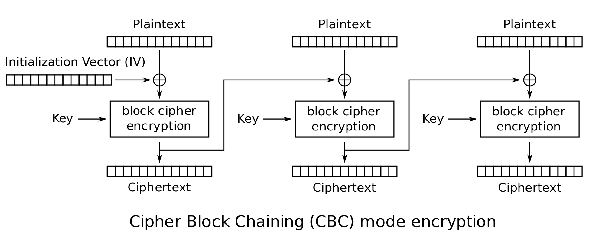
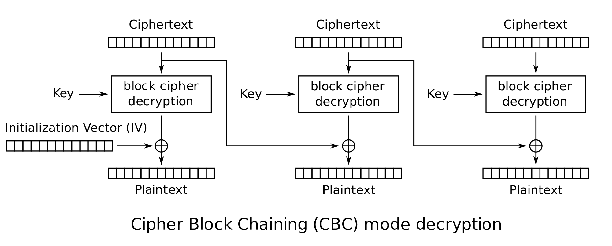
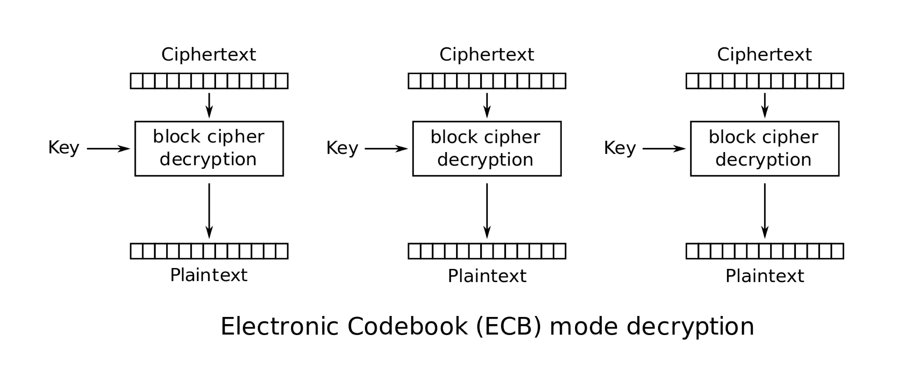

# الفصل 2: شيفرات الكتل

**Jonathan A. Poritz**

معظم التشفير الجاري اليوم على الإنترنت يتمّ على الأرجح بإحدى أنظمة التشفير المسماة *شيفرات الكتل*، وهي لا توفّر أمانًا تشفيريًا كاملًا كالقرص الواحد، لكن مستوى صعوبة إدارة المفاتيح فيها أقل بكثير جدًا. وشيفرات الكتل سريعة جدًا أيضًا، وفيها بعض الخصائص الأمنية الجيدة التي لا تملكها أنظمة التشفير المبنيّة كالتي رأيناها حتى الآن.

ومن أمثلة شيفرات الكتل التي ربما صادفتها:

- ***معيار التشفير المتقدّم [AES]***، الذي أذن به المعهد الوطني للمعايير والتقنية [NIST] لاستخدامه في الحكومة الفيدرالية الأمريكية في الحالات غير المصنَّفة؛
- ***معيار تشفير البيانات [DES]***، وهو شيفرة الكتل التي أذن بها NIST من 1977 إلى 2001؛ و
- *3DES* أو *DES الثلاثي*، وهي شيفرة كتل تتكوّن عمليًا من تنفيذ DES ثلاث مرات، وقد استُخدمت فترة بعد أن عُرف أن DES على وشك أن تُكسر، وقبل أن يُعيَّر AES.

وفي هذا الفصل سنتناول بإيجاز شديد بعض أبسط مبادئ تصميم شيفرات الكتل، وننفّذ قليلًا من **Python** لاستكشاف هذه المبادئ، ونستخدم بعض مكتبات الشيفرة لتشفير حقيقي بشيفرات كتل بأحدث ما وصلت إليه التقنية.

## لماذا نشفّر كتل البيانات: التمويه والانتشار عند شانون

كان نهجنا في تحليل شيفرتي قيصر وVigenère مبنيًا على تكرارات ظهور الحروف الفردية في اللغة الإنجليزية وكذلك في النص المشفَّر الذي نحاول كسره. وفي بعض أنظمة التشفير، يمكن استخدام مناهج مشابهة على سلاسل أطول من المحارف:

**التعريف 1.1.1.** يُسمّى الحرف الواحد (من أبجدية ما) في قطعة نص كالنص الصريح أو النص المشفَّر بعينه، أو في مجموعة كبيرة من كل النصوص الإنجليزية، **أحاديّة الحرف** (monograph).

وعلى المنوال نفسه، يُسمّى زوج الحروف المتجاورين في المصدر النصي نفسه **ثنائية الحرف** (digraph)، وتُسمّى سلسلة من ثلاثة حروف **ثلاثية الحرف** (trigraph).

فإحدى طرق وصف هجماتنا على قيصر وVigenère أن نقول إنها قارنت إحصاءات أحاديات الحروف في (سلاسل فرعية متنوعة من) نص مشفَّر مع الإحصاءات نفسها في اللغة الإنجليزية، وهي إحصاءات تتّضح أنها توزيع مستقرّ إلى حدّ كبير لتكرارات الحروف (أحاديات الحروف).

وكذلك فإن تكرارات ثنائيات الحروف في الإنجليزية مستقرة إلى حدّ كبير: فمثلًا *th* شائعة جدًا، وكذلك *qu*، بينما *tx* و*ql* نادرتان جدًا. ومن ثمّ يمكن أن تكون إحصاءات ثنائيات الحروف (وفي النهاية ثلاثياتها) مفيدة في مهاجمة بعض أنظمة التشفير.

> **مهمة إضافية.**
>
> بإغفال المحارف غير الأبجدية والفرق بين الحروف الكبيرة والصغيرة، هناك 676=26² ثنائية حرف ممكنة في الإنجليزية (26 خيارًا للحرف الأول من الثنائية و26 خيارًا للحرف الثاني).

> **مهمة إضافية.**
>
> اكتب دالة **Python** باسم `digraph_freq(f, n)` تُنشئ جدول تكرار نسبي لثنائيات الحروف من النص في الملف ذي الاسم `f`، وتطبع أكثر `n` ثنائية تكرارًا وتكراراتها النسبية. ستحتاج إلى قراءة الملف كله، لكن مع إسقاط كل المحارف غير الأبجدية (كما فعلنا سابقًا) وتحويل الحروف الباقية كلها إلى حروف صغيرة، قبل عدّ الثنائيات.

> **مهمة إضافية.**
>
> لاحظ أيضًا أن ثنائيات الحروف يمكن أن تتداخل: أي أن السلسلة

> **مهمة إضافية.**
>
> *humperdink*

> **مهمة إضافية.**
>
> تحتوي هذه الثنائيات:

> **مهمة إضافية.**
>
> *hu, um, mp, pe, er, rd, di, in,* و*nk*

> **مهمة إضافية.**
>
> لا الثنائيات غير المتداخلة فقط *hu, mp, er, di* و*nk*.

> **مهمة إضافية.**
>
> طباعة جدول التكرار النسبي كله أسهل من طباعة `n` ثنائية فقط من الأكثر تكرارًا. وللقيام بذلك، ستحتاج إلى ترتيب قيم التكرار النسبي، ثم المرور عليها بترتيب تكرار تنازلي. ولكل قيمة تكرار، ستحتاج حينذاك إلى إيجاد كل الثنائيات ذات ذلك التكرار وطباعتها، مع زيادة عدّاد أثناء ذلك. وعندما يبلغ العدّاد `n`، تتوقف.

سبب نجاح هجومنا على قيصر بأحاديات الحروف أن قيصر لا يخفي إحصاءات حروف نصّه الصريح جيدًا: فكلها في النص المشفَّر، لكن مُزاحة في الأبجدية. بل ما دامت طريقة خلط حروف النص الصريح للحصول على حروف النص المشفَّر المقابل هي نفسها لكل حرف، وربما ليست إزاحة بسيطة مثل

مخطّط بسيط: سطر علوي هو النص الصريح a، b، c، d، …، y، z، وسطر سفلي هو النص المشفَّر A، B، C، D، …، Y، Z، وكل حرف في السطر العلوي يُرسَل بسهم نازل إلى الحرف الواقع تحته في السطر السفلي.

ثم مخطّط ثانٍ: النص الصريح a، b، c، d، …، y، z يُرسَل إلى النص المشفَّر A، B، C، D، …، Y، Z، لكن الأسهم تتقاطع في مواضع متعددة، إذ يُرسَل a إلى A ويُرسَل b إلى B ويُرسَل c إلى C ويُرسَل d إلى D، ثم يتبادل بعض الحروف المتجاورة مواضعها، فينتج أن الترتيب في النص المشفَّر ليس مطابقًا لترتيب النص الصريح.

إزاحة الأعداد الفردية، فإن إحصاءات أحاديات الحروف في نصنا المشفَّر ستكون هي نفسها في النص الصريح، لكن بترتيب مختلف. وهناك اسم لأنظمة التشفير التي تفعل ذلك:

**التعريف 1.1.2.** يُسمّى نظام التشفير الذي تكون فيه عملية خلط واحدة واحدة لتحويل حروف النص الصريح إلى حروف النص المشفَّر **نظام تشفير أحادي الأبجدية** (monoalphabetic cryptosystem).

أما نظام التشفير الذي تتغيّر فيه عملية خلط حروف النص الصريح إلى حروف النص المشفَّر من حرف إلى حرف في النص الصريح، بحيث مثلًا يُشفَّر الحرف *a* في النص الصريح إلى *K* في النص المشفَّر أحيانًا، لكن قد يُشفَّر *a* في نص صريح آخر إلى *B* أو *M* أو حرف آخر، اعتمادًا ربما على الحروف الأخرى في الرسالة أو على موضع حرف النص الصريح في النص الصريح كله، فإنه يُسمّى **نظام تشفير متعدد الأبجدية** (polyalphabetic cryptosystem).

> **استجابة القراءة.**
>
> هل كل هذا مفهوم؟ ما الجديد أو المثير للاهتمام، وما القديم غير المثير؟ هل تشعر أنك تفهم أي أنظمة التشفير أحادية الأبجدية وأيها متعددة الأبجدية؟ وإن كان الأمر كذلك، فأيّ الأنظمة التي ناقشناها حتى الآن من أي نوع؟

فإذن ستحرز التكرارات (أحاديات الحروف) تقدّمًا جيدًا في تحليل شيفرات الأنظمة أحادية الأبجدية، أما جداول التكرار النسبي لنصوص مشفَّرة من أنظمة متعددة الأبجدية فتُلطَّخ بجمع نسخ كثيرة مختلفة الخلط من جدول التكرار، ومن ثمّ سيكون التحليل بهذه الطريقة أصعب بكثير.

وخلاصة ما نراه أن النصوص المشفَّرة التي تنتجها شيفرة ما إذا كانت إحصاءاتها تعكس إحصاءات النص الصريح على نحو ما، فهناك مسار هجوم ممكن. وأفضل ما يمكن إذن أن يبدو عليه الأمر هو أن يبدو النص الصريح والنص المشفَّر غير مرتبطين إحصائيًا ببعضهما بعضًا.

وقد عرّف عالم الرياضيات وعلوم الحاسوب والتشفير الكبير Claude Shannon[^1]، في ورقته شديدة التأثير (والمصنَّفة سرّية في البداية من الحكومة الأمريكية) *A Mathematical Theory of Cryptography*Shannon 1945، خاصيتين:

**التعريف 1.1.3.** نقول إن نظام تشفير له خاصية **الانتشار** (diffusion) إذا كان، لاختيار ثابت للمفتاح، كلما انقلب أي بت واحد في النص الصريح، تغيّر نصف بتات النص المشفَّر (إحصائيًا في العموم)، والعكس صحيح. (والمقصود بـ«إحصائيًا» هنا أن ذلك لا يجب أن يكون صحيحًا بدقة في كل مرة، لكن عندما نأخذ المتوسط على نصوص صريحة ومفاتيح كثيرة، فسيبلغ متوسط ما يتغيّر نصف بتات النص المشفَّر كل مرة نغيّر فيها أي بت واحد من النص الصريح.)

والغرض من الانتشار تقليل المعلومات عن النص الصريح التي *تتسرّب* عبر النص المشفَّر. ومجرّد وجود اتصال بين Alice وBob يتسرّب بالطبع. والنظر في تدفّقات الرسائل بين الأفراد في مجموعة ما، أي مَن يتحدّث ومتى، أو بعبارة أخرى **البيانات الوصفية** للاتصال، يُسمّى **تحليل حركة الاتصالات**، ويمكن أن يكون مهمًا جدًا. فرؤية الفرد الذي يمرّ عبره كل الرسائل، وما يتصل بذلك من مسائل تحليل حركة الاتصالات، يمكن أن تعطي معلومات عن قائد المجموعة، وما إلى ذلك. وكما قال رئيس وكالة الأمن القومي الأمريكية السابق الجنرال Michael HaydenCole 2014: «نقتل أشخاصًا بناءً على البيانات الوصفية»، في إشارة إلى ضربات الطائرات المسيّرة الأمريكية على أفراد يُظنّ أنهم قادة إرهابيين بناءً على تحليل حركة اتصالاتهم.

وإذا لم نكن نحاول فهم تنظيم مجموعة من الأفراد المتصلين على أساس نمط اتصالاتهم، وإنما ننظر فقط إلى تبادل Alice وBob رسائل مشفَّرة، فبعض الأمور يصعب إخفاؤها. فمثلًا يكاد يكون من المستحيل إرسال قطعة معلومات كبيرة جدًا (نص صريح) عبر قناة مشفَّرة ما لم يكن النص المشفَّر المقابل كبيرًا جدًا.

وإنصافًا، فإن العكس، أي أن النص المشفَّر الكبير يعني أن النص الصريح كان فيه معلومات كثيرة، ليس صحيحًا بالضرورة. فمثلًا يمكن لAlice أن تحشو رسالة قصيرة بكمية كبيرة جدًا من بيانات عشوائية إضافية وترسل إلى Bob النسخة المشفَّرة من ذلك النص الصريح الطويل. فسيكون ذلك نصًّا مشفَّرًا كبيرًا لا يقابل كمية كبيرة من المعلومات (المفيدة) في النص الصريح.

> **استجابة القراءة.**
>
> هل كل هذا مفهوم؟ ما الجديد أو المثير للاهتمام، وما القديم غير المثير؟ هل تفهم كيف يمكن لمراقب أن يستخدم تحليل حركة الاتصالات ليخمّن مَن قائد مجموعة من الأفراد المتصلين؟ هل يمكنك التفكير في مواقف أخرى يظهر فيها شيء كتحليل حركة الاتصالات في الحياة العادية، كأن يتصل أصدقاء أو شريكان عاطفيان فجأة بأشخاص آخرين بتكرار أكبر أو أقل؟

ولأنه من الصعب جدًا منع تسرّب مجرّد حدوث الاتصال، وربما أيضًا مقدار البيانات المُرسَلة، فسيحاول نظام تشفير جيد منع أكبر قدر ممكن من التسريبات الأخرى: وانتشار شانون إحدى طرق ذلك.

> **مهمة برمجية.**
>
> في طريقنا إلى معرفة ما إذا كانت أنظمة التشفير التي لقيناها حتى الآن تحقّق الانتشار:

> **مهمة برمجية.**
>
> اكتب دالة **Python** باسم `str_diff_display(s,t)` تأخذ السلسلتين `s` و`t` وتُظهر مدى اختلافهما.

> **مهمة برمجية.**
>
> يجب أن تتحقّق الدالة أولًا من أن السلسلتين بالطول نفسه، وتطبع خطأً وتعيد 0 إن لم تكونا كذلك.

> **مهمة برمجية.**
>
> ثم يجب أن تمرّ الدالة عبر السلسلتين وتطبع «*» إذا اختلفتا في كل موضع و«_» إذا اتّفقتا. (قد ترغب في طباعة هذه الرموز في صفوف بطول محدَّد، كثلاثين محرفًا. ويمكنك فعل ذلك بالطباعة بأوامر مثل `print('*',end='')` و`print('_',end='')` للبقاء في السطر نفسه، ثم استخدام `print('')` للانتقال إلى السطر التالي.)

> **مهمة برمجية.**
>
> ثم يجب أن تُعيد الدالة عدد المواضع التي تختلف فيها السلسلتان، أي عدد رموز «*» المطبوعة.

> **مهمة برمجية.**
>
> فمثلًا، تشغيل `str_diff_display("abc"*30,("abc"*15)+"Abc"+("abc"*13)+"aBc")` ينبغي أن يُنتج الخرج `______________________________` ثم في السطر التالي `_______________*______________` ثم `____________________________*_` ثم العدد `2`.

> **مهمة برمجية.**
>
> في الواقع، إن إظهار مواضع اختلاف المحارف في سلسلتين، كما تفعل `str_diff_display`، تقريب خام جدًا لإظهار مواضع اختلاف *البتات* في تلك السلاسل. فلنُحسِّن شيفرة عرض الفرق بين السلاسل وحسابه لنصنع برنامج عرض الفرق بين البتات وحسابه.

> **مهمة برمجية.**
>
> من حيث المبدأ، أسهل طريقة لذلك هي أن تحوّل سلسلة المحارف إلى سلسلة محارف تُظهر كل بتات السلسلة الأولى، ثم تستخدم `str_diff_display` التي بنيتها سابقًا.

> **مهمة برمجية.**
>
> وللحصول على التعبير الثنائي لمحرف، يمكنك تحويله أولًا إلى `int` بالأمر `ord`، ثم تحويل ذلك العدد الصحيح إلى سلسلة أرقام ثنائية بالأمر `bin`. ومشكلة `bin` أنه يضع دائمًا `0b` في مقدّمة سلاسله الثنائية، وأنه يُسقط الأصفار البادئة أيضًا. (وهذا منطقي: فعند كتابة العدد 17 في الأساس عشرة، لا نكتبه «017» لنشير إلى أنه لا مئات فيه ولا عشرات واحدة وسبع آحاد… بل نكتب «17» فقط، أي أننا نسقط الأصفار البادئة. ويحدث الشيء نفسه في الأساس اثنين.)

> **مهمة برمجية.**
>
> بالطبع يمكنك تجاوز المحرفين الأولين (كذلك «`0b`») في سلسلة `s` بـ`s[2:]`، وإذا كانت لديك سلسلة `b` من الأصفار والآحاد تريد حشوها من اليسار بالعدد الصحيح من الأصفار لتصبح ثمانية رموز (لتُظهر كل بتات ذلك البايت)، فيمكنك أن تفعل `('0'*(8-len(b)))+b`.

> **مهمة برمجية.**
>
> استخدم المقادير السابقة لتصنع دالة **Python** باسم `bits_diff_display(s,t)` تأخذ السلسلتين `s` و`t` وتُظهر مدى اختلاف بتاتهما. ولأن عدد البتات المعروضة سيكون ثمانية أضعاف ما كان في `str_diff_display(s,t)`، فقد ترغب في جعل سطورك أطول قليلًا، وربما في إظهار اتفاق البتات بـ«.» واختلافها بـ«x».

> **مهمة برمجية.**
>
> فمثلًا، تشغيل `bits_diff_display("abcdef", "CbcdeF")` ينبغي أن يُنتج الخرج `..x...x.........................` ثم في السطر التالي `............x.....` والعدد `3`.
>
> (مع أن تشغيل `str_diff_display("abcdef", "CbcdeF")` كان سيُنتج الخرج `*____*` ثم `2`. والفرق أن السلسلتين `"abcdef"` و`"CbcdeF"` تختلفان في محرفين فقط، الأول والأخير، لكن بتات `"a"` هي `01100001` بينما بتات `"C"` هي `01000011`، فثمّة **بتان** مختلفان في هذا المحرف **الواحد** المختلف، وبتات `"f"` هي `01100110` بينما بتات `"F"` هي `01000110`، فثمّة بت واحد مختلف فقط في هذا المحرف الواحد المختلف!)

> **مهمة برمجية.**
>
> أي أنظمة التشفير التي درسناها حتى الآن، قيصر وVigenère والقرص الواحد، يحقّق فكرة شانون عن الانتشار؟

> **مهمة برمجية.**
>
> خذ نصًا صريحًا طويلًا إلى حدّ كبير، مئة محرف أو نحو ذلك، من مصدر ما، واصنع منه نسختين تختلفان في بت واحد فقط.

> **مهمة برمجية.**
>
> [ملاحظة: فكّر قليلًا في كيفية إحداث ذلك التغيير في بت واحد. فتغيير حرف واحد قد لا يفعل ذلك! فمثلًا الحرف **a** يمثّله في Unicode العدد 97، وتعبيره الثنائي **01100001**. أما **b** في Unicode فهو 98، أي **01100010** ثنائيًا، فتغيير **a** إلى **b** يغيّر *بتين*!]

> **مهمة برمجية.**
>
> وعندما تحصل على هاتين السلسلتين، اصنع مفاتيح مناسبة وشفّر السلسلتين، ثم شغّل `bits_diff_display` على النسختين المشفَّرتين لترى أين تختلفان وكم. وجرّب ذلك مع كل نظام من أنظمة التشفير التي أنجزناها في هذا المقرّر.

> **مهمة برمجية.**
>
> ينبغي أن تكون الآن قادرًا على الإجابة عن السؤال: هل تحقّق أنظمة التشفير تلك انتشار شانون؟

وثمّة أمر آخر شغل شانون: هل تتسرّب النصوص المشفَّرة بمعلومات عن *المفتاح* المستخدم في تشفيرها؟ وعلى وجه الخصوص، صنع تعريفًا مشابهًا للانتشار، لكن بالنظر إلى المفاتيح هذه المرة، على النحو الآتي:

**التعريف 1.1.4.** نقول إن نظام تشفير له خاصية **التمويه** (confusion) إذا كان، بالعمل على نص صريح ثابت، كلما انقلب أي بت واحد في المفتاح، تغيّر نصف بتات النص المشفَّر (إحصائيًا في العموم)، والعكس صحيح. (والمقصود بـ«إحصائيًا» هنا أن ذلك لا يجب أن يكون صحيحًا بدقة في كل مرة، لكن عندما نأخذ المتوسط على نصوص مشفَّرة ومفاتيح كثيرة، فسيبلغ متوسط ما يتغيّر نصف بتات النص المشفَّر كل مرة نغيّر فيها أي بت واحد من المفتاح.)

> **مهمة برمجية.**
>
> أي أنظمة التشفير التي درسناها حتى الآن، قيصر وVigenère والقرص الواحد، يحقّق فكرة شانون عن التمويه؟

> **مهمة برمجية.**
>
> أعد المهمة البرمجية السابقة بنص صريح ثابت هذه المرة، لكن جرّب تشفيراته بتغيير بت واحد فقط في المفتاح، وانظر كم يتغيّر من النص المشفَّر.

وخلاصة هذه المناقشة لتسرّب المعلومات أننا ينبغي أن نبحث عن أنظمة تشفير تحقّق التمويه والانتشار: فيجب أن تهرم بتات النص الصريح والمفتاح وتخلطها، بحيث يعتمد، في العموم، (كل) بت تقريبًا من النص المشفَّر على (كل) بت تقريبًا من النص الصريح والمفتاح معًا. وهذا يعني أن علينا معالجة النص الصريح كله دفعة واحدة، ولا يمكننا معالجة بتات (محارف) النص الصريح واحدًا في كل مرة كما فعلت أنظمة التشفير التي رأيناها حتى الآن.

وهذا ليس سهلًا بخوارزمية تشفير ثابتة لنص صريح عام، لذا كان النهج الشائع هو العمل على قطع من النص الصريح في كل مرة، وتُسمّى كتلًا، وتكون كلها بالحجم نفسه. وعلى مستوى الكتل على الأقل، يمكننا أن نأمل أن تحقّق خوارزمية التشفير الجديدة التمويه والانتشار، ومن ثمّ تقلّل تسرّب المعلومات.

وهذا يقودنا إلى:

**التعريف 1.1.5.** نقول إن نظام التشفير **شيفرة كتل** إذا كان معرَّفًا فقط عندما تكون نصوصه الصريحة والمشفَّرة المدخلة ذات حجم ثابت يُسمّى **حجم الكتلة**، وإذا كان حتميًا (أي أنه لا عشوائية مدمجة فيه) فتكون نتيجته معتمدة فقط على نص صريح أو مشفَّر المدخل وعلى المفتاح.

> **استجابة القراءة.**
>
> هل كل هذا مفهوم؟ ما الجديد أو المثير للاهتمام، وما القديم غير المثير؟ هل يبدو بديهيًا لك أن التمويه والانتشار خصيصتان مرغوبتان في نظام تشفير، وكيف يمكن أن تتصل شيفرات الكتل بذلك؟

ذكرنا في بداية هذا الفصل تمامًا عدة شيفرات كتل معروفة. وهذه الأنظمة، أو على الأقل تلك المستخدمة استخدامًا واسعًا، تميل إلى الاعتماد على عمليات خلط بدائية جدًا لكن سريعة جدًا على بتات الرسائل والمفتاح. وإحدى الاستراتيجيات بعينها هي أخذ قطع من المفتاح وتنفيذ عمليات متنوعة عليها وعلى كتلة الرسالة، لصنع ما يُسمّى *دالة الجولة*. ثم تطبّق خوارزمية التشفير الكاملة دالة الجولة عددًا من المرات، في كل مرة بقطعة جديدة من بيانات المفتاح، مرة بعد مرة على كتلة الرسالة التي تتحوّل ببطء.

## تشفير كتلة في كل مرة باستخدام AES

فلنتدرّب قليلًا على استخدام شيفرة كتل بالنظر إلى حالة *معيار التشفير المتقدّم [AES]*. يجب أن يكون مفتاح AES بطول 16 أو 24 أو 32 بايت (وبعبارة أخرى: 128 أو 192 أو 256 بت)، بينما حجم كتلته 16 بايت (أو 128 بت).

ويجب أن تأتي توزيعات **Python** القياسية بحزمة `Crypto`، التي تضمّ `AES` بين الشيفرات المنفَّذة في `Crypto.Cipher`. ولذلك، قبل أن تستخدم AES، يجب أن تنفّذ

```text
  from Crypto.Cipher import AES
```

ثم تُنشئ كائن الشيفرة بمفتاحك، كما في:

```text
  cipher=AES.new(key, AES.MODE_ECB)
```

وستُطلق محاولة إنشاء الكائن هذه خطأً (وسنناقش لاحقًا ما تفعله `AES.MODE_ECB`…).

ويمكن استخدام كائن AES المنشأ بهذه الطريقة لتشفير كتلة من 16 بايت من النص الصريح أو المشفَّر أو لفكّ تشفيرها (أو للأمرين معًا)، ودائمًا بالمفتاح الذي استخدمته لإنشاء الكائن. فمثلًا، إذا كان مفتاحك `"asdfghijklmnotuv"` فإليك مثالًا على التشفير

```text
  cipher=AES.new("asdfghijklmnotuv", AES.MODE_ECB)
  >>> cipher.encrypt("16 bytes of fun!")
  b'~\x94\xaa\xf6\xc20\x85\xce\x83\x91\xc9}\xdf\x96\xb8\xcf'
```

ولفكّ التشفير:

```text
  >>> cipher.decrypt(
  ... b'~\x94\xaa\xf6\xc20\x85\xce\x83\x91\xc9}\xdf\x96\xb8\xcf')
  b'16 bytes of fun!'
```

> **مهمة برمجية.**
>
> إذا كان AES سيكون شيفرة معيارية مفيدة للاستخدام الواسع على الإنترنت، فينبغي أن يعمل بسرعة كبيرة. فلنختبر مدى سرعته بتوقيت المدة التي يستغرقها تشفير كتلة واحدة… في الواقع، وللاحتياط (إذا استغرقت عملية أخرى بعض الوقت على حاسوبك وأنت تظن أنه لا يجري سوى تشفير)، فمن الأفضل أن تُجري مثلًا 1000 عملية تشفير، وتقيس الزمن الكلي، ثم تقسمه على 1000.

> **مهمة برمجية.**
>
> من الطرق المباشرة جدًا لقياس مدة شيء ما أن تشغّل أولًا `import time`. ثم يمكنك أن تحفظ في متغيّر عدد الثواني منذ ما يُسمّى «حقبة يونكس» (وهي 00:00:00 UTC في 1 يناير 1970) بالأمر `start_time=time.time()`. وإذا نفّذت بعد ذلك بعض المعالجة، فيمكنك حساب المدة التي استغرقتها بـ`elapsed_time=time.time()-start_time`.

> **مهمة برمجية.**
>
> وعند استخدام هذا النهج لقياس السرعة الحسابية، ينبغي أن تحرص على ألا تُجري بين استدعاءي `time.time()` إلا التشغيلات المتكررة للأوامر التي تريد توقيتها، ولا تُشغّل شيئًا زائدًا! فمثلًا أنشئ كائن شيفرة AES واحدًا قبل بدء التوقيت، حتى لا تُحتسب الكلفة الحسابية لبناء ذلك الكائن وأنت تحاول معرفة كلفة التشفير (أو فكّ التشفير).

> **مهمة برمجية.**
>
> وبكل ذلك في الحسبان، اصنع مفتاح AES بطول 16 بايت ونصًا صريحًا بطول 16 بايت، وقِس المدة التي يستغرقها تنفيذ 1000 عملية تشفير و1000 عملية فكّ تشفير، وأبلغ عن المدة التي يستغرقها كل تشفير أو فكّ تشفير في المتوسط. وسيكون جيدًا أن تغيّر الرسالة و/أو المفتاح في كل مرة من المرات الألف، لكن إن استدعيت مولّد أعداد عشوائية داخل الحلقة، فستكون أيضًا توقّت *ذلك* بقدر ما توقّت التشفير وفكّ التشفير!

> **مهمة برمجية.**
>
> هل يحقّق AES فكرة شانون عن الانتشار؟

> **مهمة برمجية.**
>
> لترى ذلك، خذ نصًا صريحًا بطول 16 بايت واصنع منه نسختين تختلفان في بت واحد فقط.

> **مهمة برمجية.**
>
> ثم اصنع مفتاحًا بطول 16 بايت، وأنشئ نسخة من AES، واصنع نصين مشفَّرين للنصين الصريحين المختلفين (لكن بالمفتاح نفسه). واستخدم برنامجك `bits_diff_display` لترى أين يختلف النصان المشفَّران وكم.

> **مهمة برمجية.**
>
> ويمكنك أيضًا تجريب ما سبق بعدة مفاتيح مختلفة، لتتأكد أنه ليس صدفة خاصة باختيار المفتاح الذي صنعته عرضًا.

> **مهمة برمجية.**
>
> هل يحقّق AES فكرة شانون عن التمويه؟

> **مهمة برمجية.**
>
> لترى ذلك، خذ نصًا صريحًا بطول 16 بايت. واصنع مفتاحين مختلفين بطول 16 بايت يختلفان في بت واحد فقط. ثم بالمفتاح الأول، أنشئ كائن شيفرة AES وشفّر النص الصريح الثابت، ثم افعل الشيء نفسه بالمفتاح الآخر. واستخدم برنامجك `bits_diff_display` لترى أين يختلف النصان المشفَّران الناتجان وكم.

> **مهمة برمجية.**
>
> ويمكنك أيضًا تجريب ما سبق بعدة نصوص مشفَّرة مختلفة، لتتأكد أنه ليس صدفة خاصة باختيار المفتاح الذي صنعته عرضًا.

> **استجابة القراءة.**
>
> هل كل هذا مفهوم؟ ما الجديد أو المثير للاهتمام، وما القديم غير المثير؟ هل كان استخدام AES في **Python** سهلًا أم صعبًا؟ وما الذي تجده أكثر إزعاجًا و/أو أكثر ملاءمة في هذا التنفيذ لـAES؟

## تشفير أكثر أو أقل من كتلة بشيفرة كتل

إذا عرف Alice وBob أنهما سيتبادلان دائمًا رسائل بعدد البايتات نفسه تمامًا في حجم كتلة شيفرة الكتل التي يستخدمانها، فهما في وضع جيد جدًا. لكن الأرجح بكثير أن يرسلا رسائل أصغر أو أكبر (بكثير)، وينبغي أن نساعدهما على ذلك بأمان.

### الرسائل الصغيرة جدًا تحتاج إلى *حشو*

عندما تكون الرسالة أصغر من حجم الكتلة، يبدو سهلًا جدًا أن نضيف بعض الأشياء الإضافية لملء كتلة كاملة: وتُسمّى هذه البيانات الإضافية **الحشو** (padding). والمشكلة أنه إذا كانت الرسالة قد تكون بيانات اعتباطية، فكيف نعرف ما هو الرسالة وما هو الحشو؟

والطريقة الشائعة لذلك، عندما نعرف أنه لا بدّ من وجود بعض الحشو (ربما بيانات وصفية ترافق الرسالة، كسطر الموضوع في بريد إلكتروني أو البيانات الوصفية لحزمة مشفَّرة تُرسَل على شبكة تبديل حزم)، أن نفترض وجود بايت حشو واحد على الأقل دائمًا: الأخير. ويمكن لذلك البايت أن يحمل معلومات، فيمكنه ببساطة أن يقول عدد بايتات الحشو، أو بالعكس عدد البايتات الفعلية غير المحشوّة في الكتلة.

> **مهمة برمجية.**
>
> اكتب دالة **Python** باسم `pad_string(s, n)` تأخذ مدخلًا سلسلة `s` وحجم كتلة `n` وتُعيد سلسلة بطول `n`، بالحشو الموصوف أعلاه.

> **مهمة برمجية.**
>
> إذا كان `len(s)>n-1`، فينبغي أن تطبع خطأً وتُعيد السلسلة الفارغة، لأنه لن يكون هناك متّسع للحشو. وإلا فأعد سلسلة تكون محارفها الأولى نسخة من `s` وبايتاتها الباقية نسخًا من العدد `len(s)`.

> **مهمة برمجية.**
>
> واكتب أيضًا دالة `unpad_string(s)` تأخذ مدخلًا سلسلة `s` يُفترض أنها آتية من الدالة `pad_string()` وتُعيد السلسلة الأصلية دون حشو.

> **مهمة برمجية.**
>
> في `unpad_string` يمكنك افتراض أن حجم الكتلة المستخدم في `pad_string` كان ببساطة `len(s)` وأن البايت الأخير من `s` عدد يخبر بمقدار `s` الذي هو السلسلة الأصلية. ومن ثمّ، إذا كان `ord(s[-1])>len(s)-1` فثمّة مشكلة ما، وينبغي أن تطبع رسالة خطأ وتُعيد السلسلة الخالية. وإلا فأعد السلسلة الفرعية المكوّنة من أول `ord(s[-1])` محرفًا من `s`.

> **مهمة برمجية.**
>
> فمثلًا، `pad_string('test',16)` ينبغي أن تُعيد `'test\x04\x04\x04\x04\x04\x04\x04\x04\x04\x04\x04\x04'`، و`unpad_string('fishhead\x08\x08\x08\x08\x08\x08\x08\x08')` ينبغي أن تُعيد `'fishhead'`.

> **مهمة برمجية.**
>
> اكتب دالة **Python** باسم `smallAESencrypt(k, s)` تأخذ مدخلًا مفتاح AES هو `k` ونصًا صريحًا هو السلسلة `s`، حيث `len(s)<16`، وتُعيد تشفير AES للنسخة المحشوّة من `s`.

> **مهمة برمجية.**
>
> إذا كان `len(s)>15` أو لم يكن `k` مفتاح AES صالحًا، فينبغي أن تطبع خطأً وتُعيد السلسلة الفارغة.

> **مهمة برمجية.**
>
> واكتب أيضًا دالة `smallAESdecrypt(k, t)` تأخذ مدخلًا مفتاح AES هو `k` ونصًا مشفَّرًا بـAES هو `t`، يُفترض أنه آتٍ من الدالة `smallAESencrypt(k, s)`، وتُعيد النص الصريح الأصلي `s` (دون حشو).

> **استجابة القراءة.**
>
> هل كل هذا مفهوم؟ ما الجديد أو المثير للاهتمام، وما القديم غير المثير؟ هل يمكنك التفكير في مخطط حشو مختلف (أو أفضل)؟

### الرسائل الأكبر تحتاج إلى **تسلسل الكتل**

ماذا لو كان النص الصريح أطول من حجم كتلة شيفرة الكتل التي نستخدمها؟ الشيء البديهي أن نقسّم النص الصريح ببساطة إلى عدد من الكتل الكاملة ثم كتلة أخيرة أصغر، ونستخدم تشفير الكتل العادي على الكتل الكاملة، والحشو مع التشفير على الكتلة الأخيرة الأصغر.

> **مهمة برمجية.**
>
> نفّذ ذلك المخطط لشيفرة كتل AES. أي:

> **مهمة برمجية.**
>
> اكتب دالة **Python** باسم `naiveAESencrypt(k, s)` تأخذ مدخلًا مفتاح AES هو `k` ونصًا صريحًا هو السلسلة `s`. ثم تبني قيمة إرجاع على النحو الآتي:

> **مهمة برمجية.**
>
> 1. لكل كتلة كاملة من النص الصريح (وقد لا تكون هناك كتلة كهذه إن كان `len(s)<16`)، أضف إلى قيمة الإرجاع تشفير AES العادي لتلك الكتلة بالمفتاح `k`.
> 2. أضف إلى قيمة الإرجاع خرج `smallAESencrypt(k, small)`، حيث `small` هي القطعة الأخيرة من النص الصريح، التي يقلّ طولها عن 16 بايت.

> **مهمة برمجية.**
>
> واكتب أيضًا دالة **Python** باسم `naiveAESdecrypt(k, t)` تأخذ مدخلًا مفتاح AES هو `k` وسلسلة نص مشفَّر هي `t`. ثم تبني قيمة إرجاع على النحو الآتي:

> **مهمة برمجية.**
>
> 1. إذا كان في `t` أكثر من 16 بايت، فلكل كتلة من 16 بايت في `t` عدا الأخيرة، أضف إلى قيمة الإرجاع فكّ تشفير AES العادي لتلك الكتلة بالمفتاح `k`.
> 2. وعند الانتهاء من ذلك، أضف `smallAESdecrypt(k, last)` إلى قيمة الإرجاع، حيث يحوي المتغيّر `last` آخر 16 بايت من `t`.

لكن علينا الآن أن نتساءل: هل يحقّق هذا النهج الساذج لـAES على الرسائل الكبيرة شرط الانتشار عند شانون؟

> **مهمة برمجية.**
>
> أعد المهمة البرمجية السابقة، لكن الآن بنصين صريحين بطول 80 بايت يختلفان في بت واحد قرب المنتصف، وباستخدام الدالة `naiveAESencrypt`.

كيف سنحصل على شيفرة كتل تحقّق شرط الانتشار عند شانون؟ شيفرة الكتل الجيدة تنشر جيدًا… داخل الكتلة. لكن حجم الكتلة ثابت، وعلينا أن ننشر الانتشار بطريقة ما (وهو، كما تذكّر، يعني أساسًا أن تغيير بت واحد في النص الصريح يغيّر نحو نصف بتات النص المشفَّر) داخل كل كتلة. وإحدى الطرق أن نصمّم ببساطة شيفرة كتل جديدة لكل نص صريح جديد بحجم كتلة أكبر من حجم النص الصريح وتحقق انتشارًا جيدًا على تلك الكتلة. لكن التحقق من أن الشيفرات آمنة فعلًا صعب جدًا، فهذا غير عملي تمامًا.

والأفضل بدلًا من ذلك هو النهج الأكثر شيوعًا: استخدام شيفرة كتل بحجم ثابت (كـAES) وجعل تشفير كل كتلة معتمدًا أيضًا على ما جرى في الكتل السابقة، ويُسمّى ذلك **تسلسل الكتل** (block chaining).

وثمّة أمران علينا التفكير فيهما في تسلسل الكتل.

1. **كيف نُسلسل الكتل بالضبط:** هناك طرق متنوعة لتسلسل تشفير الكتل وتحقيق الانتشار. وهذه إحداها: لنفترض أننا غيّرنا بتًا واحدًا في كتلة من النص الصريح. فإذا كنا نستخدم شيفرة كتل جيدة التصميم، فسيتغيّر نحو نصف بتات النص المشفَّر أيضًا. ويمكننا استخدام هذه البتات المختلفة لتغيير بتات كتلة النص الصريح التالية، بـXOR على مستوى البتات (أي الجمع على مستوى البتات بمعيار 2) بين كتلة النص المشفَّر وتلك الكتلة التالية من النص الصريح. وسينشر ذلك التغيير إلى نصف بتات النص المشفَّر المقابل، وبتكرار ذلك لكل كتلة تالية، نكون قد نشرنا البتات المتغيّرة على طول سلاسل الكتل من النص المشفَّر الناتجة من النص الصريح الطويل.
2. **كيف نبدأ التسلسل:** الكتلة الأولى لن يكون لها كتلة سابقة نسلسل منها. ويتّضح أن ذلك يمكن أن يسبب مشكلات أمنية، فطريقة معالجتها أن نصنع كتلة من البيانات العشوائية تُسمّى **متجه التهيئة (IV)**، وأن نبدأ التسلسل كأن ذلك المتجه هو النص المشفَّر من الكتلة السابقة. ثم ينبغي أن ترسل Alice متجه التهيئة العشوائي الذي اختارته مع النص المشفَّر حتى يستطيع Bob فكّ تشفير الرسالة الطويلة.

**التعريف 1.3.1.** يُسمّى نهج تسلسل الكتل الموصوف للتوّ **تسلسل كتل الشيفرة** (Cipher Block Chaining) أو تسلسل **نمط CBC**. وهو يعمل رمزيًا كما يلي:



**الشكل 1.3.1.** تشفير CBC



**الشكل 1.3.2.** فكّ تشفير CBC

والرمز «⊕» يعني XOR على مستوى البتات (أي الجمع بمعيار 2).

لاحظ أن طريقتنا السابقة في تشفير الرسائل الطويلة بشيفرة كتل، وهي التي تعالج كل كتلة معالجة منفصلة تمامًا وتُخفق في شرط الانتشار عند شانون، تُسمّى في سياق مخططات تسلسل الكتل **نمط دفتر الشيفرة الإلكتروني** (Electronic Codebook) أو تسلسل **نمط ECB**، ولها المخطط البسيط الآتي:


**الشكل 1.3.3.** تشفير ECB



**الشكل 1.3.4.** فكّ تشفير ECB

وطريقة اختيار نمط تسلسل الكتل في **Python** تكون في إنشاء كائن `Crypto.Cipher`. فحيث استخدمنا سابقًا `AES.MODE_ECB` لتسلسل دفتر الشيفرة الإلكتروني، يمكننا أن نستخدم بدلًا منها `AES.MODE_CBC` لتسلسل كتل الشيفرة كما وُصف أعلاه. ولأن ذلك النمط يتطلّب متجه تهيئة، يجب أن تحدّد Alice متجه التهيئة ذا البايتات الستة عشرة الذي تريده، على النحو الآتي:

```text
  from Crypto.Cipher import AES
  key=b'randobytes 4 key'  # not a good choice of key
  iv=b'IV of randobytes'   # terrible choice of IV
  cipher=AES.new(key,AES.MODE_CBC,iv)
  ciphertext=cipher.encrypt(b'some cleartext w/ len two blocks')
  message=iv+ciphertext    # put together IV and ciphertext
                           # to be transmitted to Bob
```

وفي جهة Bob:

```text
  from Crypto.Cipher import AES
  key=b'randobytes 4 key' # Bob must know the same key
  iv=message[:16]         # Bob grabs the IV out of the message
  ciphertext=message[16:] # the rest of the message is ciphertext
  cipher=AES.new(key,AES.MODE_CBC,iv)
  cleartext=cipher.decrypt(ciphertext)
```

لاحظ أن كائن `Crypto.Cipher` **حافظ للحالة** في نمط CBC، أي أنه يتذكّر ما رآه سابقًا. فعند إنشائه يستخدم متجه التهيئة المعطى لبدء التسلسل، لكن بعد ذلك يتسلسل كل استدعاء لـ`encrypt` من الكتلة السابقة. أي أن طريقة تشفير النص الصريح ذي الكتلتين `b'some cleartext w/ len two blocks'` الموصوفة أعلاه تُنتج النتيجة نفسها تمامًا كما لو فعلنا بدلًا من ذلك:

```text
  from Crypto.Cipher import AES
  key=b'randobytes 4 key'  # not a good choice of key
  iv=b'IV of randobytes'   # terrible choice of IV
  cipher=AES.new(key,AES.MODE_CBC,iv)
  ciphertext_part1=cipher.encrypt(b'some cleartext w')
  ciphertext_part2=cipher.encrypt(b'/ len two blocks')
  ciphertext_full=ciphertext_part1+ciphertext_part2
  message=iv+ciphertext_full # put together IV and ciphertext
                             # to be transmitted to Bob
```

> **استجابة القراءة.**
>
> هل كل هذا مفهوم؟ ما الجديد أو المثير للاهتمام، وما القديم غير المثير؟ هل يمكنك التفكير في نهج مختلف (أو أفضل) لتسلسل الكتل؟ هل ترى لماذا التسلسل جيد، ولماذا متجه التهيئة فكرة جيدة؟

وأخيرًا، يمكننا أن نرى إلى أي حدّ يجعل تسلسل الكتل نسخة من AES تحقّق شرط الانتشار عند شانون… إلى حدّ ما.

> **مهمة برمجية.**
>
> أعد المهمة البرمجية السابقة، لكن الآن باستخدام AES في نمط CBC.

## بعض الملاحظات الختامية عن شيفرات الكتل

يمكن لشيفرات الكتل الحديثة كـAES أن تعمل بسرعة كبيرة (وكان ينبغي أن تكون هذه خلاصة المهمة البرمجية السابقة). ويمكنها، باستخدام بعض أنماط تسلسل الكتل لا كلها، أن تحقّق شرط الانتشار عند شانون، على الأقل نوعًا من *الانتشار الأمامي*، بمعنى أنه عندما تختلف رسالتان في بت واحد، فإن نحو نصف البتات في الكتل المقابلة في النصين المشفَّرين تكون مختلفة، وكذلك في كل الكتل بعد تلك الكتلة (لا قبلها!).

وهذا يجعل شيفرات الكتل جيدة جدًا للاستخدام العملي… بافتراض أنها آمنة. ولحسن الحظ، لا يوجد في الوقت الحالي هجوم معروف عام الغرض على نظام تشفير AES أفضل من القوة الغاشمة.

فلنفكّر في بعض المسائل حول هجوم القوة الغاشمة على AES. حجم المفتاح الذي كنا نستخدمه هو 16 بايت، أي 128 بت. وإذا اختير مفتاح عشوائي، فيجب تجريب 2¹²⁷ مفتاحًا في المتوسط في هجوم القوة الغاشمة قبل تخمين المفتاح الصحيح. و2¹²⁷ تساوي نحو 1.7×10³⁸، ما يعني أنه إذا استطعت فحص مليار مفتاح ممكن في الثانية، فسيستغرق الأمر نحو مئة مليار ضعف عمر الكون (وهو نحو 4.3×10¹⁷ ثانية) لإجراء هجوم قوة غاشمة واحد على AES.

> **مهمة برمجية.**
>
> ينبغي على الأقل أن نجرّب هجوم قوة غاشمة على AES… في حالة خاصة جدًا على الأقل (فلا نريد أن ننتظر مليارات أضعاف عمر الكون!).

> **مهمة برمجية.**
>
> لنفترض أن Eve تظنّ أن Alice أرسلت كلمة مرورها إلى Bob في رسالة شُفّرت بشيفرة AES بنمط تسلسل دفتر الشيفرة الإلكتروني. وتعرف Eve أيضًا أن العدد المفضّل لدى Alice وBob هو 17، فتظنّ أنهما سيستخدمان على الأرجح مفتاحًا معظمه 17. وفي الواقع، تخمّن Eve أن المفتاح سيكون 15 بايت كلها بالقيمة 17 يتبعها بايت واحد جديد عشوائي.

> **مهمة برمجية.**
>
> ويمكن لEve أن تجرّب كل المفاتيح الممكنة من هذا الشكل بشيفرة كهذه:

> **مهمة برمجية.**
>
> ```text
>   key_ints=[17]*16  # last 17 is probably not right,
>                     # it's just here to make a list of
>                     # the correct length
>   for i in range(256):
>     key_ints[15]=i
>     possible_key=bytes(key_ints)
>     # make an AES object with that possible_key
>     # and use it to try decrypting the ciphertext
> ```

> **مهمة برمجية.**
>
> وتخمّن Eve أيضًا أن الكلمة «password» ستظهر في النص الصريح. وفي **Python** أمر جميل للتحقق من وجود سلسلة فرعية في سلسلة، وهو الأمر `in`، الذي يعمل مع السلاسل العادية والسلاسل الفرعية ومع سلاسل البايتات والسلاسل الفرعية المحتملة من البايتات. ويمكن لEve استخدامه على النحو الآتي:

> **مهمة برمجية.**
>
> ```text
>   # inside a loop making attempted decryptions which
>   # are in a variable possible_cleartext
>   if b'password' in possible_cleartext:
>     print('Found the cleartext!  It should be: ',end='')
>     print(possible_cleartext)
> ```

> **مهمة برمجية.**
>
> فلو جرّبت Eve النهج أعلاه لفكّ تشفير النص المشفَّر المسروق

> **مهمة برمجية.**
>
> ```text
> b"h9\xf2\x12,\x5e.\xab\xf4M\x1e\xf5\xc9\xcea\r"
> ```

> **مهمة برمجية.**
>
> فأي كلمة مرور ستجد، وأي مفتاح هو الذي فتحها؟ [أظهر كل شيفرة Eve مع الإجابة عن السؤالين!]

> **مهمة برمجية.**
>
> أعد المهمة البرمجية السابقة، لكن لنفترض الآن أن Eve تظنّ أن أول 14 بايت من المفتاح فقط هي 17، وأن البايتين الأخيرين قد يكونان أي شيء.

> **مهمة برمجية.**
>
> في هذه الحالة، جرّب استخدام النهج العام نفسه (لكن بحلقتين متداخلتين على الأرجح، لتجربة كل القيم الممكنة الـ256 في كل من البايتين الأخيرين من المفتاح) لفكّ تشفير النص المشفَّر المسروق

> **مهمة برمجية.**
>
> ```text
> b"\xe0\xb3W\x94/X\xe7.\x93\xda\xe9\xed\xde\xedT\xfe"
> ```

> **مهمة إضافية.**
>
> أعد المهمة البرمجية السابقة مرة أخرى، لكن لنفترض الآن أن Eve تظنّ أن 15 من بايتات المفتاح هي 17، بينما البايت الأخير، ولنسمّه «بايت المفتاح البديل»، قد يكون أي شيء… وأن ذلك البايت البديل قد يكون في أي موضع من المفتاح.

> **مهمة إضافية.**
>
> في هذه الحالة، جرّب استخدام النهج العام نفسه (لكن بحلقتين متداخلتين على الأرجح، إحداهما تمرّ على المواضع الستة عشر الممكنة لبايت المفتاح البديل، والأخرى تجرّب بعد ذلك كل القيم الممكنة الـ256 لذلك البايت) لفكّ تشفير النص المشفَّر المسروق

> **مهمة إضافية.**
>
> ```text
> b"0\xbd\x9e*\x9b\xd4\x03\xa58<\xfa\x0e\x86J\xfd@"
> ```

في المهام البرمجية والمهمة الإضافية أعلاه، تصوّرنا أن Eve ستعرف بطريقة ما أن النص الصريح وراء النص المشفَّر الذي سرقته يحتوي السلسلة الفرعية `b'password'`. ولهذا النوع من الأشياء اسم:

**التعريف 1.4.1.** إذا كان محلّل الشيفرة يحاول اكتشاف النص الصريح الذي أنتج نصًا مشفَّرًا بعينه، ويعرف (أو على الأقل يأمل) سلسلة فرعية ما من النص الصريح الكامل المجهول، فإن تلك السلسلة الفرعية تُسمّى **الشاهد** (crib).

والشواهد ليست نادرة إلى هذا الحد في الواقع. فالنصوص الصريحة كثيرًا ما يكون لها ترويسة قياسية تتضمّن التاريخ والوقت، وقد يعرفها محلّل الشيفرة لأسباب أخرى، فيمكن استخدام سلسلة التاريخ والوقت الصحيحة التنسيق شاهدًا. ومن الأمثلة الشهيرة أن الاتصالات العسكرية النازية خلال الحرب العالمية الثانية كانت تتضمّن دائمًا عبارة معروفة تُعلن الولاء لقائد الرايخ الثالث[^2]، ويمكن استخدامها شاهدًا.

> **استجابة القراءة.**
>
> هل كل هذا مفهوم؟ ما الجديد أو المثير للاهتمام، وما القديم غير المثير؟ هل يمكنك التفكير في «شاهد» في رسائل ترسلها أو تستقبلها كثيرًا، ربما إلى أحد أفراد عائلتك أو منه، أو إلى شخص (أو منظمة) تتواصل معه بانتظام على الشبكة للعمل أو الدراسة أو الترفيه؟

> **مهمة إضافية.**
>
> وهذه مهمة إضافية لا علاقة لها بالبرمجة إطلاقًا:

> **مهمة إضافية.**
>
> كانت الشواهد مهمة جدًا في كسر نظام تشفير Enigma الذي استخدمه النازيون في الحرب العالمية الثانية، وقد قُدِّر أنه قصّر الحرب سنوات (انظر «[Alan Turing: The codebreaker who saved ’millions of lives’](https://www.bbc.com/news/technology-18419691)» من [The BBC](https://www.bbc.com/)).

> **مهمة إضافية.**
>
> اكتب «ورقة مصغّرة» من صفحة واحدة أو نحوها عن Enigma، كنظام تشفير، ودورها في التاريخ، وشيء عن كيفية كسرها. وينبغي أن تشمل:

> **مهمة إضافية.**
>
> - وصفًا قصيرًا لكيفية عمل نظام تشفير Enigma، باستخدام أكبر عدد تستطيعه من المصطلحات التقنية من هذا المقرّر (مثلًا: ما كان *فضاء المفاتيح*؟ وهل كانت نظامًا *أحادي الأبجدية* أم *متعدد الأبجدية* أم لا هذا ولا ذاك؟ وما إلى ذلك)؛ وينبغي أن يكون هذا نحو نصف «ورقتك المصغّرة».
> - وصفًا قصيرًا جدًا لدور Enigma التاريخي في الحرب؛ نحو سدس «ورقتك المصغّرة».
> - وصفًا قصيرًا جدًا وعامًا جدًا للجهد الذي بذله الحلفاء لكسر نظام تشفير Enigma، مع ذكر *الشواهد*؛ نحو ثلث «ورقتك المصغّرة».

> **مهمة إضافية.**
>
> ومن المصادر التي يمكنك استخدامها:

> **مهمة إضافية.**
>
> - قصة BBC المذكورة أعلاه.
> - [صفحة ويكيبيديا «Enigma machine»](https://en.wikipedia.org/wiki/Enigma_machine)
> - [صفحة ويكيبيديا «Cryptanalysis of the Enigma»](https://en.wikipedia.org/wiki/Cryptanalysis_of_the_Enigma)
> - صفحة «[History of the Enigma](https://cryptomuseum.com/crypto/enigma/hist.htm)» في [The Crypto Museum](https://cryptomuseum.com/index.htm)

رأينا أن شيفرات الكتل يمكن أن تكون سريعة وسهلة الاستخدام وعالية الأمان.

لكننا رأينا أن الأمان قائم جزئيًا على حجم المفاتيح وانعدام البنية فيها: فذلك الفضاء للمفاتيح بحجم 2¹²⁸، مع انعدام بنية حمقاء كـ«15 من البايتات الستة عشرة ليست إلا تمثيلات للعدد 17»، هو ما جعل AES آمنة إلى هذا الحد.

ما يعني أنه من المهم جدًا أن يستطيع Alice وBob مشاركة مفتاح كبير يبدو عشوائيًا، بدقة شديدة (لأن حتى بتًا واحدًا خاطئًا سيشوّش رسائلهما تشويشًا كارثيًا!). وفي العالم الحديث المتشبّك، حيث نريد كثيرًا مشاركة معلومات قيّمة بأمان شديد مع أشخاص ربما لم نلقهم وجهًا لوجه، فهذا عيب خطير. فقد ترغب في إيصال رقم بطاقتك الائتمانية إلى متجر إلكتروني من حاسوبك المحمول، أولًا عبر شبكة WiFi المفتوحة في مقهى، ثم عبر الإنترنت (غير الآمن بحكم التصميم)! ومن الواضح أن التشفير أداة حيوية لعمل شيء كهذا، لكن كل أنظمة التشفير التي رأيناها حتى الآن تتطلّب سرًّا مشتركًا، هو المفتاح، ويصعب تحقيقه في المواقف الحديثة الشائعة كهذه.

وفي الفصل التالي نبدأ الحديث عن حلّ لمشكلة مشاركة المفاتيح هذه: أنظمة تشفير يمكن أن يكون [جزء من] مفاتيحها علنيًا،

[^1]: كان شانون شخصية بالغة التأثير في تاريخ علوم الحاسوب؛ فقد اخترع مثلًا بمفرده المجال المعروف الآن بنظرية المعلومات. وكان أيضًا شخصية شديدة الطرافة: انظر [صفحته على ويكيبيديا](https://en.wikipedia.org/wiki/Claude_Shannon).

[^2]: ولن نقتبسها هنا بنصّها، لأنه سيكون من المستهجن أن تكون تلك العبارة البغيضة سلسلة فرعية في هذا الكتاب!
