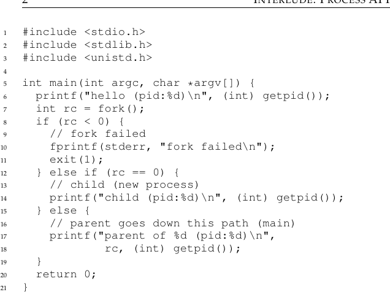
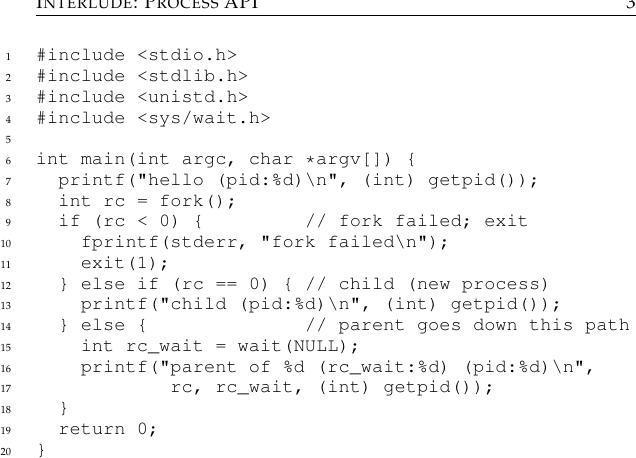
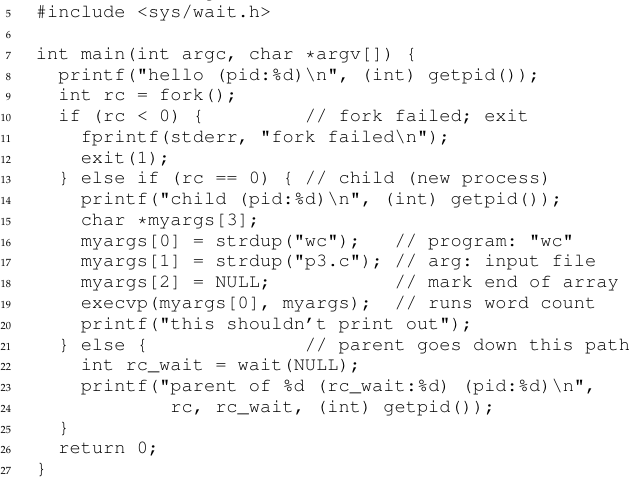
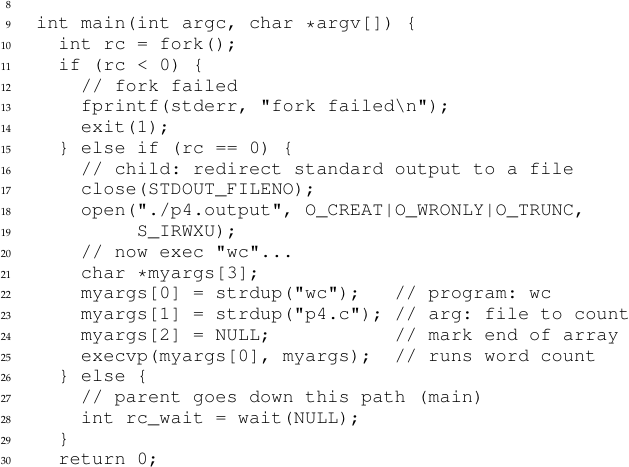

# الفصل 5: استراحة: واجهة برمجة العمليات

تتناول الاستراحات جوانب عملية من الأنظمة، بتركيز خاص على واجهات برمجة نظام التشغيل وكيفية استعمالها. وإن لم تكن تحبّ الأمور العملية، فأمكنك تجاوز هذه الاستراحات. لكن ينبغي أن تحبّ الأمور العملية، لأنها نافعة عمومًا في الحياة الواقعية؛ فالشركات مثلًا لا توظّفك عادةً من أجل مهاراتك غير العملية.

> **استطراد: الاستراحات**
>
> نتناول في هذه الاستراحة إنشاء العمليات في أنظمة UNIX. فـUNIX يقدّم واحدة من أكثر الطرائق إثارةً للاهتمام لإنشاء عملية جديدة، بزوج من نداءات النظام: `fork()` و`exec()`. وثمّة روتين ثالث، هو `wait()`، يمكن لعملية ترغب في انتظار عملية أنشأتها حتى تكتمل أن تستعمله. ونعرض الآن هذه الواجهات بتفصيل أكبر، مع أمثلة بسيطة تحفّزنا.

وعليه تظهر مسألتنا:

> **جوهر المسألة: كيف ننشئ العمليات ونتحكّم فيها**
>
> ما الواجهات التي ينبغي أن يقدّمها نظام التشغيل لإنشاء العمليات والتحكّم فيها؟ وكيف ينبغي تصميم هذه الواجهات لتمكين وظائف قوية وسهولة استعمال وأداء عالٍ؟

## 5.1 نداء النظام fork()

يُستعمل نداء النظام `fork()` لإنشاء عملية جديدة [C63]. لكن خُذ حذرك: إنه بلا شك أغرب روتين ستستدعيه في حياتك[^1]. وبتحديد أدقّ: لديك برنامج قيد التشغيل تبدو شيفرته كما ترى في الشكل 5.1؛ تأمّل الشيفرة، أو الأفضل من ذلك أن تكتبها وتشغّلها بنفسك!



**الشكل 5.1:** استدعاء fork() (p1.c)

وحين تشغّل هذا البرنامج (المسمّى p1.c) سترى ما يلي:

```c
prompt> ./p1
hello (pid:29146)
parent of 29147 (pid:29146)
child (pid:29147)
prompt>
```

لنفهم ما حدث بتفصيل أكبر في p1.c. حين بدأ التشغيل أول مرة، طبعت العملية رسالة ترحيب؛ وتضمّنت تلك الرسالة معرّف عمليتها، المعروف أيضًا بـPID. فمعرّف عملية العملية هو 29146؛ ويُستعمل PID في أنظمة UNIX لتسمية العملية إن أراد المرء أن يفعل بها شيئًا، كأن يوقف تشغيلها مثلًا. حتى هنا، كل شيء سليم.

والآن يبدأ الجزء المثير للاهتمام. تستدعي العملية نداء النظام `fork()`، الذي يقدّمه نظام التشغيل طريقةً لإنشاء عملية جديدة. والغريب في الأمر: العملية التي تُنشأ نسخة (شبه) مطابقة للعملية المستدعية. ويعني ذلك أن نظام التشغيل يرى الآن نسختين من البرنامج p1 تعملان، وكلتاهما على وشك العودة من نداء النظام `fork()`. أما العملية المنشأة حديثًا (وتسمّى الابن، في مقابل الأب المنشئ) فلا تبدأ التشغيل عند `main()` كما قد تتوقّع (لاحظ أن رسالة «hello» طُبعت مرة واحدة فقط)؛ بل تدخل الحياة كأنها هي التي استدعت `fork()`.



**الشكل 5.2:** استدعاء fork() وwait() (p2.c)

قد تكون لاحظت: الابن ليس نسخة مطابقة. فبتحديد أدقّ، مع أنه يملك الآن نسخته الخاصة من فضاء العناوين (أي ذاكرته الخاصة)، وسجلاته الخاصة، وعدّاد برنامجه الخاص، وما إلى ذلك، فإن القيمة التي يعيدها إلى مستدعي `fork()` مختلفة. فبينما يتلقّى الأب PID الابن المنشأ حديثًا، يتلقّى الابن رمز عودة صفرًا. وهذا التفريق نافع، لأن كتابة الشيفرة التي تتعامل مع الحالتين المختلفتين تصبح بسيطة حينها (كما في الأعلى).

قد تكون لاحظت أيضًا أن الخَرْج (من p1.c) غير حتمي. فحين تُنشأ العملية الابن، يصبح في النظام عمليتان نشطتان تعنينا: الأب والابن. وبافتراض أننا نعمل على نظام بمعالج واحد (للتبسيط)، فقد يعمل الابن أو الأب عند تلك اللحظة. في مثالنا (أعلاه) عمل الأب، فطبع رسالته أولًا. وفي حالات أخرى قد يحدث العكس، كما نُظهر في أثر الخَرْج هذا:

```c
prompt> ./p1
hello (pid:29146)
child (pid:29147)
parent of 29147 (pid:29146)
prompt>
```

يحدّد مجدول المعالج، وهو موضوع سنتناوله بتفصيل كبير قريبًا، أي عملية تعمل في لحظة معيّنة؛ ولأن المجدول معقّد، لا يمكننا عادةً افتراض كثير عن ما سيختار فعله، ومن ثمّ عن أي عملية ستعمل أولًا. وهذه اللاحتمية، كما تبيّن، تقود إلى بعض المشكلات المثيرة للاهتمام، خصوصًا في البرامج متعدّدة الخيوط؛ ومن ثمّ سنرى لاحتمية أكبر بكثير حين ندرس التزامن في الجزء الثاني من الكتاب.

## 5.2 نداء النظام wait()

حتى الآن لم نفعل كثيرًا: أنشأنا ابنًا يطبع رسالة ثم يخرج فحسب. لكن الانتظار مفيد جدًا في بعض الأحيان للأب، حتى ينتهي الابن من عمله. وتُنجز هذه المهمة بنداء النظام `wait()` (أو نظيره الأكثر اكتمالًا `waitpid()`)؛ انظر الشكل 5.2 للتفاصيل.

في هذا المثال (p2.c) يستدعي الأب `wait()` ليحجب نفسه (أي يؤخّر تنفيذه) حتى ينتهي الابن من التنفيذ. وحين ينتهي الابن يتحرّر الأب من الحجب، ويعود `wait()` في الأب.

وإضافة استدعاء `wait()` إلى الشيفرة أعلاه تجعل الخَرْج حتميًا. أفترى لماذا؟ هيّا، فكّر في الأمر.

(ننتظرك حتى تفكّر … وانتهى)

والآن بعد أن فكّرت قليلًا، إليك الخَرْج:

```c
prompt> ./p2
hello (pid:29266)
child (pid:29267)
parent of 29267 (rc_wait:29267) (pid:29266)
prompt>
```

بهذه الشيفرة نعلم الآن أن الابن سيطبع دائمًا أولًا. ولماذا نعلم ذلك؟ حسنًا، قد يعمل الابن أولًا ببساطة، كما في السابق، فيطبع قبل الأب. لكن إن حدث أن عمل الأب أولًا، فسيستدعي `wait()` فورًا؛ ولن يعود نداء النظام هذا حتى يعمل الابن ويخرج[^2]. ومن ثمّ، حتى حين يعمل الأب أولًا، ينتظر الابن بلطف حتى يفرغ من التشغيل، ثم يعود `wait()`، ثم يطبع الأب رسالته.

## 5.3 وأخيرًا، نداء النظام exec()

ثمّة قطعة أخيرة ومهمة في واجهة برمجة إنشاء العمليات هي نداء النظام `exec()`[^3]. وهذا النداء نافع حين تريد تشغيل برنامج مختلف عن البرنامج المستدعي. فمثلًا، استدعاء `fork()` في p2.c لا يفيد إلا إن أردت الاستمرار في تشغيل نسخ من البرنامج نفسه. لكنك تريد غالبًا تشغيل برنامج مختلف؛ و`exec()` يفعل ذلك بالضبط (الشكل 5.3).



**الشكل 5.3:** استدعاء fork() وwait() وexec() (p3.c)

في هذا المثال يستدعي الابن `execvp()` لتشغيل البرنامج wc، وهو برنامج عدّ الكلمات. بل إنه يشغّل wc على الملف المصدري p3.c، فيخبرنا بعدد الأسطر والكلمات والبايتات في الملف:

```c
prompt> ./p3
hello (pid:29383)
child (pid:29384)
       29 107 1030 p3.c
parent of 29384 (rc_wait:29384) (pid:29383)
prompt>
```

نداء النظام `fork()` غريب؛ وشريكه في الجريمة `exec()` ليس عاديًا هو الآخر. فهو يفعل الآتي: متى أُعطي اسم ملف تنفيذي (مثل wc) وبعض الوسائط (مثل p3.c)، جلب الشيفرة (والبيانات الساكنة) من ذلك الملف التنفيذي وطغى بها على مقطع الشيفرة الحالي (والبيانات الساكنة الحالية)؛ وتُعاد تهيئة الكومة والمكدّس وبقية أجزاء فضاء ذاكرة البرنامج. ثم يشغّل نظام التشغيل ذلك البرنامج ببساطة، ويمرّر أي وسائط إليه بوصفها argv لتلك العملية. ومن ثمّ فهو لا ينشئ عملية جديدة؛ بل يحوّل البرنامج العامل حاليًا (p3 سابقًا) إلى برنامج عامل مختلف (wc). وبعد `exec()` في الابن، يكاد الأمر يكون كما لو أن p3.c لم يعمل قط؛ فالنداء الناجح لـ`exec()` لا يعود أبدًا.

> **نصيحة: إصابة الهدف (قانون لامبسون)**
>
> كما يقول لامبسون في مقاله المحترم «Hints for Computer Systems Design» [L83]: «أصِب الهدف. فلا التجريد ولا البساطة بديلان عن إصابة الهدف.» أحيانًا عليك ببساطة أن تفعل الشيء الصحيح، وحين تفعله يكون أفضل كثيرًا من البدائل. وثمّة طرائق كثيرة لتصميم واجهات برمجة لإنشاء العمليات؛ لكن الجمع بين `fork()` و`exec()` بسيط وقوي إلى حدّ بعيد. وقد أصاب مصمّمو UNIX الهدف ببساطة. ولأن لامبسون «أصاب الهدف» في كثير من الأحيان، سمّينا القانون باسمه.

## 5.4 لماذا؟ تحفيز الواجهة

بالطبع، قد يخطر لك سؤال كبير: لماذا نبني واجهة غريبة إلى هذا الحدّ لفعلٍ ينبغي أن يكون بسيطًا هو إنشاء عملية جديدة؟ حسنًا، كما تبيّن، فصل `fork()` عن `exec()` جوهري في بناء صدفة UNIX، لأنه يتيح للصدفة تشغيل شيفرة بعد استدعاء `fork()` وقبل استدعاء `exec()`؛ وهذه الشيفرة يمكنها تغيير بيئة البرنامج الذي سيعمل بعد قليل، ومن ثمّ تمكّن بناء طائفة من الميزات المثيرة بسهولة.

والصدفة ليست إلا برنامج مستخدم[^4]. فهي تُظهر لك دعوة ثم تنتظرك حتى تكتب فيها شيئًا. فتكتب أمرًا (أي اسم برنامج تنفيذي، مع أي وسائط)، وفي معظم الحالات تحدّد الصدفة موضع الملف التنفيذي في نظام الملفات، وتستدعي `fork()` لإنشاء عملية ابن جديدة تشغّل الأمر، وتستدعي بعض صور `exec()` لتشغيل الأمر، ثم تنتظر اكتمال الأمر باستدعاء `wait()`. وحين ينتهي الابن تعود الصدفة من `wait()` وتطبع الدعوة مرة أخرى، مستعدة لأمرك التالي.

ويتيح فصل `fork()` عن `exec()` للصدفة إنجاز مجموعة كاملة من الأمور النافعة بسهولة. مثلًا، يمكنك توجيه خَرْج برنامج إلى ملف بدلًا من الشاشة: `prompt> wc p3.c > newfile.txt`. وفي المثال أعلاه، يُوجَّه خَرْج البرنامج wc إلى ملف الخَرْج newfile.txt (وإشارة «أكبر من» هي طريقة الإشارة إلى ذلك التوجيه). والطريقة التي تنجز بها الصدفة هذه المهمة بسيطة جدًا: حين يُنشأ الابن، وقبل استدعاء `exec()`، تُغلق الصدفة (وبتحديد أدقّ: الشيفرة المنفّذة في العملية الابن) المخرج القياسي وتفتح الملف newfile.txt. وبذلك يُوجَّه أي خَرْج من البرنامج wc الذي سيعمل بعد قليل إلى الملف بدلًا من الشاشة (فواصفات الملفات المفتوحة تبقى مفتوحة عبر استدعاء `exec()`، وهو ما يتيح هذا السلوك [SR05]).

ويعرض الشكل 5.4 (الصفحة 8) برنامجًا يفعل ذلك بالضبط. وسبب نجاح هذا التوجيه افتراضٌ عن كيفية إدارة نظام التشغيل لواصفات الملفات. فأنظمة UNIX تبدأ البحث عن واصفات ملفات حرة من الصفر. وفي هذه الحالة يكون STDOUT FILENO أول واصف متاح، ومن ثمّ يُخصَّص عند استدعاء `open()`. أما الكتابات اللاحقة من العملية الابن إلى واصف المخرج القياسي، مثلًا عبر روتينات كـ`printf()`، فتُوجَّه بعد ذلك بشفافية إلى الملف المفتوح حديثًا بدلًا من الشاشة.

وإليك خَرْج تشغيل برنامج p4.c:

```c
prompt> ./p4
prompt> cat p4.output
       32 109 846 p4.c
prompt>
```

ستلاحظ (على الأقل) فائدتين مثيرتين في هذا الخَرْج. أولًا، حين يُشغَّل p4 يبدو أنه لم يحدث شيء؛ فالصدفة تطبع دعوة الأمر فحسب وتكون مستعدة فورًا لأمرك التالي. لكن الأمر ليس كذلك؛ فالبرنامج p4 استدعى `fork()` فعلًا لإنشاء ابن جديد، ثم شغّل برنامج wc عبر استدعاء `execvp()`. ولا ترى أي خَرْج مطبوع على الشاشة لأنه وُجّه إلى الملف p4.output. ثانيًا، ترى أننا حين نقرأ ملف الخَرْج نجد كل الخَرْج المتوقّع من تشغيل wc. جميل، أليس كذلك؟



**الشكل 5.4:** كل ما سبق مع التوجيه (p4.c)

وتُنفَّذ أنابيب UNIX بطريقة مشابهة، لكن بنداء النظام `pipe()`. وفي هذه الحالة يُوصَل خَرْج عملية ما بأنبوب داخل النواة (أي طابور)، ويُوصَل دخل عملية أخرى بالأنبوب نفسه؛ وبذلك يُستعمل خَرْج عملية ما دخلًا للتالية بسلاسة، ويمكن نظم سلاسل طويلة نافعة من الأوامر. وخُذ مثالًا بسيطًا: البحث عن كلمة في ملف ثم عدّ مرات ورودها؛ وباستعمال الأنابيب والأداتين grep وwc، الأمر سهل: ما عليك إلا كتابة `grep -o foo file | wc -l` في سطر الأوامر والتمتع بالنتيجة.

وأخيرًا، مع أننا رسمنا واجهة العمليات رسمًا سريعًا على مستوى عالٍ، فثمّة تفاصيل أكثر كثيرة عن هذه النداءات يمكن تعلّمها وهضمها؛ فسنتعلّم مثلًا أكثر عن واصفات الملفات حين نتحدّث عن نظم الملفات في الجزء الثالث من الكتاب. ويكفي الآن أن نقول إن الجمع بين `fork()` و`exec()` طريقة قوية لإنشاء العمليات والتلاعب بها.

## 5.5 التحكّم في العمليات والمستخدمون

عدا `fork()` و`exec()` و`wait()`، ثمّة واجهات كثيرة أخرى للتفاعل مع العمليات في أنظمة UNIX. فمثلًا يُستعمل نداء النظام `kill()` لإرسال إشارات إلى عملية، ومنها أوامر الإيقاف المؤقت والقتل وغيرها من الأوامر النافعة. وللتيسير، ضُبطت في معظم صدَفات UNIX تركيبات مفاتيح معيّنة لتسلّم إشارة محدّدة إلى العملية العاملة حاليًا؛ فمثلًا يرسل Ctrl-c إشارة SIGINT (مقاطعة) إلى العملية (فينهيها عادةً)، ويرسل Ctrl-z إشارة SIGTSTP (إيقاف)، فيوقف العملية في منتصف تنفيذها (ويمكنك استئنافها لاحقًا بأمر، مثل الأمر المدمج fg الموجود في كثير من الصدَفات).

ويوفّر نظام الإشارات كله بنية تحتية غنية لتسليم أحداث خارجية إلى العمليات، ومنها طرائق لتلقّي تلك الإشارات ومعالجتها داخل العملية الواحدة، وطرائق لإرسال الإشارات إلى عمليات فردية وإلى مجموعات عمليات كاملة. ولكي تستعمل هذه الصورة من التواصل، ينبغي أن تستدعي العملية `signal()` لتـ«ـلتقط» إشارات مختلفة؛ فذلك يضمن أن العملية، حين تُسلَّم إليها إشارة معيّنة، تعلّق تنفيذها العادي وتشغّل قطعة شيفرة معيّنة استجابةً للإشارة. اقرأ في موضع آخر [SR05] لتتعلّم أكثر عن الإشارات وتعقيداتها الكثيرة.

> **استطراد: اقرأ صفحات الدليل (RTFM)**
>
> سنقول لك في مواضع كثيرة من هذا الكتاب، حين نشير إلى نداء نظام أو نداء مكتبة بعينه، أن تقرأ صفحات الدليل، أو صفحات «man» اختصارًا. فصفحات الدليل هي الصورة الأصلية للتوثيق الموجودة في أنظمة UNIX؛ واعلم أنها أُنشئت قبل أن يوجد شيء اسمه الشبكة العنكبوتية. وقضاء بعض الوقت في قراءة صفحات الدليل خطوة أساسية في نمو مبرمج الأنظمة؛ فثمّة أطنان من المعلومات النافعة المخبّأة في تلك الصفحات. ومن الصفحات النافعة على وجه الخصوص صفحات الدليل الخاصة بالصدفة التي تستعملها (مثل tcsh أو bash)، وبالطبع صفحات أي نداءات نظام يجريها برنامجك (لترى قيم العودة وشروط الخطأ الموجودة). وأخيرًا، قد توفّر عليك قراءة صفحات الدليل بعض الإحراج. فحين تسأل زملاءك عن تفصيل دقيق في `fork()`، قد يجيبونك ببساطة: «RTFM». وهذه طريقتهم في حثّك بلطف على قراءة صفحات الدليل. وحرف F في RTFM يضيف قليلًا من الألوان إلى العبارة…

وهذا يثير بطبيعة الحال سؤالًا: من يستطيع أن يرسل إشارة إلى عملية، ومن لا يستطيع؟ فعمومًا يمكن أن يكون في الأنظمة التي نستعملها أشخاص كثيرون في الوقت نفسه؛ وإن استطاع أحدهم أن يرسل اعتباطًا إشارات مثل SIGINT (لمقاطعة عملية، وترجيح إنهائها)، اختلّت سهولة استعمال النظام وأمنه. ونتيجة لذلك، تتضمّن الأنظمة الحديثة تصوّرًا قويًا لمفهوم المستخدم. فالمستخدم، بعد إدخال كلمة سرّ لإثبات هويته، يدخل إلى النظام ليصل إلى موارده. ثم يمكنه أن يطلق عملية أو عمليات كثيرة، وأن يمارس عليها تحكّمًا كاملًا (إيقافها مؤقتًا، وقتلها، إلخ). ولا يستطيع المستخدمون عمومًا التحكّم إلا في عملياتهم؛ ومن ثمّ فإن مهمة نظام التشغيل أن يوزّع الموارد (كالمعالج والذاكرة والقرص) على كل مستخدم (وعملياته) بما يحقّق أهداف النظام العامة.

## 5.6 أدوات نافعة

وثمّة أدوات سطر أوامر كثيرة نافعة أيضًا. فمثلًا يتيح لك الأمر ps رؤية العمليات العاملة؛ واقرأ صفحات الدليل لبعض الخيارات النافعة التي تُمرَّر إلى ps. والأداة top نافعة جدًا كذلك، إذ تعرض عمليات النظام ومقدار المعالج والموارد الأخرى التي تستهلكها. ومن الطريف أن top يدّعي في كثير من الأحيان أنه هو أكبر مستهلك للموارد؛ فلعله مصاب بعقدة العظمة بعض الشيء. ويمكن استعمال الأمر kill لإرسال إشارات اعتباطية إلى العمليات، وكذلك killall الأكثر ودًّا للمستخدم. واحرص على استعمالها بحذر؛ فإن قتلت مدير نوافذك بالخطأ فقد يصير الحاسوب الذي تجلس أمامه صعب الاستعمال جدًا.

> **استطراد: المستخدم الخارق (الجذر)**
>
> يحتاج النظام عمومًا إلى مستخدم يستطيع إدارته، ولا يكون مقيَّدًا كما يُقيَّد معظم المستخدمين. وينبغي أن يستطيع هذا المستخدم قتل أي عملية (إن كانت تُسيء استعمال النظام مثلًا)، حتى لو لم يكن هو من أطلقها. وينبغي أن يستطيع أيضًا تشغيل أوامر قوية مثل shutdown (الذي يُغلق النظام، كما لا يفاجئك). وفي الأنظمة المبنية على UNIX تُمنح هذه القدرات الخاصة للمستخدم الخارق (ويسمّى أحيانًا الجذر). فبينما لا يستطيع معظم المستخدمين قتل عمليات مستخدمين آخرين، يستطيع ذلك المستخدم الخارق. وكونك جذرًا يشبه إلى حدّ بعيد كونك الرجل العنكبوت: فالقدرة الكبيرة تجرّ مسؤولية كبيرة [QI15]. ومن ثمّ، فمن الأفضل عادةً أن تكون مستخدمًا عاديًا (لزيادة الأمن وتجنّب الأخطاء المكلفة)؛ وإن احتجت فعلًا أن تكون جذرًا فتقدّم بحذر، فكل القوى المدمّرة في عالم الحوسبة صارت الآن في متناول أصابعك.

وأخيرًا، ثمّة أنواع كثيرة من عدّادات المعالج التي يمكنك استعمالها لتحصل بنظرة سريعة على الحمل على نظامك؛ فنحن مثلًا نُبقي MenuMeters (من برمجيات Raging Menace) عاملًا دائمًا في أشرطة أدوات حواسيبنا من نوع Macintosh، حتى نرى مقدار ما يُستعمل من المعالج في أي لحظة. وعمومًا، فكلما زادت المعلومات عمّا يجري كان أفضل.

## 5.7 الخلاصة

قدّمنا بعض الواجهات المتعلّقة بإنشاء العمليات في UNIX: `fork()` و`exec()` و`wait()`. لكننا لم نلمس إلا السطح. ولمزيد من التفصيل اقرأ ستيفنز وراغو [SR05] بالطبع، وبخاصة فصول التحكّم في العمليات وعلاقات العمليات والإشارات؛ فثمّة كثير مما يُستخرج من الحكمة هناك.

ومع أن شغفنا بواجهة عمليات UNIX يبقى قويًا، ينبغي أن نلاحظ أن هذا التفاؤل ليس عامًا. فثمّة ورقة حديثة لباحثين في أنظمة من مايكروسوفت وجامعة بوسطن والمعهد التقني الفدرالي في زيوريخ تسرد بعض مشكلات `fork()`، وتدعو إلى واجهات أخرى أبسط لإنشاء العمليات مثل `spawn()` [B+19]. اقرأها، والعمل المرتبط الذي تحيل إليه، لتفهم هذا المنظور المختلف. ومع أنه حسن عمومًا أن تثق بهذا الكتاب، فتذكّر أيضًا أن للمؤلفين آراءً؛ وقد لا تكون تلك الآراء (دائمًا) واسعة الانتشار كما قد تظن.

> **استطراد: مصطلحات واجهة العمليات الأساسية**
>
> - لكل عملية اسم؛ وهو في معظم الأنظمة عدد يُعرف بمعرّف العملية (PID).
>
> - يُستعمل نداء النظام `fork()` في أنظمة UNIX لإنشاء عملية جديدة. ويُسمّى المنشئ الأب؛ وتُسمّى العملية المنشأة حديثًا الابن. وكما يحدث أحيانًا في الحياة الواقعية [J16]، تكون العملية الابن نسخة شبه مطابقة للأب.
>
> - يتيح نداء النظام `wait()` للأب أن ينتظر اكتمال تنفيذ ابنه.
>
> - تتيح أسرة نداءات النظام `exec()` للابن أن يتحرّر من شبهه بأبيه وينفّذ برنامجًا جديدًا بالكامل.
>
> - تستعمل صدفة UNIX عادةً `fork()` و`wait()` و`exec()` لإطلاق أوامر المستخدم؛ وفصل `fork` عن `exec` يتيح ميزات مثل توجيه الدخل/الخرج والأنابيب وغيرها من الميزات الطريفة، دون تغيير أي شيء في البرامج التي تُشغَّل.
>
> - التحكّم في العمليات متاح في صورة إشارات، يمكنها أن توقف المهام أو تستأنفها أو حتى تنهيها.
>
> - مسألة أي العمليات يستطيع شخص بعينه التحكّم فيها تُلخَّص في مفهوم المستخدم؛ فالنظام يتيح لمستخدمين كثيرين الدخول إليه، ويضمن ألّا يتحكّم المستخدمون إلا في عملياتهم.
>
> - يستطيع المستخدم الخارق التحكّم في كل العمليات (وفعل أمور أخرى كثيرة فعلًا)؛ وينبغي أن يُفترض هذا الدور نادرًا وبحذر لأسباب أمنية.

## المراجع

> [B+19] «A fork() in the road» لأندرو باومان وجوناثان أبافو وأوران كريغر وتيموثي روسكو. HotOS '19، بيرتينورو، إيطاليا. *ورقة ممتعة مليئة بالغضب؛ اقرأها لتحصل على وجهة نظر معارضة لواجهة عمليات UNIX. وقد قُدّمت في ورشة HotOS المفعمة بالحياة دائمًا، حيث يذهب باحثو الأنظمة ليقدّموا آراءً متطرّفة أملًا في دفع المجتمع في اتجاهات جديدة.*

> [C63] «A Multiprocessor System Design» لميلفن إ. كونواي. مؤتمر AFIPS '63 المشترك الخريفي، نيويورك، الولايات المتحدة، 1963. *ورقة مبكّرة عن كيفية تصميم أنظمة المعالجة المتعدّدة؛ وربما كانت أول موضع استُعمل فيه مصطلح fork() في الحديث عن توليد عمليات جديدة.*

> [DV66] «Programming Semantics for Multiprogrammed Computations» لجاك ب. دينيس وإيرل ك. فان هورن. Communications of the ACM، المجلد 9، العدد 3، مارس 1966. *ورقة كلاسيكية ترسم أساسيات أنظمة الحاسوب متعدّدة البرامج. ولا شك أنها أثّرت تأثيرًا كبيرًا في مشروع MAC ونظام Multics ثم UNIX في النهاية.*

> [J16] «They could be twins!» لفيبي جاكسون-إدواردز. The Daily Mail، 1 مارس 2016. *يعرض هذا العمل الصحفي الرصين مجموعة من صور الأطفال والآباء المتشابهين تشابهًا غريبًا، وهو في الحقيقة آسر إلى حدّ ما. فامضِ ودخّل دقيقتين من حياتك في مشاهدته. لكن لا تنسَ أن تعود إلى هنا! فهذا، في صورة مصغّرة، خطر الإبحار في الشبكة.*

> [L83] «Hints for Computer Systems Design» لبتلر لامبسون. ACM Operating Systems Review، المجلد 15:5، أكتوبر 1983. *نصائح لامبسون الشهيرة عن كيفية تصميم أنظمة الحاسوب. ينبغي أن تقرأها في مرحلة ما من حياتك، وربما في مراحل كثيرة منها.*

> [QI15] «With Great Power Comes Great Responsibility» لمحقّق الاقتباسات. متاح على: https://quoteinvestigator.com/2015/07/23/great-power. *يخلص محقّق الاقتباسات إلى أن أقدم ذكر لهذا المفهوم يعود إلى 1793، في مجموعة مراسيم صدرت عن المؤتمر الوطني الفرنسي. والاقتباس المحدّد: «Ils doivent envisager qu'une grande responsabilité est la suite inséparable d'un grand pouvoir»، ويُترجم تقريبًا إلى: «عليهم أن يعتبروا أن المسؤولية الكبيرة نتيجة لا تنفصل عن القدرة الكبيرة.» ولم تظهر العبارة التالية إلا في 1962 في الرجل العنكبوت: «…مع القدرة الكبيرة لا بدّ أن تأتي أيضًا مسؤولية كبيرة!» فيبدو أن الثورة الفرنسية هي من يستحقّ الفضل في هذه، لا ستان لي. آسفون يا ستان.*

> [SR05] «Advanced Programming in the UNIX Environment» لو. ريتشارد ستيفنز وستيفن أ. راغو. Addison-Wesley، 2005. *هنا تجد كل الفروق الدقيقة والتفاصيل الخفية في استعمال واجهات UNIX. اشترِ هذا الكتاب! اقرأه! والأهم من ذلك، عِشه.*

## الواجبات المنزلية (محاكاة)

يركّز واجب المحاكاة هذا على fork.py، وهو محاكي بسيط لإنشاء العمليات يُظهر كيف تتصل العمليات بعضها ببعض في شجرة «عائلية» واحدة. اقرأ ملف README ذا الصلة للتفاصيل عن كيفية تشغيل المحاكي.

## الأسئلة

1. شغّل ./fork.py -s 10 وانظر أي الأفعال تُنفَّذ. هل تستطيع التنبّؤ بشكل شجرة العمليات عند كل خطوة؟ استعمل الخيار -c للتحقّق من أجوبتك. وجرّب بذورًا عشوائية مختلفة (-s) أو أضف أفعالًا أكثر (-a) حتى تتقن الأمر.

2. من وسائل التحكّم التي يتيحها المحاكي نسبة التفريع fork_percentage، ويضبطها الخيار -f. فكلما ارتفعت زاد احتمال أن يكون الفعل التالي تفريعًا؛ وكلما انخفضت زاد احتمال أن يكون الفعل خروجًا. شغّل المحاكي بعدد كبير من الأفعال (مثل -a 100) وغيّر نسبة التفريع من 0.1 إلى 0.9. كيف تظنّ أن أشجار العمليات النهائية ستكون مع تغيّر النسبة؟ تحقّق من جوابك بـ-c.

3. اقلب الآن الخَرْج باستعمال الخيار -t (مثلًا شغّل ./fork.py -t). فإذا أُعطيت مجموعة من أشجار العمليات، أتستطيع أن تحدّد أي الأفعال نُفّذت؟

4. من الأمور المثيرة للانتباه ما يحدث حين يخرج ابن؛ فما مصير أبنائه في شجرة العمليات؟ ولدراسة ذلك، لنشغّل مثالًا بسيطًا: `./fork.py -A a+b,b+c,c+d,c+e,c-`. في هذا المثال تُنشئ العملية «a» العملية «b»، التي تُنشئ بدورها «c»، التي تُنشئ «d» و«e». لكن «c» تخرج بعد ذلك. فكيف تظنّ أن شجرة العمليات ينبغي أن تكون بعد الخروج؟ وماذا لو استعملت الخيار -R؟ تعلّم بنفسك أكثر عمّا يحدث للعمليات اليتيمة لتضيف سياقًا أكبر.

5. ثمّة خيار أخير جدير بالاستكشاف هو -F، وهو يتخطّى الخطوات الوسيطة ويطلب فقط ملء شجرة العمليات النهائية. شغّل ./fork.py -F وانظر إن كنت تستطيع كتابة الشجرة النهائية بالنظر إلى سلسلة الأفعال المولَّدة. استعمل بذورًا عشوائية مختلفة لتجرّب ذلك بضع مرات.

6. وأخيرًا، استعمل -t و-F معًا. فهذا يُظهر شجرة العمليات النهائية، لكنه يطلب منك بعد ذلك أن تملأ الأفعال التي جَرَت. فبالنظر إلى الشجرة، أتستطيع تحديد الأفعال التي جَرَت بالضبط؟ وفي أي الحالات تستطيع؟ وفي أيها لا تستطيع؟ جرّب بذورًا عشوائية مختلفة للتعمّق في هذا السؤال.

> **استطراد: واجبات البرمجة**
>
> واجبات البرمجة تمارين صغيرة تكتب فيها شيفرة تعمل على آلة حقيقية لتكتسب بعض الخبرة ببعض واجهات برمجة نظام التشغيل الأساسية. فأنت في النهاية (على الأرجح) عالِم حاسوب، ومن ثمّ ينبغي أن تحبّ البرمجة، أليس كذلك؟ وإن لم تكن تحبّها فثمّة دائمًا نظرية علوم الحاسوب، لكنها صعبة جدًا. وبالطبع، لتصبح خبيرًا حقًا عليك أن تقضي وقتًا غير قليل في العبث بالآلة؛ بل ابحث عن كل عذر تجده لتكتب بعض الشيفرة وترى كيف تعمل. اقضِ الوقت، وكن المعلّم الحكيم الذي تعرف أنك تستطيع أن تكونه.

## الواجبات المنزلية (برمجة)

في هذا الواجب ستكتسب بعض الألفة مع واجهات إدارة العمليات التي قرأت عنها للتو. لا تقلق — فهو أمتع مما يبدو! وستكون في حال أفضل عمومًا إن وجدت أكبر وقت ممكن لتكتب بعض الشيفرة، فلمَ لا تبدأ الآن؟

## الأسئلة

1. اكتب برنامجًا يستدعي `fork()`. وقبل استدعاء `fork()`، اجعل العملية الرئيسية تصل إلى متغيّر (مثل x) وتضبط قيمته على شيء ما (مثل 100). فما قيمة المتغيّر في العملية الابن؟ وماذا يحدث للمتغيّر حين يغيّر الابن والأب قيمة x كلاهما؟

2. اكتب برنامجًا يفتح ملفًا (بنداء النظام `open()`) ثم يستدعي `fork()` لإنشاء عملية جديدة. أيمكن للأب والابن أن يصل كلاهما إلى واصف الملف الذي أعاده `open()`؟ وماذا يحدث حين يكتبان في الملف تزامنيًا، أي في الوقت نفسه؟

3. اكتب برنامجًا آخر يستعمل `fork()`. وينبغي أن تطبع العملية الابن «hello»، وأن يطبع الأب «goodbye». وجرّب أن تضمن أن تطبع العملية الابن دائمًا أولًا؛ أتستطيع فعل ذلك دون استدعاء `wait()` في الأب؟

4. اكتب برنامجًا يستدعي `fork()` ثم يستدعي بعض صور `exec()` لتشغيل البرنامج /bin/ls. وانظر إن كنت تستطيع تجريب كل متغيّرات `exec()`، ومنها (على لينكس) execl() وexecle() وexecv() وexecvp() وexecvpe(). فلماذا تظنّ أن ثمّة متغيّرات كثيرة لهذا القدر من نداء أساسي واحد؟

5. اكتب الآن برنامجًا يستعمل `wait()` لانتظار انتهاء العملية الابن في الأب. فماذا يعيد `wait()`؟ وماذا يحدث إن استعملت `wait()` في الابن؟

6. اكتب تعديلًا طفيفًا على البرنامج السابق، هذه المرة باستعمال `waitpid()` بدلًا من `wait()`. فمتى يكون `waitpid()` نافعًا؟

7. اكتب برنامجًا ينشئ عملية ابن، ثم يُغلق الابن فيه المخرج القياسي (STDOUT FILENO). فماذا يحدث إن استدعى الابن `printf()` لطباعة بعض الخَرْج بعد إغلاق الواصف؟

8. اكتب برنامجًا ينشئ ابنين، ويوصل المخرج القياسي لأحدهما بالدخل القياسي للآخر، باستعمال نداء النظام `pipe()`.

[^1]: حسنًا، نعترف بأننا لا نعلم ذلك على وجه اليقين؛ فمن يعلم أي الروتينات تستدعي حين لا ينظر إليك أحد؟ لكن `fork()` غريب إلى حدّ بعيد، أيًّا كانت أنماط استدعائك للروتينات غير المعتادة.

[^2]: ثمّة حالات قليلة يعود فيها `wait()` قبل خروج الابن؛ اقرأ صفحة الدليل لمزيد من التفاصيل، كما نفعل دائمًا. واحذر أي عبارات مطلقة وغير مشروطة يقولها هذا الكتاب، مثل «الابن سيطبع دائمًا أولًا» أو «UNIX أفضل شيء في العالم، حتى أفضل من المثلّجات».

[^3]: على لينكس ثمّة ستة متغيّرات لـ`exec()`: execl() وexeclp() وexecle() وexecv() وexecvp() وexecvpe(). اقرأ صفحات الدليل لتتعلّم أكثر.

[^4]: وثمّة صدَفات كثيرة؛ tcsh وbash وzsh على سبيل المثال لا الحصر. ينبغي أن تختار واحدة، وتقرأ صفحات دليلها، وتتعلّم عنها أكثر؛ فهذا ما يفعله كل خبراء UNIX.
