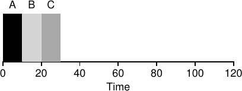
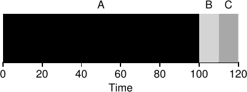
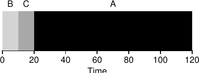
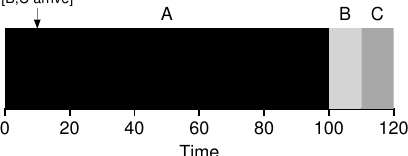
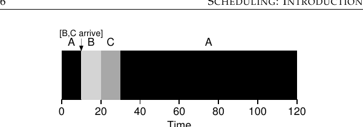
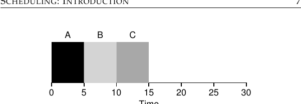
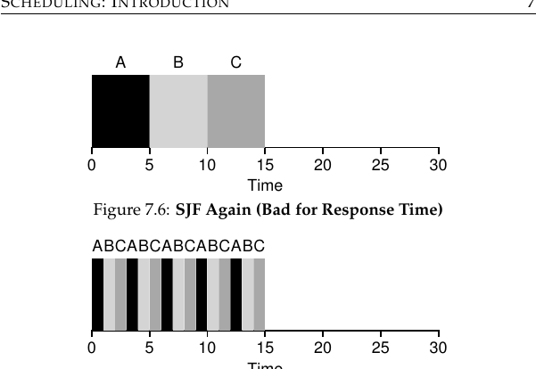
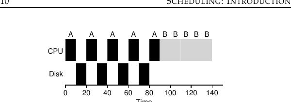
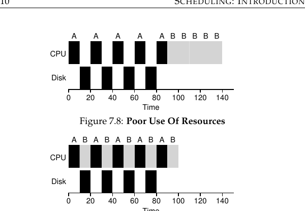

# الفصل 7: الجدولة: مقدمة

حتى الآن ينبغي أن تكون آليات تشغيل العمليات منخفضة المستوى (مثل تبديل السياق) واضحة؛ فإن لم تكن كذلك، فارجع فصلًا أو فصلين واقرأ وصف كيفية عمل ذلك مرة أخرى. لكننا لم نفهم بعد السياسات عالية المستوى التي يتبعها مجدول نظام التشغيل. وسنفعل ذلك الآن، فنعرض سلسلة من سياسات الجدولة (وتسمّى أحيانًا تخصصات) طوّرها على مرّ السنين أشخاص أذكياء ومجتهدون كثيرون.

إن أصول الجدولة في الحقيقة أقدم من أنظمة الحاسوب؛ فقد أُخذت المقاربات المبكّرة من ميدان إدارة العمليات وطُبّقت على الحواسيب. وهذا ليس مستغربًا: فخطوط التجميع وغيرها من المساعي البشرية تحتاج إلى الجدولة أيضًا، وفيها كثير من الشواغل نفسها، ومنها رغبة شديدة في الكفاءة. وعليه تظهر مسألتنا:

> **جوهر المسألة: كيف نطوّر سياسة للجدولة**
>
> كيف ينبغي أن نطوّر إطارًا أساسيًا للتفكير في سياسات الجدولة؟ وما الافتراضات الأساسية؟ وما المقاييس المهمة؟ وما المقاربات الأساسية المستخدمة في أقدم أنظمة الحاسوب؟

## 7.1 افتراضات حمل العمل

قبل الخوض في نطاق السياسات الممكنة، لنضع أولًا عددًا من الافتراضات المبسّطة عن العمليات العاملة في النظام، ويسمّى مجموعها أحيانًا حمل العمل. وتحديد حمل العمل جزء حاسم من بناء السياسات؛ فكلما عرفت أكثر عن حمل العمل، كان بوسعك ضبط سياستك على نحو أدقّ.

والافتراضات التي نضعها هنا عن حمل العمل غير واقعية في معظمها، لكن لا بأس (في الوقت الحالي)، لأننا سنخفّفها تدريجيًا، ونطوّر في النهاية ما سنسمّيه … (وقفة درامية) …

نظامًا للجدولة كامل التشغيل[^1].

وسنفترض الافتراضات التالية عن العمليات، التي تسمّى أحيانًا المهام، العاملة في النظام:

1. كل مهمة تعمل للمدة نفسها.

2. تصل جميع المهام في اللحظة نفسها.

3. كل مهمة، متى بدأت، تعمل حتى تنتهي.

4. جميع المهام تستعمل المعالج فحسب (أي لا تجري أي إدخال/إخراج).

5. زمن تشغيل كل مهمة معلوم.

قلنا إن كثيرًا من هذه الافتراضات غير واقعي، لكن كما أن بعض الحيوانات أكثر مساواة من غيرها في رواية «مزرعة الحيوان» لأورويل [O45]، فبعض الافتراضات في هذا الفصل أكثر لا واقعية من بعض. وعلى وجه الخصوص، قد يزعجك أن زمن تشغيل كل مهمة معلوم؛ فهذا يجعل المجدول عليمًا بكل شيء، وهو أمر رائع (على الأرجح) لكنه ليس مرجّحًا في أي وقت قريب.

## 7.2 مقاييس الجدولة

فضلًا عن افتراضات حمل العمل، نحتاج إلى أمر آخر لتمكيننا من مقارنة سياسات الجدولة المختلفة: مقياس للجدولة. والمقياس مجرّد شيء نستعمله لقياس شيء ما، وثمّة عدد من المقاييس المختلفة المنطقية في الجدولة.

غير أننا سنبسّط حياتنا الآن أيضًا بأن نكتفي بمقياس واحد: زمن الاستدارة. ويُعرَّف زمن استدارة مهمة بأنه الوقت الذي تنتهي فيه المهمة ناقص الوقت الذي وصلت فيه إلى النظام. وبصيغة أدقّ، زمن الاستدارة هو:

> زمن الاستدارة = زمن الإكمال − زمن الوصول (7.1)

ولأننا افترضنا أن جميع المهام تصل في اللحظة نفسها، فزمن الوصول = 0 الآن، ومن ثمّ زمن الاستدارة = زمن الإكمال. وستتغيّر هذه الحقيقة حين نخفّف الافتراضات المذكورة أعلاه.

وينبغي أن تلاحظ أن زمن الاستدارة مقياس أداء، وهو محور تركيزنا الأساسي في هذا الفصل. وثمّة مقياس آخر مهم هو العدالة، مقيسةً (مثلًا) بمؤشّر جين للعدالة [J91]. والأداء والعدالة كثيرًا ما يتعارضان في الجدولة؛ فالمجدول قد يحسّن الأداء مثلًا لكن بثمن منع بعض المهام من العمل، فيقلّل العدالة بذلك. وهذه المعضلة تُرينا أن الحياة ليست كاملة دائمًا.

## 7.3 الوارد أولًا يخرج أولًا (FIFO)

أبسط خوارزمية يمكننا تنفيذها تُعرف بالجدولة «الوارد أولًا يخرج أولًا» (FIFO)، وتسمّى أحيانًا «الأسبق وصولًا يُخدَم أولًا» (FCFS).

ولـFIFO خصائص إيجابية عدة: فهي واضحة البساطة، ومن ثمّ سهلة التنفيذ. وهي، وفق افتراضاتنا، تعمل على نحو جيد جدًا.

ولنأخذ مثالًا سريعًا معًا. تخيّل ثلاث مهام تصل إلى النظام، هي A وB وC، في وقت واحد تقريبًا (زمن الوصول = 0). ولأن FIFO لا بدّ أن تقدّم بعض المهام أولًا، لنفترض أنها وصلت كلها في الوقت نفسه، لكن A وصلت قبل B بشعرة، وB وصلت قبل C بشعرة. ولنفترض أيضًا أن كل مهمة تعمل 10 ثوانٍ. فما متوسط زمن الاستدارة لهذه المهام؟

**الشكل 7.1:** مثال بسيط على FIFO

من الشكل 7.1 ترى أن A انتهت عند 10، وB عند 20، وC عند 30. ومن ثمّ فإن متوسط زمن الاستدارة للمهام الثلاث هو ببساطة (10+20+30)/3 = 20. وحساب زمن الاستدارة بهذه السهولة.

لنخفّف الآن أحد افتراضاتنا. وبالتحديد، لنخفّف الافتراض الأول، فلم نعد نفترض أن كل مهمة تعمل للمدة نفسها. فكيف تؤدّي FIFO الآن؟ وأي نوع من أحمال العمل يمكنك بناؤه ليجعل FIFO تؤدّي أداءً سيئًا؟

(فكّر في ذلك قبل المتابعة … استمر في التفكير … أليس كذلك؟!)

لعلّك اكتشفت ذلك الآن، لكن لنعمل مثالًا يبيّن كيف يمكن لمهام مختلفة الأطوال أن توقع FIFO في مشكلة. وبالتحديد، لنفترض مرة أخرى ثلاث مهام (A وB وC)، لكن A تعمل هذه المرّة 100 ثانية بينما تعمل B وC عشرًا لكل منهما.

**الشكل 7.2:** لماذا FIFO ليست بهذه الجودة

كما ترى في الشكل 7.2، تعمل المهمة A أولًا طوال المئة ثانية قبل أن تحصل B أو C على أي فرصة للعمل. ومن ثمّ فإن متوسط زمن الاستدارة في النظام مرتفع: 110 ثانية مؤلمة ((100+110+120)/3 = 110).

وتُعرف هذه المشكلة عمومًا بأثر الرتل [B+79]، حيث تصطفّ عدد من المستهلكين قصار الأمد نسبيًا لمورد ما خلف مستهلك ثقيل الوزن لذلك المورد. وقد يذكّرك هذا السيناريو الجدولي بطابور واحد في متجر بقالة، وبما تشعر به حين ترى من أمامك يحمل ثلاث عربات مؤنٍ ودفتر شيكات جاهزًا؛ سيستغرق الأمر وقتًا[^2].

فماذا نفعل؟ كيف نطوّر خوارزمية أفضل لمواجهة واقعنا الجديد: مهام تعمل لأزمنة مختلفة؟ فكّر أولًا، ثم تابع القراءة.

> **نصيحة: مبدأ SJF**
>
> تمثّل «الأقصر مهمة أولًا» مبدأً جدوليًا عامًا يمكن تطبيقه على أي نظام يهمّ فيه زمن الاستدارة المتصوَّر لكل عميل (أو لكل مهمة في حالتنا). فكّر في أي طابور انتظرت فيه: إن كانت المؤسسة المعنية تهتمّ برضا عملائها، فمن المرجّح أنها راعت SJF. فمثلًا، كثيرًا ما تخصّص متاجر البقالة طابورًا لـ«عشرة أصناف أو أقلّ» لتضمن أن المتسوّقين الذين يشترون أشياء قليلة لا يعلقون خلف أسرة تستعدّ لشتاء نووي قادم.

## 7.4 الأقصر مهمة أولًا (SJF)

يتبيّن أن مقاربة بسيطة جدًا تحلّ هذه المشكلة؛ بل هي فكرة مسروقة من بحوث العمليات [C54,PV56] وطُبّقت على جدولة المهام في أنظمة الحاسوب. وهذا التخصص الجدولي الجديد يُعرف بـ«الأقصر مهمة أولًا» (SJF)، والاسم سهل التذكّر لأنه يصف السياسة وصفًا كاملًا تقريبًا: يشغّل أقصر مهمة أولًا، ثم التالية في القِصَر، وهكذا.

**الشكل 7.3:** مثال بسيط على SJF

لنأخذ مثالنا السابق لكن بسياسة SJF. يعرض الشكل 7.3 نتائج تشغيل A وB وC. ونرجو أن يوضّح المخطّط لماذا تؤدّي SJF أفضل بكثير من حيث متوسط زمن الاستدارة. فبتشغيل B وC قبل A فقط، تخفّض SJF متوسط زمن الاستدارة من 110 ثانية إلى 50 ((10+20+120)/3 = 50)، أي أكثر من ضعف التحسّن.

> **استطراد: المجدولات الاستباقية**
>
> في أيام الحوسبة بالدفعات القديمة، طُوّرت عدد من المجدولات غير الاستباقية؛ وكانت هذه الأنظمة تشغّل كل مهمة حتى تنتهي قبل أن تنظر في تشغيل مهمة جديدة. أما جميع المجدولات الحديثة تقريبًا فاستباقية، وهي مستعدّة تمامًا لإيقاف عملية عن العمل لتشغيل أخرى. وهذا يعني أن المجدول يستعمل الآليات التي تعلّمناها سابقًا؛ وبالتحديد، يستطيع المجدول إجراء تبديل سياق، فيوقف عملية عاملة مؤقتًا ويستأنف (أو يبدأ) أخرى.

بل إن بوسعنا، وفق افتراضاتنا بأن المهام تصل كلها في الوقت نفسه، أن نبرهن على أن SJF خوارزمية جدولة مثلى فعلًا. لكنك في صفّ أنظمة، لا في صفّ نظرية أو بحوث عمليات؛ ولا براهين مسموحة.

وهكذا نصل إلى مقاربة جيدة للجدولة بـSJF، لكن افتراضاتنا ما زالت غير واقعية إلى حدّ كبير. لنخفّف افتراضًا آخر. وبالتحديد، يمكننا استهداف الافتراض الثاني، فنفترض الآن أن المهام يمكن أن تصل في أي وقت بدلًا من وصولها كلها دفعةً واحدة. فإلى أي مشكلات يقودنا ذلك؟

(وقفة أخرى للتفكير … هل تفكّر؟ هيّا، يمكنك ذلك)

هنا يمكننا توضيح المشكلة مرة أخرى بمثال. هذه المرّة، افترض أن A تصل عند الزمن 0 وتحتاج إلى العمل 100 ثانية، بينما تصل B وC عند الزمن 10 وتحتاج كل منهما إلى العمل 10 ثوانٍ. وبـSJF الصرفة، سنحصل على الجدول الذي نراه في الشكل 7.4.

**الشكل 7.4:** SJF مع وصول B وC متأخرتين

كما ترى في الشكل، فرغم أن B وC وصلتا بعد A بقليل، فإنهما مضطرّتان إلى الانتظار حتى تنتهي A، ومن ثمّ تعانيان مشكلة الرتل نفسها. ومتوسط زمن الاستدارة لهذه المهام الثلاث 103.33 ثانية ((100+(110−10)+(120−10))/3). فماذا يمكن للمجدول أن يفعل؟

## 7.5 الأقصر حتى الإكمال أولًا (STCF)

لمعالجة هذا الشأن، نحتاج إلى تخفيف الافتراض الثالث (أن المهام يجب أن تعمل حتى تنتهي)، فلنفعل ذلك. ونحتاج أيضًا إلى بعض الآلات داخل المجدول نفسه. وكما خمّنت على الأرجح، فبفضل مناقشتنا السابقة لمقاطعات المؤقّت وتبديل السياق، يستطيع المجدول أن يفعل شيئًا آخر بالتأكيد حين تصل B وC: أن يستبق المهمة A ويقرّر تشغيل مهمة أخرى، وربما متابعة A لاحقًا. أما SJF بتعريفنا فهي مجدول غير استباقي، ومن ثمّ تعاني المشكلات الموصوفة أعلاه.

لحسن الحظ، ثمة مجدول يفعل ذلك بالضبط: يضيف الاستباق إلى SJF، ويُعرف بـ«الأقصر حتى الإكمال أولًا» (STCF) أو «الأقصر مهمة أولًا الاستباقي» (PSJF) [CK68]. فكلما دخلت مهمة جديدة إلى النظام، يحدّد مجدول STCF أي المهام المتبقية (بما فيها المهمة الجديدة) لديها أقلّ وقت متبقٍّ، ويجدولها. وهكذا، في مثالنا، يستبق STCF المهمة A ويشغّل B وC حتى تنتهيا؛ وحين تفرغان فقط يُجدول الوقت المتبقي لـA. ويعرض الشكل 7.5 مثالًا على ذلك.

**الشكل 7.5:** مثال بسيط على STCF

والنتيجة متوسط زمن استدارة محسّن كثيرًا: 50 ثانية (((120−0)+(20−10)+(30−10))/3). وكما كان من قبل، فوفق افتراضاتنا الجديدة، STCF مثلى بالبرهان؛ وبما أن SJF مثلى إذا وصلت جميع المهام في الوقت نفسه، فسيصير بوسعك على الأرجح أن ترى الحدس الكامن وراء أمثلية STCF.

## 7.6 مقياس جديد: زمن الاستجابة

إذن، لو عرفنا أطوال المهام، وعرفنا أن المهام تستعمل المعالج فحسب، وكان مقياسنا الوحيد زمن الاستدارة، لكانت STCF سياسة رائعة. بل إن هذه الأنواع من خوارزميات الجدولة كانت منطقية في عدد من أنظمة الحوسبة بالدفعات المبكّرة. لكن ظهور الآلات المشتركة زمنيًا غيّر كل ذلك. فصار المستخدمون يجلسون أمام طرفية ويطالبون النظام بأداء تفاعلي أيضًا. وهكذا وُلد مقياس جديد: زمن الاستجابة.

نعرّف زمن الاستجابة بأنه الوقت من وصول المهمة إلى النظام إلى أول مرّة تُجدول فيها[^3]. وبصيغة أدقّ:

> زمن الاستجابة = زمن أول تشغيل − زمن الوصول (7.2)

لو كان لدينا الجدول من الشكل 7.5 (بوصول A عند الزمن 0، وB وC عند الزمن 10)، لكان زمن الاستجابة لكل مهمة كما يلي: 0 للمهمة A، و0 لـB، و10 لـC (المتوسط: 3.33).

وكما تفكّر على الأرجح، فـSTCF والتخصصات المتصلة بها ليست جيدة خصوصًا في زمن الاستجابة. فلو وصلت ثلاث مهام في الوقت نفسه مثلًا، لاضطرّت المهمة الثالثة إلى انتظار المهمتين السابقتين لتعملا كاملتيهما قبل أن تُجدول مرة واحدة فحسب. وهذا أمر رائع لزمن الاستدارة، لكنه سيئ جدًا لزمن الاستجابة والتفاعلية. فتخيّل نفسك جالسًا أمام طرفية تكتب، وتنتظر عشر ثوانٍ لترى استجابة من النظام لمجرّد أن مهمة أخرى جُدولت قبل مهمتك: ليس لطيفًا كثيرًا.

فنبقى أمام مشكلة أخرى: كيف نبني مجدولًا حساسًا لزمن الاستجابة؟

## 7.7 الجولة المستديرة

لحلّ هذه المشكلة، سنقدّم خوارزمية جدولة جديدة تُعرف تقليديًا بجدولة «الجولة المستديرة» (RR) [K64]. والفكرة الأساسية بسيطة: بدلًا من تشغيل المهام حتى تنتهي، تشغّل RR المهمة لشريحة زمنية (تسمّى أحيانًا كمّ الجدولة) ثم تنتقل إلى المهمة التالية في طابور التشغيل. وتفعل ذلك مرارًا حتى تنتهي المهام. ولهذا تسمّى RR أحيانًا «التقسيم الزمني». ولاحظ أن طول الشريحة الزمنية يجب أن يكون مضاعفًا لدورة مقاطعة المؤقّت؛ فإن كانت المقاطعة تحدث كل 10 ميلي ثانية، فالشريحة الزمنية يمكن أن تكون 10 أو 20 أو أي مضاعف آخر لـ10 ميلي ثانية.

ولفهم RR بتفصيل أكبر، لننظر في مثال. افترض أن ثلاث مهام A وB وC تصل إلى النظام في الوقت نفسه، وأن كلًّا منها يرغب في العمل 5 ثوانٍ. أما مجدول SJF فيشغّل كل مهمة حتى تنتهي قبل تشغيل أخرى (الشكل 7.6). وعلى النقيض، فإن RR بشريحة زمنية مقدارها ثانية واحدة ستمرّ على المهام بسرعة (الشكل 7.7).

> **نصيحة: الإطفاء يمكن أن يخفّض الكلفة**
>
> تُستعمل تقنية الإطفاء العامة عادةً في الأنظمة حين تكون لبعض العمليات كلفة ثابتة. فبتحمّل تلك الكلفة على نحو أقلّ تواترًا (أي بإجراء العملية مرات أقلّ)، تنخفض الكلفة الكلية على النظام. فمثلًا، إن ضُبطت الشريحة الزمنية على 10 ميلي ثانية وكانت كلفة تبديل السياق 1 ميلي ثانية، فالزمن المستغرق في تبديل السياق نحو 10% ومن ثمّ مهدور. وإن أردنا إطفاء هذه الكلفة، يمكننا زيادة الشريحة الزمنية، إلى 100 ميلي ثانية مثلًا. وفي هذه الحالة، يُستغرق أقلّ من 1% في تبديل السياق، ومن ثمّ تكون كلفة التقسيم الزمني قد أُطفئت.

**الشكل 7.6:** SJF مرة أخرى (سيئة لزمن الاستجابة)

**الشكل 7.7:** الجولة المستديرة (جيدة لزمن الاستجابة)

ومتوسط زمن الاستجابة لـRR هو: (0+1+2)/3 = 1؛ أما لـSJF فمتوسط زمن الاستجابة هو: (0+5+10)/3 = 5.

وكما ترى، فطول الشريحة الزمنية حاسم لـRR. فكلما قصر، كان أداء RR أفضل وفق مقياس زمن الاستجابة. غير أن جعل الشريحة الزمنية قصيرة جدًا مشكل: فستسيطر كلفة تبديل السياق فجأة على الأداء الكلي. ومن ثمّ فإن تحديد طول الشريحة الزمنية يمثّل موازنة لمصمّم النظام، فيجعلها طويلة بما يكفي لإطفاء كلفة التبديل دون أن يجعلها طويلة إلى حدّ يصير النظام معه غير متفاعل.

ولاحظ أن كلفة تبديل السياق لا تنشأ من أفعال نظام التشغيل وحدها، أي من حفظ عدد من السجلات واستعادتها. فحين تعمل البرامج، تبني قدرًا كبيرًا من الحالة في مخابئ المعالج وTLB ومتوقّعات التفرّع وغيرها من عتاد الشريحة. والانتقال إلى مهمة أخرى يتسبّب في إفراغ هذه الحالة وجلب حالة جديدة تتعلّق بالمهمة العاملة حاليًا، وقد تفرض ذلك كلفة أداء ملحوظة [MB91].

وإذن، فـRR بشريحة زمنية معقولة مجدول ممتاز إن كان زمن الاستجابة مقياسنا الوحيد. لكن ماذا عن صديقنا القديم زمن الاستدارة؟ لننظر في مثالنا أعلاه مرة أخرى. A وB وC، لكل منها زمن تشغيل 5 ثوانٍ، تصل في الوقت نفسه، وRR هي المجدول بشريحة زمنية (طويلة) مقدارها ثانية واحدة. نرى من الصورة أعلاه أن A تنتهي عند 13، وB عند 14، وC عند 15، أي متوسط 14. أداء رديء جدًا!

فليس مستغربًا أن تكون RR واحدة من أسوأ السياسات إن كان زمن الاستدارة هو مقياسنا. وهذا منطقي حدسيًا: فما تفعله RR هو مدّ كل مهمة أطول ما يمكن، إذ تشغّل كل مهمة قليلًا فقط قبل الانتقال إلى التالية. ولأن زمن الاستدارة لا يهمّه إلا متى تنتهي المهام، فـRR شبه أسوأ ما يمكن، بل أسوأ من FIFO البسيطة في حالات كثيرة.

وبصيغة أعمّ، فأي سياسة (كـRR) تكون عادلة، أي تقسم المعالج قسمة متساوية بين العمليات النشطة على نطاق زمني صغير، ستؤدّي أداءً سيئًا في مقاييس كزمن الاستدارة. بل هذه موازنة متأصّلة: فإن كنت مستعدًا لألّا تكون عادلًا، أمكنك تشغيل المهام الأقصر حتى تنتهي، لكن بثمن في زمن الاستجابة؛ وإن كنت تقدّر العدالة بدلًا من ذلك، خفّ زمن الاستجابة، لكن بثمن في زمن الاستدارة. وهذا النوع من الموازنة شائع في الأنظمة؛ فلا يمكنك أن تحتفظ بالكعكة وتأكلها في الوقت نفسه[^4].

> **نصيحة: التداخل يتيح استغلالًا أعلى**
>
> تداخل العمليات حيث أمكن لتعظيم استغلال الأنظمة. والتداخل نافع في ميادين مختلفة كثيرة، منها إجراء الإدخال/الإخراج على القرص أو إرسال الرسائل إلى آلات بعيدة؛ وفي الحالتين، فبدء العملية ثم الانتقال إلى عمل آخر فكرة جيدة، وهي تحسّن الاستغلال الكلي للنظام وكفاءته.

طوّرنا نوعين من المجدولات. النوع الأول (SJF وSTCF) يحسّن زمن الاستدارة، لكنه سيئ لزمن الاستجابة. والنوع الثاني (RR) يحسّن زمن الاستجابة لكنه سيئ لزمن الاستدارة. وما زال لدينا افتراضان يحتاجان إلى تخفيف: الافتراض الرابع (أن المهام لا تجري إدخالًا/إخراجًا)، والافتراض الخامس (أن زمن تشغيل كل مهمة معلوم). فلنعالج هذين الافتراضين تاليًا.

## 7.8 إدماج الإدخال/الإخراج

أولًا سنخفّف الافتراض الرابع — فكل البرامج تجري إدخالًا/إخراجًا بالطبع. تخيّل برنامجًا لا يأخذ أي دخل: سينتج المخرج نفسه في كل مرّة. وتخيّل آخر بلا مخرج: إنه الشجرة التي تسقط في الغابة ولا يراها أحد؛ فلا يهمّ أنها سقطت.

ومن الواضح أن للمجدول قرارًا يتّخذه حين تبدأ مهمة طلب إدخال/إخراج، لأن المهمة العاملة حاليًا لن تستعمل المعالج في أثناء الإدخال/الإخراج؛ فهي محجوبة في انتظار اكتماله. وإن أُرسل الإدخال/الإخراج إلى قرص صلب، فقد تُحجب العملية بضع ميلي ثوانٍ أو أكثر، حسب حمل الإدخال/الإخراج الحالي على القرص. ومن ثمّ ينبغي للمجدول على الأرجح أن يجدول مهمة أخرى على المعالج في تلك اللحظة.

وعلى المجدول أن يتّخذ قرارًا أيضًا عند اكتمال الإدخال/الإخراج. فحين يحدث ذلك، تُرفع مقاطعة، فيعمل نظام التشغيل وينقل العملية التي أجرت الإدخال/الإخراج من المحجوبة إلى الحالة الجاهزة. بل قد يقرّر تشغيل المهمة في تلك اللحظة. فكيف ينبغي لنظام التشغيل أن يعامل كل مهمة؟

ولفهم هذا الشأن على نحو أفضل، لنفترض أن لدينا مهمتين، A وB، تحتاج كل منهما إلى 50 ميلي ثانية من وقت المعالج. غير أن ثمّة فرقًا واضحًا واحدًا: A تعمل 10 ميلي ثانية ثم تجري طلب إدخال/إخراج (افترض هنا أن كل إدخال/إخراج يستغرق 10 ميلي ثانية)، بينما B تستعمل المعالج 50 ميلي ثانية ببساطة ولا تجري إدخالًا/إخراجًا. ويشغّل المجدول A أولًا، ثم B بعدها (الشكل 7.8).

**الشكل 7.8:** استغلال رديء للموارد

افترض أننا نحاول بناء مجدول STCF. فكيف ينبغي لهذا المجدول أن يحسب أن A مقسّمة إلى خمس مهام فرعية كل منها 10 ميلي ثانية، بينما B مجرّد طلب واحد على المعالج مقداره 50 ميلي ثانية؟ فمن الواضح أن تشغيل مهمة ثم الأخرى ببساطة، دون النظر في كيفية مراعاة الإدخال/الإخراج، قليل المعنى.

والمقاربة الشائعة أن تُعامل كل مهمة فرعية من A مقدارها 10 ميلي ثانية معاملة مهمة مستقلة. وهكذا، حين يبدأ النظام، يكون خياره بين جدولة A مقدارها 10 أو B مقدارها 50. وبـSTCF يكون الخيار واضحًا: اختر الأقصر، وهي A في هذه الحالة. ثم حين تكتمل المهمة الفرعية الأولى من A، لا تبقى إلا B فتبدأ العمل. ثم تُقدَّم مهمة فرعية جديدة من A، فتستبق B وتعمل 10 ميلي ثانية. ويتيح ذلك التداخل، فيستعمل المعالجَ عمليةٌ بينما تنتظر أخرى اكتمال إدخالها/إخراجها؛ ومن ثمّ يُستغل النظام استغلالًا أفضل (انظر الشكل 7.9).

**الشكل 7.9:** التداخل يتيح استغلالًا أفضل للموارد

وهكذا نرى كيف يمكن للمجدول أن يدمج الإدخال/الإخراج. فبمعاملة كل اندفاعة معالج معاملة مهمة، يضمن المجدول أن تعمل العمليات «التفاعلية» على نحو متكرّر. وبينما تجري هذه المهام التفاعلية إدخالها/إخراجها، تعمل مهام أخرى مكثّفة على المعالج، فيُستغل المعالج استغلالًا أفضل.

## 7.9 لا عرّاف بعد الآن

إذ صارت لدينا مقاربة أساسية للإدخال/الإخراج، وصلنا إلى افتراضنا الأخير: أن المجدول يعرف طول كل مهمة. وكما قلنا سابقًا، هذا على الأرجح أسوأ افتراض يمكن أن نضعه. ففي نظام تشغيل عام الأغراض (كالأنظمة التي تهمّنا)، يعرف نظام التشغيل عادةً القليل جدًا عن طول كل مهمة. فكيف نبني مقاربة تتصرّف كـSJF/STCF دون هذه المعرفة المسبقة؟ وفضلًا عن ذلك، كيف ندمج بعض الأفكار التي رأيناها مع مجدول RR بحيث يصير زمن الاستجابة جيدًا أيضًا؟

## 7.10 الخلاصة

قدّمنا الأفكار الأساسية وراء الجدولة وطوّرنا عائلتين من المقاربات. الأولى تشغّل أقصر مهمة متبقية، فتحسّن زمن الاستدارة؛ والثانية تتناوب بين كل المهام، فتحسّن زمن الاستجابة. وكل منهما سيئة حيث الأخرى جيدة، وهذا للأسف موازنة متأصّلة شائعة في الأنظمة. ورأينا أيضًا كيف يمكن أن ندمج الإدخال/الإخراج في الصورة، لكننا لم نحلّ بعد مشكلة عجز نظام التشغيل الأساسي عن النظر في المستقبل. وسنرى بعد قليل كيف نتغلّب على هذه المشكلة ببناء مجدول يستعمل الماضي القريب للتنبّؤ بالمستقبل. وهذا المجدول يُعرف بقائمة التغذية الراجعة متعددة المستويات، وهو موضوع الفصل التالي.

## المراجع

> [B+79] «The Convoy Phenomenon» لـM. Blasgen وJ. Gray وM. Mitoma وT. Price. ACM Operating Systems Review، 13:2، أبريل 1979. ربما أول إشارة إلى الأرتال، وهي تحدث في قواعد البيانات كما في أنظمة التشغيل.

> [C54] «Priority Assignment in Waiting Line Problems» لـA. Cobham. Journal of Operations Research، 2:70، الصفحات 70—76، 1954. الورقة الرائدة في استعمال مقاربة SJF في جدولة إصلاح الآلات.

> [K64] «Analysis of a Time-Shared Processor» لليونارد كلاينروك. Naval Research Logistics Quarterly، 11:1، الصفحات 59—73، مارس 1964. قد تكون أول إشارة إلى خوارزمية الجدولة بالجولة المستديرة؛ وهي بالتأكيد من أوائل تحليلات هذه المقاربة في جدولة نظام مشترك زمنيًا.

> [CK68] «Computer Scheduling Methods and their Countermeasures» لإدوارد ج. كوفمان وليونارد كلاينروك. AFIPS '68 (الربيع)، أبريل 1968. مقدمة وتحليل ممتازان ومبكّران لعدد من التخصصات الجدولية الأساسية.

> [J91] «The Art of Computer Systems Performance Analysis: Techniques for Experimental Design, Measurement, Simulation, and Modeling» لـR. Jain. Interscience، نيويورك، أبريل 1991. النصّ المعياري في قياس أنظمة الحاسوب. مرجع عظيم لمكتبتك بالتأكيد.

> [O45] «Animal Farm» لجورج أورويل. Secker and Warburg (لندن)، 1945. كتاب رمزي عظيم لكنه كئيب عن السلطة وفسادها. يقول بعضهم إنه نقد لستالين وحقبة ما قبل الحرب العالمية الثانية في الاتحاد السوفييتي؛ ونحن نقول إنه نقد للخنازير.

> [PV56] «Machine Repair as a Priority Waiting-Line Problem» لتوماس إ. فيبس الابن وW. R. ڤان ڤورهيس. Operations Research، 4:1، الصفحات 76—86، فبراير 1956. عمل لاحق يعمّم مقاربة SJF في إصلاح الآلات انطلاقًا من عمل كوبهام الأصلي؛ ويفترض أيضًا نفع مقاربة STCF في بيئة كهذه. وعلى وجه التحديد: «ثمة أنواع معيّنة من أعمال الإصلاح … تنطوي على كثير من التفكيك وملء الأرض صواميل ومسامير، ولا ينبغي بالتأكيد مقاطعتها متى بدأت؛ وفي حالات أخرى يكون من غير المستحسن متابعة العمل في مهمة طويلة إن توافرت مهمة أو أكثر من المهام القصيرة (ص.81).»

> [MB91] «The effect of context switches on cache performance» لجيفري ك. موغول وأنيتا بورغ. ASPLOS، 1991. دراسة جيدة عن كيف يمكن لتبديل السياق أن يؤثّر في أداء المخبأ؛ وهي مسألة أقلّ أهمية في أنظمة اليوم حيث تصدر المعالجات مليارات التعليمات في الثانية لكن تبديلات السياق ما زالت تحدث في نطاق الميلي ثانية.

> [W15] «You can't have your cake and eat it» لمؤلفين مجهولين. ويكيبيديا (حتى ديسمبر 2015). http://en.wikipedia.org/wiki/You can't have your cake and eat it. وأفضل ما في هذه الصفحة قراءة كل التعابير المشابهة في اللغات الأخرى. ففي التاميلية لا يمكنك أن «تحتفظ بالشارب وتشرب الحساء».

## الواجبات المنزلية (محاكاة)

يتيح لك هذا البرنامج، scheduler.py، أن ترى كيف تؤدّي المجدولات المختلفة تحت مقاييس جدولة كزمن الاستجابة وزمن الاستدارة وزمن الانتظار الكلي. راجع ملف README للتفاصيل.

## الأسئلة

1. احسب زمن الاستجابة وزمن الاستدارة عند تشغيل ثلاث مهام طول كل منها 200 بمجدولي SJF وFIFO.

2. افعل الشيء نفسه الآن، لكن بمهام مختلفة الأطوال: 100 و200 و300.

3. افعل الشيء نفسه الآن، لكن مع مجدول RR أيضًا وشريحة زمنية مقدارها 1.

4. لأي أنواع من أحمال العمل تعطي SJF أزمنة استدارة مماثلة لـFIFO؟

5. لأي أنواع من أحمال العمل وأطوال الكمّ تعطي SJF أزمنة استجابة مماثلة لـRR؟

6. ماذا يحدث لزمن الاستجابة مع SJF كلما زادت أطوال المهام؟ وهل تستطيع استعمال المحاكي لبيان هذا الاتجاه؟

7. ماذا يحدث لزمن الاستجابة مع RR كلما زادت أطوال الكمّ؟ وهل تستطيع كتابة معادلة تعطي زمن الاستجابة في أسوأ الحالات، بمعطى N من المهام؟

[^1]: قالها بالطريقة نفسها التي تقول بها «نجم الموت كامل التشغيل».

[^2]: الفعل الموصى به في هذه الحالة: إما أن تنتقل بسرعة إلى طابور آخر، أو تأخذ نفسًا عميقًا ومريحًا. هذا صحيح، شهيق ثم زفير. سيكون كل شيء على ما يرام، لا تقلق.

[^3]: يعرّفها بعضهم تعريفًا مختلفًا قليلًا، كأن يشمل أيضًا الوقت حتى تنتج المهمة نوعًا من «الاستجابة»؛ وتعريفنا هو النسخة الأفضل حالة من ذلك، إذ يفترض في جوهره أن المهمة تنتج استجابة فورية.

[^4]: تعبير يربك الناس، لأنه ينبغي أن يكون «لا يمكنك أن تحتفظ بكعكتك وتأكلها أيضًا» (وهو أمر بديهي، أليس كذلك؟). ومن المدهش أن ثمة صفحة ويكيبيديا عن هذا التعبير؛ والأكثر إدهاشًا أنها ممتعة إلى حدٍّ ما [W15]. وكما يقولون في الإيطالية، لا يمكنك Avere la botte piena e la moglie ubriaca.
