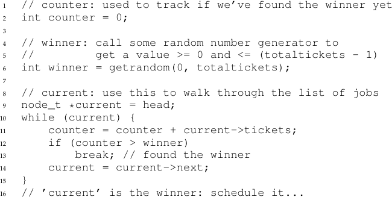
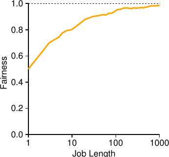
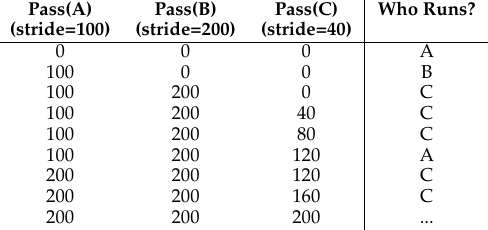
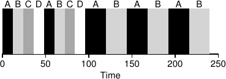
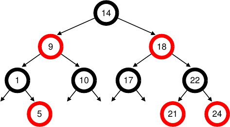

# الفصل 9: الجدولة: الحصة التناسبية

سنفحص في هذا الفصل نوعًا آخر من المجدولات يُعرف بمجدول الحصة التناسبية، ويُسمّى أحيانًا مجدول الحصة العادلة. وتقوم الحصة التناسبية على فكرة بسيطة: بدلًا من أن يحسّن المجدول زمن الاستدارة أو زمن الاستجابة، قد يحاول بدلًا من ذلك أن يضمن لكل عمل نسبة معيّنة من زمن المعالج.

وثمة مثال مبكّر ممتاز على الجدولة بالحصة التناسبية في بحث لـWaldspurger وWeihl [WW94]، ويُعرف بالجدولة باليانصيب؛ غير أن الفكرة أقدم من ذلك بلا شك [KL88]. والفكرة الأساسية بسيطة جدًا: كل فترة، أجرِ قرعة لتحديد العملية التي ينبغي أن تعمل تاليًا؛ والأعمال التي ينبغي أن تعمل أكثر ينبغي أن تُمنح فرصًا أكثر للفوز بالقرعة. سهل، أليس كذلك؟ والآن إلى التفاصيل! لكن ليس قبل جوهر مسألتنا:

> **جوهر المسألة: كيف نتقاسم المعالج تناسبيًا**
>
> كيف نصمّم مجدولًا يتقاسم المعالج تناسبيًا؟ وما الآليات الأساسية لفعل ذلك؟ وما مدى فعاليتها؟

## 9.1 الفكرة الأساسية: التذاكر تمثّل حصتك

يقوم تحت الجدولة باليانصيب مفهوم أساسي واحد: التذاكر، التي تُستعمل لتمثيل حصة المورد التي ينبغي أن تحصل عليها العملية (أو المستخدم أو أي كيان آخر). ونسبة التذاكر التي تملكها العملية تمثّل حصتها من مورد النظام المعني.

ولننظر إلى مثال. تخيّل عمليتين، A وB، ولنفترض كذلك أن A تملك 75 تذكرة بينما تملك B خمسًا وعشرين فقط. ومن ثمّ نريد أن تحصل A على 75% من المعالج وB على النسبة الباقية البالغة 25%.

وتحقّق الجدولة باليانصيب ذلك احتماليًا (لا حتميًا) بإجراء قرعة كل فترة (لنقل كل شريحة زمنية). وإجراء القرعة مباشر: على المجدول أن يعرف العدد الكلي للتذاكر (في مثالنا 100 تذكرة). ثم يختار المجدول تذكرة فائزة، وهي رقم من 0 إلى 99[^1]. وبافتراض أن A تملك التذاكر من 0 إلى 74 وB من 75 إلى 99، فإن التذكرة الفائزة تحدّد ببساطة هل تعمل A أم B. ثم يحمّل المجدول حالة العملية الفائزة ويشغّلها.

> **نصيحة: استعمل العشوائية**
>
> من أجمل جوانب الجدولة باليانصيب استعمالها العشوائية. فحين تضطر إلى اتخاذ قرار، فإن استعمال مقاربة عشوائية كهذه كثيرًا ما يكون طريقة متينة وبسيطة للقيام بذلك.
>
> وللمقاربات العشوائية ثلاث ميزات على الأقل على القرارات التقليدية. أولًا، كثيرًا ما تتجنّب العشوائية سلوكيات الحالات الحدّية الغريبة التي قد يصعب على الخوارزمية التقليدية التعامل معها. فمثلًا، انظر إلى سياسة الإحلال LRU (التي سندرسها بتفصيل أكبر في فصل لاحق عن الذاكرة الظاهرية)؛ فهي، مع أنها خوارزمية إحلال جيدة في الغالب، تبلغ أداء أسوأ حالة في بعض أحمال العمل الدورية المتتابعة. أما العشوائية فليس لها أسوأ حالة كهذه.
>
> ثانيًا، العشوائية خفيفة أيضًا، ولا تحتاج إلى كثير من الحالة لتتبّع البدائل. ففي خوارزمية جدولة عادلة تقليدية، يتطلّب تتبّع مقدار المعالج الذي حصلت عليه كل عملية محاسبةً لكل عملية، يجب تحديثها بعد تشغيل كل عملية. أما فعل ذلك عشوائيًا فيستلزم أدنى قدر من الحالة لكل عملية (مثل عدد التذاكر التي تملكها كل واحدة).
>
> وأخيرًا، يمكن أن تكون العشوائية سريعة جدًا. فما دام توليد رقم عشوائي سريعًا، فإن اتخاذ القرار سريع كذلك، ومن ثمّ يمكن استعمال العشوائية في مواضع كثيرة تتطلّب السرعة. وبالطبع، كلما كانت الحاجة إلى السرعة أكبر، اقتربت العشوائية أكثر من كونها شبه عشوائية.

وهذا مثال على مخرجات التذاكر الفائزة لمجدول يانصيب:

```
63 85 70 39 76 17 29 41 36 39 10 99 68 83 63 62 43 0 49 12
```

وهذا هو المخطّط الزمني الناتج:

```
A A A A A A A A A A A A A A A A B B B B
```

وكما ترى من المثال، يؤدي استعمال العشوائية في الجدولة باليانصيب إلى صحة احتمالية في بلوغ النسبة المرجوّة، ولكن من دون ضمان. في مثالنا أعلاه، لم تعمل B إلا في 4 شرائح زمنية من أصل 20 (أي 20%)، بدلًا من التوزيع المرجوّ البالغ 25%. غير أن هذين العملين كلما طال تنافسهما، زاد احتمال بلوغهما النسب المرجوّة.

> **نصيحة: استعمل التذاكر لتمثيل الحصص**
>
> من أقوى آليات تصميم الجدولة باليانصيب (وبالخطوة) وأكثرها أساسية تلك المتعلّقة بالتذكرة. فالتذكرة تُستعمل لتمثيل حصة العملية من المعالج في هذه الأمثلة، لكنها قابلة للتطبيق على نطاق أوسع بكثير. فمثلًا، في أعمال أحدث عن إدارة الذاكرة الظاهرية للمُشرفات الافتراضية، يبيّن Waldspurger كيف يمكن استعمال التذاكر لتمثيل حصة نظام تشغيل ضيف من الذاكرة [W02]. ومن ثمّ، إن احتجت يومًا إلى آلية لتمثيل نسبة من الملكية، فقد تكون هذه الفكرة بالضبط ... (انتظرها) ... التذكرة.

## 9.2 آليات التذاكر

تقدّم الجدولة باليانصيب أيضًا عددًا من الآليات لمعالجة التذاكر بطرق مختلفة ومفيدة أحيانًا. إحداها مفهوم عملة التذاكر. فالعملة تتيح لمستخدم يملك مجموعة من التذاكر أن يوزّع تذاكر على أعماله بعملة يختارها؛ ثم يحوّل النظام تلك العملة تلقائيًا إلى القيمة الكلية الصحيحة.

فلنفترض مثلًا أن المستخدمين A وB أُعطي كلٌّ منهما 100 تذكرة. والمستخدم A يشغّل عملين، A1 وA2، ويمنح كلًّا منهما 500 تذكرة (من أصل 1000) بعملة A. والمستخدم B يشغّل عملًا واحدًا فقط ويمنحه 10 تذاكر (من أصل 10). فيحوّل النظام توزيع A1 وA2 من 500 لكل منهما بعملة A إلى 50 لكل منهما بالعملة الكلية؛ وبالمثل تُحوّل تذاكر B1 العشر إلى 100 تذكرة. ثم تُجرى القرعة على العملة الكلية للتذاكر (200 تذكرة) لتحديد العمل الذي يعمل.

```
User A -> 500 (A's currency) to A1 -> 50 (global currency)
       -> 500 (A's currency) to A2 -> 50 (global currency)
User B -> 10 (B's currency) to B1 -> 100 (global currency)
```

وثمة آلية مفيدة أخرى هي نقل التذاكر. فبالنقل يمكن للعملية أن تسلّم تذاكرها مؤقتًا إلى عملية أخرى. وهذه القدرة مفيدة خصوصًا في إعداد الخادم/العميل، حيث ترسل عملية عميل رسالة إلى خادم تطلب منه إنجاز بعض العمل نيابة عنها. ولتسريع العمل يمكن للعميل أن يمرّر التذاكر إلى الخادم، فيحاول بذلك تعظيم أداء الخادم في أثناء معالجته طلب العميل. وعند الانتهاء يعيد الخادم التذاكر إلى العميل، فيعود كل شيء كما كان.

وأخيرًا، قد يكون تضخّم التذاكر تقنية مفيدة أحيانًا. فبالتضخّم يمكن للعملية أن ترفع عدد تذاكرها أو تخفضه مؤقتًا. وبالطبع، لا معنى لهذا في سيناريو تنافسي بعمليات لا تثق إحداها بالأخرى؛ إذ يمكن لعملية طمّاعة أن تمنح نفسها عددًا هائلًا من التذاكر وتستولي على الآلة. بل يمكن تطبيق التضخّم في بيئة تثق فيها مجموعة من العمليات بعضها ببعض؛ وفي هذه الحالة، إن عرفت أي عملية أنها تحتاج إلى زمن معالج أكبر، أمكنها أن ترفع قيمة تذاكرها كي تعكس تلك الحاجة إلى النظام، كل ذلك من دون التواصل مع أي عملية أخرى.

## 9.3 التنفيذ

لعل أروع ما في الجدولة باليانصيب بساطة تنفيذها. فكل ما تحتاج إليه مولّد أرقام عشوائية جيد لاختيار التذكرة الفائزة، وبنية بيانات لتتبّع عمليات النظام (كقائمة)، والعدد الكلي للتذاكر.

ولنفترض أننا نحفظ العمليات في قائمة. وهذا مثال من ثلاث عمليات، A وB وC، لكل منها عدد من التذاكر.

```
head ──> [Job:A] ──> [Job:B] ──> [Job:C] ──> NULL
          Tix:100     Tix:50      Tix:250
```

لاتخاذ قرار جدولة، علينا أولًا اختيار رقم عشوائي (الفائز) من العدد الكلي للتذاكر (400)[^2]. ولنقل إننا اخترنا الرقم 300. عندئذ نمرّ على القائمة ببساطة، مع عدّاد بسيط يساعدنا في إيجاد الفائز (الشكل 9.1).

تمرّ الشيفرة على قائمة العمليات، وتضيف قيمة تذاكر كل عملية إلى العدّاد `counter` حتى تتجاوز القيمة `winner`. وحين يحدث ذلك، يكون عنصر القائمة الحالي هو الفائز. وفي مثالنا، حيث التذكرة الفائزة 300، يجري ما يلي. أولًا يُزاد `counter` إلى 100 احتسابًا لتذاكر A؛ ولأن 100 أقل من 300، تستمر الحلقة. ثم يُحدّث `counter` إلى 150 (تذاكر B)، وما زال أقل من 300، فنستمر مرة أخرى. وأخيرًا يُحدّث `counter` إلى 400 (وهو أكبر من 300 بوضوح)، فنخرج من الحلقة و`current` يشير إلى C (الفائز).



**الشكل 9.1:** شيفرة قرار الجدولة باليانصيب

ولجعل هذه العملية في أعلى كفاءتها، قد يكون الأفضل عمومًا ترتيب القائمة ترتيبًا تنازليًا بحسب عدد التذاكر. فالترتيب لا يؤثر في صحة الخوارزمية؛ لكنه يضمن عمومًا أقلّ عدد من دورات المرور على القائمة، خصوصًا إذا كانت هناك عمليات قليلة تملك معظم التذاكر.

## 9.4 مثال

لجعل ديناميكية الجدولة باليانصيب أوضح، نجري الآن دراسة موجزة لزمن إكمال عملين متنافسين، لكل منهما العدد نفسه من التذاكر (100) وزمن التشغيل نفسه (R، وسنغيّره).

في هذا السيناريو نريد أن ينتهي كل عمل في الوقت نفسه تقريبًا، لكن بسبب عشوائية الجدولة باليانصيب ينتهي أحد العملين قبل الآخر أحيانًا. ولقياس هذا الفرق نعرّف مقياس عدالة بسيطًا، F، هو ببساطة زمن إكمال العمل الأول مقسومًا على زمن إكمال العمل الثاني. فمثلًا، إذا كان R = 10 وانتهى العمل الأول عند الزمن 10 (والثاني عند 20)، فإن F = 10/20 = 0.5. وحين ينتهي العملان في الوقت نفسه تقريبًا، يقترب F كثيرًا من 1. وهذا هو هدفنا في هذا السيناريو: المجدول العادل تمامًا يحقّق F = 1.

ويرسم الشكل 9.2 متوسط العدالة مع تغيّر طول العملين (R) من 1 إلى 1000 على مدى ثلاثين تجربة (وتُولّد النتائج بالمحاكي المقدّم في نهاية الفصل). وكما ترى من الرسم، حين لا يكون طول العمل طويلًا جدًا، قد يكون متوسط العدالة منخفضًا جدًا. ولا يقترب مجدول اليانصيب من النتيجة العادلة المرجوّة إلا حين تعمل الأعمال عددًا معتبرًا من الشرائح الزمنية.



**الشكل 9.2:** دراسة عدالة الجدولة باليانصيب

## 9.5 كيف نوزّع التذاكر؟

ثمة مشكلة لم نعالجها في الجدولة باليانصيب: كيف نوزّع التذاكر على الأعمال؟ وهذه مشكلة عسيرة، لأن سلوك النظام يعتمد اعتمادًا قويًا بالطبع على كيفية توزيع التذاكر. وإحدى المقاربات افتراض أن المستخدمين أعلم؛ وفي هذه الحالة يُمنح كل مستخدم عددًا من التذاكر، ويستطيع توزيعها على أي أعمال يشغّلها كما يريد. غير أن هذا الحل ليس حلًّا في الحقيقة: فهو لا يخبرك بما ينبغي فعله. ومن ثمّ تظلّ «مسألة توزيع التذاكر» مفتوحة، بمعلومية مجموعة من الأعمال.

## 9.6 الجدولة بالخطوة

قد تتساءل أيضًا: لماذا نستعمل العشوائية أصلًا؟ رأينا أعلاه أن العشوائية تمنحنا مجدولًا بسيطًا (وصحيحًا تقريبًا)، لكنها لا توفّر النسب الصحيحة بالضبط أحيانًا، خصوصًا على المقاييس الزمنية القصيرة. ولهذا السبب ابتكر Waldspurger الجدولة بالخطوة، وهي مجدول حصة عادلة حتمي [W95].

والجدولة بالخطوة مباشرة أيضًا. فلكل عمل في النظام خطوة تتناسب عكسيًا مع عدد تذاكره. وفي مثالنا أعلاه، بالأعمال A وB وC التي تملك 100 و50 و250 تذكرة على الترتيب، يمكننا حساب خطوة كل منها بقسمة عدد كبير ما على عدد التذاكر الممنوحة لكل عملية. فمثلًا، إذا قسمنا 10,000 على كل من قيم التذاكر تلك، حصلنا على قيم الخطوة الآتية لـA وB وC: 100 و200 و40. ونسمّي هذه القيمة خطوة كل عملية؛ وكل مرة تعمل فيها عملية، نزيد لها عدّادًا (يُسمّى قيمة المرور) بمقدار خطوتها لتتبّع تقدّمها الكلي.

ثم يستعمل المجدول الخطوة وقيمة المرور لتحديد العملية التي ينبغي أن تعمل تاليًا. والفكرة الأساسية بسيطة: في أي لحظة، اختر العملية التي لها أدنى قيمة مرور حتى الآن؛ وحين تشغّل عملية، زد عدّاد مرورها بمقدار خطوتها. ويقدّم Waldspurger تنفيذًا شبه-شيفري [W95]:

```
curr = remove_min(queue);   // pick client with min pass
schedule(curr);             // run for quantum
curr->pass += curr->stride; // update pass using stride
insert(queue, curr);        // return curr to queue
```

في مثالنا نبدأ بثلاث عمليات (A وB وC) بقيم خطوة 100 و200 و40، وجميع قيم المرور لديها صفر في البداية. ومن ثمّ يمكن أن تعمل أي عملية في البداية، لأن قيم مرورها متساوية الانخفاض. لنفترض أننا اخترنا A (اعتباطيًا؛ كان يمكن اختيار أي عملية ذات قيمة مرور منخفضة مساوية). فتعمل A؛ وعند انتهاء الشريحة الزمنية نحدّث قيمة مرورها إلى 100. ثم نشغّل B، فتُضبط قيمة مرورها عند 200. وأخيرًا نشغّل C، فتُزاد قيمة مرورها إلى 40. عند هذه النقطة تختار الخوارزمية أدنى قيمة مرور، وهي قيمة C، وتشغّلها، فتُحدّث قيمة مرورها إلى 80 (فخطوة C هي 40 كما تذكر). ثم ستعمل C مرة أخرى (فهي ما زالت أدنى قيمة مرور)، فترفع قيمة مرورها إلى 120. وستعمل A الآن، فتُحدّث قيمة مرورها إلى 200 (وهي الآن مساوية لقيمة B). ثم ستعمل C مرتين أخريين، فترفع قيمة مرورها إلى 160 ثم 200. وعند هذه النقطة تتساوى قيم المرور كلها مرة أخرى، وتتكرّر العملية إلى ما لا نهاية. ويتتبّع الشكل 9.3 سلوك المجدول عبر الزمن.



**الشكل 9.3:** الجدولة بالخطوة: تتبّع

وكما نرى من الشكل، عملت C خمس مرات، وA مرتين، وB مرة واحدة فقط، وذلك بتناسب تام مع قيم تذاكرها 250 و100 و50. فالجدولة باليانصيب تحقّق النسب احتماليًا مع مرور الوقت؛ أما الجدولة بالخطوة فتحقّقها بدقة في نهاية كل دورة جدولة.

فلعلك تتساءل الآن: على دقة الجدولة بالخطوة، لماذا نستعمل الجدولة باليانصيب إطلاقًا؟ حسنًا، للجدولة باليانصيب خاصية جميلة لا تملكها الجدولة بالخطوة: لا حالة كلية. تخيّل أن عملًا جديدًا يدخل في منتصف مثال الجدولة بالخطوة أعلاه؛ فماذا ينبغي أن تكون قيمة مروره؟ هل تُضبط عند صفر؟ إن كان الأمر كذلك، فسيحتكر المعالج. أما في الجدولة باليانصيب فلا حالة كلية لكل عملية؛ بل نضيف ببساطة عملية جديدة بما تملكه من تذاكر، ونحدّث المتغيّر الكلي الوحيد لتتبّع العدد الكلي للتذاكر، وننطلق من هناك. وبهذه الطريقة تجعل الجدولة باليانصيب إدماج العمليات الجديدة على نحو معقول أسهل بكثير.

## 9.7 المجدول العادل تمامًا في لينكس (CFS)

على الرغم من هذه الأعمال المبكّرة في جدولة الحصة العادلة، فإن مقاربة لينكس واحدة (أقدم) تحقّق أهدافًا مشابهة بطريقة بديلة. فالمجدول المسمّى المجدول العادل تمامًا (CFS) [J09] ينفّذ جدولة الحصة العادلة، لكنه يفعل ذلك بكفاءة عالية وقابلية توسّع.

ولتحقيق أهداف كفاءته، يهدف CFS إلى إنفاق وقت قليل جدًا في اتخاذ قرارات الجدولة، بفضل تصميمه المتأصّل واستعماله الذكي لبنى بيانات ملائمة للمهمة. وقد أظهرت دراسات حديثة أن كفاءة المجدول مهمة على نحو مفاجئ؛ ففي دراسة لمراكز بيانات جوجل، يبيّن Kanev وآخرون أن الجدولة تستهلك نحو 5% من زمن معالج مركز البيانات الكلي حتى بعد تحسين عدواني [K+15]. ومن ثمّ فإن تقليل تلك الكلفة إلى أدنى حدّ ممكن هدف أساسي في معمارية المجدولات الحديثة.



**الشكل 9.4:** مثال مبسّط على CFS

### التشغيل الأساسي

بينما تقوم معظم المجدولات على مفهوم الشريحة الزمنية الثابتة، يعمل CFS على نحو مختلف قليلًا. فهدفه بسيط: أن يقسم معالجًا بين جميع العمليات المتنافسة قسمة عادلة متساوية. ويحقّق ذلك بتقنية بسيطة قائمة على العدّ تُعرف بزمن التشغيل الافتراضي.

وكلما عملت عملية، راكمت زمن التشغيل الافتراضي. وفي الحالة الأساسية، يزيد زمن التشغيل الافتراضي لكل عملية بالمعدّل نفسه، تناسبًا مع الزمن الفيزيائي (الحقيقي). وحين يحدث قرار جدولة، يختار CFS العملية ذات أدنى زمن تشغيل افتراضي لتعمل تاليًا.

وهذا يطرح سؤالًا: كيف يعرف المجدول متى يوقف العملية العاملة الآن ويشغّل التالية؟ والتوتّر هنا واضح: إذا بدّل CFS كثيرًا، زادت العدالة، لأن CFS سيضمن أن تحصل كل عملية على حصتها من المعالج حتى على نوافذ زمنية ضئيلة، لكن بثمن في الأداء (تبديل سياق أكثر من اللازم)؛ وإذا بدّل CFS أقلّ، زاد الأداء (تبديل سياق أقلّ)، لكن بثمن في العدالة على المدى القريب.

ويتحكّم CFS في هذا التوتّر عبر وسائط تحكّم متنوّعة. أولها `sched_latency`. يستعمل CFS هذه القيمة لتحديد المدة التي ينبغي أن تعملها العملية قبل التفكير في التبديل (أي يحدّد بفعالية شريحتها الزمنية، لكن بطريقة ديناميكية). والقيمة النموذجية لـ`sched_latency` هي 48 (مللي ثانية)؛ ويقسم CFS هذه القيمة على عدد العمليات (n) العاملة على المعالج لتحديد الشريحة الزمنية للعملية، فيضمن بذلك أن يكون CFS عادلًا تمامًا خلال هذه المدة.

فمثلًا، إذا كان هناك n = 4 عمليات عاملة، يقسم CFS قيمة `sched_latency` على n ليصل إلى شريحة زمنية مقدارها 12 مللي ثانية لكل عملية. ثم يجدول CFS العمل الأول ويشغّله حتى يستهلك 12 مللي ثانية من زمن التشغيل (الافتراضي)، ثم يفحص هل ثمة عمل بزمن تشغيل افتراضي أقلّ يعمل بدلًا منه. وفي هذه الحالة يوجد، فينتقل CFS إلى أحد الأعمال الثلاثة الأخرى، وهكذا. ويعرض الشكل 9.4 مثالًا تعمل فيه الأعمال الأربعة (A وB وC وD) شريحتين زمنيتين لكل منها على هذا النحو؛ ثم يكمل اثنان منها (C وD)، فلا يبقى إلا عملان يعمل كلٌّ منهما 24 مللي ثانية بالتناوب الدوري.

لكن ماذا لو كانت هناك عمليات «كثيرة جدًا» تعمل؟ ألن يؤدي ذلك إلى شريحة زمنية أصغر من اللازم، ومن ثمّ إلى تبديلات سياق أكثر من اللازم؟ سؤال جيد! والجواب نعم.

ولمعالجة هذه المسألة، يضيف CFS وسيطًا آخر، `min_granularity`، الذي يُضبط عادةً عند قيمة مثل 6 مللي ثانية. فلن يضبط CFS الشريحة الزمنية لعملية عند أقلّ من هذه القيمة أبدًا، بما يضمن ألّا يُنفق كثير من الوقت في كلفة الجدولة.

فمثلًا، إذا كانت هناك عشر عمليات عاملة، فإن حسابنا الأصلي سيقسم `sched_latency` على عشرة لتحديد الشريحة الزمنية (والنتيجة 4.8 مللي ثانية). لكن CFS سيضبط، بفضل `min_granularity`، الشريحة الزمنية لكل عملية عند 6 مللي ثانية بدلًا من ذلك. ومع أن CFS لن يكون عادلًا (تمامًا) خلال كمون الجدولة المستهدف (`sched_latency`) البالغ 48 مللي ثانية، فسيكون قريبًا، مع تحقيق كفاءة عالية للمعالج.

لاحظ أن CFS يستعمل مقاطعة مؤقّت دورية، أي إنه لا يستطيع اتخاذ قرارات إلا على فواصل زمنية ثابتة. وهذه المقاطعة تُطلق متكرّرًا (كل 1 مللي ثانية مثلًا)، فتتيح لـCFS فرصة الاستيقاظ وتحديد هل بلغ العمل الحالي نهاية تشغيله. وإن كانت الشريحة الزمنية لعمل ما ليست مضاعفًا تامًا لفاصل مقاطعة المؤقّت، فلا بأس؛ إذ يتتبّع CFS زمن التشغيل الافتراضي بدقة، أي إنه سيقارب على المدى الطويل التشارك المثالي في المعالج.

### الترجيح (اللطف)

يتيح CFS أيضًا تحكّمًا في أولوية العمليات، فيمكّن المستخدمين أو المديرين من منح بعض العمليات حصة أكبر من المعالج. ولا يفعل ذلك بالتذاكر، بل بآلية يونكس كلاسيكية تُعرف بمستوى اللطف للعملية. ويمكن ضبط وسيط اللطف عند أي قيمة من -20 إلى +19 للعملية، والافتراضي صفر. وقيم اللطف الموجبة تعني أولوية أدنى، والسلبية تعني أولوية أعلى؛ فحين تكون لطيفًا أكثر من اللازم، لا تحصل على قدر كبير من الاهتمام (الجدولي)، للأسف.

ويقابل CFS قيمة اللطف لكل عملية بوزن، كما هو موضّح هنا:

```
static const int prio_to_weight[40] = {
    /* -20 */ 88761, 71755, 56483, 46273, 36291,
    /* -15 */ 29154, 23254, 18705, 14949, 11916,
    /* -10 */ 9548, 7620, 6100, 4904, 3906,
    /* -5 */ 3121, 2501, 1991, 1586, 1277,
    /*   0 */ 1024,    820,   655,   526,   423,
    /*   5 */   335,   272,   215,   172,   137,
    /*  10 */   110,    87,    70,    56,    45,
    /*  15 */    36,    29,    23,    18,    15,
};
```

تتيح لنا هذه الأوزان حساب الشريحة الزمنية الفعالة لكل عملية (كما فعلنا سابقًا)، لكن مع مراعاة فروق أولوياتها الآن. والصيغة المستعملة لذلك هي الآتية، بافتراض وجود n عمليات:

> الشريحة الزمنية للعملية k = (وزن العملية k ÷ مجموع أوزان العمليات من i = 0 إلى n−1) × `sched_latency` (9.1)

ولنأخذ مثالًا لنرى كيف يعمل هذا. افترض وجود عملين، A وB. فـA، لأنه عملنا الأغلى، يحصل على أولوية أعلى بإسناد قيمة لطف مقدارها -5 إليه؛ أما B، لأننا نكرهه[^3]، فله الأولوية الافتراضية فقط (قيمة لطف تساوي صفرًا). وهذا يعني أن وزن A (من الجدول) هو 3121، بينما وزن B هو 1024. وإذا حسبت بعد ذلك الشريحة الزمنية لكل عمل، فستجد أن شريحة A الزمنية نحو ثلاثة أرباع `sched_latency` (أي 36 مللي ثانية)، وشريحة B نحو الربع (أي 12 مللي ثانية).

وإضافة إلى تعميم حساب الشريحة الزمنية، ينبغي تكييف طريقة حساب CFS لزمن التشغيل الافتراضي أيضًا. وهذه هي الصيغة الجديدة، التي تأخذ زمن التشغيل الفعلي الذي راكمته العملية i وتُعيد قياسه عكسيًا بوزن العملية، أي بقسمة الوزن الافتراضي 1024 على وزنها.

> زمن التشغيل الافتراضي للعملية i = قيمته السابقة + (1024 ÷ وزن العملية i) × زمن تشغيلها الفعلي (9.2)

وفي مثالنا الجاري، سيتراكم زمن التشغيل الافتراضي لـA بمعدّل ثلث معدّل B.

وثمة جانب ذكي في بناء جدول الأوزان أعلاه: أن الجدول يحفظ نسب تناسب المعالج حين يكون الفرق بين قيم اللطف ثابتًا. فمثلًا، لو كانت قيمة لطف العملية A هي 5 (لا -5)، وقيمة لطف B هي 10 (لا صفر)، لجدولهما CFS بالطريقة نفسها تمامًا كما سابقًا. أجرِ الحساب بنفسك لترى لماذا.

### استعمال الأشجار الحمراء-السوداء

ثمة محور رئيسي في CFS هو الكفاءة، كما ذُكر أعلاه. وفي المجدول جوانب كثيرة للكفاءة، لكن أحدها بسيط كهذا: حين يتعيّن على المجدول إيجاد العمل التالي الذي سيعمل، ينبغي أن يفعل ذلك بأسرع ما يمكن. وبنى البيانات البسيطة كالقوائم لا تتوسّع: فالنظم الحديثة تتألف أحيانًا من آلاف العمليات، ومن ثمّ فإن البحث في قائمة طويلة كل بضعة ميلي ثوانٍ إنفاقٌ مبدَّد.

ويعالج CFS ذلك بحفظ العمليات في شجرة حمراء-سوداء [B72]. والشجرة الحمراء-السوداء نوع من أنواع كثيرة من الأشجار المتوازنة؛ وخلافًا للشجرة الثنائية البسيطة (التي قد تتدهوّر إلى أداء شبيه بالقائمة في أنماط إدراج أسوأ الحالات)، تبذل الأشجار المتوازنة عملًا إضافيًا للحفاظ على أعماق منخفضة، فتضمن بذلك أن تكون العمليات لوغاريتمية (لا خطية) في الزمن.

ولا يحفظ CFS جميع العمليات في هذه البنية؛ بل لا يُحفظ فيها إلا العمليات العاملة (أو القابلة للعمل). فإذا نامت عملية (بأن انتظرت إكمال إدخال/إخراج، أو وصول حزمة شبكة)، أُزيلت من الشجرة وتُتبع في مكان آخر.



**الشكل 9.5:** شجرة CFS الحمراء-السوداء

ولننظر إلى مثال لجعل هذا أوضح. افترض وجود عشر أعمال، ولها قيم زمن التشغيل الافتراضي الآتية: 1 و5 و9 و10 و14 و18 و17 و21 و22 و24. ولو حفظنا هذه الأعمال في قائمة مرتّبة، لأصبح إيجاد العمل التالي بسيطًا: ما عليك إلا إزالة العنصر الأول. لكن عند إعادة ذلك العمل إلى القائمة (بالترتيب)، علينا أن نمسح القائمة بحثًا عن الموضع الصحيح لإدراجه، وهي عملية من الرتبة O(n). وأي بحث غير كفؤ أيضًا، فهو يستغرق زمنًا خطيًا في المتوسط.

وحفظ القيم نفسها في شجرة حمراء-سوداء يجعل معظم العمليات أكثر كفاءة، كما يُصوّر الشكل 9.5. فالعمليات مرتّبة في الشجرة حسب زمن التشغيل الافتراضي، ومعظم العمليات (كالإدراج والحذف) لوغاريتمية في الزمن، أي O(log n). وحين تكون n بالآلاف، تكون اللوغاريتمية أكثر كفاءة بشكل ملحوظ من الخطية.

### التعامل مع الإدخال/الإخراج والعمليات النائمة

ثمة مشكلة في اختيار أدنى زمن تشغيل افتراضي ليعمل تاليًا تنشأ مع الأعمال التي نامت مدة طويلة. تخيّل عمليتين، A وB، تعمل إحداهما (A) باستمرار، والأخرى (B) نامت مدة طويلة (لنقل 10 ثوانٍ). وحين تستيقظ B، سيكون زمن تشغيلها الافتراضي متأخرًا عشر ثوانٍ عن زمن A، ومن ثمّ ستحتكر B (إن لم نكن حذرين) المعالج في الثواني العشر التالية في أثناء لحاقها، فتُضوّر A جوعًا فعليًا.

ويعالج CFS هذه الحالة بتغيير زمن التشغيل الافتراضي للعمل حين يستيقظ. وبتحديد أدقّ، يضبط CFS زمن التشغيل الافتراضي لذلك العمل عند أدنى قيمة موجودة في الشجرة (وتذكّر أن الشجرة لا تضم إلا الأعمال العاملة) [B+18]. وهكذا يتجنّب CFS التضوّر جوعًا، لكن بثمن: الأعمال التي تنام مددًا قصيرة متكرّرة لا تحصل في الغالب على حصتها العادلة أبدًا [AC97].

### متع أخرى في CFS

لـCFS ميزات أخرى كثيرة، أكثر مما يمكن بحثه في هذه المرحلة من الكتاب. فهو يضم استدلالات متعدّدة لتحسين أداء الذاكرة المخبئية، وله استراتيجيات للتعامل مع المعالجات المتعددة بفعالية (كما سيُبحث لاحقًا في الكتاب)، ويستطيع الجدولة على مجموعات كبيرة من العمليات (بدلًا من معاملة كل عملية ككيان مستقل)، وغير ذلك من الميزات المثيرة للاهتمام. اقرأ الأبحاث الحديثة، بدءًا بـBouron [B+18]، لتعرف المزيد.

> **نصيحة: استعمل بنى بيانات كفؤة حين يليق ذلك**
>
> في حالات كثيرة تكفي القائمة. وفي حالات كثيرة لا تكفي. ومعرفة بنية البيانات التي تستعملها ومتى علامة على هندسة جيدة. وفي الحالة المبحوثة هنا، فإن القوائم البسيطة الموجودة في المجدولات الأقدم لا تعمل جيدًا ببساطة على النظم الحديثة، خصوصًا في الخوادم الشديدة الحمل الموجودة في مراكز البيانات. فمثل هذه النظم تضم آلاف العمليات النشطة؛ والبحث في قائمة طويلة لإيجاد العمل التالي ليعمل على كل نواة كل بضعة ميلي ثوانٍ سيهدر دورات معالج ثمينة. كانت ثمة حاجة إلى بنية أفضل، وقد قدّمها CFS بإضافة تنفيذ ممتاز لشجرة حمراء-سوداء. وبوجه أعمّ، حين تختار بنية بيانات لنظام تبنيه، انظر بعناية إلى أنماط وصوله وإلى تكرار استعماله؛ فبفهم ذلك ستتمكّن من تنفيذ البنية الصحيحة للمهمة المطروحة.

## 9.8 الخلاصة

قدّمنا مفهوم جدولة الحصة التناسبية وناقشنا بإيجاز ثلاث مقاربات: الجدولة باليانصيب، والجدولة بالخطوة، وCFS. فاليانصيب يستعمل العشوائية بذكاء لتحقيق الحصة التناسبية؛ والخطوة تحقّقها حتميًا. أما CFS، وهو المجدول «الحقيقي» الوحيد المبحوث في هذا الفصل، فشبيه إلى حدٍّ ما بالجولة المستديرة الموزونة بشرائح زمنية ديناميكية، لكنه مبني ليتوسّع ويؤدي أداءً جيدًا تحت الحمل؛ وقد كان لسنوات كثيرة أكثر مجدول حصة عادلة استعمالًا على نطاق واسع.

ولا مجدول دواءً لكل داء، ولمجدولات الحصة العادلة حصتها العادلة من المشكلات. وإحدى المشكلات أن هذه المقاربات لا تنسجم انسجامًا جيدًا مع الإدخال/الإخراج [AC97]؛ فكما ذُكر أعلاه، قد لا تحصل الأعمال التي تجري إدخالًا/إخراجًا حينًا على حصتها العادلة من المعالج. ومشكلة أخرى أنها تترك مفتوحة مسألة توزيع التذاكر أو الأولويات العسيرة، أي كيف تعرف عدد التذاكر التي ينبغي تخصيصها لمتصفحك، أو قيمة اللطف التي تضبط عليها محرّر نصوصك؟ أما المجدولات العامة الأخرى (كـMLFQ التي بحثناها سابقًا) فتعالج هذه المسائل تلقائيًا، ومن ثمّ قد يكون نشرها أسهل.

والخبر السار أن ثمة مجالات كثيرة لا تكون فيها هذه المشكلات الشاغل الغالب، فتُستعمل مجدولات الحصة التناسبية بأثر عظيم. فمثلًا، في مركز بيانات مُستضاف (أو سحابة)، حيث قد ترغب في تخصيص ربع دورات معالجك لجهاز Windows الافتراضي والباقي لتثبيت لينكس الأساسي لديك، يمكن أن يكون التشارك التناسبي بسيطًا وفعّالًا. ويمكن توسيع الفكرة إلى موارد أخرى أيضًا؛ انظر Waldspurger [W02] لمزيد من التفاصيل.

وأخيرًا، فإن عالم لينكس في تغيّر دائم. فبدءًا من لينكس 6.6 صار مجدول «الأجل الافتراضي الأسبق المؤهّل أولًا» (EEVDF)، وهو مقاربة أخرى للتشارك العادل، هو الافتراضي. اذهب واقرأ المزيد عن EEVDF [Z23, SA95] لمعلومات إضافية. وفي اللحظة التي ظننت فيها أنك انتهيت!

## المراجع

> [AC97] «Extending Proportional-Share Scheduling to a Network of Workstations» لـAndrea C. Arpaci-Dusseau وDavid E. Culler. PDPTA'97، يونيو 1997. ورقة لأحد المؤلفين عن كيفية توسيع جدولة الحصة التناسبية لتؤدي عملها على نحو أفضل في بيئة عنقودية.

> [B+18] «The Battle of the Schedulers: FreeBSD ULE vs. Linux CFS» لـJ. Bouron وS. Chevalley وB. Lepers وW. Zwaenepoel وR. Gouicem وJ. Lawall وG. Muller وJ. Sopena. USENIX ATC '18، يوليو 2018، بوسطن، ماساتشوستس. عمل حديث ومفصّل يقارن بين CFS في لينكس ومجدولات FreeBSD. ويُقدّم أيضًا نظرة عامة ممتازة على كل مجدول. ونتيجة المقارنة: غير حاسمة. ففي بعض الحالات كان CFS أفضل، وفي أخرى كان ULE (مجدول BSD) أفضل. أحيانًا لا توجد أجوبة سهلة في الحياة.

> [B72] «Symmetric binary B-Trees: Data Structure And Maintenance Algorithms» لـRudolf Bayer. Acta Informatica، المجلد 1، العدد 4، ديسمبر 1972. شجرة متوازنة أنيقة قُدّمت قبل أن تُولد (على الأرجح). واحدة من أشجار متوازنة كثيرة موجودة؛ ادرس كتاب الخوارزميات لديك لمزيد من البدائل!

> [D82] «Why Numbering Should Start At Zero» لـEdsger Dijkstra، أغسطس 1982. متاح على: http://www.cs.utexas.edu/users/EWD/ewd08xx/EWD831.PDF. ملاحظة قصيرة من إ. ديكسترا، أحد روّاد علم الحاسوب. وسنسمع الكثير عن هذا الرجل في القسم الخاص بالتزامن. وفي أثناء ذلك، استمتع بهذه الملاحظة التي تضم هذا الاقتباس المحفّز: «اتهمني أحد زملائي — وليس عالم حاسوب — أنا وعددًا من علماء الحاسوب الشباب بالتنطّع لأننا بدأنا الترقيم من الصفر». وتشرح الملاحظة لماذا فعل ذلك منطقي.

> [K+15] «Profiling A Warehouse-scale Computer» لـS. Kanev وP. Ranganathan وJ. P. Darago وK. Hazelwood وT. Moseley وG. Wei وD. Brooks. ISCA '15، يونيو 2015، بورتلاند، أوريغون. دراسة رائعة عن أين تذهب الدورات في مراكز البيانات الحديثة، التي صارت على نحو متزايد المكان الذي يجري فيه معظم الحوسبة. فقرابة 20% من زمن المعالج يُنفق في نظام التشغيل، و5% في المجدول وحده!

> [J09] «Inside The Linux 2.6 Completely Fair Scheduler» لـM. Tim Jones. 15 ديسمبر 2009. https://pages.cs.wisc.edu/%7Eremzi/OSTEP/Citations/inside-cfs.pdf. نظرة عامة بسيطة على CFS في أيامه الأولى. وقد ابتكر Ingo Molnar هذا المجدول في دفعة إبداعية قصيرة أثمرت رقعة نواة بحجم 100 ألف سطر طُوّرت في 62 ساعة.

> [KL88] «A Fair Share Scheduler» لـJ. Kay وP. Lauder. CACM، المجلد 31، العدد 1، يناير 1988. إشارة مبكّرة إلى مجدول الحصة العادلة.

> [SA95] «Earliest Eligible Virtual Deadline First: A Flexible and Accurate Mechanism for Proportional Share Resource Allocation» لـIon Stoica وHussein M. Abdel-Wahab. تقرير تقني، قسم علوم الحاسوب، جامعة Old Dominion، TR-95-22. التقرير التقني الذي قدّم EEVDF. وقد واصل Ion Stoica إسهاماته الكبيرة في الأنظمة، ومنها Apache Spark وتأسيس Databricks وغير ذلك الكثير.

> [WW94] «Lottery Scheduling: Flexible Proportional-Share Resource Management» لـCarl A. Waldspurger وWilliam E. Weihl. OSDI '94، نوفمبر 1994. الورقة الرائدة في الجدولة باليانصيب التي أعادت تنشيط مجتمع الأنظمة في شأن الجدولة والتشارك العادل وقوة الخوارزميات العشوائية البسيطة.

> [W95] «Lottery and Stride Scheduling: Flexible Proportional-Share Resource Management» لـCarl A. Waldspurger. أطروحة دكتوراه، MIT، 1995. أطروحة Waldspurger الحائزة على جوائز، التي تعرض الجدولة باليانصيب والجدولة بالخطوة. وإن كنت تفكّر في كتابة أطروحة دكتوراه يومًا، فينبغي أن يكون لديك دائمًا مثال جيد أمامك لتسعى إليه: وهذه أطروحة جيدة إلى هذا الحد.

> [W02] «Memory Resource Management in VMware ESX Server» لـCarl A. Waldspurger. OSDI '02، بوسطن، ماساتشوستس. الورقة التي ينبغي قراءتها في إدارة الذاكرة في المشرفات الافتراضية. وإضافة إلى سهولتها النسبية في القراءة، تضم الورقة أفكارًا رائعة كثيرة عن هذا النوع الجديد من إدارة الذاكرة على مستوى المشرف الافتراضي.

> [Z23] «The EEVDF Scheduler» لـPeter Zijlstra. اذهب إلى هذا الرابط لتفاصيل عن EEVDF: https://docs.kernel.org/scheduler/sched-eevdf.html. فما زال لينكس يتغيّر!

## الواجب (محاكاة)

هذا البرنامج، `lottery.py`، يتيح لك رؤية كيف يعمل مجدول اليانصيب. انظر ملف README للتفاصيل.

## الأسئلة

1. احسب الحلول لمحاكاة بثلاثة أعمال وبذور عشوائية 1 و2 و3.

2. شغّل الآن بعملين محدّدين: طول كل منهما 10، لكن أحدهما (العمل 0) بتذكرة واحدة والآخر (العمل 1) بمئة تذكرة (مثلًا `-l 10:1,10:100`). ماذا يحدث حين يكون عدد التذاكر بهذا القدر من الاختلال؟ هل سيعمل العمل 0 قبل أن يكمل العمل 1 أبدًا؟ وكم مرة؟ وبوجه عامّ، ماذا يفعل اختلال التذاكر هذا بسلوك الجدولة باليانصيب؟

3. حين تشغّل بعملين طول كل منهما 100 وتوزيع تذاكر متساوٍ مقداره 100 (`-l 100:100,100:100`)، ما مدى عدم عدالة المجدول؟ شغّل ببذور عشوائية مختلفة لتحديد الجواب (الاحتمالي)؛ وليُحدَّد عدم العدالة بمقدار ما ينتهي به عمل قبل الآخر.

4. كيف يتغيّر جوابك على السؤال السابق كلما كبر حجم الكمّ الزمني (`-q`)؟

5. هل تستطيع أن تصنع نسخة من الرسم الموجود في الفصل؟ وما الذي يستحق الاستكشاف أيضًا؟ وكيف سيبدو الرسم مع مجدول الخطوة؟

[^1]: يبدأ علماء الحاسوب دائمًا العدّ من صفر. وهذا غريب إلى حدّ أن أناسًا مشهورين وجدوا أنفسهم مضطرين إلى الكتابة عن سبب فعلنا ذلك بهذه الطريقة [D82].

[^2]: من المفاجئ، كما أشار Björn Lindberg، أن هذا قد يكون عسيرًا إن أُريد له أن يُفعل على نحو صحيح؛ لمزيد من التفاصيل، انظر http://stackoverflow.com/questions/2509679/how-to-generate-a-random-number-from-within-a-range.

[^3]: نعم، نعم، نحن نستعمل قواعد نحوية رديئة هنا عن قصد، فلا ترسل لنا تصحيحًا للخطأ. ولماذا؟ حسنًا، إنها إشارة خفيفة جدًا إلى «سيد الخواتم»، وإلى بطلنا المخالف المحبوب Gollum، ولا شيء يستدعي كثيرًا من الحماس.
