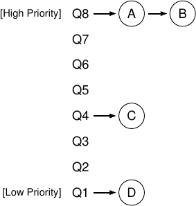
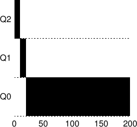
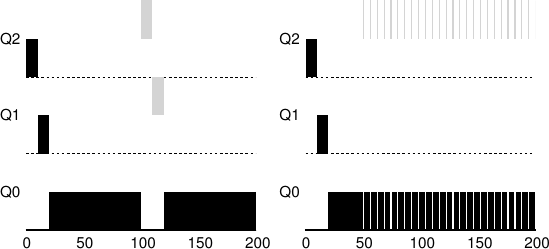
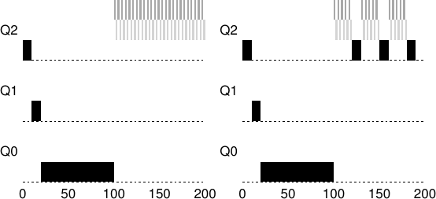
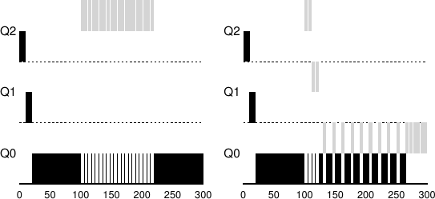
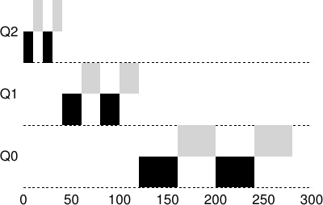

# الفصل 8: الجدولة: قائمة الانتظار متعددة المستويات

في هذا الفصل سنعالج مشكلة تطوير واحدة من أشهر مقاربات الجدولة، المعروفة بقائمة الانتظار متعددة المستويات (MLFQ). وقد وصف كورباتو وزملاؤه مجدول MLFQ أول مرّة في عام 1962 [C+62] في نظام يُعرف بنظام المشاركة الزمنية المتوافق (CTSS)، وقد أدّى هذا العمل، مع أعمال لاحقة على نظام Multics، إلى منح رابطة ACM كورباتو أعلى وسام لديها، وهو وسام تورينغ. ثم صُقل المجدول على مرّ السنين حتى بلغ التطبيقات التي ستلقاها في بعض الأنظمة الحديثة.

والمشكلة الأساسية التي تحاول MLFQ معالجتها مزدوجة. أولًا، تريد تحسين زمن الاستدارة، وهو ما يتحقّق، كما رأينا في الملاحظة السابقة، بتشغيل المهام الأقصر أولًا؛ لكن نظام التشغيل لا يعرف عمومًا كم ستعمل المهمة، وهي المعرفة نفسها التي تحتاجها خوارزميات كـSJF (أو STCF). وثانيًا، تريد MLFQ أن تجعل النظام يبدو متجاوبًا مع المستخدمين التفاعليين (أي المستخدمين الجالسين ينظرون إلى الشاشة ينتظرون انتهاء عملية ما)، ومن ثمّ تقليل زمن الاستجابة؛ لكن خوارزميات كالجولة المستديرة تقلّل زمن الاستجابة وهي بائسة في زمن الاستدارة. وعليه تظهر مسألتنا: بما أننا لا نعرف عمومًا شيئًا عن العملية، فكيف نبني مجدولًا يحقّق هذين الهدفين؟ وكيف يتعلّم المجدول، أثناء عمل النظام، خصائص المهام التي يشغّلها، فيتّخذ بذلك قرارات جدولة أفضل؟

> **جوهر المسألة: كيف نجدول دون معرفة كاملة**
>
> كيف نصمّم مجدولًا يقلّل زمن الاستجابة للمهام التفاعلية إلى أدنى حدّ، ويقلّل في الوقت نفسه زمن الاستدارة، دون معرفة مسبقة بطول المهمة؟

> **نصيحة: تعلّم من التاريخ**
>
> قائمة الانتظار متعددة المستويات مثال ممتاز على نظام يتعلّم من الماضي ليتنبّأ بالمستقبل. وهذه المقاربات شائعة في أنظمة التشغيل (وفي مواضع كثيرة أخرى من علوم الحاسوب، ومنها متوقّعات التفرّع في العتاد وخوارزميات التخزين المؤقت). وهي تعمل حين تكون للمهام أطوار من السلوك، فيصير سلوكها قابلًا للتنبّؤ؛ وبالطبع على المرء أن يحتاط بهذه التقنيات، لأنها قد تخطئ بسهولة فتدفع النظام إلى قرارات أسوأ ممّا كان سيتّخذه بلا معرفة على الإطلاق.

## 8.1 MLFQ: القواعد الأساسية

لبناء مجدول كهذا، سنصف في هذا الفصل الخوارزميات الأساسية وراء قائمة الانتظار متعددة المستويات؛ ومع أن تفاصيل كثير من مجدولات MLFQ المنفَّذة تختلف [E95]، فمعظم المقاربات متشابهة.

وفي معالجتنا، لـMLFQ عدد من الطوابير المتمايزة، ولكل منها مستوى أولوية مختلف. وفي أي لحظة، تكون المهمة الجاهزة للعمل في طابور واحد. وتستعمل MLFQ الأولويات لتقرّر أي مهمة ينبغي أن تعمل في وقت معيّن: فتُختار المهمة ذات الأولوية الأعلى (أي المهمة الموجودة في طابور أعلى) للعمل.

وبالطبع قد يكون في الطابور الواحد أكثر من مهمة، ومن ثمّ تتساوى أولوياتها. وفي هذه الحالة نستعمل ببساطة الجدولة بالجولة المستديرة بين تلك المهام.

وهكذا نبلغ أول قاعدتين أساسيتين لـMLFQ:

- القاعدة 1: إذا كانت أولوية A أعلى من أولوية B، عملت A (ولم تعمل B).

- القاعدة 2: إذا كانت أولوية A مساوية لأولوية B، عملت A وB بالجولة المستديرة.

ومفتاح الجدولة بـMLFQ يكمن إذن في كيفية ضبط المجدول للأولويات. فبدلًا من إعطاء كل مهمة أولوية ثابتة، تُغيّر MLFQ أولوية المهمة بناءً على سلوكها الملاحَظ. فإن كانت المهمة، مثلًا، تتخلّى عن المعالج مرارًا وهي تنتظر دخلًا من لوحة المفاتيح، أبقَت MLFQ أولويتها عالية، لأن هذا هو سلوك عملية تفاعلية. وإن كانت المهمة، على النقيض، تستعمل المعالج استعمالًا مكثّفًا لفترات طويلة، خفّضت MLFQ أولويتها. وبهذه الطريقة تحاول MLFQ أن تتعلّم عن العمليات أثناء عملها، فتستعمل تاريخ المهمة للتنبّؤ بسلوكها في المستقبل.

ولو رسمنا صورة لما قد تبدو عليه الطوابير في لحظة معيّنة، لرأينا شيئًا كالشكل التالي (الشكل 8.1، صفحة 3). ففي الشكل مهمتان (A وB) عند مستوى الأولوية الأعلى، والمهمة C في الوسط، والمهمة D عند الأولوية الدنيا. وبمعرفتنا الحالية بكيفية عمل MLFQ، سيناوب المجدول بين A وB في الشرائح الزمنية فحسب، لأنهما المهمتان الأعلى أولوية في النظام؛ أما المهمتان المسكينتان C وD فلن تعملا أبدًا — يا للفجيعة!

**الشكل 8.1:** مثال على MLFQ

وبالطبع، لا يعطيك عرض لقطة ساكنة لبعض الطوابير فكرةً حقيقية عن كيفية عمل MLFQ. وما نحتاجه هو أن نفهم كيف تتغيّر أولوية المهمة بمرور الزمن. وهذا بالضبط، في مفاجأة لا تُدهش إلا من يقرأ فصلًا من هذا الكتاب لأول مرّة، ما سنفعله تاليًا.

## 8.2 المحاولة الأولى: كيف نغيّر الأولوية

علينا الآن أن نقرّر كيف ستغيّر MLFQ مستوى أولوية المهمة (ومن ثمّ الطابور الذي تكون فيه) على مدى عمر المهمة. ولنفعل ذلك، يجب أن نضع في الحسبان حمل العمل لدينا: مزيج من مهام تفاعلية قصيرة التشغيل (وقد تتخلّى عن المعالج كثيرًا)، وبعض المهام الأطول تشغيلًا «المكثّفة على المعالج» التي تحتاج إلى وقت معالج كثير لكن زمن الاستجابة ليس مهمًا فيها.

ولهذا نحتاج إلى مفهوم جديد سنسمّيه المخصّص الزمني للمهمة. والمخصّص هو مقدار الوقت الذي يمكن للمهمة أن تنفقه عند مستوى أولوية معيّن قبل أن يخفض المجدول أولويتها. وللتبسيط، سنفترض في البداية أن المخصّص يساوي شريحة زمنية واحدة.

وهذه محاولتنا الأولى في خوارزمية تعديل الأولوية:

- القاعدة 3: حين تدخل المهمة النظام، تُوضع عند الأولوية الأعلى (الطابور الأعلى).

- القاعدة 4أ: إذا استنفدت المهمة مخصّصها وهي تعمل، خُفّضت أولويتها (أي انتقلت طابورًا واحدًا إلى الأسفل).

- القاعدة 4ب: إذا تخلّت المهمة عن المعالج (بأن أجرت عملية إدخال/إخراج مثلًا) قبل انتهاء مخصّصها، بقيت عند مستوى الأولوية نفسه (أي أُعيد ضبط مخصّصها).

## المثال 1: مهمة واحدة طويلة التشغيل

لننظر في بعض الأمثلة. سنرى أولًا ما يحدث حين تكون في النظام مهمة طويلة التشغيل، بشريحة زمنية مقدارها 10 ميلي ثانية (والمخصّص مضبوطًا على قيمة الشريحة الزمنية نفسها). ويعرض الشكل 8.2 ما يحدث لهذه المهمة بمرور الزمن في مجدول بثلاثة طوابير.

**الشكل 8.2:** مهمة طويلة التشغيل بمرور الزمن

وكما ترى في المثال، تدخل المهمة عند الأولوية الأعلى (Q2). وبعد شريحة زمنية واحدة مقدارها 10 ميلي ثانية، يخفض المجدول أولوية المهمة درجة واحدة، فتكون المهمة في Q1. وبعد أن تعمل في Q1 شريحة زمنية، تُنزَل أخيرًا إلى الأولوية الدنيا في النظام (Q0)، وتبقى فيها. بسيط جدًا، أليس كذلك؟

## المثال 2: ثمّة مهمة قصيرة

لننظر الآن في مثال أعقد، ونرجو أن نرى كيف تحاول MLFQ أن تقارب SJF. في هذا المثال مهمتان: A، وهي مهمة طويلة التشغيل مكثّفة على المعالج، وB، وهي مهمة تفاعلية قصيرة التشغيل. افترض أن A تعمل منذ بعض الوقت، ثم تصل B. فما الذي سيحدث؟ وهل ستقارب MLFQ سلوك SJF من أجل B؟

يعرض الشكل 8.3 في صفحة 5 (يسارًا) نتائج هذا السيناريو. فالمهمة A (المرسومة بالأسود) تعمل في طابور الأولوية الدنيا (كما تفعل أي مهمة طويلة التشغيل مكثّفة على المعالج)؛ وتصل B (المرسومة بالرمادي) عند الزمن T = 100، فتُدرَج في الطابور الأعلى؛ ولأن زمن تشغيلها قصير (20 ميلي ثانية فقط)، تنتهي B قبل أن تبلغ الطابور الأدنى، في شريحتين زمنيتين؛ ثم تستأنف A العمل (عند أولوية منخفضة).

**الشكل 8.3:** ثمّة مهمة تفاعلية: مثالان

من هذا المثال تستطيع، كما نرجو، أن تفهم أحد الأهداف الكبرى للخوارزمية: فلأنها لا تعرف إن كانت المهمة قصيرة أم طويلة التشغيل، تفترض أولًا أنها قد تكون قصيرة، فتمنحها أولوية عالية. فإن كانت فعلًا قصيرة، عملت سريعًا وانتهت؛ وإن لم تكن قصيرة، نزلت في الطوابير ببطء، فأثبتت بذلك سريعًا أنها عملية أطول تشغيلًا وأشبه بالدفعات. وبهذه الطريقة تقارب MLFQ خوارزمية SJF.

## المثال 3: ماذا عن الإدخال/الإخراج؟

لننظر الآن في مثال فيه بعض الإدخال/الإخراج. فكما تنصّ القاعدة 4ب أعلاه، إذا تخلّت العملية عن المعالج قبل أن تستنفد مخصّصها، أبقيناها عند مستوى الأولوية نفسه. وقصد هذه القاعدة بسيط: فإن كانت المهمة تفاعلية، مثلًا، تجري إدخالًا/إخراجًا كثيرًا (كأن تنتظر دخلًا من المستخدم عبر لوحة المفاتيح أو الفأرة)، فستتخلّى عن المعالج قبل أن يكتمل مخصّصها؛ وفي هذه الحالة لا نريد معاقبة المهمة، فنُبقيها ببساطة عند المستوى نفسه.

ويعرض الشكل 8.3 (يمينًا) مثالًا على كيفية عمل ذلك، بمهمة تفاعلية B (المرسومة بالرمادي) لا تحتاج إلى المعالج إلا ميلي ثانية واحدة قبل أن تجري إدخالًا/إخراجًا، وهي تنافس على المعالج مهمة دفعاتية طويلة التشغيل A (المرسومة بالأسود). فمقاربة MLFQ تُبقي B عند الأولوية الأعلى لأن B تواصل تحرير المعالج؛ وإن كانت B مهمة تفاعلية، حقّقت MLFQ بهذا هدفها في تشغيل المهام التفاعلية سريعًا.

## مشكلات في MLFQ الحالية

صار لدينا إذن مجدول MLFQ أساسي. ويبدو أنه يؤدّي عملًا جيدًا إلى حدّ كبير، فيقسم المعالج قسمة عادلة بين المهام طويلة التشغيل، ويتيح للمهام القصيرة أو التفاعلية المكثّفة على الإدخال/الإخراج أن تعمل سريعًا. لكن المقاربة التي طوّرناها حتى الآن تنطوي على عيوب جسيمة. فهل يخطر لك بعضها؟

(هنا تتوقّف وتفكّر بأكبر قدر من المكر تستطيعه)

أولًا، ثمّة مشكلة التضوّر جوعًا: فإن كان في النظام «مهام تفاعلية كثيرة جدًا»، تضافرت على استهلاك كل وقت المعالج، ومن ثمّ لا تحصل المهام طويلة التشغيل على أي وقت معالج أبدًا (أي تتضوّر جوعًا). ونريد أن نحرز بعض التقدّم في هذه المهام حتى في هذا السيناريو.

وثانيًا، يستطيع مستخدم ذكي أن يعيد كتابة برنامجه للتحايل على المجدول. والتحايل على المجدول يعني عمومًا فعل شيء مخاتل لخدع المجدول كي يمنحك أكثر من نصيبك العادل من المورد. والخوارزمية التي وصفناها عُرضة للهجوم التالي: أن تصدر عملية إدخال/إخراج (إلى ملف مثلًا) قبل استعمال المخصّص، فتتخلّى بذلك عن المعالج؛ وهذا يتيح لك البقاء في الطابور نفسه، فتحصل بذلك على نسبة أعلى من وقت المعالج. وإذا أُحسن تنفيذ ذلك (بأن تعمل 99% من المخصّص قبل التخلّي عن المعالج)، فقد تكاد المهمة تحتكر المعالج.

> **نصيحة: يجب أن تكون الجدولة آمنة من الهجوم**
>
> قد تظنّ أن سياسة الجدولة، سواء أكانت داخل نظام التشغيل نفسه (كما نناقش هنا) أم في سياق أوسع (كمعالجة طلبات الإدخال/الإخراج في نظام تخزين موزّع [Y+18])، ليست شأنًا أمنيًا؛ لكنها في حالات متزايدة كثيرة كذلك بالضبط. فانظر إلى مركز البيانات الحديث، حيث يتشارك مستخدمون من أنحاء العالم المعالجات والذواكر والشبكات وأنظمة التخزين؛ فبلا حذر في تصميم السياسة وتنفيذها، قد يستطيع مستخدم واحد أن يضرّ غيره ويحصل على ميزة لنفسه. ومن ثمّ تشكّل سياسة الجدولة جزءًا مهمًا من أمن النظام، وينبغي بناؤها بعناية.

وأخيرًا، قد يغيّر برنامج سلوكه بمرور الزمن؛ فما كان مكثّفًا على المعالج قد ينتقل إلى طور من التفاعلية. وبمقاربتنا الحالية، ستكون هذه المهمة منسيّة الحظ، ولن تُعامل كسائر المهام التفاعلية في النظام.

## 8.3 المحاولة الثانية: رفع الأولوية

لنحاول تغيير القواعد ونرى إن كان بوسعنا تجنّب مشكلة التضوّر جوعًا. فما الذي يمكننا فعله لضمان أن تُحرز المهام المكثّفة على المعالج بعض التقدّم (ولو لم يكن كثيرًا؟).

الفكرة البسيطة هنا هي رفع أولوية جميع المهام في النظام دوريًا. وثمّة طرق كثيرة لتحقيق ذلك، لكن لنفعل شيئًا بسيطًا: نرميها كلها في الطابور الأعلى؛ ومن هنا قاعدة جديدة:

- القاعدة 5: بعد مدة زمنية S، انقل جميع المهام في النظام إلى الطابور الأعلى.

وقاعدتنا الجديدة تحلّ مشكلتين في وقت واحد. أولًا، يُضمن ألّا تتضوّر العمليات جوعًا: فبجلوسها في الطابور الأعلى، تتشارك المهمة المعالج مع مهام أخرى عالية الأولوية بالجولة المستديرة، فتحصل في النهاية على الخدمة. وثانيًا، إن كانت مهمة مكثّفة على المعالج قد صارت تفاعلية، عاملها المجدول معاملة صحيحة متى تلقّت رفع الأولوية.

ولنأخذ مثالًا. في هذا السيناريو نعرض فحسب سلوك مهمة طويلة التشغيل وهي تنافس على المعالج مهمتين تفاعليتين قصيرتي التشغيل. ويُعرض مخطّطان في الشكل 8.4 (صفحة 7). على اليسار لا رفع للأولوية، فتتضوّر المهمة طويلة التشغيل جوعًا متى وصلت المهمتان القصيرتان؛ وعلى اليمين ثمّة رفع للأولوية كل 100 ميلي ثانية (وهي قيمة صغيرة على الأرجح، لكنها مستعملة هنا للمثال)، وبذلك نضمن على الأقل أن تُحرز المهمة طويلة التشغيل بعض التقدّم، إذ تُرفع إلى الأولوية الأعلى كل 100 ميلي ثانية، فتتمكّن من العمل دوريًا.

**الشكل 8.4:** بلا رفع للأولوية (يسارًا) ومع رفع لها (يمينًا)

وبالطبع، تثير إضافة المدة الزمنية S سؤالًا بديهيًا: ما القيمة التي ينبغي ضبط S عليها؟ كان جون أوسترهاوت، وهو باحث أنظمة مرموق [O11]، يسمّي هذه القيم في الأنظمة الثوابت الوهمية (voo-doo constants)، لأنها تبدو كأنها تحتاج إلى نوع من السحر الأسود لضبطها على الصواب. وللأسف، لـS هذه النكهة. فإن ضُبطت عالية جدًا، فقد تتضوّر المهام طويلة التشغيل جوعًا؛ وإن ضُبطت منخفضة جدًا، فقد لا تحصل المهام التفاعلية على نصيب مناسب من المعالج. ولذلك كثيرًا ما يُترك الأمر إلى مدير النظام ليجد القيمة الصحيحة — أو، في العالم الحديث على نحو متزايد، إلى طرق تلقائية قائمة على تعلّم الآلة [A+17].

## 8.4 المحاولة الثالثة: محاسبة أفضل

صار عندنا مشكلة أخرى ينبغي حلّها: كيف نمنع التحايل على مجدولنا؟ والسبب الحقيقي هنا، كما خمّنت على الأرجح، هو القاعدتان 4أ و4ب، إذ تتيحان للمهمة أن تحتفظ بأولويتها بالتخلّي عن المعالج قبل انتهاء مخصّصها. فماذا ينبغي أن نفعل؟

> **نصيحة: تجنّب الثوابت الوهمية (قانون أوسترهاوت)**
>
> تجنّب الثوابت الوهمية فكرة جيدة حيث أمكن. لكنه صعب، كما في المثال أعلاه. ويمكن للمرء أن يحاول جعل النظام يتعلّم قيمة جيدة، لكن هذا أيضًا ليس سهلًا. والنتيجة المتكرّرة: ملف تهيئة مليء بقيم معاملات افتراضية يستطيع مدير نظام خبير أن يعدّلها حين لا يعمل شيء على نحو صحيح تمامًا. وكما تتخيّل، كثيرًا ما تُترك هذه بلا تعديل، فنبقى نأمل أن تعمل القيم الافتراضية عملها في الميدان. وهذه النصيحة من أستاذنا القديم في أنظمة التشغيل، جون أوسترهاوت، ولذا نسمّيها قانون أوسترهاوت.

**الشكل 8.5:** بلا تحمّل للتحايل (يسارًا) ومع تحمّل له (يمينًا)

الحل هنا هو إجراء محاسبة أفضل لوقت المعالج عند كل مستوى من مستويات MLFQ. فبدلًا من نسيان مقدار ما استهلكته العملية من مخصّصها عند مستوى معيّن حين تجري إدخالًا/إخراجًا، ينبغي للمجدول أن يتابع ذلك؛ ومتى استهلكت العملية مخصّصها، أُنزلت إلى طابور الأولوية التالي. ولا ينبغي أن يهمّ إن استهلكت مخصّصها في اندفاعة واحدة طويلة أم في اندفاعات صغيرة كثيرة. وهكذا نعيد كتابة القاعدتين 4أ و4ب في قاعدة واحدة هي التالية:

- القاعدة 4: متى استنفدت المهمة مخصّصها الزمني عند مستوى معيّن (بغضّ النظر عن عدد مرّات تخلّيها عن المعالج)، خُفّضت أولويتها (أي انتقلت طابورًا واحدًا إلى الأسفل).

ولننظر في مثال. يعرض الشكل 8.5 ما يحدث حين يحاول حمل عمل ما التحايل على المجدول بالقاعدتين القديمتين 4أ و4ب (على اليسار) وبالقاعدة الجديدة المقاومة للتحايل 4. فبلا أي حماية من التحايل، يمكن للعملية أن تصدر إدخال/إخراج قبل انتهاء مخصّصها، فتبقى بذلك عند مستوى الأولوية نفسه، وتهيمن على وقت المعالج. أما بمحاسبة أفضل (يمينًا)، فمهما كان سلوك العملية في الإدخال/الإخراج، تنزل في الطوابير ببطء، فلا تستطيع الحصول على نصيب غير عادل من المعالج.

## 8.5 ضبط MLFQ ومسائل أخرى

تنشأ بعض المسائل الأخرى مع جدولة MLFQ. وأحد الأسئلة الكبرى هو كيف نضبط معاملات مجدول كهذا. فكم طابورًا ينبغي أن يكون؟ وكم ينبغي أن يكون حجم الشريحة الزمنية لكل طابور؟ والمخصّص؟ وكم مرّة ينبغي رفع الأولوية لتجنّب التضوّر جوعًا ومراعاة تغيّرات السلوك؟ لا أجوبة سهلة لهذه الأسئلة، ومن ثمّ فلن يفضي إلى توازن مُرضٍ إلا شيء من الخبرة بأحمال العمل وما يتبعها من ضبط للمجدول.

فمثلًا، تتيح معظم صيغ MLFQ تفاوت طول الشريحة الزمنية بين الطوابير المختلفة. والطوابير العالية الأولوية تُعطى عادةً شرائح زمنية قصيرة؛ فهي مؤلّفة من مهام تفاعلية في النهاية، ومن ثمّ فالتناوب السريع بينها منطقي (كـ10 ميلي ثانية أو أقلّ). أما الطوابير المنخفضة الأولوية فتحتوي، على النقيض، مهام طويلة التشغيل مكثّفة على المعالج؛ ومن ثمّ فالشرائح الزمنية الأطول تعمل جيدًا (كمئات من الميلي ثانية). ويعرض الشكل 8.6 مثالًا تعمل فيه مهمتان 20 ميلي ثانية عند الطابور الأعلى (بشريحة زمنية مقدارها 10 ميلي ثانية)، و40 ميلي ثانية في الوسط (بشريحة زمنية مقدارها 20 ميلي ثانية)، وبشريحة زمنية مقدارها 40 ميلي ثانية عند الأدنى.

**الشكل 8.6:** أولوية أدنى، كمّ أطول

وتطبيق MLFQ في Solaris — أي صنف جدولة المشاركة الزمنية، أو TS — سهل الضبط على وجه الخصوص؛ فهو يوفّر مجموعة جداول تحدّد بالضبط كيف تتغيّر أولوية العملية على مدى عمرها، وطول كل شريحة زمنية، وكم مرّة تُرفع أولوية المهمة [AD00]؛ ويستطيع مدير النظام أن يعبث بهذا الجدول ليصير المجدول يتصرّف بطرق مختلفة. والقيم الافتراضية للجدول هي 60 طابورًا، بأطوال شرائح زمنية تتزايد ببطء من 20 ميلي ثانية (الأولوية الأعلى) إلى بضع مئات من الميلي ثانية (الأدنى)، مع رفع الأولويات كل ثانية تقريبًا أو نحوها.

ومجدولات MLFQ الأخرى لا تستعمل جدولًا ولا القواعد نفسها الموصوفة في هذا الفصل؛ بل تعدّل الأولويات بمعادلات رياضية. فمجدول FreeBSD (الإصدار 4.3) مثلًا يستعمل معادلة لحساب مستوى الأولوية الحالي للمهمة، مبنيًا إياها على مقدار ما استهلكته العملية من المعالج [LM+89]؛ وفضلًا عن ذلك، يتحلّل الاستهلاك بمرور الزمن، فيوفّر رفع الأولوية المطلوب بطريقة مختلفة عمّا وصفناه هنا. وانظر ورقة إيبيمــا للحصول على نظرة عامة ممتازة على خوارزميات الاستهلاك المتحلّل هذه وخصائصها [E95].

وأخيرًا، لكثير من المجدولات بضع ميزات أخرى قد تلقاها. فبعض المجدولات مثلًا تحجز مستويات الأولوية العليا لعمل نظام التشغيل؛ ومن ثمّ لا تستطيع مهام المستخدم المعتادة أن تبلغ أعلى مستويات الأولوية في النظام أبدًا. وتتيح بعض الأنظمة أيضًا بعض النصيحة من المستخدم للمساعدة في ضبط الأولويات؛ فباستعمال الأداة السطرية nice مثلًا يمكنك زيادة أولوية مهمة أو خفضها (إلى حدّ ما)، فتزيد بذلك أو تقلّل فرصها في العمل في أي وقت معيّن. راجع صفحة الدليل لمزيد من التفاصيل.

> **نصيحة: استعمل النصيحة حيث أمكن**
>
> بما أن نظام التشغيل نادرًا ما يعرف ما هو الأفضل لكل عملية من عمليات النظام، فكثيرًا ما يكون مفيدًا توفير واجهات تتيح للمستخدمين أو المديرين تقديم بعض التلميحات إلى نظام التشغيل. ونسمّي هذه التلميحات غالبًا نصيحة، لأن نظام التشغيل ليس ملزمًا بأن يعيرها انتباهًا، بل قد يأخذها في الحسبان ليتّخذ قرارًا أفضل. وهذه التلميحات مفيدة في أجزاء كثيرة من نظام التشغيل، ومنها المجدول (بـnice مثلًا)، ومدير الذاكرة (بـmadvise مثلًا)، ونظام الملفات (كالجلب المسبق والتخزين المؤقت المستنيرين [P+95]).

## 8.6 MLFQ: الخلاصة

وصفنا مقاربة جدولة تُعرف بقائمة الانتظار متعددة المستويات (MLFQ). ونرجو أن ترى الآن لماذا سُمّيت كذلك: فلها مستويات متعددة من الطوابير، وتستعمل التغذية الراجعة لتحديد أولوية مهمة معيّنة. والتاريخ هو دليلها: انتبه إلى كيفية تصرّف المهام بمرور الزمن وعاملها وفقًا لذلك.

والمجموعة المصقولة من قواعد MLFQ، المنتشرة في الفصل، معادة هنا لمتعة نظرك:

- القاعدة 1: إذا كانت أولوية A أعلى من أولوية B، عملت A (ولم تعمل B).

- القاعدة 2: إذا كانت أولوية A مساوية لأولوية B، عملت A وB بالجولة المستديرة، بالشريحة الزمنية (طول الكمّ) الخاصة بالطابور المعني.

- القاعدة 3: حين تدخل المهمة النظام، تُوضع عند الأولوية الأعلى (الطابور الأعلى).

- القاعدة 4: متى استنفدت المهمة مخصّصها الزمني عند مستوى معيّن (بغضّ النظر عن عدد مرّات تخلّيها عن المعالج)، خُفّضت أولويتها (أي انتقلت طابورًا واحدًا إلى الأسفل).

- القاعدة 5: بعد مدة زمنية S، انقل جميع المهام في النظام إلى الطابور الأعلى.

وMLFQ مثيرة للاهتمام للسبب التالي: فهي، بدلًا من أن تطلب معرفة مسبقة بطبيعة المهمة، تلاحظ تنفيذ المهمة وترتّب أولويتها وفقًا لذلك. وبهذه الطريقة تنجح في نيل أفضل ما في العالمين: فتستطيع تقديم أداء كلي ممتاز (شبيه بـSJF/STCF) للمهام التفاعلية قصيرة التشغيل، وهي عادلة وتُحرز تقدّمًا في أحمال العمل الطويلة المكثّفة على المعالج. ولهذا السبب تستعمل أنظمة كثيرة، ومنها مشتقّات UNIX من عائلة BSD [LM+89, B86]، وSolaris [M06]، وWindows NT وأنظمة Windows اللاحقة [CS97]، صيغةً من MLFQ مجدولًا أساسيًا لها.

## المراجع

> [A+17] «Automatic Database Management System Tuning Through Large-scale Machine Learning» لدانا ڤان أكِن وأندرو پاڤلو وجيفري ج. غوردون وبوهان جانغ. SIGMOD '17. هذه الورقة ليست عن تطبيق تعلّم الآلة على جدولة المعالج في نظام التشغيل، بل عن مثال مبكّر رائع لضبط معاملات قاعدة بيانات تلقائيًا بتقنيات تعلّم الآلة. تستحق القراءة إن كنت تحب تعلّم الآلة… وهو ما يبدو أن الجميع يحبّه هذه الأيام للأسف.

> [AD00] «Multilevel Feedback Queue Scheduling in Solaris» لأندريا أرباتشي-دوسو. متاح على: http://www.ostep.org/Citations/notes-solaris.pdf. مجموعة قصيرة رائعة من الملاحظات كتبتها إحدى المؤلفتين عن تفاصيل مجدول Solaris. حسنًا، نحن متحيّزون على الأرجح في هذا الوصف، لكن الملاحظات جيدة بحق.

> [B86] «The Design of the UNIX Operating System» لـM.J. Bach. Prentice-Hall، 1986. من الكتب القديمة الكلاسيكية عن كيفية بناء نظام تشغيل UNIX حقيقي؛ قراءة لا بدّ منها لهواة النواة.

> [C+62] «An Experimental Time-Sharing System» لـF. J. Corbato وM. M. Daggett وR. C. Daley. IFIPS 1962. صعبة القراءة بعض الشيء، لكنها مصدر كثير من الأفكار الأولى في الجدولة متعددة المستويات بالتغذية الراجعة. وقد ذهب كثير من هذا لاحقًا إلى Multics، الذي يمكن للمرء أن يعتبره النظام التشغيلي الأكثر تأثيرًا في التاريخ كله.

> [CS97] «Inside Windows NT» لهيلين كاستر وديفيد أ. سولومون. Microsoft Press، 1997. كتاب NT، إن أردت أن تتعلّم شيئًا غير UNIX. ولمَ لا؟ حسنًا، نمزح؛ فقد تعمل فعلًا لدى مايكروسوفت يومًا ما، كما تعلم.

> [E95] «An Analysis of Decay-Usage Scheduling in Multiprocessors» لـD.H.J. Epema. SIGMETRICS '95. ورقة جيدة عن حالة فنّ الجدولة في منتصف التسعينيات، وفيها نظرة عامة جيدة على المقاربة الأساسية وراء مجدولات الاستهلاك المتحلّل.

> [LM+89] «The Design and Implementation of the 4.3BSD UNIX Operating System» لـS.J. Lefler وM.K. McKusick وM.J. Karels وJ.S. Quarterman. Addison-Wesley، 1989. كلاسيكي آخر من كلاسيكيات أنظمة التشغيل، كتبه أربعة من أبرز العاملين على BSD. والإصدارات اللاحقة من هذا الكتاب، مع كونها أحدث، لا تبلغ جمال هذا الإصدار.

> [M06] «Solaris Internals: Solaris 10 and OpenSolaris Kernel Architecture» لريتشارد مكدوغال. Prentice-Hall، 2006. كتاب جيد عن Solaris وكيفية عمله.

> [O11] «John Ousterhout's Home Page» لجون أوسترهاوت. www.stanford.edu/˜ouster/. الصفحة الرئيسية للأستاذ الشهير أوسترهاوت. وقد نال مؤلّفا هذا الكتاب متعة دراسة أنظمة التشغيل في الدراسات العليا على يد أوسترهاوت؛ بل إن هذا هو المكان الذي تعرّف فيه المؤلفان على بعضهما، فأفضى ذلك في النهاية إلى زواج وأطفال وحتى هذا الكتاب. ومن ثمّ يمكنك بحق أن تلوم أوسترهاوت على هذه الفوضى كلها التي أنت فيها.

> [P+95] «Informed Prefetching and Caching» لـR.H. Patterson وG.A. Gibson وE. Ginting وD. Stodolsky وJ. Zelenka. SOSP '95، كوپر ماونتن، كولورادو، أكتوبر 1995. ورقة ممتعة عن أفكار باردة جدًا في أنظمة الملفات، ومنها كيف يمكن للتطبيقات أن تنصح نظام التشغيل بالملفات التي تصل إليها وكيف تخطّط للوصول إليها.

> [Y+18] «Principled Schedulability Analysis for Distributed Storage Systems using Thread Architecture Models» لسولي يانغ وجينغ ليو وأندريا ج. أرباتشي-دوسو وريمزي هـ. أرباتشي-دوسو. OSDI '18، سان دييغو، كاليفورنيا. عمل حديث لفريقنا يبيّن صعوبة جدولة طلبات الإدخال/الإخراج داخل أنظمة التخزين الموزّع الحديثة كـHive/HDFS وCassandra وMongoDB وRiak. فبلا حذر، قد يستطيع مستخدم واحد احتكار موارد النظام.

## الواجبات المنزلية (محاكاة)

يتيح لك هذا البرنامج، mlfq.py، أن ترى كيف يتصرّف مجدول MLFQ المعروض في هذا الفصل. راجع ملف README للتفاصيل.

## الأسئلة

1. شغّّل بضعة مسائل مولّدة عشوائيًا بمهمتين وطابورين فقط؛ واحسب مسار تنفيذ MLFQ لكل منها. سهّل حياتك بتحديد طول كل مهمة وإيقاف الإدخال/الإخراج.

2. كيف تشغّل المجدول لتُعيد إنتاج كل مثال من أمثلة الفصل؟

3. كيف تضبط معاملات المجدول ليتصرّف تمامًا كمجدول جولة مستديرة؟

4. اصنع حمل عمل بمهمتين ومعاملات جدولة بحيث تستغلّ إحدى المهمتين القاعدتين القديمتين 4أ و4ب (المفعّلتين بالعلم -S) للتحايل على المجدول والحصول على 99% من المعالج خلال فترة زمنية معيّنة.

5. بمعطى نظام طول الكمّ فيه 10 ميلي ثانية في طابوره الأعلى، كم مرّة ينبغي أن ترفع المهام إلى مستوى الأولوية الأعلى (بالعلم -B) لتضمن أن تحصل مهمة واحدة طويلة التشغيل (وقد تتضوّر جوعًا) على 5% من المعالج على الأقل؟

6. من الأسئلة التي تنشأ في الجدولة: في أي طرف من الطابور تُضاف المهمة التي أنهت للتوّ إدخالًا/إخراجًا؟ يغيّر العلم -I هذا السلوك في محاكي الجدولة هذا. جرّب بعض أحمال العمل وانظر إن كان بوسعك رؤية أثر هذا العلم.
