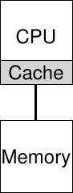
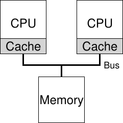

# الفصل 10: الجدولة على معالجات متعددة (متقدّم)

يقدّم هذا الفصل أساسيات جدولة المعالجات المتعددة. ولأن هذا الموضوع متقدّم نسبيًا، فربما كان الأفضل تغطيته بعد أن تكون قد درست موضوع التزامن بقدر من التفصيل (أي الجزء «السهل» الرئيسي الثاني من الكتاب).

بعد سنوات لم تكن فيها المعالجات المتعددة موجودة إلا في الطرف الأعلى من الطيف الحاسوبي، صارت هذه الأنظمة شائعة على نحو متزايد، ووجدت طريقها إلى الحواسيب المكتبية والحواسيب المحمولة وحتى الأجهزة الجوّالة. ومصدر هذا الانتشار هو صعود المعالج متعدد الأنوية، حيث تُحزَم عدة أنوية معالجة على شريحة واحدة؛ وقد صارت هذه الشرائح شائعة لأن معماريي الحواسيب وجدوا صعوبة في جعل المعالج الواحد أسرع بكثير دون استهلاك قدر (كبير جدًا) من الطاقة. وهكذا صار لدى كلٍّ منا الآن بضعة معالجات متاحة له، وهذا شيء جيد، أليس كذلك؟

بالطبع، ثمّة صعوبات كثيرة تنشأ مع مجيء أكثر من معالج واحد. وأبرزها أن التطبيق النمطي (أي برنامج C كتبته أنت) لا يستخدم إلا معالجًا واحدًا؛ وإضافة مزيد من المعالجات لا تجعل ذلك التطبيق الواحد أسرع. ولمعالجة هذه المشكلة سيكون عليك إعادة كتابة تطبيقك ليعمل على التوازي، ربما باستخدام خيوط (كما نوقش بتفصيل كبير في الجزء الثاني من هذا الكتاب). فالتطبيقات متعددة الخيوط تستطيع توزيع العمل على عدة معالجات، ومن ثم تعمل أسرع حين تُمنَح موارد معالجة أكثر.

> **جانبًا: الفصول المتقدّمة**
>
> تتطلّب الفصول المتقدّمة مادةً من مساحة واسعة من الكتاب حتى تُفهَم حق الفهم، بينما تتلاءم منطقيًا مع قسم يسبق تلك المواد المطلوبة. فمثلًا، يصير هذا الفصل عن جدولة المعالجات المتعددة أكثر منطقية إذا كنت قد قرأت أولًا الجزء الأوسط عن التزامن؛ غير أنه يتلاءم منطقيًا مع جزء الكتاب عن المحاكاة الافتراضية (عمومًا) وجدولة المعالج (تحديدًا). ولذلك يُنصح بتغطية مثل هذه الفصول خارج الترتيب؛ وفي هذه الحالة، بعد الجزء الثاني من الكتاب.

وراء التطبيقات، ثمة مشكلة جديدة تنشأ لنظام التشغيل، وهي (ليس مفاجئًا!) مشكلة جدولة المعالجات المتعددة. لقد ناقشنا حتى الآن عددًا من المبادئ الكامنة وراء جدولة المعالج الأحادي؛ فكيف نمدّ هذه الأفكار لتعمل على معالجات متعددة؟ وما المشكلات الجديدة التي يجب أن نتغلب عليها؟ وهكذا تكون مشكلتنا:

> **المعضلة: كيف نجدول المهام على معالجات متعددة**
>
> كيف ينبغي لنظام التشغيل أن يجدول المهام على معالجات متعددة؟ وما المشكلات الجديدة التي تنشأ؟ وهل تنجح التقنيات القديمة نفسها، أم أن هناك حاجة إلى أفكار جديدة؟

## 10.1 خلفية: معمارية المعالج المتعدد

لفهم المسائل الجديدة المحيطة بجدولة المعالجات المتعددة، علينا أن نفهم فرقًا جديدًا وأساسيًا بين عتاد المعالج الواحد وعتاد المعالجات المتعددة. ويتمحور هذا الفرق حول استخدام الذاكرة المخبئية العتادية (مثل الشكل 10.1)، وحول الكيفية التي تُشارَك بها البيانات بالضبط بين معالجات متعددة. وسنناقش هذه المسألة الآن بمزيد من التفصيل، على مستوى عالٍ. والتفاصيل متاحة في مكان آخر [CSG99]، ولا سيما في مقرر معمارية حواسيب على المستوى الأعلى أو مستوى الدراسات العليا.



**الشكل 10.1:** معالج واحد مع ذاكرة مخبئية

في نظام فيه معالج واحد، توجد هرمية من الذاكرة المخبئية العتادية تساعد المعالج عمومًا على تشغيل البرامج أسرع. فالذاكرة المخبئية ذاكرة صغيرة سريعة تحتفظ (عمومًا) بنسخ من البيانات الشائعة الموجودة في الذاكرة الرئيسية للنظام. أما الذاكرة الرئيسية فتحتفظ بكل البيانات، لكن الوصول إلى هذه الذاكرة الأكبر أبطأ. وبإبقاء البيانات كثيرة الوصول في ذاكرة مخبئية، يستطيع النظام أن يجعل الذاكرة الكبيرة البطيئة تبدو سريعة.

وكمثال، تخيّل برنامجًا يصدر تعليمة تحميل صريحة لجلب قيمة من الذاكرة، ونظامًا بسيطًا فيه معالج واحد فقط؛ وللمعالج ذاكرة مخبئية صغيرة (لنقل 64 كيلوبايت) وذاكرة رئيسية كبيرة. في المرة الأولى التي يصدر فيها البرنامج تعليمة التحميل هذه تكون البيانات في الذاكرة الرئيسية، ولذلك يستغرق جلبها وقتًا طويلًا (ربما عشرات النانوثانية أو حتى مئاتها). ثم يضع المعالج، وهو يتوقع أن تُعاد البيانات استخدامًا، نسخة من البيانات المحمّلة في ذاكرة المعالج المخبئية. وإذا جلب البرنامج لاحقًا عنصر البيانات نفسه مرة أخرى، فحص المعالج أولًا ذاكرة مخبئيته؛ فإن وجده هناك جُلبت البيانات أسرع بكثير (لنقل بضعة نانوثانية فقط)، ومن ثم يعمل البرنامج أسرع.

وعلى ذلك تقوم الذاكرة المخبئية على فكرة المحلية، وهي نوعان: المحلية الزمنية والمحلية المكانية. فالفكرة وراء المحلية الزمنية هي أنَّ قطعة البيانات متى جرى الوصول إليها، يُرجَّح أن يُعاد الوصول إليها في المستقبل القريب؛ تخيّل متغيرات أو حتى تعليمات يجري الوصول إليها مرارًا وتكرارًا داخل حلقة. والفكرة وراء المحلية المكانية هي أنه إذا وصل برنامج إلى عنصر بيانات عند العنوان x، فمن المرجّح أن يصل كذلك إلى عناصر بيانات قريبة من x؛ وهنا فكّر في برنامج يمرّ عبر مصفوفة بالتتابع، أو تعليمات تُنفَّذ واحدة بعد أخرى. ولأن هذه الأنواع من المحلية موجودة في برامج كثيرة، تستطيع أنظمة العتاد أن تخمّن تخمينًا جيدًا أيَّ البيانات تضع في الذاكرة المخبئية، ومن ثم تعمل جيدًا.

والآن الجزء الصعب: ماذا يحدث حين يكون لديك عدة معالجات في نظام واحد، مع ذاكرة رئيسية واحدة مشتركة، كما نرى في الشكل 10.2؟



**الشكل 10.2:** معالجان بذاكرتين مخبئيتين تتشاركان الذاكرة

وتبيّن أن التخزين المؤقت مع معالجات متعددة أكثر تعقيدًا بكثير. تخيّل، على سبيل المثال، أن برنامجًا يعمل على المعالج 1 يقرأ عنصر بيانات (قيمته D) عند العنوان A؛ ولأن البيانات ليست في الذاكرة المخبئية على المعالج 1، يجلبها النظام من الذاكرة الرئيسية ويحصل على القيمة D. ثم يعدّل البرنامج القيمة عند العنوان A، مكتفيًا بتحديث ذاكرته المخبئية بالقيمة الجديدة D′؛ وكتابة البيانات على طول الطريق حتى الذاكرة الرئيسية عملية بطيئة، لذلك سيفعل النظام ذلك (عادةً) لاحقًا. ثم افترض أن نظام التشغيل يقرّر إيقاف تشغيل البرنامج ونقله إلى المعالج 2. فيعيد البرنامج قراءة القيمة عند العنوان A؛ ولا توجد بيانات كهذه في ذاكرة المعالج 2 المخبئية، فيجلب النظام القيمة من الذاكرة الرئيسية ويحصل على القيمة القديمة D بدلًا من القيمة الصحيحة D′. عذرًا!

تُسمّى هذه المشكلة العامة مشكلة تماسك الذاكرة المخبئية، وهناك أدبيات بحثية واسعة تصف كثيرًا من الدقائق المتعلقة بحلّها [SHW11]. وسنتجاوز هنا كل التفاصيل الدقيقة ونذكر بعض النقاط الكبرى؛ خُذ مقررًا في معمارية الحواسيب (أو ثلاثة) لتعرف المزيد.

يوفّر العتاد الحل الأساسي: فبرصد وصولات الذاكرة، يستطيع العتاد أن يضمن حدوث «الشيء الصحيح» في الأساس، وأن تبقى صورة الذاكرة المشتركة الواحدة محفوظة. وإحدى طرق فعل ذلك في نظام قائم على ناقل (كما وُصف أعلاه) استخدام تقنية قديمة تُعرف بالتنصّت على الناقل [G83]؛ فكل ذاكرة مخبئية تنتبه إلى تحديثات الذاكرة عبر مراقبة الناقل الذي يصلها بالذاكرة الرئيسية. وحين يرى معالجٌ تحديثًا لعنصر بيانات يحتفظ به في ذاكرته المخبئية، فسيلحظ التغيير إما بأن يُبطل نسخته (أي يحذفها من ذاكرة مخبئيته) أو بأن يحدّثها (أي يضع القيمة الجديدة في ذاكرة مخبئيته أيضًا). والذاكرات المخبئية بنمط الكتابة المرجأة، كما أُشير أعلاه، تجعل هذا أعقد (لأن الكتابة إلى الذاكرة الرئيسية لا تكون مرئية إلا لاحقًا)، لكنك تستطيع أن تتخيّل كيف قد يعمل المخطط الأساسي.

## 10.2 لا تنسَ التزامن

ما دامت الذاكرة المخبئية تقوم بكل هذا العمل لتوفير التماسك، فهل على البرامج (أو نظام التشغيل نفسه) أن تقلق بشأن أي شيء حين تصل إلى بيانات مشتركة؟ الجواب، للأسف، نعم، وهو موثّق بتفصيل كبير في الجزء الثاني من هذا الكتاب عن موضوع التزامن. ولن نخوض في التفاصيل هنا، بل سنرسم ونراجع بعض الأفكار الأساسية (بافتراض أنك ملمّ بالتزامن).

عند الوصول إلى عناصر بيانات أو بُنى بيانات مشتركة عبر المعالجات (وتحديدًا عند تحديثها)، يُرجَّح أنه ينبغي استخدام بدائيات الاستبعاد المتبادل (مثل الأقفال) لضمان الصحة (وثمة مقاربات أخرى، مثل بناء بُنى بيانات خالية من الأقفال، وهي معقّدة ولا تُستخدم إلا في بعض الأحيان؛ انظر فصل الجمود في جزء التزامن للتفاصيل). فمثلًا، افترض أن لدينا طابورًا مشتركًا يجري الوصول إليه على معالجات متعددة في آن واحد. فبدون أقفال، لن تعمل إضافة العناصر إلى الطابور أو إزالتها منه على نحو متزامن كما هو متوقع، حتى مع بروتوكولات التماسك الكامنة؛ فالإنسان بحاجة إلى أقفال لتحديث بنية البيانات إلى حالتها الجديدة تحديثًا ذرّيًا.

ولنجعل هذا أكثر تحديدًا، تخيّل تسلسل الشيفرة هذا، المستخدم لإزالة عنصر من قائمة مترابطة مشتركة، كما نرى في القائمة 10.3.

```
 1   typedef struct __Node_t {
 2       int              value;
 3       struct __Node_t *next;
 4   } Node_t;
 5
 6   int List_Pop() {
 7       Node_t *tmp = head;          // remember old head
 8       int value    = head->value;  // ... and its value
 9       head         = head->next;   // advance to next
10       free(tmp);                   // free old head
11       return value;                // return value @head
12   }
```

**القائمة 10.3:** شيفرة بسيطة لحذف عنصر من قائمة

تخيّل أن خيطين على معالجين يدخلان هذا الروتين في الوقت نفسه. فإذا نفّذ الخيط 1 السطر الأول، سيكون لديه القيمة الحالية لرأس القائمة head مخزّنة في متغيّره tmp؛ وإذا نفّذ الخيط 2 السطر الأول كذلك، فسيكون لديه القيمة نفسها لرأس القائمة مخزّنة في متغيّره tmp الخاص (فـtmp تُخصَّص على المكدّس، ومن ثم يكون لكل خيط مخزنه الخاص بها). وهكذا، بدلًا من أن يزيل كل خيط عنصرًا من رأس القائمة، سيحاول كل خيط إزالة عنصر الرأس نفسه، ما يؤدي إلى مشكلات من كل نوع (مثل محاولة تحرير مزدوج لعنصر الرأس في السطر 10، وكذلك إمكان إعادة القيمة نفسها مرتين).

والحل، بالطبع، هو جعل مثل هذه الروتينات صحيحة عبر الأقفال. وفي هذه الحالة، فإن تخصيص كائن استبعاد متبادل بسيط (مثل pthread_mutex_t m;) ثم إضافة lock(&m) في بداية الروتين وunlock(&m) في نهايته سيحلّ المشكلة، ضامنًا أن الشيفرة ستُنفَّذ كما هو مطلوب. لكن، كما سنرى، فإن مثل هذه المقاربة ليست بلا مشكلات، ولا سيما فيما يتعلق بالأداء. وتحديدًا، كلما زاد عدد المعالجات، صار الوصول إلى بنية بيانات مشتركة متزامنة بطيئًا إلى حد كبير.

## 10.3 مسألة أخيرة: ألفة الذاكرة المخبئية

ثمة مسألة أخيرة تنشأ عند بناء مجدول للمعالجات المتعددة بذاكرة مخبئية، تُعرف بألفة الذاكرة المخبئية [TTG95]. وهذه الفكرة بسيطة: العملية، حين تعمل على معالج معيّن، تبني قدرًا لا بأس به من الحالة في الذاكرة المخبئية (وفي مخازن TLB) الخاصة بذلك المعالج. وفي المرة التالية التي تعمل فيها العملية يكون من المفيد غالبًا تشغيلها على المعالج نفسه، إذ ستعمل أسرع إذا كانت بعض حالتها موجودة أصلًا في الذاكرة المخبئية لذلك المعالج. أما إذا شُغِّلت العملية في كل مرة على معالج مختلف، فسيسوء أداؤها، إذ سيكون عليها إعادة تحميل الحالة كل مرة تعمل فيها (لاحظ أنها ستعمل على نحو صحيح على معالج مختلف بفضل بروتوكولات تماسك الذاكرة المخبئية في العتاد). لذلك ينبغي لمجدول المعالجات المتعددة أن يراعي ألفة الذاكرة المخبئية عند اتخاذ قرارات الجدولة، وربما يُفضّل إبقاء العملية على المعالج نفسه إن أمكن أصلًا.

## 10.4 الجدولة بقائمة انتظار واحدة

وبعد هذه الخلفية، سنناقش الآن كيف نبني مجدولًا لنظام متعدد المعالجات. وأبسط مقاربة هي إعادة استخدام الإطار الأساسي لجدولة المعالج الأحادي ببساطة، وذلك بوضع كل المهام التي تحتاج إلى جدولة في قائمة انتظار واحدة؛ ونسمّي هذا جدولة المعالجات المتعددة أحادية القائمة، أو SQMS اختصارًا. ولهذه المقاربة ميزة البساطة؛ فهي لا تتطلب كبير عمل لأخذ سياسة قائمة تختار أفضل مهمة لتشغيلها تاليًا وتكييفها لتعمل على أكثر من معالج واحد (حيث قد تختار أفضل مهمتين لتشغيلهما، إن كان هناك معالجان مثلًا).

غير أن لـSQMS عيوبًا واضحة. فالمشكلة الأولى هي غياب القابلية للتوسع. فلضمان أن يعمل المجدول على نحو صحيح على معالجات متعددة، سيكون المطوّرون قد أدخلوا شكلًا من القفل في الشيفرة، كما وصفنا أعلاه. فالأقفال تضمن أن تحدث النتيجة الصحيحة حين تصل شيفرة SQMS إلى القائمة الواحدة (للبحث عن المهمة التالية التي ستُشغَّل، مثلًا).

غير أن الأقفال قد تقلّل الأداء تقليلًا كبيرًا، خاصة مع زيادة عدد المعالجات في الأنظمة [A90]. فكلما زاد التنازع على قفل واحد كهذا، قضى النظام وقتًا أطول في كلفة القفل ووقتًا أقل في أداء العمل الذي ينبغي أن يؤديه (ملاحظة: سيكون رائعًا أن نضمّن هنا قياسًا حقيقيًا لهذا يومًا ما).

والمشكلة الرئيسية الثانية في SQMS هي ألفة الذاكرة المخبئية. فمثلًا، لنفترض أن لدينا خمس مهام لتشغيلها (A, B, C, D, E) وأربعة معالجات. فيبدو طابور الجدولة لدينا هكذا:

```
Queue   A  B  C  D  E  NULL
```

ومع مرور الوقت، وبافتراض أن كل مهمة تعمل لشريحة زمنية ثم تُختار مهمة أخرى، فهذا جدول مهام ممكن عبر المعالجات:

```
CPU 0   A  E  D  C  B  ... (repeat) ...
CPU 1   B  A  E  D  C  ... (repeat) ...
CPU 2   C  B  A  E  D  ... (repeat) ...
CPU 3   D  C  B  A  E  ... (repeat) ...
```

ولأن كل معالج يختار ببساطة المهمة التالية من الطابور المشترك عالميًا، تنتهي كل مهمة إلى التنقّل من معالج إلى معالج، فتفعل بالضبط عكس ما يكون منطقيًا من وجهة نظر ألفة الذاكرة المخبئية.

ولمعالجة هذه المشكلة، تضمّ معظم مجدولات SQMS نوعًا من آلية الألفة لجعل استمرار العملية في العمل على المعالج نفسه أكثر ترجيحًا إن أمكن. وتحديدًا، قد تُوفَّر الألفة لبعض المهام، وتُنقَل مهام أخرى لموازنة الحمل. فمثلًا، تخيّل المهام الخمس نفسها مجدولة كما يلي:

```
CPU 0   A  E  A  A  A  ... (repeat) ...
CPU 1   B  B  E  B  B  ... (repeat) ...
CPU 2   C  C  C  E  C  ... (repeat) ...
CPU 3   D  D  D  D  E  ... (repeat) ...
```

في هذا الترتيب، لا تُنقَل المهام A حتى D عبر المعالجات، ولا تهاجر إلا المهمة E من معالج إلى آخر، ومن ثم تُحفظ الألفة لمعظمها. ويمكنك بعد ذلك أن تقرر ترحيل مهمة مختلفة في المرة التالية، فتحقق نوعًا من عدالة الألفة أيضًا. غير أن تنفيذ مخطط كهذا قد يكون معقّدًا.

وهكذا نرى أن لمقاربة SQMS نقاط قوة ونقاط ضعف. فهي مباشرة التنفيذ إذا كان لديك مجدول معالج أحادي قائم، وهو بحكم التعريف لا يملك إلا قائمة انتظار واحدة. غير أنها لا تتوسّع جيدًا (بسبب كلفة التزامن)، ولا تحفظ ألفة الذاكرة المخبئية بسهولة.

## 10.5 الجدولة بقوائم انتظار متعددة

بسبب المشكلات الناجمة في مجدولات القائمة الواحدة، تختار بعض الأنظمة قوائم انتظار متعددة، مثل قائمة لكل معالج. ونسمّي هذه المقاربة جدولة المعالجات المتعددة متعددة القوائم (أو MQMS).

في MQMS، يتكوّن إطار الجدولة الأساسي لدينا من قوائم جدولة متعددة. ومن المرجّح أن تتبع كل قائمة نظام جدولة معيّنًا، مثل الجولة المستديرة، وإن كان يمكن استخدام أي خوارزمية بالطبع. وحين تدخل مهمة إلى النظام، تُوضَع في قائمة جدولة واحدة بالضبط، وفق استدلال ما (عشوائي، أو اختيار قائمة فيها مهام أقل من غيرها، مثلًا). ثم تُجدول جوهريًا على نحو مستقل، فتتجنّب مشكلات مشاركة المعلومات والتزامن الموجودة في مقاربة القائمة الواحدة.

فمثلًا، افترض أن لدينا نظامًا فيه معالجان فقط (يُسمّيان المعالج 0 والمعالج 1)، وأن عددًا من المهام يدخل النظام: A وB وC وD مثلًا. وبما أن لكل معالج طابور جدولة الآن، فعلى نظام التشغيل أن يقرر في أي طابور يضع كل مهمة. وقد يفعل شيئًا كالتالي:

```
Q0      A  C              Q1      B  D
```

وبحسب سياسة جدولة الطابور، صار لدى كل معالج الآن مهمتان للاختيار بينهما عند تحديد ما ينبغي أن يعمل. فمثلًا، مع الجولة المستديرة، قد ينتج النظام جدولًا يبدو هكذا:

```
CPU 0   A  A  C  C  A  A  C  C  A  A  C  C  ...
CPU 1   B  B  D  D  B  B  D  D  B  B  D  D  ...
```

لـMQMS ميزة واضحة على SQMS، هي أنها ينبغي أن تكون أكثر قابلية للتوسع بطبيعتها. فكلما زاد عدد المعالجات، زاد عدد القوائم، ومن ثم لا ينبغي أن يصير التنازع على الأقفال والذاكرة المخبئية مشكلة مركزية. وإضافة إلى ذلك، توفّر MQMS ألفة الذاكرة المخبئية تلقائيًا؛ فالمهام تبقى على المعالج نفسه، ومن ثم تجني ميزة إعادة استخدام محتويات الذاكرة المخبئية فيه.

لكنك، إن كنت منتبهًا، قد ترى أن لدينا مشكلة جديدة، وهي أساسية في المقاربة القائمة على قوائم متعددة: اختلال الحمل. لنفترض أن لدينا الإعداد نفسه أعلاه (أربع مهام، معالجان)، ثم تنتهي إحدى المهام (C مثلًا). صار لدينا الآن طوابير الجدولة التالية:

```
Q0      A                 Q1      B  D
```

وإذا شغّلنا سياسة الجولة المستديرة بعد ذلك على كل طابور في النظام، فسنرى هذا الجدول الناتج:

```
CPU 0   A  A  A  A  A  A  A  A  A  A  A  A  ...
CPU 1   B  B  D  D  B  B  D  D  B  B  D  D  ...
```

وكما ترى من هذا المخطط، تحصل A على ضعف ما تحصل عليه B وD من المعالج، وهذا ليس النتيجة المرجوّة. والأسوأ من ذلك، لنتخيّل أن A وC انتهتا معًا، ولم تبقَ إلا المهمتان B وD في النظام. فيبدو طابورا الجدولة، والخط الزمني الناتج، هكذا:

```
Q0                        Q1      B  D

CPU 0
CPU 1   B  B  D  D  B  B  D  D  B  B  D  D  ...
```

يا للفداحة — المعالج 0 عاطل! (أدخِل هنا موسيقى درامية شريرة) ومن ثم يبدو خط زمن استخدام المعالجات لدينا حزينًا للغاية.

فماذا ينبغي لمجدول معالجات متعددة مسكين أن يفعل؟ كيف نتغلب على مشكلة اختلال الحمل الخبيثة ونهزم قوى الشر... الديسابتيكونز[^1]؟ وكيف نتوقف عن طرح أسئلة لا صلة لها تقريبًا بهذا الكتاب الرائع في بقية الأمر؟

> **المعضلة: كيف نتعامل مع اختلال الحمل**
>
> كيف ينبغي لمجدول المعالجات المتعددة متعدد القوائم أن يتعامل مع اختلال الحمل، ليحقق أهدافه المرجوّة من الجدولة على نحو أفضل؟

والجواب الواضح على هذا السؤال هو تحريك المهام، وهي تقنية نشير إليها (مرة أخرى) بالترحيل. فبترحيل مهمة من معالج إلى آخر يمكن بلوغ موازنة حقيقية للحمل.

ولننظر في مثالين لمزيد من الوضوح. مرة أخرى، لدينا حالة يكون فيها معالج عاطلًا وللآخر بعض المهام.

```
Q0                        Q1      B  D
```

في هذه الحالة، الترحيل المطلوب سهل الفهم: على نظام التشغيل ببساطة أن ينقل إحدى المهمتين B أو D إلى المعالج 0. ونتيجة هذا الترحيل الواحد حملٌ موزّع بالتساوي والجميع سعداء.

وثمة حالة أخطر تنشأ في مثالنا السابق، حيث تُركت A وحدها على المعالج 0 وتناوبت B وD على المعالج 1:

```
Q0      A                 Q1      B  D
```

في هذه الحالة، لا يحلّ ترحيل واحد المشكلة. فماذا ستفعل؟ الجواب، للأسف، هو الترحيل المستمر لمهمة أو أكثر. وأحد الحلول الممكنة هو الاستمرار في تبديل المهام، كما نرى في الخط الزمني التالي. في الشكل، تكون A أولًا وحدها على المعالج 0، وتتناوب B وD على المعالج 1. وبعد بضع شرائح زمنية، تُنقَل B لتنافس A على المعالج 0، بينما تنعم D ببضع شرائح زمنية وحدها على المعالج 1. وهكذا يُوازَن الحمل:

```
CPU 0   A  A  A  A  B  A  B  A  B  B  B  B  ...
CPU 1   B  D  B  D  D  D  D  D  A  D  A  D  ...
```

بالطبع، توجد أنماط ترحيل أخرى ممكنة كثيرة. لكن الآن الجزء الصعب: كيف ينبغي للنظام أن يقرر تنفيذ ترحيل كهذا؟

إحدى المقاربات الأساسية استخدام تقنية تُعرف بسرقة العمل [FLR98]. وفي مقاربة سرقة العمل، فإن طابورًا (مصدرًا) يعاني قلّة المهام سيختلس النظر أحيانًا إلى طابور آخر (هدف) ليرى مدى امتلائه. فإن كان طابور الهدف أكثر امتلاءً (بشكل ملحوظ) من طابور المصدر، «يسرق» المصدر مهمة أو أكثر من الهدف للمساعدة في موازنة الحمل.

بالطبع، ثمة توتر طبيعي في مقاربة كهذه. فإن أكثرت من النظر إلى الطوابير الأخرى، عانيت كلفة عالية وواجهت صعوبة في التوسع، وهذا هو الغرض كله من تنفيذ جدولة القوائم المتعددة في المقام الأول! وإن كان العكس، ولم تنظر إلى الطوابير الأخرى إلا نادرًا، كنت في خطر المعاناة من اختلالات حمل شديدة. ويبقى إيجاد العتبة الصحيحة، كما هو شائع في تصميم سياسات الأنظمة، فنًّا غامضًا.

## 10.6 مجدولات لينكس للمعالجات المتعددة

ومما يثير الاهتمام أنه لم يبرز في مجتمع لينكس حلّ مشترك لبناء مجدول معالجات متعددة. وعلى مرّ الوقت نشأت ثلاثة مجدولات مختلفة: مجدول O(1)، والمجدول العادل تمامًا (CFS)، ومجدول BF (BFS)[^2]. انظر أطروحة Meehean للحصول على نظرة عامة ممتازة على نقاط القوة والضعف في المجدولات المذكورة [M11]؛ وسنكتفي هنا بتلخيص بعض الأساسيات.

يستخدم كل من O(1) وCFS قوائم متعددة، بينما يستخدم BFS قائمة واحدة، ما يدل على أن المقاربتين يمكن أن تنجحا. وبالطبع، ثمة تفاصيل أخرى كثيرة تفصل بين هذه المجدولات. فمثلًا، مجدول O(1) مجدول قائم على الأولوية (شبيه بـMLFQ الذي نوقش سابقًا)، يغيّر أولوية العملية بمرور الوقت ثم يجدول ذوي الأولوية العليا لتلبية أهداف جدولة متنوعة؛ والتفاعلية محور خاص فيه. أما CFS فمقاربة حتمية للتقاسم النسبي (أشبه بجدولة الخطوة كما نوقشت سابقًا). وBFS، وهو المقاربة الوحيدة أحادية القائمة بين الثلاثة، هو أيضًا تقاسم نسبي، لكنه قائم على مخطط أكثر تعقيدًا يُعرف بأبكر موعد نهائي افتراضي مؤهل أولًا (EEVDF) [SA96]. اقرأ المزيد عن هذه الخوارزميات الحديثة بنفسك؛ ينبغي أن تكون قادرًا الآن على فهم كيف تعمل!

## 10.7 الخلاصة

لقد رأينا مقاربات متنوعة لجدولة المعالجات المتعددة. فمقاربة القائمة الواحدة (SQMS) مباشرة البناء نسبيًا وتوازن الحمل جيدًا، لكنها تجد صعوبة بطبيعتها في التوسع إلى معالجات كثيرة وفي ألفة الذاكرة المخبئية. ومقاربة القوائم المتعددة (MQMS) تتوسّع أفضل وتتعامل مع ألفة الذاكرة المخبئية جيدًا، لكنها تعاني اختلال الحمل وهي أكثر تعقيدًا. وأيًّا كانت المقاربة التي تتخذها، فلا جواب بسيط: يبقى بناء مجدول للأغراض العامة مهمة شاقة، إذ إن تغييرات صغيرة في الشيفرة قد تؤدي إلى فروق كبيرة في السلوك. فلا تخض في تمرين كهذا إلا إذا كنت تعرف بالضبط ما تفعله، أو كنت على الأقل تتقاضى مبلغًا كبيرًا من المال لتفعله.

## المراجع

> [A90] «The Performance of Spin Lock Alternatives for Shared-Memory Multiprocessors» لـThomas E. Anderson. IEEE TPDS المجلد 1:1، يناير 1990. ورقة كلاسيكية عن كيف تتوسّع خيارات القفل المختلفة وكيف لا تتوسّع. بقلم Tom Anderson، وهو باحث معروف جدًا في الأنظمة والشبكات معًا. ومؤلّف كتاب ممتاز في أنظمة التشغيل، يجب أن نقول ذلك.

> [B+10] «An Analysis of Linux Scalability to Many Cores Abstract» لـSilas Boyd-Wickizer وAustin T. Clements وYandong Mao وAleksey Pesterev وM. Frans Kaashoek وRobert Morris وNickolai Zeldovich. OSDI '10، فانكوفر، كندا، أكتوبر 2010. ورقة حديثة رائعة عن صعوبات توسيع لينكس إلى أنوية كثيرة.

> [CSG99] «Parallel Computer Architecture: A Hardware/Software Approach» لـDavid E. Culler وJaswinder Pal Singh وAnoop Gupta. Morgan Kaufmann، 1999. كنز مليء بالتفاصيل عن الآلات المتوازية والخوارزميات المتوازية. وكما يلاحظ Mark Hill طريفًا على غلافه، فإن الكتاب يحتوي معلومات أكثر من معظم الأوراق البحثية.

> [FLR98] «The Implementation of the Cilk-5 Multithreaded Language» لـMatteo Frigo وCharles E. Leiserson وKeith Randall. PLDI '98، مونتريال، كندا، يونيو 1998. Cilk لغة وبيئة تشغيل خفيفة لكتابة البرامج المتوازية، ومثال ممتاز على نموذج سرقة العمل.

> [G83] «Using Cache Memory To Reduce Processor-Memory Traffic» لـJames R. Goodman. ISCA '83، ستوكهولم، السويد، يونيو 1983. الورقة الرائدة في كيفية استخدام التنصّت على الناقل، أي الانتباه إلى الطلبات التي تراها على الناقل، لبناء بروتوكول تماسك للذاكرة المخبئية. وبحث Goodman على مدى سنوات طويلة في ويسكونسن مليء بالبراعة، وهذا مثال واحد منه.

> [M11] «Towards Transparent CPU Scheduling» لـJoseph T. Meehean. أطروحة دكتوراه في جامعة ويسكونسن—ماديسون، 2011. أطروحة تغطي كثيرًا من تفاصيل كيفية عمل جدولة المعالجات المتعددة الحديثة في لينكس. رائعة بحق! لكننا، بصفتنا مشرفين مشاركين على Joe، قد نكون متحيّزين قليلًا هنا.

> [SHW11] «A Primer on Memory Consistency and Cache Coherence» لـDaniel J. Sorin وMark D. Hill وDavid A. Wood. Synthesis Lectures in Computer Architecture. Morgan and Claypool Publishers، مايو 2011. نظرة عامة مرجعية على تماسك الذاكرة والتخزين المؤقت متعدد المعالجات. قراءة لازمة لمن يحب أن يعرف أكثر مما ينبغي عن موضوع معيّن.

> [SA96] «Earliest Eligible Virtual Deadline First: A Flexible and Accurate Mechanism for Proportional Share Resource Allocation» لـIon Stoica وHussein Abdel-Wahab. تقرير تقني TR-95-22، جامعة Old Dominion، 1996. تقرير تقني عن فكرة الجدولة الرائعة هذه، من Ion Stoica، وهو الآن أستاذ في جامعة كاليفورنيا في بركلي وخبير عالمي في الشبكات والأنظمة الموزّعة وأشياء أخرى كثيرة.

> [TTG95] «Evaluating the Performance of Cache-Affinity Scheduling in Shared-Memory Multiprocessors» لـJosep Torrellas وAndrew Tucker وAnoop Gupta. Journal of Parallel and Distributed Computing، المجلد 24:2، فبراير 1995. ليست هذه أول ورقة في الموضوع، لكنها تحوي إحالات إلى أعمال أسبق، وهي أكثر قابلية للقراءة والعمل من بعض أوراق التحليل الأسبق القائمة على نظرية الطوابير.

## الواجب (محاكاة)

في هذا الواجب سنستخدم multi.py لمحاكاة مجدول معالجات متعددة، ونتعلّم بعض تفاصيله. اقرأ ملف README المرتبط لمزيد من المعلومات عن المحاكي وخياراته.

## الأسئلة

1. لنبدأ بتعلّم كيف نستخدم المحاكي لدراسة كيفية بناء مجدول معالجات متعددة فعّال. ستشغّل المحاكاة الأولى مهمة واحدة فقط، زمن تشغيلها 30، وحجم مجموعة عملها 200. شغّل هذه المهمة (المسمّاة هنا المهمة 'a') على معالج محاكى واحد كما يلي: `./multi.py -n 1 -L a:30:200`. كم سيستغرق إكمالها؟ شغّل الخيار `-c` لترى جوابًا نهائيًا، والخيار `-t` لترى تتبّعًا لكل نبضة للمهمة وكيف تُجدول.

2. زد الآن حجم الذاكرة المخبئية بحيث تدخل مجموعة عمل المهمة (حجمها 200) في الذاكرة المخبئية (وهي بحجم 100 افتراضيًا)؛ فمثلًا شغّل `./multi.py -n 1 -L a:30:200 -M 300`. هل تستطيع أن تتوقع ما مدى سرعة عمل المهمة بعد أن تدخل في الذاكرة المخبئية؟ (تلميح: تذكّر المعامل الأساسي لمعدّل التسخين، وهو يُضبط بالخيار `-r`) تحقّق من جوابك بتشغيل خيار الحل (`-c`).

3. من الأمور الرائعة في multi.py أنك تستطيع رؤية مزيد من التفاصيل عما يجري عبر خيارات تتبّع مختلفة. شغّل المحاكاة نفسها أعلاه، لكن هذه المرة مع تمكين تتبّع الزمن المتبقي (`-T`). يُظهر هذا الخيار المهمة التي جُدولت على معالج عند كل خطوة زمنية، وكذلك مقدار زمن التشغيل المتبقي لتلك المهمة بعد كل نبضة. ماذا تلاحظ في كيفية تناقص ذلك العمود الثاني؟

4. أضف الآن قليلًا آخر من التتبّع، لإظهار حالة ذاكرة كل معالج المخبئية لكل مهمة، عبر الخيار `-C`. ولكل مهمة، ستُظهر كل ذاكرة مخبئية إما مسافة فارغة (إن كانت الذاكرة المخبئية باردة لتلك المهمة) أو حرف 'w' (إن كانت دافئة لتلك المهمة). في أي نقطة تصير الذاكرة المخبئية دافئة للمهمة 'a' في هذا المثال البسيط؟ وماذا يحدث حين تغيّر معامل زمن التسخين (`-w`) إلى قيم أقل أو أعلى من القيمة الافتراضية؟

5. في هذه المرحلة، ينبغي أن تكون لديك فكرة جيدة عن كيفية عمل المحاكي لمهمة واحدة تعمل على معالج واحد. لكن مهلا، أليس هذا فصلًا عن جدولة المعالجات المتعددة؟ بلى! فلنبدأ العمل بمهام متعددة. تحديدًا، لنشغّل المهام الثلاث التالية على نظام بمعالجين (أي اكتب `./multi.py -n 2 -L a:100:100,b:100:50,c:100:50`). هل تستطيع أن تتوقع كم سيستغرق هذا، بمجدول مركزي بالجولة المستديرة؟ استخدم `-c` لترى إن كنت محقًا، ثم تعمّق في التفاصيل عبر `-t` لترى خطوة بخطوة، ثم `-C` لترى هل سُخّنت الذاكرة المخبئية لهذه المهام على نحو فعّال. ماذا تلاحظ؟

6. سنطبّق الآن بعض الضوابط الصريحة لدراسة ألفة الذاكرة المخبئية، كما وُصف في الفصل. وللقيام بذلك ستحتاج الخيار `-A`. ويمكن استخدام هذا الخيار لتحديد المعالجات التي يستطيع المجدول وضع مهمة معيّنة عليها. وفي هذه الحالة، لنستخدمه لوضع المهمتين 'b' و'c' على المعالج 1، مع تقييد 'a' بالمعالج 0. ويُنجَز هذا السحر بكتابة هذا: `./multi.py -n 2 -L a:100:100,b:100:50, c:100:50 -A a:0,b:1,c:1` ؛ لا تنسَ تشغيل خيارات تتبّع متنوعة لترى ما يحدث فعلًا! هل تستطيع أن تتوقع مدى سرعة عمل هذه النسخة؟ ولماذا تعمل أفضل؟ وهل ستعمل توليفات أخرى من 'a' و'b' و'c' على المعالجين أسرع أم أبطأ؟

7. من الجوانب المثيرة للاهتمام في المعالجات المتعددة ذات الذاكرة المخبئية إمكانية الحصول على تسريع للمهام أفضل من المتوقع عند استخدام معالجات متعددة (وذاكراتها المخبئية) مقارنة بتشغيل المهام على معالج واحد. وتحديدًا، حين تشغّل على N معالجًا، فقد تستطيع أحيانًا التسريع بأكثر من معامل N، وهي حالة تُسمّى التسريع فوق الخطي. للتجربة مع هذا، استخدم وصف المهام هنا (`-L a:100:100,b:100:100,c:100:100`) مع ذاكرة مخبئية صغيرة (`-M 50`) لإنشاء ثلاث مهام. شغّل هذا على أنظمة بمعالج واحد ومعالجين وثلاثة معالجات (`-n 1`، `-n 2`، `-n 3`). ثم افعل الشيء نفسه، لكن بذاكرة مخبئية أكبر لكل معالج حجمها 100. ماذا تلاحظ في الأداء مع توسّع عدد المعالجات؟ استخدم `-c` لتأكيد تخميناتك، وخيارات تتبّع أخرى للتعمّق أكثر.

8. من الجوانب الأخرى في المحاكي التي تستحق الدراسة خيار الجدولة لكل معالج، وهو الخيار `-p`. شغّل بمعالجين مرة أخرى، بهذه التهيئة الثلاثية للمهام (`-L a:100:100,b:100:50,c:100:50`). كيف يعمل هذا الخيار مقارنة بحدود الألفة التي وضعتها يدويًا أعلاه؟ وكيف يتغير الأداء حين تغيّر «فترة الاستراق» (`-P`) إلى قيم أقل أو أعلى؟ وكيف تعمل هذه المقاربة لكل معالج مع توسّع عدد المعالجات؟

9. أخيرًا، لا تتردد في توليد أحمال عمل عشوائية فحسب، وانظر هل تستطيع التنبؤ بأدائها على أعداد مختلفة من المعالجات وأحجام مختلفة للذاكرة المخبئية وخيارات جدولة مختلفة. وإن فعلت ذلك، فستصير قريبًا سيدًا في جدولة المعالجات المتعددة، وهذا شيء رائع بحق أن تكونه. حظًا موفقًا!

[^1]: حقيقة أقل شهرة أن الكوكب الأصلي لسايبرترون دُمّر بقرارات جدولة سيئة على المعالج. وليكن هذا الآن أول إشارة وآخرها إلى المحوّلات في هذا الكتاب، ونعتذر عنها بصدق.

[^2]: ابحث بنفسك عمّا يرمز إليه BF؛ وأنذرك مسبقًا بأنه ليس للضعاف القلوب.
