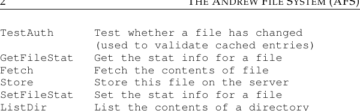
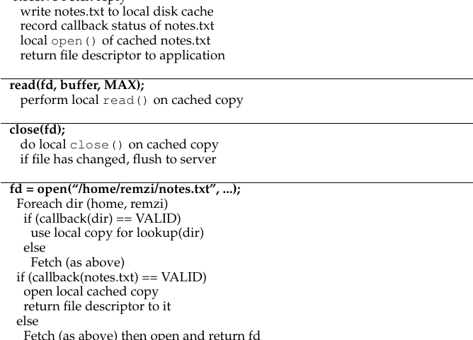
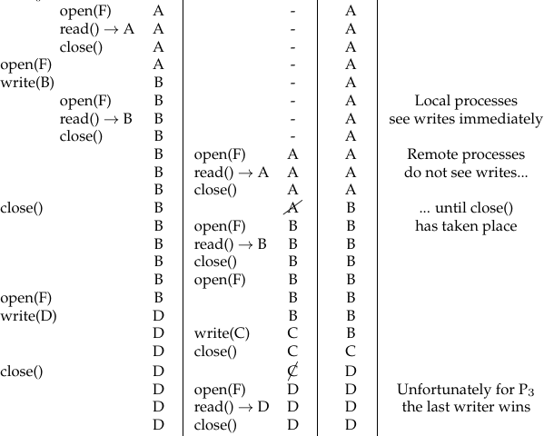
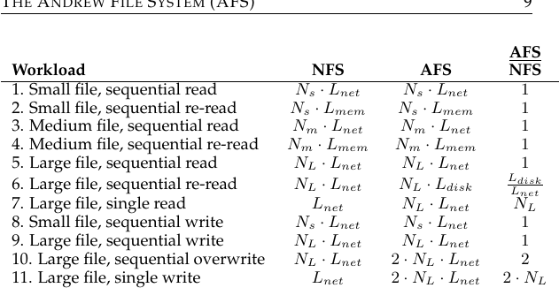

# الفصل 50: نظام ملفات أندرو (AFS)

قُدّم نظام ملفات أندرو (Andrew File System، ويُختصر إلى AFS) في جامعة كارنيغي ميلون (Carnegie-Mellon University، ويُختصر إلى CMU)[^1] في الثمانينيات [H+88]. وقد قاده الأستاذ المعروف م. ساتيانارايانان (M. Satyanarayanan) من جامعة كارنيغي ميلون، ويُلقّب اختصارًا «ساتيا»، وكان الهدف الرئيسي لهذا المشروع بسيطًا: التوسّع. وتحديدًا: كيف يمكن للمرء أن يصمّم نظام ملفات موزّعًا بحيث يستطيع خادم واحد أن يخدم أكبر عدد ممكن من العملاء؟

ومن المثير للاهتمام أن ثمة جوانب كثيرة للتصميم والتنفيذ تؤثّر في قابلية التوسّع. وأهمّها تصميم البروتوكول بين العملاء والخوادم. ففي NFS، على سبيل المثال، يُلزم البروتوكولُ العملاءَ بأن يتحقّقوا من الخادم دوريًا لمعرفة ما إذا كانت المحتويات المخزّنة مؤقتًا قد تغيّرت؛ ولأن كل تحقّق يستهلك موارد الخادم (بما فيها المعالج وعرض نطاق الشبكة)، فإن التحقّقات المتكررة كهذه تحدّ من عدد العملاء الذين يستطيع الخادم الاستجابة لهم، ومن ثمّ تحدّ من قابلية التوسّع.

ويختلف AFS عن NFS أيضًا في أن السلوك المعقول المرئي للمستخدم كان، منذ البداية، شاغلًا من الدرجة الأولى. ففي NFS يصعب وصف اتساق التخزين المؤقت (cache consistency) لأنه يعتمد اعتمادًا مباشرًا على تفاصيل تنفيذ منخفضة المستوى، بما فيها فترات انتهاء صلاحية التخزين المؤقت عند العميل. أما في AFS فاتساق التخزين المؤقت بسيط ويسهل فهمه: فعند فتح الملف، يتلقّى العميل عمومًا أحدث نسخة متّسقة من الخادم.

## 50.1 الإصدار الأول من AFS

سنناقش إصدارين من AFS [H+88, S+85]. أما الإصدار الأول (وسنسمّيه AFSv1، مع أن النظام الأصلي كان يُسمّى في الحقيقة نظام الملفات الموزّع ITC [S+85]) فقد كان يضم بعض التصميم الأساسي، لكنه لم يتوسّع كما هو مطلوب، وهو ما أدّى إلى إعادة التصميم وإلى البروتوكول النهائي (وسنسمّيه AFSv2، أو AFS فقط) [H+88]. ونناقش الآن الإصدار الأول.

**الشكل 50.1:** أبرز معالم بروتوكول AFSv1

من المبادئ الأساسية في جميع إصدارات AFS تخزين الملف كاملًا في مخزن مؤقت على القرص المحلي لجهاز العميل الذي يصل إلى الملف. فحين تفتح ملفًا بالدالة open()، يُجلب الملف كله (إن كان موجودًا) من الخادم ويُخزَّن في ملف على قرصك المحلي. ثم تُعاد توجيه عمليات read() وwrite() اللاحقة التي يجريها التطبيق إلى نظام الملفات المحلي حيث يُخزَّن الملف؛ ومن ثمّ لا تحتاج هذه العمليات إلى أي اتصال شبكي، وتكون سريعة. وأخيرًا، عند close()، يُدفع الملف (إن كان قد عُدّل) عائدًا إلى الخادم. ولاحظ التباين الواضح مع NFS، الذي يخزّن الكتل مؤقتًا (لا الملفات كاملة، مع أن NFS يستطيع بالطبع أن يخزّن كل كتلة من ملف كامل)، ويفعل ذلك في ذاكرة العميل (لا على القرص المحلي).

ولندخل في التفاصيل قليلًا. عندما يستدعي تطبيق العميل open() للمرة الأولى، كانت شيفرة جانب العميل في AFS (التي يسمّيها مصمّمو AFS ‏Venus) ترسل رسالة بروتوكول Fetch إلى الخادم. وكانت رسالة Fetch تحمل المسار الكامل للملف المطلوب (مثل /home/remzi/notes.txt) إلى خادم الملفات (والمجموعة التي سمّوها Vice)، فيجتاز الخادم المسار، ويعثر على الملف المطلوب، ويعيد الملف كله إلى العميل. ثم كانت الشيفرة في جانب العميل تخزّن الملف مؤقتًا على القرص المحلي للعميل (بكتابته إلى القرص المحلي). وكما قلنا أعلاه، فإن نداءات النظام read() وwrite() اللاحقة محلية تمامًا في AFS (لا يحدث أي اتصال بالخادم)؛ فهي مجرّد إعادة توجيه إلى النسخة المحلية من الملف. ولأن نداءي read() وwrite() يعملان تمامًا كنداءات إلى نظام ملفات محلي، فإن الكتلة قد تُخزَّن مؤقتًا في ذاكرة العميل أيضًا بمجرد الوصول إليها. ومن ثمّ يستخدم AFS ذاكرة العميل كذلك لتخزين نسخ من الكتل الموجودة على قرصه المحلي. وأخيرًا، عند الانتهاء، يتحقّق عميل AFS مما إذا كان الملف قد عُدّل (أي أنه فُتح للكتابة)؛ فإن كان كذلك، دفع النسخة الجديدة عائدًا إلى الخادم برسالة بروتوكول Store، فيرسل الملف كله والمسار إلى الخادم للتخزين الدائم.

وفي المرة التالية التي يُوصل فيها إلى الملف، يفعل AFSv1 ذلك بكفاءة أكبر بكثير. وتحديدًا، تتصل شيفرة جانب العميل بالخادم أولًا (برسالة بروتوكول TestAuth) لتحديد ما إذا كان الملف قد تغيّر. فإن لم يكن، استخدم العميل النسخة المخزّنة محليًا، فحسّن الأداء بتجنّب نقل عبر الشبكة. ويعرض الشكل أعلاه بعض رسائل البروتوكول في AFSv1. ولاحظ أن هذا الإصدار المبكّر من البروتوكول كان يخزّن محتويات الملفات فقط؛ أما الأدلة، على سبيل المثال، فكانت تُحفظ عند الخادم وحده.

> **نصيحة: قِس أولًا ثم ابنِ (قانون باترسون)**
>
> كان أحد مستشارينا، ديفيد باترسون (David Patterson) (المعروف بأعمال RISC وRAID)، يحثّنا دائمًا على قياس النظام وإظهار وجود مشكلة قبل بناء نظام جديد لحلّ تلك المشكلة. فباستخدام الدليل التجريبي بدلًا من الحدس، يمكنك أن تحوّل عملية بناء الأنظمة إلى مسعى أكثر علمية. ولهذا فائدة جانبية أيضًا: فهو يجعلك تفكّر في كيفية قياس النظام بالضبط قبل أن يُطوَّر إصدارك المحسّن. وحين تصل أخيرًا إلى بناء النظام الجديد، يتحسّن أمران نتيجة لذلك: أولًا، لديك دليل يُظهر أنك تحلّ مشكلة حقيقية؛ وثانيًا، لديك الآن وسيلة لقياس نظامك الجديد، تُظهر أنه يتفوّق فعلًا على أحدث ما وصل إليه المجال. ومن ثمّ نسمّي هذا قانون باترسون (Patterson's Law).

## 50.2 مشكلات الإصدار الأول

دفعت بضع مشكلات رئيسية في هذا الإصدار الأول من AFS المصمّمين إلى إعادة التفكير في نظام ملفاتهم. ولدراسة المشكلات بالتفصيل، أمضى مصمّمو AFS وقتًا طويلًا في قياس نموذجهم الأولي القائم ليكتشفوا ما الخطأ فيه. وهذه التجريبية أمر حسن، لأن القياس هو مفتاح فهم كيفية عمل الأنظمة وكيفية تحسينها؛ ومن ثمّ فإن الحصول على بيانات جيدة وملموسة جزء ضروري من بناء الأنظمة. وقد وجد المؤلفون في دراستهم مشكلتين رئيستين في AFSv1:

- كلفة اجتياز المسار مرتفعة جدًا: عند تنفيذ طلب بروتوكول Fetch أو Store، يمرّر العميل المسار الكامل (مثل /home/remzi/notes.txt) إلى الخادم. وعلى الخادم، للوصول إلى الملف، أن يجتاز المسار كاملًا، فيبحث أولًا في الدليل الجذر ليجد home، ثم في home ليجد remzi، وهكذا نزولًا على طول المسار حتى يُعثر أخيرًا على الملف المطلوب.

ومع وصول عملاء كثيرين إلى الخادم في الوقت نفسه، وجد مصمّمو AFS أن الخادم كان ينفق قدرًا كبيرًا من زمن معالجه في مجرّد السير على مسارات الأدلة.

- يُصدر العميل رسائل بروتوكول TestAuth أكثر من اللازم: فكما في NFS وفرط رسائل بروتوكول GETATTR فيه، كان AFSv1 يولّد قدرًا كبيرًا من حركة الشبكة للتحقّق، برسالة TestAuth، مما إذا كان ملف محلي (أو معلومات stat الخاصة به) صالحًا. ومن ثمّ كانت الخوادم تنفق كثيرًا من وقتها في إخبار العملاء ما إذا كان استعمال نسخهم المخزّنة مؤقتًا من الملف مقبولًا. وكان الجواب في معظم الوقت أن الملف لم يتغيّر.

وكانت هناك في الحقيقة مشكلتان أخريان في AFSv1: أن الحمل لم يكن موزّعًا توزيعًا متوازنًا بين الخوادم، وأن الخادم كان يستخدم عملية منفصلة واحدة لكل عميل، فيستدعي بذلك تبديل السياق (context switch) وغيره من الأعباء الإضافية. وقد حُلّت مشكلة اختلال الحمل بإدخال فكرة الأحجام (volumes)، التي كان يستطيع المدير نقلها بين الخوادم لموازنة الحمل؛ أما مشكلة تبديل السياق فحُلّت في AFSv2 ببناء الخادم بخيوط (threads) بدلًا من عمليات. غير أننا، إيثارًا للمساحة، نركّز هنا على مشكلتي البروتوكول الرئيستين المذكورتين أعلاه، وهما اللتان حدّتا من حجم النظام.

## 50.3 تحسين البروتوكول

حدّت المشكلتان أعلاه من قابلية توسّع AFS؛ فصار معالج الخادم عنق الزجاجة في النظام، ولم يكن كل خادم قادرًا على خدمة سوى 20 عميلًا دون أن يُفرط في التحميل. فقد كانت الخوادم تتلقّى رسائل TestAuth أكثر من اللازم، وكانت، حين تتلقّى رسائل Fetch أو Store، تنفق وقتًا طويلًا في اجتياز هرمية الأدلة. وهكذا واجه مصمّمو AFS مشكلة:

> **جوهر المسألة: كيف نصمّم بروتوكول ملفات قابلًا للتوسّع**
>
> كيف ينبغي للمرء أن يعيد تصميم البروتوكول بحيث يقلّل إلى أدنى حد عدد التفاعلات مع الخادم، أي كيف يمكنهم تقليل عدد رسائل TestAuth؟ ثم كيف يمكنهم تصميم البروتوكول ليجعل هذه التفاعلات مع الخادم فعّالة؟

وبمهاجمة هاتين المسألتين معًا، أنتج بروتوكول جديد إصدارًا من AFS أوسع قابلية للتوسّع بكثير.

## 50.4 الإصدار الثاني من AFS

أدخل AFSv2 فكرة الاستدعاء الراجع (callback) لتقليل عدد التفاعلات بين العميل والخادم. والاستدعاء الراجع مجرّد وعد من الخادم للعميل بأن الخادم سيُعلم العميل حين يُعدَّل ملف يخزّنه العميل مؤقتًا. وبإضافة هذه الحالة إلى النظام، لم يعد العميل بحاجة إلى الاتصال بالخادم لمعرفة ما إذا كان الملف المخزّن مؤقتًا ما يزال صالحًا. بل يفترض أن الملف صالح حتى يخبره الخادم بغير ذلك؛ ولاحظ القياس على الاستقصاء (polling) مقابل المقاطعات (interrupts).

كما أدخل AFSv2 فكرة معرّف الملف (file identifier، ويُختصر إلى FID) (على غرار مقبض ملف NFS) بدلًا من المسارات لتحديد الملف الذي يهتم به العميل. ويتكوّن الـFID في AFS من معرّف حجم، ومعرّف ملف، و«مُميّز» (uniquifier) (لتمكين إعادة استخدام معرّفات الأحجام والملفات عند حذف ملف). ومن ثمّ، بدلًا من إرسال المسارات الكاملة إلى الخادم وترك الخادم يسير على المسار ليجد الملف المطلوب، كان العميل يسير على المسار، قطعةً قطعة، ويخزّن النتائج مؤقتًا، فيقلّل بذلك، كما نأمل، الحمل على الخادم.

فمثلًا، إذا وصل عميل إلى الملف /home/remzi/notes.txt، وكان home هو دليل AFS المركَّب على / (أي أن / كان دليل الجذر المحلي، لكن home وأبناءه كانوا في AFS)، فإن العميل كان يجلب أولًا محتويات دليل home برسالة Fetch، ويضعها في المخزن المؤقت على القرص المحلي، وينشئ استدعاءً راجعًا على home. ثم كان العميل يجلب دليل remzi، ويضعه في المخزن المؤقت على القرص المحلي، وينشئ استدعاءً راجعًا على remzi. وأخيرًا، كان العميل يجلب notes.txt، ويخزّن هذا الملف العادي في القرص المحلي، وينشئ استدعاءً راجعًا، ثم يعيد في النهاية واصف ملف إلى التطبيق المستدعي. انظر الشكل 50.2 للملخّص.

والفرق الرئيسي عن NFS، مع ذلك، هو أن عميل AFS كان ينشئ، مع كل جلب لدليل أو ملف، استدعاءً راجعًا مع الخادم، فيضمن بذلك أن يُعلم الخادمُ العميلَ بأي تغيّر في حالته المخزّنة مؤقتًا. والفائدة واضحة: فمع أن الوصول الأول إلى /home/remzi/notes.txt يولّد رسائل كثيرة بين العميل والخادم (كما وصفنا أعلاه)، فإنه ينشئ أيضًا استدعاءات راجعة لكل الأدلة وللملف notes.txt، ومن ثمّ تكون عمليات الوصول اللاحقة محلية تمامًا ولا تحتاج إلى أي تفاعل مع الخادم. وهكذا، في الحالة الشائعة التي يكون فيها الملف مخزّنًا مؤقتًا عند العميل، يتصرّف AFS تصرّفًا يكاد يكون مطابقًا لنظام ملفات محلي قائم على القرص. وإذا وصل المرء إلى ملف أكثر من مرة، وجب أن يكون الوصول الثاني بالسرعة نفسها التي يكون بها الوصول إلى ملف محلي.

**الشكل 50.2:** قراءة ملف: إجراءات جانب العميل وخادم الملفات

> **ملاحظة جانبية: اتساق التخزين المؤقت ليس دواءً لكل داء**
>
> حين نتحدث عن نظم الملفات الموزّعة، يُقال الكثير عن اتساق التخزين المؤقت الذي تقدّمه هذه النظم. غير أن هذا الاتساق الأساسي لا يحلّ كل المشكلات المتعلقة بالوصول إلى الملفات من عملاء متعددين. فمثلًا، إذا كنت تبني مستودع شيفرة، وفيه عملاء كثيرون يُدخلون الشيفرة ويُخرجونها، فلا يمكنك ببساطة أن تتّكل على نظام الملفات الأدنى ليقوم بكل العمل نيابةً عنك؛ بل عليك أن تستخدم قفلًا صريحًا على مستوى الملف لتضمن حدوث الشيء «الصحيح» عند وقوع عمليات وصول متزامنة كهذه. والحقيقة أن أي تطبيق يهمّه حقًا التحديث المتزامن سيضيف آليات إضافية لمعالجة التعارضات. والاتساق الأساسي الموصوف في هذا الفصل والفصل السابق مفيد أساسًا للاستعمال العابر، أي حين يدخل مستخدم إلى عميل مختلف، فإنه يتوقّع أن تظهر هناك نسخة معقولة من ملفاته. أما توقّع أكثر من ذلك من هذه البروتوكولات فهو تهيئة لنفسك للفشل وخيبة الأمل والإحباط المدمع.

## 50.5 اتساق التخزين المؤقت

حين ناقشنا NFS، نظرنا في جانبين لاتساق التخزين المؤقت: ظهور التحديث (update visibility) وتقادم التخزين المؤقت (cache staleness). أما ظهور التحديث فالسؤال فيه: متى يُحدَّث الخادم بنسخة جديدة من الملف؟ وأما تقادم التخزين المؤقت فالسؤال فيه: بعد أن يصير عند الخادم نسخة جديدة، كم يمضي قبل أن يرى العملاء النسخة الجديدة بدلًا من نسخة أقدم مخزّنة مؤقتًا؟

وبفضل الاستدعاءات الراجعة والتخزين المؤقت للملف كامل، يسهل وصف اتساق التخزين المؤقت الذي يقدّمه AFS وفهمه. وثمة حالتان مهمتان ينبغي النظر فيهما: الاتساق بين عمليات على أجهزة مختلفة، والاتساق بين عمليات على الجهاز نفسه.

بين الأجهزة المختلفة، يجعل AFS التحديثات ظاهرة عند الخادم ويُبطل النسخ المخزّنة مؤقتًا في الوقت نفسه بالضبط، أي حين يُغلق الملف المحدَّث. فالعميل يفتح ملفًا، ثم يكتب إليه (وربما مرارًا). وحين يُغلق أخيرًا، يُدفع الملف الجديد إلى الخادم (ومن ثمّ يصير ظاهرًا). وعند هذه النقطة «يكسر» الخادم الاستدعاءات الراجعة لأي عملاء لديهم نسخ مخزّنة مؤقتًا؛ ويتم الكسر بالاتصال بكل عميل وإبلاغه بأن الاستدعاء الراجع الذي لديه على الملف لم يعد صالحًا. وتضمن هذه الخطوة ألا يقرأ العملاء بعد ذلك نسخًا متقادمة من الملف؛ وستتطلب عمليات الفتح اللاحقة عند هؤلاء العملاء إعادة جلب النسخة الجديدة من الملف من الخادم (وستعمل أيضًا على إعادة إنشاء استدعاء راجع على النسخة الجديدة من الملف).

ويستثني AFS من هذا النموذج البسيط الحالةَ بين عمليات على الجهاز نفسه. ففي هذه الحالة تكون الكتابات إلى ملف ظاهرة فورًا لعمليات محلية أخرى (أي أن العملية لا يلزمها أن تنتظر إغلاق الملف لترى أحدث تحديثاتها). وهذا يجعل استعمال جهاز واحد يعمل تمامًا كما تتوقّع، لأن هذا السلوك قائم على دلالات UNIX المعتادة. ولن تتمكّن من رصد آلية الاتساق الأعمّ في AFS إلا حين تنتقل إلى جهاز مختلف.

وثمة حالة واحدة مثيرة للاهتمام بين الأجهزة تستحق مزيدًا من النقاش. وتحديدًا، في الحالة النادرة التي تعدّل فيها عمليات على أجهزة مختلفة ملفًا في الوقت نفسه، يستخدم AFS بطبيعته ما يُعرف بمقاربة «آخر كاتب يفوز» (last writer wins) (والتي ربما ينبغي أن تُسمّى «آخر مُغلِق يفوز»). وتحديدًا، أي عميل يستدعي close() أخيرًا سيحدّث الملف كله على الخادم أخيرًا، ومن ثمّ سيكون هو «الفائز»، أي الملف الذي يبقى على الخادم ليراه الآخرون. والنتيجة ملف تكوّن بكامله إما من عميل أو من الآخر. ولاحظ الفرق عن بروتوكول قائم على الكتل مثل NFS: ففي NFS قد تُدفع كتابات الكتل الفردية إلى الخادم بينما يحدّث كل عميل الملف، ومن ثمّ قد ينتهي الملف النهائي على الخادم خليطًا من تحديثات العميلين. وفي حالات كثيرة لن يكون ناتج ملف مختلط كهذا منطقيًا كثيرًا، أي تخيّل صورة JPEG يعدّلها عميلان في أجزاء؛ فخليط الكتابات الناتج لن يكون على الأرجح صورة JPEG صالحة.

ويمكن رؤية خط زمني يعرض بعض هذه السيناريوهات المختلفة في الشكل 50.3. تعرض الأعمدة سلوك عمليتين (P1 وP2) على Client1 وحالة مخزنه المؤقت، وعملية واحدة (P3) على Client2 وحالة مخزنه المؤقت، والخادم (Server)، وكلها تعمل على ملف واحد سمّيناه، على سبيل الخيال، F. وأما الخادم، فيعرض الشكل ببساطة محتويات الملف بعد اكتمال العملية الواقعة إلى اليسار. اقرأه وتروَّ، وانظر هل تستطيع فهم سبب إرجاع كل قراءة للنتائج التي ترجعها. وسيساعدك حقل التعليق على اليمين إن واجهت صعوبة.

**الشكل 50.3:** الخط الزمني لاتساق التخزين المؤقت

## 50.6 التعافي من الانهيار

من الوصف أعلاه، قد تشعر بأن التعافي من الانهيار أعقد مما هو في NFS. وستكون محقًا. فمثلًا، تخيّل أن ثمة فترة قصيرة لا يستطيع فيها خادم (S) الاتصال بعميل (C1)، مثلًا بينما يعيد العميل C1 التشغيل. وبينما C1 غير متاح، قد يكون S قد حاول إرسال رسالة استدعاء راجع واحدة أو أكثر إليه؛ فتخيّل مثلًا أن C1 كان يخزّن الملف F مؤقتًا على قرصه المحلي، ثم حدّث C2 (عميل آخر) الملف F، فدفع ذلك S إلى إرسال رسائل إلى كل العملاء الذين يخزّنون الملف ليزيلوه من مخازنهم المحلية. ولأن C1 قد يفوت هذه الرسائل الحرجة أثناء إعادة تشغيله، فعليه، عند عودته إلى النظام، أن يعامل كل محتويات مخزنه المؤقت كموضع شك. ومن ثمّ، عند الوصول التالي إلى الملف F، ينبغي لـC1 أن يسأل الخادم أولًا (برسالة بروتوكول TestAuth) ما إذا كانت نسخته المخزّنة مؤقتًا من الملف F ما تزال صالحة؛ فإن كانت، استطاع C1 استخدامها؛ وإن لم تكن، وجب عليه جلب النسخة الأحدث من الخادم.

كما أن تعافي الخادم بعد الانهيار أعقد أيضًا. فالمشكلة التي تنشأ أن الاستدعاءات الراجعة تُحفظ في الذاكرة؛ ومن ثمّ، حين يعيد الخادم التشغيل، لا تكون لديه فكرة عن أي جهاز عميل يحتفظ بأي ملفات. ومن ثمّ، عند إعادة تشغيل الخادم، يجب على كل عميل من عملائه أن يدرك أن الخادم انهار، وأن يعامل كل محتويات مخزنه المؤقت كموضع شك، وأن يعيد (كما أعلاه) إثبات صلاحية الملف قبل استخدامه. وهكذا فإن انهيار الخادم حدث كبير، إذ يجب التأكد من أن كل عميل واعٍ بالانهيار في الوقت المناسب، أو المخاطرة بأن يصل عميل إلى ملف متقادم. وثمة طرق كثيرة لتنفيذ تعافٍ كهذا؛ مثلًا بأن يرسل الخادم رسالة (تقول «لا تثق بمحتويات مخزنك المؤقت!») إلى كل عميل حين يعود إلى العمل، أو بأن يتحقّق العملاء دوريًا من أن الخادم حيّ (برسالة نبض، كما تُسمّى). وكما ترى، فثمة كلفة لبناء نموذج تخزين مؤقت أكثر قابلية للتوسّع وأكثر معقولية؛ فمع NFS، لم يكن العملاء يكادون يلاحظون انهيار الخادم.

**الشكل 50.4:** مقارنة: AFS مقابل NFS

## 50.7 الحجم والأداء في AFSv2

وبعد أن استقرّ البروتوكول الجديد، قيس AFSv2 فوجد أنه أوسع قابلية للتوسّع بكثير من الإصدار الأصلي. فقد كان كل خادم يستطيع خدمة نحو 50 عميلًا (بدلًا من 20 فقط). وثمة فائدة أخرى، هي أن الأداء عند جانب العميل كان كثيرًا ما يقترب اقترابًا كبيرًا من الأداء المحلي، لأن جميع عمليات الوصول إلى الملفات كانت محلية في الحالة الشائعة؛ فقراءات الملفات كانت تذهب عادةً إلى المخزن المؤقت على القرص المحلي (وربما إلى الذاكرة المحلية). ولم تكن ثمة حاجة إلى إرسال رسالة Store إلى الخادم، ومن ثمّ تحديث الملف بمحتويات جديدة، إلا حين ينشئ العميل ملفًا جديدًا أو يكتب إلى ملف قائم.

ولنكتسب أيضًا بعض المنظور في أداء AFS بمقارنة سيناريوهات الوصول الشائعة إلى نظام الملفات مع NFS. ويعرض الشكل 50.4 (صفحة 9) نتائج مقارنتنا النوعية.

وفي الشكل، نفحص أنماط القراءة والكتابة المعتادة تحليلًا، لملفات مختلفة الأحجام. فالملفات الصغيرة فيها Ns كتلة؛ والملفات المتوسطة فيها Nm كتلة؛ والملفات الكبيرة فيها NL كتلة. ونفترض أن الملفات الصغيرة والمتوسطة تتّسع في ذاكرة العميل؛ وأن الملفات الكبيرة تتّسع على قرص محلي لكن لا تتّسع في ذاكرة العميل.

ونفترض أيضًا، لأغراض التحليل، أن الوصول عبر الشبكة إلى الخادم البعيد لجلب كتلة من ملف يستغرق Lnet وحدة زمنية. والوصول إلى الذاكرة المحلية يستغرق Lmem، والوصول إلى القرص المحلي يستغرق Ldisk. والافتراض العام أن Lnet > Ldisk > Lmem.

وأخيرًا، نفترض أن الوصول الأول إلى ملف لا يصيب في أي مخزن مؤقت. أما عمليات الوصول اللاحقة إلى الملف (أي «إعادة القراءة») فنفترض أنها ستصيب في المخازن المؤقتة، إن كان للمخزن المؤقت المعني سعة كافية لحمل الملف.

وتعرض أعمدة الشكل الزمن الذي تستغرقه عملية معيّنة (مثل قراءة تتابعية لملف صغير) تقريبًا على NFS أو على AFS. ويعرض العمود الأيمن نسبة AFS إلى NFS.

ونتوصّل إلى الملاحظات الآتية. أولًا، في حالات كثيرة يكون أداء النظامين متكافئًا تقريبًا. فمثلًا، عند القراءة الأولى لملف (مثل أحمال العمل 1 و3 و5)، يغلب الزمن اللازم لجلب الملف من الخادم البعيد، وهو مشابه في النظامين. وقد تظن أن AFS سيكون أبطأ في هذه الحالة، لأنه عليه أن يكتب الملف إلى القرص المحلي؛ غير أن تلك الكتابات تُخزَّن مؤقتًا في مخزن نظام الملفات المحلي (عند جانب العميل)، ومن ثمّ تُخفى تلك الكلفة على الأرجح. وبالمثل، قد تظن أن قراءات AFS من النسخة المخزّنة محليًا ستكون أبطأ، لأن AFS يخزّن النسخة المخزّنة مؤقتًا على القرص مرة أخرى. غير أن AFS يستفيد هنا أيضًا من التخزين المؤقت في نظام الملفات المحلي؛ فقراءات AFS ستصيب على الأرجح في المخزن المؤقت في ذاكرة العميل، ويكون الأداء مشابهًا لأداء NFS.

ثانيًا، ينشأ فرق مثير للاهتمام أثناء إعادة قراءة تتابعية لملف كبير (حمل العمل 6). ولأن AFS يملك مخزنًا مؤقتًا كبيرًا على القرص المحلي، فسيصل إلى الملف من هناك حين يُوصل إليه مرة أخرى. أما NFS، في المقابل، لا يستطيع تخزين الكتل مؤقتًا إلا في ذاكرة العميل؛ ونتيجة لذلك، إذا أُعيدت قراءة ملف كبير (أي ملف أكبر من الذاكرة المحلية)، فسيكون على عميل NFS إعادة جلب الملف كله من الخادم البعيد. ومن ثمّ يكون AFS أسرع من NFS في هذه الحالة بمعامل Lnet/Ldisk، بافتراض أن الوصول البعيد أبطأ فعلًا من القرص المحلي. ونلاحظ أيضًا أن NFS في هذه الحالة يزيد الحمل على الخادم، وهو ما يؤثّر في قابلية التوسّع أيضًا.

ثالثًا، نلاحظ أن الكتابات التتابعية (لملفات جديدة) ينبغي أن تؤدي أداءً مشابهًا في النظامين (حملَا العمل 8 و9). فـAFS في هذه الحالة يكتب الملف إلى النسخة المخزّنة محليًا؛ وحين يُغلق الملف، يفرض عميل AFS الكتابات إلى الخادم، وفقًا للبروتوكول. أما NFS فيخزّن الكتابات مؤقتًا في ذاكرة العميل، وربما يفرض بعض الكتل إلى الخادم بسبب ضغط الذاكرة عند العميل، لكنه يكتبها بالتأكيد إلى الخادم عند إغلاق الملف، حفاظًا على اتساق NFS عند الإغلاق. وقد تظن أن AFS سيكون أبطأ هنا، لأنه يكتب كل البيانات إلى القرص المحلي. غير أن تذكّر أنه يكتب إلى نظام ملفات محلي؛ وتلك الكتابات تُثبَّت أولًا في مخزن الصفحات، ثم تُكتب إلى القرص لاحقًا فقط (في الخلفية)، ومن ثمّ يجني AFS ثمار بنية التخزين المؤقت في ذاكرة نظام التشغيل عند جانب العميل لتحسين الأداء.

رابعًا، نلاحظ أن AFS يؤدي أداءً أسوأ في الكتابة فوق ملف تتابعيًا (حمل العمل 10). فقد افترضنا حتى الآن أن أحمال العمل التي تكتب تنشئ أيضًا ملفًا جديدًا؛ أما في هذه الحالة فالملف موجود، ثم يُكتب فوقه. والكتابة فوق الملف يمكن أن تكون حالة سيئة خاصة لـAFS، لأن العميل يجلب الملف القديم بكامله أولًا، ليكتب فوقه بعد ذلك فقط. أما NFS، في المقابل، فيكتب فوق الكتل ببساطة، ويتجنّب بذلك القراءة الأولى (غير المفيدة)[^2].

خامسًا، نلاحظ أن أحمال العمل التي تصل إلى مجموعة فرعية صغيرة من البيانات داخل ملفات كبيرة تؤدي أداءً أفضل بكثير على NFS من AFS (حملَا العمل 7 و11). ففي هذه الحالات يجلب بروتوكول AFS الملف كله عند فتحه؛ وللأسف لا تُنفَّذ سوى قراءة أو كتابة صغيرة. والأسوأ من ذلك أن الملف، إن عُدّل، يُكتب كله عائدًا إلى الخادم، فيتضاعف أثر الأداء. أما NFS، بوصفه بروتوكولًا قائمًا على الكتل، فينفّذ إدخالًا/إخراجًا يتناسب مع حجم القراءة أو الكتابة.

> **ملاحظة جانبية: أهمية حمل العمل**
>
> أحد تحديات تقييم أي نظام هو اختيار حمل العمل. ولأن أنظمة الحاسوب تُستخدم بطرق مختلفة كثيرة جدًا، فثمة تنوّع كبير في أحمال العمل للاختيار منها. فكيف ينبغي لمصمّم نظام التخزين أن يقرّر أي أحمال العمل مهمة، ليتّخذ قرارات تصميم معقولة؟ لقد اتخذ مصمّمو AFS، بحكم خبرتهم في قياس كيفية استخدام نظم الملفات، افتراضات معيّنة عن أحمال العمل؛ وتحديدًا افترضوا أن معظم الملفات لم تكن تُشارَك تكرارًا، وأنها تُوصل إليها تتابعيًا بكاملها. وبمعلومية هذه الافتراضات، يصير تصميم AFS منطقيًا تمامًا. غير أن هذه الافتراضات ليست صحيحة دائمًا. فمثلًا، تخيّل تطبيقًا يضيف معلومات إلى سجل (log) دوريًا. فهذه الكتابات الصغيرة إلى السجل، التي تضيف كميات صغيرة من البيانات إلى ملف كبير قائم، مشكلة إلى حد كبير في AFS. وثمة أحمال عمل صعبة أخرى كثيرة أيضًا، مثل التحديثات العشوائية في قاعدة بيانات معاملات. وأحد المواضع التي يمكن الحصول منها على بعض المعلومات عن أنواع أحمال العمل الشائعة هو الدراسات البحثية المختلفة التي أُجريت. انظر أيًّا من هذه الدراسات لأمثلة جيدة على تحليل أحمال العمل [B+91, H+11, R+00, V99]، بما فيها مراجعة AFS الاستعادية [H+88].

وعلى العموم، نرى أن NFS وAFS يفترضان افتراضات مختلفة، فيحقّقان نتيجة لذلك، على غير المفاجئ، نتائج أداء مختلفة. وأما ما إذا كانت هذه الفروق تهمّ، فذلك، كما هو الحال دائمًا، مسألة تتعلق بحمل العمل.

## 50.8 AFS: تحسينات أخرى

كما رأينا مع تقديم نظام Berkeley FFS (الذي أضاف الروابط الرمزية وعددًا من الميزات الأخرى)، اغتنم مصمّمو AFS الفرصة وهم يبنون نظامهم ليضيفوا عددًا من الميزات التي جعلت النظام أسهل استخدامًا وإدارة. فمثلًا، يقدّم AFS فضاء أسماء عالميًا حقيقيًا للعملاء، فيضمن بذلك أن تُسمّى كل الملفات بالطريقة نفسها على كل أجهزة العملاء. أما NFS، في المقابل، فيتيح لكل عميل أن يركّب خوادم NFS بالطريقة التي يشاء، ومن ثمّ فلن تُسمّى الملفات تسمية متشابهة عبر العملاء إلا بالعرف وحده (وبجهد إداري كبير).

كما يأخذ AFS الأمن على محمل الجدّ، ويضمّ آليات للمصادقة على المستخدمين ولضمان إمكان الحفاظ على مجموعة من الملفات خاصة إن أراد المستخدم ذلك. أما NFS، في المقابل، فكان دعمه للأمن بدائيًا إلى حد كبير لسنوات كثيرة.

ويضمّ AFS أيضًا أدوات لتحكّم مرن يديره المستخدم في الوصول. ومن ثمّ، عند استخدام AFS، يكون للمستخدم قدر كبير من التحكّم في من يستطيع بالضبط الوصول إلى أي ملفات. أما NFS، كمعظم نظم ملفات UNIX، فدعمه لهذا النوع من المشاركة أقل بكثير.

وأخيرًا، وكما ذُكر سابقًا، يضيف AFS أدوات تتيح لمديري النظام إدارة أبسط للخوادم. وفي التفكير في إدارة الأنظمة، كان AFS يسبق الميدان بسنوات ضوئية.

## 50.9 الخلاصة

يُظهر لنا AFS كيف يمكن بناء نظم الملفات الموزّعة بناءً مختلفًا تمامًا عما رأيناه مع NFS. وتصميم البروتوكول في AFS مهم بشكل خاص؛ فبتقليل التفاعلات مع الخادم إلى أدنى حد (عبر التخزين المؤقت للملف كامل والاستدعاءات الراجعة)، يستطيع كل خادم أن يخدم عملاء كثيرين، فيقلّل بذلك عدد الخوادم اللازمة لإدارة موقع معيّن. وثمة ميزات أخرى كثيرة، منها فضاء الأسماء الواحد والأمن وقوائم التحكّم في الوصول، تجعل AFS لطيف الاستخدام إلى حد كبير. ونموذج الاتساق الذي يقدّمه AFS سهل الفهم والاستدلال، ولا يؤدّي إلى السلوك الغريب العارض الذي يُلاحظ أحيانًا في NFS.

ولعلّه من المؤسف أن AFS على الأرجح في تراجع. فلأن NFS صار معيارًا مفتوحًا، دعمته جهات كثيرة مختلفة، وهو يهيمن، مع CIFS (بروتوكول نظام الملفات الموزّع القائم على ويندوز)، على السوق. ومع أن المرء ما يزال يرى تنصيبات AFS من وقت إلى آخر (كما في مؤسسات تعليمية مختلفة، منها ويسكونسن)، فإن الأثر الباقي على الأرجح سيكون من أفكار AFS لا من النظام نفسه. والحقيقة أن NFSv4 يضيف الآن حالة إلى الخادم (مثل رسالة بروتوكول «open»)، ومن ثمّ يتزايد شبهه بالبروتوكول الأساسي لـAFS.

## المراجع

> [B+91] «Measurements of a Distributed File System» لـMary Baker وJohn Hartman وMartin Kupfer وKen Shirriff وJohn Ousterhout. SOSP '91، باسيفيك غروف، كاليفورنيا، أكتوبر 1991. ورقة مبكّرة تقيس كيفية استخدام الناس لنظم الملفات الموزّعة. وتطابق كثيرًا من الحدوس الموجودة في بقية الأدبيات.

> [H+11] «A File is Not a File: Understanding the I/O Behavior of Apple Desktop Applications» لـTyler Harter وChris Dragga وMichael Vaughn وAndrea C. Arpaci-Dusseau وRemzi H. Arpaci-Dusseau. SOSP '11، نيويورك، نيويورك، أكتوبر 2011. ورقتنا الخاصة في دراسة سلوك أحمال عمل سطح مكتب Apple؛ وتبيّن أنها مختلفة بعض الشيء عن كثير من أحمال العمل القائمة على الخوادم التي يركّز عليها مجتمع بحث الأنظمة عادةً. وهي أيضًا مرجع حديث جيد يحيل إلى كثير من الأعمال ذات الصلة.

> [H+88] «Scale and Performance in a Distributed File System» لـJohn H. Howard وMichael L. Kazar وSherri G. Menees وDavid A. Nichols وM. Satyanarayanan وRobert N. Sidebotham وMichael J. West. ACM Transactions on Computing Systems (ACM TOCS)، المجلد 6:1، فبراير 1988. النسخة الطويلة المنشورة في دورية عن نظام AFS الشهير، وهو ما يزال قيد الاستخدام في عدد من المواضع حول العالم، وهو أيضًا على الأرجح أول تفكير واضح في كيفية بناء نظم الملفات الموزّعة. مزيج رائع من علم القياس والهندسة المبدئية.

> [R+00] «A Comparison of File System Workloads» لـDrew Roselli وJacob R. Lorch وThomas E. Anderson. USENIX '00، سان دييغو، كاليفورنيا، يونيو 2000. مجموعة أحدث من الآثار الملتقطة بالمقارنة بورقة Baker ‏[B+91]، وفيها بعض الالتفاتات المثيرة للاهتمام.

> [S+85] «The ITC Distributed File System: Principles and Design» لـM. Satyanarayanan وJ.H. Howard وD.A. Nichols وR.N. Sidebotham وA. Spector وM.J. West. SOSP '85، جزيرة أوركاس، واشنطن، ديسمبر 1985. الورقة الأقدم عن نظام ملفات موزّع. وكثير من التصميم الأساسي لـAFS قائم في هذا النظام الأقدم، لكن دون تحسينات التوسّع. أما تغيير الاسم إلى «Andrew» فهو تكريم لشخصين كلاهما اسمه Andrew، وهما أندرو كارنيغي وأندرو ميلون. وقد أسّس هذان الثريّان معهد كارنيغي للتكنولوجيا ومعهد ميلون للبحث الصناعي على الترتيب، ثم اندمج المعهدان ليصيرا ما يُعرف الآن بجامعة كارنيغي ميلون.

> [V99] «File system usage in Windows NT 4.0» لـWerner Vogels. SOSP '99، منتجع جزيرة كياواه، كارولينا الجنوبية، ديسمبر 1999. دراسة أنيقة لأحمال عمل ويندوز، وهي بطبيعتها مختلفة عن كثير من الدراسات القائمة على UNIX التي أُجريت قبل ذلك.

## الواجب (محاكاة)

يقدّم هذا القسم الملف afs.py، وهو محاكي بسيط لـAFS يمكنك استخدامه لتثبيت معرفتك بكيفية عمل نظام ملفات أندرو. اقرأ ملف README لمزيد من التفاصيل.

## الأسئلة

1. نفّذ بضع حالات بسيطة لتتأكّد من قدرتك على التنبّؤ بالقيم التي سيقرأها العملاء. غيّر راية البذرة العشوائية (-s) وانظر هل تستطيع التتبّع والتنبّؤ بالقيم الوسيطة والقيم النهائية المخزّنة في الملفات معًا. وغيّر أيضًا عدد الملفات (-f)، وعدد العملاء (-C)، ونسبة القراءة (-r، بين 0 و1) لتصير المسألة أكثر تحدّيًا بعض الشيء. وقد ترغب كذلك في توليد آثار أطول قليلًا لتصنع تفاعلات أكثر تشويقًا، مثل (-n 2 أو أكثر).

2. افعل الآن الشيء نفسه وانظر هل تستطيع التنبّؤ بكل استدعاء راجع يشرع فيه خادم AFS. جرّب بذورًا عشوائية مختلفة، واحرص على استخدام مستوى عالٍ من التغذية الراجعة المفصّلة (مثل -d 3) لترى متى تحدث الاستدعاءات الراجعة حين تجعل البرنامج يحسب الأجوبة لك (بـ-c). هل تستطيع تخمين متى يحدث كل استدعاء راجع بالضبط؟ وما الشرط الدقيق لحدوثه؟

3. على غرار ما سبق، شغّل ببعض البذور العشوائية المختلفة وانظر هل تستطيع التنبّؤ بحالة المخزن المؤقت الدقيقة عند كل خطوة. ويمكن رصد حالة المخزن المؤقت بالتشغيل مع -c و-d 7.

4. لنبنِ الآن بعض أحمال العمل المحدّدة. شغّل المحاكاة بالراية -A oa1:w1:c1,oa1:r1:c1. ما القيم المختلفة المحتملة التي يرصدها العميل 1 حين يقرأ الملف a، عند التشغيل بالمجدول العشوائي؟ (جرّب بذورًا عشوائية مختلفة لترى نتائج مختلفة.) ومن بين كل التوليفات الممكنة لتشابك عمليات العميلين، كم منها يؤدّي إلى قراءة العميل 1 القيمة 1، وكم منها يؤدّي إلى قراءته القيمة 0؟

5. لنبنِ الآن بعض الجداول المحدّدة. عند التشغيل بالراية -A oa1:w1:c1,oa1:r1:c1، شغّل أيضًا بالجداول الآتية: -S 01، و-S 100011، و-S 011100، وغيرها مما يمكنك التفكير فيه. ما القيمة التي سيقرأها العميل 1؟

6. شغّل الآن بحمل العمل هذا: -A oa1:w1:c1,oa1:w1:c1، وغيّر الجداول كما أعلاه. ماذا يحدث عند التشغيل بـ-S 011100؟ وماذا عن التشغيل بـ-S 010011؟ وما المهم في تحديد القيمة النهائية للملف؟

[^1]: مع أن الجامعة كانت تُسمّى في الأصل «Carnegie-Mellon University»، فقد حذفت CMU الشرطة في ما بعد، وهكذا وُلد الشكل الحديث «Carnegie Mellon University». ولأن AFS نشأ من عمل في أوائل الثمانينيات، فإننا نشير إلى CMU بشكلها الأصلي الموصول بشرطة كاملة. انظر https://www.quora.com/When-did-Carnegie-Mellon-University-remove-the-hyphen-in-the-university-name لمزيد من التفاصيل، إن كنت مولعًا بالتفاصيل التافهة المملّة حقًا.

[^2]: نفترض هنا أن كتابات NFS بحجم الكتلة ومحاذاة عليها؛ فإن لم تكن كذلك، فسيكون على عميل NFS أن يقرأ الكتلة أولًا أيضًا. ونفترض أيضًا أن الملف لم يُفتح بالراية O_TRUNC؛ فإن كان قد فُتح بها، لما جلب الفتح الأولي في AFS محتويات الملف الذي سيُقتطع قريبًا.
