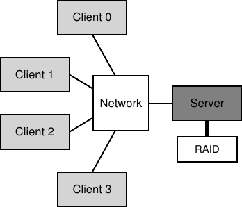
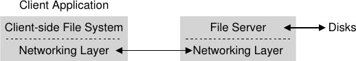
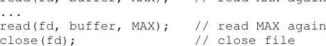
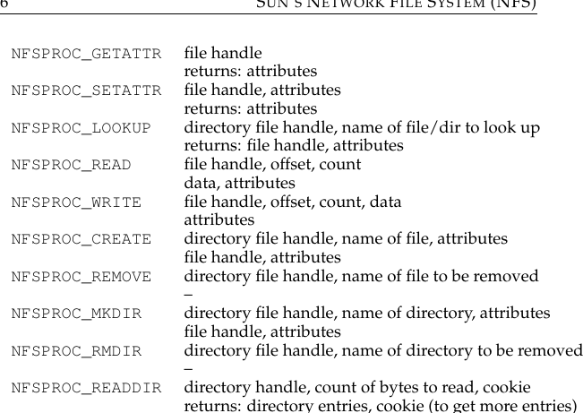
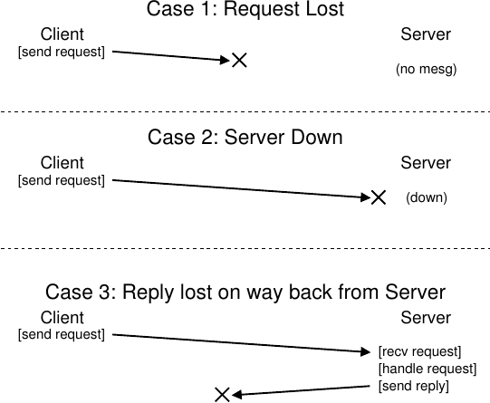
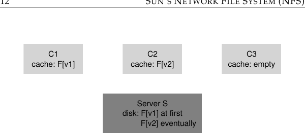

# الفصل 49: نظام ملفات الشبكة (NFS)

## نظام صن (Sun) لملفات الشبكة (NFS)

من أوائل استخدامات الحوسبة الموزّعة من نمط العميل/الخادم ما ظهر في مجال أنظمة الملفات الموزّعة (distributed file systems). ففي مثل هذه البيئة توجد آلات عملاء عدة وخادم واحد (أو بضعة خوادم)؛ يخزّن الخادم البيانات على أقراصه، ويطلب العملاء البيانات عبر رسائل بروتوكول محكمة الصياغة. ويصوّر الشكل 49.1 هذا الترتيب الأساسي.

**الشكل 49.1:** نظام عميل/خادم عام

كما ترى من الصورة، الخادم هو من يملك الأقراص، والعملاء يرسلون الرسائل عبر الشبكة للوصول إلى أدلّتهم وملفاتهم على تلك الأقراص. فلماذا نتكلّف هذا الترتيب؟ (أي لماذا لا ندع العملاء يستخدمون أقراصهم المحلية فحسب؟) حسنًا، هذا الترتيب يتيح أولًا وقبل كل شيء مشاركة البيانات بين العملاء بسهولة. فإذا وصلت إلى ملف على آلة ما (العميل 0) ثم استخدمت لاحقًا آلة أخرى (العميل 2)، فسترى الصورة نفسها من نظام الملفات. وبياناتك مشتركة طبيعيًا بين هذه الآلات المختلفة. وثمة فائدة ثانوية هي الإدارة المركزية؛ فمثلًا يمكن نسخ الملفات احتياطيًا من آلات الخادم القليلة بدلًا من كثرة العملاء. وثمة ميزة أخرى قد تكون الأمن؛ فوجود جميع الخوادم في غرفة آلات مقفلة يمنع ظهور أنواع معيّنة من المشكلات.

> **جوهر المسألة: كيف نبني نظام ملفات موزّعًا**

كيف تبني نظام ملفات موزّعًا؟ وما الجوانب الرئيسية التي ينبغي التفكير فيها؟ وما الذي يسهل الخطأ فيه؟ وما الذي يمكن أن نتعلّمه من الأنظمة القائمة؟

## 49.1 نظام ملفات موزّع أساسي

سندرس الآن معمارية نظام ملفات موزّع مبسّط. فنظام ملفات موزّع بسيط من نمط العميل/الخادم يحتوي مكوّنات أكثر من أنظمة الملفات التي درسناها حتى الآن. في جهة العميل توجد تطبيقات عميل تصل إلى الملفات والأدلّة عبر نظام الملفات في جهة العميل. ويُصدر تطبيق العميل نداءات نظام إلى نظام الملفات في جهة العميل (مثل `open()` و`read()` و`write()` و`close()` و`mkdir()` وغيرها) للوصول إلى الملفات المخزّنة على الخادم. ومن ثمّ لا يبدو نظام الملفات لتطبيقات العميل مختلفًا عن نظام ملفات محلي (قائم على القرص)، إلا في الأداء ربما؛ وبهذه الطريقة توفّر أنظمة الملفات الموزّعة وصولًا شفافًا إلى الملفات، وهو هدف بديهي؛ فمن ذا الذي يريد استخدام نظام ملفات يتطلّب مجموعة مختلفة من واجهات البرمجة أو يكون مؤلمًا في استعماله؟

ودور نظام الملفات في جهة العميل هو تنفيذ الإجراءات اللازمة لخدمة نداءات النظام تلك. فمثلًا، إن أصدر العميل طلب `read()`، فقد يرسل نظام الملفات في جهة العميل رسالة إلى نظام الملفات في جهة الخادم (أو، كما يُسمّى عادةً، خادم الملفات) لقراءة كتلة معيّنة؛ ثم يقرأ خادم الملفات الكتلة من القرص (أو من ذاكرته المؤقتة)، ويرسل رسالة عائدة إلى العميل بالبيانات المطلوبة. ثم ينسخ نظام الملفات في جهة العميل البيانات إلى مخزن المستخدم المؤقّت الممرّر إلى نداء النظام `read()`، وبذلك يكتمل الطلب. ولاحظ أن قراءة لاحقة لنفس الكتلة على العميل قد تُخزَّن مؤقتًا في ذاكرة العميل أو حتى على قرصه؛ وفي أفضل هذه الحالات لا حاجة إلى أي حركة شبكة على الإطلاق.

**الشكل 49.2:** معمارية نظام ملفات موزّع

من هذا العرض المختصر ينبغي أن تلمس وجود قطعتين مهمّتين من البرمجيات في نظام ملفات موزّع من نمط العميل/الخادم: نظام الملفات في جهة العميل، وخادم الملفات. وسلوكهما معًا يحدّد سلوك نظام الملفات الموزّع. وقد حان الوقت لدراسة نظام بعينه: نظام صن لملفات الشبكة (NFS).

> **استطراد: لماذا تتعطّل الخوادم**

قبل الخوض في تفاصيل بروتوكول NFSv2 قد تتساءل: لماذا تتعطّل الخوادم؟ حسنًا، كما قد تتوقّع، الأسباب كثيرة. فقد يعاني الخادم ببساطة من انقطاع التيار (مؤقتًا)؛ ولا يمكن إعادة تشغيل الآلات إلا بعد عودة التيار. وكثيرًا ما تتكوّن الخوادم من مئات الآلاف أو حتى ملايين الأسطر من الشيفرة؛ ومن ثمّ فيها أخطاء (فحتى البرمجيات الجيدة فيها بضعة أخطاء لكل مئة أو ألف سطر من الشيفرة)، ولذلك ستُفعّل في النهاية خطأً يؤدي إلى تعطّلها. ولديها أيضًا تسريبات ذاكرة؛ فحتى تسريب صغير للذاكرة سيجعل النظام ينفد من الذاكرة ويتعطّل. وأخيرًا، في الأنظمة الموزّعة توجد شبكة بين العميل والخادم؛ فإن تصرّفت الشبكة بغرابة (مثلًا إذا انقسمت فصار العملاء والخوادم عاملين لكنهم لا يستطيعون التواصل)، فقد يبدو الأمر كأن آلة بعيدة تعطّلت، بينما هي في الحقيقة غير قابلة للوصول عبر الشبكة في الوقت الراهن فحسب.

## 49.2 نحو NFS

من أوائل الأنظمة الموزّعة وأكثرها نجاحًا نظام طوّرته صن ميكروسيستمز (Sun Microsystems)، ويُعرف بنظام صن لملفات الشبكة (Sun Network File System) أو NFS [S86]. وقد اختارت صن عند تعريف NFS مقاربة غير معتادة: فبدلًا من بناء نظام مغلق ومملوك، طوّرت بروتوكولًا مفتوحًا يحدّد ببساطة صيغ الرسائل الدقيقة التي سيستخدمها العملاء والخوادم للتواصل. وهكذا أمكن لجماعات مختلفة أن تطوّر خوادم NFS خاصة بها وتتنافس في سوق NFS مع الحفاظ على قابلية التشغيل البيني. وقد نجح ذلك: فاليوم شركات كثيرة تبيع خوادم NFS (ومنها Oracle/Sun وNetApp [HLM94] وEMC وIBM وغيرها)، والنجاح الواسع لـNFS يُعزى على الأرجح إلى هذه المقاربة «السوق المفتوحة».

## 49.3 التركيز: استعادة سريعة وبسيطة من عطل الخادم

في هذا الفصل سنناقش بروتوكول NFS الكلاسيكي (الإصدار 2، أي NFSv2)، الذي كان معيارًا لسنوات كثيرة؛ وقد أُجريت تغييرات صغيرة عند الانتقال إلى NFSv3، وتغييرات أكبر على مستوى البروتوكول عند الانتقال إلى NFSv4. غير أن NFSv2 بديع ومُحيّر في آن، ولذلك يكون محور تركيزنا.

في NFSv2 كان الهدف الرئيسي في تصميم البروتوكول هو استعادة سريعة وبسيطة من عطل الخادم. وفي بيئة متعددة العملاء وذات خادم واحد يكون هذا الهدف منطقيًا جدًا؛ فأي دقيقة يتعطّل فيها الخادم (أو يكون غير متاح) تجعل جميع آلات العملاء (ومستخدميها) غير سعداء وغير منتجين. ومن ثمّ، كما يكون حال الخادم يكون حال النظام كله.

## 49.4 مفتاح الاستعادة السريعة من الأعطال: انعدام الحالة

يتحقّق هذا الهدف البسيط في NFSv2 عبر تصميم ما نسمّيه بروتوكولًا بلا حالة (stateless protocol). فالخادم، بحكم التصميم، لا يتتبّع شيئًا مما يجري عند كل عميل. فمثلًا لا يعرف الخادم أي العملاء يخزّن مؤقتًا أي الكتل، ولا أي الملفات مفتوحة حاليًا عند كل عميل، ولا موضع مؤشّر الملف الحالي في ملف ما، إلى غير ذلك. وببساطة، لا يتتبّع الخادم شيئًا مما يفعله العملاء؛ بل صُمّم البروتوكول بحيث يحمل كل طلب بروتوكول جميع المعلومات اللازمة لإكمال ذلك الطلب. وإن لم يكن ذلك واضحًا الآن، فستصبح هذه المقاربة القائمة على انعدام الحالة أوضح حين نناقش البروتوكول بتفصيل أكبر أدناه.

ولنأخذ مثالًا على بروتوكول ذي حالة (وليس بلا حالة)، وهو نداء النظام `open()`. فإذا أُعطي مسارًا، أعاد `open()` واصف ملف (عددًا صحيحًا). ويُستخدم هذا الواصف في طلبات `read()` أو `write()` اللاحقة للوصول إلى كتل ملف مختلفة، كما في شيفرة التطبيق هذه (لاحظ أن التحقق الصحيح من أخطاء نداءات النظام محذوف توفيرًا للمساحة):

`char buffer[MAX];` ثم `int fd = open("foo", O_RDONLY);` للحصول على الواصف `fd`، ثم `read(fd, buffer, MAX);` لقراءة `MAX` من الملف `foo` عبر `fd`، ثم `read(fd, buffer, MAX);` لقراءة `MAX` مرة أخرى، ثم `read(fd, buffer, MAX);` لقراءة `MAX` مرة أخرى، ثم `close(fd);` لإغلاق الملف.

**الشكل 49.3:** شيفرة العميل: القراءة من ملف

تخيّل الآن أن نظام الملفات في جهة العميل يفتح الملف بإرسال رسالة بروتوكول إلى الخادم تقول «افتح الملف `foo` وأعد إليّ واصفًا». ثم يفتح خادم الملفات الملف محليًا في جهته ويرسل الواصف عائدًا إلى العميل. وفي القراءات اللاحقة يستخدم تطبيق العميل ذلك الواصف لنداء النظام `read()`؛ ثم يمرّر نظام الملفات في جهة العميل الواصف في رسالة إلى خادم الملفات قائلًا «اقرأ بعض البايتات من الملف الذي يشير إليه الواصف الذي أمرّره إليك هنا».

في هذا المثال، واصف الملف قطعة من حالة مشتركة بين العميل والخادم (ويسمّيها Ousterhout الحالة الموزّعة [O91]). والحالة المشتركة، كما لمّحنا أعلاه، تعقّد استعادة ما بعد العطل. تخيّل أن الخادم يتعطّل بعد اكتمال القراءة الأولى وقبل أن يُصدر العميل القراءة الثانية. وبعد أن يعود الخادم إلى العمل، يُصدر العميل القراءة الثانية. وللأسف لا فكرة للخادم عن الملف الذي يشير إليه `fd`؛ فتلك المعلومة كانت عابرة (أي في الذاكرة) وضاعت بتعطّل الخادم. وللتعامل مع هذا الوضع سيكون على العميل والخادم أن يخوضا نوعًا من بروتوكول الاستعادة، يحرص فيه العميل على الاحتفاظ بمعلومات كافية في ذاكرته ليستطيع إخبار الخادم بما يحتاج إلى معرفته (في هذه الحالة، أن واصف الملف `fd` يشير إلى الملف `foo`).

ويسوء الأمر أكثر إذا أخذت في الحسبان أن الخادم ذا الحالة عليه أن يتعامل مع تعطّل العملاء. تخيّل مثلًا عميلًا يفتح ملفًا ثم يتعطّل. فنداء `open()` يستهلك واصف ملف على الخادم؛ فكيف يعرف الخادم أنه من المقبول إغلاق ملف معيّن؟ في التشغيل الطبيعي، سيستدعي العميل `close()` في النهاية فيخبر الخادم بأن الملف ينبغي أن يُغلق. أما حين يتعطّل العميل، فلا يستلم الخادم `close()` أبدًا، ومن ثمّ عليه أن يلاحظ تعطّل العميل ليغلق الملف.

لهذه الأسباب قرّر مصمّمو NFS اتّباع مقاربة بلا حالة: كل عملية عميل تحمل جميع المعلومات اللازمة لإكمال الطلب. ولا حاجة إلى استعادة فخمة من الأعطال؛ فالخادم يعود إلى العمل فحسب، وقد يضطر العميل في أسوأ الأحوال إلى إعادة محاولة طلب.

## 49.5 بروتوكول NFSv2

وهكذا نصل إلى تعريف بروتوكول NFSv2. وعبارة مشكلتنا بسيطة:

من الواضح أن النداءات ذات الحالة مثل `open()` لا يمكن أن تكون جزءًا من النقاش (لأنها ستتطلّب أن يتتبّع الخادم الملفات المفتوحة)؛ غير أن تطبيق العميل سيريد استدعاء `open()` و`read()` و`write()` و`close()` وغيرها من نداءات الواجهة القياسية للوصول إلى الملفات والأدلّة. ومن ثمّ، وكسؤال أدقّ، كيف نعرّف البروتوكول بحيث يكون بلا حالة ويدعم واجهة نظام الملفات POSIX في آن؟

> **جوهر المسألة: كيف نعرّف بروتوكول ملفات بلا حالة**

كيف نعرّف بروتوكول الشبكة بحيث يتيح التشغيل بلا حالة؟

أحد مفاتيح فهم تصميم بروتوكول NFS فهم مقبض الملف (file handle). تُستخدم مقابض الملفات لوصف الملف أو الدليل الذي ستجري عليه عملية معيّنة وصفًا فريدًا؛ ومن ثمّ تتضمّن طلبات كثيرة من البروتوكول مقبض ملف.

يمكنك أن تتخيّل مقبض الملف بوصفه ثلاثة مكوّنات مهمة: معرّف وحدة تخزين (volume identifier)، ورقم عقدة (inode number)، ورقم جيل (generation number)؛ وهذه الثلاثة معًا تشكّل معرّفًا فريدًا لملف أو دليل يريد العميل الوصول إليه. فمعرّف وحدة التخزين يخبر الخادم أي نظام ملفات يعنيه الطلب (فخادم NFS يستطيع تصدير أكثر من نظام ملفات)؛ ورقم العقدة يخبر الخادم أي ملف داخل ذلك القسم يصل إليه الطلب. وأخيرًا، يلزم رقم الجيل عند إعادة استخدام رقم عقدة؛ فبزيادته كلما أُعيد استخدام رقم عقدة، يضمن الخادم أن عميلًا يحمل مقبض ملف قديمًا لا يستطيع أن يصل مصادفةً إلى الملف المُخصَّص حديثًا.

وفيما يلي ملخّص لبعض الأجزاء المهمة من البروتوكول؛ والبروتوكول الكامل متاح في مكان آخر (انظر كتاب Callaghan للحصول على عرض ممتاز ومفصّل لـNFS [C00]).

- `NFSPROC_GETATTR`: مقبض ملف؛ يعيد: السمات (attributes).
- `NFSPROC_SETATTR`: مقبض ملف وسمات؛ يعيد: السمات.
- `NFSPROC_LOOKUP`: مقبض دليل واسم الملف أو الدليل المطلوب البحث عنه؛ يعيد: مقبض ملف وسمات.
- `NFSPROC_READ`: مقبض ملف وإزاحة وعدد؛ يعيد: بيانات وسمات.
- `NFSPROC_WRITE`: مقبض ملف وإزاحة وعدد وبيانات؛ يعيد: السمات.
- `NFSPROC_CREATE`: مقبض دليل واسم ملف وسمات؛ يعيد: مقبض ملف وسمات.
- `NFSPROC_REMOVE`: مقبض دليل واسم الملف المطلوب حذفه؛ يعيد: لا شيء.
- `NFSPROC_MKDIR`: مقبض دليل واسم دليل وسمات؛ يعيد: مقبض ملف وسمات.
- `NFSPROC_RMDIR`: مقبض دليل واسم الدليل المطلوب حذفه؛ يعيد: لا شيء.
- `NFSPROC_READDIR`: مقبض دليل وعدد البايتات المطلوب قراءتها وكوكي (cookie)؛ يعيد: مدخلات الدليل والكوكي (لجلب مزيد من المدخلات).

**الشكل 49.4:** بروتوكول NFS: أمثلة

نُبرز بإيجاز الأجزاء المهمة من البروتوكول. أولًا، تُستخدم رسالة البروتوكول LOOKUP للحصول على مقبض ملف، يُستخدم بعد ذلك للوصول إلى بيانات الملف. ويمرّر العميل مقبض ملف دليل واسم ملف للبحث عنه، ويُعاد إليه من الخادم مقبض ذلك الملف (أو الدليل) مع سماته.

مثلًا، افترض أن العميل يملك بالفعل مقبض ملف دليل للدليل الجذري لنظام ملفات (`/`) (والواقع أن هذا يُحصل عليه عبر بروتوكول التركيب (mount) في NFS، وهو الطريقة التي يتّصل بها العملاء والخوادم أول مرة؛ ولا نناقش بروتوكول التركيب هنا إيجازًا). فإن فتح تطبيق يعمل على العميل الملف `/foo.txt`، أرسل نظام الملفات في جهة العميل طلب بحث (lookup) إلى الخادم، ومرّر إليه مقبض الملف الجذري والاسم `foo.txt`؛ وإن نجح الطلب، أُعيد مقبض الملف (والسمات) الخاصّ بـ`foo.txt`.

وإن كنت تتساءل، فالسمات ليست إلا البيانات الوصفية (metadata) التي يتتبّعها نظام الملفات عن كل ملف، وفيها حقول مثل وقت إنشاء الملف ووقت آخر تعديل وحجم ومعلومات الملكية والأذونات، إلى غير ذلك، أي النوع نفسه من المعلومات التي ستحصل عليها لو استدعيت `stat()` على ملف.

وبمجرد توفّر مقبض ملف، يستطيع العميل إصدار رسالتي البروتوكول READ وWRITE على ملف لقراءته أو الكتابة فيه على التوالي. وتتطلّب رسالة READ أن يمرّر البروتوكول مقبض ملف الملف مع الإزاحة داخل الملف وعدد البايتات المطلوب قراءتها. ثم يستطيع الخادم إصدار القراءة (فالمقبض يخبره أي وحدة تخزين وأي عقدة يقرأ منها، والإزاحة والعدد يخبرانه أي بايتات من الملف يقرأ) وإعادة البيانات (والسمات المحدَّثة) إلى العميل (أو خطأ إن وقع فشل). ويُعالج WRITE على نحو مشابه، إلا أن البيانات تُمرَّر من العميل إلى الخادم، ولا يُعاد إلا رمز نجاح (والسمات المحدَّثة).

وآخر رسالة بروتوكول مثيرة للاهتمام هي طلب GETATTR؛ فإذا أُعطي مقبض ملف، جلب ببساطة سمات ذلك الملف، ومنها وقت آخر تعديل له. وسنرى أدناه في NFSv2 لماذا هذا الطلب مهم حين نناقش التخزين المؤقت (أتستطيع تخمين السبب؟).

## 49.6 من البروتوكول إلى نظام ملفات موزّع

نأمل أن تكون الآن أدركت شيئًا من كيفية تحويل هذا البروتوكول إلى نظام ملفات عبر نظام الملفات في جهة العميل وخادم الملفات. فنظام الملفات في جهة العميل يتتبّع الملفات المفتوحة، ويترجم عمومًا طلبات التطبيق إلى المجموعة المناسبة من رسائل البروتوكول. والخادم يردّ ببساطة على رسائل البروتوكول، وكل واحدة منها تحمل جميع المعلومات اللازمة لإكمال الطلب.

ولنأخذ مثالًا تطبيقًا بسيطًا يقرأ ملفًا. في المخطط (الشكل 49.5) نوضّح نداءات النظام التي يصدرها التطبيق، وما يفعله نظام الملفات في جهة العميل وخادم الملفات استجابةً لتلك النداءات.

وبضع تعليقات على الشكل. أولًا، لاحظ كيف يتتبّع العميل كل الحالة ذات الصلة بالوصول إلى الملف، ومنها ربط واصف الملف الصحيح بمقبض ملف NFS، وكذلك مؤشّر الملف الحالي. وهذا يتيح للعميل تحويل كل طلب قراءة (وقد لاحظت أنها لا تحدّد الإزاحة التي تُقرأ منها صراحةً) إلى رسالة بروتوكول قراءة محكمة الصياغة تخبر الخادم تمامًا أي بايتات من الملف يقرأ. وعند نجاح القراءة، يحدّث العميل موضع الملف الحالي؛ وتُصدر القراءات اللاحقة بالمقبض نفسه لكن بإزاحة مختلفة.

ثانيًا، قد تلاحظ أين تحدث تفاعلات الخادم. فحين يُفتح الملف أول مرة، يرسل نظام الملفات في جهة العميل رسالة طلب LOOKUP. والواقع أنه إذا وجب عبور مسار طويل (مثل `/home/remzi/foo.txt`)، فسيرسل العميل ثلاثة طلبات LOOKUP: واحد للبحث عن `home` في الدليل `/`، وآخر للبحث عن `remzi` في `home`، وأخيرًا واحد للبحث عن `foo.txt` في `remzi`.

ثالثًا، قد تلاحظ كيف يحمل كل طلب إلى الخادم جميع المعلومات اللازمة لإكماله بالكامل. ونقطة التصميم هذه حرجة للاستعادة الرشيدة من عطل الخادم، كما سنناقش بتفصيل أكبر الآن؛ فهي تضمن ألا يحتاج الخادم إلى حالة ليستطيع الردّ على الطلب.

**الشكل 49.5:** قراءة ملف: إجراءات جهة العميل وخادم الملفات

التكرار الجموحي (idempotency) خاصية مفيدة عند بناء أنظمة موثوقة. فحين يمكن إصدار عملية أكثر من مرة، يكون التعامل مع فشلها أسهل بكثير؛ إذ يمكنك ببساطة إعادة محاولتها. وإن لم تكن العملية جموحية التكرار، صارت الحياة أصعب.

> **نصيحة: التكرار الجموحي قوة**

## 49.7 التعامل مع عطل الخادم بعمليات جموحية التكرار

حين يرسل عميل رسالة إلى الخادم، فإنه لا يستلم ردًّا أحيانًا. والأسباب المحتملة لهذا الفشل في الردّ كثيرة. في بعض الحالات قد تُسقط الشبكة الرسالة؛ فالشبكات تفقد الرسائل، ومن ثمّ قد يُفقد الطلب أو الردّ فلا يستلم العميل أي استجابة.

ومن الممكن أيضًا أن يكون الخادم قد تعطّل، فلا يستجيب للرسائل حاليًا. وبعد قليل ستُعاد تشغيل الخادم ويعود إلى العمل، لكن الطلبات كلها ضاعت في تلك الأثناء. وفي كل هذه الحالات يبقى أمام العملاء سؤال: ماذا عليهم أن يفعلوا حين لا يردّ الخادم في وقت معقول؟

في NFSv2 يعالج العميل كل هذه الأعطال بطريقة واحدة موحّدة وأنيقة: بإعادة محاولة الطلب فحسب. وتحديدًا، بعد إرسال الطلب، يضبط العميل مؤقّتًا ينطلق بعد مدة محدّدة. فإن وصل ردّ قبل انطلاق المؤقّت، أُلغي المؤقّت وكان كل شيء على خير. أما إن انطلق المؤقّت قبل استلام أي ردّ، افترض العميل أن الطلب لم يُعالج فأعاد إرساله. فإن ردّ الخادم، كان كل شيء على خير وعالج العميل المشكلة ببراعة.

ومرّد قدرة العميل على إعادة محاولة الطلب ببساطة (أيًّا كان سبب الفشل) خاصية مهمة في معظم طلبات NFS: أنها جموحية التكرار. تُسمّى العملية جموحية التكرار حين يكون أثر أدائها عدة مرات مكافئًا لأثر أدائها مرة واحدة. فمثلًا، إن أخزنت قيمة في موضع ذاكرة ثلاث مرات، فذلك كإخزانها مرة واحدة؛ ومن ثمّ «أخزن القيمة في الذاكرة» عملية جموحية التكرار. أما إن زدت عدّادًا ثلاث مرات، فسينتج مبلغ مختلف عن زيادته مرة واحدة؛ ومن ثمّ «زد العدّاد» ليست جموحية التكرار. وبصورة أعمّ، أي عملية تقرأ البيانات فحسب جموحية التكرار بوضوح؛ وأي عملية تحدّث البيانات يجب النظر فيها بعناية أكبر لتحديد ما إذا كانت تحمل هذه الخاصية.

وقلب تصميم استعادة ما بعد العطل في NFS هو تكرارية معظم العمليات الشائعة الجموحية. فطلبات LOOKUP وREAD جموحية التكرار بلا عناء، لأنها تقرأ معلومات من خادم الملفات ولا تحدّثها. والأكثر إثارة للاهتمام أن طلبات WRITE جموحية التكرار أيضًا. فمثلًا، إن فشل طلب WRITE، يستطيع العميل إعادة محاولته ببساطة. فرسالة WRITE تحمل البيانات والعدد و(المهم) الإزاحة الدقيقة لكتابة البيانات فيها. ومن ثمّ يمكن تكرارها مع المعرفة بأن حصيلة كتابات متعددة كحصيلة كتابة واحدة.

## الحالة 1: فقدان الطلب

## العميل والخادم

## الحالة 2: تعطّل الخادم

## العميل والخادم

## الحالة 3: فقدان الرد في طريق العودة من الخادم

## العميل والخادم

**الشكل 49.6:** الأنواع الثلاثة للفقدان

بهذه الطريقة يستطيع العميل التعامل مع جميع المهل بطريقة موحّدة. فإن كان طلب WRITE قد فُقد ببساطة (الحالة 1 أعلاه)، أعاده العميل، ونفّذ الخادم الكتابة، وكان كل شيء على خير. والأمر نفسه يحدث إن كان الخادم متعطّلًا حين أُرسل الطلب ثم عاد إلى العمل حين أُرسل الطلب الثاني، فيعمل كل شيء كما هو مرغوب (الحالة 2). وأخيرًا، قد يستلم الخادم طلب WRITE فعلًا، ويُجري الكتابة على قرصه، ويرسل ردًّا. وقد يُفقد هذا الردّ (الحالة 3)، فيدفع العميل إلى إعادة إرسال الطلب. وحين يستلم الخادم الطلب مرة أخرى، سيفعل الشيء نفسه تمامًا: يكتب البيانات على القرص ويردّ بأنه فعل ذلك. فإن استلم العميل الردّ هذه المرة، كان كل شيء على خير مرة أخرى، وبذلك عالج العميل فقدان الرسائل وعطل الخادم معًا بطريقة موحّدة. بديع!

استطراد صغير: بعض العمليات يصعب جعلها جموحية التكرار. فمثلًا، حين تحاول إنشاء دليل موجود بالفعل، يُخبرك النظام أن طلب `mkdir` قد فشل. ومن ثمّ في NFS، إن استلم خادم الملفات رسالة البروتوكول MKDIR ونفّذها بنجاح لكن الردّ فُقد، فقد يعيد العميل إرسالها فيصادف ذلك الفشل، مع أن العملية نجحت أولًا ثم فشلت في إعادة المحاولة فقط. ومن ثمّ الحياة ليست كاملة.

وحتى حين تصمّم نظامًا بديعًا، لا تخرج جميع الحالات الطرفية تمامًا كما تحبّ أحيانًا. خذ مثال `mkdir` أعلاه؛ يمكن للمرء أن يعيد تصميم `mkdir` بدلالات مختلفة فيجعلها جموحية التكرار (فكّر كيف يمكنك فعل ذلك)؛ لكن لماذا نتكلّف؟ ففلسفة تصميم NFS تغطّي أهم الحالات، وتجعل تصميم النظام عمومًا نظيفًا وبسيطًا فيما يتعلق بالفشل. ومن ثمّ فإن قبول أن الحياة ليست كاملة وبناء النظام مع ذلك علامة على هندسة جيدة. ويُنسب هذا الحكمة على ما يبدو إلى فولتير، لقولته «... يقول إيطالي حكيم إن الأفضل عدوّ الجيد» [V72]، ومن ثمّ نسمّيها قانون فولتير.

> **نصيحة: الكامل عدوّ الجيد (قانون فولتير)**

## 49.8 تحسين الأداء: التخزين المؤقت في جهة العميل

أنظمة الملفات الموزّعة جيدة لأسباب عدة، لكن إرسال جميع طلبات القراءة والكتابة عبر الشبكة قد يؤدي إلى مشكلة أداء كبيرة: فالشبكة عمومًا ليست بهذه السرعة، خصوصًا بالمقارنة مع الذاكرة المحلية أو القرص. ومن ثمّ تبرز مشكلة أخرى: كيف نحسّن أداء نظام ملفات موزّع؟

الجواب، كما قد تتوقّع من قراءة الكلمات العريضة في العنوان الفرعي أعلاه، هو التخزين المؤقت في جهة العميل. فنظام الملفات في جهة عميل NFS يخزّن مؤقتًا في ذاكرة العميل بيانات الملفات (وبياناتها الوصفية) التي قرأها من الخادم. ومن ثمّ، مع أن الوصول الأول مكلف (أي يتطلّب تواصلًا عبر الشبكة)، تُخدم عمليات الوصول اللاحقة بسرعة كبيرة من ذاكرة العميل.

ويؤدي التخزين المؤقت أيضًا دور المخزن المؤقّت للكتابات. فحين يكتب تطبيق عميل أول مرة في ملف، يخزّن العميل البيانات في ذاكرة العميل (في المخزن المؤقّت نفسه الذي فيه البيانات المقروءة من خادم الملفات) قبل كتابتها إلى الخادم. وهذا التخزين المؤقّت للكتابات مفيد لأنه يفصل كمون `write()` في التطبيق عن أداء الكتابة الفعلي، أي أن نداء التطبيق إلى `write()` ينجح فورًا (ويضع البيانات في مخزن نظام الملفات المؤقّت في جهة العميل فحسب)؛ ولا تُكتب البيانات إلى خادم الملفات إلا لاحقًا.

ومن ثمّ، تخزّن عملاء NFS البيانات ويكون الأداء رائعًا عادةً وقد انتهينا، صحيح؟ للأسف، ليس تمامًا. فإضافة التخزين المؤقت إلى أي نظام فيه مخازن مؤقتة متعددة عند العملاء تُدخل تحديًا كبيرًا ومثيرًا للاهتمام نسمّيه مشكلة اتساق ذاكرة التخزين المؤقت (cache consistency problem).

## 49.9 مشكلة اتساق ذاكرة التخزين المؤقت

تُوضَّح مشكلة اتساق ذاكرة التخزين المؤقت على أفضل وجه بثلاثة عملاء وخادم واحد. تخيّل أن العميل C1 يقرأ ملفًا F، ويحتفظ بنسخة من الملف في مخزنه المؤقّت المحلي. ثم تخيّل عميلًا آخر، C2، يكتب فوق الملف F فيغيّر محتواه؛ ولنسمّ النسخة الجديدة من الملف F

**الشكل 49.7:** مشكلة اتساق ذاكرة التخزين المؤقت

(الإصدار 2)، أي F[v2]، والنسخة القديمة F[v1] حتى نستطيع التمييز بينهما (لكن الملف بالطبع يحمل الاسم نفسه، ومحتواه مختلف فقط). وأخيرًا ثمة عميل ثالث، C3، لم يصل بعد إلى الملف F.

يمكنك على الأرجح أن ترى المشكلة المقبلة (الشكل 49.7). والواقع أن ثمة مشكلتين فرعيتين. المشكلة الفرعية الأولى أن العميل C2 قد يخزّن كتاباته في مخزنه المؤقّت مدةً قبل نقلها إلى الخادم؛ وفي هذه الحالة، ما دام F[v2] في ذاكرة C2، فأي وصول إلى F من عميل آخر (قل C3) سيجلب النسخة القديمة من الملف (F[v1]). ومن ثمّ، بتخزين الكتابات مؤقتًا عند العميل، قد يحصل عملاء آخرون على نسخ قديمة من الملف، وهو ما قد يكون غير مرغوب؛ تخيّل فعلًا أنك تدخل إلى الآلة C2 وتحدّث F، ثم تدخل إلى C3 وتحاول قراءة الملف فلا تجد إلا النسخة القديمة! هذا مما يُحبط بالتأكيد. ولنسمّ هذا الجانب من مشكلة اتساق ذاكرة التخزين المؤقت ظهور التحديثات (update visibility)؛ متى تصبح تحديثات عميل ما مرئية عند عملاء آخرين؟

والمشكلة الفرعية الثانية لاتساق ذاكرة التخزين المؤقت هي ذاكرة تخزين مؤقّت قديمة (stale cache)؛ وفي هذه الحالة يكون C2 قد أفرغ كتاباته أخيرًا إلى خادم الملفات، فصار لدى الخادم أحدث نسخة (F[v2]). غير أن C1 ما يزال يحمل F[v1] في مخزنه المؤقّت؛ فإن قرأ برنامج يعمل على C1 الملف F، حصل على نسخة قديمة (F[v1]) لا على أحدث نسخة (F[v2])، وهو (غالبًا) غير مرغوب.

تحلّ تطبيقات NFSv2 مشكلتي اتساق ذاكرة التخزين المؤقت هاتين بطريقتين. أولًا، ولمعالجة ظهور التحديثات، تُجري العملاء ما يُسمّى أحيانًا اتساق الإفراغ عند الإغلاق (flush-on-close)، أي اتساق الإغلاق حتى الفتح (close-to-open)؛ وتحديدًا، حين يُكتب في ملف ثم يُغلق لاحقًا بتطبيق عميل، يُفرغ العميل جميع التحديثات (أي الصفحات المتّسخة في ذاكرة التخزين المؤقت) إلى الخادم. وباتساق الإفراغ عند الإغلاق تضمن NFS أن فتحًا لاحقًا من عقدة أخرى سيرى أحدث نسخة من الملف.

وثانيًا، ولمعالجة مشكلة ذاكرة التخزين المؤقت القديمة، تتحقّق عملاء NFSv2 أولًا مما إذا كان الملف قد تغيّر قبل استخدام محتواه المخزّن مؤقتًا. وتحديدًا، قبل استخدام كتلة مخزّنة مؤقتًا، يصدر نظام الملفات في جهة العميل طلب GETATTR إلى الخادم لجلب سمات الملف. والسمات، والمهم، تحمل معلومات عن وقت آخر تعديل للملف على الخادم؛ فإن كان وقت التعديل أحدث من الوقت الذي جُلب فيه الملف إلى ذاكرة العميل المؤقتة، أَبطل العميل الملف، فحذفه من ذاكرة التخزين المؤقت للعميل وضمن بذلك أن القراءات اللاحقة ستذهب إلى الخادم وتجلب أحدث نسخة من الملف. أما إن رأى العميل أنه يحمل أحدث نسخة من الملف، فسيمضي في استخدام المحتوى المخزّن مؤقتًا، وبذلك يزيد الأداء.

وحين نفّذ الفريق الأصلي في صن هذا الحل لمشكلة ذاكرة التخزين المؤقت القديمة، أدركوا مشكلة جديدة؛ فجأة غمر خادم NFS سيل من طلبات GETATTR. ومن مبادئ الهندسة الجيدة أن تُصمّم من أجل الحالة الشائعة وأن تجعلها تعمل جيدًا؛ وهنا، مع أن الحالة الشائعة كانت أن ملفًا ما يُوصل إليه من عميل واحد فقط (وربما مرارًا)، كان على العميل دائمًا أن يرسل طلبات GETATTR إلى الخادم ليتأكد أن أحدًا آخر لم يغيّر الملف. فكان العميل يقصف الخادم سائلًا باستمرار «هل غيّر أحد هذا الملف؟»، بينما لم يغيّره أحد في معظم الوقت.

ولمعالجة هذا الوضع (إلى حدّ ما)، أُضيف مخزن مؤقّت للسمات إلى كل عميل. فكان العميل يتحقّق من صحة ملف قبل الوصول إليه، لكنه غالبًا كان ينظر فحسب في مخزن السمات المؤقّت لجلب السمات. وقد كانت سمات ملف معيّن تُوضع في المخزن المؤقّت حين يُوصل إلى الملف أول مرة، ثم تنتهي مهلتها بعد مقدار معيّن من الوقت (قل 3 ثوانٍ). ومن ثمّ، خلال تلك الثواني الثلاث، كانت جميع عمليات الوصول إلى الملفات تستنتج أنه لا بأس من استخدام الملف المخزّن مؤقتًا، فتفعل ذلك دون أي تواصل شبكي مع الخادم.

## 49.10 تقييم اتساق ذاكرة التخزين المؤقت في NFS

وبضع كلمات أخيرة عن اتساق ذاكرة التخزين المؤقت في NFS. أُضيف سلوك الإفراغ عند الإغلاق ليكون «منطقيًا»، لكنه أدخل مشكلة أداء معيّنة. وتحديدًا، إن أُنشئ ملف مؤقّت أو قصير العمر على عميل ثم حُذف سريعًا، فسيُدفع إلى الخادم رغم ذلك. وربما كان التنفيذ الأمثل يُبقي هذه الملفات قصيرة العمر في الذاكرة حتى تُحذف فيزيل التفاعل مع الخادم إزالة كاملة، وربما يزيد الأداء.

والأهم من ذلك أن إضافة مخزن مؤقّت للسمات إلى NFS جعلت من الصعب جدًا فهم أي نسخة من الملف ستحصل عليها أو التفكير فيها بدقّة. فأحيانًا كنت تحصل على أحدث نسخة؛ وأحيانًا كنت تحصل على نسخة قديمة لمجرد أن مخزن السمات المؤقّت لم تنته مهلته بعد، فكان العميل سعيدًا بأن يعطيك ما في ذاكرة العميل. ومع أن ذلك كان مقبولًا في معظم الوقت، فقد أدّى (وما يزال يؤدي!) إلى سلوك غريب أحيانًا.

وهكذا وصفنا الغرابة التي هي التخزين المؤقت في جهة عميل NFS. وهو مثال مثير للاهتمام يخدم فيه تفصيل من تفاصيل التنفيذ في تعريف الدلالات التي يلاحظها المستخدم، لا العكس.

## 49.11 التبعات على التخزين المؤقت للكتابة في جهة الخادم

كان تركيزنا حتى الآن على التخزين المؤقت عند العميل، وهنا تنشأ معظم المسائل المثيرة. غير أن خوادم NFS تميل إلى أن تكون آلات مجهّزة تجهيزًا جيدًا وبذاكرة كبيرة أيضًا، ومن ثمّ لديها شواغل تخزين مؤقّت كذلك. فحين تُقرأ البيانات (والبيانات الوصفية) من القرص، يُبقيها خادم NFS في الذاكرة، فلا تذهب القراءات اللاحقة لتلك البيانات (وتلك البيانات الوصفية) إلى القرص، وهو تعزيز (صغير) محتمل للأداء.

والأكثر إثارة للاهتمام حالة التخزين المؤقت للكتابات. فخادم NFS لا يجوز له إطلاقًا أن يعيد نجاحًا على طلب بروتوكول WRITE قبل أن تُدفع الكتابة إلى تخزين مستقر (إلى القرص أو إلى أي جهاز دائم آخر مثلًا). فمع أن الخادم يستطيع وضع نسخة من البيانات في ذاكرته، فإن إعادة النجاح إلى العميل على طلب بروتوكول WRITE قد تؤدي إلى سلوك غير صحيح؛ أتستطيع أن تكتشف السبب؟

الجواب يكمن في افتراضاتنا عن كيفية تعامل العملاء مع عطل الخادم. تخيّل تسلسل الكتابات التالي كما أصدره عميل:

`write(fd, a_buffer, size);` لملء الكتلة الأولى بحروف a، ثم `write(fd, b_buffer, size);` لملء الكتلة الثانية بحروف b، ثم `write(fd, c_buffer, size);` لملء الكتلة الثالثة بحروف c.

هذه الكتابات تكتب فوق كتل الملف الثلاث بكتلة من حروف a، ثم من حروف b، ثم من حروف c. ومن ثمّ، إن كان الملف في البداية هكذا:

xxxxxxxxxxxxxxxxxxxxxxxxxxxxxxxxxxxxxxxxxxxx yyyyyyyyyyyyyyyyyyyyyyyyyyyyyyyyyyyyyyyyyyyy zzzzzzzzzzzzzzzzzzzzzzzzzzzzzzzzzzzzzzzzzzzz

فقد نتوقّع أن تكون النتيجة النهائية بعد هذه الكتابات هكذا، إذ تُكتب فوق حروف x وy وz حروف a وb وc على التوالي.

aaaaaaaaaaaaaaaaaaaaaaaaaaaaaaaaaaaaaaaaaaaa bbbbbbbbbbbbbbbbbbbbbbbbbbbbbbbbbbbbbbbbbbbb cccccccccccccccccccccccccccccccccccccccccccc

لنفترض الآن، لأجل المثال، أن كتابات العميل الثلاث أُرسلت إلى الخادم كثلاث رسائل بروتوكول WRITE منفصلة. افترض أن الخادم استلم رسالة WRITE الأولى وأجراها على القرص، وأُخبر العميل بنجاحها. ثم افترض أن الكتابة الثانية خُزّنت مؤقتًا في الذاكرة فقط، وأن الخادم أبلغ العميل بنجاحها أيضًا قبل دفعها إلى القرص؛ وللأسف يتعطّل الخادم قبل كتابتها إلى القرص. ثم يعيد الخادم التشغيل سريعًا ويستلم طلب الكتابة الثالث، الذي ينجح هو أيضًا.

وهكذا، من منظور العميل، نجحت جميع الطلبات، لكننا نُفاجأ بأن محتوى الملف يبدو هكذا:

aaaaaaaaaaaaaaaaaaaaaaaaaaaaaaaaaaaaaaaaaaaa yyyyyyyyyyyyyyyyyyyyyyyyyyyyyyyyyyyyyyyyyyyy (هنا الخطأ!) cccccccccccccccccccccccccccccccccccccccccccc

يا للهول! لأن الخادم أخبر العميل أن الكتابة الثانية نجحت قبل تثبيتها على القرص، بقيت قطعة قديمة في الملف، وهو ما قد يكون كارثيًا حسب التطبيق.

وكما هي حال كثير من التقنيات الرائدة، تطلّب إحضار NFS إلى العالم ابتكارات أساسية أخرى لتمكين نجاحه. ولعلّ أبعدها أثرًا واجهة نظام الملفات الافتراضي (Virtual File System) والعقدة الافتراضية (vnode)، التي أدخلتها صن للسماح بإدخال أنظمة ملفات مختلفة في نظام التشغيل بسهولة [K86]. وتتضمّن طبقة VFS عمليات تُجرى على نظام ملفات بأكمله، مثل التركيب وإلغاء التركيب، والحصول على إحصاءات على مستوى نظام الملفات، ودفع جميع الكتابات المتّسخة (التي لم تُكتب بعد) إلى القرص. وتتكوّن طبقة vnode من كل العمليات التي يمكن إجراؤها على ملف، مثل الفتح والإغلاق والقراءة والكتابة وغيرها. ولبناء نظام ملفات جديد، على المرء ببساطة أن يعرّف هذه «الطرائق»؛ ثم يتولّى الإطار البقية، فيصل نداءات النظام بتنفيذ نظام الملفات المعني، وينفّذ الوظائف العامة المشتركة بين جميع أنظمة الملفات (كالتخزين المؤقت) بطريقة مركزية، وبذلك يوفّر سبيلًا لتشغيل عدة تنفيذات لأنظمة ملفات في الوقت نفسه داخل النظام نفسه. ومع أن بعض التفاصيل تغيّرت، فإن أنظمة حديثة كثيرة فيها شكل من طبقة VFS/vnode، ومنها Linux ومتغيّرات BSD وmacOS وحتى Windows (في صورة نظام الملفات القابل للتثبيت Installable File System). وحتى إن صار NFS أقل صلة بالعالم، فستبقى بعض الأسس الضرورية تحته حيّة.

> **استطراد: الابتكار يولّد الابتكار**

ولمنع هذه المشكلة، على خوادم NFS أن تثبّت كل كتابة على تخزين مستقر (دائم) قبل إبلاغ العميل بالنجاح؛ فذلك يتيح للعميل كشف عطل الخادم أثناء الكتابة، ومن ثمّ إعادة المحاولة حتى تنجح أخيرًا. وهذا يضمن ألا ننتهي أبدًا بمحتوى ملف متشابك كما في المثال أعلاه.

والمشكلة التي ينشئها هذا الشرط في تنفيذ خادم NFS هي أن أداء الكتابة، دون عناية كبيرة، قد يكون عنق الزجاجة الرئيسي في الأداء. والواقع أن بعض الشركات (مثل Network Appliance) نشأت بهدف بسيط هو بناء خادم NFS يستطيع تنفيذ الكتابات سريعًا؛ ومن الحيل التي تستخدمها أن تضع الكتابات أولًا في ذاكرة مدعومة ببطارية، فيمكنها الردّ سريعًا على طلبات WRITE دون خوف من فقدان البيانات ودون كلفة الكتابة إلى القرص فورًا؛ والحيلة الثانية استخدام تصميم نظام ملفات مصمّم خصيصًا للكتابة إلى القرص بسرعة حين يلزم ذلك أخيرًا [HLM94, RO91].

## 49.12 الخلاصة

لقد رأينا مقدمة نظام الملفات الموزّع NFS. ويتمحور NFS حول فكرة الاستعادة البسيطة والسريعة في وجه عطل الخادم، ويحقّق هذه الغاية عبر تصميم بروتوكول دقيق.

> **استطراد: مصطلحات NFS الأساسية**

- مفتاح تحقيق الهدف الرئيسي للاستعادة السريعة والبسيطة من الأعطال في NFS هو تصميم بروتوكول بلا حالة. فبعد العطل يستطيع الخادم إعادة التشغيل سريعًا والبدء بخدمة الطلبات من جديد؛ ويكتفي العملاء بإعادة محاولة الطلبات حتى تنجح.
- جعل الطلبات جموحية التكرار جانب مركزي في بروتوكول NFS. تُعدّ العملية جموحية التكرار حين يكون أثر أدائها عدة مرات مكافئًا لأدائها مرة واحدة. وفي NFS، تتيح التكرارية الجموحية للعميل إعادة المحاولة دون قلق، وتوحّد إعادة إرسال الرسائل المفقودة لدى العميل وكيفية تعامله مع تعطّل الخوادم.
- شواغل الأداء تفرض الحاجة إلى التخزين المؤقت في جهة العميل وتخزين الكتابات مؤقتًا، لكنها تُدخل مشكلة اتساق ذاكرة التخزين المؤقت.
- تقدّم تطبيقات NFS حلًّا هندسيًا لاتساق ذاكرة التخزين المؤقت بوسائل عدة: مقاربة الإفراغ عند الإغلاق (الإغلاق حتى الفتح) تضمن أنه حين يُغلق ملف، يُدفع محتواه إلى الخادم، فيستطيع عملاء آخرون ملاحظة التحديثات عليه. ويقلّل مخزن السمات المؤقّت من تكرار التحقّق مع الخادم مما إذا كان ملف قد تغيّر (عبر طلبات GETATTR).
- على خوادم NFS تثبيت الكتابات على وسائط دائمة قبل إعادة النجاح؛ وإلا فقد يقع فقدان للبيانات.
- لدعم دمج NFS في نظام التشغيل، أدخلت صن واجهة VFS/Vnode، فتيحت لعدة تنفيذات لأنظمة ملفات أن تتعايش في نظام التشغيل نفسه.

وتكرارية العمليات الجموحية أمر جوهري؛ فلأن العميل يستطيع بأمان إعادة تشغيل عملية فاشلة، فلا بأس من ذلك سواء نفّذ الخادم الطلب أم لم ينفّذه. ورأينا أيضًا كيف يمكن لإدخال التخزين المؤقت في نظام متعدد العملاء وذا خادم واحد أن يعقّد الأمور. وتحديدًا، على النظام أن يحلّ مشكلة اتساق ذاكرة التخزين المؤقت ليسلك سلوكًا معقولًا؛ غير أن NFS يفعل ذلك بطريقة ارتجالية بعض الشيء قد تؤدي أحيانًا إلى سلوك غريب يمكن ملاحظته. وأخيرًا، رأينا كيف يمكن أن يكون التخزين المؤقت عند الخادم ماكرًا: فيجب دفع الكتابات إلى الخادم إلى تخزين مستقر قبل إعادة النجاح (وإلا فقد تُفقد البيانات). ولم نتحدّث عن مسائل أخرى ذات صلة بالتأكيد، وأبرزها الأمن. كان الأمن في تطبيقات NFS المبكرة متراخيًا بشكل ملحوظ؛ فقد كان سهلًا على أي مستخدم على عميل أن يتنكّر في صورة مستخدمين آخرين فيصل إلى أي ملف تقريبًا. وقد عالج الدمج اللاحق مع خدمات مصادقة أكثر جدّية (مثل Kerberos [NT94]) هذه النقائص الواضحة.

## المراجع

> [AKW88] «The AWK Programming Language» لـAlfred V. Aho وBrian W. Kernighan وPeter
>
> J. Weinberger. Pearson، 1988 (الطبعة الأولى). كتاب موجز وبديع عن awk. وقد تسنّت لنا مرة
>
> متعة لقاء Peter Weinberger؛ وحين عرّف بنفسه قال «أنا Peter Weinberger، كما تعرف، حرف W في awk؟» وبوصفنا من أشدّ المعجبين بـawk، كانت تلك لحظة تُتذوّق. فقال أحدنا (Remzi) حينها:
>
> «أحبّ awk! وأحبّ خصوصًا الكتاب، فهو يجعل كل شيء واضحًا على نحو بديع». فأجاب Weinberger
>
> (بوجه كاسف): «آه، Kernighan هو من كتب الكتاب».

> [C00] «NFS Illustrated» لـBrent Callaghan. Addison-Wesley Professional Computing Series،

> [ES03] «New NFS Tracing Tools and Techniques for System Analysis» لـDaniel Ellard و
>
> Margo Seltzer. LISA '03، سان دييغو، كاليفورنيا. تحليل دقيق ومتقن لـNFS أُجري عبر
>
> التتبّع السلبي. فبمراقبة حركة الشبكة فحسب، يُظهر المؤلفان كيف يُستخرج قدر هائل
>
> من الفهم لنظام الملفات.

> [HLM94] «File System Design for an NFS File Server Appliance» لـDave Hitz وJames Lau و
>
> Michael Malcolm. USENIX Winter 1994، سان فرانسيسكو، كاليفورنيا، 1994. تأثّر Hitz وآخرون
>
> تأثيرًا كبيرًا بالأعمال السابقة على أنظمة الملفات ذات البنية السجلية.

> [K86] «Vnodes: An Architecture for Multiple File System Types in Sun UNIX» لـSteve R.
>
> Kleiman. USENIX Summer '86، أتلانتا، جورجيا. تُظهر هذه الورقة كيف تُبنى معمارية مرنة
>
> لنظام ملفات داخل نظام تشغيل، فتيح لعدة تنفيذات مختلفة لأنظمة الملفات
>
> أن تتعايش. وهي الآن مستخدمة في كل نظام تشغيل حديث تقريبًا بشكل ما.

> [NT94] «Kerberos: An Authentication Service for Computer Networks» لـB. Clifford Neu-
>
> man وTheodore Ts'o. IEEE Communications، 32(9):33-38، سبتمبر 1994. Kerberos خدمة مصادقة
>
> مبكرة وشديدة التأثير. وربما ينبغي لنا أن نكتب فصلًا في كتاب عنها في وقت ما...

> [O91] «The Role of Distributed State» لـJohn K. Ousterhout. 1991. متاح على هذا الموقع:
>
> ftp://ftp.cs.berkeley.edu/ucb/sprite/papers/state.ps. مناقشة قليلة الإحالة
>
> للحالة الموزّعة؛ ومنظور أوسع للمشكلات والتحديات.

> [P+94] «NFS Version 3: Design and Implementation» لـBrian Pawlowski وChet Juszczak وPeter
>
> Staubach وCarl Smith وDiane Lebel وDave Hitz. USENIX Summer 1994، الصفحات 137-152. التعديلات
>
> الصغيرة التي يقوم عليها الإصدار 3 من NFS.

> [P+00] «The NFS version 4 protocol» لـBrian Pawlowski وDavid Noveck وDavid Robinson و
>
> Robert Thurlow. المؤتمر الدولي الثاني لإدارة الأنظمة والشبكات (SANE)

> [RO91] «The Design and Implementation of the Log-structured File System» لـMendel Rosen-
>
> blum وJohn Ousterhout. Symposium on Operating Systems Principles (SOSP)، 1991. نظام LFS
>
> مرة أخرى. لا، لا يمكن للمرء أن يحصل على ما يكفيه من LFS أبدًا.

> [S86] «The Sun Network File System: Design, Implementation and Experience» لـRussel
>
> Sandberg. USENIX Summer 1986. ورقة NFS الأصلية؛ ومع أنها قراءة صعبة بعض الشيء،
>
> فمن الجدير أن ترى مصدر هذه الأفكار البديمة.

> [Sun89] «NFS: Network File System Protocol Specification» لـSun Microsystems, Inc. طلب
>
> التعليقات: 1094، مارس 1989. متاح على: http://www.ietf.org/rfc/rfc1094.txt.
>
> المواصفة المخيفة؛ اقرأها إن كان لا بدّ، أي إن كنت تُدفع لكي تقرأها. ونأمل أن تُدفع كثيرًا.

> [V72] «La Begueule» لـFrancois-Marie Arouet المعروف بـVoltaire. نُشر في 1772. قال Voltaire
>
> أشياء ذكية كثيرة، وهذا مثال واحد فحسب. فمثلًا قال Voltaire أيضًا «إن كان في أرضك دينان،
>
> فسيذبح كل منهما الآخر؛ أما إن كان فيها ثلاثون دينًا، فسيتعايشون في سلام». فماذا تقول في ذلك، يا ديمقراطيين وجمهوريين؟

## الواجب المنزلي (القياس)

في هذا الواجب المنزلي ستُجري قليلًا من تحليل تتبّع NFS باستخدام تتبّعات حقيقية. ومصدر هذه التتبّعات جهد Ellard وSeltzer [ES03]. تأكّد من قراءة ملف README ذي الصلة وتنزيل الحزمة المضغوطة ذات الصلة من صفحة الواجبات المنزلية في OSTEP (كالعادة) قبل البدء. وأحد الأدوات التي قد يكون استعمالها ممتعًا في هذا التحليل لغة البرمجة awk [AKW88].

## الأسئلة

1. سؤال أول لتحليل التتبّع: باستخدام الطوابع الزمنية الموجودة في العمود الأول، حدّد الفترة التي أُخذت فيها التتبّعات. فما طول الفترة؟ وأي يوم أو أسبوع أو شهر أو سنة كانت؟ (وهل يطابق ذلك التلميح المعطى في اسم الملف؟) تلميح: استخدم الأداتين `head -1` و`tail -1` لاستخراج أول أسطر الملف وآخرها، ثم أجرِ الحساب.

2. ولنُجرِ الآن بعض إحصاءات العمليات. كم عملية من كل نوع تحدث في التتبّع؟ رتّبها بحسب التكرار؛ فأي عملية هي الأكثر تكرارًا؟ وهل يرقى NFS إلى سمعته؟

3. ولننظر الآن في بعض العمليات بعينها بتفصيل أكبر. فمثلًا، طلب GETATTR يعيد معلومات كثيرة عن الملفات، منها معرّف المستخدم الذي يُجرى الطلب لحسابه، وحجم الملف، إلى غير ذلك. أنشئ توزيعًا لأحجام الملفات التي وُصل إليها في التتبّع؛ فما متوسط حجم الملف؟ وأيضًا، كم مستخدمًا مختلفًا يصل إلى ملفات في التتبّع؟ هل يهيمن مستخدمون قليلون على الحركة، أم أنها أكثر انتشارًا؟ وأي معلومات أخرى مثيرة للاهتمام توجد في ردود GETATTR؟

4. يمكنك أيضًا النظر في الطلبات إلى ملف معيّن وتحديد كيف يُوصل إلى الملفات. فمثلًا، هل يُقرأ ملف معيّن أو يُكتب تسلسليًا؟ أم عشوائيًا؟ انظر في تفاصيل طلبات READ وWRITE وردودها لحساب الجواب.

5. تأتي الحركة من آلات كثيرة وتذهب إلى خادم واحد (في هذا التتبّع). احسب مصفوفة حركة تُظهر كم عميلًا مختلفًا في التتبّع، وكم طلبًا وردًّا يذهب إلى كل منها. فهل تهيمن آلات قليلة، أم أن التوازن أكبر؟

6. ينبغي أن تتيح لك معلومات التوقيت والمعرّف الفريد لكل طلب وردّ حساب الكمون لطلب معيّن. احسب كمونات جميع أزواج الطلب والردّ، وارسمها توزيعًا. فما المتوسط؟ وما الأقصى؟ وما الأدنى؟

7. تُعاد الطلبات أحيانًا، لأن الطلب أو ردّه قد يُفقد أو يُسقط. أتستطيع أن تجد أي دليل على إعادة محاولة كهذه في عيّنة التتبّع؟

8. ثمة أسئلة أخرى كثيرة يمكنك الإجابة عنها بتحليل أكبر. أي أسئلة تراها مهمة؟ اقترحها علينا، وربما أضفناها هنا!

[^20]: مرجع عظيم عن NFS؛ شديد الشمول والتفصيل فيما يتعلق بالبروتوكول نفسه.

[^20]: بلا شك أكثر ورقة أدبية كُتبت عن NFS على الإطلاق.
