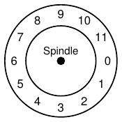
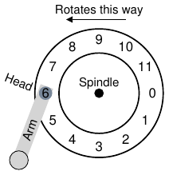
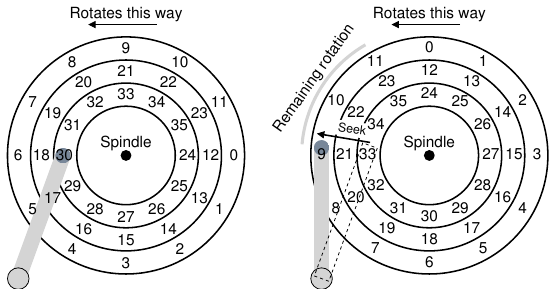
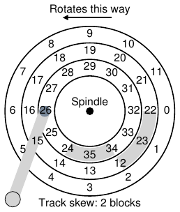
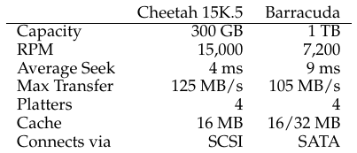
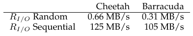
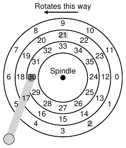
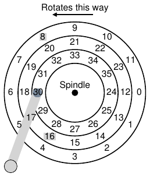

# الفصل 37: محرّكات الأقراص الصلبة

قدّم الفصل السابق المفهوم العام لجهاز الإدخال/الإخراج، وأظهر لك كيف قد يتفاعل نظام التشغيل مع وحش كهذا. وفي هذا الفصل نغوص في تفاصيل أكثر عن جهاز واحد بعينه: محرّك القرص الصلب. وقد كانت هذه المحرّكات الشكل الرئيسي لتخزين البيانات الدائم في أنظمة الحاسوب لعقود، وكثير من تطوير تقنية نظم الملفات (الآتية قريبًا) مبنيّ على سلوكها. ومن ثمّ يجدر بنا فهم تفاصيل عمل القرص قبل بناء برمجيات نظام الملفات التي تديره. وكثير من هذه التفاصيل متاح في ورقتين ممتازتين لرويملر وويلكس [RW92]، وأندرسون ودايكس وريدل [ADR03].

> **جوهر المسألة: كيف نخزّن البيانات على القرص ونصل إليها**
>
> كيف تخزّن محرّكات الأقراص الصلبة الحديثة البيانات؟ وما الواجهة؟ وكيف تُرتَّب البيانات فعليًا ويُ الوصول إليها؟ وكيف تحسّن جدولة القرص الأداء؟

## 37.1 الواجهة

لنبدأ بفهم واجهة محرّك أقراص حديث. الواجهة الأساسية في كل المحرّكات الحديثة مباشرة. يتكوّن المحرّك من عدد كبير من القطاعات (كتل من 512 بايت)، يمكن قراءة كل منها أو الكتابة فيه. والقطاعات مرقّمة من 0 إلى n − 1 على قرص ذي n قطاعًا. ومن ثمّ نستطيع أن ننظر إلى القرص كمصفوفة من القطاعات؛ ومن ثمّ فإن المدى من 0 إلى n − 1 هو فضاء عناوين المحرّك.

والعمليات متعددة القطاعات ممكنة؛ بل إن كثيرًا من نظم الملفات تقرأ أو تكتب 4 كيلوبايت في المرة (أو أكثر). غير أن الضمان الوحيد الذي تقدّمه مصانع المحرّكات عند تحديث القرص هو أن كتابة واحدة من 512 بايت ذرّية (أي أنها إمّا تكتمل بتمامها أو لا تكتمل أصلًا)؛ ومن ثمّ، إن حدث انقطاع كهرباء في وقت غير مناسب، فقد يكتمل جزء فقط من كتابة أكبر (وهو ما يُسمّى أحيانًا الكتابة الممزّقة).

وثمة افتراضات يبني عليها معظم مستخدمي محرّكات الأقراص، لكنها غير منصوص عليها صراحة في الواجهة؛ وقد سمّى شلوسر وغانغر ذلك «العقد غير المكتوب» لمحرّكات الأقراص [SG04]. وتحديدًا، يمكن للمرء عادةً أن يفترض أن الوصول إلى كتلتين[^1] متجاورتين داخل فضاء عناوين المحرّك أسرع من الوصول إلى كتلتين متباعدتين. ويمكنه عادةً أيضًا أن يفترض أن الوصول إلى الكتل في مقطع متجاور (أي قراءة أو كتابة تتابعية) هو أسرع نمط وصول، وأنه عادةً أسرع بكثير من أي نمط وصول عشوائي.

## 37.2 الهندسة الأساسية

لنبدأ بفهم بعض مكوّنات قرص حديث. نبدأ بالصفيحة، وهي سطح صلب دائري تُخزَّن عليه البيانات تخزينًا دائمًا بإحداث تغيّرات مغناطيسية فيه. وقد يكون للقرص صفيحة واحدة أو أكثر؛ ولكل صفيحة جانبان، يُسمّى كل منهما سطحًا. وتُصنع هذه الصفائح عادةً من مادة صلبة ما (مثل الألمنيوم)، ثم تُطلى بطبقة مغناطيسية رقيقة تمكّن المحرّك من تخزين البتات تخزينًا دائمًا حتى حين يكون مطفأً.

وتُشدّ الصفائح كلها معًا حول المغزل، المتصل بمحرّك يدير الصفائح (ما دام محرّك الأقراص متصلًا بالطاقة) بمعدّل ثابت. ويُقاس معدّل الدوران غالبًا بعدد الدورات في الدقيقة (RPM)، والقيم الحديثة النمطية تتراوح بين 7200 و15000 دورة في الدقيقة. ولاحظ أننا سنكون مهتمّين كثيرًا بزمن الدورة الواحدة، فمحرّك يدور بـ10000 دورة في الدقيقة يعني أن الدورة الواحدة تستغرق نحو 6 أجزاء من الألف من الثانية (6 ms).

وتُشفَّر البيانات على كل سطح في دوائر متحدة المركز من القطاعات؛ ونسمّي الدائرة الواحدة من هذه الدوائر مسارًا. ويحتوي السطح الواحد على آلاف وآلاف من المسارات، متراصّة تراصًا شديدًا، بحيث تتناسب مئات المسارات في عرض شعرة بشرية.

وللقراءة والكتابة من السطح، نحتاج إلى آلية تتيح لنا إمّا استشعار الأنماط المغناطيسية على القرص (أي قراءتها) وإمّا إحداث تغيير فيها (أي كتابتها). وتُنجَز عملية القراءة والكتابة هذه برأس القرص؛ وثمة رأس واحد لكل سطح من أسطح المحرّك. ويتصل رأس القرص بذراع قرص واحدة، تتحرك عبر السطح لتضع الرأس فوق المسار المطلوب.

## 37.3 قرص صلب بسيط

لنفهم كيف تعمل الأقراص بأن نبني نموذجًا مسارًا بعد مسار. افترض أن لدينا قرصًا بسيطًا ذا مسار واحد (الشكل 37.1). ولهذا المسار 12 قطاعًا فقط، كل منها بحجم 512 بايت (وهو حجم قطاعنا النمطي، كما تذكر)، ومن ثمّ يُعنون بالأرقام من 0 إلى 11. والصفيحة الواحدة التي لدينا هنا تدور حول المغزل المتصل بمحرّك.

**الشكل 37.1:** قرص بمسار واحد فقط

بالطبع ليس المسار في حد ذاته مثيرًا للاهتمام كثيرًا؛ فنحن نريد أن نستطيع قراءة هذه القطاعات أو الكتابة فيها، ومن ثمّ نحتاج إلى رأس قرص متصل بذراع قرص، كما نرى الآن (الشكل 37.2). وفي الشكل، رأس القرص، المتصل بطرف الذراع، موضوع فوق القطاع 6، والسطح يدور عكس اتجاه عقارب الساعة.

**الشكل 37.2:** مسار واحد مع رأس

### زمن التأخير على مسار واحد: تأخير الدوران

لفهم كيف ستُعالج طلب ما على قرصنا البسيط ذي المسار الواحد، تخيّل أننا نستقبل الآن طلبًا لقراءة الكتلة 0. فكيف ينبغي للقرص أن يخدم هذا الطلب؟

في قرصنا البسيط، ليس على القرص أن يفعل كثيرًا. وتحديدًا، عليه أن ينتظر فقط أن يدور القطاع المطلوب تحت رأس القرص. وهذا الانتظار يحدث كثيرًا بما يكفي في المحرّكات الحديثة، وهو مكوّن مهم بما يكفي من زمن خدمة الإدخال/الإخراج، بحيث له اسم خاص: تأخير الدوران (ويُسمّى أحيانًا تأخير الدورة، وإن كان ذلك يبدو غريبًا). وفي المثال، إن كان تأخير الدوران الكامل هو R، فعلى القرص أن يتحمّل تأخير دوران قدره نحو R/2 لينتظر وصول 0 تحت رأس القراءة/الكتابة (إن بدأنا من 6). وأسوأ طلب على هذا المسار الواحد سيكون إلى القطاع 5، فيتسبب في تأخير دوران يقارب الكامل لخدمة طلب كهذا.

### مسارات متعددة: زمن البحث

حتى الآن قرصنا ذو مسار واحد فحسب، وهذا ليس واقعيًا كثيرًا؛ فالأقراص الحديثة فيها ملايين المسارات بالطبع. فلننظر إذن إلى سطح قرص أكثر واقعية بقليل، ذي ثلاثة مسارات (الشكل 37.3، يسارًا).

في الشكل، الرأس موضوع حاليًا فوق المسار الأعمق (الذي يحتوي القطاعات من 24 إلى 35)؛ والمسار التالي يحتوي المجموعة التالية من القطاعات (من 12 إلى 23)، والمسار الأبعد يحتوي القطاعات الأولى (من 0 إلى 11).

**الشكل 37.3:** ثلاثة مسارات مع رأس (يمينًا: مع بحث)

لفهم كيف قد يصل المحرّك إلى قطاع معيّن، نتتبّع الآن ما سيحدث عند طلب إلى قطاع بعيد، مثل قراءة إلى القطاع 11. ولخدمة هذه القراءة، على المحرّك أولًا أن ينقل ذراع القرص إلى المسار الصحيح (وهو الأبعد في هذه الحالة)، في عملية تُعرف بالبحث. والبحث، مع الدوران، من أكلف عمليات القرص.

ويجدر التنبيه إلى أن البحث له أطوار كثيرة: أولًا طور تسارع مع بدء حركة ذراع القرص؛ ثم انزلاق مع تحرك الذراع بسرعتها الكاملة، ثم تباطؤ مع إبطاء الذراع؛ وأخيرًا استقرار مع وضع الرأس بعناية فوق المسار الصحيح. وزمن الاستقرار كبير غالبًا، مثلًا من 0.5 إلى 2 ms، لأن على المحرّك أن يتأكد من إيجاد المسار الصحيح (تخيّل لو اقترب منه فحسب!).

وبعد البحث، يكون ذراع القرص قد وضع الرأس فوق المسار الصحيح. وتصوير البحث موجود في الشكل 37.3 (يمينًا).

وكما نرى، أثناء البحث نُقل الذراع إلى المسار المطلوب، ودَارت الصفيحة بالطبع، في هذه الحالة نحو 3 قطاعات. ومن ثمّ فالقطاع 9 على وشك المرور تحت رأس القرص، وعلينا أن نتحمّل تأخير دوران قصيرًا فقط لإتمام النقل.

وحين يمرّ القطاع 11 تحت رأس القرص، سيحدث الطور الأخير من الإدخال/الإخراج، وهو ما يُعرف بالنقل، حيث تُقرأ البيانات من السطح أو تُكتب فيه. وهكذا صار لدينا صورة كاملة لزمن الإدخال/الإخراج: بحث أولًا، ثم انتظار لتأخير الدوران، وأخيرًا النقل.

### بعض التفاصيل الأخرى

وإن كنا لن ننفق وقتًا كثيرًا على ذلك، فثمة تفاصيل أخرى مثيرة لاهتمام في كيفية عمل محرّكات الأقراص. فكثير من المحرّكات تستخدم نوعًا من انحراف المسار لتضمن أن القراءات التتابعية يمكن خدمتها على نحو سليم حتى عند عبور حدود المسارات. وفي قرصنا البسيط، قد يبدو ذلك كما في الشكل 37.4 (الصفحة 5).

**الشكل 37.4:** ثلاثة مسارات: انحراف مسار قدره 2

والقطاعات تنحرف هكذا غالبًا لأن المحرّك، حين ينتقل من مسار إلى آخر، يحتاج إلى وقت لإعادة وضع الرأس (حتى إلى مسارات مجاورة). فمن دون انحراف كهذا، سيكون الرأس قد نُقل إلى المسار التالي، لكن الكتلة التالية المطلوبة ستكون قد دارت تحت الرأس من قبل، ومن ثمّ سيكون على المحرّك أن ينتظر تأخير الدوران كله تقريبًا للوصول إلى الكتلة التالية.

وثمة حقيقة أخرى هي أن المسارات الخارجية تميل إلى أن تحتوي قطاعات أكثر من الداخلية، وهذا نتيجة الهندسة؛ فثمة ببساطة مساحة أوسع هناك. ويُشار إلى هذه المسارات غالبًا بمحرّكات الأقراص متعددة المناطق، حيث يُنظَّم القرص في مناطق متعددة، والمنطقة مجموعة متتالية من المسارات على سطح ما. ولكل منطقة العدد نفسه من القطاعات لكل مسار، والمناطق الخارجية فيها قطاعات أكثر من الداخلية.

وأخيرًا، ثمة جزء مهم في أي محرّك أقراص حديث، وهو ذاكرته المؤقتة (cache)، التي تُسمّى لأسباب تاريخية أحيانًا مخزن المسار. وهذه الذاكرة المؤقتة مجرد قدر صغير من الذاكرة (نحو 8 أو 16 ميغابايت عادةً) يستطيع المحرّك استخدامه لحفظ البيانات المقروءة من القرص أو المكتوبة فيه. فمثلًا، عند قراءة قطاع من القرص، قد يقرّر المحرّك أن يقرأ كل القطاعات على ذلك المسار ويخزّنها في ذاكرته؛ وهذا يتيح له الاستجابة بسرعة لأي طلبات لاحقة إلى المسار نفسه.

وفي الكتابة، أمام المحرّك خيار: هل يقرّ بأن الكتابة اكتملت حين وضع البيانات في ذاكرته، أم بعد أن كُتبت البيانات فعلًا على القرص؟ الأول يُسمّى التخزين المؤقت بالكتابة الخلفية (وأحيانًا الإبلاغ الفوري)، والثاني الكتابة المباشرة. والتخزين المؤقت بالكتابة الخلفية يجعل المحرّك يبدو «أسرع» أحيانًا، لكنه قد يكون خطيرًا؛ فإن كان نظام الملفات أو التطبيقات يشترط كتابة البيانات إلى القرص بترتيب معيّن من أجل الصحة، فقد يفضي التخزين المؤقت بالكتابة الخلفية إلى مشكلات (اقرأ فصل سجلّات نظام الملفات للتفاصيل).

> **استطراد: التحليل البُعدي**
>
> أتذكر في حصة الكيمياء كيف كنت تحلّ كل مشكلة تقريبًا بأن ترتّب الوحدات بحيث تتلاشى، فيظهر الجواب نتيجة لذلك بطريقة ما؟ ذلك السحر الكيميائي يُعرف بالاسم الفخم التحليل البُعدي، وقد تبيّن أنه مفيد في تحليل أنظمة الحاسوب أيضًا.
>
> ولنأخذ مثالًا لنرى كيف يعمل التحليل البُعدي ولماذا هو مفيد. افترض في هذه الحالة أن عليك أن تعرف كم يستغرق دوران واحد للقرص بالمللي ثانية. وللأسف، لا يُعطى لك إلا معدّل الدورات في الدقيقة للقرص. ولنفترض أننا نتحدث عن قرص بـ10 آلاف دورة في الدقيقة (أي أنه يدور 10000 مرة في الدقيقة). فكيف نرتّب التحليل البُعدي لنحصل على الزمن لكل دورة بالمللي ثانية؟
>
> نفعل ذلك بأن نبدأ بوضع الوحدات المطلوبة على اليسار؛ فنحن نريد في هذه الحالة الزمن (بالمللي ثانية) لكل دورة، وذلك بالضبط ما نكتبه: الزمن (ms) / الدورة. ثم نكتب كل ما نعرفه، مع الحرص على إلغاء الوحدات حيث أمكن. أولًا نحصل على 1 دقيقة / 10000 دورة (نُبقي الدورة في المقام، لأنها هناك على اليسار)، ثم نحوّل الدقائق إلى ثوانٍ بـ60 ثانية / 1 دقيقة، ثم أخيرًا نحوّل الثواني إلى مللي ثانية بـ1000 ms / 1 ثانية. والنتيجة النهائية هي التالية (وقد تلاشت الوحدات تلاشيًا جميلًا):
>
> > الزمن (ms) / الدورة = (1 دقيقة / 10000 دورة) · (60 ثانية / 1 دقيقة) · (1000 ms / 1 ثانية) = 60000 ms / 10000 دورة = 6 ms / دورة
>
> وكما ترى من هذا المثال، يجعل التحليل البُعدي ما يبدو حدسيًا عملية بسيطة قابلة للتكرار. وفيما هو أبعد من حساب الدورات أعلاه، فإنه يفيد في تحليل الإدخال/الإخراج بانتظام. فمثلًا، ستعطى غالبًا معدّل نقل القرص، مثل 100 ميغابايت/ثانية، ثم يُسأل: كم يستغرق نقل كتلة من 512 كيلوبايت (بالمللي ثانية)؟ وبالتحليل البُعدي، الأمر سهل:
>
> > الزمن (ms) / الطلب = (512 KB / 1 طلب) · (1 MB / 1024 KB) · (1 ثانية / 100 MB) · (1000 ms / 1 ثانية) = 5 ms / طلب

## 37.4 زمن الإدخال/الإخراج: إجراء الحساب

بعد أن صار لدينا نموذج مجرّد للقرص، نستطيع أن نستخدم قليلًا من التحليل لفهم أداء القرص فهمًا أفضل. وتحديدًا، نستطيع الآن تمثيل زمن الإدخال/الإخراج كمجموع ثلاثة مكوّنات رئيسية:

> T_I/O = T_seek + T_rotation + T_transfer        (37.1)

ولاحظ أن معدّل الإدخال/الإخراج (R_I/O)، وهو غالبًا أسهل استخدامًا للمقارنة بين المحرّكات (كما سنفعل أدناه)، يُحسب من الزمن بسهولة. اقسم ببساطة حجم النقل على الزمن الذي استغرقه:

> R_I/O = Size_transfer / T_I/O        (37.2)

ولنحصل على إحساس أفضل بزمن الإدخال/الإخراج، لنجرِ الحساب التالي. افترض أن ثمة حملَي عمل يهمّاننا. الأول، المعروف بحمل العمل العشوائي، يصدر قراءات صغيرة (مثل 4 كيلوبايت) إلى مواضع عشوائية على القرص. وأحمال العمل العشوائية شائعة في كثير من التطبيقات المهمة، منها أنظمة إدارة قواعد البيانات. والثاني، المعروف بحمل العمل التتابعي، يقرأ ببساطة عددًا كبيرًا من القطاعات تتابعيًا من القرص، دون القفز هنا وهناك. وأنماط الوصول التتابعي شائعة جدًا ومن ثمّ مهمة أيضًا.

ولفهم الفرق في الأداء بين حملَي العمل العشوائي والتتابعي، علينا أولًا أن نفترض بعض الافتراضات عن محرّك الأقراص. لننظر إلى قرصين حديثين من Seagate. الأول، المعروف بـCheetah 15K.5 [S09b]، محرّك SCSI عالي الأداء. والثاني، Barracuda [S09a]، محرّك بُني للسعة. والتفاصيل عن كليهما موجودة في الشكل 37.5.

**الشكل 37.5:** مواصفات محرّكات الأقراص: SCSI مقابل SATA

وكما ترى، للمحرّكين خصائص مختلفة تمامًا، وهما يلخّصان تلخيصًا جميلًا مكوّنين مهمّين من سوق محرّكات الأقراص. الأول سوق المحرّكات «عالية الأداء»، حيث تُهندَس المحرّكات لتدور بأسرع ما يمكن، وتقدّم أزمنة بحث منخفضة، وتنقل البيانات بسرعة. والثاني سوق «السعة»، حيث تكون الكلفة لكل بايت أهمّ جانب؛ ومن ثمّ تكون المحرّكات أبطأ لكنها تحشد أكبر عدد ممكن من البتات في المساحة المتاحة.

ومن هذه الأرقام نستطيع أن نبدأ حساب كيف سيكون أداء المحرّكين تحت حملَي العمل اللذين وصفناهما أعلاه. لنبدأ بحمل العمل العشوائي. بافتراض أن كل قراءة من 4 كيلوبايت تحدث في موضع عشوائي على القرص، نستطيع حساب كم ستستغرق كل قراءة كهذه. على Cheetah:

> T_seek = 4 ms, T_rotation = 2 ms, T_transfer = 30 microsecs        (37.3)

ويُؤخذ متوسط زمن البحث (4 أجزاء من الألف من الثانية) كما هو متوسط الزمن الذي تعلنه الشركة المصنّعة؛ ولاحظ أن بحثًا كاملًا (من طرف السطح إلى طرفه الآخر) سيستغرق على الأرجح ضعف ذلك أو ثلاثة أضعافه. ويُحسب متوسط تأخير الدوران من معدّل الدورات مباشرة. فـ15000 دورة في الدقيقة تساوي 250 دورة في الثانية؛ ومن ثمّ تستغرق كل دورة 4 ms. وفي المتوسط سيواجه القرص نصف دورة، ومن ثمّ فمتوسط الزمن 2 ms. وأخيرًا، زمن النقل ليس إلا حجم النقل على معدّل النقل الأقصى؛ وهو هنا ضئيل إلى حد التلاشي (30 ميكروثانية؛ ولاحظ أننا نحتاج إلى 1000 ميكروثانية لنحصل على 1 ms واحد!).

ومن ثمّ، من معادلتنا أعلاه، يساوي T_I/O لـCheetah نحو 6 ms. ولحساب معدّل الإدخال/الإخراج، نقسم ببساطة حجم النقل على الزمن المتوسط، فنصل بذلك إلى R_I/O لـCheetah تحت حمل العمل العشوائي، وهو نحو 0.66 ميغابايت/ثانية. والحساب نفسه لـBarracuda يعطي T_I/O نحو 13.2 ms، أي أكثر من ضعف البطء، ومن ثمّ معدّلًا نحو 0.31 ميغابايت/ثانية.

ولننظر الآن إلى حمل العمل التتابعي. هنا نستطيع أن نفترض بحثًا ودورانًا واحدين قبل نقل طويل جدًا. وللتبسيط، افترض أن حجم النقل 100 ميغابايت. ومن ثمّ فإن T_I/O لـCheetah وBarracuda نحو 800 ms و950 ms على التوالي. ومن ثمّ فمعدّلا الإدخال/الإخراج يقاربان جدًا معدّلَي النقل الأقصىين 125 ميغابايت/ثانية و105 ميغابايت/ثانية على التوالي. ويلخّص الشكل 37.6 هذه الأرقام.

**الشكل 37.6:** أداء محرّكات الأقراص: SCSI مقابل SATA

يُظهر لنا الشكل أمورًا مهمة عدة. أولًا، وأهمّها، أن ثمة فجوة هائلة في أداء المحرّك بين حملَي العمل العشوائي والتتابعي، تقارب معامل 200 لـCheetah وأكثر من فرق بمعامل 300 لـBarracuda. ومن ثمّ نصل إلى أوضح نصيحة تصميم في تاريخ الحوسبة.

> **نصيحة: استخدم الأقراص تتابعيًا**
>
> انقل البيانات من الأقراص وإليها بطريقة تتابعية متى أمكن ذلك أصلًا. وإن لم يكن التتابع ممكنًا، ففكّر على الأقل في نقل البيانات في مقاطع كبيرة: فالأكبر أفضل. وإن أُجري الإدخال/الإخراج في قطع عشوائية صغيرة، فسيعاني أداء الإدخال/الإخراج معاناة هائلة. وسيعاني المستخدمون أيضًا. وستعاني أنت أيضًا، وأنت تعرف أي معاناة جلبتها بقراءاتك العشوائية المتهوّرة.

وثمة نقطة ثانية أدقّ: ثمة فرق كبير في الأداء بين المحرّكات «عالية الأداء» الراقية والمحرّكات «ذات السعة» الدنيا. ولهذا السبب (ولأسباب أخرى)، يرغب الناس غالبًا في دفع أعلى الأثمان للأولى بينما يحاولون الحصول على الثانية بأرخص ثمن ممكن.

> **استطراد: حساب زمن البحث «المتوسط»**
>
> سترى في كثير من الكتب والأوراق أن متوسط زمن البحث على القرص يُذكر بأنه نحو ثلث زمن البحث الكامل. فمن أين يأتي ذلك؟
>
> تبيّن أنه ينشأ من حساب بسيط مبني على متوسط مسافة البحث، لا على الزمن. تخيّل القرص مجموعة مسارات، من 0 إلى N. ومن ثمّ تُحسب مسافة البحث بين أي مسارين x وy كالقيمة المطلقة للفرق بينهما: |x − y|.
>
> ولحساب متوسط مسافة البحث، كل ما عليك فعله هو أن تجمع أولًا كل مسافات البحث الممكنة:
>
> > مجموع من x=0..N، ومجموع من y=0..N لـ|x − y|        (37.4)
>
> ثم تقسم ذلك على عدد عمليات البحث المختلفة الممكنة: N². ولحساب المجموع، سنستخدم الصيغة التكاملية فحسب:
>
> > تكامل مزدوج من x=0..N ومن y=0..N لـ|x − y| dy dx        (37.5)
>
> ولحساب التكامل الداخلي، لنفصل القيمة المطلقة:
>
> > تكامل من y=0..x لـ(x − y) dy + تكامل من y=x..N لـ(y − x) dy        (37.6)
>
> وحلّ ذلك يفضي إلى (xy − ½y²) من 0 إلى x + (½y² − xy) من x إلى N، وهو ما يمكن تبسيطه إلى (x² − Nx + ½N²). والآن علينا حساب التكامل الخارجي:
>
> > تكامل من x=0..N لـ(x² − Nx + ½N²) dx        (37.7)
>
> وهو يفضي إلى:
>
> > (⅓x³ − ½Nx² + ½N²x) من 0 إلى N = N³/3        (37.8)
>
> وتذكّر أن علينا أن نقسم بعد ذلك على العدد الكلي لعمليات البحث (N²) لحساب متوسط مسافة البحث: (N³/3)/(N²) = ⅓N. ومن ثمّ فإن متوسط مسافة البحث على القرص، على كل عمليات البحث الممكنة، ثلث المسافة الكاملة. والآن، حين تسمع أن متوسط البحث ثلث البحث الكامل، ستعرف من أين جاء ذلك.

## 37.5 جدولة القرص

بسبب الكلفة العالية للإدخال/الإخراج، لعب نظام التشغيل دورًا عبر التاريخ في تحديد ترتيب عمليات الإدخال/الإخراج الصادرة إلى القرص. وبتعبير أدقّ، يعاين مجدول القرص، بمجموعة من طلبات الإدخال/الإخراج، الطلبات ويقرّر أيها يجدر جدولته تاليًا [SCO90, JW91].

وخلافًا لجدولة المهام، حيث يكون طول كل مهمة مجهولًا عادةً، نستطيع في جدولة القرص أن نحدّد تخمينًا جيدًا لكم سيستغرق «العمل» (أي طلب القرص). فبتقدير زمن البحث وتأخير الدوران المحتمل لطلب ما، يستطيع مجدول القرص أن يعرف كم سيستغرق كل طلب، ومن ثمّ أن يختار (على نحو جشع) أقصرها زمنًا في الخدمة أولًا. ومن ثمّ سيحاول مجدول القرص أن يتّبع مبدأ SJF (أقصر مهمة أولًا) في عمله.

### SSTF: أقصر زمن بحث أولًا

ثمة مقاربة مبكرة في جدولة القرص تُعرف بأقصر زمن بحث أولًا (SSTF) (وتُسمّى أيضًا أقصر بحث أولًا أو SSF). فـSSTF ترتّب طابور طلبات الإدخال/الإخراج حسب المسار، وتختار الطلبات على المسار الأقرب لإتمامها أولًا. فمثلًا، بافتراض أن موضع الرأس الحالي فوق المسار الأعمق، ولدينا طلبات للقطاعين 21 (المسار الأوسط) و2 (المسار الأبعد)، فإننا نصدر الطلب إلى 21 أولًا، وننتظر إتمامه، ثم نصدر الطلب إلى 2 (الشكل 37.7).

**الشكل 37.7:** SSTF: جدولة الطلبين 21 و2

تعمل SSTF عملًا جيدًا في هذا المثال، إذ تبحث إلى المسار الأوسط أولًا ثم الأبعد. غير أن SSTF ليست دواءً لكل داء، للأسباب التالية. أولًا، هندسة المحرّك غير متاحة لنظام التشغيل المضيف؛ فهو يرى مصفوفة كتل فحسب. ولحسن الحظ، هذه المشكلة تُصلَح بسهولة إلى حد كبير. فبدلًا من SSTF، يستطيع نظام التشغيل أن ينفّذ ببساطة أقرب كتلة أولًا (NBF)، الذي يجدول الطلب ذا عنوان الكتلة الأقرب تاليًا.

أما المشكلة الثانية فأكثر جوهرية: التضوّر جوعًا. تخيّل في مثالنا أعلاه لو كان ثمة تيار ثابت من الطلبات إلى المسار الأعمق، حيث الرأس موضوع الآن. فستُهمَل الطلبات إلى أي مسارات أخرى إهمالًا تامًا بمقاربة SSTF الصافية. ومن ثمّ جوهر المشكلة:

> **جوهر المسألة: كيف نتعامل مع تضوّر الأقراص جوعًا**
>
> كيف نستطيع تنفيذ جدولة شبيهة بـSSTF مع تجنّب التضوّر جوعًا؟

### المصعد (المعروف أيضًا SCAN أو C-SCAN)

طُوّر الجواب عن هذا السؤال منذ زمن (انظر [CKR72] مثلًا)، وهو مباشر نسبيًا. فالخوارزمية، المسماة أصلًا SCAN، تتحرك ببساطة ذهابًا وإيابًا عبر القرص، وتخدم الطلبات بالترتيب على امتداد المسارات. ولنسمِّ المرور الواحد عبر القرص (من المسارات الخارجية إلى الداخلية أو من الداخلية إلى الخارجية) مسحة. ومن ثمّ، إن وصل طلب لكتلة على مسار خُدم بالفعل في هذه المسحة، فإنه لا يُعالج فورًا، بل يُوضع في الطابور إلى المسحة التالية (في الاتجاه الآخر).

ولـSCAN صور عدة، كلها تفعل الشيء نفسه تقريبًا. فمثلًا قدم كوفمان وغيره F-SCAN، التي تجمّد الطابور المطلوب خدمته حين يجري مسحة [CKR72]؛ وهذا الفعل يضع الطلبات الواردة أثناء المسحة في طابور ليُخدم لاحقًا. وهذا يتجنّب تضوّر الطلبات البعيدة جوعًا، بتأخير خدمة الطلبات المتأخرة الوصول (والأقرب).

وC-SCAN صورة شائعة أخرى، وهي اختصار Circular SCAN. فبدلًا من المسح في اتجاهين عبر القرص، تمسح الخوارزمية من الخارج إلى الداخل فحسب، ثم تعود إلى المسار الأبعد لتبدأ من جديد. وهذا أنصف إلى حد ما للمسارات الداخلية والخارجية، لأن SCAN ذهابًا وإيابًا صرفًا تحابي المسارات الوسطى، أي أنها بعد خدمة المسار الأبعد تمرّ بالوسط مرتين قبل أن تعود إلى المسار الأبعد مرة أخرى.

ولأسباب ينبغي أن تكون واضحة الآن، تُسمّى خوارزمية SCAN (وبنات عمومتها) أحيانًا خوارزمية المصعد، لأنها تتصرّف كمصعد يصعد أو ينزل، لا يخدم طلبات الطوابق بحسب أيّها أقرب فحسب. تخيّل كم سيكون مزعجًا لو كنت نازلًا من الطابق 10 إلى 1، فركب أحدهم في 3 وضغط 4، فصعد المصعد إلى 4 لأنه «أقرب» من 1! وكما ترى، فخوارزمية المصعد، حين تُستخدم في الحياة الواقعية، تمنع قيام المعارك في المصاعد. وفي الأقراص، هي تمنع التضوّر جوعًا فحسب.

للأسف، لا تمثّل SCAN وبنات عمومتها أفضل تقنية جدولة. وتحديدًا، لا تلتزم SCAN (ولا SSTF حتى) بمبدأ SJF التزامًا وثيقًا كما كان يمكنها. فهي تتجاهل الدوران تحديدًا. ومن ثمّ جوهر آخر:

> **جوهر المسألة: كيف نحسب كلفة دوران القرص**
>
> كيف نستطيع تنفيذ خوارزمية تقارب SJF اقترابًا أكبر بأخذ البحث والدوران في الحسبان معًا؟

### SPTF: أقصر زمن تحديد موضع أولًا

قبل الحديث عن أقصر زمن تحديد موضع أولًا أو جدولة SPTF (وتُسمّى أحيانًا أقصر زمن وصول أولًا أو SATF)، وهي الحل لمشكلتنا، لنتأكد من فهمنا المشكلة بمزيد من التفصيل. ويعرض الشكل 37.8 مثالًا.

في المثال، الرأس موضوع حاليًا فوق القطاع 30 على المسار الأعمق. ومن ثمّ على المجدول أن يقرّر: هل يجدول القطاع 16 (على المسار الأوسط) أم القطاع 8 (على المسار الأبعد) لطلبه التالي؟ فأيّهما ينبغي أن يخدم تاليًا؟

**الشكل 37.8:** SSTF: ليست جيدة بما يكفي أحيانًا

الجواب، بالطبع، «يعتمد». وقد تبيّن في الهندسة أن «يعتمد» هو الجواب دائمًا تقريبًا، وهو يعكس أن المقايضات جزء من حياة المهندس؛ وهذه الحكم المأثورة تفيد أيضًا في الأزمات، فمثلًا حين لا تعرف جواب سؤال مديرك، قد تريد أن تجرّب هذه الجوهرة. غير أنه من الأفضل دائمًا أن تعرف لماذا يعتمد الأمر، وهو ما نناقشه هنا.

وما يعتمد عليه الأمر هنا هو الزمن النسبي للبحث مقارنةً بالدوران. فإن كان زمن البحث في مثالنا أعلى بكثير من تأخير الدوران، فـSSTF (وبنات عمومتها) جيدة تمامًا. لكن تخيّل لو كان البحث أسرع من الدوران بكثير. حينها سيكون من المنطقي في مثالنا أن نبحث أبعد لخدمة الطلب 8 على المسار الأبعد بدلًا من إجراء بحث أقصر إلى المسار الأوسط لخدمة 16، الذي عليه أن يدور دورة كاملة قبل أن يمرّ تحت رأس القرص.

> **نصيحة: الأمر يعتمد دائمًا (قانون ليفني)**
>
> يمكن الإجابة عن أي سؤال تقريبًا بـ«يعتمد»، كما يقول زميلنا ميرون ليفني دائمًا. غير أن استخدمها بحذر، فإنك إن أجبت هذا الجواب عن أسئلة كثيرة جدًا، توقف الناس عن سؤالك أصلًا. فمثلًا يسألك أحدهم: «أتريد أن نذهب إلى الغداء؟» فتجيب: «يعتمد، هل ستأتي معنا؟»

وعلى المحرّكات الحديثة، كما رأينا أعلاه، يتكافأ البحث والدوران تقريبًا (اعتمادًا بالطبع على الطلبات المحددة)، ومن ثمّ فـSPTF مفيدة وتحسّن الأداء. غير أنها أصعب تنفيذًا في نظام التشغيل، الذي لا يعرف عمومًا أين حدود المسارات ولا أين رأس القرص حاليًا (من حيث الدوران). ومن ثمّ تُنجَز SPTF عادةً داخل المحرّك، كما هو موصوف أدناه.

### مسائل جدولة أخرى

ثمة مسائل أخرى كثيرة لا نناقشها في هذا الوصف الموجز لعمل القرص الأساسي والجدولة والموضوعات ذات الصلة. ومن هذه المسائل: أين تُنجَز جدولة القرص في الأنظمة الحديثة؟ في الأنظمة الأقدم، كان نظام التشغيل ينجز الجدولة كلها؛ فبعد أن يعاين مجموعة الطلبات المعلّقة، كان يختار أفضلها ويصدره إلى القرص. وحين يكتمل ذلك الطلب، يُختار التالي، وهكذا. كانت الأقراص أبسط حينها، وكانت الحياة أبسط كذلك.

وفي الأنظمة الحديثة، تستطيع الأقراص استيعاب طلبات معلّقة متعددة، ولها مجدولات داخلية متطوّرة بنفسها (تستطيع تنفيذ SPTF بدقة؛ فداخل متحكّم القرص كل التفاصيل ذات الصلة متاحة، بما فيها موضع الرأس الدقيق). ومن ثمّ يختار مجدول نظام التشغيل عادةً ما يظن أنها أفضل الطلبات القليلة (قل 16) ويصدرها كلها إلى القرص؛ ثم يستخدم القرص معرفته الداخلية بموضع الرأس ومعلومات تخطيط المسارات التفصيلية ليخدم تلك الطلبات بأفضل ترتيب ممكن (SPTF).

وثمة مهمة أخرى مهمة ذات صلة ينجزها مجدولات القرص، وهي دمج الإدخال/الإخراج. فمثلًا، تخيّل سلسلة طلبات لقراءة الكتل 33 ثم 8 ثم 34، كما في الشكل 37.8. وفي هذه الحالة ينبغي للمجدول أن يدمج الطلبين للكتلتين 33 و34 في طلب واحد من كتلتين؛ وأي إعادة ترتيب يجريها المجدول تُنجَز على الطلبات المدموجة. والدمج مهم بشكل خاص على مستوى نظام التشغيل، لأنه يقلّل عدد الطلبات المرسلة إلى القرص ومن ثمّ يخفّض الأحمال الإضافية.

وثمة مشكلة أخيرة يعالجها المجدولات الحديثة: كم ينبغي للنظام أن ينتظر قبل إصدار إدخال/إخراج إلى القرص؟ قد يظن المرء بسذاجة أن القرص، ما إن تصله ولو عملية إدخال/إخراج واحدة، ينبغي أن يصدر الطلب إلى المحرّك فورًا؛ وتُسمّى هذه المقاربة محافظة على العمل، لأن القرص لن يكون عاطلًا ما دامت ثمة طلبات تُخدم. غير أن البحث في جدولة القرص التوقّعية أظهر أن الأفضل أحيانًا هو الانتظار قليلًا [ID01]، في ما يُسمّى مقاربة غير محافظة على العمل. فالانتظار قد يجعل طلبًا جديدًا «أفضل» يصل إلى القرص، ومن ثمّ تزداد الكفاءة الكلية. وبالطبع، قد يكون تحديد وقت الانتظار ومدّته أمرًا دقيقًا؛ انظر الورقة البحثية للتفاصيل، أو ألقِ نظرة على تنفيذ نواة لينكس لترى كيف تنتقل أفكار كهذه إلى الممارسة (إن كنت من الطموحين).

## 37.6 الخلاصة

قدّمنا ملخّصًا لكيفية عمل الأقراص. والملخّص في الحقيقة نموذج وظيفي مفصّل؛ فهو لا يصف الفيزياء والإلكترونيات وعلم المواد المذهلة التي تدخل في تصميم المحرّكات الفعلي. ولمن يهمّه مزيد من تفاصيل ذلك النوع، نقترح تخصّصًا آخر (أو تخصّصًا فرعيًا ربما)؛ ولمن يكفيه هذا النموذج، جيد! فبإمكاننا الآن أن نمضي إلى استخدام النموذج لبناء أنظمة أكثر إثارة للاهتمام فوق هذه الأجهزة المذهلة.

## المراجع

> [ADR03] «More Than an Interface: SCSI vs. ATA» لـDave Anderson وJim Dykes وErik Riedel. FAST '03، 2003. من أفضل المراجع الحديثة نسبيًا عن كيفية عمل محرّكات الأقراص الحديثة فعلًا؛ قراءة لازمة لكل من يريد معرفة المزيد.

> [CKR72] «Analysis of Scanning Policies for Reducing Disk Seek Times» لـE.G. Coffman وL.A. Klimko وB. Ryan. SIAM Journal of Computing، سبتمبر 1972، المجلد 1، العدد 3. من الأعمال المبكرة في مجال جدولة القرص.

> [HK+17] «The Unwritten Contract of Solid State Drives» لـJun He وSudarsun Kannan وAndrea C. Arpaci-Dusseau وRemzi H. Arpaci-Dusseau. EuroSys '17، بلغراد، صربيا، أبريل 2017. نأخذ فكرة العقد غير المكتوب ونوسّعها إلى أقراص الحالة الصلبة. ويبدو استخدام أقراص الحالة الصلبة على نحو سليم معقّدًا كتعقيد الأقراص الصلبة، وأحيانًا أكثر.

> [ID01] «Anticipatory Scheduling: A Disk-scheduling Framework To Overcome Deceptive Idleness In Synchronous I/O» لـSitaram Iyer وPeter Druschel. SOSP '01، أكتوبر 2001. ورقة رائعة تُظهر كيف يمكن للانتظار أن يحسّن جدولة القرص: فلعلّ طلبات أفضل في الطريق!

> [JW91] «Disk Scheduling Algorithms Based On Rotational Position» لـD. Jacobson وJ. Wilkes. تقرير تقني HPL-CSP-91-7rev1، Hewlett-Packard، فبراير 1991. نظرة أكثر حداثة إلى جدولة القرص. وما يزال تقريرًا تقنيًا (لا ورقة منشورة) لأن سيلتزر وغيره سبقوا المؤلفين [SCO90].

> [RW92] «An Introduction to Disk Drive Modeling» لـC. Ruemmler وJ. Wilkes. IEEE Computer، 27:3، مارس 1994. مقدمة رائعة لأساسيات عمل القرص. بعض الأجزاء قديمة، لكن معظم الأساسيات ما يزال قائمًا.

> [SCO90] «Disk Scheduling Revisited» لـMargo Seltzer وPeter Chen وJohn Ousterhout. USENIX 1990. ورقة تتحدث عن أن الدوران مهم أيضًا في عالم جدولة القرص.

> [SG04] «MEMS-based storage devices and standard disk interfaces: A square peg in a round hole?» لـSteven W. Schlosser وGregory R. Ganger. FAST '04، الصفحات 87-100، 2004. وإن كان الجانب المتعلق بـMEMS في هذه الورقة لم يُحدث أثرًا بعد، فالمناقشة عن العقد بين نظم الملفات والأقراص رائعة وإسهام باقٍ. وقد بنينا لاحقًا على هذا العمل لدراسة «العقد غير المكتوب لأقراص الحالة الصلبة» [HK+17]

> [S09a] «Barracuda ES.2 data sheet» لـSeagate, Inc.. متاح على هذا الموقع، على الأقل كان كذلك: http://www.seagate.com/docs/pdf/datasheet/disc/ds_barracuda_es.pdf. ورقة بيانات؛ اقرأها على مسؤوليتك. مسؤولية ماذا؟ الملل.

> [S09b] «Cheetah 15K.5» لـSeagate, Inc.. متاح على هذا الموقع، ونحن واثقون تمامًا أنه كذلك: http://www.seagate.com/docs/pdf/datasheet/disc/ds-cheetah-15k-5-us.pdf. انظر التعليق أعلاه عن أوراق البيانات.

## الواجب (محاكاة)

يستخدم هذا الواجب disk.py ليعرّفك بكيفية عمل محرّك أقراص حديث. وله خيارات كثيرة مختلفة، وخلافًا لمعظم المحاكيات الأخرى، له محرّك رسوم متحركة يُظهر لك بالضبط ما يحدث حين يعمل القرص. انظر ملف README للتفاصيل.

1. احسب أزمنة البحث والدوران والنقل لمجموعات الطلبات التالية: `-a 0`، و`-a 6`، و`-a 30`، و`-a 7,30,8`، وأخيرًا `-a 10,11,12,13`.
2. نفّذ الطلبات نفسها أعلاه، لكن غيّر معدّل البحث إلى قيم مختلفة: `-S 2`، و`-S 4`، و`-S 8`، و`-S 10`، و`-S 40`، و`-S 0.1`. فكيف تتغيّر الأزمنة؟
3. نفّذ الطلبات نفسها أعلاه، لكن غيّر معدّل الدوران: `-R 0.1`، و`-R 0.5`، و`-R 0.01`. فكيف تتغيّر الأزمنة؟
4. لا تكون FIFO الأفضل دائمًا، فمثلًا مع تيار الطلبات `-a 7,30,8`، بأي ترتيب ينبغي معالجة الطلبات؟ شغّل مجدول أقصر زمن بحث أولًا (SSTF) (`-p SSTF`) على حمل العمل هذا؛ فكم ينبغي أن يستغرق (بحثًا ودورانًا ونقلًا) خدمة كل طلب؟
5. استخدم الآن مجدول أقصر زمن وصول أولًا (SATF) (`-p SATF`). فهل يُحدث أي فرق مع حمل العمل `-a 7,30,8`؟ جد مجموعة طلبات يتفوّق فيها SATF على SSTF؛ وبصفة أعمّ، متى يكون SATF أفضل من SSTF؟
6. ها هو تيار طلبات لتجربته: `-a 10,11,12,13`. فما الذي يسوء حين يعمل؟ جرّب إضافة انحراف المسار لمعالجة هذه المشكلة (`-o skew`). وبالنظر إلى معدّل البحث الافتراضي، ما ينبغي أن يكون الانحراف لتعظيم الأداء؟ وماذا عن معدّلات بحث مختلفة (مثل `-S 2`، `-S 4`)؟ وبصفة عامة، هل تستطيع أن تكتب صيغة لحساب الانحراف؟
7. حدّد قرصًا بكثافة مختلفة لكل منطقة، مثل `-z 10,20,30`، الذي يحدّد الفرق الزاوي بين الكتل على المسارات الخارجية والوسطى والداخلية. شغّل بعض الطلبات العشوائية (مثل `-a -1 -A 5,-1,0`، الذي يحدّد أن تُستخدم طلبات عشوائية عبر العلم `-a -1` وأن تُولَّد خمسة طلبات تتراوح من 0 إلى الأقصى)، واحسب أزمنة البحث والدوران والنقل. استخدم بذورًا عشوائية مختلفة. فما النطاق الترددي (بالقطاعات لكل وحدة زمن) على المسارات الخارجية والوسطى والداخلية؟
8. تحدّد نافذة الجدولة عدد الطلبات التي يستطيع القرص معاينتها في وقت واحد. ولّد أحمال عمل عشوائية (مثل `-A 1000,-1,0`، ببذور مختلفة) وانظر كم يستغرق مجدول SATF حين تتغيّر نافذة الجدولة من 1 إلى عدد الطلبات. فكم ينبغي أن تكون النافذة لتعظيم الأداء؟ تلميح: استخدم العلم `-c` ولا تشغّل الرسوميات (`-G`) لتشغيل هذه بسرعة. وحين تُضبط نافذة الجدولة على 1، هل يهمّ أي سياسة تستخدم؟
9. أنشئ سلسلة طلبات لتجويع طلب معيّن، بافتراض سياسة SATF. وبالنظر إلى ذلك التسلسل، كيف يعمل إن استخدمت مقاربة جدولة SATF محدودة (BSATF)؟ في هذه المقاربة تحدّد نافذة الجدولة (مثل `-w 4`)؛ فلا ينتقل المجدول إلى النافذة التالية من الطلبات إلا حين تُخدم كل الطلبات في النافذة الحالية. فهل يحلّ ذلك مشكلة التضوّر جوعًا؟ وكيف يعمل، مقارنةً بـSATF؟ وبصفة عامة، كيف ينبغي للقرص أن يوازن بين الأداء وتجنّب التضوّر جوعًا؟
10. كل سياسات الجدولة التي نظرنا إليها حتى الآن جشعة؛ فهي تختار الخيار الأفضل التالي بدلًا من البحث عن جدول أمثل. فهل تستطيع أن تجد مجموعة طلبات لا تكون فيها المقاربة الجشعة مثلى؟

[^1]: نستخدم نحن وآخرون مصطلحَي الكتلة والقطاع بالتبادل غالبًا، بافتراض أن القارئ سيعرف بالضبط المقصود بحسب السياق. نعتذر عن ذلك!
