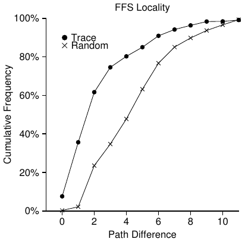
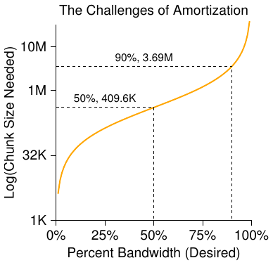
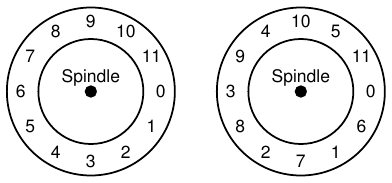

# الفصل 41: المحلّية ونظام الملفات السريع

حين قُدّم نظام التشغيل يونكس أول مرة، كتب ساحر يونكس نفسه، كِن تومسون، نظام الملفات الأول. ولنسمّه «نظام ملفات يونكس القديم»، فقد كان بسيطًا حقًا. وكانت بناه البيانات على القرص تبدو في الأساس هكذا:

```
S    Inodes                       Data
```

كانت الكتلة الفائقة (S) تحوي معلومات عن نظام الملفات بأكمله: ما حجم الوحدة التخزينية، وكم عدد العقد الفهرسة فيها، ومؤشّر إلى رأس قائمة حرة من الكتل، وما إلى ذلك. أما منطقة العقد الفهرسة من القرص فكانت تحوي كل العقد الفهرسة في نظام الملفات. وأخيرًا، كان معظم القرص مشغولًا بكتل البيانات.

والميزة الحسنة في نظام الملفات القديم أنه كان بسيطًا، وأنه دعم التجريدات الأساسية التي كان نظام الملفات يسعى إلى تقديمها: الملفات والهرمية الدليلية. وكان هذا النظام سهل الاستخدام خطوة حقيقية إلى الأمام من نظم التخزين المتعثّرة القائمة على السجلات في الماضي، وكانت الهرمية الدليلية تقدمًا حقيقيًا على الهرميات الأبسط ذات المستوى الواحد التي قدّمتها النظم الأسبق.

## 41.1 المشكلة: أداء رديء

المشكلة هي أن الأداء كان فظيعًا. وكما قاس كيرك مكوسيك وزملاؤه في بيركلي [MJLF84]، بدأ الأداء سيئًا ثم ازداد سوءًا مع الوقت، إلى حدّ أن نظام الملفات لم يكن يقدّم سوى 2% من عرض النطاق الكلي للقرص!

والمسألة الرئيسية أن نظام ملفات يونكس القديم كان يعامل القرص كأنه ذاكرة وصول عشوائي؛ فكانت البيانات تُنثر في كل مكان دون اعتبار لحقيقة أن الوسط الحامل للبيانات قرص، ومن ثمّ له كلفة تموضع حقيقية وباهظة. فمثلًا كانت كتل بيانات الملف بعيدة جدًا في الغالب عن عقدته الفهرسة، مما يستدعي بحثًا باهظًا كلما قرأ المرء العقدة الفهرسة ثم كتل بيانات الملف (وهي عملية شائعة جدًا).

والأسوأ أن نظام الملفات كان ينتهي إلى تفتّت شديد، لأن المساحة الحرة لم تُدَر بعناية. فكانت القائمة الحرة تنتهي إلى الإشارة إلى مجموعة كتل متناثرة عبر القرص، وحين تُخصَّص ملفات كانت تأخذ ببساطة الكتلة الحرة التالية. وكانت النتيجة أن ملفًا متّصلًا منطقيًا يُقرأ بالذهاب والإياب عبر القرص، مما يخفض الأداء انخفاضًا هائلًا.

افترض، على سبيل المثال، منطقة كتل البيانات التالية، التي تحوي أربعة ملفات (A وB وC وD)، حجم كل منها كتلتان:

```
A1   A2   B1   B2   C1   C2   D1   D2
```

وإن حُذف الملفان B وD، صار التخطيط الناتج:

```
A1   A2             C1   C2
```

وكما ترى، تفتّتت المساحة الحرة إلى مقطعين من كتلتين، بدلًا من مقطع متّصل واحد أنيق من أربع كتل. ولنقل إنك تريد الآن تخصيص ملف E حجمه أربع كتل:

```
A1   A2   E1   E2   C1   C2   E3   E4
```

يمكنك أن ترى ما يحدث: ينثر الملف E عبر القرص، ونتيجة لذلك لا تحصل على أداء الذروة (التتابعي) من القرص عند الوصول إلى E. بل تقرأ أولًا E1 وE2، ثم تبحث، ثم تقرأ E3 وE4. وكانت مشكلة التفتّت هذه تحدث طوال الوقت في نظام ملفات يونكس القديم، وكانت تضرّ بالأداء. وملاحظة جانبية: هذه المشكلة بالضبط هي ما تساعد عليه أدوات إزالة تفتّت القرص؛ فهي تعيد تنظيم البيانات على القرص لتضع الملفات متجاورة وتصنع مساحة حرة في منطقة متّصلة واحدة أو بضع مناطق، بنقل البيانات ثم إعادة كتابة العقد الفهرسة وما شابه لتعكس التغييرات.

وثمة مشكلة أخرى: كان حجم الكتلة الأصلي صغيرًا جدًا (512 بايت). ومن ثمّ كان نقل البيانات من القرص غير فعّال بطبيعته. فالكتل الأصغر كانت جيدة لأنها تقلّل التفتّت الداخلي (الهدر داخل الكتلة)، لكنها سيئة للنقل لأن كل كتلة قد تستلزم حملًا إضافيًا للتموضع للوصول إليها. ومن ثمّ المشكلة:

> **جوهر المسألة: كيف ننظّم البيانات على القرص لتحسين الأداء**
>
> كيف ننظّم بنى بيانات نظام الملفات بحيث نحسّن الأداء؟ وأي أنواع من سياسات التخصيص نحتاج فوق تلك البنى؟ وكيف نجعل نظام الملفات «مدركًا للقرص»؟

## 41.2 FFS: الوعي بالقرص هو الحل

قرّر فريق في بيركلي بناء نظام ملفات أفضل وأسرع، سمّاه ببراعة نظام الملفات السريع (FFS). وكانت الفكرة أن تُصمَّم بنى نظام الملفات وسياسات التخصيص بحيث تكون «مدركة للقرص»، فتحسّن بذلك الأداء، وهذا بالضبط ما فعلوه. وهكذا فتح FFS عصرًا جديدًا من البحث في نظم الملفات؛ فبإبقاء الواجهة نفسها لنظام الملفات (الواجهات البرمجية نفسها، بما فيها open() وread() وwrite() وclose() وغيرها من نداءات نظام الملفات) مع تغيير التنفيذ الداخلي، مهّد المؤلفون الطريق لبناء نظم ملفات جديدة، وهو عمل يستمر حتى اليوم. وكل نظم الملفات الحديثة تقريبًا تلتزم الواجهة القائمة (فتحافظ بذلك على التوافق مع التطبيقات) بينما تغيّر داخلياتها لأسباب تتعلق بالأداء أو الموثوقية أو غير ذلك.

## 41.3 تنظيم البنية: مجموعة الأسطوانة

كانت الخطوة الأولى تغيير البنى على القرص. فـFFS يقسّم القرص إلى عدد من مجموعات الأسطوانات. والأسطوانة الواحدة مجموعة مسارات على أسطح مختلفة من القرص الصلب تكون على المسافة نفسها من مركز القرص؛ وتُسمّى أسطوانة لشبهها الواضح بالشكل الهندسي المعروف بهذا الاسم. ويجمع FFS عدد N من الأسطوانات المتتالية في مجموعة، ومن ثمّ يمكن النظر إلى القرص بأكمله كمجموعة من مجموعات الأسطوانات. وهذا مثال بسيط يعرض المسارات الأربعة الخارجية من قرص ذي ستة أقراص، ومجموعة أسطوانات مؤلّفة من ثلاث أسطوانات:

```
                       Single track (e.g., dark gray)


   Cylinder:                                Cylinder Group:

   Tracks at same distance from center      Set of N consecutive cylinders
   of drive across different surfaces
   [all tracks with same color]             [if N=3, first group does
                                             not include black track]
```

لاحظ أن الأقراص الحديثة لا تُظهر معلومات كافية كي يفهم نظام الملفات فهمًا حقيقيًا هل أسطوانة معيّنة مستخدمة أم لا؛ فكما نوقش سابقًا [AD18a]، تُظهر الأقراص فضاء عناوين منطقيًا من الكتل وتخفي تفاصيل هندستها عن العملاء. ولذلك تنظّم نظم الملفات الحديثة (مثل ext2 وext3 وext4 في لينكس) القرص بدلًا من ذلك إلى مجموعات كتل، كل منها ليس إلا جزءًا متتاليًا من فضاء عناوين القرص. ويوضّح الشكل أدناه مثالًا تُنظَّم فيه كل ثماني كتل في مجموعة كتل مختلفة (لاحظ أن المجموعات الحقيقية تتألف من كتل أكثر بكثير):

```
       Group 0                Group 1                Group 2
  0  1  2  3  4  5  6  7  8  9 10 11 12 13 14 15 16 17 18 19 20 21 22 23
```

وسواء سمّيتها مجموعات أسطوانات أو مجموعات كتل، فهذه المجموعات هي الآلية المحورية التي يستخدمها FFS لتحسين الأداء. والأهم أنه بوضع ملفين داخل المجموعة نفسها يستطيع FFS أن يضمن أن الوصول إلى أحدهما بعد الآخر لن يؤدي إلى عمليات بحث طويلة عبر القرص.

ولاستخدام هذه المجموعات لتخزين الملفات والأدلّة، يحتاج FFS إلى القدرة على وضع الملفات والأدلّة في مجموعة، وتتبّع كل المعلومات اللازمة عنها فيها. ولذلك يُدرج FFS داخل كل مجموعة كل البنى التي قد تتوقع أن يملكها نظام الملفات، مثل مساحة للعقد الفهرسة، وكتل البيانات، وبعض البنى لتتبّع هل كل منها مخصّص أم حر. وهذا تصوير لما يحتفظ به FFS داخل مجموعة أسطوانات واحدة:

```
   S  ib  db       Inodes                     Data
```

ولنفحص الآن مكوّنات مجموعة الأسطوانات الواحدة هذه بمزيد من التفصيل. يحتفظ FFS بنسخة من الكتلة الفائقة (S) في كل مجموعة لأسباب الموثوقية. فالكتلة الفائقة لازمة لتركيب نظام الملفات؛ وبالاحتفاظ بنسخ متعددة، إن تلفت نسخة واحدة استطعت أن تُركّب نظام الملفات وتصل إليه باستخدام نسخة عاملة.

وداخل كل مجموعة يحتاج FFS إلى تتبّع هل عقدها الفهرسة وكتل بياناتها مخصّصة. ويؤدي خريطتا بتّ لكل مجموعة، خريطة العقد الفهرسة (ib) وخريطة البيانات (db)، هذا الدور للعقد الفهرسة وكتل البيانات في كل مجموعة. والخرائط البتّية وسيلة ممتازة لإدارة المساحة الحرة في نظام الملفات، لأنه يسهل بها إيجاد مقطع كبير من المساحة الحرة وتخصيصه لملف، متجنّبين بذلك بعض مشكلات التفتّت التي كانت في القائمة الحرة بالنظام القديم.

وأخيرًا، فمنطقتا العقد الفهرسة وكتل البيانات مثل نظيرتيهما في نظام الملفات البسيط جدًا السابق (VSFS). ومعظم كل مجموعة أسطوانات، كما هو معتاد، مكوّن من كتل بيانات.

> **استطراد: إنشاء ملف في FFS**
>
> فكّر، على سبيل المثال، في بنى البيانات التي يجب تحديثها عند إنشاء ملف؛ وافترض في هذا المثال أن المستخدم ينشئ ملفًا جديدًا هو /foo/bar.txt وأن الملف بحجم كتلة واحدة (4KB). فالملف جديد، ومن ثمّ يحتاج عقدة فهرسة جديدة؛ ولذلك ستُكتب إلى القرص خريطة العقد الفهرسة والعقدة الفهرسة المخصّصة حديثًا معًا. وللملف بيانات أيضًا، ومن ثمّ يجب تخصيصها هي الأخرى؛ وستُكتب بذلك خريطة البيانات وكتلة بيانات إلى القرص (في النهاية). ومن ثمّ ستحدث أربع كتابات على الأقل إلى مجموعة الأسطوانات الحالية (تذكّر أن هذه الكتابات قد تُخزَّن مؤقتًا في الذاكرة برهة قبل حدوثها). لكن هذا ليس كل شيء! فعند إنشاء ملف جديد يجب أيضًا وضع الملف في هرمية نظام الملفات، أي يجب تحديث الدليل. وتحديدًا يجب تحديث الدليل الأب foo لإضافة إدخال bar.txt؛ وقد تناسب هذه الإضافة كتلة بيانات موجودة في foo أو تستلزم تخصيص كتلة جديدة (مع خريطة بيانات مرافقة). ويجب أيضًا تحديث عقدة foo الفهرسة، لتعكس الطول الجديد للدليل ولمحدّث حقول الوقت (مثل وقت آخر تعديل). وإجمالًا، عمل كثير جدًا لمجرد إنشاء ملف جديد! فلعلّك في المرة القادمة التي تفعل فيها ذلك ينبغي أن تكون أكثر امتنانًا، أو على الأقل أكثر دهشة من أن كل هذا يعمل بهذه الجودة.

## 41.4 السياسات: كيف نخصّص الملفات والأدلّة

وبعد أن صارت بنية المجموعات قائمة، على FFS الآن أن يقرّر كيف يضع الملفات والأدلّة والبيانات الوصفية المرافقة على القرص لتحسين الأداء. والشعار الأساسي بسيط: أبقِ المتعلّقات معًا (ولازمه: أبقِ غير المتعلّقات متباعدة).

ومن ثمّ، ليطيع الشعار، على FFS أن يقرّر ما هو «متعلّق» فيضعه داخل مجموعة الكتل نفسها؛ وعلى العكس ينبغي وضع العناصر غير المتعلّقة في مجموعات كتل مختلفة. ولتحقيق هذه الغاية يستخدم FFS بعض الاستدلالات البسيطة في التوزيع.

الأول توزيع الأدلّة. يستخدم FFS مقاربة بسيطة: ابحث عن مجموعة الأسطوانات ذات العدد القليل من الأدلّة المخصّصة (لتوازن الأدلّة بين المجموعات) والعدد الكبير من العقد الفهرسة الحرة (لتستطيع لاحقًا تخصيص حزمة ملفات)، وضع بيانات الدليل وعقدته الفهرسة في تلك المجموعة. وبالطبع يمكن استخدام استدلالات أخرى هنا (مثل أخذ عدد كتل البيانات الحرة في الحسبان).

أما الملفات فيفعل FFS بها أمرين. أولًا يحرص (في الحالة العامة) على تخصيص كتل بيانات الملف في المجموعة نفسها التي فيها عقدته الفهرسة، فيمنع بذلك عمليات بحث طويلة بين العقدة الفهرسة والبيانات (كما كان في النظام القديم). وثانيًا يضع كل الملفات التي في الدليل نفسه في مجموعة الأسطوانات الخاصة بالدليل الذي هي فيه. ومن ثمّ، إن أنشأ المستخدم أربعة ملفات، /a/b و/a/c و/a/d و/b/f، فسيحاول FFS وضع الثلاثة الأولى قريبًا من بعضها (المجموعة نفسها) والرابع بعيدًا (في مجموعة أخرى ما).

ولننظر إلى مثال على هذا التخصيص. افترض في المثال أن في كل مجموعة 10 عقد فهرسة و10 كتل بيانات فقط (وكلاهما رقمان صغيران بغير واقعية)، وأن الأدلّة الثلاثة (الدليل الجذري /، و/a، و/b) والملفات الأربعة (/a/c و/a/d و/a/e و/b/f) موضوعة فيها وفق سياسات FFS. وافترض أن الملفات العادية حجم كل منها كتلتان، وأن الأدلّة لها كتلة بيانات واحدة فقط. وفي هذا الشكل نستخدم الرموز الواضحة لكل ملف أو دليل (أي / للدليل الجذري، وa لـ/a، وf لـ/b/f، وهكذا).

```
group inodes             data
    0 /--------- /---------
    1 acde------ accddee---
    2 bf-------- bff-------
    3 ---------- ----------
    4 ---------- ----------
    5 ---------- ----------
    6 ---------- ----------
    7 ---------- ----------
```

لاحظ أن سياسة FFS تفعل أمرين إيجابيين: كتل بيانات كل ملف قريبة من عقدته الفهرسة، والملفات التي في الدليل نفسه قريبة من بعضها (أي أن /a/c و/a/d و/a/e كلها في المجموعة 1، والدليل /b وملفه /b/f قريبان من بعضهما في المجموعة 2).

وعلى النقيض، لننظر الآن إلى سياسة تخصيص للعقد الفهرسة تنثر العقد ببساطة عبر المجموعات، محاولةً ضمان ألا تمتلئ جدول عقد أي مجموعة سريعًا. وقد يبدو التخصيص النهائي حينئذ مثل هذا:

```
group inodes             data
    0 /--------- /---------
    1 a--------- a---------
    2 b--------- b---------
    3 c--------- cc--------
    4 d--------- dd--------
    5 e--------- ee--------
    6 f--------- ff--------
    7 ---------- ----------
```

وكما ترى من الشكل، فمع أن هذه السياسة تُبقي فعلًا بيانات الملف (والدليل) قريبة من عقدتها الفهرسة، فإن الملفات داخل الدليل تُنثر اعتباطًا في القرص، ومن ثمّ لا تُحفظ المحلّية القائمة على التسمية. فالوصول إلى الملفات /a/c و/a/d و/a/e يمتد الآن على ثلاث مجموعات بدلًا من واحدة كما في مقاربة FFS.

واستدلالات سياسة FFS ليست مبنية على دراسات موسّعة لحركة نظام الملفات ولا على شيء دقيق خصوصًا؛ بل هي مبنية على الحسّ السليم العريق (ألم يكن هذا ما يرمز إليه CS في النهاية؟)[^1]. فالملفات التي في الدليل تُفتح معًا في الغالب: تخيّل ترجمة حزمة ملفات ثم ربطها في برنامج تنفيذي واحد. ولأن هذه المحلّية القائمة على فضاء الأسماء موجودة، فسيحسّن FFS الأداء غالبًا، بحرصه على أن تكون عمليات البحث بين الملفات المتعلّقة قصيرة لطيفة.

## 41.5 قياس محلّية الملفات

لفهم أفضل هل هذه الاستدلالات منطقية، لنحلّل بعض تتبّعات الوصول إلى نظام الملفات ونرَ هل ثمة فعلًا محلّية في فضاء الأسماء. ولسبب ما لا يبدو أن ثمة دراسة جيدة لهذا الموضوع في الأدبيات.

وتحديدًا سنستخدم تتبّعات SEER [K94] ونحلّل مدى «بعد» عمليات الوصول إلى الملفات بعضها عن بعض في شجرة الأدلّة. فمثلًا، إن فُتح الملف f ثم أُعيد فتحه تاليًا في التتبّع (قبل فتح أي ملفات أخرى)، فالمسافة بين هذين الفتحين في شجرة الأدلّة صفر (لأنهما الملف نفسه). وإن فُتح ملف f في الدليل dir (أي dir/f) وتلاه فتح للملف g في الدليل نفسه (أي dir/g)، فالمسافة بين الوصولين واحد، لأنهما يتشاركان الدليل نفسه لكنهما ليسا الملف نفسه. وبتعبير آخر، يقيس مقياس المسافة لدينا مدى صعودك في شجرة الأدلّة لتجد الجدّ المشترك لملفين؛ فكلما اقتربا في الشجرة قلّ المقياس.

ويعرض الشكل 41.1 المحلّية الملاحَظة في تتبّعات SEER على كل محطات العمل في عنقود SEER خلال كل التتبّعات. ويرسم التخطيط مقياس الفرق على المحور الأفقي، ويعرض النسبة المتراكمة لفتحات الملفات التي كانت بذلك الفرق على المحور الرأسي. وتحديدًا، في تتبّعات SEER (المؤشَّرة بـ«Trace» في التخطيط) ترى أن نحو 7% من عمليات الوصول إلى الملفات كانت إلى الملف الذي فُتح سابقًا، وأن قرابة 40% منها كانت إما إلى الملف نفسه وإما إلى ملف في الدليل نفسه (أي فرقًا صفرًا أو واحدًا). ومن ثمّ يبدو افتراض المحلّية في FFS منطقيًا (لهذه التتبّعات على الأقل).



**الشكل 41.1:** محلّية FFS في تتبّعات SEER

ومن المثير للاهتمام أن نحو 25% أخرى من عمليات الوصول إلى الملفات كانت إلى ملفات ذات مسافة اثنين. وهذه المحلّية تحدث حين ينظّم المستخدم مجموعة أدلّة متعلّقة على نحو متعدد المستويات وينتقل بينها باطراد. فمثلًا، إن كان للمستخدم دليل src ويبني ملفات الكائنات (ملفات .o) في دليل obj، وكان هذان الدليلان دليلين فرعيين من دليل رئيسي proj، فسيكون نمط الوصول الشائع proj/src/foo.c يتلوه proj/obj/foo.o. والمسافة بين هذين الوصولين اثنان، لأن proj هو الجدّ المشترك. ولا يلتقط FFS هذا النوع من المحلّية في سياساته، ومن ثمّ سيحدث بحث أكثر بين هذه الوصولات.

وللمقارنة، يعرض التخطيط أيضًا المحلّية في تتبّع «عشوائي». فقد وُلّد التتبّع العشوائي باختيار ملفات من داخل تتبّع SEER موجود بترتيب عشوائي، ثم حساب مقياس المسافة بين هذه الوصولات العشوائية الترتيب. وكما ترى، المحلّية في فضاء الأسماء أقل في التتبّعات العشوائية، كما هو متوقع. غير أنه، لأن كل الملفات تتشارك في النهاية جدًّا مشتركًا (مثل الجذر)، فثمة بعض المحلّية، ومن ثمّ فالعشوائي مفيد كنقطة مقارنة.

## 41.6 استثناء الملفات الكبيرة

ثمة في FFS استثناء مهم واحد من السياسة العامة لتوزيع الملفات، وهو ينشأ عند الملفات الكبيرة. فمن دون قاعدة مختلفة، سيملأ ملف كبير المجموعة التي وُضع فيها أول مرة بالكامل (وربما غيرها). وملء مجموعة كتل بهذه الطريقة غير مرغوب، لأنه يمنع وضع ملفات «متعلّقة» لاحقة داخل هذه المجموعة، ومن ثمّ قد يضرّ بمحلّية الوصول إلى الملفات.

ولذلك يفعل FFS بالملفات الكبيرة ما يلي. بعد تخصيص عدد من الكتل في مجموعة الكتل الأولى (مثلًا 12 كتلة، أو عدد المؤشّرات المباشرة المتاحة داخل العقدة الفهرسة)، يضع FFS «المقطع» الكبير التالي من الملف (مثلًا ما تشير إليه الكتلة غير المباشرة الأولى) في مجموعة كتل أخرى (تُختار ربما لقلة استغلالها). ثم يوضع المقطع التالي من الملف في مجموعة كتل أخرى مختلفة، وهكذا.

ولننظر إلى بعض الرسوم لفهم هذه السياسة أفضل. فمن دون استثناء الملفات الكبيرة، سيضع ملف كبير واحد كل كتلته في جزء واحد من القرص. ولنبحث في مثال صغير لملف (/a) ذي 30 كتلة في FFS مهيّأ بـ10 عقد فهرسة و40 كتلة بيانات في كل مجموعة. وهذا تصوير FFS من دون استثناء الملفات الكبيرة:

```
group inodes     data
  0   /a-------- /aaaaaaaaa aaaaaaaaaa aaaaaaaaaa a---------
  1   ---------- ---------- ---------- ---------- ----------
  2   ---------- ---------- ---------- ---------- ----------
```

وكما ترى في الصورة، يملأ /a معظم كتل البيانات في المجموعة 0، بينما تبقى المجموعات الأخرى فارغة. فإن أُنشئت الآن ملفات أخرى في الدليل الجذري (/) لم يبقَ متسع كبير لبياناتها في المجموعة.

أما مع استثناء الملفات الكبيرة (وهو هنا مضبوط على خمس كتل في كل مقطع)، فينثر FFS الملف بدلًا من ذلك عبر المجموعات، ولا تكون النسبة الناتجة للاستغلال داخل أي مجموعة عالية كثيرًا:

```
group inodes     data
  0   /a-------- /aaaaa---- ---------- ---------- ----------
  1   ---------- aaaaa----- ---------- ---------- ----------
  2   ---------- aaaaa----- ---------- ---------- ----------
  3   ---------- aaaaa----- ---------- ---------- ----------
  4   ---------- aaaaa----- ---------- ---------- ----------
  5   ---------- aaaaa----- ---------- ---------- ----------
  6   ---------- ---------- ---------- ---------- ----------
```

سيلاحظ القارئ الفطن (وأنت هو) أن نثر كتل الملف عبر القرص سيضرّ بالأداء، خصوصًا في الحالة الشائعة نسبيًا للوصول التتابعي إلى الملف (مثلًا حين يقرأ مستخدم أو تطبيق المقاطع من 0 إلى 29 بالترتيب). وأنت محق، يا قارئنا الفطن! لكنك تستطيع معالجة هذه المشكلة باختيار حجم المقطع بعناية.

وتحديدًا، إن كان حجم المقطع كبيرًا بما يكفي، فإن نظام الملفات سينفق معظم وقته في نقل البيانات من القرص ووقتًا قليلًا (نسبيًا) في البحث بين مقاطع الملف. وتُسمّى عملية خفض الحمل الإضافي بإنجاز عمل أكثر مقابل كل حمل إضافي مدفوع «الإطفاء»، وهي تقنية شائعة في أنظمة الحاسوب.

ولنضرب مثالًا: افترض أن متوسط زمن التموضع (أي البحث والدوران) لقرص هو 10 ملي ثانية. وافترض كذلك أن القرص ينقل البيانات بسرعة 40 ميغابايت/ثانية. فإن كان هدفك أن تنفق نصف وقتك في البحث بين المقاطع ونصفه في نقل البيانات (فتحقق بذلك 50% من أداء القرص في الذروة)، فستحتاج إذن إلى إنفاق 10 ملي ثانية في نقل البيانات مقابل كل 10 ملي ثانية من التموضع. ومن ثمّ يصبح السؤال: ما حجم المقطع اللازم لإنفاق 10 ملي ثانية في النقل؟ سهل، استخدم صديقنا القديم، أي الرياضيات، وتحديدًا التحليل البُعدي المذكور في فصل الأقراص [AD18a]:

> (40 MB/sec) · (1024 KB / 1 MB) · (1 sec / 1000 ms) · (10 ms) = 409.6 KB        (41.1)

وبشكل أساسي تقول هذه المعادلة ما يلي: إن كنت تنقل البيانات بسرعة 40 ميغابايت/ثانية، فلا تحتاج إلى نقل سوى 409.6 كيلوبايت في كل مرة تبحث فيها كي تنفق نصف وقتك في البحث ونصفه في النقل. وبالمثل تستطيع حساب حجم المقطع اللازم لتحقيق 90% من عرض النطاق في الذروة (وتبيّن أنه نحو 3.6 ميغابايت)، أو حتى 99% من عرض النطاق في الذروة (39.6 ميغابايت!). وكما ترى، كلما أردت الاقتراب من الذروة كبرت هذه المقاطع (انظر الشكل 41.2 لرسم هذه القيم).

غير أن FFS لم يستخدم هذا النوع من الحساب لنثر الملفات الكبيرة عبر المجموعات. بل اتّخذ مقاربة بسيطة، قائمة على بنية العقدة الفهرسة نفسها. فوُضعت الكتل المباشرة الاثنتا عشرة الأولى في المجموعة نفسها التي فيها العقدة الفهرسة؛ ووُضعت كل كتلة غير مباشرة تالية، وكل الكتل التي تشير إليها، في مجموعة مختلفة. وبحجم كتلة 4 كيلوبايت وعناوين قرص بطول 32 بتًا، تعني هذه الاستراتيجية أن كل 1024 كتلة من الملف (4 ميغابايت) تُوضع في مجموعات منفصلة، والاستثناء الوحيد هو أول 48 كيلوبايت من الملف كما تشير إليها المؤشّرات المباشرة.



**الشكل 41.2:** الإطفاء: ما حجم المقاطع اللازم؟

لاحظ أن اتجاه محرّكات الأقراص هو أن معدّل النقل يتحسّن بسرعة معقولة، فمصنّعو الأقراص بارعون في حشو بتات أكثر في السطح نفسه، أما الجوانب الميكانيكية للمحرّكات المتعلّقة بالبحث (سرعة ذراع القرص ومعدّل الدوران) فتَحسّن ببطء شديد [P98]. والمؤدّى أن الكلف الميكانيكية تصير بمرور الوقت أغلى نسبيًا، ومن ثمّ يجب، لإطفاء هذه الكلف، أن تنقل بيانات أكثر بين عمليات البحث.

## 41.7 أمور أخرى قليلة عن FFS

قدّم FFS بضع ابتكارات أخرى أيضًا. وتحديدًا كان المصمّمون قلقين جدًا من استيعاب الملفات الصغيرة؛ فقد تبيّن أن ملفات كثيرة كانت بحجم 2 كيلوبايت أو نحو ذلك في ذلك الزمان، وأن استخدام كتل بحجم 4 كيلوبايت، مع أنه جيد لنقل البيانات، لم يكن جيدًا كثيرًا لكفاءة المساحة. ومن ثمّ قد يؤدي هذا التفتّت الداخلي إلى هدر نحو نصف القرص في نظام ملفات نمطي.

وكان الحل الذي اهتدى إليه مصمّمو FFS بسيطًا وحلّ المشكلة. فقد قرّروا إدخال الكتل الفرعية، وهي كتل صغيرة بحجم 512 بايت يستطيع نظام الملفات تخصيصها للملفات. ومن ثمّ، إن أنشأت ملفًا صغيرًا (قل بحجم 1 كيلوبايت) فسيشغل كتلتين فرعيتين فلا يهدر كتلة كاملة بحجم 4 كيلوبايت. وكلما كبر الملف واصل نظام الملفات تخصيص كتل بحجم 512 بايت له إلى أن يجمع 4 كيلوبايت كاملة من البيانات. عندئذ سيجد FFS كتلة بحجم 4 كيلوبايت، وينسخ الكتل الفرعية إليها، ويحرّر الكتل الفرعية للاستخدام المستقبلي.

وقد تلاحظ أن هذه العملية غير فعّالة، فهي تستلزم عملًا إضافيًا كثيرًا لنظام الملفات (وتحديدًا إدخالًا/إخراجًا إضافيًا كثيرًا لإجراء النسخ). وستكون محقًا مرة أخرى! ومن ثمّ تجنّب FFS عمومًا هذا السلوك الأسوأ بتعديل مكتبة libc؛ فكانت المكتبة تخزّن الكتابات مؤقتًا ثم تصدرها إلى نظام الملفات في مقاطع بحجم 4 كيلوبايت، متجنبةً بذلك تخصيص الكتل الفرعية تمامًا في معظم الحالات.

وثاني أمر أنيق قدّمه FFS تخطيط قرص محسَّن للأداء. ففي تلك الأزمنة (قبل SCSI وغيره من واجهات الأجهزة الأحدث) كانت الأقراص أقل تطورًا بكثير وكانت تستلزم من معالج المضيف أن يتحكّم في عملها تحكمًا مباشرًا أكثر. وقد نشأت مشكلة في FFS حين وُضع ملف في قطاعات متتالية من القرص، كما في يسار الشكل 41.3.



**الشكل 41.3:** FFS: التوزيع النمطي مقابل التوزيع المُعامَل

وتحديدًا نشأت المشكلة في أثناء القراءات التتابعية. فقد كان FFS يصدر أولًا قراءة للكتلة 0؛ وحين تكتمل القراءة ويصدر FFS قراءة للكتلة 1 كان الوقت قد فات: فقد دارت الكتلة 1 تحت الرأس، ومن ثمّ ستستلزم القراءة من الكتلة 1 دورة كاملة.

وحلّ FFS هذه المشكلة بتخطيط مختلف، كما ترى في يمين الشكل 41.3. فبتخطّي كل كتلة ثانية (في المثال) يكون لدى FFS وقت كافٍ لطلب الكتلة التالية قبل أن تمرّ برأس القرص. بل كان FFS ذكيًا بما يكفي ليحدّد لقرص معيّن كم كتلة ينبغي أن يتخطاها في التخطيط لتجنّب الدورات الإضافية؛ وسُمّيت هذه التقنية «التعميل»، إذ كان FFS يستنتج معاملات الأداء المحدّدة للقرص ثم يستخدمها ليقرّر نمط التخطيط المتدرّج الدقيق.

وقد تفكّر: هذه الطريقة ليست عظيمة بعد كل شيء. بل ستحصل على 50% فقط من عرض النطاق في الذروة مع تخطيط كهذا، لأن عليك أن تدور حول كل مسار مرتين لمجرد قراءة كل كتلة مرة واحدة. لحسن الحظ، الأقراص الحديثة أذكى بكثير: فهي تقرأ المسار بأكمله داخليًا وتخزّنه مؤقتًا في ذاكرة قرص داخلية (تُسمّى ذاكرة المسار المؤقتة لهذا السبب بالذات). ثم، في القراءات التالية من المسار، يعيد القرص البيانات المطلوبة من ذاكرته المؤقتة فحسب. ومن ثمّ لم يعد على نظم الملفات أن تقلق من هذه التفاصيل المنخفضة المستوى بشكل لا يصدّق. فالتجريد والواجهات الأعلى مستوى قد يكونان أمرًا جيدًا حين تُصمَّم تصميمًا سليمًا.

> **نصيحة: اجعل النظام قابلًا للاستخدام**
>
> لعلّ أبسط درس من FFS أنه لم يقدّم الفكرة الجيدة مفهوميًا للتخطيط المدرك للقرص فحسب، بل أضاف أيضًا عددًا من الميزات التي جعلت النظام أكثر قابلية للاستخدام فحسب. فتسميات الملفات الطويلة، والوصلات الرمزية، وعملية إعادة تسمية تعمل ذرّيًا، كلها حسّنت نفع النظام؛ ومع أنه يصعب كتابة ورقة بحثية عنها (تخيّل محاولة قراءة ورقة من 14 صفحة عن «الوصلة الرمزية: قريب الوصلة الصلبة المفقود منذ زمن»)، فإن ميزات صغيرة كهذه جعلت FFS أنفع ومن ثمّ رجّحت كفة تبنّيه. فجعل النظام قابلًا للاستخدام كثيرًا ما يكون مهمًا بقدر ابتكاراته التقنية العميقة أو أكثر.

وأُضيفت بعض تحسينات قابلية الاستخدام الأخرى أيضًا. فكان FFS من أوائل نظم الملفات التي تتيح تسميات ملفات طويلة، فتيح بذلك تسميات أكثر تعبيرًا في نظام الملفات بدلًا من المقاربة التقليدية الثابتة الحجم (مثل 8 محارف). ثم أُدخل مفهوم جديد يُسمّى الوصلة الرمزية. وكما نوقش في فصل سابق [AD18b]، الوصلات الصلبة محدودة بأنها لا تستطيع الإشارة إلى الأدلّة (خشيةًا من إدخال حلقات في هرمية نظام الملفات) وأنها لا تستطيع الإشارة إلا إلى ملفات داخل الوحدة التخزينية نفسها (أي يجب أن يبقى رقم العقدة الفهرسة ذا معنى). أما الوصلات الرمزية فتيح للمستخدم إنشاء «اسم بديل» لأي ملف أو دليل آخر في النظام، ومن ثمّ فهي أكثر مرونة بكثير. وقدّم FFS أيضًا عملية rename() ذرّية لإعادة تسمية الملفات. وتحسينات قابلية الاستخدام، فوق التقنية الأساسية، قد أكسبت FFS على الأرجح قاعدة مستخدمين أقوى.

## 41.8 الخلاصة

كان إدخال FFS لحظة فاصلة في تاريخ نظم الملفات، إذ أبان أن مسألة إدارة الملفات من أكثر المسائل إثارة للاهتمام داخل نظام التشغيل، وأظهر كيف يمكن البدء في التعامل مع أهم الأجهزة على الإطلاق، أي القرص الصلب. ومنذ ذلك الوقت تطوّرت مئات نظم الملفات الجديدة، لكن كثيرًا من نظم الملفات حتى اليوم يستلهم FFS (فمثلًا ext2 وext3 في لينكس سليلان فكريان واضحان). ومن المؤكد أن كل الأنظمة الحديثة تراعي درس FFS الرئيسي: عامل القرص كأنه قرص.

## المراجع

> [AD18a] «Operating Systems: Three Easy Pieces» (فصل: Hard Disk Drives) لـRemzi Arpaci-Dusseau وAndrea Arpaci-Dusseau. Arpaci-Dusseau Books، 2018. لا ينبغي بحال أن تقرأ عن FFS قبل أن تفهم محرّكات الأقراص بشيء من التفصيل. فإن حاولت ذلك، فاذهب رجاءً مباشرة إلى السجن؛ لا تمرّ بـ«ابدأ»، والأهم: لا تجمع 200 عملة نقدية كنت في أشد الحاجة إليها.

> [AD18b] «Operating Systems: Three Easy Pieces» (فصل: File System Implementation) لـRemzi Arpaci-Dusseau وAndrea Arpaci-Dusseau. Arpaci-Dusseau Books، 2018. وكما سبق، لا معنى كبيرًا لقراءة هذا الفصل إن لم تكن قد قرأت فصل تنفيذ نظم الملفات (وفهمته). وإلا فسنرمي مصطلحات مثل «العقدة الفهرسة» و«الكتلة غير المباشرة» وستكون مثلي: «هاه؟» وذلك لا يسلّي أيًا منا.

> [K94] «The Design of the SEER Predictive Caching System» لـG. H. Kuenning. MOBICOMM '94، سانتا كروز، كاليفورنيا، ديسمبر 1994. وفقًا لكويننغ، هذه أفضل نظرة عامة على مشروع SEER، الذي أدى (من جملة ما أدى إليه) إلى جمع هذه التتبّعات.

> [MJLF84] «A Fast File System for UNIX» لـMarshall K. McKusick وWilliam N. Joy وSam J. Leffler وRobert S. Fabry. ACM TOCS، 2:3، أغسطس 1984. وقد كُرّم مكوسيك مؤخرًا بجائزة IEEE Reynold B. Johnson لمساهماته في نظم الملفات، وكثير منها مبني على عمله في بناء FFS. وفي خطاب تسلّمه الجائزة تحدّث عن برمجية FFS الأصلية: 1200 سطر شيفرة فقط! أما النسخ الحديثة فأعقد قليلًا، فمثلًا سليل FFS في BSD صار في نطاق خمسين ألف سطر شيفرة.

> [P98] «Hardware Technology Trends and Database Opportunities» لـDavid A. Patterson. محاضرة رئيسية في SIGMOD '98، يونيو 1998. نظرة عامة رائعة وبسيطة على اتجاهات تقنية الأقراص وكيف تتغيّر بمرور الوقت.

## الواجب (محاكاة)

يقدّم هذا القسم ffs.py، وهو محاكي بسيط لـFFS تستطيع استخدامه لفهم أفضل كيف يعمل تخصيص الملفات والأدلّة في FFS. اقرأ ملف README للتفاصيل عن كيفية تشغيل المحاكي.

## الأسئلة

1. افحص الملف in.largefile، ثم شغّل المحاكي بالعلم `-f in.largefile` والعلم `-L 4`. هذا الأخير يضبط استثناء الملفات الكبيرة على 4 كتل. فكيف سيبدو التخصيص الناتج؟ شغّل مع `-c` للتحقّق.
2. شغّل الآن مع `-L 30`. فماذا تتوقع أن ترى؟ شغّل `-c` مرة أخرى لترى هل كنت محقًا. ويمكنك أيضًا استخدام `-S` لترى بالضبط أي الكتل خُصّصت للملف /a.
3. سنحسب الآن بعض الإحصاءات عن الملف. الأولى شيء نسمّيه filespan، وهو أقصى مسافة بين أي كتلتَي بيانات في الملف أو بين العقدة الفهرسة وأي كتلة بيانات. احسب filespan للملف /a. شغّل `ffs.py -f in.largefile -L 4 -T -c` لترى ما هو. وافعل الشيء نفسه مع `-L 100`. فأي فرق تتوقع في filespan حين تتغيّر معاملة استثناء الملفات الكبيرة من قيم منخفضة إلى قيم عالية؟
4. لننظر الآن إلى ملف إدخال جديد، in.manyfiles. فكيف تعتقد أن سياسة FFS ستوزّع هذه الملفات عبر المجموعات؟ (يمكنك التشغيل مع `-v` لترى أي الملفات والأدلّة تُنشأ، أو مجرد `cat in.manyfiles`). شغّل المحاكي مع `-c` لترى هل كنت محقًا.
5. ثمة مقياس لتقييم FFS يُسمّى dirspan. يحسب هذا المقياس انتشار الملفات داخل دليل معيّن، وتحديدًا أقصى مسافة بين العقد الفهرسة وكتل بيانات كل الملفات في الدليل وبين عقدة الدليل الفهرسة وكتلة بياناته. شغّل مع in.manyfiles والعلم `-T`، واحسب dirspan للأدلّة الثلاثة. شغّل مع `-c` للتحقّق. فما مدى جودة FFS في تصغير dirspan؟
6. غيّر الآن حجم جدول العقد الفهرسة لكل مجموعة إلى 5 (`-i 5`). فكيف تعتقد أن ذلك سيغيّر تخطيط الملفات؟ شغّل مع `-c` لترى هل كنت محقًا. وكيف يؤثر ذلك في dirspan؟
7. في أي مجموعة ينبغي أن يضع FFS عقدة دليل جديد فهرسة؟ سياسة المحاكي الافتراضية تبحث عن المجموعة ذات أكبر عدد من العقد الفهرسة الحرة. وثمة سياسة مختلفة تبحث عن مجموعة من المجموعات ذات أكبر عدد من العقد الفهرسة الحرة. فمثلًا، إن شغّلت مع `-A 2`، فسيبحث المحاكي، عند تخصيص دليل جديد، في المجموعات مزدوجة مزدوجة ويختار أفضل زوج للتخصيص. شغّل `./ffs.py -f in.manyfiles -i 5 -A 2 -c` لترى كيف يتغيّر التخصيص مع هذه الاستراتيجية. وكيف يؤثر ذلك في dirspan؟ ولماذا قد تكون هذه السياسة جيدة؟
8. ثمة تغيير سياسة أخير سنستكشفه يتعلق بتفتّت الملفات. شغّل `./ffs.py -f in.fragmented -v` وانظر هل تستطيع أن تتوقع كيف تُخصَّص الملفات الباقية. شغّل مع `-c` لتؤكّد إجابتك. وما المثير في تخطيط بيانات الملف /i؟ ولماذا هو مشكل؟
9. ثمة سياسة جديدة، نسمّيها التخصيص المتّصل (`-C`)، تحاول ضمان تخصيص كل ملف تخصيصًا متّصلًا. وتحديدًا، مع `-C n` يحاول نظام الملفات ضمان وجود n كتلة متّصلة حرة داخل مجموعة قبل تخصيص كتلة. شغّل `./ffs.py -f in.fragmented -v -C 2 -c` لترى الفرق. وكيف يتغيّر التخطيط مع زيادة المعامل الممرَّر إلى `-C`؟ وأخيرًا، كيف تؤثر `-C` في filespan وdirspan؟

[^1]: بعض الناس يسمّون الحسّ السليم «حسّ الفرس»، خصوصًا من يعمل بانتظام مع الخيول. غير أن لدينا شعورًا بأن هذا التعبير قد يضيع مع اكتساب «الفرس المميكن»، المعروف أيضًا بالسيارة، شعبية أكبر. فماذا سيخترعون تاليًا؟ آلة طائرة؟!!
