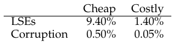

# الفصل 45: سلامة البيانات وحمايتها

وراء التقدّم الأساسي الذي نجده في نظم الملفات التي درسناها حتى الآن، ثمة عدد من الخصائص يجدر بنا دراستها. وفي هذا الفصل نعود مرة أخرى إلى الموثوقية (بعد أن درسنا موثوقية أنظمة التخزين في فصل RAID). وتحديدًا: كيف ينبغي لنظام ملفات أو نظام تخزين أن يضمن أن البيانات آمنة، بالنظر إلى الطبيعة غير الموثوقة لأجهزة التخزين الحديثة؟

ويُشار إلى هذا المجال عمومًا بسلامة البيانات أو حماية البيانات. ومن ثمّ سنبحث الآن في التقنيات المستخدمة لضمان أن البيانات التي تضعها في نظام التخزين هي نفسها حين يعيدها إليك نظام التخزين.

> **جوهر المسألة: كيف نضمن سلامة البيانات**
>
> كيف ينبغي للأنظمة أن تضمن حماية البيانات المكتوبة إلى التخزين؟ وما التقنيات اللازمة لذلك؟ وكيف يمكن جعل تقنيات كهذه فعّالة، بأعباء زمنية ومكانية منخفضة معًا؟

## 45.1 أنماط أعطال الأقراص

كما تعلّمت في الفصل الخاص بـRAID، فإن الأقراص ليست كاملة، وقد تفشل (أحيانًا). ففي أنظمة RAID المبكرة كان نموذج العطل بسيطًا جدًا: إمّا أن القرص كله يعمل، أو أنه يفشل فشلًا كاملًا، ويكون كشف عطل كهذا مباشرًا. ونموذج العطل هذا، أي نموذج التوقف بالفشل، يجعل بناء RAID بسيطًا نسبيًا [S90].

لكن ما لم تتعلّمه هو كل أنماط الأعطال الأخرى التي تُظهرها الأقراص الحديثة. وتحديدًا، وكما درس بيرافاسوندارام وغيره بتفصيل كبير [B+07, B+08]، فإن الأقراص الحديثة تبدو أحيانًا عاملة في معظمها لكنها تجد صعوبة في الوصول بنجاح إلى كتلة أو أكثر. وتحديدًا، ثمة نوعان شائعان من أعطال الكتلة الواحدة جديران بالاعتبار: أخطاء القطاعات الكامنة والتلف في الكتل. وسنناقش كلًّا منهما بمزيد من التفصيل الآن.



**الشكل 45.1:** تكرار أخطاء القطاعات الكامنة وتلف الكتل

تنشأ أخطاء القطاعات الكامنة حين يتضرّر قطاع قرص (أو مجموعة قطاعات) بطريقة ما. فمثلًا، إن لمس رأس القرص السطح لسبب ما (سقوط الرأس، وهو أمر لا ينبغي أن يحدث في أثناء التشغيل العادي)، فقد يضرّ السطح ويجعل البتّات غير قابلة للقراءة. ويمكن للأشعة الكونية أيضًا أن تقلب البتّات فتؤدي إلى محتويات غير صحيحة. ولحسن الحظ تستخدم الأقراص شيفرات تصحيح الأخطاء داخل القرص لتحديد ما إذا كانت البتّات على القرص في كتلة ما سليمة، ولإصلاحها في بعض الحالات؛ فإن لم تكن سليمة ولم يكن لدى القرص معلومات كافية لإصلاح الخطأ، أعاد القرص خطأً حين يُوجَّه إليه طلب لقراءتها.

وثمة حالات أيضًا يتلف فيها قرص كتلةً بطريقة لا يستطيع القرص نفسه كشفها. فمثلًا قد تكتب برمجية ثابتة معطوبة في القرص كتلةً إلى موضع خطأ؛ وفي حالة كهذه تدلّ شيفرة تصحيح الأخطاء في القرص على أن محتويات الكتلة سليمة، لكن من منظور العميل تُعاد الكتلة الخطأ حين يُوصل إليها لاحقًا. وبالمثل، قد تتلف كتلة حين تُنقل من المضيف إلى القرص عبر ناقل معطوب؛ فيخزّن القرص البيانات التالفة الناتجة، لكنها ليست ما يريده العميل. وهذه الأنواع من الأعطال خبيثة خصوصًا لأنها أعطال صامتة؛ فلا يعطي القرص أي إشارة إلى المشكلة حين يعيد البيانات المعطوبة.

ويصف برابهاكاران وغيره هذا المنظور الأحدث لعطل القرص بنموذج العطل الجزئي [P+05]. ففي هذا المنظور يمكن للأقراص أن تفشل بكاملها (كما كان الحال في نموذج التوقف بالفشل التقليدي)؛ غير أن الأقراص يمكن أن تبدو أيضًا عاملة بينما تصير كتلة أو أكثر منها غير قابلة للوصول (أي أخطاء القطاعات الكامنة) أو تحمل محتويات خطأ (أي التلف). ومن ثمّ، حين تصل إلى قرص يبدو عاملًا، فقد يعيد أحيانًا خطأً عند محاولة قراءة كتلة ما أو كتابتها (عطل جزئي غير صامت)، وقد يعيد أحيانًا ببساطة البيانات الخطأ (عطل جزئي صامت).

وكلا هذين النوعين من الأعطال نادر إلى حدّ ما، لكن ما مدى ندرته؟ يلخّص الشكل 45.1 بعض نتائج الدراستين اللتين أجراهما بيرافاسوندارام [B+07,B+08].

ويُظهر الشكل النسبة المئوية للأقراص التي أظهرت خطأ قطاع كامنًا واحدًا على الأقل أو تلف كتلة واحدة على الأقل على مدى الدراسة (نحو 3 سنوات، على أكثر من 1.5 مليون قرص). ثم يقسّم الشكل النتائج كذلك إلى أقراص «رخيصة» (وهي عادةً أقراص SATA) وأقراص «مكلفة» (وهي عادةً SCSI أو Fibre Channel). وكما ترى، فمع أن شراء أقراص أفضل يقلّل تكرار هذين النوعين من المشكلات (بنحو رتبة قدر)، فإنها ما تزال تحدث بما يكفي لأن تحتاج إلى التفكير بعناية في كيفية التعامل معها في نظام تخزينك.

وثمة نتائج إضافية عن أخطاء القطاعات الكامنة:

- الأقراص المكلفة التي فيها أكثر من خطأ قطاع كامن واحد معرّضة لتطوير أخطاء إضافية بقدر ما هي الأقراص الأرخص
- في معظم الأقراص يزيد معدّل الخطأ السنوي في السنة الثانية
- يزداد عدد أخطاء القطاعات الكامنة مع حجم القرص
- معظم الأقراص التي فيها أخطاء قطاعات كامنة فيها أقل من 50 خطأً
- الأقراص التي فيها أخطاء قطاعات كامنة أكثر عرضة لتطوير أخطاء إضافية
- ثمة قدر كبير من المحلّية المكانية والزمانية
- كشط القرص مفيد (فمعظم أخطاء القطاعات الكامنة اكتُشفت بهذه الطريقة)

وثمة نتائج عن التلف:

- احتمال التلف يتفاوت تفاوتًا كبيرًا بين طرازات الأقراص المختلفة داخل الفئة نفسها
- تأثيرات العمر مختلفة بين الطرازات
- لحمل العمل وحجم القرص أثر ضئيل على التلف
- معظم الأقراص التي فيها تلف فيها بضع حالات تلف فحسب
- التلف ليس مستقلًا داخل القرص الواحد ولا بين أقراص RAID
- ثمة محلّية مكانية، وبعض المحلّية الزمانية
- ثمة ارتباط ضعيف بأخطاء القطاعات الكامنة

وللتعلّم أكثر عن هذه الأعطال ينبغي أن تقرأ الورقتين الأصليتين على الأرجح [B+07,B+08]. لكن نأمل أن تكون النقطة الأساسية واضحة: إن كنت ترغب حقًا في بناء نظام تخزين موثوق، فعليك أن تضمّن فيه آليات لكشف أخطاء القطاعات الكامنة وتلف الكتل والتعافي منهما معًا.

## 45.2 التعامل مع أخطاء القطاعات الكامنة

بالنظر إلى نمطي العطل الجزئي الجديدين هذين، ينبغي أن نحاول الآن أن نرى ما يمكننا فعله بشأنهما. ولنعالج أولًا أيسرهما، ألا وهو أخطاء القطاعات الكامنة.

> **جوهر المسألة: كيف نتعامل مع أخطاء القطاعات الكامنة**
>
> كيف ينبغي لنظام تخزين أن يتعامل مع أخطاء القطاعات الكامنة؟ وكم من الآليات الإضافية يلزم للتعامل مع هذا الشكل من العطل الجزئي؟

كما تبيّن، فإن أخطاء القطاعات الكامنة مباشرة إلى حدّ كبير في التعامل معها، لأنها (بحكم تعريفها) سهلة الكشف. فحين يحاول نظام تخزين الوصول إلى كتلة، ويعيد القرص خطأً، فعلى نظام التخزين أن يستخدم ببساطة أي آلية تكرار متاحة لديه لإعادة البيانات الصحيحة. ففي RAID المعكوس، مثلًا، على النظام أن يصل إلى النسخة البديلة؛ وفي نظام RAID-4 أو RAID-5 قائم على التكافؤ، على النظام أن يعيد بناء الكتلة من الكتل الأخرى في مجموعة التكافؤ. ومن ثمّ فإن المشكلات سهلة الكشف كأخطاء القطاعات الكامنة تُستعاد بسهولة عبر آليات التكرار المعتادة.

وقد أثّر تزايد شيوع أخطاء القطاعات الكامنة في تصاميم RAID على مرّ السنين. وثمة مشكلة مثيرة للاهتمام خصوصًا تنشأ في أنظمة RAID-4/5 حين تحدث أعطال القرص الكامل وأخطاء القطاعات الكامنة معًا. وتحديدًا، حين يفشل قرص كامل، تحاول RAID إعادة بناء القرص (قل على قرص احتياطي ساخن) بقراءة كل الأقراص الأخرى في مجموعة التكافؤ وإعادة حساب القيم المفقودة. فإن ظهر أثناء إعادة البناء خطأ قطاع كامن على أي من الأقراص الأخرى، وقعنا في مشكلة: إذ لا تستطيع إعادة البناء أن تكتمل بنجاح.

ولمكافحة هذه المسألة تضيف بعض الأنظمة درجة إضافية من التكرار. فمثلًا يملك RAID-DP من NetApp ما يكافئ قرصَي تكافؤ بدلًا من قرص واحد [C+04]. فحين يُكتشف خطأ قطاع كامن أثناء إعادة البناء، يساعد التكافؤ الإضافي على إعادة بناء الكتلة المفقودة. وكما هو الحال دائمًا ثمة كلفة، إذ إن صيانة كتلتَي تكافؤ لكل شريط أكثر كلفة؛ غير أن الطبيعة السجلية لنظام ملفات WAFL من NetApp تخفّف تلك الكلفة في حالات كثيرة [HLM94]. أما الكلفة المتبقية فهي المساحة، في صورة قرص إضافي لكتلة التكافؤ الثانية.

## 45.3 كشف التلف: المجموع الاختباري

لنعالج الآن المشكلة الأصعب، ألا وهي الأعطال الصامتة الناتجة عن تلف البيانات. فكيف نمنع المستخدمين من الحصول على بيانات سيئة حين ينشأ التلف، فيؤدي بذلك إلى إعادة الأقراص بيانات سيئة؟

> **جوهر المسألة: كيف نحافظ على سلامة البيانات رغم التلف**
>
> بالنظر إلى الطبيعة الصامتة لأعطال كهذه، ماذا يستطيع نظام التخزين أن يفعل لكشف نشوء التلف؟ وما التقنيات اللازمة؟ وكيف يمكن تنفيذها بكفاءة؟

وخلافًا لأخطاء القطاعات الكامنة، فإن كشف التلف مشكلة أساسية. فكيف يعرف العميل أن كتلة ما قد فسدت؟ وما إن يُعرف أن كتلة معيّنة فاسدة، فالتعافي كما كان من قبل: تحتاج إلى نسخة أخرى من الكتلة في مكان ما (ونأمل ألا تكون تالفة!). ومن ثمّ نركّز هنا على تقنيات الكشف.

الآلية الأساسية التي تستخدمها أنظمة التخزين الحديثة للحفاظ على سلامة البيانات تُسمّى المجموع الاختباري. فالمجموع الاختباري ليس إلا نتيجة دالة تأخذ قطعة من البيانات (قل كتلة بحجم 4KB) مدخلًا لها وتحسب دالة على تلك البيانات، فتنتج ملخّصًا صغيرًا لمحتويات البيانات (قل 4 أو 8 بايتات). ويُشار إلى هذا الملخّص بالمبلغ الاختباري. والهدف من حساب كهذا تمكين النظام من كشف ما إذا كانت البيانات قد تلفت أو تغيّرت بطريقة ما، وذلك بتخزين المجموع الاختباري مع البيانات ثم التأكد عند الوصول اللاحق من أن المجموع الاختباري الحالي للبيانات يطابق القيمة المخزّنة الأصلية.

> **نصيحة: لا وجود لغداء مجاني**
>
> «لا شيء يُعطى مجانًا»، أو TNSTAAFL اختصارًا، تعبير أمريكي قديم يعني أنك حين تبدو حاصلًا على شيء مجانًا فإنك على الأرجح تدفع كلفة ما مقابله. وهو يأتي من الأيام القديمة حين كانت المطاعم تعلن غداءً مجانيًا للزبائن أملًا في جذبهم؛ فلا تكتشف إلا حين تدخل أنك تحتاج، للحصول على ذلك الغداء «المجاني»، إلى شراء مشروب كحولي واحد أو أكثر. وبطبيعة الحال قد لا تكون هذه مشكلة فعلًا، خصوصًا إن كنت طامحًا إلى أن تصير كحوليًا (أو طالبًا جامعيًا نمطيًا).

### دوال المجموع الاختباري الشائعة

ثمة عدد من الدوال المختلفة المستخدمة لحساب المجاميع الاختبارية، وهي تتفاوت في القوة (أي في جودة حمايتها لسلامة البيانات) والسرعة (أي في سرعة حسابها). وهنا تنشأ مقايضة شائعة في الأنظمة: فعادةً، كلما زادت الحماية زادت الكلفة. فلا وجود لغداء مجاني.

ومن دوال المجموع الاختباري البسيطة التي يستخدمها البعض تلك القائمة على الاستبعاد أو. ففي المجاميع الاختبارية القائمة على الاستبعاد أو يُحسب المجموع بإجراء استبعاد أو على كل قطعة من كتلة البيانات التي يُحسب لها المجموع، فينتج بذلك قيمة واحدة تمثّل استبعاد أو للكتلة بأكملها.

ولنجعل ذلك ملموسًا أكثر، تخيّل أننا نحسب مجموعًا اختباريًا بحجم 4 بايتات على كتلة من 16 بايتًا (وهذه الكتلة صغيرة بالطبع لأن تكون قطاع قرص أو كتلة حقيقية، لكنها تصلح للمثال). وتبدو بايتات البيانات الست عشرة، بالنظام الست عشري، هكذا:

```
365e c4cd ba14 8a92 ecef 2c3a 40be f666
```


وإن نظرنا إليها بالنظام الثنائي، حصلنا على ما يلي:

```
0011 0110 0101 1110              1100 0100 1100 1101
1011 1010 0001 0100              1000 1010 1001 0010
1110 1100 1110 1111              0010 1100 0011 1010
0100 0000 1011 1110              1111 0110 0110 0110
```


ولأننا رتّبنا البيانات في مجموعات من 4 بايتات في كل صف، فمن السهل رؤية ما سيكون عليه المجموع الاختباري الناتج: أجرِ استبعاد أو على كل عمود لتحصل على قيمة المجموع الاختباري النهائية:

```
0010 0000 0001 1011              1001 0100 0000 0011
```


والنتيجة، بالنظام الست عشري، هي 0x201b9403.

والاستبعاد أو مجموع اختباري معقول لكن له حدوده. فمثلًا، إن تغيّرت بتّتان في الموضع نفسه داخل كل وحدة من الوحدات المحسوب لها المجموع، لم يكشف المجموع الاختباري التلف. ولهذا السبب بحث الناس في دوال مجموع اختباري أخرى.

وثمة دالة مجموع اختباري أساسية أخرى هي الجمع. ولهذه المقاربة ميزة السرعة؛ فحسابها يتطلب فقط إجراء جمع بالتكملة الثنائية على كل قطعة من البيانات، مع تجاهل الفائض. وهي تكشف تغيّرات كثيرة في البيانات، لكنها ليست جيدة إن كانت البيانات، مثلًا، مُزاحة.

وثمة خوارزمية أعقد قليلًا تُعرف بمجموع فليتشر الاختباري، المسمّى (كما قد تتوقع) على اسم مخترعه جون ج. فليتشر [F82]. وهو بسيط الحساب إلى حدّ كبير، وينطوي على حساب بايتَي تحقّق هما s1 وs2. وتحديدًا، افترض أن كتلة D تتكون من بايتات d1 ... dn؛ فتُعرَّف s1 كما يلي: s1 = (s1 + di ) mod 255 (محسوبة على كل di )؛ وs2 بدورها: s2 = (s2 + s1) mod 255 (مرة أخرى على كل di ) [F04]. ومجموع فليتشر الاختباري يقارب في قوته CRC (انظر أدناه)، إذ يكشف كل أخطاء البتّة الواحدة والبتّتين، وكثيرًا من أخطاء الرشقات [F04].

وثمة مجموع اختباري أخير شائع الاستخدام يُعرف بفحص التكرار الدوري. افترض أنك تريد حساب المجموع الاختباري على كتلة بيانات D. كل ما تفعله هو أن تعامل D كأنها عدد ثنائي كبير (فهي سلسلة بتّات في النهاية) وتقسمه على قيمة متّفق عليها (k). والباقي من هذه القسمة هو قيمة فحص التكرار الدوري. وكما تبيّن، يستطيع المرء تنفيذ عملية الباقي الثنائية هذه بكفاءة إلى حدّ كبير، ومن هنا شعبية فحص التكرار الدوري في الشبكات أيضًا. انظر في مكان آخر لمزيد من التفاصيل [M13].

وأيًا كانت الطريقة المستخدمة، ينبغي أن يكون واضحًا أنه لا وجود لمجموع اختباري كامل: فمن الممكن أن تكون لكتلتَي بيانات مختلفتَي المحتويات المجموعتان الاختباريتان نفسهما، وهو ما يُسمّى تصادمًا. وهذه الحقيقة بديهية: فحساب مجموع اختباري، في نهاية المطاف، أخذ شيء كبير (مثل 4KB) وإنتاج ملخّص أصغر منه بكثير (مثل 4 أو 8 بايتات). ومن ثمّ فنحن، في اختيار دالة مجموع اختباري جيدة، نحاول أن نجد دالة تقلّل احتمال التصادم مع بقائها سهلة الحساب.

### تخطيط المجموع الاختباري

بعد أن فهمت شيئًا عن كيفية حساب المجموع الاختباري، لنحلّل الآن كيفية استخدام المجاميع الاختبارية في نظام تخزين. وأول سؤال يجب أن نعالجه هو تخطيط المجموع الاختباري، أي كيف ينبغي تخزين المجاميع الاختبارية على القرص؟

أبسط مقاربة تخزّن مجموعًا اختباريًا مع كل قطاع قرص (أو كتلة). وبالنظر إلى كتلة بيانات D، لنسمّ المجموع الاختباري على تلك البيانات C(D). ومن ثمّ، بلا مجاميع اختبارية، يبدو تخطيط القرص هكذا:

```
D0          D1     D2       D3        D4        D5        D6
```


أما مع المجاميع الاختبارية، فيضيف التخطيط مجموعًا اختباريًا واحدًا لكل كتلة:

```
C[D0]   D0    C[D1]        D1    C[D2]   D2        C[D3]   D3   C[D4]    D4
```


ولأن المجاميع الاختبارية صغيرة عادةً (مثل 8 بايتات)، ولأن الأقراص لا تستطيع الكتابة إلا في قطع بحجم القطاع (512 بايتًا) أو مضاعفاته، تنشأ مشكلة في كيفية تحقيق التخطيط أعلاه. ومن الحلول التي تستخدمها مصانع الأقراص تهيئة القرص بقطاعات بحجم 520 بايتًا؛ إذ يمكن استخدام 8 بايتات إضافية في كل قطاع لتخزين المجموع الاختباري.

وفي الأقراص التي لا تملك وظيفة كهذه، على نظام الملفات أن يجد طريقة لتخزين المجاميع الاختبارية محشورة في كتل بحجم 512 بايتًا. ومن الاحتمالات لذلك ما يلي:

```
C[D0]
C[D1]
C[D2]
C[D3]                 D0        D1            D2           D3           D4
C[D4]
```


في هذا المخطط تُخزَّن المجاميع الاختبارية n معًا في قطاع، تتبعها n كتلة بيانات، ثم قطاع مجموع اختباري آخر للكتل n التالية، وهكذا. ولهذه المقاربة ميزة أنها تعمل على كل الأقراص، لكنها قد تكون أقل كفاءة؛ فإن أراد نظام الملفات، مثلًا، أن يكتب فوق الكتلة D1، فعليه أن يقرأ قطاع المجموع الاختباري الذي يحتوي C(D1)، ويحدّث C(D1) فيه، ثم يكتب قطاع المجموع الاختباري والكتلة الجديدة D1 (أي قراءة واحدة وكتابتان). أما المقاربة السابقة (مجموع اختباري واحد لكل قطاع) فتُجري كتابة واحدة فقط.

## 45.4 استخدام المجاميع الاختبارية

بعد أن حُسم تخطيط المجموع الاختباري، نستطيع الآن أن ننتقل إلى فهم كيفية استخدام المجاميع الاختبارية فعلًا. فحين يقرأ العميل (أي نظام الملفات أو متحكّم التخزين) كتلة D، يقرأ أيضًا مجموعها الاختباري من القرص Cs (D)، وهو ما نسمّيه المجموع الاختباري المخزّن (ومن هنا الرمز السفلي Cs ). ثم يحسب العميل المجموع الاختباري على الكتلة المسترجعة D، وهو ما نسمّيه المجموع الاختباري المحسوب Cc (D). وعند هذه النقطة يقارن العميل بين المجموع المخزّن والمحسوب؛ فإن كانا متساويين (أي Cs (D) == Cc (D)) فالبيانات على الأرجح لم تتلف، ومن ثمّ يمكن إعادتها إلى المستخدم بأمان. وإن لم يتطابقا (أي Cs (D) != Cc (D))، دلّ ذلك على أن البيانات تغيّرت منذ وقت تخزينها (لأن المجموع الاختباري المخزّن يعكس قيمة البيانات في ذلك الوقت). وفي هذه الحالة لدينا تلف ساعدنا مجموعنا الاختباري على كشفه.

وبالنظر إلى وجود تلف، فالسؤال الطبيعي هو ما ينبغي أن نفعل بشأنه؟ فإن كان لدى نظام التخزين نسخة مكرّرة، فالجواب سهل: حاول استخدامها بدلًا منها. وإن لم تكن لدى نظام التخزين نسخة كهذه، فالجواب المرجّح هو إعادة خطأ. وفي كلتا الحالتين، أدرك أن كشف التلف ليس حلًا سحريًا؛ فإن لم يكن ثمة طريقة أخرى للحصول على البيانات غير التالفة، فأنت ببساطة بلا حظ.

## 45.5 مشكلة جديدة: الكتابات الموجّهة خطأً

يعمل المخطط الأساسي الموصوف أعلاه عملًا جيدًا في الحالة العامة للكتل التالفة. غير أن الأقراص الحديثة لها نمطا عطل غير معتادين يحتاجان إلى حلول مختلفة.

ونمط العطل الأول الجدير بالاهتمام يُسمّى الكتابة الموجّهة خطأً. وهو ينشأ في متحكّمات الأقراص وRAID التي تكتب البيانات إلى القرص كتابة صحيحة، لكن في الموضع الخطأ. ففي نظام ذي قرص واحد، يعني ذلك أن القرص كتب الكتلة Dx لا إلى العنوان x (كما هو مرغوب) بل إلى العنوان y (فيتلف بذلك Dy )؛ وفوق ذلك، في نظام متعدد الأقراص قد يكتب المتحكّم أيضًا Di,x لا إلى العنوان x من القرص i بل إلى قرص آخر j. ومن ثمّ سؤالنا:

> **جوهر المسألة: كيف نتعامل مع الكتابات الموجّهة خطأً**
>
> كيف ينبغي لنظام تخزين أو متحكّم قرص أن يكشف الكتابات الموجّهة خطأً؟ وما الخصائص الإضافية المطلوبة من المجموع الاختباري؟

الجواب، كما لا يفاجئنا، بسيط: أضف قليلًا من المعلومات إلى كل مجموع اختباري. وفي هذه الحالة فإن إضافة معرّف مادي مفيد جدًا. فمثلًا، إن كانت المعلومات المخزّنة تحتوي الآن المجموع الاختباري C(D) ورقمَي القرص والقطاع للكتلة، فمن السهل على العميل أن يحدّد ما إذا كانت المعلومات الصحيحة موجودة في ذلك الموضع. وتحديدًا، إن كان العميل يقرأ الكتلة 4 على القرص 10 (D10,4 )، فينبغي أن تتضمن المعلومات المخزّنة رقم ذلك القرص وإزاحة القطاع، كما هو موضّح أدناه. وإن لم تتطابق المعلومات، فقد حدثت كتابة موجّهة خطأً، ويُكشف الآن تلف. وهذا مثال لما ستبدو عليه هذه المعلومات المضافة على نظام ذي قرصين. ولاحظ أن هذا الشكل، كالتي قبله، ليس بمقياس الرسم، لأن المجاميع الاختبارية صغيرة عادةً (مثل 8 بايتات) بينما الكتل أكبر بكثير (مثل 4 KB أو أكثر):

```
                   block=0
          C[D0]                           disk=1                  disk=1
Disk 1                       D0   C[D1]             D1    C[D2]             D2
          disk=1                          block=1                 block=2

                   block=0
          C[D0]                           disk=0                  disk=0
Disk 0                       D0   C[D1]             D1    C[D2]             D2
          disk=0                          block=1                 block=2
```


تستطيع أن ترى من التنسيق على القرص أن ثمة الآن قدرًا معقولًا من التكرار: فلكل كتلة يُكرَّر رقم القرص داخل كل كتلة، وتُحفظ إزاحة الكتلة المعنيّة أيضًا إلى جانب الكتلة نفسها. ولا ينبغي أن يفاجئك وجود معلومات مكرّرة؛ فالتكرار هو مفتاح كشف الأخطاء (في هذه الحالة) والتعافي منها (في حالات أخرى). فقليل من المعلومات الإضافية، مع أنه ليس ضروريًا تمامًا مع أقراص كاملة، يمكن أن يساعد كثيرًا في كشف حالات إشكالية إن نشأت.

## 45.6 مشكلة أخيرة: الكتابات المفقودة

للأسف، ليست الكتابات الموجّهة خطأً آخر مشكلة سنعالجها. وتحديدًا، فإن بعض أجهزة التخزين الحديثة تعاني أيضًا مسألة تُعرف بالكتابة المفقودة، وهي تحدث حين يُخبر الجهاز الطبقة العليا أن كتابة قد اكتملت بينما لم تُدوَّم فعلًا؛ ومن ثمّ يبقى ما هو إلا المحتوى القديم للكتلة بدلًا من المحتوى الجديد المحدّث.

والسؤال الواضح هنا: هل تساعد أي من استراتيجيات المجموع الاختباري لدينا أعلاه (مثل المجاميع الاختبارية الأساسية، أو الهوية المادية) في كشف الكتابات المفقودة؟ للأسف، الجواب لا: فالكتلة القديمة على الأرجح لها مجموع اختباري مطابق، والمعرّف المادي المستخدم أعلاه (رقم القرص وإزاحة الكتلة) سيكون صحيحًا أيضًا. ومن ثمّ مشكلتنا الأخيرة:

> **جوهر المسألة: كيف نتعامل مع الكتابات المفقودة**
>
> كيف ينبغي لنظام تخزين أو متحكّم قرص أن يكشف الكتابات المفقودة؟ وما الخصائص الإضافية المطلوبة من المجموع الاختباري؟

ثمة عدد من الحلول الممكنة التي قد تساعد [K+08]. ومن المقاربات الكلاسيكية [BS04] إجراء تحقّق من الكتابة أو قراءة بعد الكتابة؛ فبقراءة البيانات مرة أخرى فورًا بعد الكتابة يستطيع النظام أن يضمن أن البيانات بلغت سطح القرص فعلًا. غير أن هذه المقاربة بطيئة جدًا، إذ تضاعف عدد عمليات الإدخال/الإخراج اللازمة لإكمال الكتابة.

وتضيف بعض الأنظمة مجموعًا اختباريًا في مكان آخر من النظام لكشف الكتابات المفقودة. فمثلًا يضمّ نظام الملفات ZFS من Sun مجموعًا اختباريًا في كل عقدة فهرسة وكتلة غير مباشرة في نظام الملفات لكل كتلة مشمولة في ملف. ومن ثمّ، حتى لو فُقدت الكتابة إلى كتلة البيانات نفسها، فلن يطابق المجموع الاختباري داخل العقدة الفهرسة البيانات القديمة. ولا يفشل مخطط كهذا إلا إذا فُقدت الكتابتان إلى العقدة الفهرسة والبيانات في الوقت نفسه، وهي حالة غير مرجّحة (لكنها ممكنة للأسف!).

## 45.7 الكشط

بالنظر إلى كل هذا النقاش، قد تتساءل: متى تُفحص هذه المجاميع الاختبارية فعلًا؟ بالطبع يحدث قدر من الفحص حين تصل التطبيقات إلى البيانات، لكن معظم البيانات نادرًا ما يُوصل إليها، ومن ثمّ تبقى بلا فحص. والبيانات غير المفحوصة إشكالية لنظام تخزين موثوق، إذ قد يصيب تعفّن البتّات في النهاية كل نسخ قطعة بيانات معيّنة.

ولمعالجة هذه المشكلة تستخدم أنظمة كثيرة كشط القرص بأشكال مختلفة [K+08]. فبقراءة كل كتلة في النظام دوريًا والتحقّق من أن المجاميع الاختبارية ما تزال صحيحة، يستطيع نظام القرص أن يقلّل احتمال أن تتلف كل نسخ عنصر بيانات معيّن. والأنظمة النمطية تجدول المسوحات ليلًا أو أسبوعيًا.

## 45.8 أعباء حساب المجاميع الاختبارية

قبل أن نُغلق الحديث، نناقش الآن بعض أعباء استخدام المجاميع الاختبارية لحماية البيانات. وثمة نوعان مختلفان من الأعباء، كما هو شائع في أنظمة الحاسوب: المساحة والزمن.

والأعباء المكانية تأتي في صورتين. الأولى على القرص نفسه (أو أي وسط تخزين آخر)؛ فكل مجموع اختباري مخزّن يأخذ مساحة على القرص لا يمكن استخدامها بعد ذلك لبيانات المستخدم. وقد تكون النسبة النمطية مجموعًا اختباريًا بحجم 8 بايتات لكل كتلة بيانات بحجم 4 KB، أي عبء مساحة على القرص قدره 0.19%.

والنوع الثاني من العبء المكاني يأتي في ذاكرة النظام. فحين يُوصل إلى البيانات، يجب أن تتوفر في الذاكرة مساحة للمجاميع الاختبارية وللبيانات نفسها. غير أن النظام إن فحص المجموع الاختباري ببساطة ثم أهمله بعد ذلك، فهذا العبء قصير الأمد وليس مصدر قلق كبير. ولن يكون هذا العبء الصغير ملحوظًا إلا إن أُبقيت المجاميع الاختبارية في الذاكرة (لمستوى إضافي من الحماية من تلف الذاكرة [Z+13]).

ومع أن الأعباء المكانية صغيرة، فإن الأعباء الزمنية الناتجة عن حساب المجاميع الاختبارية قد تكون ملحوظة إلى حدّ كبير. فعلى الأقل يجب على المعالج أن يحسب المجموع الاختباري على كل كتلة، عند تخزين البيانات (لتحديد قيمة المجموع المخزّن) وعند الوصول إليها (لحساب المجموع مرة أخرى ومقارنته بالمخزّن). ومن مقاربات تقليل أعباء المعالج، المستخدمة في أنظمة كثيرة تستخدم المجاميع الاختبارية (منها مكدّسات الشبكات)، دمج نسخ البيانات وحساب المجموع في نشاط واحد مبسّط؛ فلأن النسخ مطلوب على أي حال (مثلًا لنسخ البيانات من ذاكرة نظام الملفات المؤقتة في النواة إلى ذاكرة المستخدم المؤقتة)، فقد يكون النسخ والحساب المدمجان فعّالين إلى حدّ كبير.

وراء أعباء المعالج، قد تتسبب بعض مخططات المجموع الاختباري في أعباء إدخال/إخراج إضافية، خصوصًا حين تُخزَّن المجاميع الاختبارية منفصلة عن البيانات (فتتطلب بذلك عمليات إدخال/إخراج إضافية للوصول إليها)، ولأي إدخال/إخراج إضافي يلزم للكشط في الخلفية. والنوع الأول يمكن تخفيضه بالتصميم؛ أما الثاني فيمكن ضبطه وبذلك تحديد أثره، ربما بالتحكم في وقت حدوث نشاط الكشط. وقد يكون منتصف الليل، حين يذهب معظم العاملين المنتجين (لا كلهم!) إلى الفراش، وقتًا جيدًا لإجراء نشاط كشط كهذا وزيادة متانة نظام التخزين.

## 45.9 الخلاصة

ناقشنا حماية البيانات في أنظمة التخزين الحديثة، مركّزين على تنفيذ المجاميع الاختبارية واستخدامها. فالمجاميع الاختبارية المختلفة تحمي من أنواع مختلفة من الأعطال؛ ومع تطوّر أجهزة التخزين ستظهر أنماط عطل جديدة بلا شك. وربما يجبرنا تغيّر كهذا على أن يعيد مجتمع البحث والصناعة النظر في بعض هذه المقاربات الأساسية، أو أن يخترعوا مقاربات جديدة تمامًا. وسيخبرنا الوقت. أو لن يخبرنا. فالوقت مضحك بهذه الطريقة.

## المراجع

> [B+07] «An Analysis of Latent Sector Errors in Disk Drives» لـL. Bairavasundaram وG. Goodson وS. Pasupathy وJ. Schindler. SIGMETRICS '07، سان دييغو، كاليفورنيا. أول ورقة تدرس أخطاء القطاعات الكامنة بتفصيل. وقد نالت الورقة أيضًا جائزة كينيث ك. سيفيك للورقة الطلابية المتميّزة، المسماة على اسم باحث لامع ورجل رائع رحل مبكرًا. وليري أتباع OSTEP أنه ممكن الانتقال من الولايات المتحدة إلى كندا، غنّى لنا كين مرة النشيد الوطني الكندي واقفًا في وسط مطعم. اخترنا الولايات المتحدة، لكننا حصلنا على هذه الذكرى.

> [B+08] «An Analysis of Data Corruption in the Storage Stack» لـLakshmi N. Bairavasundaram وGarth R. Goodson وBianca Schroeder وAndrea C. Arpaci-Dusseau وRemzi H. Arpaci-Dusseau. FAST '08، سان خوسيه، كاليفورنيا، فبراير 2008. أول ورقة تدرس تلف القرص بتفصيل حقيقي، مركّزة على تكرار حدوثه على مدى ثلاث سنوات لأكثر من 1.5 مليون قرص.

> [BS04] «Commercial Fault Tolerance: A Tale of Two Systems» لـWendy Bartlett وLisa Spainhower. IEEE Transactions on Dependable and Secure Computing، المجلد 1:1، يناير 2004. هذا العمل الكلاسيكي في بناء أنظمة تحمّل الأعطال نظرة ممتازة على أحدث ما وصلت إليه الصناعة عند IBM وTandem معًا. وقراءة لا بد منها لمن يهتم بالمجال.

> [C+04] «Row-Diagonal Parity for Double Disk Failure Correction» لـP. Corbett وB. English وA. Goel وT. Grcanac وS. Kleiman وJ. Leong وS. Sankar. FAST '04، سان خوسيه، كاليفورنيا، فبراير 2004. ورقة مبكرة عن كيفية مساعدة التكرار الإضافي في حل مشكلة عطل القرص الكامل والعطل الجزئي معًا. وهي أيضًا مثال جميل على كيفية مزج عمل نظري أكثر بعمل عملي.

> [F04] «Checksums and Error Control» لـPeter M. Fenwick. النسخة متاحة على الإنترنت هنا: http://www.ostep.org/Citations/checksums-03.pdf. درس تعليمي بسيط ممتاز عن المجاميع الاختبارية، متاح لك بكلفة مذهلة: مجانًا.

> [F82] «An Arithmetic Checksum for Serial Transmissions» لـJohn G. Fletcher. IEEE Transactions on Communication، المجلد 30:1، يناير 1982. عمل فليتشر الأصلي على مجموعه الاختباري المنسوب إليه. لم يسمّه مجموع فليتشر الاختباري، بل لم يسمّه شيئًا أصلًا؛ ثم سمّاه آخرون بعده باسمه. فلا تلوم فليتشر العجوز على ما يبدو تفاخرًا. وقد تذكّرك هذه الحكاية بروبيك؛ فلم يسمّه روبيك «مكعب روبيك»، بل سمّاه «مكعبي».

> [HLM94] «File System Design for an NFS File Server Appliance» لـDave Hitz وJames Lau وMichael Malcolm. USENIX Spring '94. الورقة الرائدة التي تصف الأفكار والمنتج في قلب جوهر NetApp. وعلى أساس هذا النظام نمت NetApp حتى صارت شركة تخزين بمليارات الدولارات. ولمزيد عن NetApp اقرأ سيرة هيتز «How to Castrate a Bull» (وهذا هو عنوانها الفعلي، لا مزاح). وكنت تظن أنك تستطيع تجنّب هذا الأمر بدخول علوم الحاسوب.

> [K+08] «Parity Lost and Parity Regained» لـAndrew Krioukov وLakshmi N. Bairavasundaram وGarth R. Goodson وKiran Srinivasan وRandy Thelen وAndrea C. Arpaci-Dusseau وRemzi H. Arpaci-Dusseau. FAST '08، سان خوسيه، كاليفورنيا، فبراير 2008. يستكشف هذا العمل كيف تعمل مخططات المجموع الاختباري المختلفة (أو لا تعمل) في حماية البيانات. ونكشف فيه عددًا من العيوب المثيرة للاهتمام في استراتيجيات الحماية الحالية.

> [M13] «Cyclic Redundancy Checks» لمؤلف مجهول. متاح: http://www.mathpages.com/home/kmath458.htm. وصف فائق الوضوح والإيجاز لفحوص التكرار الدوري. فالإنترنت مليء بالمعلومات، كما تبيّن.

> [P+05] «IRON File Systems» لـV. Prabhakaran وL. Bairavasundaram وN. Agrawal وH. Gunawi وA. Arpaci-Dusseau وR. Arpaci-Dusseau. SOSP '05، برايتون، إنجلترا. ورقتنا عن كيف تكون للأقراص أنماط عطل جزئي، ودراسة مفصّلة لكيفية تفاعل نظم الملفات الحديثة مع أعطال كهذه. وكما تبيّن، تفاعل رديء إلى حدّ كبير! فقد وجدنا أخطاء كثيرة وعيوب تصميم وأمورًا غريبة أخرى في هذا العمل. وقد رجع بعض ذلك إلى مجتمع لينكس، فحسّن موثوقية نظام الملفات. على الرحب والسعة!

> [RO91] «Design and Implementation of the Log-structured File System» لـMendel Rosenblum وJohn Ousterhout. SOSP '91، باسيفيك غروف، كاليفورنيا، أكتوبر 1991. رائع إلى حدّ أننا نستشهد به مرة أخرى.

> [S90] «Implementing Fault-Tolerant Services Using The State Machine Approach: A Tutorial» لـFred B. Schneider. ACM Surveys، المجلد 22، العدد 4، ديسمبر 1990. كيف نبني خدمات متحمّلة للأعطال. قراءة لا بد منها لمن يبني أنظمة موزّعة.

> [Z+13] «Zettabyte Reliability with Flexible End-to-end Data Integrity» لـY. Zhang وD. Myers وA. Arpaci-Dusseau وR. Arpaci-Dusseau. MSST '13، لونغ بيتش، كاليفورنيا، مايو 2013. كيف نضيف حماية البيانات إلى ذاكرة الصفحات المؤقتة في النظام. لا مساحة، وإلا لكتبنا شيئًا...

## الواجب (محاكاة)

في هذا الواجب ستستخدم checksum.py لاستقصاء جوانب مختلفة من المجاميع الاختبارية.

1. أولًا شغّل checksum.py بلا وسائط فحسب. احسب المجاميع الاختبارية الجمعي والقائم على الاستبعاد أو وفليتشر. استخدم `-c` للتحقق من إجاباتك.
2. افعل الشيء نفسه الآن، لكن غيّر البذرة (`-s`) إلى قيم مختلفة.
3. أحيانًا ينتج المجموع الاختباري الجمعي والمجموع القائم على الاستبعاد أو المجموع نفسه (مثلًا إن كانت قيمة البيانات كلها أصفارًا). فهل تستطيع تمرير قيمة بيانات بحجم 4 بايتات (بالعلم `-D`، مثلًا `-D a,b,c,d`) لا تحتوي أصفارًا فقط وتؤدي إلى أن يكون المجموع الجمعي والمجموع القائم على الاستبعاد أو بالقيمة نفسها؟ ومتى يحدث ذلك عمومًا؟ تحقّق من صحة إجابتك بالعلم `-c`.
4. مرّر الآن قيمة بحجم 4 بايتات تعرف أنها ستنتج قيمتَي مجموع اختباري مختلفتين للجمعي وللاستبعاد أو. ومتى يحدث ذلك عمومًا؟
5. استخدم المحاكي لحساب المجاميع الاختبارية مرتين (مرة لكل مجموعة أرقام مختلفة). وينبغي أن تكون سلسلتا الأرقام مختلفتين (مثلًا `-D a1,b1,c1,d1` في المرة الأولى و`-D a2,b2,c2,d2` في الثانية) لكنهما تنتجان المجموع الجمعي نفسه. ومتى يكون المجموع الجمعي هو نفسه عمومًا، مع أن قيم البيانات مختلفة؟ تحقّق من إجابتك المحدّدة بالعلم `-c`.
6. افعل الشيء نفسه الآن للمجموع القائم على الاستبعاد أو.
7. لننظر الآن إلى مجموعة محدّدة من قيم البيانات. الأولى هي: `-D 1,2,3,4`. فما المجاميع الاختبارية المختلفة (الجمعي والاستبعاد أو وفليتشر) لهذه البيانات؟ قارنها الآن بحساب هذه المجاميع على `-D 4,3,2,1`. فماذا تلاحظ في هذه المجاميع الثلاثة؟ وكيف يقارن فليتشر بالآخرين؟ وكيف يكون فليتشر عمومًا «أفضل» من شيء كالمجموع الجمعي البسيط؟
8. لا مجموع اختباري كامل. فبالنظر إلى مدخل معيّن تختاره، هل تستطيع أن تجد قيم بيانات أخرى تؤدي إلى مجموع فليتشر الاختباري نفسه؟ ومتى يحدث ذلك عمومًا؟ ابدأ بسلسلة بيانات بسيطة (مثلًا `-D 0,1,2,3`) وانظر هل تستطيع استبدال أحد تلك الأرقام وتنتهي بمجموع فليتشر الاختباري نفسه. وكما هو الحال دائمًا، استخدم `-c` للتحقق من إجاباتك.

## الواجب (شيفرة)

في هذا الجزء من الواجب ستكتب بعض الشيفرة بنفسك لتنفيذ مجاميع اختبارية مختلفة.

1. اكتب برنامجًا قصيرًا بلغة C (يُسمّى check-xor.c) يحسب مجموعًا اختباريًا قائمًا على الاستبعاد أو على ملف دخل، ويطبع المجموع الاختباري مخرَجًا. استخدم char غير مؤشَّر بحجم 8 بتات لتخزين المجموع الاختباري (بايت واحد). اصنع بعض ملفات الاختبار لترى هل يعمل كما هو متوقع.
2. اكتب الآن برنامجًا قصيرًا بلغة C (يُسمّى check-fletcher.c) يحسب مجموع فليتشر الاختباري على ملف دخل. ومرة أخرى اختبر برنامجك لترى هل يعمل.
3. قارن الآن أداء الاثنين: هل أحدهما أسرع من الآخر؟ وكيف يتغير الأداء مع تغيّر حجم ملف الدخل؟ استخدم نداءات داخلية إلى gettimeofday لتوقيت البرنامجين. فأيهما ينبغي أن تستخدم إن كنت تهتم بالأداء؟ وبقدرة الفحص؟
4. اقرأ عن فحص التكرار الدوري بحجم 16 بتة ثم نفّذه. اختبره على عدد من المدخلات المختلفة لتضمن أنه يعمل. فكيف أداؤه مقارنة بالاستبعاد أو البسيط وفليتشر؟ وماذا عن قدرته على الفحص؟
5. ابنِ الآن أداة (create-csum.c) تحسب مجموعًا اختباريًا من بايت واحد لكل كتلة بحجم 4KB في ملف، وتسجّل النتائج في ملف خرج (يُحدَّد على سطر الأوامر). وابنِ أداة مرتبطة بها (check-csum.c) تقرأ ملفًا، وتحسب المجاميع الاختبارية على كل كتلة، وتقارن النتائج بالمجاميع الاختبارية المخزّنة في ملف آخر. فإن كانت ثمة مشكلة، ينبغي أن يطبع البرنامج أن الملف قد تلف. اختبر البرنامج بإتلاف الملف يدويًا.
