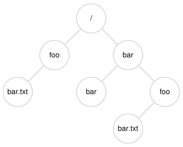
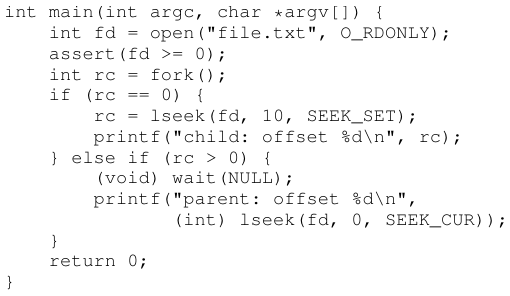
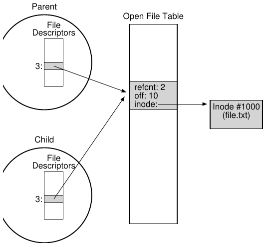
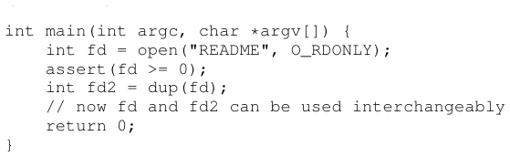
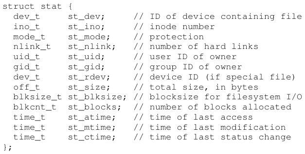

# الفصل 39: الملفات والأدلّة

رأينا حتى الآن تطوّر تجريدين أساسيين من تجريدات نظام التشغيل: العملية، وهي محاكاة افتراضية للمعالج، وفضاء العنوان، وهو محاكاة افتراضية للذاكرة. ويعمل هذان التجريدان معًا على تمكين البرنامج من العمل كأنه في عالمه الخاص المعزول؛ كأن له معالجه الخاص (أو معالجاته)؛ كأن له ذاكرته الخاصة. وهذا الوهم يجعل برمجة النظام أسهل بكثير، ومن ثمّ فهو سائد اليوم، لا على الحواسيب المكتبية والخوادم فحسب، بل وعلى نحو متزايد على كل المنصّات القابلة للبرمجة، بما فيها الهواتف المحمولة وما شابهها.

وسنضيف في هذا القسم قطعة حاسمة أخرى إلى أحجية المحاكاة الافتراضية: التخزين الدائم. فجهاز التخزين الدائم، مثل محرّك أقراص صلبة كلاسيكي أو جهاز تخزين حديث قائم على الحالة الصلبة، يخزّن المعلومات تخزينًا دائمًا (أو على الأقل لزمن طويل). وخلافًا للذاكرة، التي تضيع محتوياتها عند انقطاع الطاقة، يحتفظ جهاز التخزين الدائم بتلك البيانات سليمة. ومن ثمّ يجب على نظام التشغيل أن يولي جهازًا كهذا عناية إضافية: فهنا يحتفظ المستخدمون بالبيانات التي تهمّهم فعلًا.

> **جوهر المسألة: كيف ندير جهازًا دائمًا**
>
> كيف ينبغي لنظام التشغيل أن يدير جهازًا دائمًا؟ وما واجهات البرمجة؟ وما الجوانب المهمة في التنفيذ؟

ومن ثمّ سنستكشف في الفصول القليلة القادمة تقنيات حاسمة لإدارة البيانات الدائمة، مركّزين على طرق تحسين الأداء والموثوقية. لكننا نبدأ بلمحة عامة عن الواجهة البرمجية: الواجهات التي تتوقع أن تراها عند التعامل مع نظام ملفات يونكس.

## 39.1 الملفات والأدلّة

طوّر تجريدا تخزين رئيسيان على مرّ الزمن في محاكاة التخزين الافتراضية. الأول هو الملف. فالملف ليس إلا مصفوفة خطية من البايتات، يمكنك قراءة كل منها أو كتابته. ولكل ملف اسم منخفض المستوى من نوع ما، وهو عادةً عدد ما؛ وفي كثير من الأحيان لا يكون المستخدم على علم بهذا الاسم (كما سنرى). ولأسباب تاريخية، يُشار إلى الاسم منخفض المستوى للملف كثيرًا برقم الـinode (رقم i). وسنتعلّم الكثير عن الـinode في الفصول القادمة؛ افترض الآن فقط أن لكل ملف رقم inode مرتبطًا به.



**الشكل 39.1:** شجرة أدلّة مثال

وفي معظم الأنظمة لا يعرف نظام التشغيل الكثير عن بنية الملف (مثلًا، هل هو صورة أم ملف نصي أم شيفرة C)؛ بل إن مسؤولية نظام الملفات ببساطة أن يخزّن هذه البيانات تخزينًا دائمًا على القرص، وأن يضمن أنك حين تطلب البيانات مرة أخرى تحصل على ما وضعته هناك في المقام الأول. وهذا ليس بسيطًا كما يبدو!

أما التجريد الثاني فهو الدليل. فالدليل، مثل الملف، له اسم منخفض المستوى أيضًا (أي رقم inode)، لكن محتوياته محدّدة تمامًا: فهو يحتوي قائمة من الأزواج (اسم يقرأه المستخدم، اسم منخفض المستوى). فلنفترض، على سبيل المثال، أن ثمة ملفًا اسمه منخفض المستوى «10»، ويُشار إليه بالاسم الذي يقرأه المستخدم «foo». ومن ثمّ يكون في الدليل الذي يقيم فيه «foo» إدخال («foo»، «10») يربط الاسم الذي يقرأه المستخدم بالاسم منخفض المستوى. وكل إدخال في دليل يشير إما إلى ملفات أو إلى أدلّة أخرى. وبوضع الأدلّة داخل أدلّة أخرى، يستطيع المستخدمون بناء شجرة أدلّة (أو هرمية أدلّة) اعتباطية تُخزَّن تحتها كل الملفات والأدلّة.

وتبدأ هرمية الأدلّة عند دليل جذر (في الأنظمة القائمة على يونكس، يُشار إلى دليل الجذر ببساطة بـ /)، وتستخدم نوعًا من الفواصل لتسمية الأدلّة الفرعية التالية إلى أن يُسمّى الملف أو الدليل المطلوب. فمثلًا، إن أنشأ مستخدم دليلًا foo في دليل الجذر /، ثم أنشأ ملفًا bar.txt في الدليل foo، أمكننا الإشارة إلى الملف بمساره المطلق، وهو في هذه الحالة /foo/bar.txt. وانظر الشكل 39.1 لشجرة أدلّة أعقد؛ والأدلّة الصحيحة في المثال هي /، و/foo، و/bar، و/bar/bar، و/bar/foo، والملفات الصحيحة هي /foo/bar.txt و/bar/foo/bar.txt.

> **نصيحة: فكّر بعناية في التسمية**
>
> التسمية جانب مهم من جوانب أنظمة الحاسوب [SK09]. ففي أنظمة يونكس، كل ما يمكنك أن تتخيّله تقريبًا يُسمّى عبر نظام الملفات. ففيما هو أبعد من الملفات، يمكن العثور على الأجهزة والأنابيب وحتى العمليات [K84] في ما يبدو نظام ملفات عاديًا قديمًا. وهذا التوحيد في التسمية ييسّر نموذجك الذهني للنظام، ويجعل النظام أبسط وأكثر وحدوية. ومن ثمّ، كلما أنشأت نظامًا أو واجهة، فكّر بعناية في الأسماء التي تستخدمها.

ويمكن أن تحمل الأدلّة والملفات الاسم نفسه ما دامت في مواضع مختلفة في شجرة نظام الملفات (مثلًا، ثمة ملفان اسمهما bar.txt في الشكل، وهما /foo/bar.txt و/bar/foo/bar.txt).

وقد تلاحظ أيضًا أن اسم الملف في هذا المثال يتكوّن غالبًا من جزأين: bar وtxt، يفصل بينهما نقطة. فالجزء الأول اسم اعتباطي، أما الجزء الثاني من اسم الملف فيُستخدم عادةً للدلالة على نوع الملف، مثلًا هل هو شيفرة C (مثل .c)، أم صورة (مثل .jpg)، أم ملف موسيقى (مثل .mp3). غير أن هذا عادةً مجرّد عُرف: فلا يوجد عادةً ما يفرض أن البيانات الموجودة في ملف اسمه main.c هي فعلًا شيفرة مصدرية بلغة C.

وهكذا نرى شيئًا عظيمًا يوفّره نظام الملفات: طريقة مريحة لتسمية كل الملفات التي تهمّنا. فالأسماء مهمة في الأنظمة لأن الخطوة الأولى في الوصول إلى أي مورد هي القدرة على تسميته. ومن ثمّ يوفّر نظام الملفات في أنظمة يونكس طريقة موحّدة للوصول إلى الملفات على القرص وذاكرة USB والقرص المدمج وكثير من الأجهزة الأخرى، بل وكثير من الأشياء الأخرى أيضًا، وكلها تقع تحت شجرة أدلّة واحدة.

## 39.2 واجهة نظام الملفات

لنناقش الآن واجهة نظام الملفات بمزيد من التفصيل. سنبدأ بأساسيات إنشاء الملفات والوصول إليها وحذفها. قد تظن أن هذا مباشر، لكننا سنكتشف في الطريق النداء الغامض الذي يُستخدم لإزالة الملفات، والمعروف باسم unlink(). ونأمل أن يكون هذا الغموض غير غامض بالنسبة لك بنهاية هذا الفصل!

## 39.3 إنشاء الملفات

سنبدأ بأبسط العمليات: إنشاء ملف. ويمكن إنجاز ذلك بنداء النظام open؛ فباستدعاء open() وتمرير العلم O_CREAT إليه، يستطيع البرنامج إنشاء ملف جديد. وها هي شيفرة مثال لإنشاء ملف اسمه «foo» في دليل العمل الحالي:

```
int fd = open("foo", O_CREAT|O_WRONLY|O_TRUNC,
              S_IRUSR|S_IWUSR);
```

> **استطراد: نداء النظام creat()**
>
> الطريقة الأقدم لإنشاء ملف هي استدعاء creat()، هكذا:
>
> ```
> // option: add second flag to set permissions
> int fd = creat("foo");
> ```
>
> يمكنك أن تعتبر creat() بمثابة open() بالأعلام التالية: O_CREAT | O_WRONLY | O_TRUNC. ولأن open() يستطيع إنشاء ملف، فقد خرج استخدام creat() من التفضيل إلى حد ما (بل إنه قد يكون منفَّذًا ببساطة كنداء مكتبي إلى open())؛ غير أنه يحتل مكانة خاصة في فولكلور يونكس. وتحديدًا، حين سُئل كِن طومسون عمّا كان سيفعله على نحو مختلف لو كان يعيد تصميم يونكس، أجاب: «كنت سأكتب creat بحرف e.»

ويأخذ الروتين open() عددًا من الأعلام المختلفة. وفي هذا المثال، المعامل الثاني ينشئ الملف (O_CREAT) إن لم يكن موجودًا، ويضمن ألّا يكون الملف قابلًا إلا للكتابة (O_WRONLY)، وإن كان الملف موجودًا بالفعل فإنه يقصّه إلى حجم صفر بايت، فيزيل بذلك أي محتوى موجود (O_TRUNC). أما المعامل الثالث فيحدّد الأذونات، وهو هنا يجعل الملف قابلًا للقراءة والكتابة من قِبل المالك.

وثمة جانب مهم في open() هو ما يُعيده: واصف ملف. فواصف الملف مجرّد عدد صحيح، خاص بكل عملية، ويُستخدم في أنظمة يونكس للوصول إلى الملفات؛ ومن ثمّ، ما إن يُفتح الملف، تستخدم واصف الملف لقراءته أو كتابته، بافتراض أن لديك الإذن بذلك. وبهذه الطريقة يكون واصف الملف قدرة [L84]، أي مقبضًا معتمًا يمنحك سلطة أداء عمليات معيّنة. وهناك طريقة أخرى للتفكير في واصف الملف، وهي اعتباره مؤشّرًا إلى كائن من النوع file؛ وما إن يصير لديك كائن كهذا، تستطيع استدعاء «دوال» أخرى للوصول إلى الملف، مثل read() وwrite() (وسنرى كيف نفعل ذلك أدناه).

وكما ذُكر أعلاه، يدير نظام التشغيل واصفات الملفات على أساس كل عملية. وهذا يعني أن بنية بسيطة ما (مثل مصفوفة) تُحفظ في بنية proc على أنظمة يونكس. وها هو الجزء ذو الصلة من نواة xv6 [CK+08]:

```
struct proc {
  ...
  struct file *ofile[NOFILE]; // Open files
  ...
};
```

فمصفوفة بسيطة (بحدّ أقصى NOFILE من الملفات المفتوحة)، مفهرسة بواصف الملف، تتتبّع الملفات المفتوحة على أساس كل عملية. وكل إدخال في المصفوفة ليس في الحقيقة إلا مؤشّرًا إلى بنية file، التي ستُستخدم لتتبّع معلومات عن الملف الذي يُقرأ أو يُكتب؛ وسنناقش ذلك أكثر أدناه.

> **نصيحة: استخدم strace (وأدوات مشابهة)**
>
> توفّر أداة strace طريقة رائعة لرؤية ما تفعله البرامج. فبتشغيلها تستطيع تتبّع نداءات النظام التي يستدعيها برنامج ما، ورؤية المعاملات ورموز الإرجاع، والحصول عمومًا على فكرة جيدة جدًا عمّا يجري.
>
> وتأخذ الأداة بعض المعاملات التي قد تكون مفيدة جدًا. فمثلًا، -f يتبع أي أبناء ناتجين عن fork؛ و-t يبلّغ عن وقت اليوم عند كل نداء؛ و-e trace=open,close,read,write يتتبّع النداءات إلى نداءات النظام تلك فقط ويتجاهل سواها. وثمة أعلام أخرى كثيرة؛ اقرأ صفحات الدليل واكتشف كيف تسخّر هذه الأداة الرائعة.

## 39.4 قراءة الملفات وكتابتها

ما إن تصير لدينا ملفات، فمن الطبيعي أن نرغب في قراءتها أو كتابتها. لنبدأ بقراءة ملف موجود. فلو كنا نكتب على سطر الأوامر، لاستخدمنا ببساطة البرنامج cat لإفراغ محتويات الملف على الشاشة.

```
prompt> echo hello > foo
prompt> cat foo
hello
prompt>
```

في مقطع الشيفرة هذا نعيد توجيه خرج البرنامج echo إلى الملف foo، الذي يحتوي بعد ذلك على الكلمة «hello». ثم نستخدم cat لرؤية محتويات الملف. لكن كيف يصل برنامج cat إلى الملف foo؟

لمعرفة ذلك، سنستخدم أداة بالغة الفائدة لتتبّع نداءات النظام التي يستدعيها برنامج ما. فعلى لينكس تُسمّى الأداة strace؛ وللأنظمة الأخرى أدوات مشابهة (انظر dtruss على Mac، أو truss على بعض إصدارات يونكس الأقدم). وما تفعله strace أنها تتتبّع كل نداء نظام يستدعيه برنامج أثناء عمله، وتُفرغ التتبّع على الشاشة لتراه.

وها هو مثال على استخدام strace لمعرفة ما يفعله cat (حُذفت بعض النداءات للوضوح):

```
prompt> strace cat foo
...
open("foo", O_RDONLY|O_LARGEFILE)                       = 3
read(3, "hello\n", 4096)                                = 6
write(1, "hello\n", 6)                                  = 6
hello
read(3, "", 4096)                                       = 0
close(3)                                                = 0
...
prompt>
```

أول ما يفعله cat هو فتح الملف للقراءة. وينبغي أن نلاحظ هنا أمرين؛ الأول أن الملف يُفتح للقراءة فقط (لا للكتابة)، كما يدل العلم O_RDONLY؛ والثاني أن الإزاحة ذات 64 بت مستخدمة (O_LARGEFILE)؛ والثالث أن نداء open() ينجح ويُعيد واصف ملف قيمته 3.

ولماذا يُعيد أول نداء إلى open() القيمة 3، لا 0 أو ربما 1 كما قد تتوقع؟ كما تبيّن، لكل عملية عاملة ثلاثة ملفات مفتوحة بالفعل، وهي الدخل القياسي (الذي تستطيع العملية القراءة منه لتلقّي الدخل)، والخرج القياسي (الذي تستطيع العملية الكتابة فيه لإفراغ المعلومات على الشاشة)، والخطأ القياسي (الذي تستطيع العملية الكتابة فيه برسائل الخطأ). وهذه تمثّلها واصفات الملفات 0 و1 و2 على التوالي. ومن ثمّ، حين تفتح أول ملف آخر (كما يفعل cat أعلاه)، سيكون واصف الملف 3 على نحو شبه مؤكد.

وبعد نجاح open، يستخدم cat نداء النظام read() ليقرأ بعض البايتات من الملف مرارًا. والمعامل الأول لـread() هو واصف الملف، فيخبر بذلك نظام الملفات أي ملف يقرأ؛ فمن الطبيعي أن تكون للعملية ملفات كثيرة مفتوحة في الوقت نفسه، ومن ثمّ يمكّن الواصف نظام التشغيل من معرفة الملف الذي تشير إليه قراءة معيّنة. ويشير المعامل الثاني إلى ذاكرة مؤقتة يوضع فيها ناتج read()؛ وفي تتبّع نداءات النظام أعلاه تُظهر strace نتائج القراءة في هذا الموضع («hello»). أما المعامل الثالث فهو حجم الذاكرة المؤقتة، وهو في هذه الحالة 4 كيلوبايت. وينجح نداء read() أيضًا، ويعيد هنا عدد البايتات التي قرأها (6، وهي تشمل 5 لحروف الكلمة «hello» وواحدًا لعلامة نهاية السطر).

وعند هذه النقطة ترى نتيجة أخرى مثيرة في تتبّع strace: نداء واحد إلى نظام write()، موجّه إلى واصف الملف 1. وكما ذكرنا أعلاه، هذا الواصف معروف بالخرج القياسي، ومن ثمّ يُستخدم لكتابة الكلمة «hello» على الشاشة كما يُفترض ببرنامج cat أن يفعل. لكن هل يستدعي write() مباشرةً؟ ربما (إن كان مُحسَّنًا تحسينًا عاليًا). وإن لم يكن، فإن ما قد يفعله cat هو استدعاء الروتين المكتبي printf()؛ وداخليًا يحسب printf() كل تفاصيل التنسيق التي تمرّر إليه، ثم يكتب في النهاية إلى الخرج القياسي ليطبع النتائج على الشاشة.

ثم يحاول برنامج cat أن يقرأ أكثر من الملف، لكن ما دام لم تبقَ بايتات في الملف، يُعيد read() القيمة 0 ويعلم البرنامج أن هذا يعني أنه قرأ الملف بكامله. ومن ثمّ يستدعي البرنامج close() ليدلّ على أنه انتهى من الملف «foo»، فيمرّر واصف الملف المقابل. ويُغلق الملف بذلك، وتكتمل قراءته.

وتُنجَز كتابة ملف عبر مجموعة خطوات مشابهة. أولًا يُفتح ملف للكتابة، ثم يُستدعى نداء النظام write()، وربما مرارًا للملفات الأكبر، ثم close(). استخدم strace لتتبّع الكتابات إلى ملف، ربما لبرنامج كتبته بنفسك، أو بتتبّع أداة dd، مثل dd if=foo of=bar.

> **استطراد: بنية بيانات — جدول الملفات المفتوحة**
>
> تحتفظ كل عملية بمصفوفة من واصفات الملفات، يشير كل منها إلى إدخال في جدول الملفات المفتوحة على مستوى النظام كله. وكل إدخال في هذا الجدول يتتبّع الملف الأساسي الذي يشير إليه الواصف، والإزاحة الحالية، وتفاصيل أخرى ذات صلة مثل هل الملف قابل للقراءة أم للكتابة.

## 39.5 القراءة والكتابة، لكن لا تتابعيًا

ناقشنا حتى الآن كيفية قراءة الملفات وكتابتها، لكن كل الوصول كان تتابعيًا؛ أي أننا إما قرأنا ملفًا من بدايته إلى نهايته، أو كتبنا ملفًا من بدايته إلى نهايته.

غير أنه قد يكون مفيدًا أحيانًا أن نقرأ أو نكتب عند إزاحة محدّدة داخل الملف؛ فمثلًا، إن بنيت فهرسًا على مستند نصي واستخدمته للبحث عن كلمة معيّنة، فقد ينتهي بك الأمر إلى القراءة من إزاحات عشوائية داخل المستند. وللقيام بذلك سنستخدم نداء النظام lseek(). وها هو نموذج الدالة:

```
off_t lseek(int fildes, off_t offset, int whence);
```

المعامل الأول مألوف (واصف ملف). والمعامل الثاني هو الإزاحة، التي تضع إزاحة الملف عند موضع معيّن داخل الملف. أما المعامل الثالث، المسمّى whence لأسباب تاريخية، فيحدّد بالضبط كيف يُنفّذ البحث. ومن صفحة الدليل:

```
If whence is SEEK_SET, the offset is set to offset bytes.
If whence is SEEK_CUR, the offset is set to its current
  location plus offset bytes.
If whence is SEEK_END, the offset is set to the size of
  the file plus offset bytes.
```

وكما تستطيع أن ترى من هذا الوصف، يتتبّع نظام التشغيل لكل ملف تفتحه عملية إزاحة «حالية»، تحدد من أين ستبدأ القراءة أو الكتابة التالية داخل الملف. ومن ثمّ، فمن تجريد الملف المفتوح أنه يملك إزاحة حالية، تُحدَّث بإحدى طريقتين. الأولى حين تحدث قراءة أو كتابة لـN بايت، تُضاف N إلى الإزاحة الحالية؛ ومن ثمّ كل قراءة أو كتابة تحدّث الإزاحة ضمنًا. والثانية صراحةً بـlseek، التي تغيّر الإزاحة كما هو موصوف أعلاه.

والإزاحة، كما قد تكون خمّنت، تُحفظ في بنية file التي رأيناها سابقًا، كما يُشار إليها من بنية proc. وها هو تعريف (مبسّط) لبنية xv6:

```
struct file {
   int ref;
   char readable;
   char writable;
   struct inode *ip;
   uint off;
};
```

> **استطراد: استدعاء lseek() لا يُجري بحثًا على القرص**
>
> يُربك نداء النظام lseek()، سيّئ التسمية، كثيرًا من الطلبة الذين يحاولون فهم الأقراص وكيف تعمل نظم الملفات فوقها. لا تخلط بين الأمرين! فنداء lseek() يغيّر ببساطة متغيّرة في ذاكرة نظام التشغيل تتتبّع، لعملية معيّنة، الإزاحة التي ستبدأ عندها قراءتها أو كتابتها التالية. أما بحث القرص فيحدث حين لا تكون قراءة أو كتابة موجّهة إلى القرص على المسار نفسه الذي كانت عليه القراءة أو الكتابة الأخيرة، فتستلزم بذلك حركة للرأس. ومما يزيد الأمر إرباكًا أن استدعاء lseek() للقراءة أو الكتابة من وإلى أجزاء عشوائية من ملف، ثم القراءة والكتابة إلى تلك الأجزاء العشوائية، سيؤدي فعلًا إلى مزيد من عمليات بحث القرص. ومن ثمّ فقد يؤدي استدعاء lseek() إلى بحث في قراءة أو كتابة قادمة، لكنه لا يسبب مطلقًا أي إدخال/إخراج على القرص في ذاته.

وكما ترى في البنية، يستطيع نظام التشغيل أن يستخدمها لتحديد هل الملف المفتوح قابل للقراءة أم للكتابة (أو كليهما)، وأي ملف أساسي يشير إليه (كما يشير إليه مؤشّر struct inode المدعو ip)، والإزاحة الحالية (off). وثمة أيضًا عدّاد مراجع (ref)، سنناقشه أكثر أدناه.

وتمثّل بنى الملفات هذه كل الملفات المفتوحة حاليًا في النظام؛ ويُشار إليها مجتمعةً أحيانًا باسم جدول الملفات المفتوحة. وتحتفظ نواة xv6 بها ببساطة في مصفوفة، بقفل واحد للجدول كله:

```
struct {
  struct spinlock lock;
  struct file file[NFILE];
} ftable;
```

ولنجعل هذا أوضح ببضعة أمثلة. أولًا، لنتتبّع عملية تفتح ملفًا (حجمه 300 بايت) وتقرأه باستدعاء نداء النظام read() مرارًا، بقراءة 100 بايت في كل مرة. وها هو تتبّع لنداءات النظام ذات الصلة، مع القيم التي يعيدها كل نداء نظام، وقيمة الإزاحة الحالية في جدول الملفات المفتوحة لهذا الوصول إلى الملف:

```
                                             Return     Current
      System Calls                              Code      Offset
      fd = open("file", O_RDONLY);                   3           0
      read(fd, buffer, 100);                       100         100
      read(fd, buffer, 100);                       100         200
      read(fd, buffer, 100);                       100         300
      read(fd, buffer, 100);                         0         300
      close(fd);                                     0           –
```

وثمة بندان مثيران للانتباه في التتبّع. أولًا، ترى كيف تُهيّأ الإزاحة الحالية إلى صفر حين يُفتح الملف. ثم ترى كيف تزداد مع كل read() تقوم بها العملية؛ وهذا يجعل من السهل على العملية أن تستمر في استدعاء read() للحصول على الجزء التالي من الملف. وأخيرًا، ترى كيف يُعيد read() في النهاية صفرًا عند محاولة قراءة بعد نهاية الملف، فيدلّ بذلك للعملية على أنها قرأت الملف بكامله.

ثانيًا، لنتتبّع عملية تفتح الملف نفسه مرتين وتصدر قراءة إلى كل منهما.

```
                                                           OFT[10]     OFT[11]
                                                Return     Current     Current
   System Calls                                   Code      Offset      Offset
   fd1 = open("file", O_RDONLY);                      3            0           –
   fd2 = open("file", O_RDONLY);                      4            0           0
   read(fd1, buffer1, 100);                         100         100            0
   read(fd2, buffer2, 100);                         100         100         100
   close(fd1);                                        0            –        100
   close(fd2);                                        0            –           –
```

في هذا المثال يُخصَّص واصفا ملفات (3 و4)، ويشير كل منهما إلى إدخال مختلف في جدول الملفات المفتوحة (في هذا المثال، الإدخالان 10 و11، كما هو موضّح في عنوان الجدول؛ وOFT اختصار Open File Table، أي جدول الملفات المفتوحة). وإن تتبّعت ما يحدث، ترى كيف تُحدَّث كل إزاحة حالية على نحو مستقل.

وفي مثال أخير، تستخدم عملية lseek() لإعادة وضع الإزاحة الحالية قبل القراءة؛ وفي هذه الحالة لا يلزم إلا إدخال واحد في جدول الملفات المفتوحة (كما في المثال الأول).

```
                                                     Return     Current
        System Calls                                    Code      Offset
        fd = open("file", O_RDONLY);                       3           0
        lseek(fd, 200, SEEK_SET);                        200         200
        read(fd, buffer, 50);                             50         250
        close(fd);                                         0           –
```

هنا يضع نداء lseek() الإزاحة الحالية عند 200 أولًا. ثم تقرأ read() التالية الـ50 بايت التالية، وتحدّث الإزاحة الحالية وفقًا لذلك.

## 39.6 إدخالات جدول الملفات المتشاركة: fork() وdup()

في كثير من الحالات (كما في الأمثلة المعروضة أعلاه)، يكون ربط واصف الملف بإدخال في جدول الملفات المفتوحة ربطًا متقابلًا واحدًا بواحد. فمثلًا، حين تعمل عملية ما، قد تقرّر أن تفتح ملفًا وتقرأه ثم تغلقه؛ وفي هذا المثال سيكون للملف إدخال فريد في جدول الملفات المفتوحة. وحتى إن قرأت عملية أخرى الملف نفسه في الوقت نفسه، فسيكون لكل منهما إدخالها الخاص في جدول الملفات المفتوحة. وبهذه الطريقة تكون كل قراءة أو كتابة منطقية لملف مستقلة، ولكل منها إزاحتها الحالية أثناء الوصول إلى الملف المعطى.



**الشكل 39.2:** إدخالات جدول ملفات متشاركة بين أب وابنه (fork-seek.c)

غير أن ثمة حالات قليلة مثيرة تُشارَك فيها إدخالات في جدول الملفات المفتوحة. وإحدى تلك الحالات تحدث حين تنشئ عملية أب عملية ابن بـfork(). ويعرض الشكل 39.2 مقطع شيفرة صغيرًا ينشئ فيه الأب ابنًا ثم ينتظر اكتماله. ويعدّل الابن الإزاحة الحالية عبر استدعاء lseek() ثم يخرج. وأخيرًا يفحص الأب، بعد انتظاره الابن، الإزاحة الحالية ويطبع قيمتها.

وحين نشغّل هذا البرنامج نرى الخرج التالي:

```
prompt> ./fork-seek
child: offset 10
parent: offset 10
prompt>
```

ويعرض الشكل 39.3 العلاقات التي تربط مصفوفة الواصفات الخاصة بكل عملية، وإدخال جدول الملفات المفتوحة المتشارك، والمرجع منه إلى الـinode الأساسي في نظام الملفات. ولاحظ أننا نستفيد هنا أخيرًا من عدّاد المراجع. فحين يُشارَك إدخال جدول ملفات، يزداد عدّاد مراجعه؛ ولا يُزال الإدخال إلا حين تغلق العمليتان الملف (أو تخرجان).



**الشكل 39.3:** عمليات تتشارك إدخالًا في جدول الملفات المفتوحة

ومشاركة إدخالات جدول الملفات المفتوحة بين الأب والابن مفيدة أحيانًا. فمثلًا، إن أنشأت عددًا من العمليات تعمل تعاونًا على مهمة، فبإمكانها أن تكتب إلى ملف الخرج نفسه دون أي تنسيق إضافي. ولمزيد عن ما تتشاركه العمليات عند استدعاء fork()، انظر صفحات الدليل.

وثمة حالة أخرى مثيرة للمشاركة، وربما أكثر فائدة، تحدث مع نداء النظام dup() (وأبناء عمومته dup2() وdup3()).

فنداء dup() يتيح لعملية أن تنشئ واصف ملف جديدًا يشير إلى الملف المفتوح الأساسي نفسه الذي يشير إليه واصف موجود. ويعرض الشكل 39.4 مقطع شيفرة صغيرًا يُظهر كيف يمكن استخدام dup().

ونداء dup() (وخصوصًا dup2()) مفيد عند كتابة صدفة يونكس وأداء عمليات مثل إعادة توجيه الخرج؛ خصّص بعض الوقت وفكّر في السبب! والآن أنت تفكّر: لماذا لم يخبروني بهذا حين كنت أعمل على مشروع الصدفة؟ لا بأس، فلا يمكنك أن تحصل على كل شيء بالترتيب الصحيح، حتى في كتاب مذهل عن أنظمة التشغيل. آسفون!



**الشكل 39.4:** إدخال جدول ملفات متشارك مع dup() (dup.c)

## 39.7 الكتابة الفورية باستخدام fsync()

في معظم الأوقات التي يستدعي فيها برنامج write()، فإنه يقول لنظام الملفات ببساطة: اكتب هذه البيانات إلى التخزين الدائم في وقت ما في المستقبل. ويدّخر نظام الملفات، لأسباب تتعلق بالأداء، مثل هذه الكتابات في الذاكرة لبعض الوقت (قل 5 ثوانٍ أو 30)؛ وفي ذلك الوقت اللاحق تُوجَّه الكتابات فعلًا إلى جهاز التخزين. ومن منظور التطبيق المستدعي، تبدو الكتابات سريعة الاكتمال، ولن تضيع البيانات إلا في حالات نادرة (مثلًا، أعطبت الآلة بعد نداء write() وقبل الكتابة إلى القرص).

غير أن بعض التطبيقات تتطلب شيئًا أكثر من هذا الضمان النهائي. فمثلًا، في نظام إدارة قواعد بيانات (DBMS)، يتطلب تطوير بروتوكول استعادة سليم القدرة على فرض الكتابة إلى القرص من وقت لآخر.

ولدعم هذه الأنواع من التطبيقات، توفّر معظم نظم الملفات بعض واجهات التحكّم الإضافية. وفي عالم يونكس، تُعرف الواجهة المقدَّمة للتطبيقات بـfsync(int fd). فحين تستدعي عملية fsync() لواصف ملف معيّن، يستجيب نظام الملفات بفرض كل البيانات المتسخة (أي التي لم تُكتب بعد) إلى القرص، للملف الذي يشير إليه واصف الملف المحدَّد. ويعود الروتين fsync() بعد اكتمال كل هذه الكتابات.

وها هو مثال بسيط على استخدام fsync(). تفتح الشيفرة الملف foo، وتكتب إليه مقطعًا واحدًا من البيانات، ثم تستدعي fsync() لتضمن فرض الكتابات فورًا إلى القرص. وما إن يعود fsync()، يستطيع التطبيق أن يمضي بأمان، عالمًا أن البيانات صارت دائمة (إن كان fsync() منفَّذًا تنفيذًا صحيحًا، أي).

```
int fd = open("foo", O_CREAT|O_WRONLY|O_TRUNC,
              S_IRUSR|S_IWUSR);
assert(fd > -1);
int rc = write(fd, buffer, size);
assert(rc == size);
rc = fsync(fd);
assert(rc == 0);
```

ومن المثير أن هذا التسلسل لا يضمن كل ما قد تتوقعه؛ ففي بعض الحالات تحتاج أيضًا إلى استدعاء fsync() على الدليل الذي يحتوي الملف foo. وإضافة هذه الخطوة تضمن لا أن الملف نفسه على القرص فحسب، بل وأن الملف، إن كان منشأً حديثًا، صار جزءًا دائمًا من الدليل أيضًا. وليس مفاجئًا أن هذا النوع من التفاصيل يُغفل كثيرًا، فيؤدي إلى كثير من الأخطاء على مستوى التطبيقات [P+13,P+14].

## 39.8 إعادة تسمية الملفات

ما إن يصير لدينا ملف، قد يكون من المفيد أحيانًا أن نعطيه اسمًا مختلفًا. وعند الكتابة على سطر الأوامر يُنجَز ذلك بأمر mv؛ وفي هذا المثال يُعاد تسمية الملف foo إلى bar:

```
prompt> mv foo bar
```

وباستخدام strace نرى أن mv يستخدم نداء النظام rename(char *old, char *new)، الذي يأخذ بالضبط معاملين: الاسم الأصلي للملف (old) والاسم الجديد (new).

وثمة ضمان مثير يوفّره نداء rename()، وهو أنه (عادةً) منفَّذ كنداء ذرّي بالنسبة لأعطال النظام؛ فإن أعطب النظام أثناء إعادة التسمية، فسيكون اسم الملف إما الاسم القديم أو الاسم الجديد، ولا يمكن أن تنشأ حالة بينية غريبة. ومن ثمّ فإن rename() حاسم لدعم أنواع معيّنة من التطبيقات التي تتطلب تحديثًا ذرّيًا لحالة الملف.

ولنكن أكثر تحديدًا هنا. تخيّل أنك تستخدم محرّر ملفات (مثل emacs)، وتُدخل سطرًا في منتصف ملف. واسم الملف، في المثال، هو foo.txt. والطريقة التي قد يحدّث بها المحرّر الملف ليضمن أن الملف الجديد يحمل المحتويات الأصلية مضافًا إليها السطر المُدخل هي كما يلي (بإغفال فحص الأخطاء للتبسيط):

```
int fd = open("foo.txt.tmp", O_WRONLY|O_CREAT|O_TRUNC,
              S_IRUSR|S_IWUSR);
write(fd, buffer, size); // write out new version of file
fsync(fd);
close(fd);
rename("foo.txt.tmp", "foo.txt");
```

وما يفعله المحرّر في هذا المثال بسيط: يكتب النسخة الجديدة من الملف باسم مؤقّت (foo.txt.tmp)، ويفرضها إلى القرص بـfsync()، ثم، حين يتأكد التطبيق من أن بيانات الملف الجديد الوصفية ومحتوياته على القرص، يعيد تسمية الملف المؤقّت إلى اسم الملف الأصلي. وهذه الخطوة الأخيرة تبدّل الملف الجديد ذرّيًا في موضعه، وتحذف في الوقت نفسه النسخة القديمة من الملف، فيُنجَز بذلك تحديث ذرّي للملف.

> **استطراد: mmap() والذاكرة الدائمة (استطراد ضيف بقلم تيرنس كيلي)**
>
> تعيين الذاكرة طريقة بديلة للوصول إلى البيانات الدائمة في الملفات. فنداء النظام mmap() ينشئ تقابلًا بين إزاحات البايت في ملف والعناوين الافتراضية في العملية المستدعية؛ ويُسمّى الأول الملف المدعوم، والثاني صورته في الذاكرة. ثم تستطيع العملية الوصول إلى الملف المدعوم باستخدام تعليمات المعالج (أي التحميل والتخزين) إلى الصورة في الذاكرة.
>
> وبدمج دوام الملفات مع دلالات وصول الذاكرة، تدعم تعيينات الذاكرة المدعومة بالملفات تجريدًا برمجيًا يُسمّى الذاكرة الدائمة. ويمكن لأسلوب البرمجة بالذاكرة الدائمة أن يبسّط التطبيقات بإلغاء الترجمة بين صيغ البيانات المختلفة للذاكرة والتخزين [K19].
>
> ```
> 1   p = mmap(NULL, file_size, PROT_READ|PROT_WRITE,
> 2            MAP_SHARED, fd, 0);
> 3   assert(p != MAP_FAILED);
> 4   for (int i = 1; i < argc; i++)
> 5     if (strcmp(argv[i], "pop") == 0) // pop
> 6       if (p->n > 0) // stack not empty
> 7         printf("%d\n", p->stack[--p->n]);
> 8     } else { // push
> 9       if (sizeof(pstack_t) + (1 + p->n) * sizeof(int)
> 10           <= file_size) // stack not full
> 11         p->stack[p->n++] = atoi(argv[i]);
> 12     }
> ```
>
> ويخزّن البرنامج pstack.c (المضمَّن في مستودع شيفرة OSTEP على GitHub، مع مقطع منه معروض أعلاه) مكدّسًا دائمًا في الملف ps.img، يبدأ حياته ككيس من الأصفار، مثلًا منشأً على سطر الأوامر بأداة truncate أو dd. ويحتوي الملف عددًا لحجم المكدّس ومصفوفة من الأعداد الصحيحة تحمل محتويات المكدّس. وبعد تعيين الملف المدعوم بـmmap() نستطيع الوصول إلى المكدّس بمؤشّرات C إلى الصورة في الذاكرة، فمثلًا p->n يصل إلى عدد العناصر في المكدّس، وp->stack مصفوفة الأعداد الصحيحة. ولأن المكدّس دائم، فالبيانات التي تدفعها إحدى تشغيلات pstack يمكن أن تسحبها التشغيلة التالية.
>
> وعطل ما، مثلًا بين الزيادة والإسناد في عملية الدفع، قد يترك مكدّسنا الدائم في حالة غير متسقة. وتتجنّب التطبيقات هذا الضرر باستخدام آليات تحدّث الذاكرة الدائمة ذرّيًا بالنسبة للفشل [K20].

## 39.9 الحصول على معلومات عن الملفات

فيما هو أبعد من الوصول إلى الملفات، نتوقع من نظام الملفات أن يحفظ قدرًا وافرًا من المعلومات عن كل ملف يخزّنه. ونسمّي عمومًا هذه البيانات عن الملفات البيانات الوصفية. ولرؤية البيانات الوصفية لملف معيّن، نستطيع استخدام نداءي النظام stat() أو fstat(). ويأخذ هذان النداءان مسارًا (أو واصف ملف) لملف، ويملآن بنية stat كما في الشكل 39.5.



**الشكل 39.5:** بنية stat.

تستطيع أن ترى أن قدرًا كبيرًا من المعلومات يُحفظ عن كل ملف، منها حجمه (بالبايت)، واسمه منخفض المستوى (أي رقم inode)، وبعض معلومات الملكية، وبعض المعلومات عن وقت الوصول إلى الملف أو تعديله، من بين أمور أخرى. ولرؤية هذه المعلومات، يمكنك استخدام أداة سطر الأوامر stat. وفي هذا المثال ننشئ أولًا ملفًا (اسمه file) ثم نستخدم أداة سطر الأوامر stat لمعرفة بعض الأشياء عن الملف.

وها هو الخرج على لينكس:

```
prompt> echo hello > file
prompt> stat file
  File: 'file'
  Size: 6          Blocks: 8          IO Block: 4096   regular file
Device: 811h/2065d      Inode: 67158084    Links: 1
Access: (0640/-rw-r-----)  Uid: (30686/remzi)   Gid: (30686/remzi)
Access: 2011-05-03 15:50:20.157594748 -0500
Modify: 2011-05-03 15:50:20.157594748 -0500
Change: 2011-05-03 15:50:20.157594748 -0500
```

وكل نظام ملفات يحفظ عادةً هذا النوع من المعلومات في بنية تُسمّى inode[^1]. وسنتعلّم الكثير عن الـinode حين نتحدّث عن تنفيذ نظم الملفات. أما الآن، فما عليك إلا أن تتخيّل الـinode بنية بيانات دائمة يحفظها نظام الملفات، وفيها معلومات كالتي نراها أعلاه. وكل الـinode يقيم على القرص؛ وتبقى نسخة من النشِطة منها في الذاكرة عادةً لتسريع الوصول.

## 39.10 إزالة الملفات

بتنا نعرف عند هذه النقطة كيفية إنشاء الملفات والوصول إليها، تتابعيًا أو بغير تتابع. لكن كيف تحذف الملفات؟ إن كنت قد استخدمت يونكس فأنت تظن أنك تعرف: شغّل البرنامج rm فحسب. لكن أي نداء نظام يستخدمه rm لإزالة ملف؟

لنستخدم صديقنا القديم strace مرة أخرى لمعرفة ذلك. وهنا نزيل الملف foo المزعج:

```
prompt> strace rm foo
...
unlink("foo")                                              = 0
...
```

لقد أزلنا كومة من نفايات غير ذات صلة من الخرج المتتبَّع، فلم يبقَ إلا نداء واحد إلى نداء النظام الغامض الاسم unlink(). وكما ترى، لا يأخذ unlink() إلا اسم الملف المطلوب إزالته، ويُعيد صفرًا عند النجاح. لكن هذا يقودنا إلى أحجية عظيمة: لماذا يُسمّى نداء النظام هذا unlink؟ ولماذا لا يُسمّى ببساطة remove أو delete؟

ولفهم جواب هذه الأحجية، يجب أن نفهم أكثر من الملفات فحسب، بل الأدلّة أيضًا.

## 39.11 إنشاء الأدلّة

فيما هو أبعد من الملفات، ثمة مجموعة من نداءات النظام المتعلقة بالأدلّة تمكّنك من إنشاء الأدلّة وقراءتها وحذفها. ولاحظ أنك لا تستطيع أبدًا الكتابة إلى دليل مباشرةً. فلأن صيغة الدليل تُعدّ من البيانات الوصفية لنظام الملفات، يعدّ نظام الملفات نفسه مسؤولًا عن سلامة بيانات الدليل؛ ومن ثمّ لا تستطيع تحديث دليل إلا تحديثًا غير مباشر، مثلًا بإنشاء ملفات أو أدلّة أو أنواع كائنات أخرى داخله. وبهذه الطريقة يضمن نظام الملفات أن تكون محتويات الأدلّة كما هو متوقع.

ولإنشاء دليل، يتوفّر نداء نظام واحد هو mkdir(). ويمكن استخدام البرنامج الذي يحمل الاسم نفسه، mkdir، لإنشاء دليل كهذا. ولننظر إلى ما يحدث حين نشغّل البرنامج mkdir لإنشاء دليل بسيط اسمه foo:

```
prompt> strace mkdir foo
...
mkdir("foo", 0777)                                         = 0
...
prompt>
```

وحين يُنشأ دليل كهذا يُعدّ «فارغًا»، وإن كانت له محتويات بالحد الأدنى. وتحديدًا، للدليل الفارغ إدخالان: إدخال يشير إلى نفسه، وإدخال يشير إلى أبيه. ويُشار إلى الأول بالدليل «.» (نقطة)، وإلى الثاني بـ«..» (نقطتان). وتستطيع رؤية هذين الدليلين بتمرير العلم -a إلى البرنامج ls:

```
prompt> ls -a
./ ../
prompt> ls -al
total 8
drwxr-x--- 2 remzi remzi                   6 Apr 30 16:17 ./
drwxr-x--- 26 remzi remzi 4096 Apr 30 16:17 ../
```

> **نصيحة: احذر الأوامر القوية**
>
> يقدّم لنا البرنامج rm مثالًا عظيمًا على الأوامر القوية، وكيف قد تكون القوة المفرطة شيئًا سيئًا أحيانًا. فمثلًا، لإزالة كومة من الملفات دفعة واحدة، يمكنك كتابة شيء مثل:
>
> ```
> prompt> rm *
> ```
>
> حيث يطابق * كل الملفات في الدليل الحالي. لكنك تريد أحيانًا أن تحذف الأدلّة أيضًا، بل وكل محتوياتها. ويمكنك فعل ذلك بأن تطلب من rm أن ينزل تكراريًا في كل دليل ويحذف محتوياته أيضًا:
>
> ```
> prompt> rm -rf *
> ```
>
> وحيث تقع في المشكلة مع هذه السلسلة القصيرة من الأحرف هو أن تصدر الأمر، خطأً، من دليل الجذر في نظام ملفات، فتحذف بذلك كل ملف ودليل فيه. عذرًا!
>
> ومن ثمّ تذكّر السيف ذا الحدّين للأوامر القوية؛ فهي إذ تمنحك القدرة على إنجاز عمل كثير بضربات مفاتيح قليلة، تستطيع أيضًا بسرعة وسهولة أن تُلحق ضررًا كبيرًا.

## 39.12 قراءة الأدلّة

بتنا نعرف كيف ننشئ دليلًا، وقد نرغب في قراءته أيضًا. وهذا بالضبط ما يفعله البرنامج ls. ولنكتب أداتنا الصغيرة الخاصة على غرار ls ونرَ كيف يُنجَز ذلك.

فبدلًا من فتح دليل كما لو كان ملفًا، نستخدم مجموعة نداءات جديدة. وأدناه برنامج مثال يطبع محتويات دليل. ويستخدم البرنامج ثلاثة نداءات، opendir() وreaddir() وclosedir()، لإنجاز العمل، وتستطيع أن ترى كم هي بسيطة الواجهة؛ فنحن نستخدم حلقة بسيطة لقراءة إدخال دليل واحد في كل مرة، ونطبع اسم كل ملف في الدليل ورقم الـinode الخاص به.

```
int main(int argc, char *argv[]) {
    DIR *dp = opendir(".");
    assert(dp != NULL);
    struct dirent *d;
    while ((d = readdir(dp)) != NULL) {
        printf("%lu %s\n", (unsigned long) d->d_ino,
               d->d_name);
    }
    closedir(dp);
    return 0;
}
```

ويُظهر التعريف أدناه المعلومات المتاحة في كل إدخال دليل في بنية البيانات struct dirent:

```
struct dirent {
  char           d_name[256]; // filename
  ino_t          d_ino;       // inode number
  off_t          d_off;       // offset to the next dirent
  unsigned short d_reclen;    // length of this record
  unsigned char  d_type;      // type of file
};
```

ولأن الأدلّة قليلة المعلومات (فهي في الأساس تربط الاسم برقم الـinode، مع بضعة تفاصيل أخرى فحسب)، فقد يرغب برنامج في استدعاء stat() على كل ملف للحصول على مزيد من المعلومات عن كل منها، مثل طوله أو معلومات أخرى مفصّلة. وهذا بالضبط ما يفعله ls حين تمرّر إليه العلم -l؛ جرّب strace على ls مع ذلك العلم وبدونه لترى بنفسك.

## 39.13 حذف الأدلّة

وأخيرًا، يمكنك حذف دليل بنداء إلى rmdir() (يستخدمه البرنامج الذي يحمل الاسم نفسه، rmdir). غير أن حذف الأدلّة، خلافًا لحذف الملفات، أخطر، إذ قد تحذف كمًّا كبيرًا من البيانات بأمر واحد. ومن ثمّ يشترط rmdir() أن يكون الدليل فارغًا (أي ألّا يحوي إلا الإدخالين «.» و«..») قبل حذفه. فإن حاولت حذف دليل غير فارغ، فشل نداء rmdir() ببساطة.

## 39.14 الوصلات الصلبة

نعود الآن إلى أحجية سبب إجراء إزالة الملف عبر unlink()، بفهم طريقة جديدة لصنع إدخال في شجرة نظام الملفات، عبر نداء نظام يُعرف بـlink(). ويأخذ نداء النظام link() معاملين، مسارًا قديمًا ومسارًا جديدًا؛ فحين «تصل» اسم ملف جديد باسم قديم، تُنشئ في جوهر الأمر طريقة أخرى للإشارة إلى الملف نفسه. ويُستخدم برنامج سطر الأوامر ln لفعل ذلك، كما نرى في هذا المثال:

```
prompt> echo hello > file
prompt> cat file
hello
prompt> ln file file2
prompt> cat file2
hello
```

هنا أنشأنا ملفًا فيه الكلمة «hello»، وسمّيناه file[^2]. ثم أنشأنا وصلة صلبة إلى ذلك الملف باستخدام البرنامج ln. وبعد ذلك نستطيع فحص الملف بفتح file أو file2.

وطريقة عمل link() أنه ينشئ ببساطة اسمًا آخر في الدليل الذي تُنشئ فيه الوصلة، ويشير به إلى رقم الـinode نفسه (أي الاسم منخفض المستوى) للملف الأصلي. ولا يُنسخ الملف بأي طريقة؛ بل يصير لديك الآن اسمان يقرأهما الإنسان (file وfile2) يشيران كلاهما إلى الملف نفسه. بل نستطيع أن نرى ذلك في الدليل نفسه، بطباعة رقم الـinode لكل ملف:

```
prompt> ls -i file file2
67158084 file
67158084 file2
prompt>
```

وبتمرير العلم -i إلى ls يطبع رقم الـinode لكل ملف (واسم الملف أيضًا). وهكذا ترى ما فعله link فعلًا: مجرّد إنشاء مرجع جديد إلى رقم الـinode نفسه بالضبط (67158084 في هذا المثال).

وربما بدأت الآن ترى لماذا يُسمّى unlink() بهذا الاسم. فحين تنشئ ملفًا، أنت في الحقيقة تفعل شيئين. أولًا، تصنع بنية (الـinode) ستتتبّع كل المعلومات ذات الصلة بالملف تقريبًا، بما فيها حجمه وأين تقع كتلته على القرص وما إلى ذلك. وثانيًا، تربط اسمًا يقرأه الإنسان بذلك الملف، وتضع تلك الوصلة في دليل.

وبعد إنشاء وصلة صلبة إلى ملف، لا يدرك نظام الملفات أي فرق بين اسم الملف الأصلي (file) واسم الملف المنشأ حديثًا (file2)؛ بل هما مجرّد وصلتين إلى البيانات الوصفية الأساسية للملف، الموجودة في رقم الـinode 67158084.

ومن ثمّ، لإزالة ملف من نظام الملفات نستدعي unlink(). وفي المثال أعلاه، كان بإمكاننا مثلًا إزالة الملف المسمّى file، ويبقى الوصول إلى الملف دون صعوبة:

```
prompt> rm file
removed 'file'
prompt> cat file2
hello
```

وسبب نجاح ذلك أن نظام الملفات، حين يزيل وصلة file، يفحص عدّاد مراجع داخل رقم الـinode. وهذا العدّاد (يُسمّى أحيانًا عدّاد الوصلات) يتيح لنظام الملفات أن يتتبّع كم اسم ملف مختلفًا وُصل بهذا الـinode بعينه. وحين يُستدعى unlink()، يزيل «الوصلة» بين الاسم الذي يقرأه الإنسان (الملف الذي يُحذف) ورقم الـinode المعطى، وينقص عدّاد المراجع؛ ولا يُحرّر نظام الملفات الـinode وكتل البيانات ذات الصلة إلا حين يبلغ عدّاد المراجع صفرًا، فيحذف بذلك الملف حذفًا حقيقيًا.

وتستطيع أن ترى عدّاد مراجع ملف باستخدام stat() طبعًا. ولنرَ ما هو حين ننشئ وصلات صلبة إلى ملف ونحذفها. وفي هذا المثال سننشئ ثلاث وصلات إلى الملف نفسه، ثم نحذفها. راقب عدّاد الوصلات!

```
prompt> echo hello > file
prompt> stat file
... Inode: 67158084    Links: 1 ...
prompt> ln file file2
prompt> stat file
... Inode: 67158084    Links: 2 ...
prompt> stat file2
... Inode: 67158084    Links: 2 ...
prompt> ln file2 file3
prompt> stat file
... Inode: 67158084    Links: 3 ...
prompt> rm file
prompt> stat file2
... Inode: 67158084    Links: 2 ...
prompt> rm file2
prompt> stat file3
... Inode: 67158084    Links: 1 ...
prompt> rm file3
```

## 39.15 الوصلات الرمزية

ثمة نوع آخر من الوصلات مفيد حقًا، ويُسمّى الوصلة الرمزية أو الوصلة اللينة أحيانًا. فالوصلات الصلبة محدودة إلى حد ما: فلا يمكنك إنشاء وصلة صلبة إلى دليل (خشية أن تُنشئ دورة في شجرة الأدلّة)؛ ولا يمكنك الوصل الصلب إلى ملفات في أقسام قرص أخرى (لأن أرقام الـinode فريدة داخل نظام ملفات معيّن فقط، لا عبر نظم الملفات)؛ وما إلى ذلك. ومن ثمّ أُنشئ نوع جديد من الوصلات يُسمّى الوصلة الرمزية [MJLF84].

ولإنشاء وصلة كهذه، يمكنك استخدام البرنامج نفسه ln، لكن مع العلم -s. وها هو مثال:

```
prompt> echo hello > file
prompt> ln -s file file2
prompt> cat file2
hello
```

وكما ترى، يبدو إنشاء وصلة لينة شبيهًا إلى حد كبير، ويمكن الآن الوصول إلى الملف الأصلي عبر اسم الملف file وكذلك عبر اسم الوصلة الرمزية file2.

غير أن الوصلات الرمزية، فيما هو أبعد من هذا التشابه السطحي، مختلفة عن الوصلات الصلبة اختلافًا كبيرًا. فالفرق الأول أن الوصلة الرمزية ملف في الحقيقة، من نوع مختلف. تحدّثنا سابقًا عن الملفات العادية والأدلّة؛ والوصلات الرمزية نوع ثالث يعرفه نظام الملفات. ونداء stat على الوصلة يكشف كل شيء:

```
prompt> stat file
 ... regular file ...
prompt> stat file2
 ... symbolic link ...
```

وتكشف تشغيل ls هذه الحقيقة أيضًا. فإن دقّقت في الحرف الأول من الشكل الطويل لخرج ls، ترى أن الحرف الأول في العمود الأيسر هو - للملفات العادية، وd للأدلّة، وl للوصلات اللينة. وتستطيع أيضًا رؤية حجم الوصلة الرمزية (4 بايت في هذه الحالة) وما تشير إليه (الملف المسمّى file).

```
prompt> ls -al
drwxr-x--- 2 remzi remzi    29 May  3 19:10 ./
drwxr-x--- 27 remzi remzi 4096 May  3 15:14 ../
-rw-r----- 1 remzi remzi     6 May  3 19:10 file
lrwxrwxrwx 1 remzi remzi     4 May  3 19:10 file2 -> file
```

وسبب أن حجم file2 أربعة بايتات هو أن الوصلة الرمزية تتكوّن بحفظ مسار الملف الموصول إليه كبيانات لملف الوصلة. ولأننا وصلنا إلى ملف اسمه file، فملف وصلتنا file2 صغير (4 بايت). ولو وصلنا إلى مسار أطول، لكان ملف وصلتنا أكبر:

```
prompt> echo hello > alongerfilename
prompt> ln -s alongerfilename file3
prompt> ls -al alongerfilename file3
-rw-r----- 1 remzi remzi 6 May 3 19:17 alongerfilename
lrwxrwxrwx 1 remzi remzi 15 May 3 19:17 file3 ->
                                        alongerfilename
```

وأخيرًا، تتيح الوصلات الرمزية، بحكم طريقة إنشائها، احتمال ما يُعرف بالمرجع المعلّق:

```
prompt> echo hello > file
prompt> ln -s file file2
prompt> cat file2
hello
prompt> rm file
prompt> cat file2
cat: file2: No such file or directory
```

وكما ترى في هذا المثال، وخلافًا كبيرًا للوصلات الصلبة، يؤدي حذف الملف الأصلي المسمّى file إلى أن تشير الوصلة إلى مسار لم يعد موجودًا.

## 39.16 بتات الأذونات وقوائم التحكّم في الوصول

وفّر تجريد العملية محاكاتين افتراضيتين مركزيتين: للمعالج وللذاكرة. وقد أعطى كل منهما العملية وهمًا بأن لها معالجها الخاص وذاكرتها الخاصة؛ أما في الحقيقة فقد استخدم نظام التشغيل تحته تقنيات متنوعة لتقاسم موارد مادية محدودة بين كيانات متنافسة بطريقة آمنة وسليمة.

ويعرض نظام الملفات أيضًا رؤية افتراضية للقرص، فيحوّله من كومة من الكتل الخام إلى ملفات وأدلّة أكثر ملاءمة للمستخدم بكثير، كما هو موصوف في هذا الفصل. غير أن التجريد مختلف اختلافًا ملحوظًا عن تجريد المعالج والذاكرة، في أن الملفات تُتشارك عادةً بين مستخدمين وعمليات مختلفة، وليست (دائمًا) خاصة. ومن ثمّ توجد عادةً في نظم الملفات مجموعة أكثر شمولًا من الآليات لتمكين درجات مختلفة من التشارك.

وأول أشكال هذه الآليات هو بتات الأذونات اليونكسية الكلاسيكية. ولرؤية أذونات ملف foo.txt، اكتب فحسب:

```
prompt> ls -l foo.txt
-rw-r--r-- 1 remzi wheel              0 Aug 24 16:29 foo.txt
```

وسننتبه إلى الجزء الأول من هذا الخرج فقط، أي -rw-r--r--. فالحرف الأول هنا يبيّن نوع الملف فحسب: - لملف عادي (وهو ما عليه foo.txt)، وd لدليل، وl لوصلة رمزية، وما إلى ذلك؛ وهذا (في معظمه) غير متعلق بالأذونات، فسنتجاهله الآن.

ونحن معنيّون ببتات الأذونات، التي تمثّلها الأحرف التسعة التالية (rw-r--r--). وتحدّد هذه البتات، لكل ملف عادي ودليل وكيان آخر، من يستطيع الوصول إليه بالضبط وكيف.

وتتكوّن الأذونات من ثلاث مجموعات: ما يستطيع مالك الملف أن يفعله به، وما يستطيع من في المجموعة أن يفعله بالملف، وأخيرًا ما يستطيع أي شخص (يُشار إليه أحيانًا بـother) أن يفعله. وتشمل القدرات التي قد تكون للمالك أو عضو المجموعة أو الآخرين القدرة على قراءة الملف أو كتابته أو تنفيذه.

وفي المثال أعلاه، تُظهر الأحرف الثلاثة الأولى من خرج ls أن الملف قابل للقراءة والكتابة من المالك (rw-)، وقابل للقراءة فقط من أعضاء المجموعة wheel وكذلك من أي شخص آخر في النظام (r-- تليها r--).

ويستطيع مالك الملف أن يغيّر هذه الأذونات بسهولة، مثلًا باستخدام الأمر chmod (لتغيير نمط الملف). ولإزالة القدرة على الوصول إلى الملف من أي شخص غير المالك، يمكنك كتابة:

```
prompt> chmod 600 foo.txt
```

> **استطراد: المستخدم الأعلى لنظم الملفات**
>
> أي مستخدم يُسمح له بأداء عمليات مميّزة للمساعدة في إدارة نظام الملفات؟ فمثلًا، إن احتاجت ملفات مستخدم غير نشط إلى الحذف لتوفير مساحة، فمن له الحق في ذلك؟
>
> في نظم الملفات المحلية، العُرف الشائع هو وجود نوع من مستخدم أعلى (أي root) يستطيع الوصول إلى كل الملفات بصرف النظر عن الأذونات. أما في نظام ملفات موزّع مثل AFS (الذي له قوائم تحكّم في الوصول)، فثمة مجموعة اسمها system:administrators تضم مستخدمين موثوقين لفعل ذلك. وفي الحالتين يمثّل هؤلاء المستخدمون الموثوقون خطرًا أمنيًا كامنًا؛ فإن استطاع مهاجم أن يتنكّر بطريقة ما لشخص كهذا، أمكنه الوصول إلى كل المعلومات في النظام، فينتهك بذلك ضمانات الخصوصية والحماية المتوقعة.

هذا الأمر يمكّن بتة القراءة (4) وبتة الكتابة (2) للمالك (والجمع بينهما بعملية OR ينتج الـ6 أعلاه)، لكنه يضبط بتّات أذونات المجموعة والآخرين على 0 و0 على التوالي، فيجعل بذلك الأذونات rw-------.

وبتة التنفيذ مثيرة للاهتمام خصوصًا. فالملفات العادية، يحدّد وجودها هل يمكن تشغيل برنامج أم لا. فمثلًا، إن كان لدينا سكربت صدفة بسيط اسمه hello.csh، فقد نرغب في تشغيله بكتابة:

```
prompt> ./hello.csh
hello, from shell world.
```

غير أننا إن لم نضبط بتة التنفيذ على نحو صحيح لهذا الملف، يحدث ما يلي:

```
prompt> chmod 600 hello.csh
prompt> ./hello.csh
./hello.csh: Permission denied.
```

أما الأدلّة، فتتصرّف بتة التنفيذ فيها تصرّفًا مختلفًا بعض الشيء. وتحديدًا، تمكّن مستخدمًا (أو مجموعة، أو الجميع) من أمور مثل تغيير الدليل (أي cd) إلى الدليل المعطى، ومن إنشاء ملفات فيه بالاشتراك مع بتة الكتابة. وأفضل طريقة لتعلّم المزيد عن ذلك: جرّب الأمر بنفسك! لا تقلق، فلن (يحتمل أن) تفسد شيئًا فسادًا كبيرًا.

وفيما هو أبعد من بتات الأذونات، تشمل بعض نظم الملفات، مثل نظام الملفات الموزّع المعروف بـAFS (الذي نناقشه في فصل لاحق)، ضوابط أكثر تطورًا. فـAFS، مثلًا، يفعل ذلك في صورة قائمة تحكّم في الوصول (ACL) لكل دليل. وقوائم التحكّم في الوصول طريقة أعمّ وأقوى لتمثيل من يستطيع الوصول بالضبط إلى مورد معيّن. وهي في نظام الملفات تتيح للمستخدم أن ينشئ قائمة محدّدة جدًا بمن يستطيع قراءة مجموعة ملفات ومن لا يستطيع، خلافًا لنموذج المالك والمجموعة والجميع المحدود إلى حد ما في بتات الأذونات الموصوفة أعلاه.

فمثلًا، ها هي ضوابط الوصول لدليل خاص في حساب AFS لأحد المؤلفين، كما يعرضها الأمر fs listacl:

```
prompt> fs listacl private
Access list for private is
Normal rights:
  system:administrators rlidwka
  remzi rlidwka
```

تُظهر القائمة أن مديري النظام والمستخدم remzi كلاهما يستطيع البحث في هذا الدليل والإدراج فيه والحذف منه وإدارته، وكذلك قراءة الملفات فيه وكتابتها وقفلها.

وللسماح لشخص ما (في هذه الحالة، المؤلف الآخر) بالوصول إلى هذا الدليل، يستطيع المستخدم remzi أن يكتب الأمر التالي فحسب.

```
prompt> fs setacl private/ andrea rl
```

وهكذا ذهبت خصوصية remzi! لكنك تعلّمت الآن درسًا أهم: لا يمكن أن تكون ثمة أسرار في زواج سعيد، حتى داخل نظام الملفات[^3].

## 39.17 إنشاء نظام ملفات وتركيبه

لقد تجوّلنا الآن في الواجهات الأساسية للوصول إلى الملفات والأدلّة وأنواع معيّنة خاصة من الوصلات. لكن ثمة موضوعًا آخر ينبغي أن نناقشه: كيف نجمّع شجرة أدلّة كاملة من نظم ملفات كثيرة أساسية. وتُنجَز هذه المهمة بإنشاء نظم الملفات أولًا، ثم تركيبها لتصبح محتوياتها متاحة.

ولإنشاء نظام ملفات، توفّر معظم نظم الملفات أداةً تُسمّى عادةً mkfs (تُلفظ «make fs»)، تؤدي هذه المهمة بالضبط. والفكرة كما يلي: أعطِ الأداة، كدخل، جهازًا (مثل قسم قرص، مثل /dev/sda1) ونوع نظام ملفات (مثل ext3)، فتكتب ببساطة نظام ملفات فارغًا، يبدأ بدليل جذر، على قسم القرص ذلك. وقال mkfs: ليكن ثمة نظام ملفات!

غير أن نظام الملفات هذا، ما إن يُنشأ، يحتاج إلى أن يصير متاحًا داخل شجرة نظام الملفات الموحّدة. وتُنجَز هذه المهمة عبر البرنامج mount (الذي يستدعي نداء النظام mount() الأساسي لأداء العمل الحقيقي). وما يفعله mount ببساطة أنه يأخذ دليلًا موجودًا كنقطة تركيب هدف، ويلصق في جوهر الأمر نظام ملفات جديدًا على شجرة الأدلّة عند تلك النقطة.

وقد يكون ثمة مثال مفيد هنا. تخيّل أن لدينا نظام ملفات ext3 غير مركّب، مخزّنًا في قسم الجهاز /dev/sda1، وله المحتويات التالية: دليل جذر يحتوي دليلين فرعيين، a وb، يحوي كل منهما بدوره ملفًا واحدًا اسمه foo. ولنفترض أننا نريد تركيب نظام الملفات هذا عند نقطة التركيب /home/users. سنكتب شيئًا مثل هذا:

```
prompt> mount -t ext3 /dev/sda1 /home/users
```

وإن نجح الأمر، يجعل التركيب نظام الملفات الجديد هذا متاحًا. غير أن لاحظ كيف يُوصل إلى نظام الملفات الجديد الآن. فللنظر إلى محتويات دليل الجذر، سنستخدم ls هكذا:

```
prompt> ls /home/users/
a b
```

> **نصيحة: احذر TOCTTOU**
>
> في عام 1974 لاحظ مكفي مشكلة في أنظمة الحاسوب. وتحديدًا، لاحظ مكفي أن «… إن وُجد فاصل زمني بين فحص صلاحية ما والعملية المرتبطة بذلك الفحص، [وإن] أمكن، عبر تعدد المهام، تغيير متغيّرات فحص الصلاحية عمدًا خلال هذا الفاصل الزمني، فسينتج عن ذلك تنفيذ عملية غير صالحة من قِبل برنامج التحكّم.» ونسمّي هذا اليوم مشكلة الزمن من الفحص إلى زمن الاستخدام (TOCTTOU)، وللأسف ما يزال في الإمكان حدوثها.
>
> ويعرض مثال بسيط، كما وصفه بيشوب وديلغر [BD96]، كيف يستطيع مستخدم أن يخدع خدمة أكثر ثقة فيسبب بذلك مشكلة. تخيّل، مثلًا، أن خدمة بريد تعمل بصلاحية root (ومن ثمّ لها امتياز الوصول إلى كل الملفات في النظام). وتُلحق هذه الخدمة رسالة واردة بملف صندوق بريد المستخدم كما يلي. أولًا تستدعي lstat() للحصول على معلومات عن الملف، وتتأكد تحديدًا من أنه فعلًا ملف عادي فقط يملكه المستخدم الهدف، لا وصلة إلى ملف آخر لا ينبغي لخادم البريد تحديثه. ثم، بعد نجاح الفحص، تحدّث الخدمة الملف بالرسالة الجديدة.
>
> وللأسف تؤدي الفجوة بين الفحص والتحديث إلى مشكلة: فالمهاجم (في هذه الحالة، المستخدم الذي يتلقّى البريد، ومن ثمّ له أذونات الوصول إلى صندوق البريد) يبدّل ملف صندوق البريد (عبر استدعاء rename()) ليشير إلى ملف حسّاس مثل /etc/passwd (الذي يحفظ معلومات عن المستخدمين وكلمات مرورهم). وإن حدث هذا التبديل في الوقت المناسب تمامًا (بين الفحص والوصول)، فستحدّث الخدمة في هدوء الملف الحسّاس بمحتويات البريد. ويستطيع المهاجم الآن أن يكتب في الملف الحسّاس بإرسال رسالة بريد، وهو تصعيد في الامتياز؛ فبتحديث /etc/passwd يستطيع المهاجم أن يضيف حسابًا بامتيازات root، فيسيطر بذلك على النظام.
>
> ولا توجد حلول بسيطة وعظيمة لمشكلة TOCTTOU [T+08]. فأحد المقاربات تقليل عدد الخدمات التي تحتاج إلى امتيازات root لتعمل، وهذا يساعد. والعلم O_NOFOLLOW يجعل open() يفشل إن كان الهدف وصلة رمزية، فيتجنّب بذلك الهجمات التي تتطلب مثل تلك الوصلات. أما المقاربات الأكثر جذرية، مثل استخدام نظام ملفات تعاملي [H+18]، فستحل المشكلة، لكن نظم الملفات التعاملية ليست كثيرة في النشر الواسع. ومن ثمّ تبقى النصيحة المعتادة (الباهتة): كن حذرًا حين تكتب شيفرة تعمل بامتيازات عالية!

وكما ترى، يشير المسار /home/users/ الآن إلى جذر الدليل المركَّب حديثًا. وبالمثل، نستطيع الوصول إلى الدليلين a وb بالمسارين /home/users/a و/home/users/b. وأخيرًا، يمكن الوصول إلى الملفين المسمّيين foo عبر /home/users/a/foo و/home/users/b/foo. وهكذا جمال mount: فبدلًا من وجود عدد من نظم الملفات المنفصلة، يوحّد mount كل نظم الملفات في شجرة واحدة، فيجعل التسمية موحّدة ومريحة.

ولرؤية ما هو مركّب على نظامك وفي أي نقاط، شغّل البرنامج mount ببساطة. سترى شيئًا مثل هذا:

```
/dev/sda1 on / type ext3 (rw)
proc on /proc type proc (rw)
sysfs on /sys type sysfs (rw)
/dev/sda5 on /tmp type ext3 (rw)
/dev/sda7 on /var/vice/cache type ext3 (rw)
tmpfs on /dev/shm type tmpfs (rw)
AFS on /afs type afs (rw)
```

وهذا المزيج المجنون يُظهر أن عددًا كاملًا من نظم الملفات المختلفة، منها ext3 (نظام ملفات قياسي قائم على القرص)، ونظام ملفات proc (نظام ملفات للوصول إلى معلومات عن العمليات الحالية)، وtmpfs (نظام ملفات للملفات المؤقتة فحسب)، وAFS (نظام ملفات موزّع)، كلها ملصوقة معًا على شجرة نظام الملفات لهذه الآلة الواحدة.

## 39.18 الخلاصة

تبدو واجهة نظام الملفات في أنظمة يونكس (وفي أي نظام في الحقيقة) بدائية إلى حد كبير، لكن ثمة الكثير لفهمه إن أردت إتقانها. ولا شيء أفضل، بطبيعة الحال، من استخدامها ببساطة (استخدامًا كثيرًا). فالرجاء افعل ذلك! وبالطبع اقرأ المزيد؛ وكما هو الحال دائمًا، فكتاب ستيفنز [SR05] هو نقطة البداية.

> **استطراد: مصطلحات نظام الملفات الأساسية**
>
> - الملف مصفوفة من البايتات يمكن إنشاؤها وقراءتها وكتابتها وحذفها. وله اسم منخفض المستوى (أي عدد) يشير إليه إشارة فريدة. ويُسمّى الاسم منخفض المستوى كثيرًا رقم i.
> - الدليل مجموعة من الصفوف، يحتوي كل منها اسمًا يقرأه الإنسان واسمًا منخفض المستوى يُربط به. وكل إدخال يشير إما إلى دليل آخر أو إلى ملف. ولكل دليل أيضًا اسم منخفض المستوى (رقم i) خاص به. وللدليل دائمًا إدخالان خاصان: إدخال «.» الذي يشير إلى نفسه، وإدخال «..» الذي يشير إلى أبيه.
> - شجرة الأدلّة أو هرمية الأدلّة تنظّم كل الملفات والأدلّة في شجرة كبيرة تبدأ عند الجذر.
> - للوصول إلى ملف، يجب أن تستخدم عملية نداء نظام (عادةً open()) لتطلب الإذن من نظام التشغيل. وإن مُنح الإذن، أعاد نظام التشغيل واصف ملف يمكن استخدامه بعد ذلك للوصول بالقراءة أو الكتابة، حسب الأذونات والقصد.
> - كل واصف ملف كيان خاص بكل عملية، يشير إلى إدخال في جدول الملفات المفتوحة. ويتتبّع الإدخال هناك الملف الذي يشير إليه هذا الوصول، والإزاحة الحالية للملف (أي أي جزء من الملف سيصل إليه الوصول التالي بالقراءة أو الكتابة)، ومعلومات أخرى ذات صلة.
> - تحدّث النداءات إلى read() وwrite() الإزاحة الحالية تلقائيًا؛ وفي غير ذلك تستطيع العمليات استخدام lseek() لتغيير قيمتها، بما يتيح الوصول العشوائي إلى أجزاء مختلفة من الملف.
> - لفرض التحديثات على وسط دائم، يجب أن تستخدم عملية fsync() أو نداءات ذات صلة. غير أن فعل ذلك على نحو صحيح مع الحفاظ على أداء عالٍ تحدٍّ صعب [P+14]، ففكّر بعناية حين تفعله.
> - لجعل أسماء كثيرة يقرأها الإنسان في نظام الملفات تشير إلى الملف الأساسي نفسه، استخدم الوصلات الصلبة أو الوصلات الرمزية. وكل منها مفيد في ظروف مختلفة، فاعتبر نقاط قوته وضعفه قبل الاستخدام. وتذكّر أن حذف ملف ليس إلا أداء تلك الوصلة الأخيرة من نوع unlink() له من هرمية الأدلّة.
> - لمعظم نظم الملفات آليات لتمكين التشارك وتعطيله. وتوفّر بتات الأذونات شكلًا بدائيًا من هذه الضوابط؛ وتتيح قوائم التحكّم في الوصول الأكثر تطورًا تحكّمًا أدقّ في من يستطيع الوصول إلى المعلومات والتلاعب بها بالضبط.

## المراجع

> [BD96] «Checking for Race Conditions in File Accesses» لـMatt Bishop وMichael Dilger. Computing Systems 9:2، 1996. وصف عظيم لمشكلة TOCTTOU ووجودها في نظم الملفات.

> [CK+08] «The xv6 Operating System» لـRuss Cox وFrans Kaashoek وRobert Morris وNickolai Zeldovich. من: https://github.com/mit-pdos/xv6-public. وكما ذُكر سابقًا، تنفيذ يونكس رائع وبسيط. وقد كنا نستخدم إصدارًا أقدم (2012-01-30-1-g1c41342)، ومن ثمّ فقد لا تطابق بعض الأمثلة في الكتاب آخر ما في الشيفرة.

> [H+18] «TxFS: Leveraging File-System Crash Consistency to Provide ACID Transactions» لـY. Hu وZ. Zhu وI. Neal وY. Kwon وT. Cheng وV. Chidambaram وE. Witchel. USENIX ATC '18، يونيو 2018. أفضل ورقة في USENIX ATC '18، ونقطة بداية حديثة جيدة لتعلّم نظم الملفات التعاملية.

> [K19] «Persistent Memory Programming on Conventional Hardware» لـTerence Kelly. ACM Queue، 17:4، يوليو/أغسطس 2019. لمحة عظيمة عن البرمجة بالذاكرة الدائمة؛ ألقِ نظرة عليها!

> [K20] «Is Persistent Memory Persistent?» لـTerence Kelly. Communications of the ACM، 63:9، سبتمبر 2020. مقال شائق عن كيفية اختبار أعطال العتاد في النظام بأبخس التكاليف؛ من كان يعلم أن كسر الأشياء قد يكون ممتعًا إلى هذا الحد؟

> [K84] «Processes as Files» لـTom J. Killian. USENIX، يونيو 1984. الورقة التي قدّمت نظام ملفات /proc، حيث يمكن معالجة كل عملية كملف داخل نظام ملفات زائف. فكرة بارعة ما تزال تراها في أنظمة يونكس الحديثة.

> [L84] «Capability-Based Computer Systems» لـHenry M. Levy. Digital Press، 1984. متاح: http://homes.cs.washington.edu/~levy/capabook. لمحة ممتازة عن الأنظمة المبكرة القائمة على القدرات.

> [MJLF84] «A Fast File System for UNIX» لـMarshall K. McKusick وWilliam N. Joy وSam J. Leffler وRobert S. Fabry. ACM TOCS، 2:3، أغسطس 1984. سنتحدّث عن نظام الملفات السريع (FFS) صراحةً لاحقًا. وهنا نحيل إليه بسبب كل الأشياء العشوائية الممتعة الأخرى التي قدّمها، مثل الأسماء الطويلة للملفات والوصلات الرمزية. فأحيانًا، حين تبني نظامًا لتحسين شيء واحد، تحسّن أشياء أخرى كثيرة في الطريق.

> [P+13] «Towards Efficient, Portable Application-Level Consistency» لـThanumalayan S. Pillai وVijay Chidambaram وJoo-Young Hwang وAndrea C. Arpaci-Dusseau وRemzi H. Arpaci-Dusseau. HotDep '13، نوفمبر 2013. عملنا نحن، يُظهر كيف تصنع التطبيقات أخطاءً بسهولة في إثبات البيانات إلى القرص؛ وتحديدًا، تتسرّب افتراضات عن نظام الملفات إلى التطبيقات، فتجعل التطبيقات تعمل عملًا صحيحًا فقط إن كانت تعمل على نظام ملفات معيّن.

> [P+14] «All File Systems Are Not Created Equal: On the Complexity of Crafting Crash-Consistent Applications» لـThanumalayan S. Pillai وVijay Chidambaram وRamnatthan Alagappan وSamer Al-Kiswany وAndrea C. Arpaci-Dusseau وRemzi H. Arpaci-Dusseau. OSDI '14، برومفيلد، كولورادو، أكتوبر 2014. الورقة الكاملة للمؤتمر في هذا الموضوع — بتفاصيل أكثر بكثير ومعلومات ممتعة أكثر من ورقة الورشة الأولى أعلاه.

> [SK09] «Principles of Computer System Design» لـJerome H. Saltzer وM. Frans Kaashoek. Morgan-Kaufmann، 2009. هذه الجولة الباهرة في الأنظمة قراءة لا بدّ منها لكل مهتم بالمجال. وهكذا يدرّسون الأنظمة في MIT. اقرأه مرة، ثم اقرأه بضع مرات أخرى ليترسّخ كله.

> [SR05] «Advanced Programming in the UNIX Environment» لـW. Richard Stevens وStephen A. Rago. Addison-Wesley، 2005. لقد أشرنا إلى هذا الكتاب مئات الآلاف من المرات على الأرجح. فهو بهذه الفائدة لك، إن كنت ترغب في أن تصير مبرمج أنظمة بارعًا.

> [T+08] «Portably Solving File TOCTTOU Races with Hardness Amplification» لـD. Tsafrir وT. Hertz وD. Wagner وD. Da Silva. FAST '08، سان خوزيه، كاليفورنيا، 2008. ليست الورقة التي قدّمت TOCTTOU، لكنها وصف حديث نسبيًا ومتقن للمشكلة ولطريقة لحلّها على نحو محمول.

## الواجب (شيفرة)

في هذا الواجب سنتعرّف ببساطة على كيفية عمل واجهات البرمجة الموصوفة في الفصل. وللقيام بذلك ستكتب بضعة برامج مختلفة، معظمها مبني على أدوات يونكس متنوّعة.

## الأسئلة

1. Stat: اكتب نسختك من برنامج سطر الأوامر stat، الذي يستدعي ببساطة نداء النظام stat() على ملف أو دليل معيّن. اطبع حجم الملف، وعدد الكتل المخصَّصة، وعدّاد المراجع (الوصلات)، وما إلى ذلك. وما عدّاد وصلات دليل، مع تغيّر عدد الإدخالات في الدليل؟ الواجهات المفيدة: stat() طبعًا.
2. List Files: اكتب برنامجًا يسرد الملفات في دليل معيّن. وحين يُستدعى دون معاملات، ينبغي أن يطبع البرنامج أسماء الملفات فحسب. وحين يُستدعى بالعلم -l، ينبغي أن يطبع معلومات عن كل ملف، مثل المالك والمجموعة والأذونات وغيرها من المعلومات المستمدة من نداء النظام stat(). وينبغي أن يأخذ البرنامج معاملًا إضافيًا واحدًا هو الدليل المطلوب قراءته، مثل myls -l directory. وإن لم يُعطَ دليل، فليستخدم البرنامج دليل العمل الحالي فحسب. الواجهات المفيدة: stat() وopendir() وreaddir() وgetcwd().
3. Tail: اكتب برنامجًا يطبع الأسطر الأخيرة من ملف. وينبغي أن يكون البرنامج فعّالًا، فيبحث قرب نهاية الملف، ويقرأ كتلة بيانات، ثم يرجع إلى الوراء حتى يجد العدد المطلوب من الأسطر؛ وعند هذه النقطة يطبع تلك الأسطر من بدايتها إلى نهاية الملف. ولتشغيل البرنامج، يكتب المرء: mytail -n file، حيث n عدد الأسطر في نهاية الملف المطلوب طبعها. الواجهات المفيدة: stat() وlseek() وopen() وread() وclose().
4. Recursive Search: اكتب برنامجًا يطبع أسماء كل ملف ودليل في شجرة نظام الملفات، بدءًا من نقطة معيّنة في الشجرة. فمثلًا، حين يُشغَّل دون معاملات، ينبغي أن يبدأ البرنامج بدليل العمل الحالي ويطبع محتوياته، وكذلك محتويات أي أدلّة فرعية، وهكذا إلى أن تُطبع الشجرة كلها وجذرها دليل العمل الحالي. وإن أُعطي معاملًا واحدًا (اسم دليل)، فليستخدمه جذرًا للشجرة بدلًا من ذلك. وحسّن بحثك التكراري بخيارات ممتعة أخرى، على غرار أداة سطر الأوامر القوية find. الواجهات المفيدة: اكتشفها بنفسك.

[^1]: تُسمّي بعض نظم الملفات هذه البنى أسماء مشابهة لكن مختلفة قليلًا، مثل dnodes؛ غير أن الفكرة الأساسية مشابهة.

[^2]: لاحظ مرة أخرى كم مؤلفو هذا الكتاب مبدعون. كان لدينا أيضًا قطة اسمها «Cat» (قصة حقيقية). غير أنها ماتت، ولدينا الآن هامستر اسمه «Hammy». تحديث: هامي مات أيضًا الآن. جثث الحيوانات الأليفة تتكوّم.

[^3]: متزوجان بسعادة منذ 1996، إن كنت تتساءل. نعلم أنك لم تكن تتساءل.
