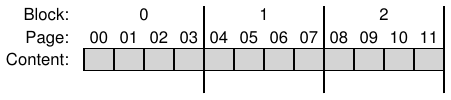
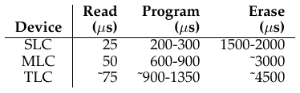
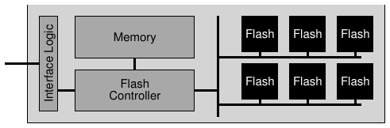
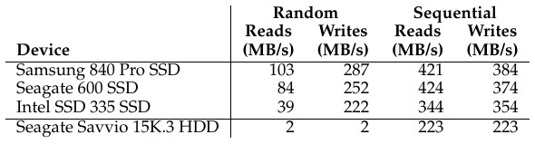

# الفصل 44: أقراص الحالة الصلبة القائمة على الذاكرة الوميضية

بعد عقود من هيمنة محرّكات الأقراص الصلبة، اكتسب شكل جديد من أجهزة التخزين الدائمة أهمية في العالم في السنوات الأخيرة. وتُعرف هذه الأجهزة عمومًا بالتخزين الصلب (solid-state)، وهي لا تحتوي أجزاء ميكانيكية أو متحرّكة كما في محرّكات الأقراص الصلبة، بل تُبنى ببساطة من ترانزستورات، مثل الذاكرة والمعالجات تمامًا. غير أنها، خلافًا للذاكرة النمطية ذات الوصول العشوائي (مثل DRAM)، تحتفظ بالمعلومات رغم انقطاع الطاقة، ومن ثمّ فهي مرشّح مثالي للاستخدام في التخزين الدائم للبيانات.

والتقنية التي سنركّز عليها تُعرف بالوميض (flash)، وبالأخص وميض NAND، وقد ابتكرها فوجيو ماسوكا في الثمانينيات [M+14]. وللوميض، كما سنرى، خصائص فريدة. فمثلًا، للكتابة إلى مقطع معيّن منه (أي صفحة وميض)، عليك أولًا أن تمحو مقطعًا أكبر (أي كتلة وميض)، وهذا قد يكون مكلفًا جدًا. وإضافة إلى ذلك، فإن الكتابة إلى صفحة مرات كثيرة ستجعلها تبلى. وهاتان الخاصيتان تجعلان بناء قرص حالة صلبة قائم على الوميض تحديًا مثيرًا للاهتمام:

> **جوهر المسألة: كيف نبني قرص حالة صلبة قائمًا على الوميض**
>
> كيف يمكننا بناء قرص حالة صلبة قائم على الوميض؟ وكيف نتعامل مع كلفة المحو الباهظة؟ وكيف نبني جهازًا يدوم طويلًا، وقد علمنا أن الكتابة المتكررة ستُبليه؟ وهل سيتوقف تقدّم التقنية يومًا؟ أم سيتوقف عن الإدهاش؟

## 44.1 تخزين بتّة واحدة

صُمّمت شرائح الوميض لتخزّن بتّة أو أكثر في ترانزستور واحد؛ ويُقابل مستوى الشحنة المحتجزة داخل الترانزستور بقيمة ثنائية. ففي وميض الخلية أحادية المستوى (SLC) تُخزَّن بتّة واحدة فقط داخل الترانزستور (أي 1 أو 0)؛ وفي وميض الخلية متعددة المستويات (MLC) تُرمَّز بتّتان في مستويات شحنة مختلفة، فمثلًا 00 و01 و10 و11 تُمثَّل بمستويات منخفضة، ومنخفضة نوعًا ما، ومرتفعة نوعًا ما، ومرتفعة. بل ثمة وميض الخلية ثلاثية المستويات (TLC)، الذي يرمّز 3 بتّات في الخلية. وإجمالًا، تحقّق شرائح SLC أداءً أعلى وهي أغلى ثمنًا.

> **نصيحة: احذر المصطلحات**
>
> ربما لاحظت أن بعض المصطلحات التي استخدمناها مرارًا من قبل (الكتل والصفحات) تُستخدم الآن في سياق الوميض، لكن بطرق مختلفة قليلًا عمّا سبق. فالمصطلحات الجديدة لا تُبتكر لتُصعّب حياتك (وإن كانت قد تفعل ذلك فعلًا)، بل تنشأ لأن ليس ثمة سلطة مركزية تُتّخذ فيها قرارات المصطلحات. فما هو كتلة عندك قد يكون صفحة عند غيرك، والعكس، تبعًا للسياق. ومهمتك بسيطة: أن تعرف المصطلحات المناسبة في كل مجال، وأن تستخدمها بحيث يفهمك من أتقن ذلك التخصص. وهي واحدة من تلك المواقف التي لا حلّ فيها إلا حل بسيط ومؤلم أحيانًا: استخدم ذاكرتك.

وبالطبع ثمة تفاصيل كثيرة عن كيفية عمل تخزين على مستوى البتّة كهذا، نزولًا إلى مستوى فيزياء الأجهزة. ومع أنها تتجاوز نطاق هذا الكتاب، يمكنك أن تقرأ المزيد عنها بنفسك [J10].

## 44.2 من البتّات إلى المصارف والمستويات

كما يقولون في اليونان القديمة، إن تخزين بتّة واحدة (أو بضع بتّات) لا يصنع نظام تخزين. ومن ثمّ تُنظَّم شرائح الوميض في مصارف (banks) أو مستويات (planes) تتكوّن من عدد كبير من الخلايا.

ويُوصَل إلى المصرف بوحدتين مختلفتي الحجم: الكتل (وتُسمّى أحيانًا كتل المحو)، وهي عادةً بحجم 128 كيلوبايت أو 256 كيلوبايت، والصفحات، التي يبلغ حجمها بضعة كيلوبايت (مثل 4 كيلوبايت). وداخل كل مصرف عدد كبير من الكتل؛ وداخل كل كتلة عدد كبير من الصفحات. وحين تفكّر في الوميض، عليك أن تتذكر هذه المصطلحات الجديدة، المختلفة عن الكتل التي نشير إليها في الأقراص وRAID والصفحات التي نشير إليها في الذاكرة الافتراضية.

ويعرض الشكل 44.1 مثالًا على مستوى وميض فيه كتل وصفحات؛ فثمة ثلاث كتل، كل واحدة تحوي أربع صفحات، في هذا المثال البسيط. وسنرى أدناه لماذا نميّز بين الكتل والصفحات؛ فقد تبيّن أن هذا التمييز جوهري في عمليات الوميض مثل القراءة والكتابة، وأكثر من ذلك في الأداء الكلي للجهاز. وأهم ما ستتعلّمه (وأغربه) أن الكتابة إلى صفحة داخل كتلة تتطلب أولًا محو الكتلة بأكملها؛ وهذه التفصيلة المخادعة تجعل بناء قرص حالة صلبة قائم على الوميض تحديًا مثيرًا وجديرًا بالعناء، وموضوع النصف الثاني من هذا الفصل.



**الشكل 44.1:** شريحة وميض بسيطة: صفحات داخل كتل

## 44.3 عمليات الوميض الأساسية

بهذا التنظيم للوميض، ثمة ثلاث عمليات منخفضة المستوى تدعمها شريحة الوميض. فالأمر read يُستخدم لقراءة صفحة من الوميض؛ وerase وprogram يُستخدمان معًا للكتابة. والتفاصيل:

- قراءة (صفحة): يستطيع عميل شريحة الوميض أن يقرأ أي صفحة (مثل 2 كيلوبايت أو 4 كيلوبايت)، بمجرد تحديد أمر القراءة ورقم الصفحة المناسب للجهاز. وهذه العملية سريعة عادةً، عشرات الميكروثانية أو نحو ذلك، بصرف النظر عن الموضع على الجهاز، و(إلى حدّ ما) بصرف النظر عن موضع الطلب السابق (خلافًا للقرص تمامًا). والقدرة على الوصول إلى أي موضع بالسرعة نفسها تعني أن الجهاز جهاز وصول عشوائي.
- محو (كتلة): قبل الكتابة إلى صفحة داخل الوميض، تقتضي طبيعة الجهاز أن تمحو أولًا الكتلة بأكملها التي تقع فيها الصفحة. والمحو، وهذا مهم، يتلف محتويات الكتلة (بضبط كل بتّة على القيمة 1)؛ ومن ثمّ عليك أن تتأكد أن أي بيانات تهمّك في الكتلة قد نُسخت إلى موضع آخر (إلى الذاكرة، أو ربما إلى كتلة وميض أخرى) قبل تنفيذ المحو. وأمر المحو مكلف جدًا، إذ يستغرق بضعة ميلي ثانية ليكتمل. وما إن ينتهي حتى تُعاد تهيئة الكتلة بأكملها وتصبح كل صفحة جاهزة للبرمجة.
- برمجة (صفحة): بعد أن تُمحى كتلة، يمكن استخدام أمر البرمجة لتغيير بعض الآحاد داخل صفحة إلى أصفار، وكتابة المحتويات المطلوبة لصفحة في الوميض. وبرمجة صفحة أقل كلفة من محو كتلة، لكنها أكلف من قراءة صفحة، وتستغرق عادةً نحو مئات الميكروثانية على شرائح الوميض الحديثة.

وثمة طريقة للتفكير في شرائح الوميض، وهي أن لكل صفحة حالة مرتبطة بها. فالصفحات تبدأ في حالة غير صالحة (INVALID). وبمحو الكتلة التي تقع فيها الصفحة، تجعل حالة الصفحة (وكل الصفحات داخل تلك الكتلة) محوّة (ERASED)، وهذا يعيد ضبط محتوى كل صفحة في الكتلة لكنه يجعلها قابلة للبرمجة أيضًا (وهذا مهم). وحين تبرمج صفحة، تتغيّر حالتها إلى صالحة (VALID)، أي أن محتوياتها ضُبطت ويمكن قراءتها. والقراءات لا تؤثر في هذه الحالات (وإن كان ينبغي أن تقرأ فقط من صفحات بُرمجت). وما إن تُبرمج صفحة، فالسبيل الوحيد لتغيير محتوياتها هو محو الكتلة بأكملها التي تقع فيها الصفحة. وهذا مثال على انتقال الحالات بعد عمليات محو وبرمجة مختلفة داخل كتلة من أربع صفحات:

```
                           iiii     Initial: pages in block are invalid (i)
      Erase()        →     EEEE     State of pages in block set to erased (E)
      Program(0)     →     VEEE     Program page 0; state set to valid (V)
      Program(0)     →     error    Cannot re-program page after programming
      Program(1)     →     VVEE     Program page 1
      Erase()        →     EEEE     Contents erased; all pages programmable
```

### مثال مفصّل

لأن عملية الكتابة (أي المحو والبرمجة) غير مألوفة إلى هذا الحدّ، لنمضِ في مثال مفصّل لنتأكد أنها مفهومة. تخيّل في هذا المثال أن لدينا الصفحات الأربع التالية من 8 بتّات، داخل كتلة من أربع صفحات (والمقاسان غير واقعيين، لكنهما مفيدان في هذا المثال)؛ وكل صفحة صالحة لأنها بُرمجت سابقًا.

```
             Page 0        Page 1        Page 2        Page 3
            00011000      11001110      00000001      00111111
             VALID         VALID         VALID         VALID
```

لنقل الآن إننا نريد الكتابة إلى الصفحة 0، بملئها بمحتويات جديدة. ولكتابة أي صفحة، علينا أولًا محو الكتلة بأكملها. ولنفترض أننا فعلنا ذلك، فتصبح الكتلة في هذه الحالة:

```
             Page 0        Page 1        Page 2        Page 3
            11111111      11111111      11111111      11111111
            ERASED        ERASED        ERASED        ERASED
```

خبر سار! يمكننا الآن أن نمضي ونبرمج الصفحة 0، مثلًا بالمحتويات 00000011، فنتجاوز بذلك الصفحة 0 القديمة (محتوياتها 00011000) كما أردنا. وبعد فعل ذلك تصبح كتلتنا هكذا:

```
             Page 0        Page 1        Page 2        Page 3
            00000011      11111111      11111111      11111111
             VALID        ERASED        ERASED        ERASED
```

والآن الخبر السيئ: محتويات الصفحات 1 و2 و3 السابقة ذهبت كلها! ومن ثمّ، قبل تجاوز أي صفحة داخل كتلة، علينا أولًا أن ننقل أي بيانات تهمّنا إلى موضع آخر (الذاكرة، أو موضع آخر في الوميض). وستكون لطبيعة المحو أثر قوي في كيفية تصميمنا لأقراص الحالة الصلبة القائمة على الوميض، كما سنتعلّم قريبًا.

### خلاصة

خلاصة القول: قراءة صفحة سهلة، فاقرأ الصفحة فحسب. وشرائح الوميض تفعل ذلك جيدًا وسريعًا؛ ومن حيث الأداء، فإنها تنطوي على إمكان تجاوز أداء القراءة العشوائية في محرّكات الأقراص الحديثة تجاوزًا كبيرًا، وهي بطيئة بسبب كلفة البحث والدوران الميكانيكية.

أما كتابة صفحة فأدقّ؛ إذ يجب أولًا محو الكتلة بأكملها (مع الحرص على نقل أي بيانات تهمّنا إلى موضع آخر قبل ذلك)، ثم برمجة الصفحة المطلوبة. وهذا ليس مكلفًا فحسب، بل إن التكرار المتواتر لدورة البرمجة والمحو قد يقود إلى أكبر مشكلة موثوقية في شرائح الوميض: البلى. وحين نصمّم نظام تخزين بالوميض، يكون أداء الكتابة وموثوقيتها محور التركيز. وسنتعلّم قريبًا المزيد عن كيفية مهاجمة أقراص الحالة الصلبة الحديثة لهذه المسائل، وهي تقدّم أداءً ممتازًا وموثوقية عالية رغم هذه القيود.



**الشكل 44.2:** خصائص أداء الوميض الخام

## 44.4 أداء الوميض وموثوقيته

لأننا مهتمون ببناء جهاز تخزين من شرائح وميض خام، يجدر أن نفهم خصائص أدائها الأساسية. ويعرض الشكل 44.2 خلاصة تقريبية لبعض الأرقام الواردة في الصحافة الشائعة [V12]. ويعرض المؤلف هناك زمن كمون العمليات الأساسية من القراءات والبرمجات وعمليات المحو عبر وميض SLC وMLC وTLC، الذي يخزّن 1 و2 و3 بتّات من المعلومات في الخلية على الترتيب.

وكما نرى من الجدول، فإن أزمنة كمون القراءة جيدة جدًا، إذ تستغرق عشرات الميكروثانية فحسب. أما كمون البرمجة فأعلى وأكثر تفاوتًا، يبلغ 200 ميكروثانية لـSLC، لكنه يزيد كلما حشوت بتّات أكثر في كل خلية؛ وللحصول على أداء كتابة جيد، سيكون عليك استخدام شرائح وميض متعددة على التوازي. وأخيرًا، فإن عمليات المحو مكلفة جدًا، وتستغرق بضعة ميلي ثانية عادةً. والتعامل مع هذه الكلفة محوري في تصميم تخزين الوميض الحديث.

ولننظر الآن في موثوقية شرائح الوميض. فخلافًا للأقراص الميكانيكية، التي قد تتعطّل لأسباب متنوعة كثيرة (منها ارتطام الرأس البشع والمادي جدًا، حيث يلامس رأس المحرّك سطح التسجيل فعلًا)، فإن شرائح الوميض سيليكون خالص، ومن هذه الناحية لها مشكلات موثوقية أقلّ. والقلق الأساسي هو البلى؛ فحين تُمحى كتلة وميض وتُبرمج، تكتسب ببطء قليلًا من الشحنة الزائدة. ومع الوقت، وكلما تراكمت تلك الشحنة الزائدة، صار التمييز بين 0 و1 أصعب وأصعب. وعند النقطة التي يصير فيها مستحيلًا، تصبح الكتلة غير قابلة للاستخدام.

وعمر الكتلة النمطي غير معروف جيدًا حاليًا. فالمصنّعون يقدّرون الكتل القائمة على MLC بعمر 10,000 دورة برمجة/محو (P/E)؛ أي أن كل كتلة يمكن محوها وبرمجتها 10,000 مرة قبل أن تتعطّل. أما الشرائح القائمة على SLC، لأنها تخزّن بتّة واحدة فقط في الترانزستور، فتُقدَّر بعمر أطول، وهو 100,000 دورة برمجة/محو عادةً. غير أن أبحاثًا حديثة أظهرت أن الأعمار أطول كثيرًا مما كان متوقعًا [BD10].

وثمة مشكلة موثوقية أخرى داخل شرائح الوميض تُعرف بالتشويش. فحين يُوصَل إلى صفحة معيّنة داخل الوميض، يمكن أن تنقلب بعض البتّات في صفحات مجاورة؛ وتُعرف انقلابات البتّات هذه بتشويشات القراءة أو تشويشات البرمجة، تبعًا لما إذا كانت الصفحة تُقرأ أو تُبرمج على الترتيب.

> **نصيحة: أهمية التوافق مع الإصدارات السابقة**
>
> التوافق مع الإصدارات السابقة هاجس دائم في الأنظمة الطبقية. فبتعريف واجهة مستقرة بين نظامين، يمكّن المرء الابتكار على كل جانب من الواجهة مع ضمان استمرار التشغيل البيني. وقد نجحت مقاربة كهذه نجاحًا كبيرًا في مجالات كثيرة: فلأنظمة التشغيل واجهات برمجية مستقرة نسبيًا للتطبيقات، وللأقراص الواجهة القائمة على الكتل نفسها لأنظمة الملفات، وكل طبقة في مكدّس شبكات IP توفّر واجهة ثابتة لا تتغيّر للطبقة التي فوقها. وليس مفاجئًا أن يكون لهذه الصلابة جانب سلبي، إذ إن واجهات عُرفت في جيل قد لا تكون مناسبة في الجيل التالي. وفي بعض الحالات قد يكون من المفيد التفكير في إعادة تصميم النظام بأكمله. وثمة مثال ممتاز في نظام ملفات Sun ZFS [B07]؛ فبإعادة النظر في تفاعل أنظمة الملفات وRAID، تصوّر مبتكرو ZFS ككلًّا متكاملًا أكثر فعالية (ثم حققوه).

## 44.5 من الوميض الخام إلى أقراص الحالة الصلبة

بعد فهمنا الأساسي لشرائح الوميض، نواجه الآن مهمتنا التالية: كيف نحوّل مجموعة أساسية من شرائح الوميض إلى شيء يشبه جهاز تخزين نمطيًا. فواجهة التخزين المعيارية بسيطة وقائمة على الكتل، حيث يمكن قراءة كتل (قطاعات) بحجم 512 بايت (أو أكبر) أو كتابتها، بمعرفة عنوان الكتلة. ومهمة قرص الحالة الصلبة القائم على الوميض أن يوفّر واجهة الكتل المعيارية هذه فوق شرائح الوميض الخام بداخله.

وداخليًا، يتكوّن القرص من عدد من شرائح الوميض (للتخزين الدائم). ويحتوي أيضًا على قدر من الذاكرة المتطايرة (أي غير الدائمة) مثل SRAM؛ وهذه الذاكرة مفيدة للتخزين المؤقت وللتوسيط في البيانات وكذلك لجداول التعيين، التي سنتعلّم عنها أدناه. وأخيرًا، يحتوي القرص على منطق تحكّم لتنظيم عمل الجهاز. انظر عمل أغراوال وزملائه للتفاصيل [A+08]؛ ويُرى مخطط كتلي مبسّط في الشكل 44.3 (الصفحة 7).

وواحدة من الوظائف الجوهرية لهذا المنطق التحكّمي أن يلبّي قراءات العميل وكتاباته، فيحوّلها إلى عمليات وميض داخلية حسب الحاجة. وطبقة ترجمة الوميض، أو FTL، توفّر هذه الوظيفة بالضبط. فتأخذ FTL طلبات القراءة والكتابة على الكتل المنطقية (التي تشكّل واجهة الجهاز) وتحوّلها إلى أوامر قراءة ومحو وبرمجة منخفضة المستوى على الكتل المادية والصفحات المادية الأساسية (التي تشكّل جهاز الوميض الفعلي). وينبغي أن تنجز FTL هذه المهمة بهدف تقديم أداء ممتاز وموثوقية عالية.

والأداء الممتاز، كما سنرى، يمكن تحقيقه بمزيج من التقنيات. وأحد المفاتيح استخدام شرائح وميض متعددة على التوازي؛ ومع أننا لن نناقش هذه التقنية كثيرًا بعد الآن، يكفي أن نقول إن كل أقراص الحالة الصلبة الحديثة تستخدم شرائح متعددة داخليًا للحصول على أداء أعلى. وثمة هدف أداء آخر هو تقليل تضخيم الكتابة، وهو يُعرَّف بأنه إجمالي حركة الكتابة (بالبايت) التي تصدرها FTL إلى شرائح الوميض مقسومة على إجمالي حركة الكتابة (بالبايت) التي يصدرها العميل إلى القرص. وكما سنرى أدناه، فإن المقاربات الساذجة لبناء FTL تؤدي إلى تضخيم كتابة عالٍ وأداء منخفض.



**الشكل 44.3:** قرص حالة صلبة قائم على الوميض: مخطط منطقي

أما الموثوقية العالية فتُحقَّق بمزيج من بضع مقاربات مختلفة. وأحد الهواجس الرئيسية، كما نوقش أعلاه، هو البلى. فإن كانت كتلة واحدة تُمحى وتُبرمج أكثر من اللازم، صارت غير قابلة للاستخدام؛ ومن ثمّ ينبغي أن تحاول FTL توزيع الكتابات على كتل الوميض بأكبر قدر من التساوي، فتضمن أن تبلى كل كتل الجهاز في الوقت نفسه تقريبًا؛ ويُسمّى فعل ذلك موازنة البلى، وهو جزء جوهري من أي FTL حديثة.

وثمة هاجس موثوقية آخر هو تشويش البرمجة. ولتقليل هذا التشويش إلى أدنى حدّ، تبرمج FTL عادةً الصفحات داخل الكتلة المحوّة بالترتيب، من الصفحة الدنيا إلى العليا. ومقاربة البرمجة التتابعية هذه تقلّل التشويش إلى أدنى حدّ وتُستخدم على نطاق واسع.

## 44.6 تنظيم FTL: مقاربة سيئة

إن أبسط تنظيم لـFTL هو ما نسمّيه التعيين المباشر. ففي هذه المقاربة، تُعيَّن القراءة إلى الصفحة المنطقية N مباشرةً إلى قراءة الصفحة المادية N. أما الكتابة إلى الصفحة المنطقية N فأعقد؛ إذ على FTL أولًا أن تقرأ الكتلة بأكملها التي تحتوي الصفحة N؛ ثم عليها أن تمحو الكتلة؛ وأخيرًا تبرمج FTL الصفحات القديمة مع الصفحة الجديدة.

وكما تستطيع أن تخمّن، فإن FTL ذات التعيين المباشر فيها مشكلات كثيرة، من حيث الأداء والموثوقية معًا. فمشكلات الأداء تأتي عند كل كتابة: على الجهاز أن يقرأ الكتلة بأكملها (مكلف)، ويمحوها (مكلف جدًا)، ثم يبرمجها (مكلف). والنتيجة النهائية تضخيم كتابة شديد (يتناسب مع عدد صفحات الكتلة)، ومن ثمّ أداء كتابة فظيع، أبطأ حتى من محرّكات الأقراص النمطية ببحثها الميكانيكي وتأخيراتها الدورانية.

والأسوأ من ذلك موثوقية هذه المقاربة. فإن كانت البيانات الوصفية لنظام الملفات أو بيانات ملفات المستخدم تُستكتب مرارًا، فإن الكتلة نفسها تُمحى وتُبرمج مرارًا وتكرارًا، فتبلى سريعًا وقد تُفقد البيانات. فمقاربة التعيين المباشر تمنح حمل العميل تحكّمًا أكبر من اللازم في البلى؛ فإن لم يوزّع الحمل كتابةً على كتله المنطقية بالتساوي، بليت الكتل المادية الأساسية التي تحوي البيانات الشائعة سريعًا. ولأسباب تتعلق بالموثوقية والأداء معًا، فإن FTL ذات التعيين المباشر فكرة سيئة.

## 44.7 FTL ذو بنية سجلية

ولهذه الأسباب فإن معظم ما يسمّى FTL اليوم ذو بنية سجلية، وهي فكرة مفيدة في أجهزة التخزين (كما سنرى الآن) وفي أنظمة الملفات فوقها (مثل أنظمة الملفات ذات البنية السجلية). فحين تُكتب الكتلة المنطقية N، يُلحق الجهاز الكتابة في أول موضع حرّ في الكتلة الجاري الكتابة فيها؛ ونسمّي هذا الأسلوب في الكتابة التسجيل. ولتمكين القراءات اللاحقة للكتلة N، يحتفظ الجهاز بجدول تعيين (في ذاكرته، وعلى الجهاز بشكل دائم بشكل ما)؛ ويخزّن هذا الجدول العنوان المادي لكل كتلة منطقية في النظام.

ولنمضِ في مثال لنتأكد أننا فهمنا كيف تعمل المقاربة الأساسية القائمة على السجل. فبالنسبة إلى العميل، يبدو الجهاز قرصًا نمطيًا يستطيع أن يقرأ منه ويكتب إليه قطاعات بحجم 512 بايت (أو مجموعات قطاعات). وللتبسيط، افترض أن العميل يقرأ أو يكتب مقاطع بحجم 4 كيلوبايت. ولنفترض كذلك أن القرص يحتوي عددًا كبيرًا من الكتل بحجم 16 كيلوبايت، كل واحدة مقسومة إلى أربع صفحات بحجم 4 كيلوبايت؛ وهذه المعاملات غير واقعية (فكتل الوميض تحوي عادةً صفحات أكثر)، لكنها ستخدم أغراضنا التعليمية خدمة جيدة.

افترض أن العميل يصدر تسلسل العمليات التالي:

- Write(100) بمحتويات a1
- Write(101) بمحتويات a2
- Write(2000) بمحتويات b1
- Write(2001) بمحتويات b2

وهذه عناوين الكتل المنطقية (مثل 100) يستخدمها عميل القرص (مثل نظام ملفات) ليتذكّر موضع المعلومات.

وداخليًا، على الجهاز أن يحوّل كتابات الكتل هذه إلى عمليات المحو والبرمجة التي يدعمها العتاد الخام، وأن يسجّل بشكل ما، لكل عنوان كتلة منطقية، أي صفحة مادية في القرص تخزّن بياناتها. وافترض أن كل كتل القرص غير صالحة حاليًا، ويجب محوها قبل برمجة أي صفحة. وهنا نعرض الحالة الابتدائية لقرصنا، وكل صفحة فيه موسومة غير صالحة (i):

```
           Block:          0           1           2
           Page:      00 01 02 03 04 05 06 07 08 09 10 11
         Content:
           State:     i   i   i   i     i   i   i   i   i   i   i   i
```

وحين يستقبل القرص أول كتابة (إلى الكتلة المنطقية 100)، تقرّر FTL كتابتها في الكتلة المادية 0، التي تحوي أربع صفحات مادية: 0 و1 و2 و3. ولأن الكتلة غير محوّة، لا يمكننا الكتابة فيها بعد؛ فعلى الجهاز أن يصدر أولًا أمر محو إلى الكتلة 0. ويؤدي ذلك إلى الحالة التالية:

```
           Block:          0           1           2
           Page:      00 01 02 03 04 05 06 07 08 09 10 11
         Content:
           State:     E   E   E   E     i   i   i   i   i   i   i   i
```

الكتلة 0 صارت الآن جاهزة للبرمجة. ومعظم أقراص الحالة الصلبة تكتب الصفحات بالترتيب (أي من الدنيا إلى العليا)، فتقليل مشكلات الموثوقية المتعلقة بتشويش البرمجة. ثم يوجّه القرص كتابة الكتلة المنطقية 100 إلى الصفحة المادية 0:

```
       Block:        0            1           2
       Page:    00 01 02 03 04 05 06 07 08 09 10 11
     Content:   a1
       State:   V E E E i       i   i i  i  i   i i
```

لكن ماذا لو أراد العميل قراءة الكتلة المنطقية 100؟ كيف يمكنه أن يجد موضعها؟ على القرص أن يحوّل القراءة الصادرة إلى الكتلة المنطقية 100 إلى قراءة للصفحة المادية 0. وملاءمة لهذه الوظيفة، حين تكتب FTL الكتلة المنطقية 100 في الصفحة المادية 0، تسجّل هذه الحقيقة في جدول تعيين في الذاكرة. وسنتتبّع حالة جدول التعيين هذا في المخططات أيضًا:

```
       Table:    100     0                                        Memory

       Block:        0            1           2
       Page:    00 01 02 03 04 05 06 07 08 09 10 11                Flash
     Content:   a1                                                 Chip
       State:   V E E E i       i   i i  i  i   i i
```

الآن تستطيع أن ترى ما يحدث حين يكتب العميل إلى القرص. فيجد القرص موضعًا للكتابة، باختيار الصفحة الحرة التالية عادةً؛ ثم يبرمج تلك الصفحة بمحتويات الكتلة، ويسجّل التعيين المنطقي إلى المادي في جدول تعيينه. أما القراءات اللاحقة فتستخدم الجدول ببساطة لترجمة عنوان الكتلة المنطقي الذي يقدّمه العميل إلى رقم الصفحة المادية المطلوب لقراءة البيانات.

ولننظر الآن في بقية الكتابات في تدفّق الكتابة في مثالنا: 101 و2000 و2001. وبعد كتابة هذه الكتل تصبح حالة الجهاز:

```
       Table:    100     0   101    1   2000   2   2001   3       Memory

       Block:        0            1           2
       Page:    00 01 02 03 04 05 06 07 08 09 10 11                Flash
     Content:   a1 a2 b1 b2                                        Chip
       State:   V V V V i       i   i i  i  i   i i
```

والمقاربة القائمة على السجل تحسّن الأداء بطبيعتها (فعمليات المحو لا تُطلب إلا من وقت لآخر، ويُتجنّب تمامًا القراءة والتعديل والكتابة المكلفة في مقاربة التعيين المباشر)، وتعزّز الموثوقية تعزيزًا كبيرًا. وتستطيع FTL الآن أن توزّع الكتابات على كل الصفحات، فتُجري ما يُسمّى موازنة البلى وتزيد عمر الجهاز؛ وسنناقش موازنة البلى لاحقًا.

> **استطراد: دوام معلومات التعيين في FTL**
>
> قد تتساءل: ماذا يحدث إن فقد الجهاز الطاقة؟ هل يختفي جدول التعيين في الذاكرة؟ من الواضح أن هذه المعلومات لا يمكن أن تُفقد فعلًا، وإلا لما عمل الجهاز كجهاز تخزين دائم. فلا بدّ للقرص من وسيلة لاستعادة معلومات التعيين.
>
> وأبسط ما يمكن فعله هو تسجيل بعض معلومات التعيين مع كل صفحة، في ما يُسمّى منطقة خارج النطاق (OOB). فحين يفقد الجهاز الطاقة ويُعاد تشغيله، عليه أن يعيد بناء جدول تعيينه بمسح مناطق OOB وإعادة بناء الجدول في الذاكرة. ولهذه المقاربة الأساسية مشكلاتها؛ فمسح قرص كبير للعثور على كل معلومات التعيين اللازمة بطيء. وللتغلب على هذا القيد، تستخدم بعض الأجهزة الأعلى طرفًا تقنيات تسجيل ونقاط تحقّق أعقد لتسريع الاستعادة؛ وتعلّم المزيد عن التسجيل بقراءة فصول الاتساق بعد الانهيار وأنظمة الملفات ذات البنية السجلية [AD14a].

وللأسف فإن لهذه المقاربة الأساسية في البنية السجلية عيوبًا. الأول أن تجاوزات الكتل المنطقية تؤدي إلى ما نسمّيه قمامة، أي نسخ قديمة من البيانات تبقى على القرص وتشغل مساحة. وعلى الجهاز أن يُجري جمع القمامة دوريًا ليجد تلك الكتل ويحرّر مساحة لكتابات مستقبلية؛ وجمع القمامة المفرط يرفع تضخيم الكتابة ويخفض الأداء. والثاني كلفة جداول التعيين في الذاكرة؛ فكلما كبر الجهاز، احتاجت هذه الجداول ذاكرة أكثر. وسنناقش كلًّا منهما بدوره.

## 44.8 جمع القمامة

الكلفة الأولى لأي مقاربة سجلية كهذه هي أن القمامة تُنشأ، ومن ثمّ يجب إجراء جمع القمامة (أي استعادة الكتل الميتة). ولنستخدم مثالنا المستمر لنجعل ذلك مفهومًا. تذكّر أن الكتل المنطقية 100 و101 و2000 و2001 كُتبت إلى الجهاز.

لنفترض الآن أن الكتل 100 و101 كُتبت مرة أخرى، بمحتويات c1 وc2. وتُكتب الكتابتان في الصفحات الحرة التالية (وهي في هذه الحالة الصفحتان الماديتان 4 و5)، ويُحدَّث جدول التعيين وفقًا لذلك. ولاحظ أن الجهاز لا بدّ أن يكون قد محا الكتلة 1 أولًا لتكون هذه البرمجة ممكنة:

```
           Table:     100   4   101     5   2000   2   2001    3      Memory

           Block:          0            1           2
           Page:      00 01 02 03 04 05 06 07 08 09 10 11               Flash
         Content:     a1 a2 b1 b2 c1 c2                                 Chip
           State:     V V V V V V E E i           i   i i
```

والمشكلة التي لدينا الآن ينبغي أن تكون بيّنة: الصفحتان الماديتان 0 و1، وإن كانتا موسومتين صالحتين، فيهما قمامة، أي النسختان القديمتان من الكتلتين 100 و101. وبسبب الطبيعة السجلية للجهاز، تُنشئ التجاوزات كتل قمامة، وعلى الجهاز أن يستعيدها لتوفير مساحة حرة لكتابات جديدة.

وعملية إيجاد كتل القمامة (وتُسمّى أيضًا الكتل الميتة) واستعادتها للاستخدام المستقبلي تُسمّى جمع القمامة، وهي مكوّن مهم في أي قرص حالة صلبة حديث. والعملية الأساسية بسيطة: ابحث عن كتلة تحوي صفحة قمامة واحدة أو أكثر، واقرأ الصفحات الحيّة (غير القمامة) من تلك الكتلة، واكتب تلك الصفحات الحيّة في نهاية السجل، ثم (أخيرًا) استعد الكتلة بأكملها للاستخدام في الكتابة.

ولنوضّح الآن بمثال. يقرّر الجهاز أنه يريد استعادة أي صفحات ميتة داخل الكتلة 0 أعلاه. في الكتلة 0 كتلتان ميتتان (الصفحتان 0 و1) وكتلتان حيّتان (الصفحتان 2 و3، وفيهما الكتلتان 2000 و2001 على الترتيب). وللقيام بذلك:

- يقرأ الجهاز البيانات الحيّة (الصفحتين 2 و3) من الكتلة 0
- يكتب البيانات الحيّة في نهاية السجل
- يمحي الكتلة 0 (فيحرّرها للاستخدام لاحقًا)

ولكي يعمل جامع القمامة، يجب أن تكون في كل كتلة معلومات كافية تمكّن القرص من تحديد ما إذا كانت كل صفحة حيّة أو ميتة. وثمة طريقة طبيعية لتحقيق ذلك، وهي تخزين معلومات، في موضع ما داخل كل كتلة، عن الكتل المنطقية المخزّنة في كل صفحة. فيستطيع الجهاز بعد ذلك استخدام جدول التعيين لتحديد ما إذا كانت كل صفحة داخل الكتلة تحمل بيانات حيّة أم لا.

ومن مثالنا أعلاه (قبل حدوث جمع القمامة)، كانت الكتلة 0 تحوي الكتل المنطقية 100 و101 و2000 و2001. وبفحص جدول التعيين (الذي كان، قبل جمع القمامة، يحوي 100->4 و101->5 و2000->2 و2001->3)، يستطيع الجهاز أن يحدّد بسهولة ما إذا كانت كل صفحة داخل كتلة القرص تحمل معلومات حيّة. فمثلًا، الصفحتان 2 و3 ما يزال التعيين يشير إليهما بوضوح؛ أما الصفحتان 0 و1 فلا، ومن ثمّ فهما مرشّحتان لجمع القمامة.

وحين تكتمل عملية جمع القمامة هذه في مثالنا، تصبح حالة الجهاز:

```
       Table:   100      4   101   5   2000   6    2001   7      Memory

       Block:        0           1            2
       Page:    00 01 02 03 04 05 06 07 08 09 10 11               Flash
     Content:               c1 c2 b1 b2                           Chip
       State:   E E E E V V V V i           i   i i
```

وكما ترى، قد يكون جمع القمامة مكلفًا، إذ يتطلب قراءة البيانات الحيّة وإعادة كتابتها. والمرشّح المثالي للاستعادة كتلة تتكوّن من صفحات ميتة فقط؛ وفي هذه الحالة يمكن محو الكتلة فورًا واستخدامها لبيانات جديدة، دون ترحيل بيانات مكلف.

> **استطراد: واجهة تخزين جديدة تُعرف بـtrim**
>
> حين نفكّر في محرّكات الأقراص الصلبة، نفكّر عادةً في أبسط واجهة لقراءتها وكتابتها: القراءة والكتابة (وثمة عادةً أمر من نوع تفريغ الذاكرة المؤقتة يضمن أن الكتابات دُوّنت فعلًا، لكننا نحذفه أحيانًا للتبسيط). ومع أقراص الحالة الصلبة ذات البنية السجلية، بل ومع أي جهاز يحتفظ بتعيين مرن ومتغيّر من الكتل المنطقية إلى المادية، تصبح واجهة جديدة مفيدة، تُعرف بعملية trim.
>
> تأخذ عملية trim عنوانًا (وربما طولًا) وتُعلم الجهاز ببساطة أن الكتلة أو الكتل التي يحدّدها العنوان (والطول) قد حُذفت؛ ومن ثمّ لم يعد على الجهاز تتبّع أي معلومات عن نطاق العناوين المعطى. أما لمحرّك أقراص نمطي، فإن trim ليس مفيدًا كثيرًا، لأن للمحرّك تعيينًا ساكنًا لعناوين الكتل إلى صحن ومسار وقطاعات محدّدة. أما لقرص حالة صلبة ذي بنية سجلية، فمن المفيد جدًا أن يعرف أن كتلة لم تعد لازمة، إذ يستطيع القرص عندئذ أن يحذف هذه المعلومات من FTL ويستعيد المساحة المادية لاحقًا أثناء جمع القمامة.
>
> ومع أننا نفكّر أحيانًا في الواجهة والتنفيذ ككيانين منفصلين، ففي هذه الحالة نرى أن التنفيذ يصوغ الواجهة. فمع التعيينات المعقّدة، تصبح معرفة أي الكتل لم تعد لازمة أساسًا لتنفيذ أكثر فعالية.

ولتقليل كلفة جمع القمامة، تُفرط بعض أقراص الحالة الصلبة في تخصيص سعة إضافية للجهاز [A+08]؛ فبإضافة سعة وميض إضافية يمكن تأخير التنظيف ودفعه إلى الخلفية، وربما إجراؤه في وقت يكون فيه الجهاز أقل انشغالًا. كما أن إضافة سعة أكبر تزيد عرض النطاق الداخلي، الذي يمكن استخدامه للتنظيف فلا يضرّ بعرض النطاق المدرَك عند العميل. وكثير من المحرّكات الحديثة تُفرط في التخصيص بهذه الطريقة، وهو أحد مفاتيح تحقيق أداء كلي ممتاز.

## 44.9 حجم جدول التعيين

الكلفة الثانية للبنية السجلية هي احتمال أن تصبح جداول التعيين ضخمة جدًا، بإدخال واحد لكل صفحة بحجم 4 كيلوبايت في الجهاز. فمع قرص بحجم 1 تيرابايت، مثلًا، يؤدي إدخال واحد بحجم 4 بايت لكل صفحة من 4 كيلوبايت إلى 1 غيغابايت من الذاكرة يحتاجها الجهاز لهذه التعيينات فحسب! ومن ثمّ فإن مخطط FTL على مستوى الصفحة هذا غير عملي.

### التعيين القائم على الكتل

ثمة مقاربة لتقليل كلفة التعيين، وهي الاحتفاظ بمؤشّر واحد لكل كتلة في الجهاز بدلًا من كل صفحة، فيقلّ قدر معلومات التعيين بمقدار حجم الكتلة مقسومًا على حجم الصفحة. وFTL على مستوى الكتل هذه شبيهة باستخدام أحجام صفحات أكبر في نظام ذاكرة افتراضية؛ ففي تلك الحالة تستخدم بتّات أقل لرقم الصفحة الافتراضية ويكون الإزاحة في كل عنوان افتراضي أكبر.

وللأسف فإن استخدام تعيين قائم على الكتل داخل FTL ذي بنية سجلية لا يعمل جيدًا لأسباب تتعلق بالأداء. وأكبر مشكلة تنشأ حين تحدث «كتابة صغيرة» (أي كتابة أصغر من حجم الكتلة المادية). ففي هذه الحالة على FTL أن تقرأ قدرًا كبيرًا من البيانات الحيّة من الكتلة القديمة وتنسخها إلى كتلة جديدة (مع بيانات الكتابة الصغيرة). ونسخ البيانات هذا يزيد تضخيم الكتابة زيادة كبيرة، ومن ثمّ يخفض الأداء.

ولتوضيح هذه المسألة أكثر، لننظر في مثال. افترض أن العميل كتب سابقًا الكتل المنطقية 2000 و2001 و2002 و2003 (بمحتويات a وb وc وd)، وأنها تقع داخل الكتلة المادية 1 في الصفحات المادية 4 و5 و6 و7. ومع التعيين على مستوى الصفحة، سيكون على جدول الترجمة أن يسجّل أربعة تعيينات لهذه الكتل المنطقية: 2000→4 و2001→5 و2002→6 و2003→7.

أما إن استخدمنا تعيينًا على مستوى الكتل، فإن FTL تحتاج إلى تسجيل ترجمة عنوان واحدة فقط لكل هذه البيانات. غير أن تعيين العنوان مختلف قليلًا عن أمثلتنا السابقة. وتحديدًا، نفكّر في الفضاء المنطقي للعناوين في الجهاز كأنه مُقطّع إلى مقاطع بحجم الكتل المادية في الوميض. ومن ثمّ يتكوّن عنوان الكتلة المنطقية من جزأين: رقم المقطع وإزاحة. ولأننا نفترض أن أربع كتل منطقية تتّسع في كل كتلة مادية، فإن جزء الإزاحة من العناوين المنطقية يحتاج بتّتين؛ أما البتّات الباقية (الأعلى) فتشكّل رقم المقطع.

والكتل المنطقية 2000 و2001 و2002 و2003 لها رقم المقطع نفسه (500)، ولها إزاحات مختلفة (0 و1 و2 و3 على الترتيب). ومن ثمّ، مع تعيين على مستوى الكتل، تسجّل FTL أن المقطع 500 يُعيَّن إلى الكتلة 1 (بدءًا من الصفحة المادية 4)، كما يُظهر هذا المخطط:

```
       Table:    500     4                                        Memory

       Block:         0          1            2
       Page:    00 01 02 03 04 05 06 07 08 09 10 11                Flash
     Content:               a b c d                                Chip
       State:    i  i   i i V V V V i       i   i i
```

وفي FTL قائمة على الكتل، القراءة سهلة. فأولًا تستخرج FTL رقم المقطع من عنوان الكتلة المنطقية الذي يقدّمه العميل، بأخذ البتّات العليا من العنوان. ثم تبحث FTL عن تعيين رقم المقطع إلى الصفحة المادية في الجدول. وأخيرًا تحسب FTL عنوان صفحة الوميض المطلوبة بإضافة الإزاحة من العنوان المنطقي إلى العنوان المادي للكتلة.

فمثلًا، إن أصدر العميل قراءة إلى العنوان المنطقي 2002، يستخرج الجهاز رقم المقطع المنطقي (500)، ويبحث عن الترجمة في جدول التعيين (فيجد 4)، ويضيف الإزاحة من العنوان المنطقي (2) إلى الترجمة (4). فيكون عنوان الصفحة المادية الناتج (6) هو موضع البيانات؛ ويمكن لـFTL عندئذ أن تصدر القراءة إلى ذلك العنوان المادي وتحصل على البيانات المطلوبة (c).

لكن ماذا لو كتب العميل إلى الكتلة المنطقية 2002 (بمحتويات c')؟ في هذه الحالة على FTL أن تقرأ 2000 و2001 و2003، ثم تكتب الكتل المنطقية الأربع كلها في موضع جديد، وتحدّث جدول التعيين وفقًا لذلك. ويمكن بعد ذلك محو الكتلة 1 (التي كانت البيانات تقيم فيها) وإعادة استخدامها، كما يُظهر هنا.

```
       Table:     500    8                                           Memory

       Block:           0          1           2
       Page:      00 01 02 03 04 05 06 07 08 09 10 11                 Flash
     Content:                             a b c' d                    Chip
       State:      i  i   i i E E E E V V V V
```

وكما ترى من هذا المثال، فإن التعيينات على مستوى الكتل تقلّل كثيرًا الذاكرة اللازمة للترجمات، لكنها تسبب مشكلات أداء كبيرة حين تكون الكتابات أصغر من حجم الكتلة المادية في الجهاز؛ ولأن الكتل المادية الحقيقية قد تكون 256 كيلوبايت أو أكبر، فمن المرجّح أن تحدث كتابات كهذه كثيرًا. ومن ثمّ ثمة حاجة إلى حلّ أفضل. هل تستشعر أن هذا هو الجزء من الفصل الذي نخبرك فيه ما ذلك الحل؟ بل أفضل من ذلك: هل تستطيع أن تكتشفه بنفسك قبل أن تمضي في القراءة؟

### التعيين الهجين

لتمكين الكتابة المرنة مع تقليل كلفة التعيين أيضًا، تستخدم كثير من أقراص FTL الحديثة تقنية تعيين هجينة. وفي هذه المقاربة، تُبقي FTL بضع كتل محوّة وتوجّه كل الكتابات إليها؛ وتُسمّى كتل السجل. ولأن FTL تريد أن تستطيع كتابة أي صفحة في أي موضع داخل كتلة السجل دون كل النسخ الذي يقتضيه التعيين الصرف على مستوى الكتل، فإنها تحتفظ بتعيينات على مستوى الصفحة لكتل السجل هذه.

ومن ثمّ لـFTL منطقيًا نوعان من جداول التعيين في ذاكرتها: مجموعة صغيرة من التعيينات على مستوى الصفحة فيما سنسمّيه جدول السجل، ومجموعة أكبر من التعيينات على مستوى الكتل في جدول البيانات. وحين تبحث عن كتلة منطقية معيّنة، تراجع FTL أولًا جدول السجل؛ فإن لم تجد موضع الكتلة المنطقية هناك، راجعت FTL جدول البيانات لتجد موضعها ثم تصل إلى البيانات المطلوبة.

ومفتاح استراتيجية التعيين الهجين إبقاء عدد كتل السجل صغيرًا. ولإبقاء عدد كتل السجل صغيرًا، على FTL أن تفحص كتل السجل دوريًا (وهي التي لها مؤشّر لكل صفحة) وتحوّلها إلى كتل يمكن أن يشير إليها مؤشّر كتلة واحد فقط. ويُنجَز هذا التحويل بواحدة من ثلاث تقنيات رئيسية، بناءً على محتويات الكتلة [KK+02].

فمثلًا، لنقل إن FTL كتبت سابقًا الصفحات المنطقية 1000 و1001 و1002 و1003، ووضعتها في الكتلة المادية 2 (الصفحات المادية 8 و9 و10 و11)؛ وافترض أن محتويات الكتابات إلى 1000 و1001 و1002 و1003 هي a وb وc وd على الترتيب.

```
   Log Table:
  Data Table:    250      8                                         Memory

       Block:         0           1          2
       Page:    00 01 02 03 04 05 06 07 08 09 10 11                  Flash
     Content:                           a b c d                      Chip
       State:    i  i   i i  i  i   i i V V V V
```

افترض الآن أن العميل يستكتب كل هذه الكتل (ببيانات a' وb' وc' وd')، بالترتيب نفسه تمامًا، في إحدى كتل السجل المتاحة حاليًا، قل الكتلة المادية 0 (الصفحات المادية 0 و1 و2 و3). في هذه الحالة ستكون حالة FTL كما يلي:

```
   Log Table:    1000     0   1001   1   1002   2   1003    3
  Data Table:    250      8                                         Memory

       Block:        0            1          2
       Page:    00 01 02 03 04 05 06 07 08 09 10 11                  Flash
     Content:   a' b' c' d'             a b c d                      Chip
       State:   V V V V i       i   i i V V V V
```

ولأن هذه الكتل كُتبت بالطريقة نفسها تمامًا كما سبق، تستطيع FTL أن تُجري ما يُعرف بدمج التبديل. وفي هذه الحالة تصبح كتلة السجل (0) هي موضع التخزين للكتل 0 و1 و2 و3، ويشير إليها مؤشّر كتلة واحد؛ أما الكتلة القديمة (2) فتمحى الآن وتُستخدم ككتلة سجل. وفي هذه الحالة الأفضل، تُستبدل كل مؤشّرات الصفحات المطلوبة بمؤشّر كتلة واحد.

```
   Log Table:
  Data Table:    250      0                                         Memory

       Block:        0            1           2
       Page:    00 01 02 03 04 05 06 07 08 09 10 11                  Flash
     Content:   a' b' c' d'                                          Chip
       State:   V V V V i       i   i i  i  i   i i
```

ودمج التبديل هذا هو الحالة الأفضل لـFTL هجينة. وللأسف، أحيانًا لا تكون FTL بهذا الحظ. تخيّل الحالة التي تكون فيها الشروط الابتدائية نفسها (الكتل المنطقية 1000 ... 1003 مخزّنة في الكتلة المادية 2) لكن العميل يستكتب بعد ذلك الكتلتين المنطقيتين 1000 و1001.

فما رأيك بما يحدث في هذه الحالة؟ ولماذا معالجتها أصعب؟ (فكّر قبل أن تنظر إلى النتيجة في الصفحة التالية)

```
      Log Table:   1000   0   1001   1
     Data Table:   250    8                                         Memory

         Block:          0           1          2
         Page:     00 01 02 03 04 05 06 07 08 09 10 11               Flash
       Content:    a' b'                   a b c d                   Chip
         State:    V V i     i  i  i   i i V V V V
```

ولمّ الصفحات الأخرى لهذه الكتلة المادية، وبالتالي إمكان الإشارة إليها بمؤشّر كتلة واحد فقط، تُجري FTL ما يُسمّى دمجًا جزئيًا. وفي هذه العملية تُقرأ الكتلتان المنطقيتان 1002 و1003 من الكتلة المادية 2، ثم تُلحقان بالسجل. وتكون الحالة الناتجة للقرص كما في دمج التبديل أعلاه؛ غير أن على FTL في هذه الحالة إجراء إدخال/إخراج إضافي لتحقيق أهدافها، فيزيد بذلك تضخيم الكتابة.

والحالة الأخيرة التي تصادفها FTL تُعرف بالدمج الكامل، وتتطلب عملًا أكبر. ففي هذه الحالة على FTL أن تجمع صفحات من كتل أخرى كثيرة لإجراء التنظيف. فمثلًا، تخيّل أن الكتل المنطقية 0 و4 و8 و12 كُتبت في كتلة السجل A. ولتحويل كتلة السجل هذه إلى صفحة معيّنة بالكتل، على FTL أولًا أن تنشئ كتلة بيانات تحوي الكتل المنطقية 0 و1 و2 و3، ومن ثمّ عليها أن تقرأ 1 و2 و3 من مواضع أخرى ثم تكتب 0 و1 و2 و3 معًا. ثم على الدمج أن يفعل الشيء نفسه للكتلة المنطقية 4، فيجد 5 و6 و7 ويوفّق بينها في كتلة مادية واحدة. والشيء نفسه يجب فعله للكتلتين المنطقيتين 8 و12، ثم (أخيرًا) يمكن تحرير كتلة السجل A. والدمج الكامل المتكرر، كما هو متوقّع، قد يضرّ الأداء ضررًا شديدًا، ومن ثمّ ينبغي تجنّبه ما أمكن [GY+09].

### تعيين الصفحات مع التخزين المؤقت

نظرًا إلى تعقيد المقاربة الهجينة أعلاه، اقترح آخرون طرائق أبسط لتقليل الحمل الذاكري لأقراص FTL المعيّنة على مستوى الصفحة. وربما أبسطها هو تخزين الأجزاء النشطة من FTL فقط في الذاكرة، فيقلّ بذلك مقدار الذاكرة اللازم [GY+09].

وقد تنجح هذه المقاربة نجاحًا جيدًا. فمثلًا، إن كان حمل عمل معيّن يصل إلى مجموعة صغيرة فقط من الصفحات، فستُخزَّن ترجمات تلك الصفحات في FTL في الذاكرة، ويكون الأداء ممتازًا دون كلفة ذاكرة عالية. وبالطبع قد تسوء هذه المقاربة أيضًا. فإن لم تستطع الذاكرة أن تحتوي مجموعة العمل من الترجمات اللازمة، فكل وصول سيتطلب على الأقل قراءة وميض إضافية لجلب التعيين الناقص قبل إمكان الوصول إلى البيانات نفسها. والأسوأ من ذلك، أنه لإفراغ مساحة للتعيين الجديد، قد تضطر FTL إلى إخراج تعيين قديم، وإن كان ذلك التعيين معدّلًا (أي لم يُكتب بعد إلى الوميض بشكل دائم)، فستتحمّل كتابة إضافية أيضًا. غير أن حمل العمل سيُظهر محلّية في حالات كثيرة، ومقاربة التخزين المؤقت هذه ستقلّل أعباء الذاكرة وتبقي الأداء عاليًا.

## 44.10 موازنة البلى

وأخيرًا، ثمة نشاط خلفي ذو صلة يجب أن تنفّذه أقراص FTL الحديثة، وهو موازنة البلى، كما قُدّم أعلاه. والفكرة الأساسية بسيطة: لأن دورات المحو والبرمجة المتعددة تُبلي كتلة وميض، ينبغي أن تبذل FTL جهدها لتوزيع ذلك العمل على كل كتل الجهاز بالتساوي. وبهذه الطريقة تبلى كل الكتل في الوقت نفسه تقريبًا، بدلًا من أن تصير بضع كتل «شائعة» غير قابلة للاستخدام سريعًا.

والمقاربة الأساسية للبنية السجلية تؤدي عملًا أوّليًا جيدًا في توزيع حمل الكتابة، وجمع القمامة يساعد أيضًا. غير أن كتلة قد تُملأ أحيانًا ببيانات طويلة العمر لا تُستكتب؛ وفي هذه الحالة لن يستعيدها جمع القمامة أبدًا، ومن ثمّ لا تتلقّى نصيبها العادل من حمل الكتابة.

ولعلاج هذه المشكلة، على FTL أن تقرأ دوريًا كل البيانات الحيّة من كتل كهذه وتعيد كتابتها في موضع آخر، فتصير الكتلة متاحة للكتابة مرة أخرى. وعملية موازنة البلى هذه تزيد تضخيم الكتابة في القرص، ومن ثمّ تخفض الأداء لأن إدخال/إخراج إضافي مطلوب لضمان أن تبلى كل الكتل بالمعدّل نفسه تقريبًا. وثمة خوارزميات كثيرة مختلفة في الأدبيات [A+08, M+14]؛ اقرأ المزيد إن كنت مهتمًا.

## 44.11 أداء أقراص الحالة الصلبة وكلفتها

قبل الختام، لنفحص أداء أقراص الحالة الصلبة الحديثة وكلفتها، لنفهم أفضل كيف سيُستخدم الواحد منها في أنظمة التخزين الدائم. وفي الحالتين سنقارن بمحرّكات الأقراص الصلبة التقليدية (HDDs)، ونبرز أكبر الفروق بين الاثنين.

### الأداء

خلافًا لمحرّكات الأقراص الصلبة، لا تحتوي أقراص الحالة الصلبة القائمة على الوميض مكوّنات ميكانيكية، بل هي في نواحٍ كثيرة أقرب إلى DRAM، من حيث إنها أجهزة «وصول عشوائي». وأكبر فرق في الأداء، مقارنةً بمحرّكات الأقراص، يتحقق عند إجراء قراءات وكتابات عشوائية؛ فبينما يستطيع محرّك أقراص نمطي أن يُجري بضع مئات من عمليات الإدخال/الإخراج العشوائية في الثانية فحسب، تستطيع أقراص الحالة الصلبة أن تفعل أفضل من ذلك بكثير. وهنا نستخدم بعض البيانات من أقراص الحالة الصلبة الحديثة لنرى كم هي أفضل فعلًا؛ ونحن مهتمون بشكل خاص بمدى نجاح أقراص FTL في إخفاء مشكلات أداء الشرائح الخام.

ويعرض الجدول 44.4 بعض بيانات الأداء لثلاثة أقراص حالة صلبة مختلفة ومحرّك أقراص رفيع المستوى واحد؛ وأُخذت البيانات من بضعة مصادر مختلفة على الإنترنت [S13, T15]. ويعرض العمودان الأيسران أداء الإدخال/الإخراج العشوائي، والعمودان الأيمنان الأداء التتابعي؛ وتعرض الصفوف الثلاثة الأولى بيانات ثلاثة أقراص حالة صلبة مختلفة (من سامسونغ وسيغيت وإنتل)، ويعرض الصف الأخير أداء محرّك أقراص صلبة (HDD)، وهو في هذه الحالة محرّك سيغيت رفيع المستوى.

ويمكننا أن نتعلّم من الجدول حقائق قليلة مثيرة. الأولى، وهي الأكثر إثارة، الفرق في أداء الإدخال/الإخراج العشوائي بين أقراص الحالة الصلبة والمحرّك الوحيد. فبينما تحصل الأقراص على عشرات أو حتى مئات الميغابايت في الثانية في الإدخال/الإخراج العشوائي، فإن محرّك الأقراص «عالي الأداء» هذا يبلغ ذروة بضعة ميغابايت في الثانية فحسب (بل قرّبنا للأعلى للوصول إلى 2 ميغابايت في الثانية). والثانية أنك ترى في الأداء التتابعي فرقًا أقل بكثير؛ فمع أن الأقراص تؤدي أفضل، فما يزال محرّك الأقراص خيارًا جيدًا إن كان كل ما تحتاجه هو الأداء التتابعي. والثالثة أن أداء القراءة العشوائية في أقراص الحالة الصلبة ليس جيدًا كأداء الكتابة العشوائية فيها. وسبب هذا الأداء الجيد غير المتوقع في الكتابة العشوائية هو التصميم السجلي لكثير من الأقراص، الذي يحوّل الكتابات العشوائية إلى تتابعية ويحسّن الأداء. وأخيرًا، ولأن أقراص الحالة الصلبة تُظهر بعض الفرق في الأداء بين الإدخال/الإخراج التتابعي والعشوائي، فإن كثيرًا من التقنيات الواردة في فصول بناء أنظمة الملفات لمحرّكات الأقراص ما تزال قابلة للتطبيق على أقراص الحالة الصلبة [AD14b]؛ ومع أن مقدار الفرق بين التتابعي والعشوائي أصغر، فثمة فجوة كافية للتفكير بعناية في كيفية تصميم أنظمة الملفات لتقليل الإدخال/الإخراج العشوائي.



**الشكل 44.4:** أقراص الحالة الصلبة ومحرّكات الأقراص الصلبة: مقارنة أداء

### الكلفة

كما رأينا أعلاه، فإن أداء أقراص الحالة الصلبة يتجاوز محرّكات الأقراص الحديثة تجاوزًا كبيرًا، حتى عند إجراء إدخال/إخراج تتابعي. فلماذا لم تحلّ أقراص الحالة الصلبة محلّ محرّكات الأقراص كوسيط التخزين المفضّل حاليًا؟ الجواب بسيط: الكلفة، أو بالأحرى الكلفة لكل وحدة سعة. فحاليًا [A15] يكلّف قرص الحالة الصلبة نحو 150 دولارًا لسعة 250 غيغابايت؛ أي 60 سنتًا للغيغابايت. أما محرّك أقراص نمطي فيكلّف نحو 50 دولارًا لسعة 1 تيرابايت، أي 5 سنتات للغيغابايت. فما يزال ثمة فرق في الكلفة يزيد على 10 أضعاف بين وسيطَي التخزين هذين.

وهذه الفروق في الأداء والكلفة تحكم كيفية بناء أنظمة التخزين الواسعة النطاق. فإن كان الأداء هو الهاجس الرئيسي، فأقراص الحالة الصلبة خيار رائع، خصوصًا إن كان أداء القراءة العشوائية مهمًا. أما إن كنت تجمع مركز بيانات كبيرًا وتريد تخزين كميات هائلة من المعلومات، فسيقودك فرق الكلفة الكبير نحو محرّكات الأقراص. وبالطبع قد تكون المقاربة الهجينة معقولة: فبعض أنظمة التخزين تُجمَّع بأقراص حالة صلبة ومحرّكات أقراص معًا، باستخدام عدد أصغر من الأقراص للبيانات «الساخنة» الأكثر استخدامًا وتقديم أداء عالٍ، مع تخزين بقية البيانات «الأبرد» (الأقل استخدامًا) على محرّكات الأقراص توفيرًا للكلفة. وما دام فرق السعر موجودًا، فمحرّكات الأقراص باقية.

## 44.12 الخلاصة

أقراص الحالة الصلبة القائمة على الوميض تصبح حضورًا شائعًا في الحواسيب المحمولة والمكتبية والخوادم داخل مراكز البيانات التي تُدير اقتصاد العالم. ولذلك يحسن بك أن تعرف شيئًا عنها، أليس كذلك؟

وثمة خبر سيئ: هذا الفصل (مثل كثير في هذا الكتاب) مجرّد الخطوة الأولى في فهم أحدث ما وصلت إليه التقنية. وثمة مواضع يمكنك أن تحصل منها على مزيد من المعلومات عن التقنية الخام، منها الأبحاث في أداء الأجهزة الفعلي (مثل عمل تشن وزملائه [CK+09] وغروب وزملائه [GC+09])، ومسائل تصميم FTL (بما في ذلك أعمال أغراوال وزملائه [A+08]، وغوبتا وزملائه [GY+09]، وهوانغ وزملائه [H+14]، وكيم وزملائه [KK+02]، ولي وزملائه [L+07]، وتشانغ وزملائه [Z+12])، بل والأنظمة الموزّعة المكوّنة من الوميض (ومنها Gordon [CG+09] وCORFU [B+12]). وإن سمح لنا القول، فإن نظرة عامة جيدة حقًا إلى كل ما تحتاج فعله لاستخراج أداء عالٍ من قرص الحالة الصلبة موجودة في ورقة عن «العقد غير المكتوب» [HK+17].

لا تقرأ الأوراق الأكاديمية فحسب؛ بل اقرأ أيضًا عن التقدّم الحديث في الصحافة الشائعة (مثل [V12]). وستتعلّم هناك معلومات أكثر عملية (لكنها مفيدة) مثل استخدام سامسونغ خلايا TLC وSLC معًا داخل القرص نفسه لتعظيم الأداء (فـSLC تستطيع توسيط الكتابات سريعًا) والسعة معًا (فـTLC تخزّن بتّات أكثر في الخلية). وهذا، كما يقولون، مجرّد قمة الجبل الجليدي. انغمس وتعلّم أكثر عن «جبل الجليد» البحثي هذا بنفسك، وربما ابدأ بمسح ما وزملائه الممتاز (والحديث) [M+14]. لكن احذر؛ فجبال الجليد قد تُغرق حتى أعتى السفن [W15].

> **استطراد: مصطلحات أقراص الحالة الصلبة الأساسية**
>
> - تتكوّن شريحة الوميض من مصارف كثيرة، كل مصرف منظّم في كتل محو (وتُسمّى أحيانًا كتلًا فقط). وكل كتلة مقسومة بدورها إلى عدد من الصفحات.
> - الكتل كبيرة (128 كيلوبايت – 2 ميغابايت) وتحوي صفحات كثيرة، وهي صغيرة نسبيًا (1 كيلوبايت – 8 كيلوبايت).
> - للقراءة من الوميض، أصدر أمر قراءة بعنوان وطول؛ وهذا يتيح للعميل قراءة صفحة أو أكثر.
> - كتابة الوميض أعقد. أولًا على العميل أن يمحي الكتلة بأكملها (وهذا يحذف كل المعلومات داخل الكتلة). ثم يستطيع العميل برمجة كل صفحة مرة واحدة بالضبط، فيكمل بذلك الكتابة.
> - ثمة عملية جديدة هي trim، وهي مفيدة لإعلام الجهاز بأن كتلة معيّنة (أو نطاق من الكتل) لم تعد لازمة.
> - تُحدَّد موثوقية الوميض في الأغلب بالبلى؛ فإن مُحيت كتلة وبُرمجت أكثر من اللازم، صارت غير قابلة للاستخدام.
> - يتصرّف قرص الحالة الصلبة القائم على الوميض كما لو كان قرصًا نمطيًا للقراءة والكتابة بالكتل؛ وباستخدام طبقة ترجمة الوميض (FTL)، يحوّل القراءات والكتابات من العميل إلى قراءات وعمليات محو وبرمجة على شرائح الوميض الأساسية.
> - معظم أقراص FTL ذات بنية سجلية، وهذا يقلّل كلفة الكتابة بتقليل دورات المحو والبرمجة. وتتبّع طبقة ترجمة في الذاكرة موضع الكتابات المنطقية داخل الوسيط المادي.
> - إحدى المشكلات الرئيسية في أقراص FTL ذات البنية السجلية كلفة جمع القمامة، التي تؤدي إلى تضخيم الكتابة.
> - ومشكلة أخرى حجم جدول التعيين، الذي قد يصير كبيرًا جدًا. واستخدام تعيين هجين أو مجرّد تخزين الأجزاء الساخنة من FTL مؤقتًا من العلاجات الممكنة.
> - ومشكلة أخيرة هي موازنة البلى؛ فعلى FTL أن ترحّل أحيانًا بيانات من كتل تُقرأ في الأغلب، لتضمن أن تلك الكتل تتلقّى نصيبها من حمل المحو والبرمجة.

## المراجع

> [A+08] «Design Tradeoffs for SSD Performance» لـN. Agrawal وV. Prabhakaran وT. Wobber وJ. D. Davis وM. Manasse وR. Panigrahy. USENIX '08، سان دييغو، كاليفورنيا، يونيو 2008. نظرة عامة ممتازة لما يدخل في تصميم أقراص الحالة الصلبة.

> [AD14a] «Operating Systems: Three Easy Pieces» لـChapters: Crash Consistency: FSCK and Journaling and Log-Structured File Systems. Remzi Arpaci-Dusseau وAndrea Arpaci-Dusseau. مزيد من التفاصيل هنا عن كيفية استخدام التسجيل في أنظمة الملفات؛ وبعض الأفكار نفسها يمكن تطبيقها داخل الأجهزة أيضًا عند الحاجة.

> [AD14a] «Operating Systems: Three Easy Pieces» لـChapters: Locality and the Fast File System and File System Implementation. Remzi Arpaci-Dusseau وAndrea Arpaci-Dusseau. تتناول هذه الفصول كيفية بناء نظام ملفات أساسي لمحرّك أقراص. ومن المدهش أن بعض هذه الأفكار يعمل عملًا ممتازًا على أقراص الحالة الصلبة! انظر هل تستطيع أن تكتشف أي تقنيات التصميم مناسبة وأيها أقلّ حاجة.

> [A15] «Amazon Pricing Study» لـRemzi Arpaci-Dusseau. فبراير 2015. هذه ليست ورقة فعلية، بل أحد المؤلفين يذهب إلى أمازون وينظر في أسعار محرّكات الأقراص وأقراص الحالة الصلبة الحالية. ويمكنك أنت أيضًا أن تكرّر هذه الدراسة وترى ما هي الكلفة اليوم. افعلها!

> [B+12] «CORFU: A Shared Log Design for Flash Clusters» لـM. Balakrishnan وD. Malkhi وV. Prabhakaran وT. Wobber وM. Wei وJ. D. Davis. NSDI '12، سان خوسيه، كاليفورنيا، أبريل 2012. طريقة جديدة للتفكير في تصميم سجل مكرّر عالي الأداء للعناقيد باستخدام الوميض.

> [BD10] «Write Endurance in Flash Drives: Measurements and Analysis» لـSimona Boboila وPeter Desnoyers. FAST '10، سان خوسيه، كاليفورنيا، فبراير 2010. ورقة بارعة تعيد هندسة أعمار أجهزة الوميض عكسيًا. فالتحمّل يتجاوز أحيانًا تقديرات المصنّعين تجاوزًا كبيرًا، يبلغ 100 ضعف.

> [B07] «ZFS: The Last Word in File Systems» لـJeff Bonwick وBill Moore. متاح هنا: http://www.ostep.org/Citations/zfs_last.pdf. وهل كانت هذه الكلمة الأخيرة في أنظمة الملفات؟ لا، لكنها ربما قريبة.

> [CG+09] «Gordon: Using Flash Memory to Build Fast, Power-efficient Clusters for Data-intensive Applications» لـAdrian M. Caulfield وLaura M. Grupp وSteven Swanson. ASPLOS '09، واشنطن العاصمة، مارس 2009. بحث مبكر في تجميع الوميض في عناقيد أوسع نطاقًا؛ جدير بالقراءة بلا شك.

> [CK+09] «Understanding Intrinsic Characteristics and System Implications of Flash Memory based Solid State Drives» لـFeng Chen وDavid A. Koufaty وXiaodong Zhang. SIGMETRICS/Performance '09، سياتل، واشنطن، يونيو 2009. نظرة عامة ممتازة على مشكلات أداء أقراص الحالة الصلبة نحو 2009 (وإن كانت قديمة قليلًا الآن).

> [G14] «The SSD Endurance Experiment» لـGeoff Gasior. The Tech Report، 19 سبتمبر 2014. متاح: http://techreport.com/review/27062. مجموعة طيبة من التجارب البسيطة التي تقيس أداء أقراص الحالة الصلبة مع الوقت. وثمة دراسات أخرى مشابهة كثيرة؛ استخدم google لتجد المزيد.

> [GC+09] «Characterizing Flash Memory: Anomalies, Observations, and Applications» لـL. M. Grupp وA. M. Caulfield وJ. Coburn وS. Swanson وE. Yaakobi وP. H. Siegel وJ. K. Wolf. IEEE MICRO '09، نيويورك، ديسمبر 2009. توصيف ممتاز آخر لأداء الوميض.

> [GY+09] «DFTL: a Flash Translation Layer Employing Demand-Based Selective Caching of Page-Level Address Mappings» لـAayush Gupta وYoungjae Kim وBhuvan Urgaonkar. ASPLOS '09، واشنطن العاصمة، مارس 2009. تقدّم هذه الورقة نظرة عامة ممتازة على استراتيجيات التنظيف المختلفة داخل أقراص الحالة الصلبة الهجينة، ومخططًا جديدًا يوفّر مساحة جدول التعيين ويحسّن الأداء في أحمال كثيرة.

> [HK+17] «The Unwritten Contract of Solid State Drives» لـJun He وSudarsun Kannan وAndrea C. Arpaci-Dusseau وRemzi H. Arpaci-Dusseau. EuroSys '17، بلغراد، صربيا، أبريل 2017. ورقتنا التي تسرد خمس قواعد ينبغي أن يتّبعها العملاء للحصول على أفضل أداء من أقراص الحالة الصلبة الحديثة. والقواعد هي مقياس الطلب، والمحلّية، والتتابعية المحاذية، والتجميع حسب وقت الموت، والعمر المتساوي. اقرأ الورقة للتفاصيل!

> [H+14] «An Aggressive Worn-out Flash Block Management Scheme To Alleviate SSD Performance Degradation» لـPing Huang وGuanying Wu وXubin He وWeijun Xiao. EuroSys '14، 2014. عمل حديث يبيّن كيف تُستخرج أقصى فائدة من كتل الوميض البالية فعلًا؛ بديع!

> [J10] «Failure Mechanisms and Models for Semiconductor Devices» لمؤلف مجهول. التقرير JEP122F، نوفمبر 2010. متاح على الإنترنت في هذا الموقع المثير المسمّى الشبكة العنكبوتية: http://www.jedec.org/sites/default/files/docs/JEP122F.pdf. مناقشة شديدة التفصيل لما يجري على مستوى الجهاز وكيف تتعطّل هذه الأجهزة. لمن لا يخاف القلب فقط. أو للفيزيائيين. أو لكليهما.

> [KK+02] «A Space-Efficient Flash Translation Layer For Compact Flash Systems» لـJesung Kim وJong Min Kim وSam H. Noh وSang Lyul Min وYookun Cho. IEEE Transactions on Consumer Electronics، المجلد 48، العدد 2، مايو 2002. من أوائل المقترحات التي اقترحت التعيينات الهجينة.

> [L+07] «A Log Buffer-Based Flash Translation Layer by Using Fully-Associative Sector Translation.» لـSang-won Lee وTae-Sun Chung وDong-Ho Lee وSangwon Park وHa-Joo Song. ACM Transactions on Embedded Computing Systems، المجلد 6، العدد 3، يوليو 2007. ورقة رائعة عن كيفية بناء تعيينات هجينة للسجل والكتل.

> [M+14] «A Survey of Address Translation Technologies for Flash Memories» لـDongzhe Ma وJianhua Feng وGuoliang Li. ACM Computing Surveys، المجلد 46، العدد 3، يناير 2014. ربما أفضل مسح حديث للوميض والتقنيات المتصلة به.

> [S13] «The Seagate 600 and 600 Pro SSD Review» لـAnand Lal Shimpi. AnandTech، 7 مايو 2013. متاح: http://www.anandtech.com/show/6935/seagate-600-ssd-review. واحد من قياسات أداء كثيرة لأقراص الحالة الصلبة متاحة على الإنترنت. ألم تسمع بالإنترنت؟ لا مشكلة. اذهب فقط إلى مستعرض الويب واكتب «internet» في أداة البحث. ستُدهش مما يمكنك تعلّمه.

> [T15] «Performance Charts Hard Drives» لـTom's Hardware. يناير 2015. متاح هنا: http://www.tomshardware.com/charts/enterprise-hdd-charts. موقع آخر فيه بيانات أداء، وهو هذه المرة يركّز على محرّكات الأقراص.

> [V12] «Understanding TLC Flash» لـKristian Vatto. AnandTech، سبتمبر 2012. متاح: http://www.anandtech.com/show/5067/understanding-tlc-nand. وصف قصير لوميض TLC وخصائصه.

> [W15] «List of Ships Sunk by Icebergs» لمؤلفين كثُر. متاح في هذا الموضع على «الشبكة»: http://en.wikipedia.org/wiki/List of ships sunk by icebergs. نعم، ثمة صفحة ويكيبيديا عن السفن التي أغرقتها جبال الجليد. إنها صفحة مملّة حقًا ويعرف الجميع تقريبًا أن السفينة الوحيدة التي تهمّ مافيا إغراق الجبال الجليدية هي Titanic.

> [Z+12] «De-indirection for Flash-based SSDs with Nameless Writes» لـYiying Zhang وLeo Prasath Arulraj وAndrea C. Arpaci-Dusseau وRemzi H. Arpaci-Dusseau. FAST '13، سان خوسيه، كاليفورنيا، فبراير 2013. بحثنا في فكرة جديدة لتقليل مساحة جدول التعيين؛ والمفتاح إعادة استخدام المؤشّرات في نظام الملفات الأعلى لتخزين مواضع الكتل، بدلًا من إضافة مستوى آخر من الإحالة غير المباشرة.

## الواجب (محاكاة)

يقدّم هذا القسم ssd.py، وهو محاكي قرص حالة صلبة بسيط يمكنك استخدامه لتفهم أفضل كيف تعمل هذه الأقراص. اقرأ ملف README للتفاصيل عن كيفية تشغيل المحاكي. إنه README طويل، فاغلِ كوب شاي (يُرجَّح أن يكون بالكافيين)، وضع نظّارتك للقراءة، ودع القطة تتكوّر في حجرك[^1]، ثم ابدأ العمل.

## الأسئلة

1. يركّز الواجب في الأغلب على القرص ذي البنية السجلية، الذي يُحاكى بالعلم «-T log». وسنستخدم الأنواع الأخرى من أقراص الحالة الصلبة للمقارنة. أولًا، شغّل بالأعلام `-T log -s 1 -n 10 -q`. هل تستطيع أن تكتشف أي العمليات حدثت؟ استخدم `-c` لتتحقق من إجاباتك (أو استخدم `-C` بدلًا من `-q -c`). واستخدم قيمًا مختلفة للعلم `-s` لتوليد أحمال عشوائية مختلفة.
2. اعرض الآن الأوامر فحسب وانظر هل تستطيع أن تكتشف الحالات الوسيطة للوميض. شغّل بالأعلام `-T log -s 2 -n 10 -C` لعرض كل أمر. ثم حدّد حالة الوميض بين كل أمر وآخر؛ واستخدم `-F` لعرض الحالات وانظر هل كنت محقًا. واستخدم بذورًا عشوائية مختلفة لاختبار خبرتك الناشئة.
3. لنجعل هذه المسألة أكثر إثارة قليلًا بإضافة العلم `-r 20`. فأي فروق يسبب ذلك في الأوامر؟ استخدم `-c` مرة أخرى للتحقق من إجاباتك.
4. يُحدَّد الأداء بعدد عمليات المحو والبرمجة والقراءة (ونفترض هنا أن عمليات trim مجانية). شغّل الحمل نفسه مرة أخرى كما سبق، لكن دون عرض أي حالات وسيطة (مثل `-T log -s 1 -n 10`). فهل تستطيع أن تقدّر كم سيستغرق هذا الحمل ليكتمل؟ (زمن المحو الافتراضي 1000 ميكروثانية، وزمن البرمجة 40، وزمن القراءة 10). استخدم العلم `-S` للتحقق من إجابتك. ويمكنك أيضًا تغيير أزمنة المحو والبرمجة والقراءة بالأعلام `-E` و`-W` و`-R`.
5. قارن الآن أداء المقاربة ذات البنية السجلية والمقاربة المباشرة (السيئة جدًا) (`-T direct` بدلًا من `-T log`). قدّر أولًا كيف تظن أن المقاربة المباشرة ستؤدي، ثم تحقق من إجابتك بالعلم `-S`. وبصفة عامة، كم ستؤدي المقاربة السجلية أفضل من المباشرة؟
6. لنستكشف بعد ذلك سلوك جامع القمامة. وللقيام بذلك، علينا ضبط العلّامة العليا (`-G`) والدنيا (`-g`) على النحو المناسب. أولًا، لنلاحظ ما يحدث حين تشغّل حملًا أكبر على القرص ذي البنية السجلية لكن دون أي جمع قمامة. وللقيام بذلك، شغّل بالأعلام `-T log -n 1000` (فالعلّامة العليا الافتراضية 10، ومن ثمّ لن يعمل جامع القمامة في هذا التهيئة). فما رأيك بما سيحدث؟ استخدم `-C` وربما `-F` لترى.
7. لتشغيل جامع القمامة، استخدم قيمًا أقل. فالعلّامة العليا (`-G N`) تخبر النظام بأن يبدأ الجمع ما إن تُستخدم N كتلة؛ والعلّامة الدنيا (`-g M`) تخبره بأن يتوقف عن الجمع ما إن يبقى M كتلة قيد الاستخدام فقط. فما قيم العلّامتين التي تظنها ستجعل النظام يعمل؟ استخدم `-C` و`-F` لعرض الأوامر وحالات الجهاز الوسيطة وانظر.
8. ثمة علم مفيد آخر هو `-J`، الذي يعرض ما يفعله الجامع حين يعمل. شغّل بالأعلام `-T log -n 1000 -C -J` لترى الأوامر وسلوك جمع القمامة معًا. فماذا تلاحظ في جمع القمامة؟ والأثر النهائي لجمع القمامة، بطبيعة الحال، هو الأداء. استخدم `-S` لتنظر في الإحصاءات النهائية؛ فكم قراءة وكتابة إضافية تحدث بسبب جمع القمامة؟ قارن ذلك بالقرص المثالي (`-T ideal`)؛ فكم من القراءة والكتابة والمحو الإضافي ثمة بسبب طبيعة الوميض؟ وقارنه أيضًا بالمقاربة المباشرة؛ فبأي وجه (المحو والقراءات والبرمجة) تكون المقاربة السجلية أفضل؟
9. ثمة جانب أخير لاستكشافه هو انحراف حمل العمل. فإضافة انحراف إلى حمل العمل تغيّر الكتابات بحيث تحدث كتابات أكثر إلى جزء أصغر من فضاء الكتل المنطقية. فمثلًا، التشغيل بـ`-K 80/20` يجعل 80% من الكتابات تذهب إلى 20% من الكتل. اختر انحرافات مختلفة وأجرِ عمليات مختارة عشوائيًا كثيرة (مثل `-n 1000`)، مستخدمًا أولًا `-T direct` لتفهم الانحراف، ثم `-T log` لترى أثره على جهاز ذي بنية سجلية. فماذا تتوقع أن يحدث؟ وثمة ضابط انحراف صغير آخر لاستكشافه هو `-k 100`؛ فبإضافة هذا العلم إلى حمل منحرف، لا تنحرف أول 100 كتابة. والفكرة أن تُنشئ أولًا قدرًا كبيرًا من البيانات، ثم تحدّث بعضها فقط. فأي أثر قد يكون لذلك على جامع القمامة؟

[^1]: قد تشتكي الآن: «لكنني من محبّي الكلاب!» فنجيبك: يا للأسف! اذهب واحصل على قطة، وضعها في حجرك، وأدِّ الواجب! فكيف ستتعلّم إن لم تكن قادرًا حتى على اتّباع أبسط التعليمات؟
