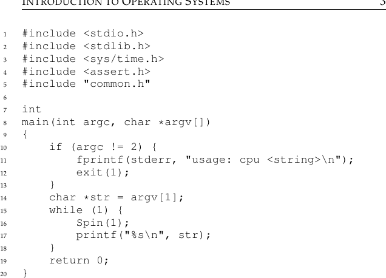
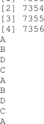
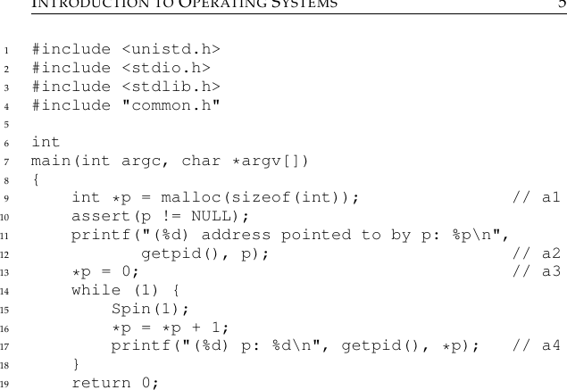
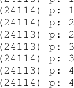
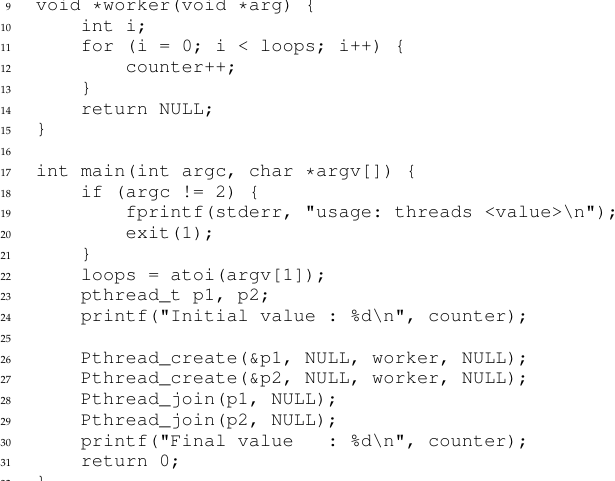
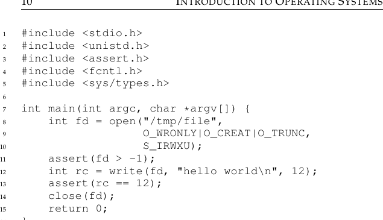

# الفصل 2: مقدمة في أنظمة التشغيل

إن كنت تدرس مقرّرًا جامعيًا في أنظمة التشغيل، فلا بدّ أن تكون لديك فكرة عن ماهية ما يفعله برنامج حاسوبي حين يعمل. وإن لم تكن لديك هذه الفكرة، فسيكون هذا الكتاب (والمقرّر المرافق له) صعبًا عليك — والأفضل أن تتوقّف عن قراءته، أو أن تنطلق إلى أقرب مكتبة لتستهلك المادة التمهيدية اللازمة قبل المتابعة (فكتابا Patt وPatel [PP03] وBryant وO'Hallaron [BOH10] كتابان ممتازان).

فما الذي يحدث حين يعمل برنامج؟

الحقيقة أن البرنامج العامل يفعل شيئًا واحدًا بسيطًا جدًا: إنه ينفّذ تعليمات. ملايين المرات (وفي هذه الأيام مليارات المرات) كل ثانية، يجلب المعالج تعليمة من الذاكرة، ويفكّ ترميزها (أي يحدّد أيّ تعليمة هذه)، ثم ينفّذها (أي يفعل ما يُفترض به أن يفعله، مثل جمع عددين، أو الوصول إلى الذاكرة، أو فحص شرط، أو القفز إلى دالة، وما إلى ذلك). وبعد أن ينتهي من هذه التعليمة، ينتقل المعالج إلى التعليمة التالية، وهكذا دواليك، حتى يكتمل البرنامج أخيرًا[^1].

وهكذا وصفنا للتوّ أساسيات نموذج فون نويمان في الحوسبة[^2]. يبدو الأمر بسيطًا، أليس كذلك؟ لكننا سنتعلّم في هذا المقرّر أنه بينما يعمل البرنامج تحدث أمور كثيرة أخرى عجيبة، هدفها الأساسي جعل النظام سهل الاستعمال.

ثمة جسم من البرمجيات، في الواقع، مسؤول عن تسهيل تشغيل البرامج (بل يتيح لك أن تُشغّل كثيرًا منها في الوقت نفسه على ما يبدو)، وعن إتاحة مشاركة البرامج للذاكرة، وتمكينها من التفاعل مع الأجهزة، وأمور طريفة أخرى من هذا القبيل. هذا الجسم من البرمجيات يُسمّى نظام التشغيل (OS)[^3]، إذ يتولّى ضمان أن يعمل النظام على نحو صحيح وفعّال وبطريقة سهلة الاستعمال.

والطريقة الأساسية التي يفعل بها نظام التشغيل ذلك تقوم على تقنية عامة نسمّيها الافتراضية. أي إن نظام التشغيل يأخذ موردًا ماديًا (مثل المعالج، أو الذاكرة، أو القرص) ويحوّله إلى صورة افتراضية منه أكثر عمومية وقوة وسهولة في الاستعمال. ولهذا نسمّي نظام التشغيل أحيانًا آلة افتراضية.

وبالطبع، لكي يتيح للمستخدمين أن يخبروا نظام التشغيل بما يريدون، وبالتالي الانتفاع بميزات الآلة الافتراضية (مثل تشغيل برنامج، أو تخصيص ذاكرة، أو الوصول إلى ملف)، يوفّر نظام التشغيل أيضًا بعض الواجهات (APIs) التي يمكنك استدعاؤها. فنظام التشغيل النموذجي يُصدّر في الواقع بضع مئات من نداءات النظام المتاحة للتطبيقات. ولأن نظام التشغيل يوفّر هذه النداءات لتشغيل البرامج والوصول إلى الذاكرة والأجهزة وغيرها من الأفعال المرتبطة، فإننا نقول أحيانًا أيضًا إن نظام التشغيل يوفّر مكتبة قياسية للتطبيقات.

وأخيرًا، لأن الافتراضية تتيح لكثير من البرامج أن تعمل (فتتشارك المعالج)، ولكثير منها أن تصل في الوقت نفسه إلى تعليماتها وبياناتها (فتتشارك الذاكرة)، ولكثير منها أن تصل إلى الأجهزة (فتتشارك الأقراص وما إلى ذلك)، فإن نظام التشغيل يُعرف أحيانًا بمدير الموارد. فكل من المعالج والذاكرة والقرص مورد من موارد النظام؛ ومن ثمّ فإن دور نظام التشغيل هو إدارة هذه الموارد، وفعل ذلك بكفاءة أو بعدالة أو فعلًا بأهداف أخرى كثيرة محتملة. ولكي نفهم دور نظام التشغيل على نحو أفضل قليلًا، لنلقِ نظرة على بعض الأمثلة.



**الشكل 2.1:** مثال بسيط: شيفرة تدور وتطبع (cpu.c)

## 2.1 افتراضية المعالج

يُصوّر الشكل 2.1 برنامجنا الأول. وهو لا يفعل كثيرًا. في الواقع، كل ما يفعله هو استدعاء `Spin()`، وهي دالة تفحص الوقت مرارًا وتعود عندما تمضي ثانية. ثم تطبع السلسلة التي مرّرها المستخدم في سطر الأوامر، وتكرّر ذلك إلى ما لا نهاية.

ولنقل إننا حفظنا هذا الملف باسم `cpu.c` وقرّرنا ترجمته وتشغيله على نظام بمعالج واحد (أو CPU كما سنسمّيه أحيانًا). وهذا ما سنراه:

```c
prompt> gcc -o cpu cpu.c -Wall
prompt> ./cpu "A"
A
A
A
A
ˆC
prompt>
```

ليس تشغيلًا مثيرًا للاهتمام — يبدأ النظام بتشغيل البرنامج، الذي يفحص الوقت مرارًا حتى تمضي ثانية. وبعد أن تمضي ثانية، تطبع الشيفرة سلسلة الدخل التي مرّرها المستخدم (حرف «A» في هذا المثال)، وتستمر. لاحظ أن البرنامج سيعمل إلى الأبد؛ وبالضغط على «Control-c» (وهو ما يُنهي البرنامج العامل في المقدمة على الأنظمة الشبيهة بـ UNIX) يمكننا إيقافه.



**الشكل 2.2:** تشغيل كثير من البرامج في الوقت نفسه

الآن لنفعل الشيء نفسه، لكن هذه المرّة لنشغّل كثيرًا من النسخ المختلفة من البرنامج ذاته. يُظهر الشكل 2.2 نتائج هذا المثال الأكثر تعقيدًا قليلًا.

حسنًا، صارت الأمور الآن أكثر تشويقًا بعض الشيء. فرغم أن لدينا معالجًا واحدًا فقط، يبدو أن هذه البرامج الأربعة كلها تعمل في الوقت نفسه بطريقة ما! فكيف يحدث هذا السحر؟[^4] تبيّن أن نظام التشغيل، ببعض المساعدة من العتاد، هو المسؤول عن هذا الوهم، أي وهم أن النظام يملك عددًا هائلًا من المعالجات الافتراضية. فتحويل معالج واحد (أو مجموعة صغيرة منها) إلى عدد لا نهائي على ما يبدو من المعالجات، وبالتالي إتاحة تشغيل كثير من البرامج في الوقت نفسه على ما يبدو، هو ما نسمّيه افتراضية المعالج، وهو محور الجزء الأول الكبير من هذا الكتاب.

وبالطبع، لكي تُشغّل البرامج وتوقفها وتخبر نظام التشغيل بأي البرامج يشتغل، لا بدّ من وجود بعض الواجهات (APIs) التي تستعملها لتوصل رغباتك إلى نظام التشغيل. وسنتحدث عن هذه الواجهات على امتداد الكتاب؛ بل هي الطريقة الرئيسية التي يتعامل بها معظم المستخدمين مع أنظمة التشغيل.

وقد تلاحظ أيضًا أن القدرة على تشغيل برامج متعددة في الوقت نفسه تثير كل أنواع الأسئلة الجديدة. فمثلًا، إن أراد برنامجان أن يعملا في لحظة معيّنة، فأيّهما ينبغي أن يعمل؟ يجيب عن هذا السؤال سياسة من سياسات نظام التشغيل؛ فالسياسات تُستعمل في مواضع كثيرة مختلفة داخل النظام للإجابة عن هذا النوع من الأسئلة، ولذلك سندرسها بينما نتعلّم الآليات الأساسية التي تنفّذها أنظمة التشغيل (مثل القدرة على تشغيل برامج متعددة في الوقت نفسه). ومن هنا دور نظام التشغيل بوصفه مدير موارد.



**الشكل 2.3:** برنامج يصل إلى الذاكرة (mem.c)

## 2.2 افتراضية الذاكرة

لننظر الآن في الذاكرة. إن نموذج الذاكرة المادية الذي تعرضه الآلات الحديثة بسيط جدًا. فالذاكرة مجرّد مصفوفة من البايتات؛ ولقراءة الذاكرة، يجب تحديد عنوان لتتمكن من الوصول إلى البيانات المخزّنة هناك؛ وللكتابة (أو التحديث) في الذاكرة، يجب أيضًا تحديد البيانات التي ستُكتب في العنوان المعطى.

والذاكرة تُستعمل طول الوقت أثناء عمل البرنامج. فالبرنامج يحتفظ بكل بناه البيانية في الذاكرة، ويصل إليها عبر تعليمات متنوّعة، مثل التحميل والتخزين أو تعليمات صريحة أخرى تصل إلى الذاكرة أثناء قيامها بعملها. ولا تنسَ أن كل تعليمة من تعليمات البرنامج موجودة في الذاكرة أيضًا؛ ومن ثمّ يُستعمل الذاكرة عند جلب كل تعليمة.

ولنلقِ نظرة على برنامج (في الشكل 2.3) يخصّص بعض الذاكرة باستدعاء `malloc()`. ويمكن العثور على خَرْج هذا البرنامج هنا:



**الشكل 2.4:** تشغيل برنامج الذاكرة عدّة مرات

يفعل البرنامج أمرين. أولًا، يخصّص بعض الذاكرة (السطر a1). ثم يطبع عنوان الذاكرة (a2)، ثم يضع العدد صفر في الخانة الأولى من الذاكرة المخصّصة حديثًا (a3). وأخيرًا يدور، مؤخّرًا ثانية ومزيدًا القيمة المخزّنة في العنوان الذي يحمله p. ومع كل عبارة طباعة، يطبع أيضًا ما يُسمّى معرّف العملية (PID) للبرنامج العامل. وهذا المعرّف فريد لكل عملية عاملة.

ومرة أخرى، هذه النتيجة الأولى ليست مثيرة للاهتمام كثيرًا. فالذاكرة المخصّصة حديثًا تقع في العنوان 0x200000. وبينما يعمل البرنامج، يحدّث القيمة ببطء ويطبع النتيجة.

والآن لنشغّل مرة أخرى نسخًا متعددة من البرنامج نفسه لنرى ما يحدث (الشكل 2.4). نرى من المثال أن كل برنامج عامل خصّص ذاكرة في العنوان نفسه (0x200000)، ومع ذلك يبدو أن كلًّا منها يحدّث القيمة في 0x200000 باستقلال! وكأن لكل برنامج عامل ذاكرة خاصة به، بدلًا من مشاركة الذاكرة المادية نفسها مع البرامج العاملة الأخرى[^5].

وهذا في الواقع هو ما يحدث تمامًا، إذ يفترض نظام التشغيل الذاكرة. فكل عملية تصل إلى فضاء عناوينها الظاهرية الخاص (ويُسمّى أحيانًا فضاء عناوينها فقط)، ويقوم نظام التشغيل بطريقة ما بتعيينه على الذاكرة المادية للآلة. والإشارة إلى الذاكرة داخل برنامج عامل لا تؤثر في فضاء عناوين العمليات الأخرى (ولا في نظام التشغيل نفسه)؛ فبالنسبة إلى البرنامج العامل، يبدو أنه يملك الذاكرة المادية كلها لنفسه. أما الحقيقة فهي أن الذاكرة المادية مورد مشترك يديره نظام التشغيل. وكيفية تحقيق ذلك كلها هي أيضًا موضوع الجزء الأول من هذا الكتاب، في باب الافتراضية.

## 2.3 التزامن



**الشكل 2.5:** برنامج متعدّد الخيوط (threads.c)

ثمة محور رئيسي آخر لهذا الكتاب هو التزامن. نستعمل هذا المصطلح المفاهيمي للإشارة إلى حزمة من المشكلات التي تنشأ، ويجب معالجتها، عند العمل على أشياء كثيرة في وقت واحد (أي تزامنيًا) داخل البرنامج نفسه. وقد نشأت مشكلات التزامن أولًا داخل نظام التشغيل نفسه؛ وكما ترى في الأمثلة السابقة عن الافتراضية، فإن نظام التشغيل يقذف أشياء كثيرة في الهواء في وقت واحد، فيشغّل أولًا عملية ثم أخرى وهكذا. وتبيّن أن فعل ذلك يقود إلى مشكلات عميقة ومثيرة للاهتمام.

ولسوء الحظ، لم تعد مشكلات التزامن مقصورة على نظام التشغيل نفسه. فالبرامج الحديثة متعدّدة الخيوط تُظهر المشكلات نفسها. ولنوضّح ذلك بمثال عن برنامج متعدّد الخيوط (الشكل 2.5).

وإن كنت قد لا تفهم هذا المثال تمامًا في هذه اللحظة (وسنتعلّم عنه الكثير لاحقًا في فصل التزامن من هذا الكتاب)، فالفكرة الأساسية بسيطة. يُنشئ البرنامج الرئيسي خيطين باستعمال `Pthread_create()`[^6]. ويمكنك أن تتخيّل الخيط دالةً تعمل في فضاء الذاكرة نفسه الذي تعمل فيه دوال أخرى، وأكثر من واحدة منها نشطة في الوقت نفسه. في هذا المثال، يبدأ كل خيط عمله في روتين يُسمّى `worker()`، حيث يزيد فيه عدّادًا في حلقة بعدد `loops` من المرات.

وفيما يلي نسخ لما يحدث عندما نشغّل هذا البرنامج مع ضبط قيمة المتغيّر `loops` على 1000. وقيمة `loops` تحدّد كم مرّة يزيد كل من العاملين العدّاد المشترك في الحلقة. فحين يُشغّل البرنامج وقيمة `loops` مساوية 1000، ما القيمة النهائية التي تتوقّعها للعدّاد؟

```c
prompt> gcc -o threads threads.c -Wall -pthread
prompt> ./threads 1000
Initial value : 0
Final value : 2000
```

وكما حدست على الأرجح، حين يفرغ الخيطان تكون القيمة النهائية للعدّاد 2000، لأن كل خيط زاد العدّاد 1000 مرّة. بل إنه حين تكون قيمة `loops` المدخلة N، نتوقّع أن يكون خَرْج البرنامج النهائي 2N. لكن الحياة ليست بهذه البساطة، كما تبيّن. لنشغّل البرنامج نفسه، لكن بقيم أكبر لـ `loops`، ونرَ ما يحدث:

```c
prompt> ./threads 100000
Initial value : 0
Final value : 143012 // huh??
prompt> ./threads 100000
Initial value : 0
Final value : 137298 // what the??
```

في هذا التشغيل، حين أعطينا قيمة دخل 100,000، حصلنا أولًا على 143,012 بدلًا من القيمة النهائية 200,000. ثم حين شغّلنا البرنامج مرة ثانية، لم نحصل على قيمة خاطئة مرة أخرى فحسب، بل على قيمة مختلفة عن المرة السابقة. بل إنك إن شغّلت البرنامج مرارًا بقيم عالية لـ `loops` فقد تجد أحيانًا أنك تحصل على الجواب الصحيح! فلماذا يحدث هذا؟

تبيّن أن سبب هذه النتائج الغريبة وغير المعتادة يتصل بكيفية تنفيذ التعليمات، وهي تُنفّذ واحدة في كل مرّة. ولسوء الحظ، فإن جزءًا أساسيًا من البرنامج السابق، حيث يُزاد العدّاد المشترك، يتطلّب ثلاث تعليمات: واحدة لتحميل قيمة العدّاد من الذاكرة إلى سجل، وواحدة لزيادتها، وواحدة لتخزينها ثانية في الذاكرة. ولأن هذه التعليمات الثلاث لا تُنفّذ ذرّيًا (أي دفعة واحدة)، فقد تحدث أمور غريبة. وهذه مشكلة التزامن التي سنتناولها بتفصيل كبير في الجزء الثاني من هذا الكتاب.

> **جوهر المسألة**
>
> كيف نبني برامج متزامنة صحيحة

فكيف يمكننا، حين تكون ثمة خيوط كثيرة تُنفّذ تزامنيًا داخل فضاء الذاكرة نفسه، أن نبني برنامجًا يعمل على نحو صحيح؟ وما العمليات الأوّلية التي نحتاجها من نظام التشغيل؟ وما الآليات التي ينبغي أن يوفّرها العتاد؟ وكيف نستعملها لحلّ مشكلات التزامن؟

## 2.4 الاستمرارية

المحور الثالث الكبير للمقرّر هو الاستمرارية. ففي ذاكرة النظام يمكن أن تضيع البيانات بسهولة، إذ تخزّن أجهزة مثل DRAM القيم على نحو متطاير؛ فحين ينقطع التيار أو ينهار النظام، تضيع أي بيانات في الذاكرة. ومن ثمّ نحتاج إلى عتاد وبرمجيات قادرة على تخزين البيانات على نحو مستديم؛ وهذا التخزين بالغ الأهمية لأي نظام، لأن المستخدمين يهتمون ببياناتهم اهتمامًا كبيرًا.

ويأتي العتاد في صورة نوع من أجهزة الإدخال والإخراج (I/O)؛ ففي الأنظمة الحديثة يكون القرص الصلب مستودعًا شائعًا للمعلومات طويلة العمر، وإن كانت أقراص الحالة الصلبة (SSDs) تحرز تقدمًا في هذا الميدان أيضًا.

والبرمجيات في نظام التشغيل التي تدير القرص عادةً تُسمّى نظام الملفات؛ وهي مسؤولة عن تخزين أي ملفات ينشئها المستخدم على نحو موثوق وفعّال على أقراص النظام.

وعلى خلاف التجريدات التي يوفّرها نظام التشغيل للمعالج والذاكرة، لا ينشئ نظام التشغيل قرصًا خاصًا افتراضيًا لكل تطبيق. بل يُفترض أن المستخدمين سيريدون في كثير من الأحيان مشاركة معلومات موجودة في ملفات. فمثلًا، حين تكتب برنامج C، قد تستعمل أولًا محرّرًا (مثل Emacs[^7]) لإنشاء ملف C وتحريره (`emacs -nw main.c`). وبعد الفراغ، قد تستعمل المترجم لتحويل الشيفرة المصدرية إلى ملف تنفيذي (مثل `gcc -o main main.c`). وحين تنتهي، قد تشغّل الملف التنفيذي الجديد (مثل `./main`). وهكذا ترى كيف تُشارَك الملفات بين عمليات مختلفة. فأولًا ينشئ Emacs ملفًا يكون دخلًا للمترجم؛ ويستعمل المترجم ملف الدخل هذا لإنشاء ملف تنفيذي جديد (على خطوات كثيرة — راجع مقرّر المترجمات للتفاصيل)؛ وأخيرًا يُشغّل الملف التنفيذي الجديد. وهكذا يولد برنامج جديد!



**الشكل 2.6:** برنامج يقوم بالإدخال والإخراج (io.c)

ولفهم ذلك على نحو أفضل، لننظر في بعض الشيفرة. يعرض الشكل 2.6 شيفرة تنشئ ملفًا (`/tmp/file`) يحتوي السلسلة "hello world".

ولإنجاز هذه المهمة، يستدعي البرنامج نظام التشغيل ثلاث مرّات. الأولى استدعاء `open()` لفتح الملف وإنشائه؛ والثانية `write()` لكتابة بعض البيانات في الملف؛ والثالثة `close()` لإغلاق الملف ببساطة، فيشير بذلك إلى أن البرنامج لن يكتب مزيدًا من البيانات فيه. وتُوجَّه نداءات النظام هذه إلى الجزء من نظام التشغيل المسمّى نظام الملفات، الذي يعالج الطلبات ويعيد نوعًا من رمز الخطأ إلى المستخدم.

وقد تتساءل عمّا يفعله نظام التشغيل كي يكتب فعلًا إلى القرص. كنا سنُريك، لكن عليك أن تعِد بإغلاق عينيك أولًا؛ فالأمر إلى هذا الحدّ من القسوة. إذ على نظام الملفات أن يقوم بقسط وافر من العمل: أولًا تحديد أين على القرص ستقيم هذه البيانات الجديدة، ثم تتبّعها في بنى مختلفة يحتفظ بها نظام الملفات. ويتطلّب ذلك إصدار طلبات إدخال وإخراج إلى جهاز التخزين الأساسي، إما لقراءة بنى قائمة أو لتحديثها (كتابتها). وكما يعلم كل من كتب سائق جهاز[^8]، فإن جعل جهاز يفعل شيئًا نيابة عنك عملية دقيقة ومفصّلة. وتتطلّب معرفة عميقة بواجهة الجهاز منخفضة المستوى ودلالاتها الدقيقة. لحسن الحظ، يوفّر نظام التشغيل طريقة قياسية بسيطة للوصول إلى الأجهزة عبر نداءات نظامه. ومن ثمّ يُنظر إلى نظام التشغيل أحيانًا بوصفه مكتبة قياسية.

وبالطبع، ثمة تفاصيل أكثر كثيرة في كيفية الوصول إلى الأجهزة، وكيف تدير نظم الملفات البيانات على نحو مستديم فوق تلك الأجهزة. ولأسباب تتعلّق بالأداء، تؤخّر معظم نظم الملفات هذه الكتابات أولًا لبعض الوقت، آملة أن تجمعها في مجموعات أكبر. ولمعالجة مشكلات انهيار النظام أثناء الكتابة، تضمّ معظم نظم الملفات نوعًا من بروتوكول كتابة معقّد، مثل السجلّات أو النسخ عند الكتابة، فترتّب الكتابات إلى القرص بعناية لتضمن أنه إذا حدث عطل أثناء تسلسل الكتابة، أمكن للنظام أن يستعيد حالة معقولة بعد ذلك. ولجعل عمليات شائعة مختلفة فعّالة، تستعمل نظم الملفات بنى بيانات وطرائق وصول كثيرة متنوّعة، من القوائم البسيطة إلى أشجار B المعقّدة. وإن لم يكن كل ذلك مفهومًا بعد، فهذا جيد! فسنتحدث عن ذلك كله بقدر أكبر بكثير في الجزء الثالث من هذا الكتاب عن الاستمرارية، حيث سنناقش الأجهزة والإدخال والإخراج عمومًا، ثم الأقراص ومصفوفات RAID ونظم الملفات بتفصيل كبير.

> **جوهر المسألة**
>
> كيف نخزّن البيانات على نحو مستديم

إن نظام الملفات هو الجزء من نظام التشغيل المسؤول عن إدارة البيانات المستديمة. فما التقنيات اللازمة لفعل ذلك على نحو صحيح؟ وما الآليات والسياسات المطلوبة لفعل ذلك بأداء عالٍ؟ وكيف تُحقَّق الموثوقية في وجه أعطال العتاد والبرمجيات؟

## 2.5 أهداف التصميم

صار لديك الآن تصوّر لما يفعله نظام التشغيل فعلًا: يأخذ موارد مادية، مثل المعالج أو الذاكرة أو القرص، ويجعلها افتراضية. وهو يعالج مسائل صعبة وشائكة تتعلّق بالتزامن. ويخزّن الملفات على نحو مستديم، فيحفظها على المدى الطويل. وبما أننا نريد بناء نظام كهذا، فمن المفيد أن نضع أمامنا أهدافًا توجّه تصميمنا وتنفيذنا وتساعدنا على الموازنة بين الخيارات عند الحاجة؛ والعثور على الموازنة الصحيحة مفتاح لبناء الأنظمة.

من أكثر الأهداف أساسيةً بناء تجريدات تجعل النظام مريحًا وسهل الاستعمال. والتجريدات أساسية في كل ما نفعله في علوم الحاسوب. فالتجريد هو ما يتيح كتابة برنامج كبير بتقسيمه إلى قطع صغيرة مفهومة، وكتابة هذا البرنامج بلغة عالية المستوى مثل C[^9] دون التفكير في لغة التجميع، وكتابة الشيفرة بلغة التجميع دون التفكير في البوابات المنطقية، وبناء معالج من بوابات دون التفكير كثيرًا في الترانزستورات. والتجريد أساسي إلى حدّ أننا ننسى أهميته أحيانًا، لكننا لن ننساها هنا؛ لذلك سنناقش في كل قسم بعض التجريدات الكبرى التي تطوّرت عبر الزمن، لنمنحك طريقة للتفكير في أجزاء نظام التشغيل.

ومن أهداف تصميم نظام التشغيل وتنفيذه تقديم أداء عالٍ؛ ويمكن صياغة ذلك بأن هدفنا تقليل النفقات العامة للنظام. والافتراضية وجعل النظام سهل الاستعمال يستحقّان ذلك، لكن ليس بأي ثمن؛ لذلك علينا أن نوفّر الافتراضية وغيرها من ميزات نظام التشغيل دون نفقات مفرطة. وتظهر هذه النفقات في صور عدّة: وقت إضافي (تعليمات أكثر) ومساحة إضافية (في الذاكرة أو على القرص). وسنبحث عن حلول تقلّل أحدهما أو كليهما إن أمكن. لكن الكمال ليس متاحًا دائمًا، وهو أمر سنتعلّم ملاحظته واحتماله حيث يلزم.

وسيكون من الأهداف أيضًا توفير الحماية بين التطبيقات، وبين النظام والتطبيقات. فبما أننا نريد إتاحة تشغيل برامج كثيرة في الوقت نفسه، نريد أن نضمن ألّا يضرّ السلوك الخبيث أو العَرَضي لأحدها بالآخرين؛ ولا نريد بالتأكيد أن يستطيع تطبيق إيذاء النظام نفسه (لأن ذلك سيؤثّر في كل البرامج العاملة على النظام). والحماية في قلب أحد المبادئ الرئيسة التي يقوم عليها نظام التشغيل، وهو العزل؛ فعزل العمليات بعضها عن بعض مفتاح الحماية، ومنه ينبع كثير مما يجب أن يفعله نظام التشغيل.

وعلى نظام التشغيل أن يعمل بلا توقّف أيضًا؛ فحين يفشل، تفشل معه كل التطبيقات العاملة على النظام. ولهذا الاعتماد تسعى أنظمة التشغيل عادةً إلى درجة عالية من الموثوقية. وبما أن أنظمة التشغيل تزداد تعقيدًا (إذ تحتوي أحيانًا ملايين الأسطر من الشيفرة)، فبناء نظام تشغيل موثوق تحدٍّ كبير، وكثير من البحث الجاري في المجال (ومن ضمنه بعض أعمالنا [BS+09, SS+10]) يتركّز على هذه المسألة تحديدًا.

وهناك أهداف أخرى منطقية: كفاءة الطاقة مهمة في عالم يتّجه أكثر فأكثر إلى الخضرة؛ والأمن (وهو امتداد للحماية في الحقيقة) ضد التطبيقات الخبيثة أمر بالغ الأهمية، خصوصًا في هذه الأزمنة شديدة الترابط الشبكي؛ والتنقّل يزداد أهمية مع عمل أنظمة التشغيل على أجهزة أصغر فأصغر. وبحسب طريقة استعمال النظام، سيكون لنظام التشغيل أهداف مختلفة، ولذلك سيُنفَّذ على الأرجح بطرائق مختلفة قليلًا على الأقل. لكننا سنرى أن كثيرًا من المبادئ التي سنعرضها لبناء نظام تشغيل مفيد على طائفة من الأجهزة المختلفة.

## 2.6 بعض التاريخ

قبل أن نختم هذه المقدمة، لنعرض تأريخًا موجزًا لتطوّر أنظمة التشغيل. فمثل أي نظام يبنيه البشر، تراكمت الأفكار الجيدة في أنظمة التشغيل عبر الزمن، إذ تعلّم المهندسون ما يهمّ في تصميمها. وسنناقش هنا بعض التطوّرات الكبرى. ولمعالجة أغنى، انظر التأريخ الممتاز لأنظمة التشغيل الذي كتبه برينك هانسن [BH00].

## أنظمة التشغيل المبكّرة: مجرّد مكتبات

في البداية، لم يكن نظام التشغيل يفعل الكثير. كان في الأساس مجرّد مجموعة مكتبات من الدوال الشائعة الاستعمال؛ فبدلًا من أن يكتب كل مبرمج في النظام شيفرة التعامل مع الإدخال والإخراج منخفض المستوى، كان «نظام التشغيل» يوفّر واجهات كهذه، فييسّر الحياة على المطوّر.

وعادةً، على أنظمة الحواسيب الكبيرة القديمة هذه، كان برنامج واحد يعمل في كل مرة، بإشراف مشغّل بشري. وكان هذا المشغّل يؤدي كثيرًا مما تظنّ أن نظام تشغيل حديثًا يؤدّيه (مثل تحديد ترتيب تشغيل المهام). وإن كنت مطوّرًا ذكيًا فستكون لطيفًا مع هذا المشغّل، حتى ينقل مهمتك إلى مقدّمة الطابور.

وكان هذا النمط من الحوسبة يُعرف بالمعالجة بالدفعات، إذ تُجهَّز عدّة مهام ثم تُشغَّل «دفعةً واحدة» على يد المشغّل. ولم تكن الحواسيب آنذاك تُستعمل بطريقة تفاعلية، بسبب الكلفة: كان من المكلف جدًا أن تدع مستخدمًا يجلس أمام الحاسوب ويستعمله، لأن الحاسوب سيبقى معطّلًا معظم الوقت حينها، وهو ما يكلّف المنشأة مئات آلاف الدولارات في الساعة [BH00].

## ما بعد المكتبات: الحماية

في خروجه من كونه مجرّد مكتبة خدمات شائعة، أخذ نظام التشغيل دورًا أكثر مركزية في إدارة الآلات. ومن الجوانب المهمة في ذلك إدراك أن الشيفرة التي تُشغَّل بالنيابة عن النظام شيفرة خاصة؛ فهي تتحكّم في الأجهزة، ولذلك ينبغي معاملتها معاملة مختلفة عن شيفرة التطبيقات العادية. ولماذا؟ تصوّر أنك سمحت لأي تطبيق بأن يقرأ من أي موضع على القرص؛ فمفهوم الخصوصية يتبخّر حينها، لأن أي برنامج يستطيع قراءة أي ملف. ولذلك فإن تنفيذ نظام ملفات (لإدارة ملفاتك) على هيئة مكتبة لا معنى له. بل كان ثمّة حاجة إلى شيء آخر.

وهكذا وُلدت فكرة نداء النظام، التي ابتكرها نظام Atlas الحاسوبي [K+61,L78]. فبدلًا من تقديم روتينات نظام التشغيل على هيئة مكتبة (حيث تكتفي بنداء إجراء للوصول إليها)، كانت الفكرة هنا إضافة زوج خاص من تعليمات العتاد وحالة عتاد لجعل الانتقال إلى نظام التشغيل عملية أكثر رسمية وإحكامًا.

والفرق الجوهري بين نداء النظام ونداء الإجراء أن نداء النظام ينقل التحكّم (أي يقفز) إلى نظام التشغيل ويرفع في الوقت نفسه مستوى الامتياز في العتاد. فالتطبيقات تعمل في ما يُسمّى نمط المستخدم، أي أن العتاد يقيّد ما تستطيع التطبيقات فعله؛ فالتطبيق العامل في نمط المستخدم لا يستطيع عادةً بدء طلب إدخال أو إخراج إلى القرص، ولا الوصول إلى أي صفحة ذاكرة مادية، ولا إرسال حزمة على الشبكة. وحين يُبدأ نداء نظام (عادةً عبر تعليمة عتادية خاصة تُسمّى فخًّا)، ينقل العتاد التحكّم إلى معالج فخّ محدَّد سلفًا (هيّأه نظام التشغيل مسبقًا) ويرفع في الوقت نفسه مستوى الامتياز إلى نمط النواة. وفي نمط النواة يكون للنظام وصول كامل إلى عتاد النظام، فيستطيع مثلًا بدء طلب إدخال أو إخراج أو توفير ذاكرة إضافية لبرنامج. وحين ينتهي النظام من خدمة الطلب، يعيد التحكّم إلى المستخدم عبر تعليمة خاصة للعودة من الفخّ، تعيد الوضع إلى نمط المستخدم وتعيد التحكّم في الوقت نفسه إلى حيث توقّف التطبيق.

## عصر تعدّد البرمجة

انطلق نظام التشغيل انطلاقته الحقيقية في عصر الحوسبة الذي جاء بعد الحواسيب الكبيرة، أي عصر الحواسيب الصغيرة. فقد جعلت آلات كلاسيكية مثل عائلة PDP من Digital Equipment الحواسيب أرخص بكثير؛ فبدلًا من حاسوب كبير واحد لكل مؤسسة كبيرة، صار بوسع مجموعة أصغر من الناس داخل المؤسسة أن تملك حاسوبها. ولم يكن مفاجئًا أن أحد الآثار الكبرى لهذا الانخفاض في الكلفة زيادة نشاط المطوّرين؛ فقد وصل الحواسيب إلى أيدٍ ذكية أكثر، فجعلت أنظمة الحاسوب تفعل أشياء أكثر إثارة وجمالًا.

وعلى وجه الخصوص، شاعت تعدّد البرمجة بسبب الرغبة في استعمال موارد الآلة استعمالًا أفضل. فبدلًا من تشغيل مهمة واحدة في كل مرة، كان النظام يحمّل عددًا من المهام في الذاكرة ويبدّل بينها بسرعة، فيحسّن استغلال المعالج. وكان هذا التبديل مهمًا بشكل خاص لأن أجهزة الإدخال والإخراج كانت بطيئة؛ فانتظار برنامج على المعالج ريثما تُخدم عمليته للإدخال أو الإخراج إهدار لوقت المعالج. فلمَ لا نبدّل إلى مهمة أخرى ونشغّلها لبعض الوقت؟

والرغبة في دعم تعدّد البرمجة والتداخل في حضور الإدخال والإخراج والمقاطعات فرضت ابتكارًا في التطوّر المفاهيمي لأنظمة التشغيل في اتجاهات عدة. فصارت مسائل مثل حماية الذاكرة مهمة؛ فلا نريد أن يستطيع برنامج الوصول إلى ذاكرة برنامج آخر. وكان فهم كيفية التعامل مع مسائل التزامن التي أدخلها تعدّد البرمجة أمرًا حاسمًا أيضًا؛ فالتأكّد من أن النظام يتصرّف على نحو صحيح رغم وجود المقاطعات تحدٍّ كبير. وسندرس هذه المسائل والموضوعات المتصلة بها لاحقًا في الكتاب.

ومن أكبر التقدّمات العملية في ذلك العصر إدخال نظام تشغيل UNIX، بفضل كين طومسون (ودنيس ريتشي) في مختبرات بيل أساسًا (نعم، شركة الهاتف). فقد أخذ UNIX أفكارًا جيدة كثيرة من أنظمة تشغيل مختلفة (خصوصًا من Multics [O72]، وبعضها من أنظمة مثل TENEX [B+72] ونظام Berkeley Time-Sharing [S68])، لكنه جعلها أبسط وأسهل استعمالًا. وسرعان ما أخذ هذا الفريق يرسل أشرطة تحتوي الشيفرة المصدرية لـ UNIX إلى الناس حول العالم، وكثير منهم شارك بعد ذلك وأضاف إلى النظام نفسه؛ انظر الاستطراد (الصفحة التالية) لمزيد من التفصيل[^10].

## العصر الحديث

وبعد الحاسوب الصغير جاء نوع جديد من الآلات، أرخص وأسرع وللجماهير: الحاسوب الشخصي، أو PC كما نسمّيه اليوم. وبقيادة آلات Apple المبكّرة (مثل Apple II) وحاسوب IBM PC، سرعان ما صار هذا النوع الجديد من الآلات القوة المهيمنة في الحوسبة، إذ أتاحت كلفته المنخفضة آلةً واحدة لكل مكتب بدلًا من حاسوب صغير مشترك لكل مجموعة عمل.

وللأسف، مثّل الحاسوب الشخصي في البداية، بالنسبة إلى أنظمة التشغيل، قفزة إلى الوراء، إذ نسيَت الأنظمة المبكّرة الدروس التي تعلّمها عصر الحواسيب الصغيرة (أو لم تعرفها أصلًا). فأنظمة مبكّرة مثل DOS (نظام تشغيل الأقراص من مايكروسوفت) لم ترَ أن حماية الذاكرة مهمة؛ فكان تطبيق خبيث (أو ربما سيّئ البرمجة فقط) يستطيع العبث بكل ذاكرته. واتّبعت الأجيال الأولى من Mac OS (الإصدار 9 وما قبله) نهجًا تعاونيًا في جدولة المهام؛ فكان خيط يعلق في حلقة لا نهائية أن يستولي على النظام كله ويُجبره على إعادة التشغيل. وقائمة ميزات أنظمة التشغيل الغائبة في هذا الجيل طويلة ومؤلمة، أطول من أن تُناقش هنا بالكامل.

لحسن الحظ، بعد سنوات من المعاناة، أخذت ميزات أنظمة تشغيل الحواسيب الصغيرة القديمة تجد طريقها إلى سطح المكتب. فمثلًا يحمل Mac OS X/macOS نواة UNIX، بما فيها كل الميزات التي تتوقّعها من نظام ناضج كهذا. وقد تبنّى Windows كذلك كثيرًا من الأفكار الكبرى في تاريخ الحوسبة، بدءًا خصوصًا بـ Windows NT، وهو تقدّم كبير في تقنية أنظمة مايكروسوفت. وحتى الهواتف الخلوية اليوم تعمل بأنظمة تشغيل (مثل Linux) أقرب بكثير إلى ما كان يعمل على حاسوب صغير في السبعينيات مما كان يعمل على حاسوب شخصي في الثمانينيات (والحمد لله)؛ ومن الجيد أن نرى الأفكار الجيدة التي تطوّرت في أوج تطوير أنظمة التشغيل تجد طريقها إلى العالم الحديث. والأفضل من ذلك أنها تستمرّ في التطوّر، فتوفّر ميزات أكثر وتجعل الأنظمة الحديثة أفضل للمستخدمين والتطبيقات.

> **استطراد: ثم جاء لينكس**
>
> إن من الصعب المبالغة في أهمية UNIX في تاريخ أنظمة التشغيل. فمتأثرًا بأنظمة أقدم (خصوصًا نظام Multics الشهير من MIT)، جمع UNIX كثيرًا من الأفكار العظيمة وصنع نظامًا بسيطًا وقويًا في آن. وكان المبدأ الموحّد خلف UNIX الأصلي في مختبرات بيل هو بناء برامج صغيرة قوية يمكن وصلها بعضها ببعض لتشكيل مسارات عمل أكبر. وقد وفّرت الصدفة (حيث تكتب الأوامر) أوّليات مثل الأنابيب لتمكين برمجة على هذا المستوى الأعلى، فصار من السهل ربط البرامج لتحقيق مهمة أكبر. فمثلًا للعثور على الأسطر التي تحتوي كلمة «foo» في ملف نصي ثم عدّها، كنت ستكتب `grep foo file.txt|wc -l`، مستعملًا بذلك برنامجَي grep وwc (عدّ الكلمات) لتحقيق مهمتك. وكانت بيئة UNIX ودّية للمبرمجين والمطوّرين على السواء، ووفّرت كذلك مترجمًا للغة C الجديدة. وجعل السهولة التي يكتب بها المبرمجون برامجهم ويشاركونها UNIX شائعًا شعبية هائلة. وربما ساعد كثيرًا أن المؤلفين كانوا يوزّعون نسخًا مجانية لكل من يطلب، وهي صورة مبكّرة من البرمجيات مفتوحة المصدر. وكان من الأمور الحاسمة أيضًا إتاحة الشيفرة وقابليتها للقراءة. فوجود نواة جميلة صغيرة مكتوبة بلغة C شجّع الآخرين على العبث بها وإضافة ميزات جديدة رائعة. فمثلًا صنعت مجموعة مغامرة في بيركلي بقيادة بيل جوي توزيعة رائعة (توزيعة أنظمة بيركلي، أو BSD) ضمّت أنظمة فرعية متقدّمة للذاكرة الافتراضية ونظام الملفات والشبكات. وقد شارك جوي لاحقًا في تأسيس Sun Microsystems. وللأسف تباطأ انتشار UNIX قليلًا حين حاولت الشركات فرض ملكيتها والربح منه، وهي نتيجة مؤسفة (لكن شائعة) لتدخّل المحامين. وكان لكل شركة تقريبًا نسختها: SunOS من Sun Microsystems، وAIX من IBM، وHPUX (المعروف بـ «H-Pucks») من HP، وIRIX من SGI. وقد ألقت المناوشات القانونية بين AT&T/مختبرات بيل وهؤلاء اللاعبين غيمة قاتمة على UNIX، وتساءل كثيرون إن كان سينجو، خصوصًا مع ظهور Windows واستيلائه على كثير من سوق الحواسيب الشخصية.

> **استطراد: وأخيرًا جاء لينكس**
>
> لحسن حظ UNIX، قرّر مخترق شاب فنلندي اسمه لينوس تورفالدس أن يكتب نسخته الخاصة من UNIX، مستعيرًا بقوة المبادئ والأفكار التي قام عليها النظام الأصلي، لكن لا من الشيفرة، فتفادى مسائل الشرعية. واستعان بمساعدة كثيرين حول العالم، واستفاد من أدوات GNU المتقدّمة الموجودة أصلًا [G85]، فولد Linux سريعًا (ومعه حركة البرمجيات مفتوحة المصدر الحديثة). ومع حلول عصر الإنترنت، اختارت معظم الشركات (مثل Google وAmazon وFacebook وغيرها) تشغيل Linux، لأنه كان مجانيًا ويمكن تعديله بسهولة ليناسب احتياجاتها؛ بل يصعب تخيّل نجاح هذه الشركات الجديدة لولا وجود نظام كهذا. وحين صارت الهواتف الذكية منصّة مهيمنة في مواجهة المستخدم، وجد Linux فيها معقلًا أيضًا (عبر Android) ولأسباب كثيرة من النوع نفسه. وقد أخذ ستيف جوبز بيئة تشغيله NeXTStep القائمة على UNIX معه إلى Apple، فجعل UNIX شائعًا على سطح المكتب (وإن كان كثير من مستخدمي تقنية Apple لا يعرفون هذه الحقيقة على الأرجح). وهكذا يعيش UNIX، وهو اليوم أهم من أي وقت مضى. وآلهة الحوسبة، إن كنت تؤمن بها، تستحقّ الشكر على هذه النتيجة الرائعة.

## 2.7 الخلاصة

بهذا صار لدينا مقدمة عن نظام التشغيل. فأنظمة التشغيل اليوم تجعل الأنظمة سهلة الاستعمال نسبيًا، وكل أنظمة التشغيل التي تستعملها اليوم تقريبًا تأثّرت بالتطوّرات التي سنناقشها في الكتاب.

وللأسف، وبسبب قيود الوقت، ثمة أجزاء من نظام التشغيل لن نغطيها في الكتاب. فمثلًا في نظام التشغيل شيفرة شبكات كثيرة؛ ونتركها لك لتأخذ مقرّر الشبكات وتتعلّم عنها أكثر. وبالمثل، فأجهزة الرسوميات مهمة بشكل خاص؛ خذ مقرّر الرسوميات لتوسّع معرفتك في ذلك الاتجاه. وأخيرًا، ثمة كتب عن أنظمة التشغيل تتحدّث كثيرًا عن الأمن؛ وسنفعل ذلك بالمعنى الذي يقتضي أن يوفّر النظام الحماية بين البرامج العاملة وأن يمنح المستخدمين القدرة على حماية ملفاتهم، لكننا لن نغوص في مسائل أمنية أعمق قد تجدها في مقرّر عن الأمن.

غير أن ثمة موضوعات مهمة كثيرة سنغطيها، منها أساسيات افتراضية المعالج والذاكرة، والتزامن، والاستمرارية عبر الأجهزة وأنظمة الملفات. لا تقلق! فمع أن أمامنا أرضًا كثيرة، فإن معظمها ممتع جدًا، وفي نهاية الطريق سيكون لديك تقدير جديد لكيفية عمل أنظمة الحاسوب فعلًا. والآن، إلى العمل!

## المراجع

## الواجبات المنزلية

لمعظم فصول هذا الكتاب (وكلها في نهاية المطاف) أقسام للواجبات المنزلية في آخرها. وأداء هذه الواجبات مهم، لأن كل واحد منها يتيح لك، أنت القارئ، اكتساب خبرة أكبر بالمفاهيم المعروضة في الفصل.

وهناك نوعان من الواجبات. الأول قائم على المحاكاة. فمحاكاة نظام حاسوبي ليست إلا برنامجًا بسيطًا يتظاهر بأداء بعض الأجزاء المثيرة مما يفعله نظام حقيقي، ثم يقدّم بعض القياسات لإظهار كيف يتصرّف النظام. فمحاكي قرص صلب مثلًا قد يأخذ سلسلة من الطلبات، ويحاكي المدة التي تستغرقها خدمتها على قرص صلب بخصائص أداء معيّنة، ثم يقدّم متوسط زمن استجابة الطلبات.

والجميل في المحاكاة أنها تتيح لك استكشاف سلوك الأنظمة بسهولة دون صعوبة تشغيل نظام حقيقي. بل إنها تتيح لك ابتكار أنظمة لا يمكن أن توجد في العالم الحقيقي (مثل قرص صلب بأداء سريع لا يُتصوّر)، فترى الأثر المحتمل للتقنيات المستقبلية.

وبالطبع ليست المحاكاة خالية من العيوب. فبحكم طبيعتها، ليست المحاكاة إلا تقريبًا لسلوك نظام حقيقي. وإن أُغفل جانب مهم من السلوك الواقعي، قدّمت المحاكاة نتائج سيئة. ولذلك ينبغي التعامل مع نتائج المحاكاة بشيء من الشك دائمًا. وفي النهاية، ما يهمّ هو كيف يتصرّف النظام في العالم الحقيقي.

أما النوع الثاني من الواجبات فيتطلّب تفاعلًا مع شيفرة واقعية. بعضها يركّز على القياس، وبعضها لا يتطلّب إلا تطويرًا وتجريبًا صغيرًا. وكلا النوعين مجرّد اقتحام صغير للعالم الأكبر الذي ينبغي أن تدخله، وهو كيفية كتابة شيفرة الأنظمة بلغة C على أنظمة قائمة على UNIX. بل إن مشاريع أكبر حجمًا، تتجاوز هذه الواجبات، لازمة لدفعك في هذا الاتجاه؛ ولذلك نوصي بقوة، إضافةً إلى أداء الواجبات، بإنجاز مشاريع ترسّخ مهاراتك في الأنظمة. انظر هذه الصفحة `https://github.com/remzi-arpacidusseau/ostep-projects` لبعض المشاريع.

ولأداء هذه الواجبات، يلزمك على الأرجح آلة قائمة على UNIX، تعمل بـ Linux أو macOS أو نظام مشابه. وينبغي أن يكون فيها مترجم C (مثل gcc) وكذلك Python. وينبغي أن تعرف أيضًا كيفية تحرير الشيفرة في محرّر شيفرة حقيقي من نوع ما.

[^1]: بالطبع تفعل المعالجات الحديثة أشياء غريبة ومخيفة كثيرة تحت الغطاء لتجعل البرامج أسرع، مثل تنفيذ تعليمات عدة في وقت واحد، بل إصدارها وإتمامها خارج الترتيب! لكن ذلك ليس شأننا هنا؛ نحن معنيون فقط بالنموذج البسيط الذي تفترضه معظم البرامج: أن التعليمات تُنفَّذ ظاهريًا واحدة في كل مرة، وبطريقة منظّمة متتالية.

[^2]: كان فون نويمان من روّاد أنظمة الحوسبة المبكّرين. وقد أنجز أيضًا عملًا رائدًا في نظرية الألعاب والقنابل الذرّية، ولعب في دوري السلة NBA ست سنوات. حسنًا، واحدة من تلك الأمور غير صحيحة.

[^3]: من الأسماء المبكّرة الأخرى لنظام التشغيل «المشرف» أو حتى «برنامج التحكّم الرئيسي». ويبدو أن الاسم الأخير بدا متعجرفًا بعض الشيء (انظر فيلم Tron للتفاصيل)، ولذلك ساد «نظام التشغيل» بدلًا منه، ولحسن الحظ.

[^5]: لكي ينجح هذا المثال، عليك أن تتأكد من تعطيل عشوائية فضاء العناوين؛ فالعشوائية، كما تبيّن، قد تكون دفاعًا جيدًا ضد أنواع معيّنة من العيوب الأمنية. اقرأ عنها أكثر بنفسك، خصوصًا إن كنت تريد تعلّم كيفية اقتحام أنظمة الحاسوب عبر هجمات سحق المكدّس. لا أننا نوصي بشيء كهذا…

[^6]: مكتبة Pthreads هي واجهة برمجة الخيوط القياسية في أنظمة UNIX، وسنبحثها بالتفصيل في قسم التزامن من الكتاب.

[^7]: ينبغي أن تستعمل Emacs. فإن كنت تستعمل vi، فثمة على الأرجح خلل فيك. وإن كنت تستعمل شيئًا ليس محرّر شيفرة حقيقيًا، فذلك أسوأ.

[^8]: مشغّل الجهاز شيفرة في نظام التشغيل تعرف كيف تتعامل مع جهاز معيّن. وسنتحدّث أكثر عن الأجهزة ومشغّلاتها لاحقًا.

[^9]: قد يعترض بعضكم على تسمية C لغة عالية المستوى. تذكّر أن هذا مقرّر أنظمة تشغيل، حيث نكتفي بأننا لسنا مضطرين إلى البرمجة بلغة التجميع طوال الوقت!

[^10]: سنستعمل الاستطرادات وغيرها من صناديق النص ذات الصلة للفت الانتباه إلى أمور لا تندرج تمامًا في المسار الرئيس للنص. وأحيانًا سنستعملها لمجرّد إطلاق نكتة، فلمَ لا نلهو قليلًا في الطريق؟ نعم، كثير من النكات سيئة.
