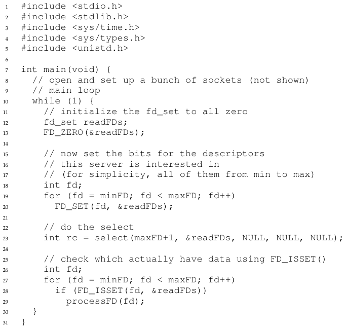

# الفصل 33: التزامن القائم على الأحداث (متقدّم)

كتبنا عن التزامن حتى الآن كأن الطريقة الوحيدة لبناء تطبيقات متزامنة هي استخدام الخيوط. وهذا، مثل أمور كثيرة في الحياة، ليس صحيحًا تمامًا. فتحديدًا، ثمة نمط مختلف للبرمجة المتزامنة يُستخدم كثيرًا في التطبيقات ذات الواجهة الرسومية [O96] وفي بعض أنواع خوادم الإنترنت [PDZ99]. وهذا النمط، المعروف بالتزامن القائم على الأحداث، صار شائعًا في بعض الأنظمة الحديثة، ومنها أطر الخوادم مثل node.js [N13]، لكن جذوره توجد في أنظمة C/UNIX التي نناقشها أدناه.

والمشكلة التي يعالجها التزامن القائم على الأحداث مزدوجة. الأولى أن إدارة التزامن إدارةً صحيحة في التطبيقات متعددة الخيوط قد تكون صعبة؛ فكما ناقشنا، قد تنشأ أقفال ناقصة أو جمود أو مشكلات بغيضة أخرى. والثانية أن المطوّر في تطبيق متعدد الخيوط لا سيطرة له، أو سيطرة ضئيلة، على ما يُجدوَل في لحظة معيّنة؛ فهو ببساطة ينشئ خيوطًا ثم يأمل أن يجدولها نظام التشغيل الكامن على نحو معقول على المعالجات المتاحة. وبالنظر إلى صعوبة بناء مجدول عام الغرض يعمل عملًا جيدًا في كل الحالات ولكل أحمال العمل، فإن نظام التشغيل قد يجدول العمل أحيانًا على نحو أقل من الأمثل. ومن ثمّ صار لدينا...

> **جوهر المسألة: كيف نبني خوادم متزامنة دون خيوط**
>
> كيف نبني خادمًا متزامنًا دون استخدام الخيوط، فنحتفظ بذلك بالتحكم في التزامن ونتجنّب بعض المشكلات التي يبدو أنها تبتلي التطبيقات متعددة الخيوط؟

## 33.1 الفكرة الأساسية: حلقة الأحداث

المقاربة الأساسية التي سنستخدمها، كما ذُكر أعلاه، تُسمّى التزامن القائم على الأحداث. وهي بسيطة جدًا: تنتظر ببساطة أن يحدث شيء ما (أي «حدث»)؛ فحين يحدث، تفحص نوع الحدث وتؤدي القدر القليل من العمل الذي يتطلبه (وقد يشمل إصدار طلبات إدخال/إخراج، أو جدولة أحداث أخرى لمعالجتها لاحقًا، وما إلى ذلك). هذا كل شيء!

وقبل الخوض في التفاصيل، لنفحص أولًا شكل الخادم النمطي القائم على الأحداث. فالتطبيقات كهذه تُبنى حول بنية بسيطة تُعرف بحلقة الأحداث. والشيفرة الزائفة لحلقة أحداث تبدو هكذا:

```
while (1) {
    events = getEvents();
    for (e in events)
        processEvent(e);
}
```

إنها بهذه البساطة فعلًا. فالحلقة الرئيسية تنتظر ببساطة أن يكون لها ما تفعله (باستدعاء getEvents() في الشيفرة أعلاه)، ثم تعالج كل حدث يُعاد، واحدًا في المرة؛ والشيفرة التي تعالج كل حدث تُعرف بمعالج الحدث. والأهم أن المعالج حين يعالج حدثًا يكون هو النشاط الوحيد الجاري في النظام؛ ومن ثمّ فإن تحديد الحدث الذي يُعالج تاليًا يكافئ الجدولة. وهذا التحكم الصريح في الجدولة من المزايا الأساسية للمقاربة القائمة على الأحداث.

غير أن هذا النقاش يتركنا أمام سؤال أكبر: كيف يحدّد الخادم القائم على الأحداث بالضبط أي الأحداث تجري، خصوصًا فيما يتعلق بإدخال/إخراج الشبكة والقرص؟ وتحديدًا، كيف يستطيع خادم أحداث أن يعرف أن رسالة قد وصلت إليه؟

## 33.2 واجهة برمجية مهمة: select() (أو poll())

وبعد أن صارت حلقة الأحداث الأساسية في ذهننا، علينا الآن أن نعالج مسألة كيفية تلقّي الأحداث. ففي معظم الأنظمة تتوفر واجهة برمجية أساسية، عبر نداءَي النظام select() أو poll().

وما تتيحه هذه الواجهات للبرنامج بسيط: أن يفحص ما إذا كان ثمة إدخال/إخراج واردة ينبغي الالتفات إليها. فتخيّل، على سبيل المثال، تطبيق شبكة (مثل خادم ويب) يريد أن يفحص ما إذا كانت أي حزم شبكة قد وصلت، ليخدمها. ونداءات النظام هذه تتيح لك ذلك بالضبط.

خذ select() مثالًا. فصفحة الدليل (على جهاز Mac) تصف الواجهة هكذا:

```
int select(int nfds,
           fd_set *restrict readfds,
           fd_set *restrict writefds,
           fd_set *restrict errorfds,
           struct timeval *restrict timeout);
```

والوصف الفعلي من صفحة الدليل: تفحص select() مجموعات واصفات الإدخال/الإخراج التي تُمرَّر عناوينها في readfds وwritefds وerrorfds لترى ما إذا كانت بعض واصفاتها جاهزة للقراءة، أو جاهزة للكتابة، أو معلّقة على شرط استثنائي، على الترتيب. وتُفحص أول nfds واصفًا في كل مجموعة، أي أن الواصفات من 0 إلى nfds-1 في مجموعات الواصفات تُفحص. وعند العودة تستبدل select() مجموعات الواصفات المعطاة بمجموعات جزئية تتكوّن من الواصفات الجاهزة للعملية المطلوبة. وتُعيد select() العدد الكلي للواصفات الجاهزة في كل المجموعات.

> **استطراد: الواجهات الحاجزة وغير الحاجزة**
>
> الواجهات الحاجزة (أو المتزامنة) تؤدي كل عملها قبل أن تعود إلى المستدعي؛ أما الواجهات غير الحاجزة (أو اللامتزامنة) فتبدأ بعض العمل لكنها تعود فورًا، فتترك ما ينبغي إنجازه يُنجَز في الخلفية.
>
> والسبب المعتاد في النداءات الحاجزة هو الإدخال/الإخراج من نوع ما. فمثلًا، إن كان على النداء أن يقرأ من القرص ليكتمل، فقد يحجب، منتظرًا عودة طلب الإدخال/الإخراج الذي أُرسل إلى القرص.
>
> ويمكن استخدام الواجهات غير الحاجزة في أي نمط من البرمجة (مثلًا مع الخيوط)، لكنها جوهرية في المقاربة القائمة على الأحداث، لأن النداء الذي يحجب سيوقف كل تقدّم.

وثمة نقطتان عن select(). أولًا، لاحظ أنها تتيح لك أن تفحص ما إذا كانت الواصفات قابلة للقراءة كما قابلة للكتابة؛ فالأولى تتيح للخادم أن يحدّد أن حزمة جديدة قد وصلت وتحتاج إلى معالجة، أما الثانية فتتيح للخدمة أن تعرف متى يصحّ الرد (أي أن طابور الصادر غير ممتلئ).

وثانيًا، لاحظ وسيط المهلة (timeout). ومن الاستخدامات الشائعة هنا ضبط المهلة على NULL، وهو ما يجعل select() تحجب بلا نهاية إلى أن يصبح بعض الواصفات جاهزًا. غير أن الخوادم الأكثر متانة ستحدّد عادةً نوعًا من المهلة؛ ومن التقنيات الشائعة ضبط المهلة على صفر، فتُستخدم بذلك select() لتعود فورًا.

ونداء النظام poll() شبيه جدًا. انظر صفحة دليله، أو Stevens وRago [SR05]، للتفاصيل.

وفي كلتا الحالتين، تمنحنا هذه البدائيات الأساسية طريقة لبناء حلقة أحداث غير حاجزة، تفحص ببساطة الحزم الواردة، وتقرأ من المقابس التي عليها رسائل، وتردّ حسب الحاجة.

## 33.3 استخدام select()

ولنجعل هذا أكثر تحديدًا، لنفحص كيف نستخدم select() لمعرفة أي واصفات الشبكة عليها رسائل واردة. ويعرض الشكل 33.1 مثالًا بسيطًا.



**الشكل 33.1:** شيفرة بسيطة تستخدم select()

هذه الشيفرة سهلة الفهم فعلًا. فبعد بعض التهيئة يدخل الخادم حلقة لا نهائية. وداخل الحلقة يستخدم الماكرو FD_ZERO() ليفرّغ أولًا مجموعة واصفات الملفات، ثم يستخدم FD_SET() ليدرج كل واصفات الملفات من minFD إلى maxFD في المجموعة. وهذه المجموعة من الواصفات قد تمثّل، مثلًا، كل مقابس الشبكة التي ينتبه إليها الخادم. وأخيرًا يستدعي الخادم select() ليرى أي الاتصالات لديها بيانات متاحة عليها. ثم باستخدام FD_ISSET() داخل حلقة يستطيع خادم الأحداث أن يرى أي الواصفات لديها بيانات جاهزة ويعالج البيانات الواردة.

وبطبيعة الحال سيكون خادم حقيقي أعقد من هذا، ويحتاج إلى منطق يستخدمه عند إرسال الرسائل وإصدار إدخال/إخراج القرص وتفاصيل أخرى كثيرة. ولمزيد من المعلومات انظر Stevens وRago [SR05] لمعلومات الواجهة البرمجية، أو Pai وآخرين أو Welsh وآخرين لنظرة عامة جيدة على التدفق العام للخوادم القائمة على الأحداث [PDZ99, WCB01].

> **نصيحة: لا تحجب في الخوادم القائمة على الأحداث**
>
> تتيح الخوادم القائمة على الأحداث تحكمًا ناعم الحبيبات في جدولة المهام. غير أنه للحفاظ على هذا التحكم، لا يجوز أبدًا إجراء أي نداء يحجب تنفيذ المستدعي؛ وفشل الالتزام بهذه النصيحة التصميمية سيفضي إلى خادم قائم على الأحداث محجوب، وعملاء محبطين، وأسئلة جدّية عمّا إذا كنت قد قرأت هذا الجزء من الكتاب أصلًا.

## 33.4 لماذا أبسط؟ لا حاجة إلى أقفال

مع معالج واحد وتطبيق قائم على الأحداث، لم تعد المشكلات الموجودة في البرامج المتزامنة حاضرة. فتحديدًا، لأن حدثًا واحدًا فقط يُعالَج في المرة، لا حاجة إلى الحصول على أقفال أو إطلاقها؛ فالخادم القائم على الأحداث لا يستطيع خيط آخر أن يقطعه لأنه أحادي الخيط بشكل قاطع. ومن ثمّ لا تظهر أخطاء التزامن الشائعة في البرامج ذات الخيوط في المقاربة الأساسية القائمة على الأحداث.

## 33.5 مشكلة: نداءات النظام الحاجزة

حتى الآن تبدو البرمجة القائمة على الأحداث رائعة، أليس كذلك؟ تبرمج حلقة بسيطة، وتعالج الأحداث حين تنشأ. بل لا تحتاج حتى إلى التفكير في القفل! غير أن ثمة مشكلة: ماذا لو كان الحدث يتطلب أن تصدر نداء نظام قد يحجب؟

تخيّل، على سبيل المثال، أن طلبًا يأتي من عميل إلى خادم لقراءة ملف من القرص وإعادة محتوياته إلى العميل الطالب (كطلب HTTP بسيط إلى حد كبير). ولخدمة طلب كهذا، سيكون على أحد معالجات الأحداث في النهاية أن يصدر نداء النظام open() لفتح الملف، يتبعه سلسلة نداءات read() لقراءة الملف. وحين يُقرأ الملف إلى الذاكرة، سيبدأ الخادم على الأرجح بإرسال النتائج إلى العميل.

وقد يصدر كل من open() وread() طلبات إدخال/إخراج إلى نظام التخزين (حين لا تكون البيانات الوصفية أو البيانات اللازمة في الذاكرة أصلًا)، ومن ثمّ قد يستغرقان وقتًا طويلًا في الخدمة. ومع خادم قائم على الخيوط، لا مشكلة في ذلك: فبينما يتوقف الخيط الذي أصدر طلب الإدخال/الإخراج (منتظرًا اكتماله)، تستطيع خيوط أخرى العمل، فيتمكّن الخادم بذلك من التقدّم. بل إن هذا التداخل الطبيعي بين الإدخال/الإخراج والحساب الآخر هو ما يجعل البرمجة القائمة على الخيوط طبيعية ومباشرة إلى حد كبير.

أما مع المقاربة القائمة على الأحداث، فلا خيوط أخرى تعمل: مجرد حلقة الأحداث الرئيسية. وهذا يعني أن معالج الحدث إن أصدر نداءً يحجب، فسيفعل الخادم كله ذلك بالضبط: يحجب إلى أن يكتمل النداء. وحين تحجب حلقة الأحداث، يبقى النظام عاطلًا، ومن ثمّ ثمة هدر هائل محتمل للموارد. وهكذا صارت لدينا قاعدة يجب الالتزام بها في الأنظمة القائمة على الأحداث: لا يُسمح بأي نداءات حاجزة.

## 33.6 حلّ: الإدخال/الإخراج اللامتزامن

وللتغلب على هذا الحدّ، أدخلت أنظمة تشغيل حديثة كثيرة طرقًا جديدة لإصدار طلبات الإدخال/الإخراج إلى نظام القرص، تُشار إليها عمومًا بالإدخال/الإخراج اللامتزامن. فهذه الواجهات تتيح للتطبيق أن يصدر طلب إدخال/إخراج ويعيد التحكم فورًا إلى المستدعي، قبل اكتمال الإدخال/الإخراج؛ وتتيح واجهات إضافية للتطبيق أن يحدّد ما إذا كانت عمليات إدخال/إخراج مختلفة قد اكتملت.

ولنفحص مثلًا الواجهة المتوفرة على جهاز Mac (ولأنظمة أخرى واجهات مشابهة). وتدور الواجهات حول بنية أساسية، هي struct aiocb أو كتلة التحكم AIO بالمصطلح الشائع. ونسخة مبسّطة من البنية تبدو هكذا (انظر صفحات الدليل لمزيد من المعلومات):

```
struct aiocb {
    int                     aio_fildes;         // File descriptor
    off_t                   aio_offset;         // File offset
    volatile void           *aio_buf;           // Location of buffer
    size_t                  aio_nbytes;         // Length of transfer
};
```

ولإصدار قراءة لامتزامنة إلى ملف، ينبغي للتطبيق أن يملأ أولًا هذه البنية بالمعلومات ذات الصلة: واصف ملف المطلوب قراءته (aio_fildes)، والإزاحة داخل الملف (aio_offset)، وطول الطلب (aio_nbytes)، وأخيرًا موضع الذاكرة الهدف الذي ينبغي نسخ نتائج القراءة إليه (aio_buf).

وبعد ملء هذه البنية، يجب على التطبيق أن يصدر النداء اللامتزامن لقراءة الملف؛ وعلى جهاز Mac، هذه الواجهة هي ببساطة واجهة القراءة اللامتزامنة:

```
int aio_read(struct aiocb *aiocbp);
```

ويحاول هذا النداء إصدار الإدخال/الإخراج؛ فإن نجح عاد فورًا، ويستطيع التطبيق (أي الخادم القائم على الأحداث) أن يواصل عمله.

غير أن ثمة قطعة أخيرة من الأحجية يجب أن نحلّها. كيف نعرف متى يكتمل الإدخال/الإخراج، ومن ثمّ أن المخزن المؤقت (الذي تشير إليه aio_buf) صار يحوي البيانات المطلوبة؟

ثمة واجهة أخيرة لازمة. وعلى جهاز Mac تُشار إليها (على نحو مربك بعض الشيء) بـaio_error(). والواجهة تبدو هكذا:

```
int aio_error(const struct aiocb *aiocbp);
```

ويفحص نداء النظام هذا ما إذا كان الطلب الذي يشير إليه aiocbp قد اكتمل. فإن اكتمل أعاد الروتين النجاح (مشارًا إليه بصفر)؛ وإن لم يكتمل أُعيد EINPROGRESS. ومن ثمّ، لكل إدخال/إخراج لامتزامن معلّق، يستطيع التطبيق أن يستطلع النظام دوريًا عبر نداء aio_error() ليحدّد ما إذا كان ذلك الإدخال/الإخراج قد اكتمل بعد.

وثمة أمر قد تكون لاحظته: فحص اكتمال الإدخال/الإخراج مؤلم؛ فإن كان للبرنامج عشرات أو مئات من عمليات الإدخال/الإخراج الصادرة في لحظة معيّنة، فهل يظل يفحص كل واحدة منها مرارًا، أم ينتظر قليلًا أولًا، أم...؟

ولمعالجة هذه المسألة، تقدّم بعض الأنظمة مقاربة قائمة على الانقطاع. فهذه الطريقة تستخدم إشارات يونكس لتُعلم التطبيقات عند اكتمال إدخال/إخراج لامتزامن، فتُزيل بذلك الحاجة إلى سؤال النظام مرارًا. ومسألة الاستطلاع مقابل الانقطاعات هذه تُرى في الأجهزة أيضًا، كما سترى (أو رأيت بالفعل) في فصل أجهزة الإدخال/الإخراج.

وفي الأنظمة التي لا إدخال/إخراج لامتزامن فيها، لا يمكن تنفيذ المقاربة القائمة على الأحداث الخالصة. غير أن باحثين أذكياء استنبطوا طرقًا تعمل عملًا جيدًا إلى حد كبير في مكانها. فمثلًا يصف Pai وآخرون [PDZ99] مقاربة هجينة تُستخدم فيها الأحداث لمعالجة حزم الشبكة، ويُستخدم فيها مجمّع خيوط لإدارة عمليات الإدخال/الإخراج المعلّقة. اقرأ ورقتهم للتفاصيل.

## 33.7 مشكلة أخرى: إدارة الحالة

وثمة مشكلة أخرى في المقاربة القائمة على الأحداث، وهي أن الشيفرة كهذه أعقد عمومًا في كتابتها من الشيفرة التقليدية القائمة على الخيوط. والسبب كما يلي: حين يصدر معالج حدث إدخال/إخراج لامتزامن، عليه أن يحزم بعض حالة البرنامج ليستخدمها معالج الحدث التالي حين يكتمل الإدخال/الإخراج أخيرًا؛ وهذا العمل الإضافي غير لازم في البرامج القائمة على الخيوط، لأن الحالة التي يحتاجها البرنامج على مكدّس الخيط. ويسمّي Adya وآخرون هذا العمل إدارة المكدّس اليدوية، وهو جوهري في البرمجة القائمة على الأحداث [A+02].

ولنجعل هذه النقطة أكثر تحديدًا، لننظر إلى مثال بسيط يحتاج فيه خادم قائم على الخيوط إلى القراءة من واصف ملف (fd) ثم، عند الاكتمال، كتابة البيانات التي قرأها من الملف إلى واصف مقبس شبكة (sd). والشيفرة (بإغفال فحص الأخطاء) تبدو هكذا:

```
int rc = read(fd, buffer, size);
rc = write(sd, buffer, size);
```

وكما ترى، ففي برنامج متعدد الخيوط يكون إنجاز هذا النوع من العمل تافهًا؛ فحين تعود read() أخيرًا، تعرف الشيفرة فورًا أي مقبس تكتب إليه لأن هذه المعلومة على مكدّس الخيط (في المتغيّرة sd).

أما في نظام قائم على الأحداث فالحياة ليست بهذه السهولة. ولأداء المهمة نفسها، سنصدر أولًا القراءة لا متزامنةً، باستخدام نداءات AIO الموصوفة أعلاه. ولنقل إننا نفحص بعد ذلك دوريًا اكتمال القراءة باستخدام نداء aio_error()؛ فحين يُعلمنا ذلك النداء أن القراءة اكتملت، كيف يعرف الخادم القائم على الأحداث ما يفعل؟

> **استطراد: إشارات يونكس**
>
> ثمة بنية تحتية هائلة وساحرة تُعرف بالإشارات موجودة في كل نسخ يونكس الحديثة. وفي أبسط صورها، توفّر الإشارات طريقة للتواصل مع عملية. فتحديدًا، يمكن إيصال إشارة إلى تطبيق؛ وفعل ذلك يوقف التطبيق عمّا يفعله ليشغّل معالج إشارة، أي بعض الشيفرة في التطبيق لمعالجة تلك الإشارة. وحين ينتهي، يستأنف العملية سلوكها السابق فحسب.
>
> ولكل إشارة اسم، مثل HUP (إنهاء الاتصال) وINT (انقطاع) وSEGV (انتهاك التجزئة)، وما إلى ذلك؛ انظر صفحة الدليل للتفاصيل. ومن المثير للاهتمام أن النواة نفسها هي التي تُرسل الإشارة أحيانًا. فمثلًا، حين يصادف برنامجك انتهاك تجزئة، يرسل إليه نظام التشغيل SIGSEGV (وإضافة SIG إلى أسماء الإشارات أمر شائع)؛ فإن كان برنامجك مهيّأً لالتقاط تلك الإشارة، يمكنك فعلًا أن تشغّل بعض الشيفرة ردًّا على هذا السلوك الخاطئ (وهو مفيد للتنقيح). وحين تُرسل إشارة إلى عملية غير مهيّأة لمعالجة إشارة، يُنفَّذ السلوك الافتراضي؛ وفي حالة SEGV تُقتل العملية.
>
> وهذا برنامج بسيط يدخل حلقة لا نهائية، لكنه نصب أولًا معالج إشارة لالتقاط SIGHUP:
>
> ```
> void handle(int arg) {
>     printf("stop wakin' me up...\n");
> }
>
> int main(int argc, char *argv[]) {
>     signal(SIGHUP, handle);
>     while (1)
>         ; // doin' nothin' except catchin' some sigs
>     return 0;
> }
> ```
>
> ويمكنك أن ترسل إليه إشارات بأداة سطر الأوامر kill (نعم، هذا اسم غريب وعدواني). وفعل ذلك سيقطع حلقة while الرئيسية في البرنامج ويشغّل شيفرة المعالج handle():
>
> ```
> prompt> ./main &
> [3] 36705
> prompt> kill -HUP 36705
> stop wakin' me up...
> prompt> kill -HUP 36705
> stop wakin' me up...
> ```
>
> وثمة الكثير لتعلّمه عن الإشارات، حتى إن فصلًا كاملًا، بل صفحة واحدة، لا يكفي لذلك إطلاقًا. وكما هو الحال دائمًا، ثمة مصدر عظيم واحد: Stevens وRago [SR05]. اقرأ المزيد إن كنت مهتمًا.

والحل، كما يصفه Adya وآخرون [A+02]، هو استخدام بنية قديمة من لغات البرمجة تُعرف بالمتابعة (continuation) [FHK84]. ومع أنها تبدو معقّدة، فالفكرة بسيطة إلى حد كبير: سجّل المعلومات اللازمة لإنهاء معالجة هذا الحدث في بنية بيانات ما؛ فحين يحدث الحدث (أي حين يكتمل إدخال/إخراج القرص)، ابحث عن المعلومات اللازمة وعالج الحدث.

وفي هذه الحالة المحدّدة، يكون الحل هو تسجيل واصف المقبس (sd) في بنية بيانات من نوع ما (مثل جدول تجزئة)، مفهرسةً بواصف الملف (fd). فحين يكتمل إدخال/إخراج القرص، يستخدم معالج الحدث واصف الملف للبحث عن المتابعة، التي ستعيد قيمة واصف المقبس إلى المستدعي. وعند هذه النقطة (أخيرًا) يستطيع الخادم أن يؤدي آخر قطعة عمل لكتابة البيانات إلى المقبس.

## 33.8 ما يزال صعبًا مع الأحداث

ثمة بضع صعوبات أخرى في المقاربة القائمة على الأحداث يجدر ذكرها. فمثلًا، حين انتقلت الأنظمة من معالج واحد إلى معالجات متعددة، اختفى بعض بساطة المقاربة القائمة على الأحداث. فتحديدًا، للاستفادة من أكثر من معالج، على خادم الأحداث أن يشغّل معالجات أحداث متعددة على التوازي؛ وحين يفعل ذلك تنشأ مشكلات المزامنة المعتادة (مثل الأقسام الحرجة)، ويجب استخدام الحلول المعتادة (مثل الأقفال). ومن ثمّ، على الأنظمة الحديثة متعددة النوى، لم يعد معالجة الأحداث البسيطة دون أقفال ممكنة.

وثمة مشكلة أخرى في المقاربة القائمة على الأحداث، وهي أنها لا تتكامل جيدًا مع بعض أنواع نشاط النظام، مثل الترقيم (paging). فمثلًا، إن أصاب خطأ صفحة معالج حدث، فسيحجب، ومن ثمّ لن يتقدّم الخادم إلى أن يكتمل خطأ الصفحة. ومع أن الخادم بُني ليتجنّب الحجب الصريح، فهذا النوع من الحجب الضمني بسبب أخطاء الصفحات يصعب تجنّبه، ومن ثمّ قد يفضي إلى مشكلات أداء كبيرة حين يشيع.

وثمة مسألة ثالثة، وهي أن الشيفرة القائمة على الأحداث قد يصعب إدارتها بمرور الوقت، لأن الدلالة الدقيقة لروتينات مختلفة تتغيّر [A+02]. فمثلًا، إن تغيّر روتين من غير حاجز إلى حاجز، فعلى معالج الحدث الذي يستدعيه أن يتغيّر هو أيضًا ليتلاءم مع طبيعته الجديدة، بتمزيق نفسه إلى قطعتين. ولأن الحجب كارثي إلى هذا الحد على الخوادم القائمة على الأحداث، فعلى المبرمج أن يظل مترصدًا لتغيّرات كهذه في دلالات الواجهات التي يستخدمها كل حدث.

وأخيرًا، ومع أن إدخال/إخراج القرص اللامتزامن صار ممكنًا الآن على معظم المنصّات، فقد استغرق الوصول إليه وقتًا طويلًا [PDZ99]، وهو لا يتكامل أبدًا مع إدخال/إخراج الشبكة اللامتزامن بالبساطة والتوحّد اللذين قد تتوقعهما. فمثلًا، مع أن المرء يودّ ببساطة أن يستخدم واجهة select() لإدارة كل عمليات الإدخال/الإخراج المعلّقة، فالمطلوب عادةً بعض الجمع بين select() للشبكات ونداءات AIO لإدخال/إخراج القرص.

## 33.9 الخلاصة

قدّمنا مقدمة عارية العظام لنمط مختلف من التزامن قائم على الأحداث. فالخوادم القائمة على الأحداث تمنح التطبيق نفسه التحكم في الجدولة، لكنها تفعل ذلك بكلفة من التعقيد وصعوبة التكامل مع جوانب أخرى من الأنظمة الحديثة (مثل الترقيم). وبسبب هذه التحديات لم تظهر مقاربة واحدة كأفضل المقاربات؛ ومن ثمّ يُرجَّح أن يبقى كل من الخيوط والأحداث مقاربتين مختلفتين للمشكلة نفسها، مشكلة التزامن، لسنوات كثيرة قادمة. اقرأ بعض الأوراق البحثية (مثل [A+02, PDZ99, vB+03, WCB01])، أو أفضل من ذلك: اكتب بعض الشيفرة القائمة على الأحداث، لتتعلّم أكثر.

## المراجع

> [A+02] «Cooperative Task Management Without Manual Stack Management» لـAtul Adya وJon Howell وMarvin Theimer وWilliam J. Bolosky وJohn R. Douceur. USENIX ATC '02، مونتيري، كاليفورنيا، يونيو 2002. هذه الورقة الجوهرية أول من بيّن بوضوح بعض صعوبات التزامن القائم على الأحداث، واقترح بعض الحلول البسيطة، واستكشف أيضًا الفكرة الأكثر جنونًا بدمج نمطَي إدارة التزامن في تطبيق واحد!

> [FHK84] «Programming With Continuations» لـDaniel P. Friedman وChristopher T. Haynes وEugene E. Kohlbecker. في Program Transformation and Programming Environments، Springer Verlag، 1984. المرجع الكلاسيكي لهذه الفكرة القديمة من عالم لغات البرمجة. وهي صارت شائعة أكثر وأكثر في بعض اللغات الحديثة.

> [N13] «Node.js Documentation» لـالقائمين على بناء node.js. متاح: nodejs.org/api. واحد من الأطر الجديدة الرائعة الكثيرة التي تساعدك على بناء خدمات وتطبيقات ويب بسهولة. وعلى كل مخضرم أنظمة حديث أن يتقن أطرًا كهذه (وعلى الأرجح أكثر من واحد). خصّص الوقت وطوّر شيئًا في أحد هذه العوالم وكن خبيرًا.

> [O96] «Why Threads Are A Bad Idea (for most purposes)» لـJohn Ousterhout. محاضرة بدعوة في USENIX '96، سان دييغو، كاليفورنيا، يناير 1996. محاضرة رائعة عن كيف أن الخيوط ليست ملائمة جدًا للتطبيقات ذات الواجهة الرسومية (لكن الأفكار أعمّ). وقد كوّن Ousterhout كثيرًا من هذه الآراء وهو يطوّر Tcl/Tk، وهي لغة برمجة وأدوات رائعة جعلت تطوير التطبيقات ذات الواجهة الرسومية أسهل مئة مرة مما كان عليه الحال وقتها. ومع أن أدوات Tk الرسومية ما تزال حيّة (في بايثون مثلًا)، يبدو أن Tcl يموت ببطء (للأسف).

> [PDZ99] «Flash: An Efficient and Portable Web Server» لـVivek S. Pai وPeter Druschel وWilly Zwaenepoel. USENIX '99، مونتيري، كاليفورنيا، يونيو 1999. ورقة رائدة عن كيفية بناء خوادم الويب في عصر الإنترنت الناشئ آنذاك. اقرأها لتفهم الأساسيات ولترى أيضًا أفكار المؤلفين عن بناء أنظمة هجينة حين يغيب دعم الإدخال/الإخراج اللامتزامن.

> [SR05] «Advanced Programming in the UNIX Environment» لـW. Richard Stevens وStephen A. Rago. Addison-Wesley، 2005. مرة أخرى نُحيل إلى الكتاب الكلاسيكي الذي يجب أن يكون على رفّك في برمجة أنظمة يونكس. فإن كان ثمة تفصيل تحتاج إلى معرفته، فهو هنا.

> [vB+03] «Capriccio: Scalable Threads for Internet Services» لـRob von Behren وJeremy Condit وFeng Zhou وGeorge C. Necula وEric Brewer. SOSP '03، بحيرة جورج، نيويورك، أكتوبر 2003. ورقة عن كيفية جعل الخيوط تعمل على نطاق هائل؛ وهي ردّ على كل العمل القائم على الأحداث الجاري آنذاك.

> [WCB01] «SEDA: An Architecture for Well-Conditioned, Scalable Internet Services» لـMatt Welsh وDavid Culler وEric Brewer. SOSP '01، بانف، كندا، أكتوبر 2001. لفّة جميلة على الخدمة القائمة على الأحداث تجمع الخيوط والطوابير والمعالجة القائمة على الأحداث في كلّ انسيابي واحد. وقد وجدت بعض هذه الأفكار طريقها إلى بنى تحتية لشركات مثل Google وAmazon وغيرهما.

## الواجب (شيفرة)

في هذا الواجب (القصير) ستكتسب بعض الخبرة بالشيفرة القائمة على الأحداث وبعض مفاهيمها المفتاحية. حظًا سعيدًا!

## الأسئلة

1. اكتب أولًا خادمًا بسيطًا يستطيع قبول اتصالات TCP وخدمتها. وسيكون عليك أن تنقّر في الإنترنت قليلًا إن كنت لا تعرف كيف تفعل ذلك. ابنه ليخدم طلبًا واحدًا في المرة بالضبط؛ وليكن كل طلب بسيطًا جدًا، مثل الحصول على وقت اليوم الحالي.
2. أضف الآن واجهة select(). ابنِ برنامجًا رئيسيًا يستطيع قبول اتصالات متعددة، وحلقة أحداث تفحص أي واصفات الملفات عليها بيانات، ثم تقرأ تلك الطلبات وتعالجها. واحرص على أن تختبر بعناية أنك تستخدم select() استخدامًا صحيحًا.
3. لنجعل الطلبات الآن أكثر تشويقًا قليلًا، لنحاكي خادم ويب أو ملفات بسيطًا. فليكن كل طلب قراءة محتويات ملف (مسمّى في الطلب)، وليستجب الخادم بقراءة الملف إلى مخزن مؤقت ثم إعادة محتوياته إلى العميل. استخدم نداءات النظام القياسية open() وread() وclose() لتنفيذ هذه الميزة. وكن حذرًا قليلًا هنا: فإن تركت هذا يعمل وقتًا طويلًا، فقد يكتشف أحدهم كيفية استخدامه لقراءة كل الملفات على حاسوبك!
4. الآن، بدلًا من استخدام نداءات نظام الإدخال/الإخراج القياسية، استخدم واجهات الإدخال/الإخراج اللامتزامن كما هو موصوف في الفصل. فما مدى صعوبة إدماج الواجهات اللامتزامنة في برنامجك؟
5. للتسلية، أضف بعض معالجة الإشارات إلى شيفرتك. فمن استخدامات الإشارات الشائعة أن تنخس خادمًا ليعيد تحميل ملف تهيئة من نوع ما، أو ليتخذ إجراءً إداريًا آخر. وربما تكون إحدى الطرق الطبيعية للعب بهذا هي إضافة مخزن ملفات مؤقت على مستوى المستخدم إلى خادمك، يخزّن الملفات التي وُصل إليها حديثًا. نفّذ معالج إشارة يفرّغ المخزن المؤقت حين تُرسل الإشارة إلى عملية الخادم.
6. أخيرًا، تبقى القطعة الصعبة: كيف تعرف إن كان الجهد المبذول في بناء مقاربة لامتزامنة قائمة على الأحداث يستحق العناء؟ هل تستطيع أن تصنع تجربة تُظهر الفوائد؟ وما قدر تعقيد التنفيذ الذي أضافته مقاربتك؟
