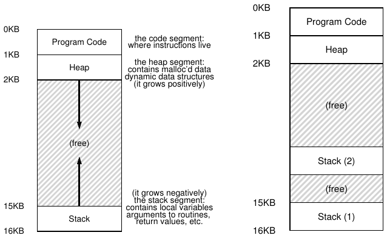
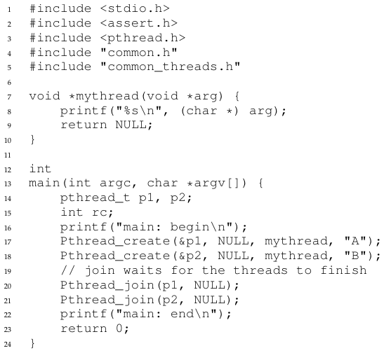
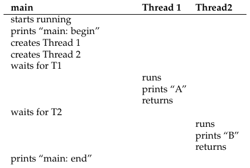
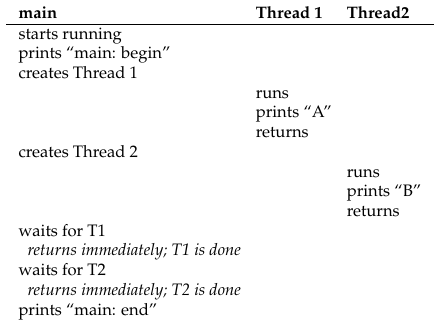
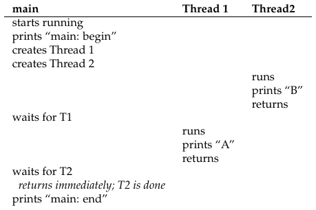
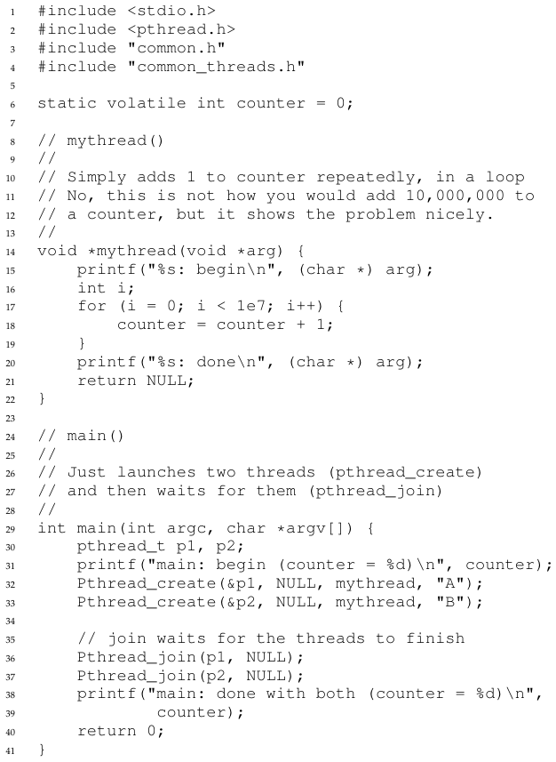
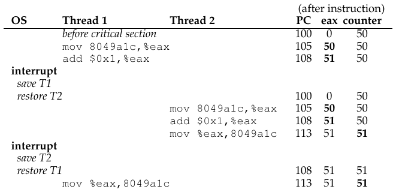

# الفصل 26: التزامن: مقدمة

رأينا حتى الآن تطوّر التجريدات الأساسية التي يقدّمها نظام التشغيل. ورأينا كيف نأخذ معالجًا ماديًا واحدًا ونحوّله إلى معالجات افتراضية متعددة، فنتيح وهم تشغيل عدة برامج في الوقت نفسه. ورأينا أيضًا كيف نصنع وهم ذاكرة افتراضية كبيرة وخاصة لكل عملية؛ فتجريد فضاء العناوين هذا يجعل كل برنامج يتصرّف كما لو كان يملك ذاكرته الخاصة، بينما يقوم نظام التشغيل سرًا بتعدّد فضاءات العناوين على الذاكرة المادية (وأحيانًا على القرص).

نقدّم في هذا الفصل تجريدًا جديدًا لعملية واحدة قيد التشغيل: الخيط. فبدلًا من رؤيتنا الكلاسيكية لنقطة تنفيذ واحدة داخل البرنامج (أي عدّاد برنامج واحد تُجلب منه التعليمات وتُنفَّذ)، يكون في البرنامج متعدد الخيوط أكثر من نقطة تنفيذ (أي عدة عدّادات برنامج، يُجلب من كل منها ويُنفَّذ). وربما طريقة أخرى لتصوّر ذلك هي أن كل خيط يشبه إلى حد كبير عملية مستقلة، إلا من فرق واحد: الخيوط تتشارك فضاء العناوين نفسه، وبالتالي تستطيع الوصول إلى البيانات نفسها.

وهكذا فحالة الخيط الواحد شبيهة جدًا بحالة العملية. فللخيط عدّاد برنامج (PC) يتتبّع من أين يجلب البرنامج تعليماته. ولكل خيط مجموعته الخاصة من السجلات التي يستخدمها في الحساب؛ ومن ثمّ، إذا كان لدينا خيطان يعملان على معالج واحد، فحين ننتقل من تشغيل أحدهما (T1) إلى تشغيل الآخر (T2) يجب أن يحدث تبديل سياق. وتبديل السياق بين الخيوط شبيه جدًا بتبديل السياق بين العمليات، إذ يجب حفظ حالة سجلات T1 واستعادة حالة سجلات T2 قبل تشغيل T2. وكنا في العمليات نحفظ الحالة في كتلة تحكم بالعملية (PCB)؛ أما الآن فسنحتاج إلى كتلة تحكم بالخيط (TCB) واحدة أو أكثر لتخزين حالة كل خيط من خيوط العملية. غير أن هناك فرقًا جوهريًا واحدًا في تبديل السياق الذي نُجريه بين الخيوط مقارنةً بالعمليات: ففضاء العناوين يبقى هو نفسه (أي لا حاجة إلى تبديل جدول الصفحات الذي نستخدمه).

وثمة فرق جوهري آخر بين الخيوط والعمليات يتعلق بالمكدّس. ففي نموذجنا البسيط لفضاء عناوين عملية كلاسيكية (يمكننا الآن أن نسمّيها عملية أحادية الخيط)، يوجد مكدّس واحد، يقيم عادةً في أسفل فضاء العناوين (الشكل 26.1، يسارًا).



**الشكل 26.1:** فضاءات عناوين أحادية الخيط ومتعددة الخيوط

غير أن في العملية متعددة الخيوط يعمل كل خيط باستقلال، وله أن يستدعي بالطبع روتينات متنوعة ليؤدي العمل الذي يقوم به. وبدلًا من مكدّس واحد في فضاء العناوين، سيكون لكل خيط مكدّس خاص. ولنقل إن لدينا عملية متعددة الخيوط فيها خيطان؛ ففضاء العناوين الناتج يبدو مختلفًا (الشكل 26.1، يمينًا).

ترى في هذا الشكل مكدّسين منتشرين في فضاء عناوين العملية. وهكذا فإن أي متغيّرات مخصَّصة على المكدّس، أو وسائط، أو قيم عائدة، أو أشياء أخرى نضعها على المكدّس، ستوضع فيما يُسمّى أحيانًا التخزين الخاص بالخيط، أي مكدّس الخيط المعني.

وربما تلاحظ أيضًا كيف يفسد هذا تخطيط فضاء عناويننا الجميل. فسابقًا كان المكدّس والكومة ينموان باستقلال، ولم تكن المشكلة تظهر إلا حين تنفد المساحة في فضاء العناوين. أما هنا فلم تعد لدينا تلك الحالة الجميلة. لحسن الحظ، هذا مقبول عادةً، لأن المكدّسات ليست في العادة بحاجة إلى أن تكون كبيرة جدًا (والاستثناء البرامج التي تكثر فيها الاستدعاءات العودية).

## 26.1 لماذا نستخدم الخيوط؟

قبل أن ندخل في تفاصيل الخيوط وبعض المشكلات التي قد تواجهها في كتابة برامج متعددة الخيوط، لنجب أولًا عن سؤال أبسط: لماذا تستخدم الخيوط أصلًا؟

يتّضح أن هناك سببين رئيسيين على الأقل لاستخدام الخيوط. الأول بسيط: التوازي. تخيّل أنك تكتب برنامجًا يجري عمليات على مصفوفات كبيرة جدًا، مثل جمع مصفوفتين كبيرتين، أو زيادة قيمة كل عنصر في المصفوفة بمقدار ما. فإن كنت تشغّل البرنامج على معالج واحد، فالمهمة مباشرة: نفّذ كل عملية وانتهِ. لكن إن كنت تشغّله على نظام فيه عدة معالجات، فأمامك إمكان تسريع العملية تسريعًا ملموسًا بأن يستخدم كل معالج جزءًا من العمل. وتُسمّى مهمة تحويل برنامجك العادي أحادي الخيط إلى برنامج يؤدي هذا النوع من العمل على عدة معالجات التمرير المتوازي، واستخدام خيط لكل معالج لتحقيق ذلك طريقة طبيعية ومعتادة لجعل البرامج أسرع على العتاد الحديث.

والسبب الثاني أدق قليلًا: تجنّب حجب تقدّم البرنامج بسبب إدخال/إخراج بطيء. تخيّل أنك تكتب برنامجًا يجري أنواعًا مختلفة من الإدخال/الإخراج: إما انتظار إرسال رسالة أو استقبالها، أو انتظار إدخال/إخراج صريح إلى القرص حتى يكتمل، أو حتى (ضمنيًا) انتظار انتهاء خطأ صفحة. فبدلًا من الانتظار، قد يرغب برنامجك في فعل شيء آخر، بما في ذلك استخدام المعالج للحساب، أو حتى إصدار طلبات إدخال/إخراج أخرى. واستخدام الخيوط طريقة طبيعية لتجنّب التعليق؛ فبينما ينتظر خيط في برنامجك (أي يُحجب منتظرًا الإدخال/الإخراج)، يستطيع مجدول المعالج أن ينتقل إلى خيوط أخرى جاهزة للتشغيل لتفعل شيئًا مفيدًا. فالخيوط تتيح تداخل الإدخال/الإخراج مع أنشطة أخرى داخل البرنامج نفسه، كما فعلت البرمجة المتعددة للعمليات عبر البرامج؛ ونتيجة لذلك، تستخدم تطبيقات خادمة حديثة كثيرة (خوادم الويب، وأنظمة إدارة قواعد البيانات، وما شابهها) الخيوط في تنفيذها.

وبالطبع، كان يمكنك في أي من الحالتين المذكورتين أعلاه أن تستخدم عمليات متعددة بدلًا من الخيوط. غير أن الخيوط تتشارك فضاء العناوين، فيسهل عليها تشارك البيانات، ومن ثمّ فهي خيار طبيعي عند بناء هذه الأنواع من البرامج. أما العمليات فهي خيار أسلم للمهام المنفصلة منطقيًا التي لا تحتاج إلى تشارك كبير لبنى البيانات في الذاكرة.

## 26.2 مثال: إنشاء الخيوط

لندخل في بعض التفاصيل. لنقل إننا أردنا تشغيل برنامج ينشئ خيطين، يقوم كل منهما بعمل مستقل، وهو في هذه الحالة طباعة «A» أو «B». والشيفرة موضّحة في الشكل 26.2 (الصفحة 4).



**الشكل 26.2:** شيفرة بسيطة لإنشاء الخيوط (t0.c)

ينشئ البرنامج الرئيسي خيطين، سيشغّل كل منهما الدالة mythread()، لكن بوسيطين مختلفين (السلسلة A أو B). وحالما يُنشأ الخيط فقد يبدأ التشغيل فورًا (رهنًا بأهواء المجدول)؛ أو قد يوضع في حالة «جاهز» لا «قيد التشغيل»، فلا يعمل بعد. وبالطبع، على معالج متعدد قد يعمل الخيطان في الوقت نفسه، لكن لا نقلق لهذا الاحتمال الآن.

بعد إنشاء الخيطين (ولنسمّهما T1 وT2)، يستدعي الخيط الرئيسي pthread_join() التي تنتظر انتهاء خيط معيّن. وهو يفعل ذلك مرتين، ضامنًا بذلك أن T1 وT2 سيعملان وينتهيان قبل أن يُسمح للخيط الرئيسي أخيرًا بالعمل من جديد؛ وحينها سيطبع «main: end» ويخرج. وإجمالًا، استُخدم ثلاثة خيوط في هذا التشغيل: الخيط الرئيسي وT1 وT2.

ولنفحص ترتيب التنفيذ المحتمل لهذا البرنامج الصغير. في مخطط التنفيذ (الشكل 26.3، الصفحة 5) يزداد الزمن في اتجاه الأسفل، ويُظهر كل عمود متى يعمل خيط مختلف (الرئيسي، أو الخيط 1، أو الخيط 2).



**الشكل 26.3:** تتبّع الخيوط (1)

غير أن هذا الترتيب ليس الترتيب المحتمل الوحيد. ففي الواقع، وبالنظر إلى تسلسل من التعليمات، هناك احتمالات كثيرة، تبعًا للخيط الذي يقرّر المجدول تشغيله في نقطة معينة. فمثلًا، قد يعمل الخيط فور إنشائه، مما يؤدي إلى التنفيذ الموضّح في الشكل 26.4 (الصفحة 5).



**الشكل 26.4:** تتبّع الخيوط (2)

بل قد نرى «B» مطبوعة قبل «A»، إن قرّر المجدول مثلًا تشغيل الخيط 2 أولًا مع أن الخيط 1 أُنشئ قبله؛ فليس هناك سبب لافتراض أن الخيط الذي يُنشأ أولًا سيعمل أولًا. ويعرض الشكل 26.5 (الصفحة 6) ترتيب التنفيذ الأخير هذا، وقد أخذ الخيط 2 فرصته في التبختر قبل الخيط 1.



**الشكل 26.5:** تتبّع الخيوط (3)

وكما قد ترى، فمن طرق التفكير في إنشاء الخيوط أنها تشبه قليلًا استدعاء دالة؛ غير أن النظام، بدلًا من أن ينفّذ الدالة أولًا ثم يعود إلى المستدعي، ينشئ نقطة تنفيذ جديدة للروتين المستدعى، فتعمل باستقلال عن المستدعي، وربما قبل أن يعود الاستدعاء، وربما بعد ذلك بكثير. وما يعمل بعد ذلك يحدّده مجدول نظام التشغيل، ومع أن المجدول ينفّذ على الأرجح خوارزمية معقولة، فمن الصعب معرفة ما الذي سيعمل في لحظة معينة.

وكما قد تستنتج من هذا المثال أيضًا، فإن الخيوط تعقّد الحياة: فمن الصعب أصلًا معرفة ما الذي سيعمل ومتى! والحواسيب صعبة الفهم بما يكفي دون التزامن. ومع التزامن، يصير الأمر أسوأ. أسوأ بكثير.

## 26.3 لماذا يزداد الأمر سوءًا: البيانات المتشاركة

كان مثال الخيوط البسيط الذي عرضناه مفيدًا في بيان كيف تُنشأ الخيوط وكيف تعمل بترتيبات مختلفة تبعًا لقرار المجدول. غير أنه لا يبيّن لك كيف تتفاعل الخيوط حين تصل إلى بيانات متشاركة.

لنتخيّل مثالًا بسيطًا يريد فيه خيطان تحديث متغيّر عام متشارك. والشيفرة التي سندرسها في الشكل 26.6 (الصفحة 7).



**الشكل 26.6:** تشارك البيانات: أوه أوه (t1.c)

وفيما يلي ملاحظات قليلة عن الشيفرة. أولًا، وكما يقترح ستيفنز [SR05]، نغلّف روتينات إنشاء الخيوط وضمّها بحيث تخرج ببساطة عند الفشل؛ فالبرنامج بهذه البساطة يعنينا أن نلحظ وقوع خطأ ما (إن وقع)، لا أن نتصرف معه بذكاء (كأن نخرج فحسب). وهكذا فإن Pthread_create() تستدعي pthread_create() ببساطة وتتأكد أن رمز العودة صفر؛ وإن لم يكن، تطبع Pthread_create() رسالة وتخرج.

وثانيًا، بدلًا من استخدام جسمين منفصلين من الشيفرة لخيطَي العمل، نستخدم قطعة شيفرة واحدة، ونمرّر للخيط وسيطًا (سلسلة في هذه الحالة) حتى يطبع كل خيط حرفًا مختلفًا قبل رسائله.

وأخيرًا، والأهم، يمكننا الآن أن ننظر في ما يحاول كل عامل فعله: إضافة عدد إلى المتغيّر المتشارك counter، وفعل ذلك عشرة ملايين مرة (1e7) في حلقة. وهكذا فالناتج النهائي المطلوب هو: 20,000,000.

ولنترجم البرنامج الآن ونشغّله لنرى كيف يتصرف. في بعض الأحيان يعمل كل شيء كما نتوقع:

```
prompt> gcc -o main main.c -Wall -pthread; ./main
main: begin (counter = 0)
A: begin
B: begin
A: done
B: done
main: done with both (counter = 20000000)
```

غير أننا حين نشغّل هذه الشيفرة، حتى على معالج واحد، لا نحصل بالضرورة على الناتج المطلوب. فأحيانًا نحصل على:

```
prompt> ./main
main: begin (counter = 0)
A: begin
B: begin
A: done
B: done
main: done with both (counter = 19345221)
```

لنجربها مرة أخرى، لنرى إن كنا قد جُننّا. فبعد كل شيء، أليس من المفروض أن تنتج الحواسيب نتائج حتمية، كما تعلمت؟! ربما كان أساتذتك يكذبون عليك؟ (شهقة)

```
prompt> ./main
main: begin (counter = 0)
A: begin
B: begin
A: done
B: done
main: done with both (counter = 19221041)
```

فليس كل تشغيل خاطئ فحسب، بل يعطي نتيجة مختلفة أيضًا! ويبقى سؤال كبير: لماذا يحدث هذا؟

> **نصيحة: اعرف أدواتك واستخدمها**
>
> ينبغي أن تتعلم دائمًا أدوات جديدة تساعدك على كتابة أنظمة الحاسوب وتنقيحها وفهمها. وهنا نستخدم أداة لطيفة تُسمّى مفكّك الشيفرة. فحين تشغّل مفكّك الشيفرة على ملف تنفيذي، يعرض لك تعليمات التجميع التي يتكوّن منها البرنامج. فمثلًا، إن أردنا فهم الشيفرة منخفضة المستوى لتحديث عدّاد (كما في مثالنا)، نشغّل objdump (في لينكس) لنرى شيفرة التجميع:
>
> ```
> prompt> objdump -d main
> ```
>
> وينتج عن ذلك قائمة طويلة بكل تعليمات البرنامج، موسومة بأناقة (خصوصًا إن جمعت مع العلم `-g`)، وتتضمن معلومات الرموز في البرنامج. وبرنامج objdump ليس إلا واحدة من أدوات كثيرة ينبغي أن تتعلمها؛ فالمتتبّع مثل gdb، وأدوات تحديد أداء الذاكرة مثل valgrind أو purify، والمترجم نفسه بالطبع، كلها أدوات أخرى ينبغي أن تنفق وقتًا في تعلمها؛ فكلما كنت أفضل في استخدام أدواتك، كنت أفضل في بناء الأنظمة.

## 26.4 قلب المشكلة: الجدولة غير المنضبطة

لفهم لماذا يحدث هذا، علينا أن نفهم تسلسل الشيفرة الذي يولّده المترجم لتحديث counter. في هذه الحالة نريد ببساطة إضافة عدد (وهو 1) إلى counter. وهكذا فقد يبدو تسلسل الشيفرة للقيام بذلك شيئًا كالتالي (في x86):

```
mov 0x8049a1c, %eax
add $0x1, %eax
mov %eax, 0x8049a1c
```

يفترض هذا المثال أن المتغيّر counter يقع في العنوان 0x8049a1c. وفي هذا التسلسل من ثلاث تعليمات، تُستخدم تعليمة mov في x86 أولًا لجلب قيمة الذاكرة في ذلك العنوان ووضعها في السجل eax. ثم يُنفَّذ add، فيضيف 1 (0x1) إلى محتوى السجل eax، وأخيرًا يُخزَّن محتوى eax في الذاكرة في العنوان نفسه.

ولنتخيّل أن أحد خيطينا (الخيط 1) دخل هذه المنطقة من الشيفرة، وصار على وشك زيادة counter بمقدار واحد. فيحمّل قيمة counter (ولنقل إنها 50 في البداية) في سجله eax. وهكذا eax=50 للخيط 1. ثم يضيف واحدًا إلى السجل؛ فيصير eax=51. والآن يحدث أمر مؤسف: ينطلق مقاطعة مؤقّت؛ فيحفظ نظام التشغيل حالة الخيط العامل (عدّاد برنامجه، وسجلاته بما فيها eax، وغيرها) في كتلة التحكم بالخيط.

والآن يحدث ما هو أسوأ: يُختار الخيط 2 للتشغيل، فيدخل هذه القطعة نفسها من الشيفرة. فينفّذ أيضًا التعليمة الأولى، فيأخذ قيمة counter ويضعها في سجله eax (تذكّر: لكل خيط أثناء تشغيله سجلاته الخاصة؛ فالسجلات تُحاكى افتراضيًا بشيفرة تبديل السياق التي تحفظها وتستعيدها). وقيمة counter لا تزال 50 في هذه اللحظة، ومن ثمّ يكون eax=50 للخيط 2. ولنفترض بعد ذلك أن الخيط 2 ينفّذ التعليمتين التاليتين، فيزيد eax بمقدار 1 (فيصير eax=51)، ثم يحفظ محتوى eax في counter (العنوان 0x8049a1c). وهكذا صار للمتغيّر العام counter القيمة 51.

وأخيرًا يحدث تبديل سياق آخر، فيستأنف الخيط 1 عمله. وتذكّر أنه كان قد نفّذ mov وadd للتوّ، وأنه على وشك تنفيذ تعليمة mov الأخيرة. وتذكّر أيضًا أن eax=51. وهكذا تُنفَّذ تعليمة mov الأخيرة، فتحفظ القيمة في الذاكرة؛ فيُضبط counter على 51 مرة أخرى.

وبكلمات بسيطة، ما حدث هو هذا: نُفّذت شيفرة زيادة counter مرتين، لكن counter، الذي بدأ عند 50، صار يساوي 51 فقط. وكان ينبغي لنسخة «صحيحة» من هذا البرنامج أن تجعل المتغيّر counter يساوي 52.

ولننظر في تتبّع تنفيذ مفصّل لفهم المشكلة أفضل. افترض في هذا المثال أن الشيفرة أعلاه محمّلة في العنوان 100 في الذاكرة، على هذا التسلسل (ملاحظة لمن اعتاد مجموعات التعليمات الأنيقة الشبيهة بـRISC: لتعليمات x86 أطوال متغيرة؛ فتعليمة mov هذه تشغل 5 بايتات من الذاكرة، وadd ثلاثة فقط):

```
100 mov          0x8049a1c, %eax
105 add          $0x1, %eax
108 mov          %eax, 0x8049a1c
```

وبهذه الافتراضات، يوضّح الشكل 26.7 (الصفحة 10) ما يحدث. افترض أن counter يبدأ عند القيمة 50، وتتبّع هذا المثال لتتأكد من فهمك لما يجري.



**الشكل 26.7:** المشكلة: عن قرب

وما بيّنّاه هنا يُسمّى حالة تسابق (أو، على نحو أدق، تسابق بيانات): فالنتائج تعتمد على توقيت تنفيذ الشيفرة. وبقليل من الحظ السيّئ (أي تبديلات السياق التي تحدث في نقاط غير مناسبة من التنفيذ) نحصل على النتيجة الخاطئة. بل قد نحصل على نتيجة مختلفة في كل مرة؛ ومن ثمّ، بدلًا من حساب حتمي أنيق (وهو ما اعتدناه من الحواسيب)، نسمّي هذه النتيجة غير محدّدة، إذ لا يُعرف ما سيكون الناتج، بل يُرجَّح أن يختلف بين تشغيل وآخر.

ولأن خيوطًا متعددة تنفّذ هذه الشيفرة قد تنتج حالة تسابق، فإننا نسمّي هذه الشيفرة قسمًا حرجًا. والقسم الحرج قطعة من الشيفرة تصل إلى متغيّر متشارك (أو، بوجه أعم، إلى مورد متشارك)، ولا يجوز أن ينفّذها أكثر من خيط في الوقت نفسه.

وما نريده فعلًا لهذه الشيفرة هو ما نسمّيه الاستبعاد المتبادل. فهذه الخاصية تضمن أنه إذا كان خيط ينفّذ داخل القسم الحرج، مُنع غيره من فعل ذلك.

وبالمناسبة، تقريبًا كل هذه المصطلحات صاغها إدسخر دايكسترا، الذي كان رائدًا في هذا المجال ونال جائزة تورينغ بفضل هذا العمل وغيره؛ انظر ورقته عام 1968 عن «العمليات التتابعية المتعاونة» [D68] لوصف بالغ الوضوح للمشكلة. وسنسمع المزيد عن دايكسترا في هذا القسم من الكتاب.

> **نصيحة: استخدم العمليات الذرّية**
>
> العمليات الذرّية واحدة من أقوى التقنيات الأساسية في بناء أنظمة الحاسوب، من معمارية الحاسوب إلى الشيفرة المتزامنة (وهو ما ندرسه هنا)، إلى أنظمة الملفات (التي سندرسها قريبًا)، وأنظمة إدارة قواعد البيانات، وحتى الأنظمة الموزّعة [L+93].
>
> والفكرة وراء جعل سلسلة من الأفعال ذرّية تُعبَّر عنها ببساطة بعبارة «الكل أو لا شيء»؛ فينبغي أن يبدو الأمر كما لو أن كل الأفعال التي تريد جمعها حدثت، أو أن أيا منها لم يحدث، دون أن تُرى حالة بينية. وأحيانًا يُسمّى تجميع أفعال كثيرة في فعل ذرّي واحد معاملة، وهي فكرة طُوِّرت بتفصيل كبير في عالم قواعد البيانات ومعالجة المعاملات [GR92].
>
> وفي موضوعنا هذا في استكشاف التزامن، سنستخدم بدائيات المزامنة لتحويل تسلسلات قصيرة من التعليمات إلى كتل تنفيذ ذرّية، لكن فكرة الذرّية أكبر من ذلك بكثير، كما سنرى. فمثلًا، تستخدم أنظمة الملفات تقنيات مثل الجريدة أو النسخ عند الكتابة لتنتقل ذرّيًا في حالتها على القرص، وهو أمر جوهري للعمل الصحيح في وجه أعطال النظام. فإن لم يكن هذا مفهومًا، فلا تقلق؛ سيفهم قريبًا في فصل ما.

## 26.5 الرغبة في الذرّية

إحدى طرق حل هذه المشكلة أن تكون لدينا تعليمات أقوى تؤدي، في خطوة واحدة، بالضبط ما نحتاج إلى أدائه، فتزيل احتمال مقاطعة غير مناسبة. فمثلًا، ماذا لو كانت لدينا تعليمة عظمى تبدو هكذا:

```
memory-add 0x8049a1c, $0x1
```

افترض أن هذه التعليمة تضيف قيمة إلى موضع في الذاكرة، وأن العتاد يضمن تنفيذها ذرّيًا؛ فحين تُنفَّذ التعليمة، تؤدي التحديث على النحو المطلوب. ولا يمكن مقاطعتها في منتصفها، لأن ذلك هو بالضبط الضمان الذي نحصل عليه من العتاد: حين تحدث مقاطعة، فإما أن التعليمة لم تعمل إطلاقًا، أو أنها عملت حتى الاكتمال؛ ولا وجود لحالة بينية. أليس العتاد شيئًا جميلًا؟

و«ذرّيًا» في هذا السياق تعني «كوحدة واحدة»، وهو ما نأخذه أحيانًا على أنه «الكل أو لا شيء». وما نريده هو تنفيذ تسلسل التعليمات الثلاث ذرّيًا:

```
mov 0x8049a1c, %eax
add $0x1, %eax
mov %eax, 0x8049a1c
```

وكما قلنا، لو كانت لدينا تعليمة واحدة تؤدي هذا، لأصدرناها ببساطة وانتهينا. لكن في الحالة العامة لن تكون لدينا تعليمة كهذه. تخيّل أننا نبني شجرة B متزامنة، وأردنا تحديثها؛ هل نريد فعلًا أن يدعم العتاد تعليمة «التحديث الذرّي لشجرة B»؟ على الأرجح لا، على الأقل في مجموعة تعليمات عاقلة.

ومن ثمّ فما سنفعله بدلًا من ذلك هو أن نطلب من العتاد بضع تعليمات مفيدة نبني فوقها مجموعة عامة مما نسمّيه بدائيات المزامنة. وباستخدام هذا الدعم العتادي، بالاشتراك مع بعض العون من نظام التشغيل، سنتمكن من بناء شيفرة متعددة الخيوط تصل إلى الأقسام الحرجة بطريقة متزامنة ومنضبطة، فتنتج النتيجة الصحيحة بموثوقية رغم الطبيعة الصعبة للتنفيذ المتزامن. رائع حقًا، أليس كذلك؟

هذه هي المشكلة التي سندرسها في هذا القسم من الكتاب. إنها مشكلة رائعة وصعبة، وينبغي أن تُوجع رأسك (قليلًا). فإن لم تفعل، فأنت لم تفهم! واصل العمل حتى يوجعك رأسك؛ فحينها تعلم أنك في الاتجاه الصحيح. وعند تلك النقطة، خذ استراحة؛ فما نريد أن يوجعك رأسك كثيرًا.

> **جوهر المسألة: كيف ندعم المزامنة**
>
> أي دعم نحتاج من العتاد لبناء بدائيات مزامنة مفيدة؟ وأي دعم نحتاج من نظام التشغيل؟ وكيف نبني هذه البدائيات بناءً صحيحًا وفعّالًا؟ وكيف تستخدمها البرامج للحصول على النتائج المطلوبة؟

## 26.6 مشكلة أخرى: الانتظار لآخر

أعدّ هذا الفصل مشكلة التزامن كما لو كان بين الخيوط نوع واحد من التفاعل، هو الوصول إلى متغيّرات متشاركة والحاجة إلى دعم الذرّية للأقسام الحرجة. لكن هناك، كما يتّضح، تفاعل شائع آخر ينشأ حين يجب أن ينتظر خيط آخر حتى يكمل فعلًا ما قبل أن يواصل. وهذا التفاعل ينشأ مثلًا حين تُجري عملية إدخال/إخراج إلى القرص فتُوضع في النوم؛ وحين يكتمل الإدخال/الإخراج، تحتاج العملية إلى أن تُوقَظ من سباتها لتواصل.

وهكذا فسنศึกษา في الفصول القادمة لا كيفية بناء دعم لبدائيات المزامنة التي تدعم الذرّية فحسب، بل أيضًا آليات تدعم هذا النوع من تفاعل النوم واليقظة الشائع في البرامج متعددة الخيوط. فإن لم يكن هذا مفهومًا الآن، فلا بأس! سيصير مفهومًا قريبًا حين تقرأ فصل متغيّرات الشرط. فإن لم يكن حينها، فذلك أقل قبولًا، وعليك أن تقرأ ذلك الفصل مرة أخرى (ومرة أخرى) حتى يصير مفهومًا.

> **استطراد: مصطلحات التزامن الأساسية**
>
> **القسم الحرج، حالة التسابق، غير المحدّد، الاستبعاد المتبادل**
>
> هذه المصطلحات الأربعة محورية في الشيفرة المتزامنة إلى حد أننا رأينا أنه يجدر بنا أن ننبّه إليها صراحةً. انظر بعض أعمال دايكسترا المبكرة [D65,D68] لمزيد من التفاصيل.
>
> - القسم الحرج قطعة من الشيفرة تصل إلى مورد متشارك، وهو عادةً متغيّر أو بنية بيانات.
> - تنشأ حالة التسابق (أو تسابق البيانات [NM92]) إذا دخلت خيوط تنفيذ متعددة القسم الحرج في الوقت نفسه تقريبًا؛ فيحاول كلاهما تحديث بنية البيانات المتشاركة، فينتج عن ذلك نتيجة مفاجئة (وربما غير مرغوبة).
> - يتكوّن البرنامج غير المحدّد من حالة تسابق واحدة أو أكثر؛ فيتفاوت ناتج البرنامج من تشغيل إلى آخر تبعًا للخيوط التي عملت ومتى. ومن ثمّ فالناتج ليس حتميًا، وهو ما ننتظره عادةً من أنظمة الحاسوب.
> - لتجنّب هذه المشكلات، ينبغي أن تستخدم الخيوط نوعًا من بدائيات الاستبعاد المتبادل؛ فذلك يضمن ألا يدخل القسم الحرج إلا خيط واحد، فيتجنّب التسابقات، وينتج مخرجات حتمية للبرنامج.

## 26.7 الخلاصة: لماذا في مقرر أنظمة التشغيل؟

قبل أن نختم، ربما يخطر لك سؤال: لماذا ندرس هذا في مقرر أنظمة التشغيل؟ الجواب كلمة واحدة: «التاريخ»؛ فنظام التشغيل كان أول برنامج متزامن، وصُنعت تقنيات كثيرة لاستخدامها داخله. ولاحقًا، مع العمليات متعددة الخيوط، صار على مبرمجي التطبيقات أن يراعوا ذلك أيضًا.

فمثلًا، تخيّل حالة وجود عمليتين تعملان. افترض أن كلتيهما تستدعي write() لتكتب إلى ملف، وكلتاهما تريد إضافة البيانات إلى الملف (أي إضافتها إلى نهايته، فتزيد طوله). وللقيام بذلك، على كلتيهما أن تخصّص كتلة جديدة، وتسجّل في عقدة الملف (inode) أين تقع هذه الكتلة، وتغيّر حجم الملف ليعكس الحجم الجديد الأكبر (من بين أمور أخرى؛ وسنتعلم المزيد عن الملفات في الجزء الثالث من الكتاب). ولأن المقاطعة قد تحدث في أي وقت، فإن الشيفرة التي تحدّث هذه البنى المتشاركة (مثل خريطة بتات للتخصيص، أو عقدة الملف) هي أقسام حرجة؛ وهكذا اضطر مصمّمو أنظمة التشغيل، منذ أول إدخال للمقاطعة، إلى القلق بشأن كيفية تحديث نظام التشغيل لبناه الداخلية. فالمقاطعة غير المناسبة تسبب كل المشكلات الموصوفة أعلاه. وليس مفاجئًا أن جداول الصفحات وقوائم العمليات وبنى نظام الملفات وكل بنية بيانات في النواة تقريبًا يجب أن تُؤتى إليها بعناية، ببدائيات المزامنة المناسبة، لتعمل بشكل صحيح.

## المراجع

> [D65] «Solution of a problem in concurrent programming control» لـE. W. Dijkstra. Communications of the ACM، 8(9):569، سبتمبر 1965. يُشار إليها باعتبارها أول ورقة لدايكسترا يوضّح فيها مشكلة الاستبعاد المتبادل وحلًّا لها. غير أن الحل ليس مستخدمًا على نطاق واسع؛ فهناك حاجة إلى دعم عتادي ونظام تشغيلي متقدم، كما سنرى في الفصول القادمة.

> [D68] «Cooperating sequential processes» لـEdsger W. Dijkstra. 1968. متاحة على: http://www.cs.utexas.edu/users/EWD/ewd01xx/EWD123.PDF. لدايكسترا عدد مذهل من أوراقه وملاحظاته وأفكاره القديمة مسجّلة (للأجيال) على هذا الموقع في آخر مكان عمل فيه، جامعة تكساس. غير أن كثيرًا من عمله التأسيسي أُنجز قبل ذلك بسنوات وهو في «المدرسة التقنية العليا في أيندهوفن» (THE)، بما فيها هذه الورقة الشهيرة عن «العمليات التتابعية المتعاونة»، التي تخطّط أساسًا لكل التفكير الذي يجب أن يدخل في كتابة البرامج متعددة الخيوط. وقد اكتشف دايكسترا كثيرًا من ذلك أثناء عمله على نظام تشغيل سُمّي على اسم مدرسته: نظام «THE» (ويُلفظ «تي»، «إتش»، «إي»، لا مثل كلمة the).

> [GR92] «Transaction Processing: Concepts and Techniques» لـJim Gray وAndreas Reuter. Morgan Kaufmann، سبتمبر 1992. هذا الكتاب هو إنجيل معالجة المعاملات، كتبه أحد أساطير المجال، جيم غراي. ولهذا السبب يُعدّ أيضًا «تفريغًا لدماغ» جيم غراي، كتب فيه كل ما يعرفه عن كيفية عمل أنظمة إدارة قواعد البيانات. وللأسف، رحل غراي رحيلًا مأساويًا قبل بضع سنوات، وفقد كثير منا صديقًا ومرشدًا عظيمًا، بمن فيهم مؤلفا هذا الكتاب، اللذان حالفهما الحظ في التعامل مع غراي في سنوات دراستهما العليا.

> [L+93] «Atomic Transactions» لـNancy Lynch وMichael Merritt وWilliam Weihl وAlan Fekete. Morgan Kaufmann، أغسطس 1993. نص لطيف في جانب من نظرية المعاملات الذرّية وممارستها في الأنظمة الموزّعة. قد يكون رسميًا قليلًا للبعض، لكن فيه مادة جيدة كثيرة.

> [NM92] «What Are Race Conditions? Some Issues and Formalizations» لـRobert H. B. Netzer وBarton P. Miller. ACM Letters on Programming Languages and Systems، المجلد 1:1، مارس 1992. مناقشة ممتازة لأنواع التسابقات المختلفة في البرامج المتزامنة. نركّز في هذا الفصل (وفي الفصول القليلة القادمة) على تسابقات البيانات، لكننا سنوسّع لاحقًا إلى التسابقات العامة أيضًا.

> [SR05] «Advanced Programming in the UNIX Environment» لـW. Richard Stevens وStephen A. Rago. Addison-Wesley، 2005. وكما قلنا مرات كثيرة، اشترِ هذا الكتاب واقرأه في قطع صغيرة، ويفضّل قبل النوم. وهكذا ستنام أسرع فعلًا؛ والأهم أنك تتعلم قليلًا عن كيف تصير مبرمج يونكس جادًا.

## الواجب (محاكاة)

يتيح لك هذا البرنامج، x86.py، أن ترى كيف تتسبب تداخلات الخيوط المختلفة في حالات التسابق أو تتجنّبها. انظر README لتفاصيل كيفية عمل البرنامج، ثم أجب عن الأسئلة أدناه.

## الأسئلة

1. لنفحص برنامجًا بسيطًا هو «loop.s». اقرأه وافهمه أولًا. ثم شغّله بهذه الوسائط (`./x86.py -t 1 -p loop.s -i 100 -R dx`)؛ فهذا يحدّد خيطًا واحدًا، ومقاطعة كل 100 تعليمة، وتتبّعًا للسجل %dx. فما ستكون قيمة %dx أثناء التشغيل؟ استخدم العلم `-c` للتحقق من إجاباتك؛ فالإجابات، على اليسار، تعرض قيمة السجل (أو قيمة الذاكرة) بعد تنفيذ التعليمة على اليمين.

2. الشيفرة نفسها بأعلام مختلفة: (`./x86.py -p loop.s -t 2 -i 100 -a dx=3,dx=3 -R dx`)؛ فهذا يحدّد خيطين، ويهيّئ كل %dx بالقيمة 3. فأي قيم سيرى %dx؟ شغّل مع `-c` للتحقق. وهل يؤثر وجود خيوط متعددة في حساباتك؟ وهل في هذه الشيفرة تسابق؟

3. شغّل هذا: `./x86.py -p loop.s -t 2 -i 3 -r -R dx -a dx=3,dx=3`. هذا يجعل فترة المقاطعة صغيرة/عشوائية؛ استخدم بذورًا مختلفة (`-s`) لرؤية تداخلات مختلفة. فهل يغيّر تكرار المقاطعة شيئًا؟

4. والآن برنامج مختلف، هو looping-race-nolock.s، يصل إلى متغيّر متشارك يقع في العنوان 2000؛ وسنسمّي هذا المتغيّر value. شغّله بخيط واحد لتتأكد من فهمك: `./x86.py -p looping-race-nolock.s -t 1 -M 2000`. فما value (أي في عنوان الذاكرة 2000) طوال التشغيل؟ استخدم `-c` للتحقق.

5. شغّله بتكرارات/خيوط متعددة: `./x86.py -p looping-race-nolock.s -t 2 -a bx=3 -M 2000`. فلماذا تكرّر كل خيط ثلاث مرات؟ وما القيمة النهائية لـvalue؟

6. شغّله بفواصل مقاطعة عشوائية: `./x86.py -p looping-race-nolock.s -t 2 -M 2000 -i 4 -r -s 0` ببذور مختلفة (`-s 1`، `-s 2`، إلخ). فهل تستطيع بالنظر إلى تداخل الخيوط أن تعرف القيمة النهائية لـvalue؟ وهل يهم توقيت المقاطعة؟ وأين يمكن أن تحدث بأمان؟ وأين لا؟ أي، أين القسم الحرج بالضبط؟

7. افحص الآن فواصل مقاطعة ثابتة: `./x86.py -p looping-race-nolock.s -a bx=1 -t 2 -M 2000 -i 1`. فما القيمة النهائية للمتغيّر المتشارك value؟ وماذا عن تغيير `-i 2` و`-i 3`، إلخ؟ ولأي فواصل مقاطعة يعطي البرنامج الإجابة «الصحيحة»؟

8. شغّل الشيء نفسه لعدد أكبر من الحلقات (مثلًا اضبط `-a bx=100`). فأي فواصل مقاطعة (`-i`) تؤدي إلى نتيجة صحيحة؟ وأي الفواصل مفاجئة؟

9. برنامج أخير: wait-for-me.s. شغّل: `./x86.py -p wait-for-me.s -a ax=1,ax=0 -R ax -M 2000`. هذا يضبط السجل %ax على 1 للخيط 0، وعلى 0 للخيط 1، ويراقب %ax وموضع الذاكرة 2000. فكيف ينبغي أن تتصرف الشيفرة؟ وكيف يستخدم الخيوط القيمة الموجودة في الموضع 2000؟ وما قيمتها النهائية؟

10. بدّل الآن المدخلات: `./x86.py -p wait-for-me.s -a ax=0,ax=1 -R ax -M 2000`. فكيف تتصرف الخيوط؟ وماذا يفعل الخيط 0؟ وكيف يغيّر تغيير فترة المقاطعة (مثلًا `-i 1000`، أو استخدام فواصل عشوائية) نتيجة التتبّع؟ وهل يستخدم البرنامج المعالج بكفاءة؟
