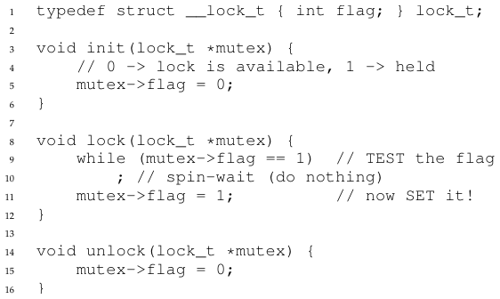
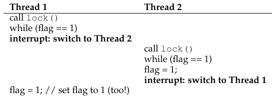
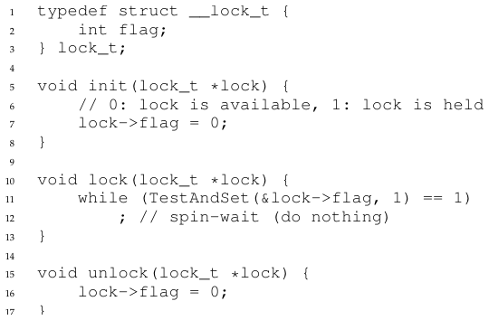
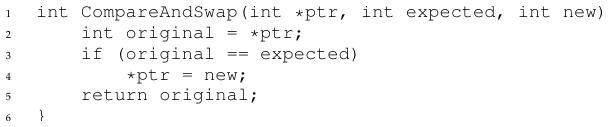
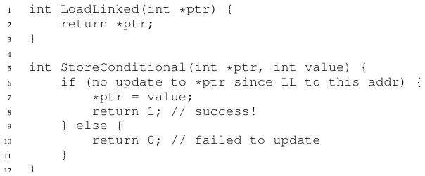
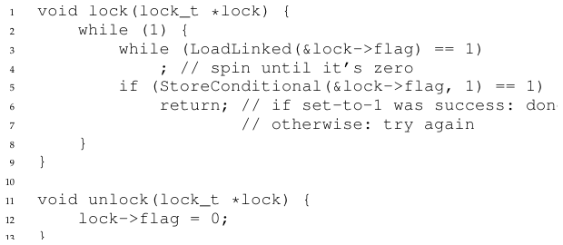
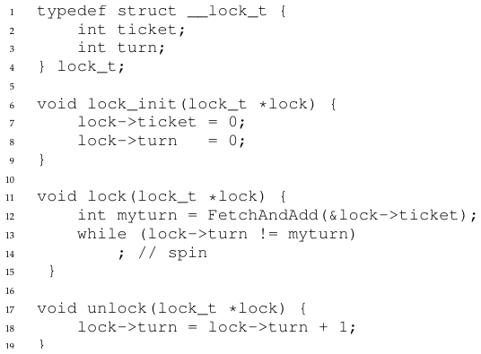
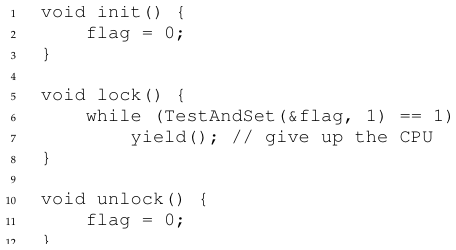
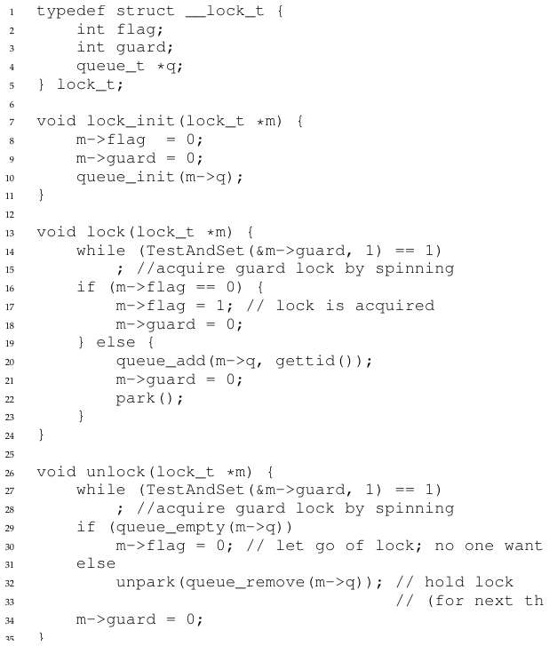
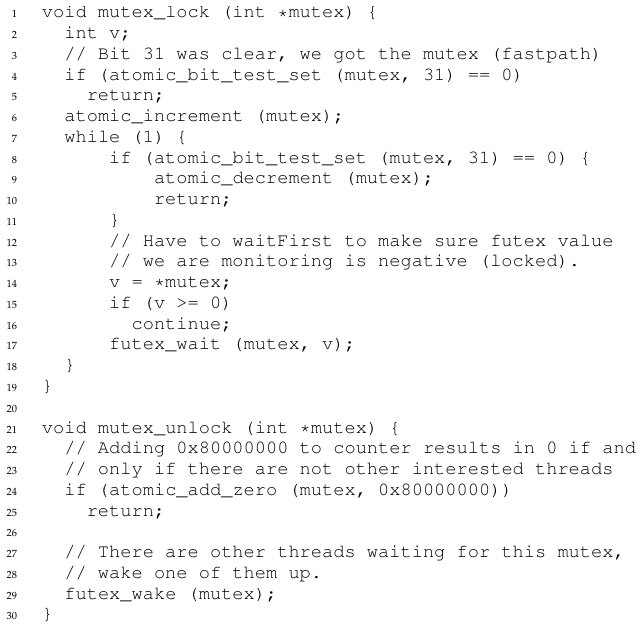

# الفصل 28: الأقفال

رأينا في مقدمة التزامن واحدة من المشكلات الجوهرية في البرمجة المتزامنة: نريد أن ننفّذ سلسلة من التعليمات ذرّيًا، لكن بسبب وجود الانقطاعات على معالج واحد (أو تنفيذ خيوط متعددة على معالجات متعددة في الوقت نفسه) لم نستطع. وفي هذا الفصل نهاجم هذه المشكلة هجومًا مباشرًا، بتقديم ما يُسمّى بالقفل. فالمبرمجون يعلّمون شيفرتهم المصدرية بالأقفال، فيضعونها حول الأقسام الحرجة، وبذلك يضمنون أن أي قسم حرج كهذا يُنفَّذ كأنه تعليمة ذرّية واحدة.

## 28.1 الأقفال: الفكرة الأساسية

افترض، على سبيل المثال، أن قسمنا الحرج يبدو هكذا، وهو التحديث النمطي لمتغيّرة متشاركة:

```
balance = balance + 1;
```

بالطبع ثمة أقسام حرجة أخرى ممكنة، مثل إضافة عنصر إلى قائمة مترابطة أو تحديثات أعقد على بنى متشاركة، لكننا سنبقى الآن عند هذا المثال البسيط. وللاستفادة من قفل، نضيف بعض الشيفرة حول القسم الحرج هكذا:

```
1   lock_t mutex; // some globally-allocated lock 'mutex'
2   ...
3   lock(&mutex);
4   balance = balance + 1;
5   unlock(&mutex);
```

القفل ليس إلا متغيّرة؛ ولذلك عليك، لاستخدام قفل، أن تصرّح بمتغيّرة قفل من نوع ما (مثل mutex أعلاه). وتحمل متغيّرة القفل هذه (أو «القفل» للاختصار) حالة القفل في أي لحظة من الزمن. فهي إما متاحة (أو مفتوحة، أو حرة) ومن ثمّ لا يحمل القفل أي خيط، أو محجوزة (أو مغلقة، أو محمولة) ومن ثمّ يحمل القفل خيط واحد بالضبط، ويُفترض أنه داخل قسم حرج. ويمكننا أن نخزّن في نوع البيانات هذا معلومات أخرى أيضًا، مثل أي خيط يحمل القفل، أو طابور لترتيب الحصول على القفل، لكن معلومات كهذه مخفية عن مستخدم القفل.

ودلالة دالتَي lock() وunlock() بسيطة. فاستدعاء الدالة lock() يحاول الحصول على القفل؛ فإن لم يكن أي خيط آخر يحمل القفل (أي أنه حر)، حصل الخيط على القفل ودخل القسم الحرج؛ ويُقال عن هذا الخيط أحيانًا إنه مالك القفل. وإن استدعى خيط آخر بعد ذلك الدالة lock() على متغيّرة القفل نفسها (mutex في هذا المثال)، فلن تعود ما دام القفل محمولًا لدى خيط آخر؛ وبهذه الطريقة تُمنع الخيوط الأخرى من دخول القسم الحرج ما دام أول خيط حصل على القفل موجودًا فيه.

وما إن يستدعي مالك القفل الدالة unlock() حتى يصبح القفل متاحًا (حرًا) مرة أخرى. فإن لم يكن ثمة خيوط أخرى تنتظر القفل (أي لم يستدعِ أي خيط آخر الدالة lock() ويعلق داخلها)، غيّرت حالة القفل ببساطة إلى حرة. أما إن كانت هناك خيوط منتظرة (عالقة في lock())، فسيُلاحظ أحدها (أو يُبلَّغ) هذا التغيّر في حالة القفل (في النهاية)، ويحصل على القفل، ويدخل القسم الحرج.

وتوفّر الأقفال للمبرمجين قدرًا ضئيلًا من التحكم في الجدولة. فنحن ننظر عمومًا إلى الخيوط كائناتٍ ينشئها المبرمج لكن يجدولها نظام التشغيل على أي نحو يختاره. والأقفال تُعيد بعض ذلك التحكم إلى المبرمج؛ فبوضع قفل حول قسم من الشيفرة يستطيع المبرمج أن يضمن ألا يكون في تلك الشيفرة أكثر من خيط واحد نشط في أي وقت. ومن ثمّ تساعد الأقفال على تحويل الفوضى التي هي الجدولة التقليدية في أنظمة التشغيل إلى نشاط أكثر انضباطًا.

## 28.2 أقفال pthread

الاسم الذي تستخدمه مكتبة POSIX للقفل هو mutex، لأنه يُستخدم لتوفير الاستبعاد المتبادل بين الخيوط، أي أنه إن كان خيط في القسم الحرج، استبعد الآخرين من الدخول حتى يُكمل القسم. ولذلك، حين ترى الشيفرة التالية الخاصة بخيوط POSIX، ينبغي أن تفهم أنها تفعل الشيء نفسه المذكور أعلاه (ونحن نستخدم مرة أخرى أغلفتنا التي تفحص الأخطاء عند القفل وفتحه):

```
1   pthread_mutex_t lock = PTHREAD_MUTEX_INITIALIZER;
2
3   Pthread_mutex_lock(&lock); // wrapper; exits on failure
4   balance = balance + 1;
5   Pthread_mutex_unlock(&lock);
```

وقد تلاحظ هنا أيضًا أن نسخة POSIX تمرّر متغيّرة إلى القفل والفتح، فقد نستخدم أقفالًا مختلفة لحماية متغيّرات مختلفة. وفعل ذلك قد يزيد التزامن: فبدلًا من قفل واحد كبير يُستخدم في أي وقت يُدخل فيه إلى أي قسم حرج (وهي استراتيجية قفل خشنة الحبيبات)، سيحمي المرء غالبًا بيانات وبنى بيانات مختلفة بأقفال مختلفة، فيتيح بذلك مزيدًا من الخيوط داخل الشيفرة المقفلة في الوقت نفسه (وهي مقاربة ناعمة الحبيبات أكثر).

## 28.3 بناء قفل

لا بد أن تكون الآن قد كوّنت بعض الفهم لكيفية عمل القفل من منظور المبرمج. لكن كيف ينبغي أن نبني قفلًا؟ وأي دعم عتادي يلزم؟ وأي دعم من نظام التشغيل؟ هذه هي مجموعة الأسئلة التي نعالجها في بقية هذا الفصل.

> **جوهر المسألة: كيف نبني قفلًا**
>
> كيف نبني قفلًا فعّالًا؟ فالأقفال الفعّالة توفّر الاستبعاد المتبادل بكلفة منخفضة، وقد تحقق أيضًا بضع خصائص أخرى نناقشها أدناه. وأي دعم عتادي يلزم؟ وأي دعم من نظام التشغيل؟

ولبناء قفل عامل سنحتاج إلى يد العون من صديقنا القديم، أي العتاد، ومن رفيقنا الجيد، أي نظام التشغيل. وقد أُضيفت على مرّ السنين بدائيات عتادية مختلفة إلى مجموعات تعليمات معماريات حاسوب متنوعة؛ ولن ندرس كيف تُنفَّذ هذه التعليمات (فتلك، في نهاية المطاف، موضوع مقرر في معمارية الحاسوب)، بل سندرس كيف نستخدمها لبناء بدائية استبعاد متبادل مثل القفل. وسندرس أيضًا كيف يتدخّل نظام التشغيل لإكمال الصورة وتمكيننا من بناء مكتبة أقفال متطوّرة.

## 28.4 تقييم الأقفال

قبل بناء أي أقفال ينبغي أن نفهم أولًا ما أهدافنا، ومن ثمّ نسأل كيف نقيّم نجاعة تنفيذ قفل معيّن. ولتقييم ما إذا كان القفل يعمل (ويعمل جيدًا)، ينبغي أن نضع بعض المعايير الأساسية. الأول هو ما إذا كان القفل يؤدي مهمته الأساسية، وهي توفير الاستبعاد المتبادل. فهل يعمل القفل في جوهر الأمر، فيمنع خيوطًا متعددة من دخول قسم حرج؟

والثاني هو الإنصاف. فهل يحصل كل خيط يتنافس على القفل على فرصة عادلة للحصول عليه ما إن يصبح حرًا؟ وثمة طريقة أخرى للنظر إلى ذلك، وهي فحص الحالة الأشدّ: هل يتضوّر أي خيط يتنافس على القفل جوعًا أثناء ذلك، فلا يحصل عليه أبدًا؟

والمعيار الأخير هو الأداء، وتحديدًا الكلفة الزمنية الإضافية التي يضيفها استخدام القفل. وثمة حالات مختلفة يجدر النظر فيها هنا. إحداها حالة انعدام التنافس؛ فحين يعمل خيط واحد ويحصل على القفل ثم يُطلقه، ما الكلفة الإضافية لذلك؟ وأخرى حالة تنافس خيوط متعددة على القفل على معالج واحد؛ فهل ثمة هواجس أداء في هذه الحالة؟ وأخيرًا، كيف يعمل القفل حين تتعدد المعالجات، وتتنافس الخيوط على كل منها على القفل؟ وبمقارنة هذه السيناريوهات المختلفة نستطيع أن نفهم على نحو أفضل أثر الأداء الناتج عن استخدام تقنيات القفل المختلفة، كما هو موصوف أدناه.

## 28.5 التحكم في الانقطاعات

من أوائل الحلول التي استُخدمت لتوفير الاستبعاد المتبادل تعطيل الانقطاعات أثناء الأقسام الحرجة؛ وقد ابتُكر هذا الحل للأنظمة أحادية المعالج. وتبدو الشيفرة هكذا:

```
1   void lock() {
2       DisableInterrupts();
3   }
4   void unlock() {
5       EnableInterrupts();
6   }
```

افترض أننا نعمل على نظام أحادي المعالج كهذا. فبإطفاء الانقطاعات (باستخدام نوع من التعليمات العتادية الخاصة) قبل الدخول إلى قسم حرج، نضمن أن الشيفرة داخل القسم الحرج لن تُقاطَع، ومن ثمّ ستُنفَّذ كأنها ذرّية. وحين ننتهي، نُعيد تمكين الانقطاعات (أيضًا بتعليمة عتادية)، ومن ثمّ يمضي البرنامج كالمعتاد.

والجانب الإيجابي الرئيسي في هذه المقاربة بساطتها. فمن المؤكد أنك لا تحتاج إلى إرهاق ذهنك كثيرًا لتعرف لماذا تعمل. فمن دون انقطاع يستطيع الخيط أن يثق بأن الشيفرة التي ينفّذها ستُنفَّذ، وأن أي خيط آخر لن يعترضه.

أما السلبيات، للأسف، فكثيرة. أولًا، تتطلب هذه المقاربة أن نسمح لأي خيط مستدعٍ بأداء عملية مميّزة (إطفاء الانقطاعات وإشعالها)، ومن ثمّ أن نثق بأن هذه الميزة لا يُساء استخدامها. وكما تعرف، فإن أي وقت يُطلب منّا فيه أن نثق ببرنامج اعتباطي، نكون على الأرجح في مشكلة. وهنا تتجلّى المشكلة بطرق كثيرة: فبرنامج طمّاع قد يستدعي lock() في بداية تنفيذه فيحتكر المعالج؛ والأسوأ أن برنامجًا زائغًا أو خبيثًا قد يستدعي lock() ويدخل في حلقة لا نهائية. وفي هذه الحالة الأخيرة لا يستعيد نظام التشغيل السيطرة على النظام أبدًا، ولا يبقى سوى ملاذ واحد: إعادة تشغيل النظام. فاستخدام تعطيل الانقطاعات كحل مزامنة عام يتطلب ثقة مفرطة في التطبيقات.

وثانيًا، لا تعمل هذه المقاربة على المعالجات المتعددة. فإن كانت خيوط متعددة تعمل على معالجات مختلفة، ويحاول كل منها دخول القسم الحرج نفسه، فلا يهمّ إن كانت الانقطاعات معطّلة؛ فستستطيع الخيوط العمل على معالجات أخرى، ومن ثمّ تستطيع دخول القسم الحرج. وبما أن المعالجات المتعددة صارت شائعة الآن، فسيكون على حلنا العام أن يكون أفضل من هذا.

وثالثًا، إن إطفاء الانقطاعات لفترات ممتدة قد يفضي إلى فقدان الانقطاعات، وهو ما قد يؤدي إلى مشكلات خطيرة في النظام. تخيّل، على سبيل المثال، أن المعالج فوّت حقيقة أن جهاز قرص قد أكمل طلب قراءة. فكيف سيعرف نظام التشغيل أنه ينبغي أن يوقظ العملية المنتظرة لتلك القراءة؟

ولهذه الأسباب لا يُستخدم إطفاء الانقطاعات إلا في سياقات محدودة كبدائية استبعاد متبادل. ففي بعض الحالات، مثلًا، يستخدم نظام التشغيل نفسه حجب الانقطاعات ليضمن الذرّية عند الوصول إلى بنى بياناته، أو على الأقل لمنع حدوث بعض حالات معالجة الانقطاعات الفوضوية. وهذا الاستخدام منطقي، لأن مسألة الثقة تختفي داخل نظام التشغيل، الذي يثق بنفسه دائمًا في أداء العمليات المميّزة على أي حال.

## 28.6 محاولة فاشلة: استخدام التحميل والتخزين فحسب

للخروج من التقنيات القائمة على الانقطاعات، سيكون علينا أن نتّكل على عتاد المعالج والتعليمات التي يقدّمها لبناء قفل سليم. لنحاول أولًا بناء قفل بسيط باستخدام متغيّرة راية واحدة. وفي هذه المحاولة الفاشلة سنرى بعض الأفكار الأساسية اللازمة لبناء قفل، ونرى (كما نأمل) لماذا لا يكفي استخدام متغيّرة واحدة والوصول إليها بعمليات تحميل وتخزين عادية.

في هذه المحاولة الأولى (الشكل 28.1)، الفكرة بسيطة جدًا: استخدم متغيّرة بسيطة (flag) للدلالة على أن أحد الخيوط حائز على قفل. فأول خيط يدخل القسم الحرج سيستدعي lock()، التي تفحص ما إذا كانت الراية تساوي 1 (وهي ليست كذلك في هذه الحالة)، ثم تضبط الراية على 1 للدلالة على أن الخيط صار يحمل القفل. وحين ينتهي من القسم الحرج، يستدعي الخيط unlock() فيصفّر الراية، دلالةً على أن القفل لم يعد محمولًا.



**الشكل 28.1:** المحاولة الأولى: راية بسيطة

وإن استدعى خيط آخر الدالة lock() في أثناء وجود ذلك الخيط الأول في القسم الحرج، فسينتظر بالدوران في حلقة while إلى أن يستدعي ذلك الخيط unlock() فيصفّر الراية. وما إن يفعل الخيط الأول ذلك، حتى يخرج الخيط المنتظر من حلقة while، ويضبط الراية على 1 لنفسه، ويمضي إلى القسم الحرج.

وللأسف فإن في الشيفرة مشكلتين: واحدة في الصحة، وأخرى في الأداء. ومشكلة الصحة سهلة الرؤية حالما تعتاد التفكير في البرمجة المتزامنة. تخيّل تشارك الشيفرة في الشكل 28.2؛ وافترض أن flag=0 في البداية.



**الشكل 28.2:** تتبّع: لا استبعاد متبادل

وكما ترى من هذا التشارك، يمكننا بانقطاعات حسنة التوقيت (أو سيئته؟) أن ننتج بسهولة حالة يضبط فيها الخيطان الراية على 1، ومن ثمّ يستطيع كلاهما دخول القسم الحرج. وهذا السلوك هو ما يسمّيه المحترفون «سيئًا» — فقد فشلنا بوضوح في توفير أبسط شرط: توفير الاستبعاد المتبادل.

أما مشكلة الأداء، التي سنعالجها لاحقًا أكثر، فهي طريقة انتظار خيط لقفل محمول بالفعل: إنه يفحص قيمة flag بلا نهاية، وهي تقنية تُعرف بالانتظار بالدوران. فالانتظار بالدوران يهدر الوقت في انتظار أن يُطلق خيط آخر القفل. والهدر عالٍ استثنائيًا على معالج واحد، حيث لا يستطيع الخيط الذي ينتظره المنتظر أن يعمل أصلًا (على الأقل حتى يحدث تبديل سياق)! ومن ثمّ، بينما نمضي قدمًا ونطوّر حلولًا أكثر تطورًا، ينبغي أن نفكّر أيضًا في سبل تجنّب هذا النوع من الهدر.

## 28.7 بناء أقفال دوران عاملة باستخدام الاختبار والضبط

لأن تعطيل الانقطاعات لا يعمل على معالجات متعددة، ولأن المقاربات البسيطة القائمة على التحميل والتخزين (كما هو موضّح أعلاه) لا تعمل، بدأ مصمّمو الأنظمة يبتكرون دعمًا عتاديًا للأقفال. وكانت أوائل الأنظمة متعددة المعالجات، مثل حاسوب Burroughs B5000 في أوائل الستينيات [M82]، تملك دعمًا كهذا؛ واليوم توفّر كل الأنظمة هذا النوع من الدعم، حتى الأنظمة ذات المعالج الواحد.

وأبسط دعم عتادي في الفهم هو ما يُعرف بتعليمة الاختبار والضبط (أو التبديل الذرّي[^1]). ونعرّف ما تفعله تعليمة الاختبار والضبط بمقطع الشيفرة التالي بلغة C:

```
1   int TestAndSet(int *old_ptr, int new) {
2       int old = *old_ptr; // fetch old value at old_ptr
3       *old_ptr = new;     // store 'new' into old_ptr
4       return old;         // return the old value
5   }
```

> **استطراد: خوارزميّا ديكر وبيترسون**
>
> طرح دايكسترا مشكلة التزامن على أصدقائه في الستينيات، فجاء أحدهم، وهو رياضياتي يُدعى ثيودوروس يوزيف ديكر، بحل [D68]. وخلافًا للحلول التي نناقشها هنا، التي تستخدم تعليمات عتادية خاصة بل ودعم نظام التشغيل، لا يستخدم حل ديكر إلا التحميل والتخزين (بافتراض أنهما ذرّيان بالنسبة لبعضهما، وهو ما كان صحيحًا على العتاد المبكر).
>
> ثم صقل بيترسون مقاربة ديكر لاحقًا [P81]. ومرة أخرى لا يُستخدم إلا التحميل والتخزين، والفكرة هي ضمان ألا يدخل خيطان قسمًا حرجًا في الوقت نفسه. وهذه هي خوارزمية بيترسون (لخيطين)؛ انظر هل يمكنك فهم الشيفرة. فماذا يُستخدم متغيّرا flag وturn؟

```
int flag[2];
int turn;

void init() {
    // indicate you intend to hold the lock w/ 'flag'
    flag[0] = flag[1] = 0;
    // whose turn is it? (thread 0 or 1)
    turn = 0;
}
void lock() {
    // 'self' is the thread ID of caller
    flag[self] = 1;
    // make it other thread's turn
    turn = 1 - self;
    while ((flag[1-self] == 1) && (turn == 1 - self))
        ; // spin-wait while it's not your turn
}
void unlock() {
    // simply undo your intent
    flag[self] = 0;
}
```

> ولسبب ما صار تطوير أقفال تعمل دون دعم عتادي خاص صرخة العصر لبرهة، فمنح أهل النظرية مشكلات كثيرة يعملون عليها. وبطبيعة الحال، أصبح هذا الخط من العمل عديم الجدوى حين أدرك الناس أن افتراض قليل من الدعم العتادي أسهل بكثير (وأن ذلك الدعم قد وُجد فعلًا منذ أيام المعالجة المتعددة الأولى). ثم إن خوارزميات كتلك المذكورة أعلاه لا تعمل على العتاد الحديث (بسبب نماذج تماسك الذاكرة المتحرّرة)، ومن ثمّ صارت أقل فائدة مما كانت عليه. ومزيد من البحث أُرسل إلى مزبلة التاريخ...



**الشكل 28.3:** قفل دوران بسيط باستخدام الاختبار والضبط

وما تفعله تعليمة الاختبار والضبط هو ما يلي. إنها تُعيد القيمة القديمة التي يشير إليها old_ptr، وتحدّث تلك القيمة في الوقت نفسه إلى new. والمفتاح، بطبيعة الحال، أن سلسلة العمليات هذه تُنفَّذ ذرّيًا. وسبب تسميتها «اختبار وضبط» أنها تتيح لك أن «تختبر» القيمة القديمة (وهي ما يُعاد) بينما «تضبط» موضع الذاكرة على قيمة جديدة في الوقت نفسه؛ وكما تبيّن، تكفي هذه التعليمة الأقوى قليلًا لبناء قفل دوران بسيط، كما نفحص الآن في الشكل 28.3. أو أفضل من ذلك: اكتشفه بنفسك أولًا!

ولنتأكد من أننا نفهم لماذا يعمل هذا القفل. تخيّل أولًا حالة يستدعي فيها خيط الدالة lock() ولا يحمل أي خيط آخر القفل حاليًا؛ ومن ثمّ ينبغي أن تكون flag صفرًا. وحين يستدعي الخيط TestAndSet(flag, 1)، ستُعيد الدالة القيمة القديمة لـflag، وهي 0؛ ومن ثمّ فإن الخيط المستدعي، الذي يختبر قيمة flag، لن يُعلق في حلقة while وسيحصل على القفل. وسيضبط الخيط القيمة أيضًا على 1 ذرّيًا، دلالةً على أن القفل صار محمولًا. وحين ينتهي الخيط من قسمه الحرج، يستدعي unlock() ليعيد الراية إلى الصفر.

والحالة الثانية التي يمكننا تخيّلها تنشأ حين يكون قفل محمولًا لدى خيط بالفعل (أي أن flag تساوي 1). وفي هذه الحالة سيستدعي هذا الخيط lock() ثم يستدعي TestAndSet(flag, 1) كذلك. وهذه المرة ستُعيد TestAndSet() القيمة القديمة في flag، وهي 1 (لأن القفل محمول)، بينما تضبطها على 1 مرة أخرى في الوقت نفسه. وما دام القفل محمولًا لدى خيط آخر، ستُعيد TestAndSet() القيمة 1 مرارًا، ومن ثمّ سيدور هذا الخيط ويدور إلى أن يُطلق القفل أخيرًا. وحين تُضبط الراية أخيرًا على 0 من خيط آخر، سيستدعي هذا الخيط TestAndSet() مرة أخرى، فتُعيد الآن 0 بينما تضبط القيمة على 1 ذرّيًا، فيحصل بذلك على القفل ويدخل القسم الحرج.

وبجعل الاختبار (لقيمة القفل القديمة) والضبط (للقيمة الجديدة) عملية ذرّية واحدة، نضمن أن خيطًا واحدًا فقط يحصل على القفل. وهكذا تُبنى بدائية استبعاد متبادل عاملة!

> **نصيحة: فكّر في التزامن كمجدول خبيث**
>
> قد تشعر من هذا المثال بطبيعة المقاربة التي تحتاجها لفهم التنفيذ المتزامن. فما ينبغي أن تحاول فعله هو أن تتظاهر بأنك مجدول خبيث، يقطع الخيوط في أسوأ الأوقات ليفسد محاولاتها الهزيلة في بناء بدائيات مزامنة. يا لك من مجدول لئيم! ومع أن التسلسل الدقيق للانقطاعات قد يكون غير محتمل، فهو ممكن، وهذا كل ما نحتاجه لإثبات أن مقاربة معيّنة لا تعمل. وقد يكون التفكير بخبث مفيدًا! (أحيانًا على الأقل)

وقد تفهم الآن أيضًا لماذا يُشار إلى هذا النوع من الأقفال عادةً بقفل الدوران. فهو أبسط أنواع الأقفال في البناء، ويدور ببساطة، مستهلكًا دورات المعالج، إلى أن يصبح القفل متاحًا. وللعمل على نحو صحيح على معالج واحد، يتطلب مجدولًا استباقيًا (أي مجدولًا يقطع خيطًا بمؤقّت ليشغّل خيطًا آخر من وقت لآخر). فمن دون استباق لا تكون أقفال الدوران ذات معنى كبير على معالج واحد، لأن الخيط الدائر على المعالج لن يتنازل عنه أبدًا.

## 28.8 تقييم أقفال الدوران

بعد أن صار لدينا قفل دوران أساسي، نستطيع أن نقيّم مدى فعاليته على المحاور التي وصفناها سابقًا. وأهم جانب في القفل هو الصحة: فهل يوفّر الاستبعاد المتبادل؟ الجواب هنا نعم: فقفل الدوران لا يسمح إلا لخيط واحد بدخول القسم الحرج في المرة الواحدة. ومن ثمّ لدينا قفل صحيح.

والمحور التالي هو الإنصاف. فما مدى إنصاف قفل الدوران لخيط منتظر؟ وهل تستطيع أن تضمن أن خيطًا منتظرًا سيدخل القسم الحرج يومًا؟ والجواب هنا، للأسف، خبر سيئ: فأقفال الدوران لا تقدّم أي ضمانات إنصاف. بل إن خيطًا دائرًا قد يدور إلى الأبد في ظل التنافس. فأقفال الدوران البسيطة (كما نوقشت حتى الآن) ليست منصفة وقد تؤدي إلى التضوّر جوعًا.

والمحور الأخير هو الأداء. فما كلفة استخدام قفل دوران؟ ولتحليل ذلك بعناية أكبر، نقترح التفكير في بضع حالات مختلفة. في الأولى تخيّل خيوطًا تتنافس على القفل على معالج واحد؛ وفي الثانية تخيّل خيوطًا موزّعة على معالجات كثيرة.

أما في حالة المعالج الواحد فإن الكلفة الإضافية لأقفال الدوران قد تكون مؤلمة جدًا؛ تخيّل حالة يُقطع فيها الخيط الحامل للقفل داخل قسم حرج. عندئذٍ قد يشغّل المجدول كل خيط آخر (تخيّل أن ثمة N − 1 غيره)، ويحاول كل منها الحصول على القفل. وفي هذه الحالة سيدور كل أولئك الخيوط طوال مدة شريحة زمنية قبل أن يتنازل عن المعالج، وهو هدر لدورات المعالج.

أما على معالجات متعددة فإن أقفال الدوران تعمل عملًا معقولًا (إن كان عدد الخيوط مساويًا تقريبًا لعدد المعالجات). والتفكير كالتالي: تخيّل الخيط A على المعالج 1 والخيط B على المعالج 2، وكلاهما يتنافس على قفل. فإن حصل الخيط A (على المعالج 1) على القفل ثم حاول الخيط B الحصول عليه، فسيدور B (على المعالج 2). غير أن القسم الحرج يُفترض أنه قصير، ومن ثمّ يصبح القفل متاحًا قريبًا فيحصل عليه الخيط B. فالدوران في انتظار قفل محمول على معالج آخر لا يهدر دورات كثيرة في هذه الحالة، ومن ثمّ قد يكون فعّالًا.

## 28.9 المقارنة والتبديل

ثمة بدائية عتادية أخرى توفّرها بعض الأنظمة، تُعرف بتعليمة المقارنة والتبديل (كما تُسمّى على SPARC، مثلًا)، أو المقارنة والاستبدال (كما تُسمّى على x86). والشيفرة الزائفة بلغة C لهذه التعليمة الواحدة موجودة في الشكل 28.4.



**الشكل 28.4:** المقارنة والتبديل

الفكرة الأساسية أن المقارنة والتبديل تختبر ما إذا كانت القيمة في العنوان الذي يحدّده ptr تساوي expected؛ فإن كان الأمر كذلك، حدّثت موضع الذاكرة الذي يشير إليه ptr بالقيمة الجديدة. وإن لم يكن، لم تفعل شيئًا. وفي الحالتين تُعيد القيمة الأصلية في ذلك الموضع من الذاكرة، فتيح بذلك للشيفرة المستدعية للمقارنة والتبديل أن تعرف هل نجحت أم لا.

وبتعليمة المقارنة والتبديل نستطيع بناء قفل على نحو شبيه جدًا ببناء القفل بالاختبار والضبط. فمثلًا يمكننا أن نستبدل روتين lock() أعلاه بما يلي:

```
1   void lock(lock_t *lock) {
2       while (CompareAndSwap(&lock->flag, 0, 1) == 1)
3           ; // spin
4   }
```

وبقية الشيفرة كما في مثال الاختبار والضبط أعلاه. وهذه الشيفرة تعمل على نحو شبيه جدًا؛ فهي تفحص ببساطة ما إذا كانت الراية صفرًا، فإن كانت كذلك أبدلت فيها 1 ذرّيًا، فحصلت بذلك على القفل. والخيوط التي تحاول الحصول على القفل ما دام محمولًا ستعلق في الدوران إلى أن يُطلق القفل أخيرًا.

وإن أردت أن ترى كيف يُصنع فعلًا إصدار من المقارنة والتبديل بلغة C قابل للاستدعاء على x86، فقد يكون تسلسل الشيفرة (من [S05]) مفيدًا[^2].

وأخيرًا، كما قد تكون أحسست، فإن المقارنة والتبديل تعليمة أقوى من الاختبار والضبط. وسنستخدم بعضًا من هذه القوة في المستقبل حين نخوض بإيجاز في موضوعات مثل المزامنة الخالية من الأقفال [H91]. غير أننا إن بنينا بها مجرد قفل دوران بسيط، فسلوكه مطابق لقفل الدوران الذي حللناه أعلاه.

## 28.10 التحميل المرتبط والتخزين الشرطي

توفّر بعض المنصّات زوجًا من التعليمات تعمل معًا لبناء الأقسام الحرجة. ففي معمارية MIPS [H93]، مثلًا، يمكن استخدام تعليمتي التحميل المرتبط والتخزين الشرطي معًا لبناء أقفال وبنى متزامنة أخرى. والشيفرة الزائفة بلغة C لهذه التعليمات موجودة في الشكل 28.5. وتوفّر Alpha وPowerPC وARM تعليمات مشابهة [W09].

وتعمل تعليمة التحميل المرتبط عمل تعليمة تحميل نمطية، فهي تجلب ببساطة قيمة من الذاكرة وتضعها في سجل. ويأتي الفرق الرئيسي مع التخزين الشرطي، الذي لا ينجح (ولا يحدّث القيمة المخزّنة في العنوان المحمَّل منه للتو) إلا إن لم يحدث تخزين متداخل إلى ذلك العنوان. وفي حالة النجاح تُعيد التعليمات 1 وتحدّث القيمة في ptr إلى value؛ وإن فشلت لم تُحدَّث القيمة في ptr وأُعيد 0.

وكتحدٍّ لنفسك، حاول التفكير في كيفية بناء قفل باستخدام التحميل المرتبط والتخزين الشرطي. ثم، حين تنتهي، انظر إلى الشيفرة أدناه التي تقدّم حلًا بسيطًا واحدًا. افعلها! فالحل في الشكل 28.6.



**الشكل 28.5:** التحميل المرتبط والتخزين الشرطي

وشيفرة lock() هي الجزء المثير الوحيد. فأولًا يدور خيط في انتظار أن تُضبط الراية على 0 (دلالةً على أن القفل غير محمول). وما إن يحدث ذلك، يحاول الخيط الحصول على القفل عبر التخزين الشرطي؛ فإن نجح، يكون الخيط قد غيّر قيمة الراية إلى 1 ذرّيًا، ومن ثمّ يستطيع المضي إلى القسم الحرج.

ولاحظ كيف قد ينشأ فشل التخزين الشرطي. يستدعي خيط الدالة lock() وينفّذ التحميل المرتبط، فيُعاد 0 لأن القفل غير محمول. وقبل أن يتمكّن من محاولة التخزين الشرطي يُقاطَع، فيدخل خيط آخر إلى شيفرة القفل، وينفّذ تعليمة التحميل المرتبط أيضًا، ويحصل على 0 أيضًا فيمضي. عند هذه النقطة يكون كل من الخيطين قد نفّذ التحميل المرتبط، وكلاهما على وشك محاولة التخزين الشرطي. والخَصيصة المفتاحية لهذه التعليمات أن واحدًا فقط من هذين الخيطين سينجح في تحديث الراية إلى 1 فيحصل على القفل؛ أما الخيط الثاني الذي يحاول التخزين الشرطي فسيفشل (لأن الخيط الآخر حدّث قيمة flag بين تحميله المرتبط وتخزينه الشرطي)، ومن ثمّ سيكون عليه أن يحاول الحصول على القفل من جديد.



**الشكل 28.6:** بناء قفل باستخدام LL/SC

واقترح الطالب الجامعي ديفيد كابل في أحد الصفوف قبل بضع سنوات شكلًا أكثر إيجازًا لما سبق، لمن يستمتع منهم باختصار الشروط المنطقية. انظر هل تستطيع أن تكتشف لماذا يكافئه. إنه أقصر بالتأكيد!

```
1   void lock(lock_t *lock) {
2       while (LoadLinked(&lock->flag) ||
3             !StoreConditional(&lock->flag, 1))
4           ; // spin
5   }
```

## 28.11 الجلب والجمع

ثمة بدائية عتادية أخيرة هي تعليمة الجلب والجمع، التي تزيد قيمة ما ذرّيًا بينما تُعيد القيمة القديمة في عنوان معيّن. والشيفرة الزائفة بلغة C لتعليمة الجلب والجمع هكذا:

```
1   int FetchAndAdd(int *ptr) {
2       int old = *ptr;
3       *ptr = old + 1;
4       return old;
5   }
```

> **نصيحة: الشيفرة القليلة شيفرة أفضل (قانون لاوير)**
>
> يميل المبرمجون إلى التفاخر بكمّ الشيفرة التي كتبوها لإنجاز شيء ما. وفعل ذلك معطوب في جوهره. فما ينبغي أن يتفاخر به المرء، بدلًا من ذلك، هو قِلّة الشيفرة التي كتبها لإنجاز مهمة معيّنة. فالشيفرة القصيرة الموجزة أفضل دائمًا؛ إذ يُرجَّح أنها أسهل في الفهم وأقل أخطاءً. وكما قال هيو لاوير، وهو يناقش بناء نظام التشغيل Pilot: «لو كان لدى هؤلاء الناس أنفسهم ضعف الوقت، لاستطاعوا أن يُنتجوا نظامًا لا يقلّ جودة في نصف الشيفرة.» [L81] وسنسمّي هذا قانون لاوير، وهو جدير بالتذكر. ففي المرة القادمة التي تتفاخر فيها بكمّ الشيفرة التي كتبتها لإنجاز الواجب، فكّر مرة أخرى، أو أفضل من ذلك: ارجع وأعد الكتابة واجعل الشيفرة واضحة موجزة قدر الإمكان.

وسنستخدم في هذا المثال الجلب والجمع لبناء قفل تذاكر أكثر إثارة للاهتمام، كما قدّمه ميلور-كرومي وسكوت [MS91]. وشيفرة القفل والفتح موجودة في الشكل 28.7 (الصفحة 14).

فبدلًا من قيمة واحدة، يستخدم هذا الحل متغيّرتَي تذكرة ودور معًا لبناء قفل. والعملية الأساسية بسيطة جدًا: حين يرغب خيط في الحصول على قفل، يقوم أولًا بجلب وجمع ذرّي على قيمة التذكرة؛ وتُعدّ هذه القيمة الآن «دور» هذا الخيط (myturn). ثم يُستخدم lock->turn المتشارك عمومًا لتحديد دور أي خيط؛ فحين (myturn == turn) لخيط معيّن، يكون الدور دور ذلك الخيط لدخول القسم الحرج. أما الفتح فيُنجَز ببساطة بزيادة الدور بحيث يستطيع الخيط المنتظر التالي (إن وُجد) دخول القسم الحرج الآن.

ولاحظ فرقًا مهمًا واحدًا بين هذا الحل ومحاولاتنا السابقة: إنه يضمن التقدّم لجميع الخيوط. فما إن تُسنَد قيمة تذكرة لخيط، حتى يُجدوَل في وقت ما في المستقبل (حين تمرّ الخيوط التي أمامه عبر القسم الحرج وتُطلق القفل). أما في محاولاتنا السابقة فلم يكن ثمة ضمان كهذا؛ فخيط يدور على الاختبار والضبط (مثلًا) قد يدور إلى الأبد بينما تحصل خيوط أخرى على القفل وتُطلقه.

## 28.12 دوران مفرط: ماذا الآن؟

أقفالنا القائمة على العتاد بسيطة (بضعة أسطر من الشيفرة فقط) وتعمل (بل يمكنك أن تُثبت ذلك إن أردت، بكتابة بعض الشيفرة)، وهما خاصيتان ممتازتان في أي نظام أو شيفرة. غير أن هذه الحلول قد تكون غير فعّالة إلى حد كبير في بعض الحالات. تخيّل أنك تشغّل خيطين على معالج واحد. وتخيّل الآن أن أحد الخيطين (الخيط 0) داخل قسم حرج، ومن ثمّ يحمل قفلًا، لكنه يُقاطَع للأسف. فيحاول الخيط الثاني (الخيط 1) الآن الحصول على القفل، فيجد أنه محمول. ومن ثمّ يبدأ بالدوران. ويدور. ثم يدور أكثر. وأخيرًا ينطلق مؤقّت، فيُشغَّل الخيط 0 مرة أخرى، فيُطلق القفل، وأخيرًا (في المرة التالية التي يعمل فيها، مثلًا) لن يضطر الخيط 1 إلى الدوران كثيرًا وسيستطيع الحصول على القفل. ومن ثمّ، في كل مرة يُعلق فيها خيط بالدوران في حالة كهذه، يهدر شريحة زمنية كاملة لا يفعل فيها شيئًا سوى فحص قيمة لن تتغيّر! وتزداد المشكلة سوءًا مع N خيطًا يتنافسون على قفل؛ فقد تُهدر N − 1 شريحة زمنية على نحو مشابه، بالدوران فحسب في انتظار خيط واحد ليُطلق القفل. ومن ثمّ مشكلتنا التالية:



**الشكل 28.7:** أقفال التذاكر

> **جوهر المسألة: كيف نتجنّب الدوران**
>
> كيف نطوّر قفلًا لا يهدر الوقت بلا داعٍ في الدوران على المعالج؟

الدعم العتادي وحده لا يستطيع حل المشكلة. سنحتاج إلى دعم نظام التشغيل أيضًا! فلنكتشف الآن كيف يمكن لذلك أن يعمل.

## 28.13 مقاربة بسيطة: تنازل فحسب، يا عزيزي

أوصلنا الدعم العتادي شوطًا بعيدًا: أقفال عاملة، بل وإنصافًا في الحصول على القفل (كما في حالة قفل التذاكر). غير أن لدينا مشكلة بعد: ماذا نفعل حين يحدث تبديل سياق داخل قسم حرج، فتبدأ الخيوط بالدوران بلا نهاية، في انتظار أن يعمل الخيط المقطوع (الحامل للقفل) مرة أخرى؟

ومحاولتنا الأولى مقاربة بسيطة وودّية: حين تكون على وشك الدوران، تنازل عن المعالج لخيط آخر بدلًا من ذلك. وكما قد يقول آل ديفيس: «تنازل فحسب، يا عزيزي!» [D91]. ويعرض الشكل 28.8 (الصفحة 15) هذه المقاربة.



**الشكل 28.8:** قفل بالاختبار والضبط مع التنازل

في هذه المقاربة نفترض وجود بدائية في نظام التشغيل هي yield() يستطيع الخيط استدعاءها حين يريد التنازل عن المعالج وترك خيط آخر يعمل. فالخيط يمكن أن يكون في إحدى ثلاث حالات (عامل، أو جاهز، أو محجوب)؛ وyield مجرد نداء نظام ينقل المستدعي من حالة العمل إلى حالة الجهوزية، فيرقّي بذلك خيطًا آخر إلى حالة العمل. ومن ثمّ فإن الخيط المتنازل يزيل جدولة نفسه في جوهر الأمر.

فكّر في المثال ذي الخيطين على معالج واحد؛ فمقاربتنا القائمة على التنازل تعمل هنا عملًا جيدًا جدًا. فإن استدعى خيط الدالة lock() ووجد قفلًا محمولًا، تنازل ببساطة عن المعالج، ومن ثمّ يعمل الخيط الآخر ويُكمل قسمه الحرج. وفي هذه الحالة البسيطة تعمل مقاربة التنازل عملًا جيدًا.

ولننظر الآن في الحالة التي ثمة فيها خيوط كثيرة (قل 100) تتنافس على قفل مرارًا. في هذه الحالة، إن حصل خيط على القفل ثم قُطع قبل أن يُطلقه، فسيستدعي كل واحد من الـ99 الآخرين الدالة lock()، ويجد القفل محمولًا، فيتنازل عن المعالج. وبافتراض مجدول من نوع الجولة المستديرة، سينفّذ كل واحد من الـ99 نمط العمل والتنازل هذا قبل أن يعمل الخيط الحامل للقفل مرة أخرى. ومع أن هذا أفضل من مقاربة الدوران (التي كانت ستهدر 99 شريحة زمنية في الدوران)، فما يزال مكلفًا؛ فكلفة تبديل السياق قد تكون كبيرة، ومن ثمّ ثمة هدر وفير.

والأسوأ أن هذه المقاربة لا تعالج التضوّر جوعًا. فقد يُعلق خيط في حلقة تنازل لا نهائية بينما تدخل خيوط أخرى القسم الحرج وتخرج منه مرارًا. فمن الواضح أننا سنحتاج إلى مقاربة تعالج التضوّر جوعًا مباشرةً.

## 28.14 استخدام الطوابير: النوم بدل الدوران

المشكلة الحقيقية في بعض المقاربات السابقة (غير قفل التذاكر) أنها تترك أمورًا كثيرة للحظّ. فالمجدول هو من يحدّد أي خيط يعمل بعد ذلك؛ فإن اتخذ المجدول قرارًا سيئًا، كان على الخيط الذي يعمل إمّا أن يدور في انتظار القفل (مقاربتنا الأولى)، أو أن يتنازل عن المعالج فورًا (مقاربتنا الثانية). وفي الحالتين ثمة احتمال للهدر ولا منع للتصوّر جوعًا.



**الشكل 28.9:** قفل بالطوابير والاختبار والضبط والتنازل والإيقاظ

ومن ثمّ يجب أن نمارس قدرًا صريحًا من التحكم في أي خيط سيحصل على القفل تاليًا بعد أن يُطلقه الحائز الحالي. وللقيام بذلك سنحتاج إلى مزيد قليل من دعم نظام التشغيل، وإلى طابور لتتبّع الخيوط التي تنتظر الحصول على القفل.

وللتبسيط سنستخدم الدعم الذي يقدّمه Solaris، من حيث نداءان: park() لإنامة الخيط المستدعي، وunpark(threadID) لإيقاظ خيط معيّن كما يحدّده threadID. ويمكن استخدام هذين الروتينين معًا لبناء قفل يُنيم المستدعي إن حاول الحصول على قفل محمول، ويوقظه حين يصبح القفل حرًا. لننظر إلى الشيفرة في الشكل 28.9 لنفهم استخدامًا ممكنًا لبدائيات كهذه.

> **استطراد: سبب آخر لتجنّب الدوران — انقلاب الأولوية**
>
> من الأسباب الجيدة لتجنّب أقفال الدوران الأداء: فكما ورد في المتن، إن قُطع خيط وهو يحمل قفلًا، فستُنفق الخيوط الأخرى التي تستخدم أقفال دوران قدرًا كبيرًا من وقت المعالج في انتظار أن يصبح القفل متاحًا فحسب. غير أنه تبيّن أن ثمة سببًا آخر مثيرًا لتجنّب أقفال الدوران على بعض الأنظمة: ألا وهو الصحة. فالمشكلة التي ينبغي الحذر منها تُعرف بانقلاب الأولوية، وهو للأسف بلاء بين المجرّات، يحدث على الأرض [M15] وعلى المريخ [R97]!
>
> لنفترض أن ثمة خيطين في النظام. فالخيط 2 (T2) له أولوية جدولة عالية، والخيط 1 (T1) له أولوية أدنى. ولنفترض في هذا المثال أن مجدول المعالج سيشغّل T2 دائمًا بدلًا من T1، إن كان كلاهما قابلًا للعمل؛ فلا يعمل T1 إلا حين لا يستطيع T2 ذلك (مثلًا حين يكون T2 محجوبًا على الإدخال/الإخراج).
>
> والآن، المشكلة. افترض أن T2 محجوب لسبب ما. فيعمل T1، ويحصل على قفل دوران، ويدخل قسمًا حرجًا. ثم يصبح T2 غير محجوب (ربما لأن عملية إدخال/إخراج اكتملت)، فيجدوله مجدول المعالج فورًا (فيزيل جدولة T1). ويحاول T2 الآن الحصول على القفل، ولأنه لا يستطيع (فـT1 يحمل القفل)، يظل يدور. ولأن القفل قفل دوران، يدور T2 إلى الأبد، فيتعلّق النظام.
>
> غير أن تجنّب استخدام أقفال الدوران فحسب لا يجنّب مشكلة الانقلاب (للأسف). تخيّل ثلاثة خيوط، T1 وT2 وT3، بحيث T3 ذو الأولوية العليا وT1 الأدنى. تخيّل الآن أن T1 يحصل على قفل. ثم يبدأ T3، ولأن أولويته أعلى من T1، يعمل فورًا (فيقطع T1). ويحاول T3 الحصول على القفل الذي يحمله T1، لكنه يعلق في الانتظار لأن T1 ما يزال يحمله. وإن بدأ T2 بالعمل، فستكون أولويته أعلى من T1، ومن ثمّ سيعمل. وهكذا يبقى T3، وهو الأعلى أولوية من T2، معلقًا في انتظار T1، الذي قد لا يعمل أبدًا الآن وقد صار T2 يعمل. أليس محزنًا أن T3 الجبار لا يستطيع العمل بينما يسيطر T2 الوضيع على المعالج؟ فالأولوية العالية لم تعد كما كانت.
>
> ويمكنك معالجة مشكلة انقلاب الأولوية بطرق عدة. ففي الحالة المحدّدة التي تتسبب فيها أقفال الدوران بالمشكلة، يمكنك تجنّب استخدام أقفال الدوران (كما هو موصوف لاحقًا أكثر). وبصفة أعمّ، يستطيع خيط ذو أولوية أعلى ينتظر خيطًا أدنى أولوية أن يرفع أولوية الخيط الأدنى رفعًا مؤقتًا، فيمكّنه بذلك من العمل ويتجاوز الانقلاب، وهي تقنية تُعرف بوراثة الأولوية. أما الحل الأخير فأبسطها: اضمن أن تكون كل الخيوط بالاولوية نفسها.

نفعل في هذا المثال أمرين مثيرين. أولًا، نجمع فكرة الاختبار والضبط القديمة مع طابور صريح لمنتظري القفل لنصنع قفلًا أكثر فعالية. وثانيًا، نستخدم طابورًا لمساعدة التحكم في من يحصل على القفل تاليًا، ونتجنّب بذلك التضوّر جوعًا.

وقد تلاحظ كيف يُستخدم الحارس (guard) (الشكل 28.9، الصفحة 16)، وهو في الأساس قفل دوران حول التلاعبات بالراية والطابور التي يقوم بها القفل. ومن ثمّ لا تتجنّب هذه المقاربة الانتظار بالدوران تجنّبًا كاملًا؛ فقد يُقاطَع خيط في أثناء الحصول على القفل أو إطلاقه، فيتسبب بذلك في دوران خيوط أخرى في انتظار أن يعمل هذا الخيط مرة أخرى. غير أن الوقت المنفق في الدوران محدود جدًا (بضع تعليمات داخل شيفرة القفل والفتح فقط، بدلًا من القسم الحرج الذي يحدّده المستخدم)، ومن ثمّ فقد تكون هذه المقاربة معقولة.

وقد تلاحظ أيضًا أنه في lock()، حين لا يستطيع خيط الحصول على القفل (فهو محمول بالفعل)، نحرص على إضافة أنفسنا إلى طابور (باستدعاء الدالة gettid() للحصول على معرّف الخيط الحالي)، ونضبط guard على 0، ونتنازل عن المعالج. وسؤال للقارئ: ماذا كان سيحدث لو جاء إطلاق قفل الحارس بعد park() لا قبله؟ تلميح: شيء سيئ.

وقد تكتشف كذلك أن الراية لا تُعاد إلى 0 حين يُوقظ خيط آخر. فلماذا؟ حسنًا، ليس ذلك خطأً، بل ضرورة! فحين يُوقظ خيط، سيكون كأنه عائد من park()؛ غير أنه لا يحمل الحارس عند تلك النقطة من الشيفرة، ومن ثمّ لا يستطيع حتى أن يحاول ضبط الراية على 1. ومن ثمّ نمرّر القفل مباشرةً من الخيط المُطلق للقفل إلى الخيط التالي الحاصل عليه؛ فلا تُضبط flag على 0 بينهما.

وأخيرًا، قد تلاحظ حالة التسابق المتوقعة في الحل، قبل استدعاء park() مباشرةً. فبتوقيت خاطئ فحسب، سيكون خيط على وشك أن ينام، بافتراض أن عليه أن ينام إلى أن يصبح القفل غير محمول. وقد يؤدي تبديل في ذلك الوقت إلى خيط آخر (قل خيط يحمل القفل) إلى مشكلة، مثلًا إن أطلق ذلك الخيط القفل عندئذٍ. فينام الخيط الأول بعد ذلك إلى الأبد (احتمالًا)، وهي مشكلة تُسمّى أحيانًا تسابق الإيقاظ والانتظار.

وتحلّ Solaris هذه المشكلة بإضافة نداء نظام ثالث: setpark(). فباستدعاء هذا الروتين يستطيع الخيط أن يدلّ على أنه على وشك النوم. فإن قُطع بعد ذلك ومرّ خيط آخر مستدعيًا unpark قبل استدعاء park فعلًا، عاد park التالي فورًا بدلًا من أن ينام. والتعديل في الشيفرة، داخل lock()، صغير جدًا:

```
1        queue_add(m->q, gettid());
2        setpark(); // new code
3        m->guard = 0;
```

وثمة حل آخر قد يمرّر الحارس إلى النواة. وفي هذه الحالة تستطيع النواة أن تتخذ احتياطات لإطلاق القفل وإخراج الخيط العامل من الطابور ذرّيًا.

## 28.15 نظام تشغيل مختلف، دعم مختلف

رأينا حتى الآن نوعًا واحدًا من الدعم الذي يستطيع نظام التشغيل تقديمه لبناء قفل أكثر فعالية في مكتبة خيوط. وتوفّر أنظمة تشغيل أخرى دعمًا مشابهًا؛ والتفاصيل تختلف.

فمثلًا يوفّر لينكس futex، وهو شبيه بواجهة Solaris لكنه يقدّم وظائف أكثر داخل النواة. وتحديدًا، لكل futex موضع ذاكرة مادية محدّد مرتبط به، وطابور داخل النواة خاص بذلك الـfutex. ويستطيع المستدعون استخدام نداءات futex (الموصوفة أدناه) للنوم والإيقاظ حسب الحاجة.



**الشكل 28.10:** أقفال futex في لينكس

وتحديدًا، ثمة نداءان متاحان. فالنداء futex_wait(address, expected) يُنيم الخيط المستدعي، بافتراض أن القيمة في العنوان address تساوي expected. فإن لم تكن مساوية، عاد النداء فورًا. والنداء futex_wake(address) يوقظ خيطًا واحدًا ينتظر في الطابور. ويُعرض استخدام هذه النداءات في قفل لينكس في الشكل 28.10 (الصفحة 19).

ومقطع الشيفرة هذا من lowlevellock.h في مكتبة nptl (وهي جزء من مكتبة gnu libc) [L09] مثير لعدة أسباب. أولًا، يستخدم عددًا صحيحًا واحدًا لتتبّع ما إذا كان القفل محمولًا أم لا (البتة العليا من العدد) وعدد المنتظرين على القفل (كل البتات الأخرى). ومن ثمّ، إن كان القفل سالبًا فهو محمول (لأن البتة العليا مضبوطة، وهي التي تحدّد إشارة العدد).

وثانيًا، يُظهر مقطع الشيفرة كيفية التحسين من أجل الحالة الشائعة، أي حين لا تنافس على القفل؛ فمع خيط واحد فقط يحصل على القفل ويُطلقه، يُنجَز عمل قليل جدًا (اختبار البتة وضبطها ذرّيًا للقفل، وجمع ذرّي لإطلاقه).

انظر هل تستطيع أن تحلّل بقية هذا القفل «الواقعي» لتفهم كيف يعمل. افعل ذلك وكُن سيد أقفال لينكس، أو على الأقل شخصًا يسمع حين يقول له كتاب أن يفعل شيئًا[^3].

## 28.16 الأقفال ثنائية الطور

ملاحظة أخيرة: لمقاربة لينكس نكهة مقاربة قديمة استُخدمت وتُركت سنوات، ورجعت إلى الأقل إلى أقفال داهم في أوائل الستينيات [M82]، وهي تُسمّى الآن القفل ثنائي الطور. فالقفل ثنائي الطور يدرك أن الدوران قد يكون مفيدًا، خصوصًا إذا كان القفل على وشك أن يُطلق. ففي الطور الأول يدور القفل لبرهة آملًا أن يحصل عليه.

غير أنه إن لم يُحصل على القفل أثناء طور الدوران الأول، دُخل في طور ثانٍ يُنام فيه المستدعي، ولا يُوقظ إلا حين يصبح القفل حرًا لاحقًا. وقفل لينكس أعلاه شكل من أشكال هذا القفل، لكنه يدور مرة واحدة فقط؛ ويمكن لتعميم ذلك أن يدور في حلقة لمدة ثابتة قبل أن يستخدم دعم futex للنوم.

والأقفال ثنائية الطور مثال آخر على المقاربة الهجينة، حيث قد ينتج عن دمج فكرتين جيدتين فكرة أفضل فعلًا. وبطبيعة الحال، يعتمد ذلك اعتمادًا قويًا على أمور كثيرة، منها بيئة العتاد وعدد الخيوط وتفاصيل أحمال العمل الأخرى. وكما هو الحال دائمًا، فإن صنع قفل واحد عام الغرض يصلح لكل حالات الاستخدام الممكنة تحدٍّ كبير.

## 28.17 الخلاصة

تُظهر المقاربة أعلاه كيف تُبنى الأقفال الحقيقية هذه الأيام: بعض الدعم العتادي (في صورة تعليمة أقوى) مع بعض دعم نظام التشغيل (مثلًا في صورة بدائيتَي park() وunpark() على Solaris، أو futex على لينكس). وبطبيعة الحال تختلف التفاصيل، والشيفرة الدقيقة لأداء قفل كهذا تكون مضبوطة ضبطًا عاليًا عادةً. ألقِ نظرة على شيفرة Solaris أو لينكس إن أردت مزيدًا من التفاصيل؛ فهي قراءة ساحرة [L09, S09]. وانظر أيضًا إلى عمل ديفيد وغيره الممتاز لمقارنة استراتيجيات القفل على المعالجات المتعددة الحديثة [D+13].

## المراجع

> [D91] «Just Win, Baby: Al Davis and His Raiders» لـGlenn Dickey. Harcourt، 1991. الكتاب الذي يدور حول آل ديفيس ومقولته الشهيرة. أو، نفترض، الكتاب يدور أكثر حول آل ديفيس وRaiders، وليس كثيرًا حول المقولة. ولنكن واضحين: نحن لا نوصي بهذا الكتاب، لكننا احتجنا إلى إحالة فحسب.

> [D+13] «Everything You Always Wanted to Know about Synchronization but Were Afraid to Ask» لـTudor David وRachid Guerraoui وVasileios Trigonakis. SOSP '13، منتجع نيماكولين وودلاندز، بنسلفانيا، نوفمبر 2013. ورقة ممتازة تقارن طرقًا كثيرة مختلفة لبناء الأقفال باستخدام البدائيات العتادية. من الرائع أن ترى كم من الأفكار يعمل على العتاد الحديث.

> [D68] «Cooperating sequential processes» لـEdsger W. Dijkstra. 1968. متاح على الإنترنت هنا: http://www.cs.utexas.edu/users/EWD/ewd01xx/EWD123.PDF. من أوائل الأوراق المؤسِّسة. يناقش كيف طرح دايكسترا مشكلة التزامن الأصلية، وحل ديكر.

> [H93] «MIPS R4000 Microprocessor User's Manual» لـJoe Heinrich. Prentice-Hall، يونيو 1993. متاح: http://cag.csail.mit.edu/raw/documents/R4400 Uman book Ed2.pdf. دليل مستخدم MIPS القديم. نزّله ما دام موجودًا.

> [H91] «Wait-free Synchronization» لـMaurice Herlihy. ACM TOPLAS، المجلد 13: 1، يناير 1991. ورقة معلَمة تقدّم مقاربة مختلفة لبناء بنى بيانات متزامنة. وبسبب التعقيد الكامن فيها، كان قبول بعض هذه الأفكار في النشر بطيئًا.

> [L81] «Observations on the Development of an Operating System» لـHugh Lauer. SOSP '81، باسيفيك غروف، كاليفورنيا، ديسمبر 1981. استذكار يجب قراءته عن تطوير نظام Pilot، وهو نظام تشغيل مبكر للحواسيب الشخصية. ممتع ومليء بالبصائر.

> [L09] «glibc 2.9 (include Linux pthreads implementation)» لمؤلفين كثُر. متاح هنا: http://ftp.gnu.org/gnu/glibc. وانظر خصوصًا المجلد الفرعي nptl حيث ستجد معظم دعم pthread في لينكس اليوم.

> [M82] «The Architecture of the Burroughs B5000: 20 Years Later and Still Ahead of the Times?» لـA. Mayer. 1982. متاح: www.ajwm.net/amayer/papers/B5000.html. «إنها (RDLK) عملية غير قابلة للتجزئة تقرأ من موضع ذاكرة وتكتب فيه.» ومن ثمّ فإن RDLK اختبار وضبط! وقد أنشأ ديف داهم أقفال دوران («أقفال الطنين») وقفلًا ثنائي الطور يُسمّى «أقفال داهم».

> [M15] «OSSpinLock Is Unsafe» لـJ. McCall. mjtsai.com/blog/2015/12/16/osspinlock-is-unsafe. استدعاء OSSpinLock على جهاز Mac غير آمن عند استخدام خيوط بأولويات مختلفة — فقد تدور إلى الأبد! فاحذر يا متعصبي Mac، فحتى نظامكم الجبار قد يكون أقل من كامل...

> [MS91] «Algorithms for Scalable Synchronization on Shared-Memory Multiprocessors» لـJohn M. Mellor-Crummey وM. L. Scott. ACM TOCS، المجلد 9، العدد 1، فبراير 1991. مسح ممتاز وشامل لخوارزميات قفل مختلفة. غير أنه لا يُستخدم أي دعم من نظام التشغيل، بل تعليمات عتادية بارعة فحسب.

> [P81] «Myths About the Mutual Exclusion Problem» لـG.L. Peterson. Information Processing Letters، 12(3)، الصفحتان 115–116، 1981. خوارزمية بيترسون مقدَّمة هنا.

> [R97] «What Really Happened on Mars?» لـGlenn E. Reeves. متاح على موقعنا: https://pages.cs.wisc.edu/%7Eremzi/OSTEP/Citations/mars.html. وصف لانقلاب الأولوية على مسبار Mars Pathfinder. صحة الشيفرة المتزامنة تهمّ، خصوصًا في الفضاء!

> [S05] «Guide to porting from Solaris to Linux on x86» لـAjay Sood، 29 أبريل 2005. متاح: http://www.ibm.com/developerworks/linux/library/l-solar/.

> [S09] «OpenSolaris Thread Library» لـSun. الشيفرة: src.opensolaris.org/source/xref/onnv/onnv-gate/usr/src/lib/libc/port/threads/synch.c. مثير للاهتمام، وإن كان لا أحد يعرف ما سيحدث الآن وقد صارت Sun ملكًا لـOracle. شكرًا لمايك سويفت على الإشارة.

> [W09] «Load-Link, Store-Conditional» لمؤلفين كثُر. en.wikipedia.org/wiki/Load-Link/Store-Conditional. هل تصدّق أننا أحلنا إلى ويكيبيديا؟ لكننا وجدنا المعلومات هناك، وشعرنا أنه خطأ ألا نفعل. ثم إنها كانت مفيدة، إذ سردت التعليمات المختلفة للمعماريات: ldl_l/stl_c وldq_l/stq_c (Alpha)، وlwarx/stwcx (PowerPC)، وll/sc (MIPS)، وldrex/strex (ARM). في الحقيقة إن ويكيبيديا مذهلة، فلا تكن قاسيًا جدًا، حسنًا؟

> [WG00] «The SPARC Architecture Manual: Version 9» لـD. Weaver وT. Germond. SPARC International، 2000. http://www.sparc.org/standards/SPARCV9.pdf. وانظر الموقع: developers.sun.com/solaris/articles/atomic_sparc/ لمزيد عن العمليات الذرّية.

## الواجب (محاكاة)

يتيح لك هذا البرنامج، x86.py، أن ترى كيف يسبب تشارك الخيوط المختلف حالات تسابق أو يتجنّبها. اقرأ ملف README للتفاصيل عن كيفية عمل البرنامج، وأجب عن الأسئلة أدناه.

## الأسئلة

1. افحص الملف flag.s. «تُنفّذ» هذه الشيفرة القفل براية واحدة في الذاكرة. فهل تفهم لغة التجميع؟
2. حين تشغّل بالافتراضيات، هل يعمل flag.s؟ استخدم العلمين `-M` و`-R` لتتبّع المتغيّرات والسجلات (وشغّل `-c` لترى قيمها). فهل تستطيع أن تتوقع القيمة التي ستنتهي في flag؟
3. غيّر قيمة السجل %bx بالعلم `-a` (مثلًا `-a bx=2,bx=2` إن كنت تشغّل خيطين فقط). فماذا تفعل الشيفرة؟ وكيف يغيّر ذلك إجابتك عن السؤال السابق؟
4. اضبط bx على قيمة عالية لكل خيط، ثم استخدم العلم `-i` لتوليد ترددات انقطاع مختلفة؛ فأي القيم تؤدي إلى نتائج سيئة؟ وأيها يؤدي إلى نتائج جيدة؟
5. لننظر الآن إلى البرنامج test-and-set.s. حاول أولًا فهم الشيفرة، التي تستخدم تعليمة xchg لبناء بدائية قفل بسيطة. فكيف كُتب الحصول على القفل؟ وماذا عن إطلاقه؟
6. شغّل الشيفرة الآن، وغيّر قيمة فاصل الانقطاع (`-i`) مرة أخرى، واحرص على التكرار عدة مرات. فهل تعمل الشيفرة دائمًا كما هو متوقع؟ وهل تؤدي أحيانًا إلى استخدام غير فعّال للمعالج؟ وكيف يمكنك قياس ذلك كمًّا؟
7. استخدم العلم `-P` لتوليد اختبارات محدّدة لشيفرة القفل. فمثلًا شغّل جدولًا يحصل على القفل في الخيط الأول، لكنه يحاول الحصول عليه في الثاني. فهل يحدث الشيء الصحيح؟ وماذا ينبغي أن تختبر غيره؟
8. لننظر الآن إلى الشيفرة في peterson.s، التي تنفّذ خوارزمية بيترسون (المذكورة في استطراد في المتن). ادرس الشيفرة وانظر هل تستطيع أن تفهمها.

[^1]: على SPARC تُسمّى هذه التعليمة تعليمة تحميل/تخزين البايت غير المؤشَّر (ldstub)؛ وعلى x86 هي النسخة المقفلة من التبديل الذرّي (xchg).

[^2]: github.com/remzi-arpacidusseau/ostep-code/tree/master/threads-locks

[^3]: مثلًا: اشترِ نسخة مطبوعة من OSTEP! فمع أن الكتاب متاح مجانًا على الإنترنت، أفلا تُحبّ أن يكون لك غلاف صلب على مكتبك؟ أو أفضل من ذلك، عشر نسخ لتشاركها مع الأصدقاء والعائلة؟ وربما نسخة إضافية لتقذفها على عدوّ ما؟ (الكتاب ثقيل، ومن ثمّ فإن رميه فعّال على نحو مفاجئ)
