# الفصل 29: بنى بيانات مقفلة

قبل أن نتجاوز الأقفال، سنصف أولًا كيف نستخدمها في بعض بنى البيانات الشائعة. فإضافة الأقفال إلى بنية بيانات لجعلها صالحة للاستخدام من الخيوط تجعل البنية آمنة للخيوط. وبطبيعة الحال، فإن طريقة إضافة هذه الأقفال تحديدًا هي ما يحدّد صحة بنية البيانات وأداءها معًا. ومن ثمّ تحدّينا:

> **جوهر المسألة: كيف نضيف الأقفال إلى بنى البيانات**
>
> حين تُعطى بنية بيانات معيّنة، كيف ينبغي أن نضيف إليها الأقفال لتجعلها تعمل عملًا صحيحًا؟ ثم كيف نضيف الأقفال بحيث تحقق بنية البيانات أداءً عاليًا، فتمكّن خيوطًا كثيرة من الوصول إليها في وقت واحد، أي بالتزامن؟

بالطبع سيكون عسيرًا علينا أن نغطّي كل بنى البيانات أو كل طرق إضافة التزامن، فهذا موضوع دُرس سنوات، ونُشرت عنه (حرفيًا) آلاف الأوراق البحثية. ولذلك نأمل أن نقدّم مقدمة كافية لنوع التفكير المطلوب، وأن نوجّهك إلى بعض المصادر الجيدة لمزيد من البحث بنفسك. وقد وجدنا مسح موير وشافيت مصدرًا ممتازًا للمعلومات [MS04].

## 29.1 العدّادات المتزامنة

من أبسط بنى البيانات العدّاد. فهي بنية شائعة الاستخدام وذات واجهة بسيطة. ونعرّف في الشكل 29.1 عدّادًا بسيطًا غير متزامن.

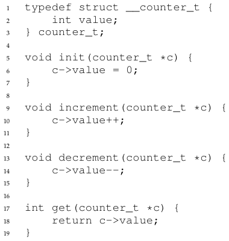

**الشكل 29.1:** عدّاد بلا أقفال

### بسيط لكنه غير قابل للتوسّع

كما ترى، العدّاد غير المتزامن بنية بيانات تافهة، لا تحتاج إلا إلى قدر ضئيل من الشيفرة لتنفيذها. وصار لدينا الآن تحدّينا التالي: كيف نجعل هذه الشيفرة آمنة للخيوط؟ ويعرض الشكل 29.2 كيف نفعل ذلك.

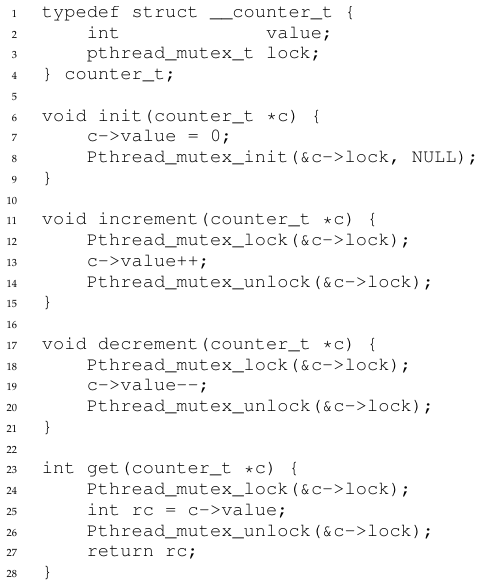

**الشكل 29.2:** عدّاد بأقفال

هذا العدّاد المتزامن بسيط ويعمل عملًا صحيحًا. بل إنه يتبع نمط تصميم شائعًا في أبسط بنى البيانات المتزامنة وأكثرها أساسية: فهو يضيف ببساطة قفلًا واحدًا يُحصل عليه عند استدعاء روتين يتلاعب ببنية البيانات، ويُطلَق عند العودة من الاستدعاء. وبهذه الطريقة يشبه بنية بيانات مبنية بالمراقبات [BH73]، حيث تُحصل الأقفال وتُطلق تلقائيًا حين تستدعي دوالّ الكائنات وتعود منها.

عند هذه النقطة صار لديك بنية بيانات متزامنة عاملة. أما المشكلة التي قد تصادفك فهي الأداء. فإن كانت بنيتك بطيئة جدًا، فسيكون عليك أن تفعل أكثر من مجرد إضافة قفل واحد؛ وهذه التحسينات، إن لزمت، هي موضوع بقية هذا الفصل. ولاحظ أنه إن لم تكن البنية بطيئة كثيرًا فقد انتهيت! فلا حاجة إلى فعل شيء مبهرج إن كان شيء بسيط سينجح.

ولفهم كلفة الأداء في المقاربة البسيطة، نُشغّل اختبارًا قياسيًا يحدّث فيه كل خيط عدّادًا متشاركًا واحدًا عددًا ثابتًا من المرات؛ ثم نغيّر عدد الخيوط. ويعرض الشكل 29.5 الزمن الكلي المستغرق، مع خيط واحد إلى أربعة خيوط نشطة؛ ويحدّث كل خيط العدّاد مليون مرة. أُجريت هذه التجربة على جهاز iMac بأربع معالجات Intel i5 بسرعة 2.7 جيجاهرتز؛ وكلما زاد عدد المعالجات النشطة، أملنا في إنجاز قدر أكبر من العمل الكلي في وحدة الزمن.

ومن السطر الأعلى في الشكل (الموسوم «Precise» أي الدقيق) ترى أن أداء العدّاد المتزامن يتوسّع توسّعًا ضعيفًا. فبينما يستطيع خيط واحد إكمال مليون تحديث للعدّاد في زمن ضئيل (نحو 0.03 ثانية)، فإن وجود خيطين يحدّث كل منهما العدّاد مليون مرة في الوقت نفسه يفضي إلى تباطؤ هائل (يستغرق أكثر من 5 ثوانٍ!). ولا يزداد الأمر إلا سوءًا مع مزيد من الخيوط.

والمثالي أن ترى الخيوط تُكمل عملها بالسرعة نفسها على معالجات متعددة كما يفعل خيط واحد على معالج واحد. وتحقيق هذه الغاية يُسمّى التوسّع المثالي؛ فمع أن العمل المنجَز أكثر، فإنه يُنجَز على التوازي، ومن ثمّ لا يزداد الزمن المستغرق لإكمال المهمة.

### العدّ المتوسّع

ومن المذهل أن الباحثين درسوا كيف تُبنى عدّادات أكثر قابلية للتوسّع لسنوات [MS04]. والأكثر إذهالًا أن العدّادات القابلة للتوسّع مهمة، كما أظهر عمل حديث في تحليل أداء أنظمة التشغيل [B+10]؛ فمن دون عدّ متوسّع، تعاني بعض أحمال العمل العاملة على لينكس من مشكلات توسّع خطيرة على أجهزة متعددة الأنوية.

وقد طُوّرت تقنيات كثيرة لمعالجة هذه المشكلة. وسنصف مقاربة واحدة تُعرف بالعدّاد التقريبي [C06].

يعمل العدّاد التقريبي بتمثيل عدّاد منطقي واحد بعدد كبير من العدّادات الفيزيائية المحلية، واحد لكل نواة معالج، إضافة إلى عدّاد عام واحد. وتحديدًا، على جهاز بأربع معالجات، ثمة أربعة عدّادات محلية وعدّاد عام واحد. وإضافة إلى هذه العدّادات ثمة أيضًا أقفال: قفل لكل عدّاد محلي[^1]، وقفل للعدّاد العام.

والفكرة الأساسية في العدّ التقريبي كما يلي. حين يرغب خيط يعمل على نواة معيّنة في زيادة العدّاد، فإنه يزيد عدّاده المحلي؛ والوصول إلى هذا العدّاد المحلي متزامن عبر القفل المحلي المقابل. ولأن لكل معالج عدّاده المحلي، تستطيع الخيوط على المعالجات المختلفة تحديث العدّادات المحلية بلا تنافس، ومن ثمّ تكون تحديثات العدّاد قابلة للتوسّع.

غير أنه لإبقاء العدّاد العام محدَّثًا (في حال أراد خيط قراءة قيمته)، تُنقل القيم المحلية دوريًا إلى العدّاد العام، بالحصول على القفل العام وزيادته بقيمة العدّاد المحلي؛ ثم يُصفَّر العدّاد المحلي بعد ذلك.

ويتحدّد تكرار هذا النقل من المحلي إلى العام بعتبة S. فكلما صغرت S، صار العدّاد أشبه بالعدّاد غير القابل للتوسّع أعلاه؛ وكلما كبرت S، صار العدّاد أكثر قابلية للتوسّع، لكن القيمة العامة قد تبعد أكثر عن العدّ الفعلي. ويمكن للمرء ببساطة أن يحصل على كل الأقفال المحلية والقفل العام (بترتيب محدّد، لتجنّب الجمود) للحصول على قيمة دقيقة، لكن ذلك غير قابل للتوسّع.

ولتوضيح ذلك لننظر إلى مثال (الشكل 29.3). في هذا المثال تُضبط العتبة S على 5، وثمة خيوط على كل واحد من المعالجات الأربع تحدّث عدّاداتها المحلية L1 ... L4. ويُعرض في التتبّع أيضًا قيمة العدّاد العام (G)، مع تزايد الزمن إلى الأسفل. وفي كل خطوة زمنية قد يُزاد عدّاد محلي؛ فإن بلغت القيمة المحلية العتبة S، نُقلت القيمة المحلية إلى العدّاد العام وصُفِّر العدّاد المحلي.

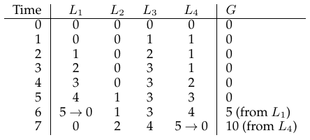

**الشكل 29.3:** تتبّع العدّادات التقريبية

ويعرض السطر الأسفل في الشكل 29.5 (الموسوم «Approximate» أي التقريبي، في الصفحة 6) أداء العدّادات التقريبية بعتبة S تساوي 1024. والأداء ممتاز؛ فالزمن المستغرق لتحديث العدّاد أربعة ملايين مرة على أربع معالجات يكاد لا يزيد على الزمن المستغرق لتحديثه مليون مرة على معالج واحد.

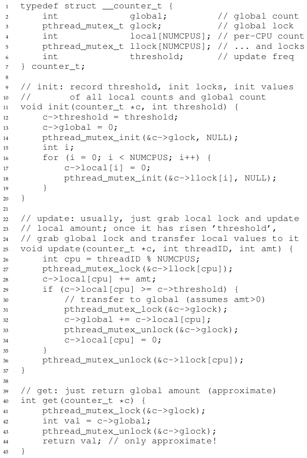

**الشكل 29.4:** تنفيذ العدّاد التقريبي

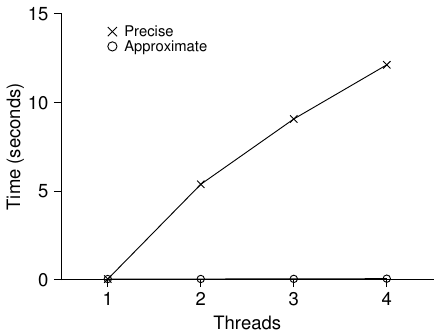

**الشكل 29.5:** أداء العدّادات التقليدية مقابل التقريبية

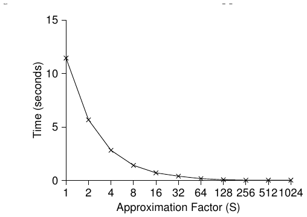

**الشكل 29.6:** توسّع العدّادات التقريبية

ويُظهر الشكل 29.6 أهمية قيمة العتبة S، مع أربعة خيوط يزيد كل منها العدّاد مليون مرة على أربع معالجات. فإن كانت S منخفضة كان الأداء ضعيفًا (لكن العدّ العام يبقى دقيقًا جدًا دائمًا)؛ وإن كانت S مرتفعة كان الأداء ممتازًا، لكن العدّ العام يتخلّف (بمقدار يساوي عدد المعالجات مضروبًا في S على الأكثر). وهذه المقايضة بين الدقة والأداء هي ما تتيحه العدّادات التقريبية.

وثمة نسخة خشنة من العدّاد التقريبي في الشكل 29.4 (الصفحة 5). اقرأها، أو أفضل من ذلك: شغّلها بنفسك في بعض التجارب لتفهم كيف تعمل فهمًا أفضل.

> **نصيحة: مزيد من التزامن ليس بالضرورة أسرع**
>
> إن أضاف المخطط الذي تصمّمه قدرًا كبيرًا من الكلفة الإضافية (مثلًا بالحصول على الأقفال وإطلاقها بكثرة بدلًا من مرة واحدة)، فقد لا تكون حقيقة أنه أكثر تزامنًا مهمة. فالمخططات البسيطة تميل إلى العمل جيدًا، خصوصًا إن كانت تستخدم الروتينات المكلفة نادرًا. وإضافة مزيد من الأقفال والتعقيد قد تكون سقوطك. ومع كل ذلك ثمة طريقة واحدة لتعرف حقًا: ابنِ البديلين (البسيط الأقل تزامنًا، والمعقّد الأكثر تزامنًا) وقِس كيف يعمل كل منهما. ففي النهاية لا يمكنك الغش في الأداء؛ فكرتك إما أسرع أو ليست كذلك.

## 29.2 القوائم المترابطة المتزامنة

ننتقل الآن إلى بنية أعقد، هي القائمة المترابطة. ولنبدأ مرة أخرى بمقاربة أساسية. وللتبسيط سنحذف بعض الروتينات البديهية التي كانت ستحتويها قائمة كهذه، ونركّز على الإدراج والبحث المتزامنين فحسب؛ ونترك للقارئ التفكير في الحذف وغيره. ويعرض الشكل 29.7 شيفرة بنية البيانات البدائية هذه.

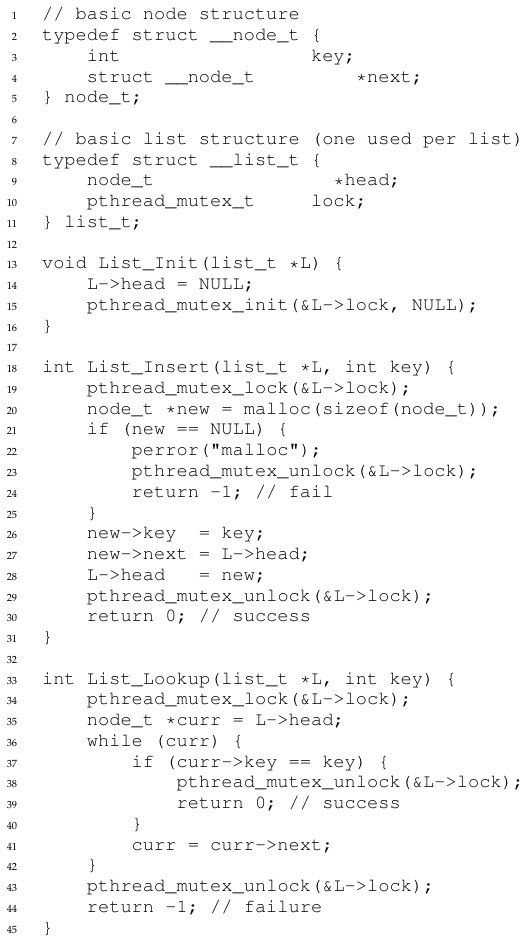

**الشكل 29.7:** قائمة مترابطة متزامنة

كما ترى في الشيفرة، تحصل الشيفرة ببساطة على قفل في روتين الإدراج عند الدخول، وتُطلقه عند الخروج. وثمة مسألة صغيرة دقيقة تنشأ إن فشل malloc() (وهي حالة نادرة)؛ وفي هذه الحالة يجب على الشيفرة أن تُطلق القفل أيضًا قبل أن يفشل الإدراج.

وقد ثبت أن هذا النوع من تدفّق التحكم الاستثنائي عرضة للخطأ جدًا؛ فقد وجدت دراسة حديثة لرقع نواة لينكس أن نسبة هائلة من الأخطاء (قرابة 40%) توجد في مسارات الشيفرة النادرة السلوك هذه (بل إن هذه الملاحظة أطلقت بعض بحثنا الخاص، الذي أزلنا فيه كل مسارات فشل الذاكرة من نظام ملفات لينكس، فنتج نظام أكثر متانة [S+11]).

ومن ثمّ تحدٍّ: هل نستطيع أن نعيد كتابة روتيني الإدراج والبحث بحيث يبقيان صحيحين في ظل الإدراج المتزامن، مع تجنّب الحالة التي يتطلب فيها مسار الفشل إضافة استدعاء unlock أيضًا؟

والجواب في هذه الحالة نعم. وتحديدًا، يمكننا أن نعيد ترتيب الشيفرة قليلًا بحيث لا يحيط القفل والإطلاق إلا القسم الحرج الفعلي في شيفرة الإدراج، ويُستخدم مسار خروج واحد في شيفرة البحث. والأول يعمل لأن جزءًا من الإدراج لا يحتاج فعلًا إلى أن يكون مقفلًا؛ فبافتراض أن malloc() نفسه آمن للخيوط، يستطيع كل خيط أن يستدعيه دون قلق من حالات التسابق أو أخطاء التزامن الأخرى. ولا يلزم حمل قفل إلا عند تحديث القائمة المتشاركة. وانظر الشكل 29.8 لتفاصيل هذه التعديلات.

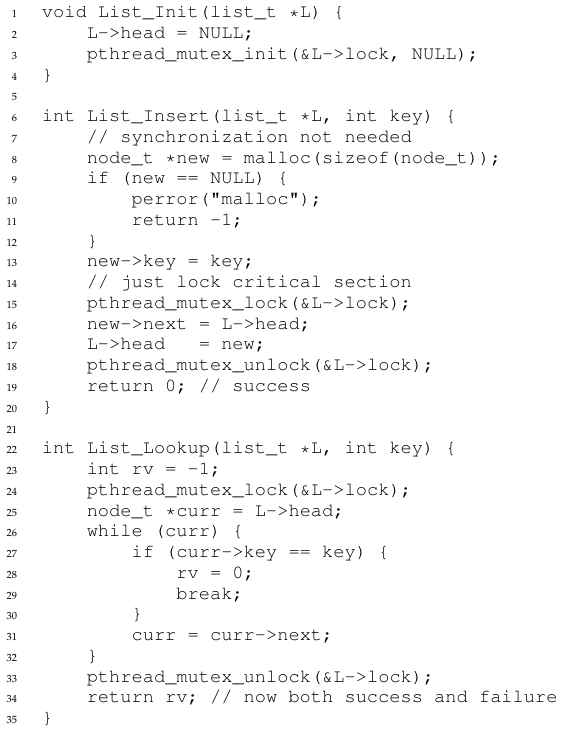

**الشكل 29.8:** قائمة مترابطة متزامنة: بعد إعادة الكتابة

أما روتين البحث، فهو تحويل بسيط في الشيفرة للقفز خارج حلقة البحث الرئيسية إلى مسار عودة واحد. وفعل ذلك يقلّل مرة أخرى عدد نقاط الحصول على القفل وإطلاقه في الشيفرة، ومن ثمّ يقلّل فرص إدخال أخطاء بالخطأ (مثل نسيان إطلاق القفل قبل العودة) في الشيفرة.

### توسيع القوائم المترابطة

مع أن لدينا مرة أخرى قائمة مترابطة متزامنة أساسية، فنحن مرة أخرى في وضع لا تتوسّع فيه توسّعًا جيدًا بشكل خاص. ومن التقنيات التي استكشفها الباحثون لتمكين مزيد من التزامن داخل القائمة ما يُسمّى القفل يدًا بيد (ويُعرف أيضًا باقتران الأقفال) [MS04].

والفكرة بسيطة جدًا. فبدلًا من قفل واحد للقائمة كلها، تضيف قفلًا لكل عقدة من عقد القائمة. وحين تجتاز الشيفرة القائمة، تحصل أولًا على قفل العقدة التالية ثم تُطلق قفل العقدة الحالية (ومن هنا جاء اسم «يدًا بيد»).

> **نصيحة: احذر الأقفال وتدفّق التحكم**
>
> ثمة نصيحة تصميمية عامة، تفيد في الشيفرة المتزامنة وفي غيرها، وهي الحذر من تغيّرات تدفّق التحكم التي تؤدي إلى عودات من الدوال أو خروج منها أو غيرها من حالات الخطأ المشابهة التي توقف تنفيذ دالة. فلأن دوالّ كثيرة تبدأ بالحصول على قفل أو تخصيص ذاكرة أو أداء عمليات أخرى مشابهة ذات حالة، فعند ظهور الأخطاء يجب على الشيفرة أن تتراجع عن كل تلك الحالة قبل العودة، وهو أمر عرضة للخطأ. ولذلك من الأفضل أن تُبنى الشيفرة بحيث يقلّ هذا النمط.

ومبدئيًا، للقائمة المترابطة يدًا بيد بعض المعقولية؛ فهي تمكّن درجة عالية من التزامن في عمليات القائمة. غير أنه عمليًا يصعب جعل بنية كهذه أسرع من مقاربة القفل الواحد البسيطة، لأن الكلفة الإضافية للحصول على قفل لكل عقدة من عقد الاجتياز وإطلاقه باهظة. فحتى مع قوائم كبيرة جدًا وعدد كبير من الخيوط، يُرجَّح ألا يكون التزامن الذي يتيحه السماح بعدّة عمليات اجتياز متزامنة أسرع من مجرد الحصول على قفل واحد وإجراء عملية وإطلاقه. وربما كان نوع من المقاربة الهجينة (حيث تحصل على قفل جديد كل بضع عقد) جديرًا بالاستكشاف.

## 29.3 الطوابير المتزامنة

كما تعرف الآن، ثمة دائمًا طريقة قياسية لجعل بنية بيانات متزامنة: أضف قفلًا كبيرًا. أما الطابور فسنتجاوز هذه المقاربة، بافتراض أنك تستطيع أن تكتشفها بنفسك.

بل سننظر إلى طابور أكثر تزامنًا بقليل صمّمه مايكل وسكوت [MS98]. وتوجد بنى البيانات والشيفرة المستخدمة لهذا الطابور في الشكل 29.9 (الصفحة 11).

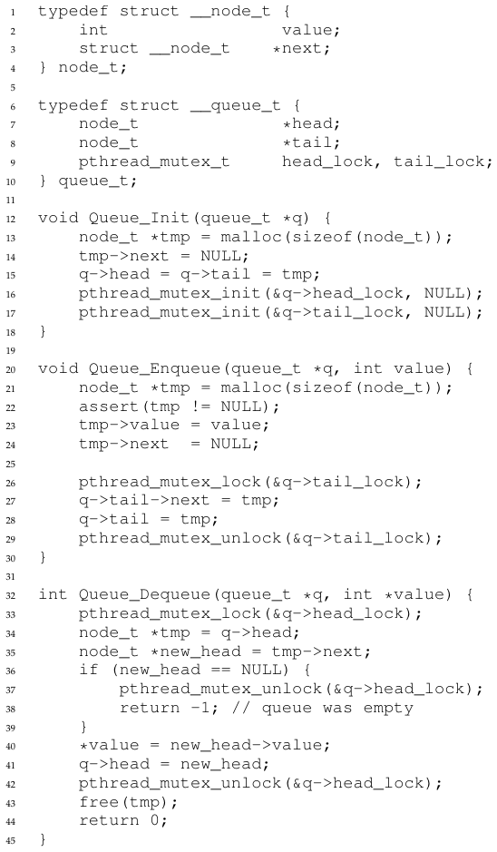

**الشكل 29.9:** طابور مايكل وسكوت المتزامن

إن درست هذه الشيفرة بعناية فستلاحظ أن فيها قفلين، واحدًا لرأس الطابور وواحدًا لذيله. والهدف من هذين القفلين تمكين تزامن عمليتَي الإضافة والإزالة. ففي الحالة الشائعة لا يصل روتين الإضافة إلا إلى قفل الذيل، ولا تصل الإزالة إلا إلى قفل الرأس.

ومن الحيل التي استخدمها مايكل وسكوت إضافة عقدة وهمية (تُخصَّص في شيفرة تهيئة الطابور)؛ وهذه العقدة الوهمية تتيح فصل عمليات الرأس عن عمليات الذيل. ادرس الشيفرة، أو أفضل من ذلك: اكتبها وشغّلها وقِسها، لتفهم كيف تعمل فهمًا عميقًا.

والطوابير شائعة الاستخدام في التطبيقات متعددة الخيوط. غير أن نوع الطابور المستخدم هنا (بالأقفال فحسب) لا يلبّي غالبًا احتياجات تلك البرامج تلبية كاملة. أما الطابور المحدود الأكثر تطوّرًا، الذي يمكّن الخيط من الانتظار إن كان الطابور فارغًا أو ممتلئًا أكثر من اللازم، فهو موضوع دراستنا المكثّفة في الفصل التالي عن المتغيّرات الشرطية. فترقّبه!

## 29.4 جدول التجزئة المتزامن

نختم نقاشنا ببنية بيانات متزامنة بسيطة وواسعة التطبيق، هي جدول التجزئة. وسنركّز على جدول تجزئة بسيط لا يغيّر حجمه؛ فالتعامل مع تغيير الحجم يحتاج عملًا إضافيًا قليلًا، ونتركه تمرينًا للقارئ (معذرة!).

وجدول التجزئة المتزامن هذا (الشكل 29.10) مباشر، ومبني باستخدام القوائم المتزامنة التي طوّرناها سابقًا، ويعمل عملًا مذهلًا. وسبب أدائه الجيد أنه يستخدم قفلًا لكل دلو تجزئة (يمثّل كل منها قائمة) بدلًا من قفل واحد للبنية كلها. وفعل ذلك يمكّن عمليات متزامنة كثيرة من الحدوث.

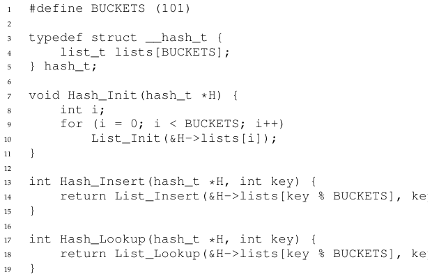

**الشكل 29.10:** جدول تجزئة متزامن

ويعرض الشكل 29.11 (الصفحة 13) أداء جدول التجزئة في ظل تحديثات متزامنة (من 10,000 إلى 50,000 تحديث متزامن من كل واحد من أربعة خيوط، على الجهاز نفسه ذي المعالجات الأربع). ويُعرض أيضًا، للمقارنة، أداء قائمة مترابطة (بقفل واحد). وكما ترى من الرسم، يتوسّع جدول التجزئة المتزامن البسيط هذا توسّعًا رائعًا؛ أما القائمة المترابطة، على النقيض، فلا تتوسّع.

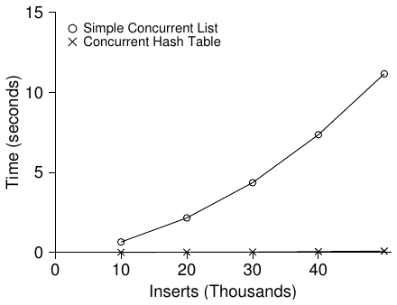

**الشكل 29.11:** توسّع جداول التجزئة

## 29.5 الخلاصة

قدّمنا نماذج من بنى البيانات المتزامنة، من العدّادات إلى القوائم والطوابير، وأخيرًا إلى جدول التجزئة الشائع كثير الاستخدام. وتعلّمنا في الطريق بضعة دروس مهمة: أن نكون حذرين في الحصول على الأقفال وإطلاقها حول تغيّرات تدفّق التحكم؛ وأن تمكين مزيد من التزامن لا يزيد الأداء بالضرورة؛ وأن مشكلات الأداء لا ينبغي أن تُعالج إلا بعد ظهورها. وهذه النقطة الأخيرة، أي تجنّب التحسين المبكر، محورية في أي مطوّر يهتم بالأداء؛ فلا قيمة في جعل شيء أسرع إن لم يكن فعل ذلك سيحسّن الأداء الكلي للتطبيق.

وبطبيعة الحال، لم نخدش إلا سطح البنى عالية الأداء. انظر مسح موير وشافيت الممتاز لمزيد من المعلومات، ولروابط مصادر أخرى [MS04]. وخصوصًا قد تهمّك بنى أخرى (مثل أشجار B)؛ ولهذه المعرفة فإن صفًّا في قواعد البيانات هو أفضل خيار لك. وقد تكون فضوليًا أيضًا بشأن تقنيات لا تستخدم الأقفال التقليدية أصلًا؛ وهذه البنى غير الحاجزة سنتذوّق طعمها في فصل أخطاء التزامن الشائعة، لكن التزامًا بالحقّ هذا الموضوع مجال معرفي كامل يحتاج إلى دراسة أكثر مما يمكن في هذا الكتاب المتواضع. فاكتشف المزيد بنفسك إن رغبت (كما هو الحال دائمًا!).

> **نصيحة: تجنّب التحسين المبكر (قانون كنوث)**
>
> حين تبني بنية بيانات متزامنة، ابدأ بأبسط مقاربة، وهي إضافة قفل واحد كبير لتوفير وصول متزامن. وفعل ذلك يُرجَّح أن ينتج قفلًا صحيحًا؛ فإن وجدت بعد ذلك أنه يعاني مشكلات أداء، أمكنك أن تصقله، فلا تجعله سريعًا إلا إن لزم. وكما قال كنوث قولته الشهيرة: «التحسين المبكر أصل الشرور كلها.»
>
> وقد استخدمت أنظمة تشغيل كثيرة قفلًا واحدًا حين انتقلت أول مرة إلى المعالجات المتعددة، منها Sun OS ولينكس. وفي الأخير كان لهذا القفل اسم حتى، هو قفل النواة الكبير (BKL). ولسنوات كثيرة كانت هذه المقاربة البسيطة مقاربة جيدة، لكن حين صارت الأنظمة متعددة المعالجات هي القاعدة، صار السماح بخيط نشط واحد فقط في النواة في المرة الواحدة عنق زجاجة في الأداء. ومن ثمّ آن الأوان أخيرًا لإضافة تحسين التزامن المحسّن إلى هذه الأنظمة. وفي لينكس اتُّخذت المقاربة الأكثر مباشرة: استبدال قفل واحد بأقفال كثيرة. وفي Sun اتُّخذ قرار أكثر جذرية: بناء نظام تشغيل جديد كليًا، يُعرف بـSolaris، يدمج التزامن دمجًا أكثر جوهرية من اليوم الأول. اقرأ كتابَي نواة لينكس وSolaris لمزيد من المعلومات عن هذين النظامين الساحرين [BC05, MM00].

## المراجع

> [B+10] «An Analysis of Linux Scalability to Many Cores» لـSilas Boyd-Wickizer وAustin T. Clements وYandong Mao وAleksey Pesterev وM. Frans Kaashoek وRobert Morris وNickolai Zeldovich. OSDI '10، فانكوفر، كندا، أكتوبر 2010. دراسة رائعة لكيفية أداء لينكس على الأجهزة متعددة الأنوية، مع بعض الحلول البسيطة. تتضمن عدّادًا «مُهملًا» أنيقًا يحل أحد أشكال مشكلة العدّ القابل للتوسّع.

> [BH73] «Operating System Principles» لـPer Brinch Hansen. Prentice-Hall، 1973. متاح: http://portal.acm.org/citation.cfm?id=540365. من أوائل كتب أنظمة التشغيل؛ ومتقدّم على عصره بالتأكيد. قدّم المراقبات كبدائية تزامن.

> [BC05] «Understanding the Linux Kernel (Third Edition)» لـDaniel P. Bovet وMarco Cesati. O'Reilly Media، نوفمبر 2005. الكتاب الكلاسيكي عن نواة لينكس. عليك أن تقرأه.

> [C06] «The Search For Fast, Scalable Counters» لـJonathan Corbet. 1 فبراير 2006. متاح: https://lwn.net/Articles/170003. لدى LWN مقالات رائعة كثيرة عن أحدث ما في لينكس. وهذا المقال وصف قصير للعدّ التقريبي القابل للتوسّع؛ اقرأه وغيره لتتعلّم المزيد عن أحدث ما في لينكس.

> [L+13] «A Study of Linux File System Evolution» لـLanyue Lu وAndrea C. Arpaci-Dusseau وRemzi H. Arpaci-Dusseau وShan Lu. FAST '13، سان خوسيه، كاليفورنيا، فبراير 2013. ورقتنا التي تدرس كل رقعة طُبّقت على أنظمة ملفات لينكس على مدى قرابة عقد. فيها نتائج ممتعة كثيرة؛ اقرأها لترى! غير أن العمل كان مؤلمًا في أدائه؛ فقد كان على طالب الدراسات العليا المسكين، لانيوي لو، أن ينظر في كل رقعة بيده ليفهم ما فعلته.

> [MS98] «Nonblocking Algorithms and Preemption-safe Locking on Multiprogrammed Shared-memory Multiprocessors» لـM. Michael وM. Scott. Journal of Parallel and Distributed Computing، المجلد 51، العدد 1، 1998. كان البروفيسور سكوت وطلابه في مقدمة خوارزميات التزامن وبنى البيانات المتزامنة سنوات كثيرة؛ تفقّد صفحته على الويب أو أوراقه الكثيرة أو كتبه لتعرف المزيد.

> [MS04] «Concurrent Data Structures» لـMark Moir وNir Shavit. في Handbook of Data Structures and Applications (بتحرير D. Metha وS.Sahni). Chapman and Hall/CRC Press، 2004. متاح: www.ostep.org/Citations/concurrent.pdf. مرجع قصير لكنه شامل نسبيًا في بنى البيانات المتزامنة. ومع أنه يفتقد بعض أحدث الأعمال في المجال (بسبب قدمه)، فإنه يبقى مرجعًا نافعًا نفعًا لا يُصدَّق.

> [MM00] «Solaris Internals: Core Kernel Architecture» لـJim Mauro وRichard McDougall. Prentice Hall، أكتوبر 2000. كتاب Solaris. عليك أن تقرأه أيضًا، إن أردت أن تتعلّم شيئًا غير لينكس.

> [S+11] «Making the Common Case the Only Case with Anticipatory Memory Allocation» لـSwaminathan Sundararaman وYupu Zhang وSriram Subramanian وAndrea C. Arpaci-Dusseau وRemzi H. Arpaci-Dusseau. FAST '11، سان خوسيه، كاليفورنيا، فبراير 2011. عملنا على إزالة استدعاءات التخصيص القابلة للفشل من مسارات شيفرة النواة. فبتخصيص كل الذاكرة التي قد تلزم قبل أداء أي عمل، نتجنّب الفشل في عمق مكدّس التخزين.

## الواجب (شيفرة)

ستكتسب في هذا الواجب بعض الخبرة في كتابة شيفرة متزامنة وقياس أدائها. فتعلّم بناء شيفرة يعمل عملًا جيدًا مهارة حرجة، ومن ثمّ فإن اكتساب قليل من الخبرة هنا جدير بالجهد.

## الأسئلة

1. سنبدأ بإعادة إجراء القياسات الواردة في هذا الفصل. استخدم النداء gettimeofday() لقياس الزمن داخل برنامجك. فما مدى دقة هذا المؤقّت؟ وما أصغر فاصل زمني يستطيع قياسه؟ اكتسب ثقة في عمله، لأننا سنحتاجه في كل الأسئلة التالية. ويمكنك أيضًا أن تنظر في مؤقّتات أخرى، مثل عدّاد الدورات المتاح على x86 عبر تعليمة rdtsc.
2. ابنِ الآن عدّادًا متزامنًا بسيطًا وقِس كم يستغرق لزيادة العدّاد مرات كثيرة مع تزايد عدد الخيوط. فكم معالجًا متاحًا في النظام الذي تستخدمه؟ وهل يؤثر هذا العدد في قياساتك؟
3. ابنِ بعد ذلك نسخة من العدّاد التقريبي. وقِس مرة أخرى أداءها مع تغيّر عدد الخيوط، وكذلك العتبة. فهل تطابق الأرقام ما تراه في الفصل؟
4. ابنِ نسخة من قائمة مترابطة تستخدم القفل يدًا بيد [MS04]، كما هو مذكور في الفصل. و ينبغي أن تقرأ الورقة أولًا لتفهم كيف تعمل، ثم تنفّذها. وقِس أداءها. فمتى تعمل قائمة يدًا بيد أفضل من القائمة القياسية المعروضة في الفصل؟
5. اختر بنية البيانات المفضّلة لديك، مثل شجرة B أو بنية أخرى أكثر إثارة للاهتمام قليلًا. نفّذها، وابدأ باستراتيجية قفل بسيطة مثل قفل واحد. وقِس أداءها مع تزايد الخيوط المتزامنة.
6. وأخيرًا، فكّر في استراتيجية قفل أكثر إثارة لبنية بياناتك المفضّلة هذه. نفّذها وقِس أداءها. فكيف تقارن بمقاربة القفل المباشرة؟

[^1]: نحتاج الأقفال المحلية لأننا نفترض أنه قد يكون على كل نواة أكثر من خيط واحد. أما لو كان خيط واحد فقط يعمل على كل نواة، لما لزم أي قفل محلي.
