# الفصل 31: الإشارات

كما نعلم الآن، يحتاج المرء إلى الأقفال ومتغيّرات الشرط معًا ليحلّ طائفة واسعة من مشكلات التزامن المهمة والمثيرة. ومن أوائل من أدركوا ذلك قبل سنوات إدسخر دايكسترا (وإن كان من الصعب معرفة التاريخ الدقيق [GR92])، المعروف من بين أمور أخرى بخوارزمية «أقصر المسارات» الشهيرة في نظرية المخطّطات [D59]، وبمقالة جدالية مبكّرة في البرمجة المهيكلة عنوانها «عبارات Goto تُعدّ ضارة» [D68a] (يا له من عنوان رائع!)، وفي الحالة التي سندرسها هنا، بتقديم بدائية مزامنة تُسمّى الإشارة [D68b, D72]. والحق أن دايكسترا وزملاءه اخترعوا الإشارة كبدائية واحدة لكل ما يتصل بالمزامنة؛ وكما سترى، يستطيع المرء أن يستخدم الإشارات أقفالًا ومتغيّرات شرط معًا.

> **جوهر المسألة: كيف نستخدم الإشارات**
>
> كيف يمكننا استخدام الإشارات بدلًا من الأقفال ومتغيّرات الشرط؟ وما تعريف الإشارة؟ وما الإشارة الثنائية؟ وهل بناء إشارة من الأقفال ومتغيّرات الشرط أمر مباشر؟ وهل بناء الأقفال ومتغيّرات الشرط من الإشارات كذلك؟

## 31.1 الإشارات: تعريف

الإشارة كائن يحمل قيمة صحيحة نستطيع التلاعب بها عبر روتينين؛ وفي معيار POSIX يُسمّى هذان الروتينان sem_wait() وsem_post()[^1]. ولأن القيمة الابتدائية للإشارة هي التي تحدّد سلوكها، فلا بد قبل استدعاء أي روتين آخر للتعامل مع الإشارة من تهيئتها إلى قيمة ما، كما تفعل الشيفرة في الشكل 31.1.

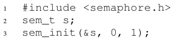

**الشكل 31.1:** تهيئة إشارة

في الشكل نُعلن إشارة s ونهيّئها إلى القيمة 1 بتمرير 1 وسيطًا ثالثًا. أما الوسيط الثاني للدالة sem_init() فسيُضبط على 0 في كل الأمثلة التي سنراها؛ وهذا يدلّ على أن الإشارة متشاركة بين خيوط العملية نفسها. وانظر صفحة الدليل (man) لتفاصيل الاستخدامات الأخرى للإشارات (أي كيف يمكن استخدامها لمزامنة الوصول بين عمليات مختلفة)، وهي تتطلب قيمة مختلفة لذلك الوسيط الثاني.

وبعد تهيئة الإشارة نستطيع استدعاء إحدى دالتين للتعامل معها، sem_wait() أو sem_post(). وسلوك هاتين الدالتين موضّح في الشكل 31.2.

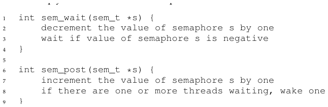

**الشكل 31.2:** الإشارة: تعريفا الانتظار والإرسال

لسنا معنيّين الآن بتنفيذ هذين الروتينين، وهو تنفيذ يتطلب عناية واضحة؛ فمع استدعاء خيوط متعددة للدالة sem_wait() وsem_post() تظهر الحاجة البديهية إلى إدارة هذه الأقسام الحرجة. وسنركّز الآن على كيفية استخدام هذه البدائيات؛ وقد نناقش لاحقًا كيف تُبنى.

وينبغي أن نناقش بضعة جوانب بارزة في هذه الواجهات. أولًا، نرى أن sem_wait() إما أن تعود فورًا (لأن قيمة الإشارة كانت واحدًا أو أعلى حين استدعينا sem_wait())، وإما أن تجعل المستدعي يعلّق تنفيذه في انتظار إرسال لاحق. وبطبيعة الحال قد تستدعي خيوط متعددة الدالة sem_wait()، فتنتظر كلها في الطابور إلى أن تُوقظ.

وثانيًا، نرى أن sem_post() لا تنتظر تحقّق شرط معيّن كما تفعل sem_wait(). بل تزيد ببساطة قيمة الإشارة، ثم، إن كان ثمة خيط ينتظر الإيقاظ، توقظ واحدًا منهم.

وثالثًا، قيمة الإشارة، حين تكون سالبة، تساوي عدد الخيوط المنتظرة [D68b]. ومع أن مستخدمي الإشارات لا يرون القيمة عمومًا، فإن هذه الخاصية الثابتة جديرة بالمعرفة، وربما تساعدك على تذكّر كيف تعمل الإشارة.

لا تقلق (بعد) من حالات التسابق الظاهرة داخل الإشارة؛ افترض أن الأفعال التي تقوم بها تُنفَّذ ذرّيًا. وسنستخدم قريبًا الأقفال ومتغيّرات الشرط لفعل ذلك بالضبط.

## 31.2 الإشارات الثنائية (الأقفال)

صرنا الآن جاهزين لاستخدام إشارة. وسيكون استخدامنا الأول شيئًا نألفه بالفعل: استخدام الإشارة قفلًا. انظر الشكل 31.3 لمقطع الشيفرة؛ وسترى فيه أننا نحيط القسم الحرج المطلوب بزوج من sem_wait()/sem_post(). غير أن ما هو حاسم في عمل ذلك هو القيمة الابتدائية للإشارة m (المضبوطة على X في الشكل). فماذا ينبغي أن تكون X؟

... (حاول التفكير في الأمر قبل المضي) ...

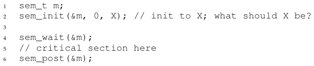

**الشكل 31.3:** إشارة ثنائية (أي قفل)

وبالعودة إلى تعريف الروتينين sem_wait() وsem_post() أعلاه، نرى أن القيمة الابتدائية ينبغي أن تكون 1.

ولتوضيح ذلك، لنتخيّل سيناريو بخيطين. فالخيط الأول (الخيط 0) يستدعي sem_wait()؛ وسيبدأ بتخفيض قيمة الإشارة، فيغيّرها إلى 0. ثم سينتظر فقط إن كانت القيمة ليست أكبر من أو تساوي 0. ولأن القيمة 0، ستعود sem_wait() ببساطة وسيواصل الخيط المستدعي، ومن ثمّ صار الخيط 0 حرًّا لدخول القسم الحرج. وإن لم يحاول خيط آخر الحصول على القفل بينما الخيط 0 داخل القسم الحرج، فحين يستدعي sem_post() سيعيد قيمة الإشارة إلى 1 فحسب (ولن يوقظ خيطًا منتظرًا، لأنه لا يوجد منها شيء). ويعرض الشكل 31.4 تتبّعًا لهذا السيناريو.

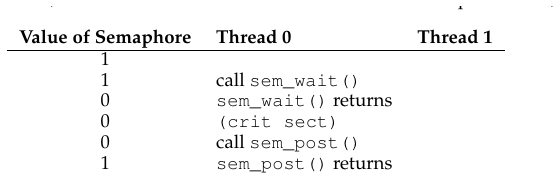

**الشكل 31.4:** تتبّع الخيوط: خيط واحد يستخدم إشارة

وثمة حالة أكثر إثارة للاهتمام تنشأ حين «يحمل» الخيط 0 القفل (أي أنه استدعى sem_wait() ولم يستدعِ sem_post() بعد)، ويحاول خيط آخر (الخيط 1) دخول القسم الحرج باستدعاء sem_wait(). وفي هذه الحالة سيخفّض الخيط 1 قيمة الإشارة إلى -1، ومن ثمّ ينتظر (فينام ويسلّم المعالج). وحين يعمل الخيط 0 مرة أخرى، سيستدعي sem_post() في النهاية، فيعيد قيمة الإشارة إلى صفر، ثم يوقظ الخيط المنتظر (الخيط 1)، الذي يستطيع عندئذٍ الحصول على القفل لنفسه. وحين ينتهي الخيط 1، سيزيد قيمة الإشارة مرة أخرى، فيعيدها إلى 1.

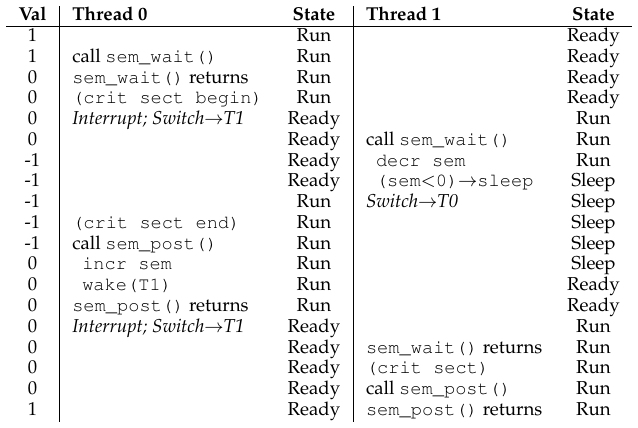

**الشكل 31.5:** تتبّع الخيوط: خيطان يستخدمان إشارة

ويعرض الشكل 31.5 تتبّعًا لهذا المثال. فإضافةً إلى أفعال الخيوط، يعرض الشكل حالة الجدولة لكل خيط: Run (الخيط يعمل)، وReady (أي قابل للعمل لكنه لا يعمل)، وSleep (الخيط محجوب). ولاحظ أن الخيط 1 يدخل حالة النوم حين يحاول الحصول على القفل المحمول بالفعل؛ ولا يمكن إيقاظ الخيط 1 وإتاحة العمل له من جديد إلا حين يعمل الخيط 0 مرة أخرى.

وإن أردت أن تعمل على مثالك الخاص، فجرّب سيناريو تصطفّ فيه خيوط متعددة منتظرة قفلًا. فما ستكون قيمة الإشارة في أثناء تتبّع كهذا؟

وهكذا نستطيع استخدام الإشارات أقفالًا. ولأن الأقفال لا تحمل إلا حالتين (محمول وغير محمول)، فإننا نسمّي الإشارة المستخدمة قفلًا أحيانًا إشارة ثنائية. ولاحظ أنك إن كنت تستخدم الإشارة على هذا النحو الثنائي فقط، فقد يمكن تنفيذها على نحو أبسط من الإشارات المعمّمة التي نقدّمها هنا.

## 31.3 الإشارات للترتيب

تفيد الإشارات أيضًا في ترتيب الأحداث في برنامج متزامن. فمثلًا قد يرغب خيط في انتظار قائمة حتى تصبح غير فارغة، ليحذف منها عنصرًا. وفي نمط الاستخدام هذا نجد غالبًا خيطًا ينتظر حدوث شيء ما، وخيطًا آخر يحدث ذلك الشيء ثم يشير إلى حدوثه، فيوقظ بذلك الخيط المنتظر. ومن ثمّ نستخدم الإشارة بدائية ترتيب (على غرار استخدامنا متغيّرات الشرط سابقًا).

والمثال البسيط كما يلي. تخيّل خيطًا ينشئ خيطًا آخر ثم يريد انتظاره حتى يُكمل تنفيذه (الشكل 31.6). وحين يعمل هذا البرنامج، نريد أن نرى ما يلي:

```
parent: begin
child
parent: end
```

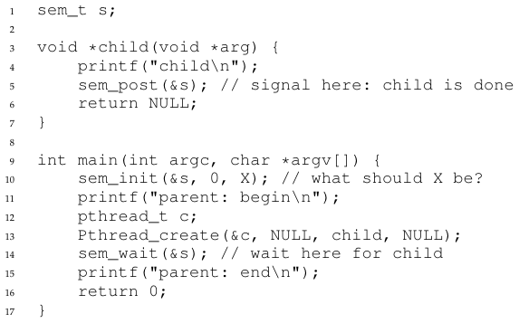

**الشكل 31.6:** أب ينتظر طفله

والسؤال إذن: كيف نستخدم إشارة لتحقيق هذا الأثر؟ وكما تبيّن، الجواب سهل الفهم نسبيًا. فكما ترى في الشيفرة، يستدعي الأب ببساطة sem_wait() ويستدعي الطفل sem_post() لينتظر تحقّق شرط انتهاء الطفل من تنفيذه. غير أن هذا يطرح السؤال: ماذا ينبغي أن تكون القيمة الابتدائية لهذه الإشارة؟

(مرة أخرى، فكّر في الأمر هنا بدلًا من قراءة ما يلي)

والجواب، بطبيعة الحال، أن قيمة الإشارة ينبغي أن تكون 0. فثمة حالتان ينبغي النظر فيهما. أولًا، لنفترض أن الأب ينشئ الطفل لكن الطفل لم يعمل بعد (أي أنه جالس في طابور الجهوزية لكنه لا يعمل). وفي هذه الحالة (الشكل 31.7، الصفحة 6) سيستدعي الأب sem_wait() قبل أن يستدعي الطفل sem_post()؛ ونريد للأب أن ينتظر حتى يعمل الطفل. والسبيل الوحيد لذلك ألا تكون قيمة الإشارة أكبر من 0؛ ومن ثمّ تكون 0 هي القيمة الابتدائية. فيعمل الأب، ويخفّض الإشارة (إلى -1)، ثم ينتظر (نائمًا). وحين يعمل الطفل أخيرًا سيستدعي sem_post()، فيزيد قيمة الإشارة إلى 0، ويوقظ الأب، الذي يعود عندئذٍ من sem_wait() وينهي البرنامج.

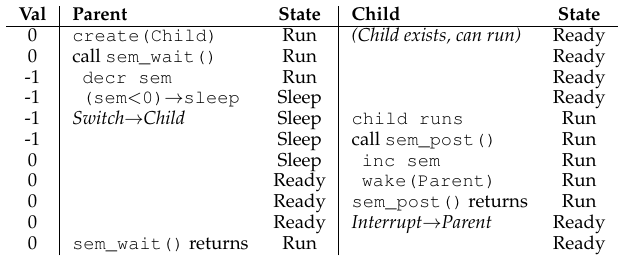

**الشكل 31.7:** تتبّع الخيوط: أب ينتظر طفله (الحالة 1)

أما الحالة الثانية (الشكل 31.8) فتنشأ حين يعمل الطفل حتى الإكمال قبل أن تسنح للأب فرصة استدعاء sem_wait(). وفي هذه الحالة سيستدعي الطفل sem_post() أولًا، فيزيد بذلك قيمة الإشارة من 0 إلى 1. وحين تسنح للأب بعد ذلك فرصة العمل، سيستدعي sem_wait() فيجد قيمة الإشارة 1؛ ومن ثمّ سيخفّض القيمة (إلى 0) ويعود من sem_wait() دون انتظار، فيحقّق بذلك الأثر المطلوب أيضًا.

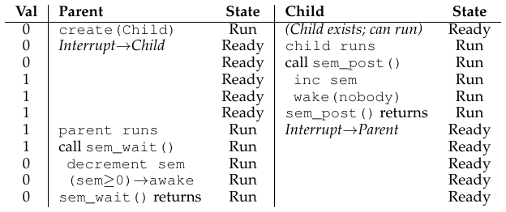

**الشكل 31.8:** تتبّع الخيوط: أب ينتظر طفله (الحالة 2)

## 31.4 مشكلة المنتج والمستهلك (المخزن المحدود)

المشكلة التالية التي سنواجهها في هذا الفصل تُعرف بمشكلة المنتج والمستهلك، وأحيانًا بمشكلة المخزن المحدود [D72]. وقد وُصفت هذه المشكلة بالتفصيل في الفصل السابق عن متغيّرات الشرط؛ انظر هناك للتفاصيل.

> **نصيحة: ضبط قيمة الإشارة**
>
> رأينا الآن مثالين لتهيئة إشارة. في الأول ضبطنا القيمة على 1 لاستخدام الإشارة قفلًا؛ وفي الثاني على 0 لاستخدامها للترتيب. فما القاعدة العامة لتهيئة الإشارات؟
>
> ثمة طريقة بسيطة للتفكير في الأمر، بفضل بيري كيفالوفيتز، وهي أن تنظر إلى عدد الموارد التي ترغب في التنازل عنها فورًا بعد التهيئة. في حالة القفل كانت 1، لأنك ترغب في أن يكون القفل مقفلًا (متنازلًا عنه) فور التهيئة. وفي حالة الترتيب كانت 0، لأنه لا شيء للتنازل عنه في البداية؛ ولا يُنشأ المورد إلا حين ينتهي الخيط الطفل، وعندها تُزاد القيمة إلى 1. جرّب هذا الخط من التفكير في مشكلات الإشارات المستقبلية، وانظر هل يساعدك.

### المحاولة الأولى

تقدّم محاولتنا الأولى لحلّ المشكلة إشارتين، empty وfull، سيستخدمهما الخيوط للدلالة على أن مدخلًا في المخزن قد أُفرغ أو مُلئ على الترتيب. وشيفرة الروتينين put وget موجودة في الشكل 31.9، ومحاولتنا لحلّ مشكلة المنتج والمستهلك في الشكل 31.10 (الصفحة 8).

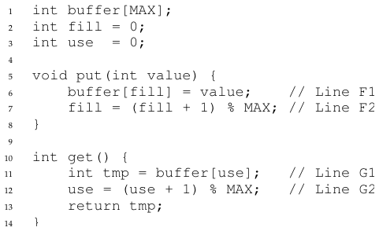

**الشكل 31.9:** الروتينان put وget

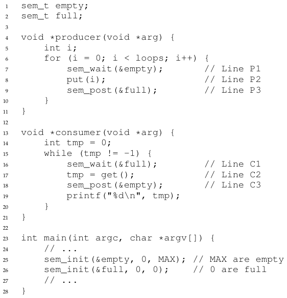

**الشكل 31.10:** إضافة الشرطين full وempty

في هذا المثال ينتظر المنتج أولًا أن يصبح مدخل في المخزن فارغًا ليضع فيه بيانات، وبالمثل ينتظر المستهلك أن يصبح مدخل مليئًا قبل استخدامه. ولنتخيّل أولًا أن MAX=1 (أي لا يوجد في المصفوفة إلا مخزن واحد)، وننظر هل يعمل هذا.

وتخيّل مرة أخرى أن ثمة خيطين، منتجًا ومستهلكًا. ولنفحص سيناريو محدّدًا على معالج واحد. افترض أن المستهلك ينال فرصة العمل أولًا. ومن ثمّ سيصل المستهلك إلى السطر C1 في الشكل 31.10، مستدعيًا sem_wait(&full). ولأن full هُيّئت إلى القيمة 0، سيخفّض النداء full (إلى -1)، ويحجب المستهلك، وينتظر خيطًا آخر يستدعي sem_post() على full، كما هو مطلوب.

افترض بعد ذلك أن المنتج يعمل. سيصل إلى السطر P1، فيستدعي الروتين sem_wait(&empty). وخلافًا للمستهلك، سيمضي المنتج عبر هذا السطر، لأن empty هُيّئت إلى القيمة MAX (وهي 1 في هذه الحالة). ومن ثمّ ستُخفَّض empty إلى 0 وسيضع المنتج قيمة بيانات في المدخل الأول من المخزن (السطر P2). ثم يمضي المنتج إلى P3 ويستدعي sem_post(&full)، فيغيّر قيمة الإشارة full من -1 إلى 0 ويوقظ المستهلك (أي ينقله من حالة الحجب إلى حالة الجهوزية مثلًا).

وفي هذه الحالة يمكن أن يحدث أحد أمرين. فإن واصل المنتج العمل، فسيدور و يصل إلى السطر P1 مرة أخرى. غير أنه سيُحجب هذه المرة، لأن قيمة الإشارة empty صفر. وإن قُطع المنتج بدلًا من ذلك وبدأ المستهلك العمل، فسيعود من sem_wait(&full) (السطر C1)، فيجد أن المخزن ممتلئ، فيستهلكه. وفي الحالتين نحقق السلوك المطلوب.

ويمكنك تجربة المثال نفسه بخيوط أكثر (منتجان متعددان ومستهلكان متعددان مثلًا). ينبغي أن يعمل مع ذلك.

ولنتخيّل الآن أن MAX أكبر من 1 (قل MAX=10). ولنفترض في هذا المثال أن ثمة منتجين متعددين ومستهلكين متعددين. صارت لدينا الآن مشكلة: حالة تسابق. فهل ترى أين تحدث؟ (خذ بعض الوقت وابحث عنها) فإن لم ترها فإليك تلميحًا: انظر عن كثب إلى الشيفرة put() وget().

حسنًا، لنفهم المسألة. تخيّل منتجين (Pa وPb) يستدعي كلاهما put() في وقت متقارب. افترض أن المنتج Pa ينال فرصة العمل أولًا، ويبدأ للتو في ملء المدخل الأول من المخزن (fill=0 عند السطر F1). وقبل أن تسنح لـPa فرصة زيادة عدّاد fill إلى 1، يُقاطَع. فيبدأ المنتج Pb العمل، ويضع عند السطر F1 بياناته هو أيضًا في العنصر رقم 0 من المخزن، ومعنى ذلك أن البيانات القديمة هناك قد كُتب عليها! وهذا الفعل ممنوع؛ فنحن لا نريد أن تضيع أي بيانات من المنتج.

### حلّ: إضافة الاستبعاد المتبادل

كما ترى، ما نسيناه هنا هو الاستبعاد المتبادل. فملء مخزن وزيادة الفهرس داخل المخزن قسم حرج، ومن ثمّ يجب حراسته بعناية. فلنستخدم صديقنا الإشارة الثنائية ونضف بعض الأقفال. ويعرض الشكل 31.11 محاولتنا.

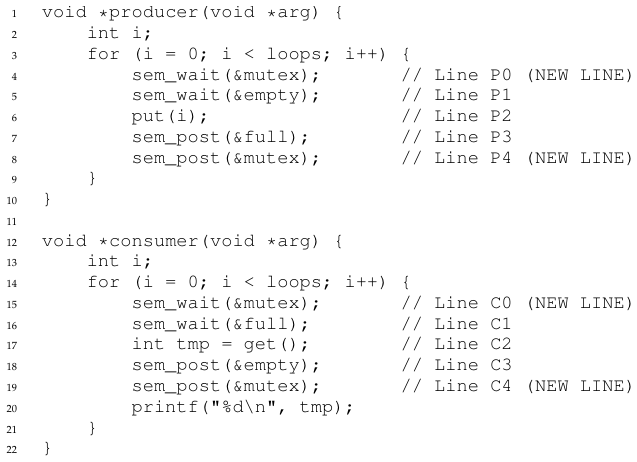

**الشكل 31.11:** إضافة الاستبعاد المتبادل (على نحو خاطئ)

أضفنا الآن بعض الأقفال حول جزأي put()/get() كلّيهما في الشيفرة، كما تدلّ تعليقات NEW LINE. ويبدو ذلك فكرة صحيحة، لكنه لا يعمل هو الآخر. لماذا؟ الجمود. فلماذا يحدث الجمود؟ خذ لحظة للتفكير؛ وحاول أن تجد حالة ينشأ فيها الجمود. فأي تسلسل من الخطوات يجب أن يحدث ليتجمّد البرنامج؟

### تجنّب الجمود

حسنًا، ما دمت قد اكتشفتها فإليك الجواب. تخيّل خيطين، منتجًا ومستهلكًا. ينال المستهلك فرصة العمل أولًا. فيحصل على mutex (السطر C0)، ثم يستدعي sem_wait() على الإشارة full (السطر C1)؛ ولأنه لا توجد بيانات بعد، يتسبب هذا النداء في حجب المستهلك، فيتنازل بذلك عن المعالج؛ والمهم، مع ذلك، أن المستهلك ما يزال يحمل القفل.

ثم يعمل منتج. فهو يملك بيانات لينتجها، ولو أمكنه العمل لاستطاع إيقاظ خيط المستهلك وكان كل شيء على ما يرام. للأسف، أول ما يفعله هو استدعاء sem_wait() على الإشارة الثنائية mutex (السطر P0). والقفل محمول بالفعل. ومن ثمّ يعلق المنتج في الانتظار هو أيضًا.

ثمة دورة بسيطة هنا. فالمستهلك يحمل mutex وينتظر أن يشير أحدهم إلى full. والمنتج يستطيع الإشارة إلى full لكنه ينتظر mutex. ومن ثمّ يعلق المنتج والمستهلك كلٌّ منهما في انتظار الآخر: جمود كلاسيكي.

### أخيرًا، حلّ عامل

لحلّ هذه المشكلة، علينا ببساطة أن نضيّق نطاق القفل. ويعرض الشكل 31.12 (الصفحة 10) الحلّ الصحيح. فكما ترى، ننقل ببساطة الحصول على mutex وإطلاقه ليكون حول القسم الحرج فقط؛ أما شيفرة انتظار full وempty والإشارة إليهما فتُترك خارجًا[^2]. والنتيجة مخزن محدود بسيط وعامل، وهو نمط شائع الاستخدام في البرامج متعددة الخيوط. افهمه الآن؛ واستخدمه لاحقًا. وستشكرنا سنوات قادمة. أو على الأقل ستشكرنا حين يُطرح السؤال نفسه في الامتحان النهائي، أو في مقابلة عمل.

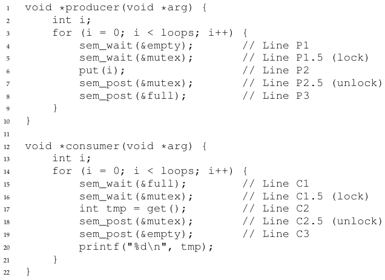

**الشكل 31.12:** إضافة الاستبعاد المتبادل (على نحو صحيح)

## 31.5 أقفال القارئ والكاتب

ثمة مشكلة كلاسيكية أخرى تنبع من الرغبة في بدائية قفل أكثر مرونة تعترف بأن وصولات مختلفة إلى بنية بيانات قد تتطلب أنواعًا مختلفة من الأقفال. تخيّل مثلًا عددًا من عمليات القائمة المتزامنة، منها الإدراج والبحث البسيط. فبينما تغيّر عمليات الإدراج حالة القائمة (ومن ثمّ يكون القسم الحرج التقليدي منطقيًا)، فإن عمليات البحث تقرأ بنية البيانات فحسب؛ وما دمنا نستطيع ضمان ألا يكون ثمة إدراج جارٍ، فبوسعنا أن نسمح لعمليات بحث كثيرة بالمضي في الوقت نفسه. والنوع الخاص من الأقفال الذي سنطوّره الآن لدعم هذا النوع من العمليات يُعرف بقفل القارئ والكاتب [CHP71]. وشيفرة قفل كهذا متاحة في الشكل 31.13 (الصفحة 12).

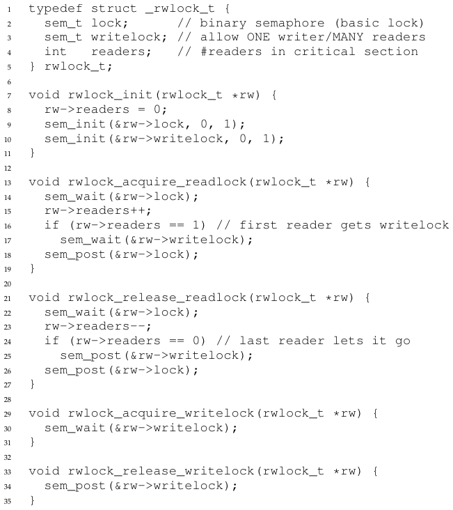

**الشكل 31.13:** قفل بسيط للقارئ والكاتب

والشيفرة بسيطة إلى حد بعيد. فإن أراد خيط تحديث بنية البيانات المعنيّة، فليستدعِ الزوج الجديد من عمليات المزامنة: rwlock_acquire_writelock() للحصول على قفل كتابة، وrwlock_release_writelock() لإطلاقه. وداخليًا تستخدم هذه ببساطة إشارة writelock لتضمن ألا يحصل على القفل إلا كاتب واحد، ومن ثمّ يدخل القسم الحرج لتحديث بنية البيانات المعنيّة.

والأكثر إثارة للاهتمام هو زوج الروتينين للحصول على أقفال القراءة وإطلاقها. فعند الحصول على قفل قراءة، يحصل القارئ أولًا على lock ثم يزيد متغيّرة readers لتتبّع عدد القرّاء الموجودين الآن داخل بنية البيانات. والخطوة المهمة التي تُتخذ بعد ذلك داخل rwlock_acquire_readlock() تحدث حين يحصل أول قارئ على القفل؛ وفي هذه الحالة يحصل القارئ أيضًا على قفل الكتابة باستدعاء sem_wait() على الإشارة writelock، ثم يطلق القفل باستدعاء sem_post().

وبذلك، ما إن يحصل قارئ على قفل قراءة، حتى يُسمح لقرّاء آخرين بالحصول على قفل القراءة كذلك؛ غير أن أي خيط يرغب في الحصول على قفل الكتابة سيكون عليه الانتظار حتى ينتهي كل القرّاء؛ وآخر من يخرج من القسم الحرج يستدعي sem_post() على «writelock» فيتيح بذلك لكاتب منتظر الحصول على القفل.

وتعمل هذه المقاربة (كما هو مطلوب)، لكن لها بعض السلبيات، خصوصًا في ما يتصل بالإنصاف. فالأمر على وجه الخصوص سهل نسبيًا على القرّاء أن يتسببوا في تضوّر الكتّاب جوعًا. وثمة حلول أكثر تطورًا لهذه المشكلة؛ فلعلّك تستطيع التفكير في تنفيذ أفضل؟ تلميح: فكّر في ما ستحتاج إلى فعله لمنع مزيد من القرّاء من دخول القفل ما إن ينتظر كاتب.

وأخيرًا ينبغي التنبيه إلى أن أقفال القارئ والكاتب ينبغي استخدامها بقدر من الحذر. فكثيرًا ما تضيف كلفة إضافية أكبر (خصوصًا مع التنفيذات الأكثر تطورًا)، ومن ثمّ لا تنتهي إلى تسريع الأداء مقارنة باستخدام بدائيات أقفال بسيطة وسريعة [CB08]. وعلى أي حال، تُظهر لنا مرة أخرى كيف نستطيع استخدام الإشارات على نحو مثير ومفيد.

> **نصيحة: البسيط والغبي قد يكون أفضل (قانون هيل)**
>
> ينبغي ألا تُقلّل أبدًا من شأن فكرة أن المقاربة البسيطة والغبية قد تكون الأفضل. ففي القفل، قد يعمل قفل دوران بسيط أفضل ما يمكن، لأنه سهل التنفيذ وسريع. ومع أن شيئًا مثل أقفال القارئ والكاتب يبدو رائعًا، فهو معقّد، والتعقيد قد يعني البطء. ومن ثمّ جرّب دائمًا المقاربة البسيطة والغبية أولًا.
>
> وهذه الفكرة، أي الاحتكام إلى البساطة، موجودة في أماكن كثيرة. ومن أوائل مصادرها أطروحة مارك هيل [H87]، التي درست كيف تُصمَّم ذاكرات التخزين المؤقت للمعالجات. فقد وجد هيل أن الذاكرات البسيطة ذات التعيين المباشر تعمل أفضل من التصاميم المبهرجة ذات التجموعات الترابطية (وأحد الأسباب أن التصاميم الأبسط تتيح بحثًا أسرع في التخزين المؤقت). وكما لخّص هيل عمله بإيجاز: «الكبير والغبي أفضل». ومن ثمّ نسمّي هذه النصيحة المشابهة قانون هيل.

## 31.6 فلاسفة المائدة

من أشهر مشكلات التزامن التي طرحها دايكسترا وحلّها مشكلة فلاسفة المائدة [D71]. والمشكلة مشهورة لأنها ممتعة ومثيرة للاهتمام فكريًا إلى حد ما؛ غير أن فائدتها العملية ضعيفة. ومع ذلك تفرض شهرتها إدراجها هنا؛ بل قد يُسأل عنها في مقابلة ما، وستكره أستاذ نظام التشغيل كرهًا شديدًا إن أخطأت السؤال ولم تحصل على الوظيفة. وعلى العكس، إن حصلت على الوظيفة، فلا تتردّد في إرسال ملاحظة لطيفة إلى أستاذ نظام التشغيل، أو بعض خيارات الأسهم.

والإعداد الأساسي للمشكلة كما يلي (كما يوضّح الشكل 31.14): افترض أن ثمة خمسة «فلاسفة» يجلسون حول مائدة. وبين كل زوج من الفلاسفة شوكة واحدة (ومن ثمّ خمس شوكات في المجموع). ولكل فيلسوف أوقات يفكّر فيها ولا يحتاج إلى شوكات، وأوقات يأكل فيها. وللأكل يحتاج الفيلسوف إلى شوكتين، الشوكة التي على يساره والشوكة التي على يمينه. والتنافس على هذه الشوكات، ومشكلات المزامنة التي تنجم عنه، هي ما يجعل من هذه مشكلة ندرسها في البرمجة المتزامنة.

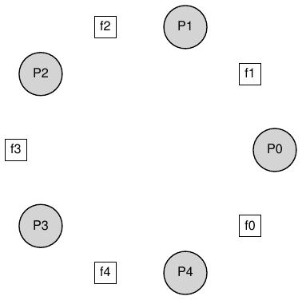

**الشكل 31.14:** فلاسفة المائدة

وهذه حلقة كل فيلسوف الأساسية، بافتراض أن لكل فيلسوف معرّف خيط فريد p من 0 إلى 4 (شاملًا الطرفين):

```
while (1) {
    think();
    get_forks(p);
    eat();
    put_forks(p);
}
```

والتحدّي الرئيسي إذن هو كتابة الروتينين get_forks() وput_forks() بحيث لا يكون ثمة جمود، ولا يتضوّر أي فيلسوف جوعًا فلا يأكل أبدًا، ويكون التزامن عاليًا (أي يستطيع أكبر عدد ممكن من الفلاسفة الأكل في الوقت نفسه).

واقتداءً بحلول داوني [D08]، سنستخدم بضع دوال مساعدة تقرّبنا من الحل. وهي:

```
int left(int p) { return p; }
int right(int p) { return (p + 1) % 5; }
```

فحين يرغب الفيلسوف p في الإشارة إلى الشوكة التي على يساره، يستدعي ببساطة left(p). وبالمثل يُشار إلى الشوكة التي على يمين الفيلسوف p باستدعاء right(p)؛ وتعالج عملية باقي القسمة هناك الحالة الوحيدة التي يحاول فيها آخر فيلسوف (p=4) الإمساك بالشوكة التي على يمينه، وهي الشوكة 0.

وسنحتاج أيضًا إلى بعض الإشارات لحلّ هذه المشكلة. لنفترض أن لدينا خمسًا، واحدة لكل شوكة: sem_t forks[5].

### حلّ معطوب

نحاول حلّنا الأول للمشكلة. افترض أننا نهيّئ كل إشارة (في مصفوفة forks) إلى القيمة 1. وافترض أيضًا أن كل فيلسوف يعرف رقمه (p). وهكذا نستطيع كتابة الروتينين get_forks() وput_forks() (الشكل 31.15، الصفحة 15).

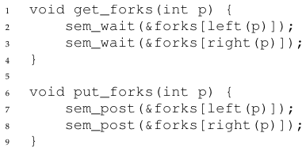

**الشكل 31.15:** الروتينان get_forks() وput_forks()

والحدس الكامن وراء هذا الحل (المعطوب) كما يلي. للحصول على الشوكات نمسك ببساطة «قفل» على كل واحدة: أولًا التي على اليسار، ثم التي على اليمين. وحين ننتهي من الأكل نطلقها. بسيط، أليس كذلك؟ للأسف، البسيط في هذه الحالة يعني المعطوب. فهل ترى المشكلة التي تنشأ؟ فكّر فيها.

المشكلة هي الجمود. فإن حدث أن أمسك كل فيلسوف بالشوكة التي على يساره قبل أن يستطيع أي فيلسوف الإمساك بالشوكة التي على يمينه، علق كل منهم ممسكًا بشوكة واحدة ينتظر أخرى إلى الأبد. وتحديدًا، يمسك الفيلسوف 0 بالشوكة 0، والفيلسوف 1 بالشوكة 1، والفيلسوف 2 بالشوكة 2، والفيلسوف 3 بالشوكة 3، والفيلسوف 4 بالشوكة 4؛ فتُحتاز كل الشوكات، ويعلق كل الفلاسفة في انتظار شوكة يملكها فيلسوف آخر. وسندرس الجمود بتفصيل أكبر قريبًا؛ أما الآن فيكفي القول إن هذا ليس حلًّا عاملًا.

### حلّ: كسر الاعتماد

أبسط طريقة لمهاجمة هذه المشكلة هي تغيير كيفية حصول أحد الفلاسفة على الأقل على الشوكات؛ وهكذا حلّ دايكسترا نفسه المشكلة بالفعل. وتحديدًا، لنفترض أن الفيلسوف 4 (صاحب الرقم الأعلى) يحصل على الشوكات بترتيب مختلف عن الآخرين (الشكل 31.16)؛ أما شيفرة put_forks() فتبقى كما هي.

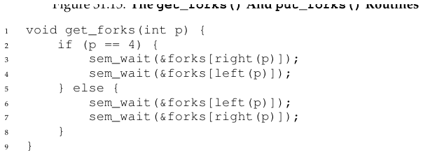

**الشكل 31.16:** كسر الاعتماد في get_forks()

ولأن آخر فيلسوف يحاول الإمساك باليمين قبل اليسار، فلا توجد حالة يمسك فيها كل فيلسوف بشوكة واحدة ويعلق في انتظار أخرى؛ فدورة الانتظار مكسورة. فكّر في عواقب هذا الحل، وأقنع نفسك بأنه يعمل.

وثمة مشكلات «مشهورة» أخرى مثل هذه، كمسألة مدخّن السيجارة أو مسألة الحلّاق النائم. ومعظمها مجرّد حجج للتفكير في التزامن؛ وبعضها له أسماء ساحرة. ابحث عنها إن كنت مهتمًا بمعرفة المزيد، أو بمجرّد مزيد من التدريب على التفكير على النحو المتزامن [D08].

## 31.7 خنق الخيوط

ثمة حالة استخدام بسيطة أخرى للإشارات تظهر أحيانًا، فنعرضها هنا. والمشكلة المحدّدة هي: كيف يستطيع المبرمج منع «عدد كبير جدًا» من الخيوط من فعل شيء في وقت واحد وإرباك النظام؟ الجواب: حدّد عتبة لما يعني «كبير جدًا»، ثم استخدم إشارة لتقييد عدد الخيوط التي تنفّذ مقطع الشيفرة المعنيّ في الوقت نفسه. ونسمّي هذه المقاربة الخنق [T99]، ونعدّها شكلًا من أشكال التحكم في القبول.

ولننظر في مثال أكثر تحديدًا. تخيّل أنك تنشئ مئات الخيوط للعمل على مشكلة ما على التوازي. غير أن كل خيط، في جزء معيّن من الشيفرة، يحصل على قدر كبير من الذاكرة لإنجاز جزء من الحساب؛ ولنسمّ هذا الجزء من الشيفرة المنطقة الكثيفة الذاكرة. فإن دخلت كل الخيوط المنطقة الكثيفة الذاكرة في الوقت نفسه، تجاوز مجموع طلبات تخصيص الذاكرة مقدار الذاكرة المادية في الجهاز. ونتيجة لذلك يبدأ الجهاز في الارتجاف (أي تبادل الصفحات من القرص وإليه)، فيتباطأ الحساب كله تباطؤًا شديدًا.

وإشارة بسيطة تستطيع حلّ هذه المشكلة. فبتهيئة قيمة الإشارة على أقصى عدد من الخيوط ترغب في دخوله المنطقة الكثيفة الذاكرة في وقت واحد، ثم وضع sem_wait() وsem_post() حول المنطقة، تستطيع الإشارة أن تخنق طبيعيًا عدد الخيوط الموجودة داخل المنطقة الخطرة من الشيفرة في الوقت نفسه.

## 31.8 كيف ننفّذ الإشارات

أخيرًا، لنستخدم بدائيات المزامنة منخفضة المستوى، أي الأقفال ومتغيّرات الشرط، لبناء نسختنا من الإشارات تُسمّى ... (قرع الطبول هنا) ... Zemaphores. وهذه المهمة مباشرة إلى حد بعيد، كما ترى في الشكل 31.17 (الصفحة 17).

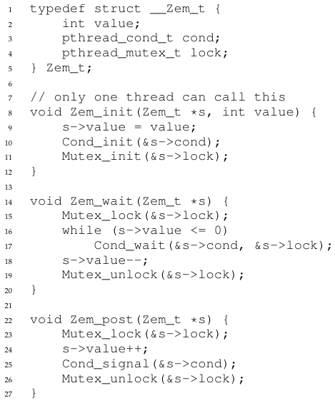

**الشكل 31.17:** تنفيذ Zemaphores بالأقفال ومتغيّرات الشرط

نستخدم في الشيفرة أعلاه قفلًا واحدًا ومتغيّرة شرط واحدة، إضافةً إلى متغيّرة حالة لتتبّع قيمة الإشارة. ادرس الشيفرة بنفسك إلى أن تفهمها فهمًا حقيقيًا. افعلها!

وثمة فرق دقيق واحد بين Zemaphore الخاصة بنا والإشارات المحضة كما عرّفها دايكسترا، هو أننا لا نحافظ على الخاصية الثابتة القائلة إن قيمة الإشارة، حين تكون سالبة، تعبّر عن عدد الخيوط المنتظرة؛ بل لن تقلّ القيمة عن الصفر أبدًا. وهذا السلوك أسهل في التنفيذ ويطابق تنفيذ لينكس الحالي.

ومن الغريب أن بناء متغيّرات الشرط من الإشارات مسألة أعقد بكثير. فقد حاول مبرمجون متزامنون ذوو خبرة عالية فعل ذلك في بيئة ويندوز، فنجمت أخطاء كثيرة ومختلفة [B04]. جرّبه بنفسك، وانظر هل تستطيع أن تكتشف لماذا يكون بناء متغيّرات الشرط من الإشارات مسألة أصعب مما قد يبدو.

## 31.9 الخلاصة

الإشارات بدائية قوية ومرنة لكتابة البرامج المتزامنة. وبعض المبرمجين يستخدمونها حصرًا، معرضين عن الأقفال ومتغيّرات الشرط، بسبب بساطتها ونفعها.

وقد عرضنا في هذا الفصل بضعة مشكلات كلاسيكية وحلولها فقط. فإن كنت مهتمًا بمعرفة المزيد، فثمة مواد كثيرة أخرى يمكنك الرجوع إليها. ومن المراجع العظيمة (والمجانية) كتاب آلن داوني عن التزامن والبرمجة بالإشارات [D08]. وهذا الكتاب مليء بالألغاز التي يمكنك العمل عليها لتحسين فهمك للإشارات خصوصًا والتزامن عمومًا. فأن تصير خبير تزامن حقيقيًا يتطلب سنوات من الجهد؛ وتجاوز ما تتعلمه في هذا المقرر هو بلا شك مفتاح إتقان موضوع كهذا.

> **نصيحة: احذر من التعميم**
>
> قد تكون التقنية المجرّدة للتعميم مفيدة جدًا في تصميم الأنظمة، حيث يمكن جعل فكرة جيدة واحدة أوسع قليلًا فتحلّ طائفة أكبر من المشكلات. غير أن احذر عند التعميم؛ فكما يحذّرنا لامبسون: «لا تعمّم؛ فالتعميمات خاطئة عمومًا» [L83].
>
> ويستطيع المرء أن ينظر إلى الإشارات كتعميم للأقفال ومتغيّرات الشرط؛ لكن هل نحتاج تعميمًا كهذا؟ ومع الصعوبة في تحقيق متغيّرة شرط فوق إشارة، فلعلّ هذا التعميم ليس عامًّا كما قد تظن.

## المراجع

> [B04] «Implementing Condition Variables with Semaphores» لـAndrew Birrell. ديسمبر 2004. قراءة مثيرة في مدى صعوبة تنفيذ متغيّرات الشرط فوق الإشارات فعلًا، والأخطاء التي وقع فيها المؤلف وزملاؤه على الطريق. وهو ذو صلة خاصة لأن المجموعة كانت قد أنجزت قدرًا هائلًا من البرمجة المتزامنة؛ فبيريل، مثلًا، معروف من بين أمور أخرى بكتابة أدلّة متعددة لبرمجة الخيوط.

> [CB08] «Real-world Concurrency» لـBryan Cantrill وJeff Bonwick. ACM Queue. المجلد 6، العدد 5. سبتمبر 2008. مقال لطيف لبعض مهندسي النواة من شركة كانت تُعرف سابقًا باسم Sun، عن المشكلات الحقيقية التي تواجه الشيفرة المتزامنة.

> [CHP71] «Concurrent Control with Readers and Writers» لـP.J. Courtois وF. Heymans وD.L. Parnas. Communications of the ACM، 14:10، أكتوبر 1971. تقديم مشكلة القارئ والكاتب، وحلّ بسيط لها. ثم قدّم عمل لاحق حلولًا أعقد، تُخطّى هنا لأنها، حسنًا، معقّدة جدًا.

> [D59] «A Note on Two Problems in Connexion with Graphs» لـE. W. Dijkstra. Numerische Mathematik 1، 269–271، 1959. متاح: http://www-m3.ma.tum.de/twiki/pub/MN0506/WebHome/dijkstra.pdf. هل تصدّق أن الناس عملوا على الخوارزميات في 1959؟ لا نصدّق. فحتى قبل أن تصير الحواسيب ممتعة في الاستخدام، كان لهؤلاء الناس إحساس بأنهم سيغيّرون العالم...

> [D68a] «Go-to Statement Considered Harmful» لـE.W. Dijkstra. CACM، المجلد 11(3)، مارس 1968. http://www.cs.utexas.edu/users/EWD/ewd02xx/EWD215.PDF. يُنظر إليه أحيانًا كبداية مجال هندسة البرمجيات.

> [D68b] «The Structure of the THE Multiprogramming System» لـE.W. Dijkstra. CACM، المجلد 11(5)، 1968. من أوائل الأوراق التي أشارت إلى أن العمل على الأنظمة في علم الحاسب مسعًى فكري جاذب. ويجادل بقوة أيضًا من أجل النمطية في صورة أنظمة مطبّقة.

> [D72] «Information Streams Sharing a Finite Buffer» لـE.W. Dijkstra. Information Processing Letters 1، 1972. http://www.cs.utexas.edu/users/EWD/ewd03xx/EWD329.PDF. فهل اخترع دايكسترا كل شيء؟ لا، لكن ربما قريبًا من ذلك. من المؤكد أنه كان أول من كتب بوضوح ما هي المشكلات في الشيفرة المتزامنة. غير أن العاملين في تصميم أنظمة التشغيل كانوا يعرفون كثيرًا من المشكلات التي وصفها دايكسترا، فلعلّ إعطاءه قدرًا أكبر من اللازم من الفضل يكون تحريفًا.

> [D08] «The Little Book of Semaphores» لـA.B. Downey. متاح على الموقع التالي: http://greenteapress.com/semaphores/. كتاب لطيف (ومجاني!) عن الإشارات. وفيه ألغاز ممتعة كثيرة لتحلّها، إن كنت تحب هذا النوع من الأشياء.

> [D71] «Hierarchical ordering of sequential processes» لـE.W. Dijkstra. متاح على الإنترنت هنا: http://www.cs.utexas.edu/users/EWD/ewd03xx/EWD310.PDF. يعرض مشكلات تزامن عديدة، منها فلاسفة المائدة. وصفحة ويكيبيديا عن هذه المشكلة مفيدة أيضًا.

> [GR92] «Transaction Processing: Concepts and Techniques» لـJim Gray وAndreas Reuter. Morgan Kaufmann، سبتمبر 1992. الاقتباس الدقيق الذي نجده مضحكًا خصوصًا موجود في الصفحة 485، في أعلى القسم 8.8: «كانت أوائل المعالجات المتعددة، حوالي 1960، تملك تعليمات اختبار وضبط ... ويُفترض أن منفّذي نظام التشغيل استنبطوا الخوارزميات المناسبة، وإن كان الفضل في اختراع الإشارات يُنسب عمومًا إلى دايكسترا بعد سنوات كثيرة.» يا للهول!

> [H87] «Aspects of Cache Memory and Instruction Buffer Performance» لـMark D. Hill. أطروحة دكتوراه، جامعة كاليفورنيا في بيركلي، 1987. عمل هيل في الأطروحة، لمن يهوونه من المهووسين بالتخزين المؤقت في الأنظمة المبكّرة. مثال رائع على أطروحة كمّية.

> [L83] «Hints for Computer Systems Design» لـButler Lampson. ACM Operating Systems Review، 15:5، أكتوبر 1983. لامبسون، وهو باحث أنظمة مشهور، أحبّ استخدام التلميحات في تصميم أنظمة الحاسب. والتلميح شيء صحيح غالبًا لكنه قد يكون خاطئًا؛ وفي هذا الاستخدام، فإن signal() تخبر خيطًا منتظرًا بأنها غيّرت الشرط الذي كان ينتظره، لكن لا تثق بأن الشرط سيكون في الحالة المطلوبة حين يستيقظ الخيط المنتظر. وفي هذه الورقة عن تلميحات تصميم الأنظمة، أحد تلميحات لامبسون العامة أن عليك استخدام التلميحات. وهو ليس محيّرًا كما يبدو.

> [T99] «Re: NT kernel guy playing with Linux» لـLinus Torvalds. 27 يونيو 1999. متاح: https://yarchive.net/comp/linux/semaphores.html. ردّ من لينوس نفسه عن نفع الإشارات، ومنه حالة الخنق التي نذكرها في المتن. وكما هو الحال دائمًا، فإن لينوس قليل التهذيب بعض الشيء لكنه مفيد جدًا.

## الواجب (شيفرة)

سنستخدم في هذا الواجب الإشارات لحلّ بعض مشكلات التزامن المشهورة. وكثير منها مأخوذ من «الكتاب الصغير للإشارات»[^3] الممتاز لداوني، وهو يجمع عددًا من المشكلات الكلاسيكية جمعًا جيدًا ويقدّم بضعة تنويعات جديدة؛ وعلى القرّاء المهتمين أن يراجعوا الكتاب الصغير لمزيد من المتعة.

يقدّم كل سؤال من الأسئلة التالية هيكلًا عظميًا لشيفرة؛ ومهمتك أن تملأ الشيفرة لتجعلها تعمل بالإشارات. وعلى لينكس ستستخدم الإشارات الأصلية؛ وعلى جهاز Mac (حيث لا يوجد دعم للإشارات) سيكون عليك أولًا بناء تنفيذ (باستخدام الأقفال ومتغيّرات الشرط، كما ورد في الفصل). حظًا سعيدًا!

## الأسئلة

1. المشكلة الأولى مجرّد تنفيذ واختبار حلّ لمشكلة التفرّع والانضمام (fork/join)، كما ورد في المتن. ومع أن هذا الحل موصوف في المتن، فإن كتابته بنفسك مسعًى جدير بالجهد؛ فحتى باخ كان سيعيد كتابة فيفالدي، فيتيح لماهر قادم أن يتعلم من ماهر قائم. انظر fork-join.c للتفاصيل. أضف النداء sleep(1) إلى الطفل لتتأكد من أنه يعمل.
2. لنعمّم الأمر الآن قليلًا بفحص مشكلة اللقاء (rendezvous). والمشكلة كما يلي: لديك خيطان، كل منهما على وشك دخول نقطة اللقاء في الشيفرة. ولا ينبغي لأيّ منهما أن يخرج من هذا الجزء من الشيفرة قبل أن يدخله الآخر. فكّر في استخدام إشارتين لهذه المهمة، وانظر rendezvous.c للتفاصيل.
3. اذهب الآن خطوة أبعد بتنفيذ حلّ عام لمزامنة الحاجز. افترض أن ثمة نقطتين في قطعة شيفرة متسلسلة، تُسمّيان P1 وP2. ووضع حاجز بين P1 وP2 يضمن أن كل الخيوط ستنفّذ P1 قبل أن ينفّذ أي خيط P2. ومهمتك: اكتب الشيفرة لتنفيذ دالة barrier() يمكن استخدامها على هذا النحو. من الآمن أن تفترض أنك تعرف N (العدد الكلي للخيوط في البرنامج العامل) وأن كل الخيوط N ستحاول دخول الحاجز. ومرة أخرى، يُرجَّح أن تستخدم إشارتين لتحقيق الحل، وبعض الأعداد الصحيحة الأخرى لعدّ الأشياء. انظر barrier.c للتفاصيل.
4. لنحلّ الآن مشكلة القارئ والكاتب، كما وردت في المتن أيضًا. لا تقلق في هذه المحاولة الأولى من التضوّر جوعًا. انظر الشيفرة في reader-writer.c للتفاصيل. أضف نداءات sleep() إلى شيفرتك لتبرهن على أنها تعمل كما تتوقع. فهل تستطيع إظهار وجود مشكلة التضوّر جوعًا؟
5. لننظر في مشكلة القارئ والكاتب مرة أخرى، لكن هذه المرة مع القلق من التضوّر جوعًا. فكيف تضمن أن كل القرّاء والكتّاب سيحقّقون تقدمًا في النهاية؟ انظر reader-writer-nostarve.c للتفاصيل.
6. استخدم الإشارات لبناء mutex لا يتضوّر فيه أحد جوعًا، بحيث يحصل عليه في النهاية كل خيط يحاول الحصول عليه. انظر الشيفرة في mutex-nostarve.c لمزيد من المعلومات.
7. أعجبتك هذه المشكلات؟ انظر نص داوني المجاني لمزيد منها. ولا تنسَ أن تستمتع! لكنك تفعل ذلك دائمًا حين تكتب شيفرة، أليس كذلك؟

[^1]: تاريخيًا كان دايكسترا يسمّي sem_wait() بـP() وsem_post() بـV(). وهذه الصور المختصرة تأتي من كلمات هولندية؛ ومن المثير للاهتمام أن الكلمات الهولندية التي يُقال إنها مشتقّة منها تغيّرت بمرور الزمن. ففي الأصل جاءت P() من «passering» (أن يمرّ) وV() من «vrijgave» (الإطلاق)؛ وكتب دايكسترا لاحقًا أن P() من «prolaag»، وهي اختصار «probeer» (بالهولندية: يحاول) و«verlaag» (يخفض)، وأن V() من «verhoog» التي تعني «يرفع». ويسمّيها الناس أحيانًا down وup. استخدم النسخ الهولندية لتبهر أصدقاءك، أو تربكهم، أو الأمرين معًا. انظر https://news.ycombinator.com/item?id=8761539) للتفاصيل.

[^2]: في الحقيقة قد يكون من الأطبع وضع الحصول على mutex وإطلاقه داخل الدالتين put() وget() لأغراض النمطية.

[^3]: متاح: http://greenteapress.com/semaphores/.
