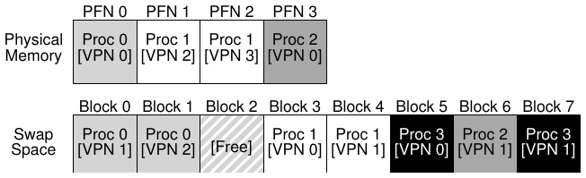
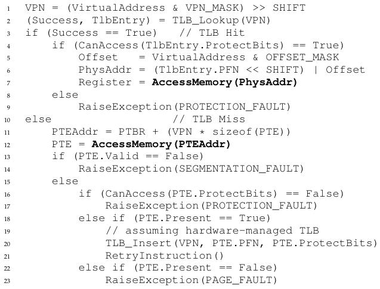
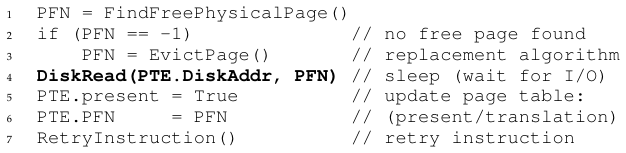

# الفصل 21: التبديل: الآليات

افترضنا حتى الآن أن فضاء العناوين صغير إلى حد غير واقعي وأنه يتّسع في الذاكرة المادية. بل إننا كنا نفترض أن كل فضاء عناوين لكل عملية جارية يتّسع في الذاكرة. وسنخفّف الآن هذه الافتراضات الكبيرة، ونفترض أننا نريد دعم فضاءات عناوين كبيرة كثيرة تعمل في الوقت نفسه.

ولتحقيق ذلك نحتاج إلى مستوى إضافي في هرم الذاكرة. فقد افترضنا حتى الآن أن كل الصفحات تقيم في الذاكرة المادية. غير أن دعم فضاءات عناوين كبيرة يتطلّب من نظام التشغيل مكانًا يخزّن فيه أجزاءً من فضاءات العناوين ليست مطلوبة بكثرة في الوقت الحالي. وبصفة عامة، فإن هذا المكان ينبغي أن تكون سعته أكبر من سعة الذاكرة؛ ونتيجة لذلك فهو أبطأ عمومًا (فلو كان أسرع لاستخدمناه ذاكرةً، أليس كذلك؟). وفي الأنظمة الحديثة، يؤدّي هذا الدور عادةً قرص صلب. وهكذا، في هرم ذاكرتنا، تجلس الأقراص الصلبة الكبيرة والبطيئة في الأسفل، والذاكرة فوقها مباشرةً. وبهذا نصل إلى جوهر المسألة:

> **جوهر المسألة: كيف نتجاوز الذاكرة المادية**
>
> كيف يستطيع نظام التشغيل أن يستفيد من جهاز أكبر وأبطأ ليوفر بشفافية وهم فضاء عناوين افتراضي كبير؟

قد يخطر لك سؤال: لِمَ نريد دعم فضاء عناوين كبير واحد للعملية؟ والجواب مرة أخرى هو الملاءمة وسهولة الاستخدام. فمع فضاء عناوين كبير، لا عليك أن تقلق بشأن توفّر مساحة كافية في الذاكرة لبنى بيانات برنامجك؛ بل تكتب البرنامج على طبيعته، وتخصّص الذاكرة حسب الحاجة. وهو وهم قوي يوفّره نظام التشغيل، ويجعل حياتك أبسط بكثير. على الرحب والسعة! والنقيض نجده في الأنظمة القديمة التي استخدمت التراكبات الذاكرية، التي كانت تُلزم المبرمجين بنقل قطع الشيفرة أو البيانات يدويًا إلى الذاكرة ومنها حسب الحاجة إليها [D97]. حاول أن تتخيّل كيف كان ذلك: قبل استدعاء دالة أو الوصول إلى بعض البيانات، عليك أولًا أن ترتّب وجود الشيفرة أو البيانات في الذاكرة؛ يا للبشاعة!

> **استطراد: تقنيات التخزين**
>
> سنتعمّق لاحقًا كثيرًا في كيفية عمل أجهزة الإدخال والإخراج فعلًا (انظر فصل أجهزة الإدخال والإخراج). فكن صبورًا! وبالطبع لا يلزم أن يكون الجهاز الأبطأ قرصًا صلبًا، بل قد يكون شيئًا أحدث مثل قرص حالة صلب قائم على الفلاش. وسنتحدث عن ذلك أيضًا. افترض الآن فقط أن لدينا جهازًا كبيرًا وبطيئًا نسبيًا يمكننا استخدامه للمساعدة في بناء وهم ذاكرة افتراضية كبيرة جدًا، أكبر حتى من الذاكرة المادية نفسها.

وإلى جانب العملية الواحدة، فإن إضافة مساحة التبديل تتيح لنظام التشغيل دعم وهم ذاكرة افتراضية كبيرة لعمليات كثيرة تعمل في الوقت نفسه. وقد كاد اختراع البرمجة المتعددة (تشغيل برامج متعددة «في آن واحد» لاستغلال الآلة على نحو أفضل) يستلزم القدرة على تبديل بعض الصفحات إلى الخارج، إذ لم تكن الآلات المبكرة قادرة بوضوح على الاحتفاظ بكل الصفحات التي تحتاجها كل العمليات في الوقت ذاته. وهكذا يقودنا اجتماع البرمجة المتعددة وسهولة الاستخدام إلى الرغبة في دعم استخدام ذاكرة أكثر من المتاح ماديًا. وهو أمر تفعله كل أنظمة الذاكرة الافتراضية الحديثة؛ وصار الآن من الأمور التي سنتعلم عنها المزيد.

## 21.1 مساحة التبديل

أول ما سنحتاج إلى فعله هو حجز بعض المساحة على القرص لنقل الصفحات ذهابًا وإيابًا. وفي أنظمة التشغيل، نشير عمومًا إلى هذه المساحة باسم مساحة التبديل، لأننا نبدّل الصفحات من الذاكرة إليها ونبدّل الصفحات إلى الذاكرة منها. وهكذا سنفترض ببساطة أن نظام التشغيل يستطيع القراءة من مساحة التبديل والكتابة إليها بوحدات بحجم الصفحة. ولتحقيق ذلك، سيحتاج نظام التشغيل إلى تذكّر عنوان القرص لصفحة معينة.

وحجم مساحة التبديل مهم، لأنه يحدّد في نهاية المطاف أقصى عدد من صفحات الذاكرة يمكن أن يستخدمها النظام في وقت معين. ولنفترض للتبسيط أنها كبيرة جدًا في الوقت الحالي.

في المثال الصغير (الشكل 21.1)، ترى مثالًا مصغّرًا لذاكرة مادية من أربع صفحات ومساحة تبديل من ثماني صفحات. في المثال، تتشارك ثلاث عمليات (العملية 0 والعملية 1 والعملية 2) الذاكرة المادية على نحو نشط؛ غير أن كل واحدة من الثلاث لا يملك في الذاكرة إلا بعض صفحاته الصالحة، والبقية تقع في مساحة التبديل على القرص. أما العملية الرابعة (العملية 3) فقد بُدّلت كل صفحاتها إلى القرص، ولذلك فهي بوضوح ليست قيد التشغيل حاليًا. ويبقى بلوك واحد من مساحة التبديل حرًّا. وحتى من هذا المثال الصغير، آمل أن ترى كيف تتيح مساحة التبديل للنظام أن يتظاهر بأن الذاكرة أكبر مما هي عليه فعليًا.

**الشكل 21.1:** الذاكرة المادية ومساحة التبديل

يجدر بنا أن نلاحظ أن مساحة التبديل ليست المكان الوحيد على القرص لحركة التبديل. فمثلًا، افترض أنك تشغّل ملفًا برمجيًا تنفيذيًا (مثل `ls`، أو برنامجك الرئيسي المترجم). إن صفحات الشيفرة من هذا الملف توجد في البداية على القرص، وحين يعمل البرنامج تُحمَّل في الذاكرة (إما دفعة واحدة عند بدء تنفيذ البرنامج، أو، كما في الأنظمة الحديثة، صفحة واحدة في كل مرة عند الحاجة). غير أنه إن احتاج النظام إلى إخلاء مساحة في الذاكرة المادية لأغراض أخرى، فيمكنه أن يعيد استخدام مساحة الذاكرة هذه لصفحات الشيفرة بأمان، عالمًا أنه يستطيع لاحقًا تبديلها إلى الذاكرة مرة أخرى من الملف التنفيذي الموجود على القرص في نظام الملفات.

## 21.2 بت الحضور

بعد أن صارت لدينا بعض المساحة على القرص، علينا أن نضيف آليات أعلى في النظام لدعم تبديل الصفحات من القرص وإليه. ولنفترض للتبسيط أن لدينا نظامًا بمخزن ترجمة مؤقت (TLB) يُدار بالعتاد.

تذكّر أولًا ما يحدث عند مرجع إلى الذاكرة. فالعملية الجارية تولّد مراجع ذاكرة افتراضية (لجلب التعليمات أو للوصول إلى البيانات)، وحينها يترجمها العتاد إلى عناوين مادية قبل جلب البيانات المطلوبة من الذاكرة.

وتذكّر أن العتاد يستخرج أولًا رقم الصفحة الافتراضية من العنوان الافتراضي، ويفحص TLB بحثًا عن تطابق (إصابة في TLB)، فإن وجدها أنتج العنوان المادي الناتج وجلبه من الذاكرة. وهذه هي الحالة الشائعة كما نأمل، لأنه سريع (لا يتطلّب أي وصول إضافي إلى الذاكرة).

أما إن لم يوجد رقم الصفحة الافتراضية في TLB (أي إخفاق في TLB)، فإن العتاد يحدّد موقع جدول الصفحات في الذاكرة (باستخدام سجل قاعدة جدول الصفحات) ويبحث عن مدخل جدول الصفحات الخاص بهذه الصفحة مستخدمًا رقم الصفحة الافتراضية كفهرس. فإن كانت الصفحة صالحة وحاضرة في الذاكرة المادية، استخرج العتاد رقم الإطار المادي من المدخل وثبّته في TLB وأعاد محاولة تنفيذ التعليمة، مولّدًا هذه المرة إصابة في TLB؛ وهكذا حتى الآن، كل شيء على ما يرام.

غير أننا إن أردنا السماح بتبديل الصفحات إلى القرص، وجب علينا إضافة آليات أكثر من ذلك. وتحديدًا، حين ينظر العتاد في مدخل جدول الصفحات، فقد يجد أن الصفحة غير حاضرة في الذاكرة المادية. والطريقة التي يحدّد بها العتاد (أو نظام التشغيل، في مقاربة TLB المُدار بالبرمجيات) ذلك هي قطعة معلومات جديدة في كل مدخل جدول صفحات تُعرف ببت الحضور. فإذا كان بت الحضور مضبوطًا على واحد، فمعناه أن الصفحة حاضرة في الذاكرة المادية وكل شيء يمضي كما سبق؛ وإذا كان مضبوطًا على صفر، فالصفحة ليست في الذاكرة بل على القرص في مكان ما.

> **استطراد: مصطلحات التبديل وأمور أخرى**
>
> قد تكون المصطلحات في أنظمة الذاكرة الافتراضية مربكة بعض الشيء ومتفاوتة بين الآلات وأنظمة التشغيل. فمثلًا، قد يشير «خطأ الصفحة» بصفة أعم إلى أي مرجع إلى جدول صفحات يولّد خطأً من نوع ما: وقد يشمل ذلك نوع الخطأ الذي نناقشه هنا، أي خطأ عدم حضور الصفحة، لكنه قد يشير أحيانًا إلى وصولات ذاكرة غير قانونية. بل إن من الغريب أن نسمّي ما هو بالتأكيد وصول قانوني (إلى صفحة مقابلة في فضاء العناوين الافتراضي لعملية، لكنها ببساطة ليست في الذاكرة المادية في تلك اللحظة) «خطأً» أصلًا؛ بل ينبغي في الحقيقة أن يُسمّى إخفاق صفحة. لكن حين يقول الناس إن برنامجًا «يرتكب أخطاء صفحات»، فمعناهم غالبًا أنه يصل إلى أجزاء من فضاء عناوينه الافتراضي بُدّلت إلى القرص.
>
> ونحن نرجّح أن سبب صيرورة هذا السلوك معروفًا باسم «خطأ» يتصل بالآليات التي يعالجه بها نظام التشغيل. فحين يحدث شيء غير مألوف، أي حين يحدث شيء لا يعرف العتاد كيف يتعامل معه، ينقل العتاد التحكّم ببساطة إلى نظام التشغيل آملًا أن يُصلح الأمر. وفي هذه الحالة، تكون صفحة يريد أحد العمليات الوصول إليها غائبة من الذاكرة؛ فيفعل العتاد الشيء الوحيد الذي يستطيعه، وهو رفع استثناء، ويتولّى نظام التشغيل الأمر من هناك. ولأن هذا مطابق لما يحدث حين تفعل عملية شيئًا غير قانوني، فليس مستغربًا أن نسمّي الفعل «خطأً».

ويُشار عمومًا إلى فعل الوصول إلى صفحة ليست في الذاكرة المادية باسم خطأ الصفحة.

وعند خطأ الصفحة، يُستدعى نظام التشغيل لخدمة خطأ الصفحة. فتعمل قطعة شيفرة معينة تُعرف بمعالج خطأ الصفحة، وعليها أن تخدم خطأ الصفحة، على النحو الذي نصفه الآن.

## 21.3 خطأ الصفحة

تذكّر أن لدينا، في حالات الإخفاق في TLB، نوعين من الأنظمة: مخازن TLB مُدارة بالعتاد (حيث يبحث العتاد في جدول الصفحات ليجد الترجمة المطلوبة) ومخازن TLB مُدارة بالبرمجيات (حيث يفعل نظام التشغيل ذلك). وفي أي من النوعين، إن لم تكن الصفحة حاضرة، يُوكل إلى نظام التشغيل أمر معالجة خطأ الصفحة. فيعمل معالج خطأ الصفحة في نظام التشغيل، وهو المسمّى باسمه عن جدارة، ليحدّد ما يجب فعله. وكل الأنظمة تقريبًا تعالج أخطاء الصفحات بالبرمجيات؛ فحتى مع TLB مُدار بالعتاد، يثق العتاد في نظام التشغيل ليتولّى هذه المهمة المهمة.

وإن لم تكن الصفحة حاضرة وقد بُدّلت إلى القرص، فسيحتاج نظام التشغيل إلى تبديل الصفحة إلى الذاكرة لخدمة خطأ الصفحة. وهكذا يطرح سؤال نفسه: كيف سيعرف نظام التشغيل أين يجد الصفحة المطلوبة؟ في أنظمة كثيرة، يكون جدول الصفحات مكانًا طبيعيًا لتخزين هذه المعلومة. وبذلك يستطيع نظام التشغيل أن يستخدم البتات في مدخل جدول الصفحات التي تُستخدم عادةً لبيانات مثل رقم الإطار المادي كعنوان قرص. وحين يتلقّى نظام التشغيل خطأ صفحة، ينظر في مدخل الجدول ليجد العنوان، ثم يصدر الطلب إلى القرص لجلب الصفحة إلى الذاكرة.

> **استطراد: لماذا لا يعالج العتاد أخطاء الصفحات؟**
>
> نعلم من تجربتنا مع TLB أن مصمّمي العتاد يكرهون أن يثقوا بنظام التشغيل في أي شيء يكاد. فلماذا يثقون به في معالجة خطأ صفحة؟ ثمة أسباب رئيسية قليلة. أولًا، أخطاء الصفحات إلى القرص بطيئة؛ فحتى لو استغرق نظام التشغيل وقتًا طويلًا في معالجة خطأ ما منفّذًا أطنانًا من التعليمات، فإن عملية القرص نفسها بطيئة تقليديًا إلى حد أن الكلفة الإضافية لتشغيل البرمجيات ضئيلة. وثانيًا، لكي يستطيع العتاد معالجة خطأ صفحة، سيكون عليه أن يفهم مساحة التبديل، وكيفية إصدار عمليات إدخال وإخراج إلى القرص، وكثيرًا من التفاصيل الأخرى التي لا يعرف عنها الكثير حاليًا. وهكذا، ولسببَي الأداء والبساطة معًا، يعالج نظام التشغيل أخطاء الصفحات، ويمكن حتى لعشّاق العتاد أن يكونوا سعداء.

وحين تكتمل عملية الإدخال والإخراج من القرص، يحدّث نظام التشغيل جدول الصفحات ليعلم الصفحة بأنها حاضرة، ويحدّث حقل رقم الإطار المادي في مدخل جدول الصفحات ليسجّل موضع الصفحة المجلوبة حديثًا في الذاكرة، ثم يعيد محاولة تنفيذ التعليمة. وقد تولّد هذه المحاولة التالية إخفاقًا في TLB، فيُخدم ذلك الإخفاق ويُحدَّث TLB بالترجمة (ويمكن بدلًا من ذلك تحديث TLB عند خدمة خطأ الصفحة لتفادي هذه الخطوة). وأخيرًا، ستجد إعادة تشغيل أخيرة الترجمة في TLB، فتمضي إلى جلب البيانات أو التعليمة المطلوبة من الذاكرة عند العنوان المادي المترجم.

لاحظ أن العملية ستكون في حالة الحجب ما دامت عملية الإدخال والإخراج جارية. وبذلك يكون نظام التشغيل حرًّا في تشغيل عمليات أخرى جاهزة أثناء خدمة خطأ الصفحة. ولأن الإدخال والإخراج مكلف، فإن هذا التداخل بين إدخال وإخراج عملية ما (خطأ صفحتها) وتنفيذ عملية أخرى هو طريقة أخرى يستطيع بها نظام متعدد البرمجة أن يستفيد من عتاده على أكمل وجه.

## 21.4 ماذا لو امتلأت الذاكرة؟

قد تلاحظ في العملية الموصوفة أعلاه أننا افترضنا توفّر ذاكرة حرة وفيرة لجلب صفحة من مساحة التبديل إليها. وهذا بالطبع قد لا يكون صحيحًا؛ فقد تكون الذاكرة ممتلئة (أو قريبة من ذلك). ولذلك قد يرغب نظام التشغيل في أن يُبدّل أولًا صفحة أو أكثر إلى الخارج ليخلو مكان للصفحات الجديدة التي هو على وشك جلبها. وتُعرف عملية اختيار الصفحة التي تُطرد أو تُستبدل باسم سياسة إحلال الصفحات.

وكما تبيّن، فقد بُذل تفكير كثير في ابتكار سياسة إحلال صفحات جيدة، لأن طرد الصفحة الخطأ قد يفرض كلفة باهظة على أداء البرنامج. فاتخاذ القرار الخطأ قد يجعل برنامجًا يعمل بسرعات شبيهة بسرعة القرص بدلًا من سرعات شبيهة بسرعة الذاكرة؛ وهذا يعني في التقنية الحالية أن برنامجًا قد يعمل أبطأ بـ10,000 أو 100,000 مرة. ولذلك فإن هذه السياسة أمر ينبغي أن ندرسه بقدر من التفصيل؛ وهذا بالضبط ما سنفعله في الفصل القادم. أما الآن فيكفي أن نفهم أن سياسة كهذه موجودة، مبنية فوق الآليات الموصوفة هنا.

**الشكل 21.2:** خوارزمية مسار التحكّم عند خطأ الصفحة (العتاد)

## 21.5 مسار التحكّم عند خطأ الصفحة

بعد أن صارت كل هذه المعرفة في مكانها، يمكننا الآن أن نرسم رسمًا تقريبيًا لمسار التحكّم الكامل للوصول إلى الذاكرة. بعبارة أخرى، حين يسألك أحدهم: «ماذا يحدث حين يجلب برنامج بعض البيانات من الذاكرة؟»، ينبغي أن تكون لديك فكرة جيدة عن كل الاحتمالات المختلفة. انظر إلى مسار التحكّم في الشكلين 21.2 و21.3 لمزيد من التفاصيل؛ فالشكل الأول يعرض ما يفعله العتاد أثناء الترجمة، والثاني ما يفعله نظام التشغيل عند خطأ صفحة.

من مخطط مسار التحكّم العتادي في الشكل 21.2، لاحظ أن ثمة الآن ثلاث حالات مهمة ينبغي فهمها عند حدوث إخفاق في TLB. أولًا، أن الصفحة كانت حاضرة وصالحة معًا (السطور 18–21)؛ وفي هذه الحالة يستطيع معالج الإخفاق في TLB أن يأخذ رقم الإطار المادي من مدخل الجدول ببساطة، ثم يعيد محاولة تنفيذ التعليمة (فيُنتج هذه المرة إصابة في TLB)، وهكذا يمضي كما وصفنا (مرارًا) من قبل. وفي الحالة الثانية (السطور 22–23)، يجب تشغيل معالج خطأ الصفحة؛ فمع أن هذه كانت صفحة مشروعة للعملية كي تصل إليها (فهي صالحة، بعد كل شيء)، فإنها ليست حاضرة في الذاكرة المادية. وثالثًا (وأخيرًا)، قد يكون الوصول إلى صفحة غير صالحة، بسبب خطأ في البرنامج مثلًا (السطور 13–14). وفي هذه الحالة لا تهم بقية البتات في مدخل الجدول حقًا؛ فيمسك العتاد بهذا الوصول غير الصالح، ويعمل معالج الفخ في نظام التشغيل، ومن المرجّح أن يُنهي العملية المخالفة.

**الشكل 21.3:** خوارزمية مسار التحكّم عند خطأ الصفحة (البرمجيات)

ومن مسار التحكّم البرمجي في الشكل 21.3، نرى ما يجب على نظام التشغيل أن يفعله تقريبًا لخدمة خطأ الصفحة. أولًا، على نظام التشغيل أن يجد إطارًا ماديًا تقيم فيه الصفحة التي يُنتظر أن تُجلب؛ فإن لم يكن ثمة إطار كهذا، فسيتعيّن علينا انتظار خوارزمية الإحلال لتعمل وتطرد بعض الصفحات من الذاكرة، فتحرّرها للاستخدام هنا. وبعد أن يصير الإطار المادي في اليد، يصدر المعالج طلب الإدخال والإخراج لقراءة الصفحة من مساحة التبديل. وأخيرًا، حين تكتمل تلك العملية البطيئة، يحدّث نظام التشغيل جدول الصفحات ويعيد محاولة تنفيذ التعليمة. وستولّد إعادة المحاولة إخفاقًا في TLB، ثم، عند محاولة أخرى، إصابة في TLB، وعند ذلك يستطيع العتاد الوصول إلى العنصر المطلوب.

## 21.6 متى تحدث عمليات الإحلال فعلًا

افترضنا حتى الآن، في طريقة وصفنا لكيفية حدوث عمليات الإحلال، أن نظام التشغيل ينتظر حتى تمتلئ الذاكرة تمامًا، وعندها فقط يستبدل (يطرد) صفحة ليخلو مكان لصفحة أخرى. وكما تتخيّل، فهذا غير واقعي قليلًا، وثمة أسباب كثيرة تجعل نظام التشغيل يبقي جزءًا صغيرًا من الذاكرة حرًّا على نحو أكثر استباقية.

وللحفاظ على كمية صغيرة من الذاكرة حرة، يكون لدى معظم أنظمة التشغيل نوع من العلامة المائية العليا والعلامة المائية الدنيا للمساعدة في تحديد متى نبدأ في طرد الصفحات من الذاكرة. وطريقة عمل ذلك كما يلي: حين يلاحظ نظام التشغيل أن المتاح أقل من عدد الصفحات المحدّد بالعلامة الدنيا، يعمل خيط خلفي مسؤول عن تحرير الذاكرة. ويطرد الخيط صفحات حتى يصير المتاح مساويًا لعدد الصفحات المحدّد بالعلامة العليا. ثم ينام الخيط الخلفي، المسمّى أحيانًا عفريت التبديل أو عفريت الصفحات[^1]، وقد سرّ بأنه حرّر بعض الذاكرة للعمليات الجارية ولنظام التشغيل كي يستخدماها.

وبإجراء عدد من عمليات الإحلال دفعة واحدة، تصير تحسينات أداء جديدة ممكنة. فمثلًا، تجمع أنظمة كثيرة عددًا من الصفحات وتكتبها دفعة واحدة إلى قسم التبديل، فترفع بذلك كفاءة القرص [LL82]؛ وكما سنرى لاحقًا حين نناقش الأقراص بمزيد من التفصيل، فإن هذا التجميع يقلّل كلفة البحث والدوران في القرص فيرفع الأداء ملحوظًا.

وللعمل مع خيط التبديل الخلفي، ينبغي تعديل مسار التحكّم في الشكل 21.3 تعديلًا طفيفًا؛ فبدلًا من إجراء إحلال مباشرةً، تفحص الخوارزمية ببساطة إن كانت ثمة صفحات حرة متاحة. فإن لم تكن، أبلغت خيط التبديل الخلفي بأن ثمة حاجة إلى صفحات حرة؛ وحين يحرّر الخيط بعض الصفحات، يوقظ الخيط الأصلي، الذي يستطيع عندئذ أن يجلب الصفحة المطلوبة ويعود إلى عمله.

> **نصيحة: أنجز العمل في الخلفية**
>
> حين يكون لديك عمل تريد إنجازه، فمن الجيد غالبًا أن تنجزه في الخلفية لزيادة الكفاءة وإتاحة تجميع العمليات. وأنظمة التشغيل كثيرًا ما تنجز عملًا في الخلفية؛ فمثلًا، تخزّن أنظمة كثيرة كتابات الملفات في الذاكرة مؤقتًا قبل كتابة البيانات فعليًا إلى القرص. ولذلك فوائد محتملة كثيرة: كفاءة أعلى للقرص، إذ قد يتلقّى الآن كتابات كثيرة دفعة واحدة فيستطيع جدولتها على نحو أفضل؛ وزمن استجابة أفضل للكتابات، إذ يظنّ التطبيق أن الكتابات اكتملت بسرعة كبيرة؛ وإمكانية تقليل العمل، إذ قد لا يلزم أن تصل الكتابات إلى القرص أصلًا (أي إن حُذف الملف)؛ واستخدام أفضل لأوقات الخمول، إذ قد يُنجز عمل الخلفية حين يكون النظام خاملًا، فيُستغل العتاد على نحو أفضل [G+95].

## 21.7 الخلاصة

قدّمنا في هذا الفصل القصير فكرة الوصول إلى ذاكرة أكبر من المتاح ماديًا في النظام. ويدعو ذلك إلى تعقيد أكبر في بنى جداول الصفحات، إذ يجب إدراج بت حضور (من نوع ما) ليخبرنا ما إذا كانت الصفحة حاضرة في الذاكرة أم لا. وحين لا تكون حاضرة، يعمل معالج خطأ الصفحة في نظام التشغيل لخدمة خطأ الصفحة، فيرتّب نقل الصفحة المطلوبة من القرص إلى الذاكرة، وربما استبدل أولًا بعض الصفحات في الذاكرة ليخلو مكان للصفحات التي تُبدَّل إلى الداخل قريبًا.

وتذكّر، على نحو مهم (ومذهل!)، أن هذه الأفعال كلها تجري بشفافية تامة بالنسبة للعملية. فمن منظور العملية، هي ليست إلا تصل إلى ذاكرتها الافتراضية الخاصة المتصلة. أما في الكواليس، فتوضع الصفحات في مواضع اعتباطية (غير متصلة) في الذاكرة المادية، وأحيانًا لا تكون حاضرة في الذاكرة أصلًا فتتطلّب جلبًا من القرص. ومع أننا نأمل أن يكون الوصول إلى الذاكرة سريعًا في الحالة الشائعة، فإنه سيستغرق في بعض الحالات عمليات قرص متعددة لخدمته؛ فشيء بسيط كتنفيذ تعليمة واحدة قد يستغرق في أسوأ الحالات عدة ميلي ثانية حتى يكتمل.

## المراجع

> [CS94] «Take Our Word For It» لـF. Corbato وR. Steinberg. www.takeourword.com/TOW146 (الصفحة 4). كتب ريتشارد شتاينبرغ: «سألني أحدهم عن أصل كلمة عفريت كما تُستخدم في الحوسبة. وأفضل ما أستطيع قوله بناءً على بحثي أن الكلمة استخدمها أولًا أشخاص في فريقكم في مشروع ماك مستخدمين حاسوب IBM 7094 في عام 1963.» فأجاب البروفيسور كورباتو: «استُوحي استخدامنا لكلمة عفريت من عفريت ماكسويل في الفيزياء والديناميكا الحرارية (وخلفيتي في الفيزياء). كان عفريت ماكسويل وكيلًا خياليًا يساعد في فرز الجزيئات مختلفة السرعات ويعمل بلا كلل في الخلفية. وشرعنا على نحو خيالي في استخدام كلمة عفريت لوصف عمليات خلفية تعمل بلا كلل لتؤدي مهام النظام.»

> [D97] «Before Memory Was Virtual» لـPeter Denning. In the Beginning: Recollections of Software Pioneers، Wiley، نوفمبر 1997. قطعة تاريخية ممتازة بقلم أحد روّاد الذاكرة الافتراضية ومجموعات العمل.

> [G+95] «Idleness is not sloth» لـRichard Golding وPeter Bosch وCarl Staelin وTim Sullivan وJohn Wilkes. USENIX ATC '95، نيو أورلينز، لويزيانا. مناقشة ممتعة سهلة القراءة لكيفية استخدام وقت الخمول على نحو أفضل في الأنظمة، مع أمثلة جيدة كثيرة.

> [LL82] «Virtual Memory Management in the VAX/VMS Operating System» لـHank Levy وP. Lipman. IEEE Computer، المجلد 15، العدد 3، مارس 1982. ليست أول موضع استُخدم فيه تجميع الصفحات، لكنها شرح واضح وبسيط لكيفية عمل آلية كهذه. حقًا إننا نستشهد بهذه الورقة كثيرًا!

## الواجب (قياس)

يقدّم لك هذا الواجب أداة جديدة هي vmstat، وكيف يمكن استخدامها لفهم استخدام الذاكرة والمعالج والإدخال والإخراج. اقرأ ملف README المرافق وافحص الشيفرة في mem.c قبل الانتقال إلى التمارين والأسئلة أدناه.

## الأسئلة

1. أولًا، افتح اتصالين منفصلين بطرفية على الآلة نفسها، حتى تستطيع بسهولة أن تشغّل شيئًا في نافذة وشيئًا آخر في الأخرى. والآن، شغّل في إحدى النافذتين الأمر `vmstat 1`، الذي يعرض إحصاءات عن استخدام الآلة كل ثانية. اقرأ صفحة الدليل وملف README المرافق وأي معلومات أخرى تحتاجها كي تفهم مخرجاته. واترك هذه النافذة تشغّل `vmstat` خلال بقية التمارين أدناه.
   والآن سنشغّل البرنامج mem.c لكن باستخدام ذاكرة قليلة جدًا. ويتحقّق ذلك بكتابة `./mem 1` (الذي يستخدم 1 م.ب فقط من الذاكرة). كيف تتغيّر إحصاءات استخدام المعالج عند تشغيل mem؟ وهل الأرقام في عمود زمن المستخدم منطقية؟ وكيف يتغيّر ذلك عند تشغيل أكثر من نسخة واحدة من mem في الوقت نفسه؟
2. لنبدأ الآن في النظر إلى بعض إحصاءات الذاكرة أثناء تشغيل mem. وسنركز على عمودين: swpd (مقدار الذاكرة الافتراضية المستخدمة) وfree (مقدار الذاكرة الخاملة). شغّل `./mem 1024` (الذي يخصّص 1024 م.ب) وراقب كيف تتغيّر هذه القيم. ثم اقتل البرنامج الجاري (بكتابة control-c) وراقب مرة أخرى كيف تتغيّر القيم. ماذا تلاحظ في القيم؟ وعلى وجه الخصوص، كيف يتغيّر عمود free حين ينتهي البرنامج؟ وهل يزداد مقدار الذاكرة الحرة بالمقدار المتوقّع حين يخرج mem؟
3. سننظر بعد ذلك إلى عمودَي التبديل (si وso)، اللذين يشيران إلى مقدار التبديل الجاري من القرص وإليه. وبالطبع تحتاج لتفعيلهما إلى تشغيل mem بكميات كبيرة من الذاكرة. أولًا، افحص مقدار الذاكرة الحرة في نظام لينكس لديك (مثلًا بكتابة `cat /proc/meminfo`؛ اكتب `man proc` للحصول على تفاصيل عن نظام ملفات /proc وأنواع المعلومات التي تجدها فيه). ومن أوائل المداخل في /proc/meminfo مقدار الذاكرة الكلي في نظامك. لنفترض أنه نحو 8 غ.ب من الذاكرة؛ فإن كان كذلك، فابدأ بتشغيل mem 4000 (نحو 4 غ.ب) وراقب عمودَي التبديل إلى الداخل والخارج. هل تعطيان يومًا قيمًا غير صفرية؟ ثم جرّب 5000 و6000 وما إلى ذلك. ماذا يحدث لهذه القيم حين يدخل البرنامج الحلقة الثانية (وما بعدها)، مقارنةً بالحلقة الأولى؟ وكم مقدار البيانات (إجمالًا) التي تُبدَّل إلى الداخل والخارج خلال الحلقات الثانية والثالثة واللاحقة؟ (وهل الأرقام منطقية؟)
4. أجرِ التجارب نفسها أعلاه، لكن راقب الآن الإحصاءات الأخرى (مثل استخدام المعالج وإحصاءات الإدخال والإخراج بالبلوك). كيف تتغيّر حين يكون mem قيد التشغيل؟
5. لنفحص الآن الأداء. اختر مُدخلًا لـmem يتّسع في الذاكرة بارتياح (قل 4000 إن كان مقدار الذاكرة في النظام 8 غ.ب). كم تستغرق الحلقة 0 (والحلقات التالية 1 و2 وما إلى ذلك)؟ والآن اختر حجمًا يتجاوز حجم الذاكرة بارتياح (قل 12000 بافتراض 8 غ.ب من الذاكرة أيضًا). كم تستغرق الحلقات هنا؟ وكيف تتباين أرقام معدّل النقل؟ وما مقدار اختلاف الأداء بين التبديل المستمر وإدخال كل شيء في الذاكرة بارتياح؟ وهل تستطيع أن تصنع رسمًا بيانيًا، على المحور الأفقي فيه حجم الذاكرة المستخدمة بواسطة mem، وعلى المحور العمودي معدّل نقل الوصول إلى تلك الذاكرة؟ وأخيرًا، كيف يقارن أداء الحلقة الأولى بأداء الحلقات التالية، في كل من حالة اتّساع كل شيء في الذاكرة وحالة عدم اتّساعه؟
6. مساحة التبديل ليست لا نهائية. تستطيع استخدام الأداة `swapon` مع الخيار `-s` لترى مقدار مساحة التبديل المتاحة. ماذا يحدث إن حاولت تشغيل mem بقيم متزايدة، وراء ما يبدو متاحًا في مساحة التبديل؟ وعند أي نقطة يفشل تخصيص الذاكرة؟
7. وأخيرًا، إن كنت متقدّمًا، تستطيع تهيئة نظامك لاستخدام أجهزة تبديل مختلفة عبر swapon وswapoff. اقرأ صفحات الدليل للتفاصيل. وإن كان لديك وصول إلى عتاد مختلف، فانظر كيف يتغيّر أداء التبديل عند التبديل إلى قرص صلب كلاسيكي، وإلى قرص حالة صلب قائم على الفلاش، وإلى مصفوفة RAID أيضًا. وكم يمكن تحسين أداء التبديل بالأجهزة الأحدث؟ وإلى أي حدّ تقترب من أداء الذاكرة؟

[^1]: كلمة «عفريت» (daemon)، التي تُلفظ عادةً «ديمون»، مصطلح قديم يدلّ على خيط أو عملية خلفية تفعل شيئًا مفيدًا. وقد اتضح (مرة أخرى!) أن مصدر المصطلح هو مولتكس [CS94].
