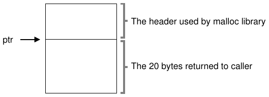
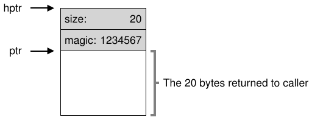
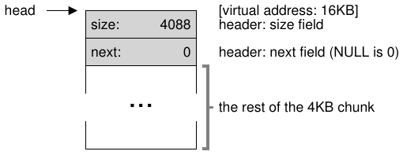
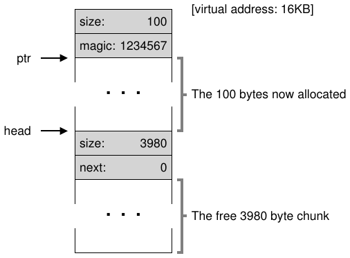
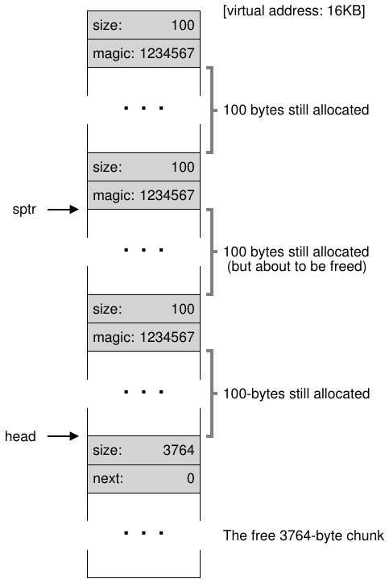
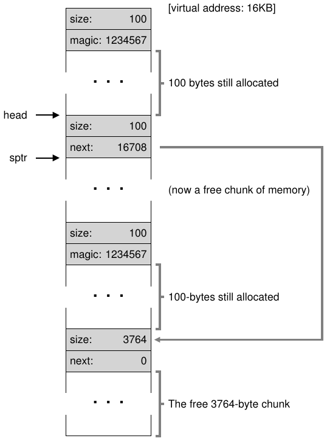
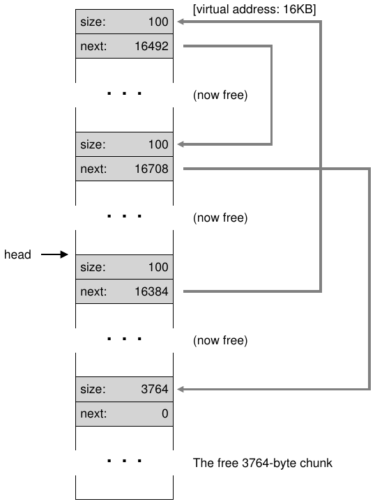
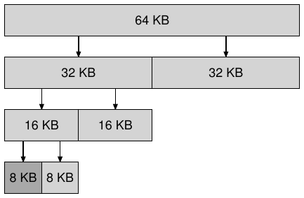

# الفصل 17: إدارة المساحة الحرة

في هذا الفصل نأخذ استراحة صغيرة من حديثنا عن محاكاة الذاكرة افتراضيًا لنناقش جانبًا جوهريًا في أي نظام لإدارة الذاكرة، سواء أكان مكتبة `malloc` (تدير صفحات كومة عملية ما) أم نظام التشغيل نفسه (يدير أجزاءً من فضاء عناوين العملية). وبالتحديد، سنناقش المسائل المحيطة بإدارة المساحة الحرة.

لنجعل المسألة أكثر تحديدًا. إن إدارة المساحة الحرة يمكن أن تكون سهلة بكل تأكيد، كما سنرى حين نناقش مفهوم الترقيم الصفحي. فهي سهلة عندما تكون المساحة التي تديرها مقسّمة إلى وحدات ثابتة الحجم؛ وفي هذه الحالة تحتفظ فقط بقائمة بهذه الوحدات الثابتة الحجم، وحين يطلب عميل إحداها تُعيد أول عنصر فيها.

أما حين تصبح إدارة المساحة الحرة أصعب (وأكثر تشويقًا) فذلك عندما تتكوّن المساحة الحرة التي تديرها من وحدات متغيّرة الحجم؛ وهذا يحدث في مكتبة تخصيص ذاكرة على مستوى المستخدم (كما في `malloc()` و`free()`) وفي نظام تشغيل يدير الذاكرة المادية عند استخدام التقطيع لتنفيذ الذاكرة الافتراضية. وفي الحالتين تُعرف المشكلة القائمة باسم التجزئة الخارجية: إذ تتقطّع المساحة الحرة إلى قطع صغيرة مختلفة الأحجام فتصبح مجزأة؛ وقد تفشل الطلبات اللاحقة لعدم وجود مساحة متصلة واحدة تستطيع تلبية الطلب، رغم أن مجموع المساحة الحرة يتجاوز حجم الطلب.

```
  free          used          free
0        10          20          30
```

يوضّح الشكل مثالًا على هذه المسألة. فالمساحة الحرة المتاحة هنا 20 بايتًا؛ وللأسف هي مجزأة إلى كتلتين حجم كل منهما 10. وبالتالي سيفشل طلب من 15 بايتًا رغم وجود 20 بايتًا حرة. وهكذا نصل إلى المسألة التي يعالجها هذا الفصل.

> **جوهر المسألة: كيف ندير المساحة الحرة**
>
> كيف ينبغي إدارة المساحة الحرة عند تلبية طلبات متغيّرة الحجم؟ وما الاستراتيجيات التي يمكن استخدامها لتقليل التجزئة؟ وما تكاليف الزمن والمساحة للمقاربات البديلة؟

## 17.1 الافتراضات

سيركّز معظم هذا النقاش على التاريخ العظيم للمخصِّصات الموجودة في مكتبات تخصيص الذاكرة على مستوى المستخدم. ونستند إلى مسح ويلسون الممتاز [W+95]، لكننا نشجّع القارئ المهتم على العودة إلى الوثيقة الأصلية نفسها لمزيد من التفاصيل[^1].

نفترض واجهة أساسية كتلك التي توفّرها `malloc()` و`free()`. وبالتحديد، تأخذ `void *malloc(size_t size)` معاملًا واحدًا هو `size`، وهو عدد البايتات التي يطلبها التطبيق؛ وتُعيد مؤشرًا (من نوع غير محدد، أو مؤشر `void` بمصطلحات لغة C) إلى منطقة بذلك الحجم (أو أكبر). أما الروتين المكمّل `void free(void *ptr)` فيأخذ مؤشرًا ويحرّر الكتلة المقابلة. لاحظ ما تستلزمه هذه الواجهة: المستخدم، عند تحرير المساحة، لا يُبلغ المكتبة بحجمها؛ لذا يجب أن تستطيع المكتبة معرفة حجم كتلة الذاكرة حين يُعطى لها مؤشر إليها فقط. وسنناقش كيفية فعل ذلك بعد قليل في هذا الفصل.

المساحة التي تديرها هذه المكتبة تُعرف تاريخيًا بالكومة، والبنية العامة المستخدمة لإدارة المساحة الحرة في الكومة هي نوع من القوائم الحرة. تحتوي هذه البنية على مراجع إلى جميع كتل المساحة الحرة في المنطقة المُدارة من الذاكرة. وبالطبع لا يلزم أن تكون هذه البنية قائمة بالمعنى الحرفي، بل يكفي أي نوع من البنى لتتبّع المساحة الحرة.

ونفترض كذلك أننا معنيون أساسًا بالتجزئة الخارجية كما وصفناها آنفًا. وقد تواجه المخصِّصات بالطبع مشكلة التجزئة الداخلية أيضًا؛ فإذا أعطى المخصِّص كتل ذاكرة أكبر من المطلوب، فإن أي مساحة غير مطلوبة (وبالتالي غير مستخدمة) في تلك الكتلة تُعدّ تجزئة داخلية (لأن الهدر يحدث داخل الوحدة المخصَّصة) وهي مثال آخر على هدر المساحة. لكن من أجل البساطة، ولأنها النوع الأكثر تشويقًا من التجزئة، سنركّز في الأغلب على التجزئة الخارجية.

وسنفترض أيضًا أن الذاكرة، بعد تسليمها إلى عميل، لا يمكن نقلها إلى موقع آخر في الذاكرة. فمثلًا، إذا استدعى برنامج ما `malloc()` وأُعطي مؤشرًا إلى مساحة داخل الكومة، فإن منطقة الذاكرة تلك تُصبح عمليًا «ملكًا» للبرنامج (ولا يمكن للمكتبة تحريكها) حتى يُعيدها عبر استدعاء مقابل إلى `free()`. وبالتالي لا يمكن دمج المساحة الحرة، وهو أمر سيكون مفيدًا لمكافحة التجزئة[^2]. على أن الدمج قد يُستخدم في نظام التشغيل للتعامل مع التجزئة عند تنفيذ التقطيع (كما نوقش في فصل التقطيع المذكور).

وأخيرًا، سنفترض أن المخصِّص يدير منطقة متصلة من البايتات. وفي بعض الحالات قد يطلب المخصِّص أن تنمو تلك المنطقة؛ فمثلًا قد تستدعي مكتبة تخصيص الذاكرة على مستوى المستخدم النواة لتنمية الكومة (عبر استدعاء نظام مثل `sbrk`) حين تنفد مساحتها. لكن من أجل البساطة سنفترض فقط أن المنطقة ذات حجم ثابت واحد طوال حياتها.

## 17.2 الآليات منخفضة المستوى

قبل الخوض في بعض تفاصيل السياسات، سنغطي أولًا بعض الآليات الشائعة في معظم المخصِّصات. أولًا، سنناقش أساسيات التقسيم والالتئام، وهما تقنيتان شائعتان في أي مخصِّص تقريبًا. ثانيًا، سنبيّن كيف يمكن تتبّع حجم المناطق المخصَّصة بسرعة وبسهولة نسبية. وأخيرًا، سنناقش كيفية بناء قائمة بسيطة داخل المساحة الحرة نفسها لتتبّع ما هو حر وما ليس كذلك.

### التقسيم والالتئام

تحتوي القائمة الحرة على مجموعة عناصر تصف المساحة الحرة المتبقية في الكومة. لذا افترض الكومة التالية التي حجمها 30 بايتًا:

```
  free          used          free
0        10          20          30
```

ستحتوي القائمة الحرة لهذه الكومة على عنصرين. عنصر يصف أول مقطع حر حجمه 10 بايتات (البايتات 0-9)، وعنصر يصف المقطع الحر الآخر (البايتات 20-29):

```
       addr:0   addr:20
head   len:10   len:10   NULL
```

كما وصفنا آنفًا، سيفشل أي طلب أكبر من 10 بايتات (فيُعيد `NULL`)؛ فليس هناك ببساطة كتلة ذاكرة متصلة واحدة بذلك الحجم. أما طلب بالحجم نفسه بالضبط (10 بايتات) فيمكن تلبيته بسهولة من أي من الكتلتين الحرتين. لكن ماذا يحدث إذا كان الطلب أصغر من 10 بايتات؟

افترض أن لدينا طلبًا لبايت واحد من الذاكرة. في هذه الحالة سينفّذ المخصِّص عملية تُعرف بالتقسيم: سيجد كتلة ذاكرة حرة تستطيع تلبية الطلب ويقسمها إلى اثنتين. الكتلة الأولى يعيدها إلى المستدعي، والثانية تبقى في القائمة. وهكذا، في مثالنا أعلاه، لو قُدّم طلب لبايت واحد، وقرّر المخصِّص استخدام العنصر الثاني من عنصري القائمة لتلبية الطلب، فإن استدعاء `malloc()` سيعيد 20 (عنوان المنطقة المخصَّصة التي حجمها بايت واحد) وستصبح القائمة هكذا:

```
       addr:0   addr:21
head   len:10   len:9    NULL
```

في الصورة ترى أن القائمة بقيت سليمة في الأساس؛ التغيير الوحيد أن المنطقة الحرة تبدأ الآن من 21 بدلًا من 20، وأن طول تلك المنطقة الحرة أصبح 9 فقط[^3]. وهكذا يُستخدم التقسيم عادة في المخصِّصات حين تكون الطلبات أصغر من حجم أي كتلة حرة معيّنة.

وثمة آلية مرافقة موجودة في كثير من المخصِّصات تُعرف بالالتئام، أي التئام المساحة الحرة. خذ مثالنا السابق مرة أخرى (10 بايتات حرة، و10 مستخدمة، و10 أخرى حرة).

بالنظر إلى هذه الكومة (الصغيرة)، ماذا يحدث حين يستدعي تطبيق ما `free(10)`، فيُعيد المساحة في وسط الكومة؟ إذا أضفنا هذه المساحة الحرة إلى قائمتنا ببساطة ودون تفكير كثير، فقد ننتهي بقائمة تبدو هكذا:

```
       addr:10  addr:0   addr:20
head   len:10   len:10   len:10   NULL
```

لاحظ المشكلة: فرغم أن الكومة بأكملها حرة الآن، فهي تبدو مقسّمة إلى ثلاث كتل حجم كل منها 10 بايتات. وبالتالي إذا طلب مستخدم 20 بايتًا، فلن يعثر تجوال بسيط في القائمة على كتلة حرة كهذه، وسيفشل الطلب.

ما تفعله المخصِّصات لتجنب هذه المشكلة هو التئام المساحة الحرة عند تحرير كتلة ذاكرة. والفكرة بسيطة: عند إعادة كتلة حرة إلى الذاكرة، انظر بعناية إلى عناوين الكتلة التي تُعيدها وإلى الكتل الحرة المجاورة؛ فإذا كانت المساحة المحرّرة حديثًا تقع تمامًا بجوار كتلة حرة قائمة (أو كتلتين كما في هذا المثال)، فالتئم بينها في كتلة حرة واحدة أكبر. وهكذا، مع الالتئام، ينبغي أن تبدو قائمتنا الأخيرة هكذا:

```
       addr:0
head   len:30   NULL
```

وبالفعل، هكذا كانت قائمة الكومة تبدو في البداية، قبل إجراء أي تخصيصات. وبالالتئام يستطيع المخصِّص أن يضمن على نحو أفضل توافر امتدادات حرة كبيرة للتطبيق.

### تتبّع حجم المناطق المخصَّصة

لعلك لاحظت أن واجهة `free(void *ptr)` لا تأخذ معامل حجم؛ لذا يُفترض أنه بمجرد إعطاء مؤشر تستطيع مكتبة `malloc` تحديد حجم منطقة الذاكرة التي تُحرَّر بسرعة، وبالتالي إعادة المساحة إلى القائمة الحرة.

ولإنجاز هذه المهمة، تخزّن معظم المخصِّصات قليلًا من المعلومات الإضافية في ترويسة تُحفظ في الذاكرة، عادة قبل الكتلة المسلَّمة مباشرة. لننظر إلى مثال مرة أخرى (الشكل 17.1). في هذا المثال نفحص كتلة مخصَّصة حجمها 20 بايتًا، يشير إليها `ptr`؛ تخيّل أن المستخدم استدعى `malloc()` وخزّن النتيجة في `ptr`، مثل `ptr = malloc(20);`.



**الشكل 17.1:** منطقة مخصَّصة مع ترويسة

تحتوي الترويسة كحد أدنى على حجم المنطقة المخصَّصة (وهو 20 هنا)؛ وقد تحتوي أيضًا على مؤشرات إضافية لتسريع إلغاء التخصيص، ورقم سحري لتوفير تحقّق إضافي من السلامة، ومعلومات أخرى. لنفترض ترويسة بسيطة تحتوي حجم المنطقة ورقمًا سحريًا، هكذا:

```
typedef struct {
    int size;
    int magic;
} header_t;
```



**الشكل 17.2:** المحتويات التفصيلية للترويسة

سيبدو المثال أعلاه كما ترى في الشكل 17.2. وحين يستدعي المستخدم `free(ptr)`، تستخدم المكتبة حسابًا بسيطًا على المؤشرات لمعرفة أين تبدأ الترويسة:

```
void free(void *ptr) {
    header_t *hptr = (header_t *) ptr - 1;
    ...
```

بعد الحصول على مؤشر كهذا إلى الترويسة، تستطيع المكتبة بسهولة التحقق من تطابق الرقم السحري مع القيمة المتوقعة كفحص سلامة (`assert(hptr->magic == 1234567)`) وحساب الحجم الكلي للمنطقة المحرّرة حديثًا بحساب بسيط (أي إضافة حجم الترويسة إلى حجم المنطقة). لاحظ التفصيل الصغير لكن الحاسم في الجملة الأخيرة: حجم المنطقة الحرة هو حجم الترويسة زائد حجم المساحة المخصَّصة للمستخدم. وهكذا، حين يطلب المستخدم N بايتًا من الذاكرة، لا تبحث المكتبة عن كتلة حرة حجمها N؛ بل تبحث عن كتلة حرة حجمها N زائد حجم الترويسة.

### تضمين قائمة حرة

حتى الآن تعاملنا مع قائمتنا الحرة البسيطة ككيان تصوّري؛ فهي مجرد قائمة تصف كتل الذاكرة الحرة في الكومة. لكن كيف نبني قائمة كهذه داخل المساحة الحرة نفسها؟

في قائمة أكثر نمطية، حين تخصّص عقدة جديدة، تستدعي `malloc()` فقط حين تحتاج مساحة للعقدة. للأسف، داخل مكتبة تخصيص الذاكرة لا تستطيع فعل ذلك! بل عليك أن تبني القائمة داخل المساحة الحرة نفسها. لا تقلق إن بدا هذا غريبًا قليلًا؛ فهو كذلك، لكن ليس غريبًا إلى حد يمنعك من فعله!

افترض أن لدينا كتلة ذاكرة حجمها 4096 بايتًا لإدارتها (أي أن الكومة 4 ك.ب). لإدارتها كقائمة حرة، علينا أولًا تهيئة تلك القائمة؛ في البداية ينبغي أن تحتوي القائمة على عنصر واحد حجمه 4096 (ناقص حجم الترويسة). هذا وصف عقدة من القائمة:

```
typedef struct __node_t {
    int              size;
    struct __node_t *next;
} node_t;
```

لننظر الآن إلى شيفرة تهيّئ الكومة وتضع أول عنصر من القائمة الحرة داخل تلك المساحة. نفترض أن الكومة مبنية داخل مساحة حرة حصلنا عليها عبر استدعاء نظام `mmap()`؛ وهذه ليست الطريقة الوحيدة لبناء كومة كهذه لكنها تخدمنا جيدًا في هذا المثال. وهذه هي الشيفرة:

```
// mmap() returns a pointer to a chunk of free space
node_t *head = mmap(NULL, 4096, PROT_READ|PROT_WRITE,
                    MAP_ANON|MAP_PRIVATE, -1, 0);
head->size   = 4096 - sizeof(node_t);
head->next   = NULL;
```

بعد تشغيل هذه الشيفرة تصبح حالة القائمة أنها تحتوي عنصرًا واحدًا حجمه 4088. نعم، هذه كومة صغيرة جدًا، لكنها تصلح مثالًا جيدًا لنا هنا. يحتوي المؤشر `head` على عنوان البداية لهذا النطاق؛ لنفترض أنه 16 ك.ب (وإن كان أي عنوان افتراضي آخر سيكون مناسبًا). وبهذا تبدو الكومة بصريًا كما ترى في الشكل 17.3.



**الشكل 17.3:** كومة فيها كتلة حرة واحدة

الآن لنتخيّل أن كتلة ذاكرة طُلبت، بحجم 100 بايت مثلًا. لتلبية هذا الطلب، ستجد المكتبة أولًا كتلة كبيرة بما يكفي لاستيعاب الطلب؛ ولأن هناك كتلة حرة واحدة فقط (حجمها 4088)، فستُختار هذه الكتلة. ثم تُقسم الكتلة إلى اثنتين: كتلة كبيرة بما يكفي لتلبية الطلب (مع الترويسة، كما وصفنا)، والكتلة الحرة المتبقية. وبافتراض ترويسة حجمها 8 بايتات (عددان صحيحان: الحجم والرقم السحري)، تبدو المساحة في الكومة الآن كما ترى في الشكل 17.4.



**الشكل 17.4:** الكومة: بعد تخصيص واحد

وهكذا، عند طلب 100 بايت، خصّصت المكتبة 108 بايتات من الكتلة الحرة الواحدة القائمة، وأعادت مؤشرًا إليها (معلَّمًا بـ `ptr` في الشكل أعلاه)، وخزّنت معلومات الترويسة قبل المساحة المخصَّصة مباشرة لاستخدامها لاحقًا عند `free()`، وقلّصت العقدة الحرة الوحيدة في القائمة إلى 3980 بايتًا (4088 ناقص 108).

لننظر الآن إلى الكومة حين تكون هناك ثلاث مناطق مخصَّصة، كل منها 100 بايت (أو 108 مع الترويسة). يوضّح الشكل 17.5 تصوّرًا لهذه الكومة.



**الشكل 17.5:** المساحة الحرة مع ثلاث كتل مخصَّصة

وكما ترى فيه، أصبحت أول 324 بايتًا من الكومة مخصَّصة، ولذا نرى ثلاث ترويسات في تلك المساحة فضلًا عن ثلاث مناطق بحجم 100 بايت تستخدمها البرمجة المستدعية. وتبقى القائمة الحرة غير مشوّقة: عقدة واحدة فقط (يشير إليها `head`)، لكن حجمها الآن 3764 بايتًا فقط بعد التقسيمات الثلاثة. لكن ماذا يحدث حين تعيد البرمجة المستدعية بعض الذاكرة عبر `free()`؟

في هذا المثال يعيد التطبيق الكتلة الوسطى من الذاكرة المخصَّصة، باستدعاء `free(16500)` (والقيمة 16500 نحصل عليها بإضافة بداية منطقة الذاكرة، 16384، إلى 108 الخاصة بالكتلة السابقة و8 بايتات ترويسة هذه الكتلة). وتظهر هذه القيمة في المخطط السابق بالمؤشر `sptr`.

وتحدّد المكتبة فورًا حجم المنطقة الحرة، ثم تضيف الكتلة الحرة مرة أخرى إلى القائمة الحرة. وبافتراض أننا نُدرج في رأس القائمة الحرة، تبدو المساحة الآن هكذا (الشكل 17.6).



**الشكل 17.6:** المساحة الحرة مع كتلتين مخصَّصتين

أصبحت لدينا الآن قائمة تبدأ بكتلة حرة صغيرة (100 بايت، يشير إليها رأس القائمة) وكتلة حرة كبيرة (3764 بايتًا). وأخيرًا تحتوي قائمتنا على أكثر من عنصر واحد! ونعم، المساحة الحرة مجزأة، وهو أمر مؤسف لكنه شائع.

مثال أخير: لنفترض الآن أن الكتلتين المستخدمتين الأخيرتين حُرّرت. بدون الالتئام تنتهي بتجزئة (الشكل 17.7).



**الشكل 17.7:** قائمة حرة غير ملتئمة

وكما ترى من الشكل، أصبح لدينا فوضى كبيرة الآن! لماذا؟ ببساطة، نسينا التئام القائمة. فرغم أن الذاكرة كلها حرة، فهي مقطّعة إلى قطع، فتبدو ذاكرة مجزأة رغم أنها ليست كذلك. والحل بسيط: تجوّل في القائمة والئم بين الكتل المتجاورة؛ وحين تنتهي، ستعود الكومة كاملة مرة أخرى.

### تنمية الكومة

ينبغي أن نناقش آلية أخيرة موجودة في كثير من مكتبات التخصيص. وبالتحديد، ماذا تفعل إذا نفدت مساحة الكومة؟ أبسط مقاربة هي الإخفاق فقط. وفي بعض الحالات يكون ذلك الخيار الوحيد، ومن ثم فإن إعادة `NULL` مقاربة كريمة. لا تشعر بالسوء! فقد حاولت، ومع أنك فشلت، فقد قاتلت قتال الشرفاء.

تبدأ معظم المخصِّصات التقليدية بكومة صغيرة الحجم ثم تطلب مزيدًا من الذاكرة من نظام التشغيل حين تنفد. وهذا يعني عادة أنها تُجري نوعًا من استدعاء النظام (مثل `sbrk` في معظم أنظمة يونِكس) لتنمية الكومة، ثم تخصّص الكتل الجديدة من هناك. ولتلبية طلب `sbrk`، يجد نظام التشغيل صفحات مادية حرة، ويُسقطها في فضاء عناوين العملية الطالبة، ثم يُعيد قيمة نهاية الكومة الجديدة؛ وعندها تتوافر كومة أكبر، ويمكن تلبية الطلب بنجاح.

## 17.3 الاستراتيجيات الأساسية

الآن وقد أصبحت لدينا بعض الآليات، لنستعرض بعض الاستراتيجيات الأساسية لإدارة المساحة الحرة. تقوم هذه المقاربات في الأغلب على سياسات بسيطة جدًا كان يمكنك أن تبتكرها بنفسك؛ جرّب ذلك قبل القراءة وانظر هل تأتي بجميع البدائل (أو ربما ببعض بدائل جديدة!).

المخصِّص الأمثل هو السريع والذي يقلّل التجزئة في الوقت نفسه. وللأسف، لأن تدفق طلبات التخصيص والتحرير قد يكون اعتباطيًا (فهو في النهاية يحدده المبرمج)، فقد يكون أداء أي استراتيجية بعينها سيئًا جدًا في ظل مجموعة مدخلات غير مناسبة. لذا لن نصف مقاربة «أفضل»، بل سنتحدث عن بعض الأساسيات ونناقش حسناتها وعيوبها.

### الملاءمة الأفضل

استراتيجية الملاءمة الأفضل بسيطة جدًا: أولًا، ابحث في القائمة الحرة عن كتل ذاكرة حرة بحجم أكبر من الحجم المطلوب أو مساوٍ له. ثم أعد الكتلة الأصغر في تلك المجموعة من المرشحين؛ وهذه هي ما تسمى كتلة الملاءمة الأفضل (ويمكن تسميتها الملاءمة الأصغر أيضًا). ويكفي تجوال واحد في القائمة الحرة للعثور على الكتلة الصحيحة.

والحدس وراء الملاءمة الأفضل بسيط: فبإعادة كتلة قريبة مما يطلبه المستخدم، تحاول الملاءمة الأفضل تقليل المساحة المهدرة. لكن هناك كلفة؛ فالتطبيقات الساذجة تدفع جزاءً أدائيًا ثقيلًا عند إجراء بحث شامل عن الكتلة الحرة الصحيحة.

### الملاءمة الأسوأ

مقاربة الملاءمة الأسوأ هي عكس الملاءمة الأفضل؛ فابحث عن أكبر كتلة وأعد المقدار المطلوب منها، وأبقِ الكتلة (الكبيرة) المتبقية في القائمة الحرة. وهكذا تحاول الملاءمة الأسوأ ترك كتل كبيرة حرة بدلًا من كثرة الكتل الصغيرة التي قد تنشأ عن مقاربة الملاءمة الأفضل. لكن، مرة أخرى، يلزم بحث كامل في المساحة الحرة، ومن ثم فقد تكون هذه المقاربة مكلفة. والأسوأ أن معظم الدراسات تُظهر أنها تؤدي أداءً سيئًا، فتؤدي إلى تجزئة زائدة مع بقاء التكاليف الإضافية مرتفعة.

### الملاءمة الأولى

طريقة الملاءمة الأولى تجد ببساطة أول كتلة كبيرة بما يكفي وتعيد المقدار المطلوب إلى المستخدم. وكما سبق، تُبقى المساحة الحرة المتبقية حرة للطلبات اللاحقة.

وللملاءمة الأولى ميزة السرعة — إذ لا حاجة إلى بحث شامل في كل المساحات الحرة — لكنها تلوّث أحيانًا بداية القائمة الحرة بأجسام صغيرة. ومن ثم تصبح كيفية إدارة المخصِّص لترتيب القائمة الحرة مسألة قائمة. ومن المقاربات استخدام الترتيب بحسب العنوان؛ فبإبقاء القائمة مرتبة بحسب عنوان المساحة الحرة يصبح الالتئام أسهل، وتنزع التجزئة إلى الانخفاض.

### الملاءمة التالية

بدلًا من البدء دائمًا من بداية القائمة في بحث الملاءمة الأولى، تحتفظ خوارزمية الملاءمة التالية بمؤشر إضافي إلى الموضع في القائمة الذي كان البحث عنده آخر مرة. والفكرة هي نشر عمليات البحث عن المساحة الحرة في القائمة على نحو أكثر انتظامًا، فتتجنّب تشظّي بداية القائمة. وأداء مقاربة كهذه شبيه جدًا بالملاءمة الأولى، لأن البحث الشامل يُتجنّب مرة أخرى كذلك.

### أمثلة

إليك بعض الأمثلة على الاستراتيجيات أعلاه. تخيّل قائمة حرة فيها ثلاثة عناصر بأحجام 10 و30 و20 (سنتجاهل الترويسات والتفاصيل الأخرى هنا، وسنركّز فقط على كيف تعمل الاستراتيجيات):

```
head   10   30   20   NULL
```

افترض طلب تخصيص حجمه 15. ستجول مقاربة الملاءمة الأفضل في القائمة كلها وتجد أن 20 هو الملاءمة الأفضل، لأنه أصغر مساحة حرة تستطيع استيعاب الطلب. والقائمة الحرة الناتجة:

```
head   10   30   5    NULL
```

وكما يحدث في هذا المثال، وكثيرًا ما يحدث مع مقاربة الملاءمة الأفضل، تبقى الآن كتلة حرة صغيرة. ومقاربة الملاءمة الأسوأ مشابهة لكنها تجد أكبر كتلة، وهي 30 في هذا المثال. والقائمة الناتجة:

```
head   10   15   20   NULL
```

أما استراتيجية الملاءمة الأولى، في هذا المثال، فتفعل الشيء نفسه الذي تفعله الملاءمة الأسوأ، فتجد أيضًا أول كتلة حرة تستطيع تلبية الطلب. والفرق في كلفة البحث؛ فكل من الملاءمة الأفضل والأسوأ تنظر في القائمة كلها، بينما تفحص الملاءمة الأولى الكتل الحرة فقط حتى تجد كتلة مناسبة، وبذلك تقلّل كلفة البحث.

هذه الأمثلة تخدش سطح سياسات التخصيص فقط. ويلزم تحليل أكثر تفصيلًا بأحمال عمل حقيقية وسلوكيات مخصِّص أكثر تعقيدًا (مثل الالتئام) لفهم أعمق. ربما شيء ما لقسم الواجب، أتقول ذلك؟

## 17.4 مقاربات أخرى

إلى جانب المقاربات الأساسية الموصوفة أعلاه، وُجد حشد من التقنيات والخوارزميات المقترحة لتحسين تخصيص الذاكرة بطريقة ما. ونسرد بعضها هنا لتنظر فيها (أي لنجعلك تفكر في شيء أكثر قليلًا من تخصيص الملاءمة الأفضل فقط).

### القوائم المنفصلة

من المقاربات المثيرة للاهتمام التي وُجدت منذ زمن طويل استخدام القوائم المنفصلة. والفكرة الأساسية بسيطة: إذا كان لتطبيق معيّن طلب واحد (أو بضعة طلبات) ذو حجم شائع يقدّمه، فاحتفظ بقائمة منفصلة لإدارة أجسام بذلك الحجم فقط؛ وتُحوَّل كل الطلبات الأخرى إلى مخصِّص ذاكرة أعمّ.

وفوائد مقاربة كهذه واضحة. فبتخصيص كتلة ذاكرة لمجموعة واحدة معيّنة من الطلبات، تصبح التجزئة أقل إثارة للقلق بكثير؛ علاوة على ذلك، يمكن تلبية طلبات التخصيص والتحرير بسرعة كبيرة حين تكون بالحجم الصحيح، إذ لا يلزم بحث معقد في قائمة.

وكما هي حال أي فكرة جيدة، تُدخل هذه المقاربة تعقيدات جديدة في النظام أيضًا. فمثلًا، كم من الذاكرة ينبغي تخصيصه لمجمّع الذاكرة الذي يلبّي الطلبات المتخصصة بحجم معيّن، مقابل المجمّع العام؟ وهناك مخصِّص بعينه، هو مخصِّص الشريحة (slab) للمهندس الخارق جيف بونوِك (صُمّم للاستخدام في نواة سولاريس)، يعالج هذه المسألة على نحو لطيف جدًا [B94].

وبالتحديد، حين تُقلع النواة، تخصّص عددًا من مخابئ الأجسام لأجسام النواة التي يُرجَّح طلبها بكثرة (مثل الأقفال، وعقد نظام الملفات، وغيرها)؛ وبهذا تكون مخابئ الأجسام قوائم حرة منفصلة بحجم معيّن، وتلبّي طلبات التخصيص والتحرير بسرعة. وحين يقترب مخبأ معيّن من نفاد المساحة الحرة، يطلب بعض الشرائح من مخصِّص ذاكرة أعمّ (ويكون المقدار الكلي المطلوب مضاعفًا لحجم الصفحة وللجسم المعني). وبالعكس، حين تنخفض عدادات مراجع الأجسام داخل شريحة معيّنة إلى الصفر كلها، يستطيع المخصِّص العام استعادتها من المخصِّص المتخصص، وهو ما يُفعل غالبًا حين يحتاج نظام الذاكرة الافتراضية مزيدًا من الذاكرة.

> **استطراد: المهندسون العظماء عظماء حقًا**
>
> مهندسون مثل جيف بونوِك (الذي لم يكتب مخصِّص الشريحة المذكور هنا فحسب، بل كان أيضًا قائد نظام ملفات مذهل هو ZFS) هم قلب وادي السيليكون. فخلف أي منتج أو تقنية عظيمة تقريبًا يوجد إنسان (أو مجموعة صغيرة من البشر) يعلو كثيرًا على المتوسط في مواهبه وقدراته وتفانيه. وكما يقول مارك زوكربيرغ (من فيسبوك): «من يكون استثنائيًا في دوره ليس أفضل قليلًا ممن هو جيد جدًا؛ بل هو أفضل منهم مئة مرة». ولهذا، حتى اليوم، يستطيع شخص أو شخصان أن يؤسسا شركة تغيّر وجه العالم إلى الأبد (فكّر في جوجل أو آبل أو فيسبوك). اعمل بجد فقد تصبح أنت أيضًا من هؤلاء «المضروبين في مئة»! وإن لم تفلح، فابحث عن طريقة للعمل مع شخص كهذا؛ ستتعلم في يوم واحد أكثر مما يتعلم معظم الناس في شهر.

يمضي مخصِّص الشريحة أبعد من معظم مقاربات القوائم المنفصلة بإبقاء الأجسام الحرة في القوائم في حالة مهيّأة مسبقًا. ويُظهر بونوِك أن تهيئة بنى البيانات وتدميرها مكلفان [B94]؛ فبإبقاء الأجسام المحرَّرة في قائمة معيّنة في حالتها المهيّأة، يتجنّب مخصِّص الشريحة دورات التهيئة والتدمير المتكررة لكل جسم، فيخفض التكاليف الإضافية بشكل ملحوظ.

### التخصيص الرفيقي

لأن الالتئام حاسم للمخصِّص، صُمّمت بعض المقاربات حول جعل الالتئام بسيطًا. ومن الأمثلة الجيدة المخصِّص الرفيقي الثنائي [K65].

في نظام كهذا، تُتصوَّر الذاكرة الحرة أولًا كمساحة واحدة كبيرة حجمها 2 أس N. وعند تقديم طلب ذاكرة، يقسم البحث عن المساحة الحرة المساحة بالتنصيف تكرارًا حتى يُعثر على كتلة كبيرة بما يكفي لاستيعاب الطلب (وحيث يؤدي تقسيم آخر إلى اثنتين إلى مساحة صغيرة جدًا). وعند هذه النقطة تُعاد الكتلة المطلوبة إلى المستخدم. وهذا مثال على مساحة حرة حجمها 64 ك.ب تُقسَّم في البحث عن كتلة بحجم 7 ك.ب (الشكل 17.8، صفحة 15).



**الشكل 17.8:** مثال على كومة يديرها المخصِّص الرفيقي

في المثال تُخصَّص الكتلة اليسرى التي حجمها 8 ك.ب (كما يدل على ذلك الظل الأغمق من الرمادي) وتُعاد إلى المستخدم؛ لاحظ أن هذا المخطط قد يعاني من التجزئة الداخلية، لأنك لا تستطيع منح سوى كتل بأحجام قوى العدد اثنين.

ويكمن جمال التخصيص الرفيقي في ما يحدث حين تُحرَّر تلك الكتلة. فعند إعادة كتلة الـ8 ك.ب إلى القائمة الحرة، يتحقق المخصِّص مما إذا كانت «رفيقتها» البالغة 8 ك.ب حرة؛ فإن كانت، يلئم الكتلتين في كتلة بحجم 16 ك.ب. ثم يتحقق المخصِّص مما إذا كانت رفيقة كتلة الـ16 ك.ب لا تزال حرة؛ فإن كانت، يلئم تلك الكتلتين. وتستمر عملية الالتئام التعاودية هذه صعودًا في الشجرة، إما مستعادة المساحة الحرة كلها أو متوقفة حين تُوجد رفيقة قيد الاستخدام.

سبب نجاح التخصيص الرفيقي على هذا النحو هو سهولة تحديد رفيقة كتلة معيّنة. وكيف ذلك، تسأل؟ فكّر في عناوين الكتل في المساحة الحرة أعلاه. فإن فكّرت بعناية كافية، سترى أن عنوان كل زوج رفيقين يختلف ببت واحد فقط؛ وأي بت يُحدده المستوى في شجرة الرفاق. وبهذا أصبحت لديك فكرة أساسية عن كيفية عمل مخططات التخصيص الرفيقي الثنائي. ولمزيد من التفاصيل، كما هو الحال دائمًا، انظر مسح ويلسون [W+95].

### أفكار أخرى

من المشكلات الكبرى في كثير من المقاربات الموصوفة أعلاه افتقارها إلى القابلية للتوسّع. وبالتحديد، قد يكون البحث في القوائم بطيئًا جدًا. لذا تستخدم المخصِّصات المتقدمة بنى بيانات أكثر تعقيدًا لمعالجة هذه التكاليف، فتقايض البساطة بالأداء. ومن الأمثلة الأشجار الثنائية المتوازنة، وأشجار splay، والأشجار المرتّبة جزئيًا [W+95].

وبما أن الأنظمة الحديثة كثيرًا ما تملك معالجات متعددة وتشغّل أحمال عمل متعددة الخيوط (وهو شيء ستتعلمه بتفصيل كبير في قسم الكتاب عن التزامن)، فلا عجب أن يكون جهد كبير قد بُذل لجعل المخصِّصات تعمل جيدًا على أنظمة متعددة المعالجات. وهناك مثالان رائعان عند بيرغر وزملائه [B+00] وإيفانز [E06]؛ راجعهما للتفاصيل.

وهاتان ليستا سوى فكرتين من آلاف الأفكار التي راودت الناس عبر الزمن حول مخصِّصات الذاكرة؛ اقرأ بنفسك إن كنت فضوليًا. وإن لم تفعل، فاقرأ كيف يعمل مخصِّص glibc [S15]، لتحصل على إحساس بما يبدو عليه العالم الحقيقي.

## 17.5 الخلاصة

ناقشنا في هذا الفصل أبسط أشكال مخصِّصات الذاكرة. فمثل هذه المخصِّصات موجودة في كل مكان، وتُربط في كل برنامج C تكتبه، فضلًا عن نظام التشغيل الأساسي الذي يدير ذاكرةً لبنى بياناته الخاصة. وكما هي الحال في كثير من الأنظمة، هناك مقايضات كثيرة تُتخذ في بناء نظام كهذا، وكلما عرفت أكثر عن حمل العمل الدقيق المقدَّم إلى مخصِّص، استطعت فعل المزيد لضبطه ليعمل على نحو أفضل لذلك الحمل. ويبقى بناء مخصِّص سريع وفعّال في المساحة وقابل للتوسّع ويعمل جيدًا في طيف واسع من أحمال العمل تحديًا مستمرًا في أنظمة الحاسوب الحديثة.

## المراجع

> [B+00] «Hoard: A Scalable Memory Allocator for Multithreaded Applications» لـEmery D. Berger وKathryn S. McKinley وRobert D. Blumofe وPaul R. Wilson. ASPLOS-IX، نوفمبر 2000. مخصِّص بيرغر ورفاقه الممتاز للأنظمة متعددة المعالجات. فهو، إضافة إلى كونه ورقة ممتعة، يُستخدم في الممارسة العملية أيضًا!

> [B94] «The Slab Allocator: An Object-Caching Kernel Memory Allocator» لـJeff Bonwick. USENIX '94. ورقة رائعة عن كيفية بناء مخصِّص لنواة نظام تشغيل، ومثال عظيم على كيفية التخصص لأحجام أجسام شائعة معيّنة.

> [E06] «A Scalable Concurrent malloc(3) Implementation for FreeBSD» لـJason Evans. أبريل 2006. http://people.freebsd.org/~jasone/jemalloc/bsdcan2006/jemalloc.pdf. نظرة مفصلة إلى كيفية بناء مخصِّص حديث حقيقي للاستخدام في المعالجات المتعددة. ومخصِّص «jemalloc» مستخدم على نطاق واسع اليوم، في FreeBSD وNetBSD وMozilla Firefox وفيسبوك.

> [K65] «A Fast Storage Allocator» لـKenneth C. Knowlton. Communications of the ACM، المجلد 8:10، أكتوبر 1965. المرجع الشائع للتخصيص الرفيقي. حقيقة غريبة عشوائية: ينسب كنوث فكرةَ هذا لا إلى نوولتون بل إلى هاري ماركويتز، خبير اقتصادي حائز على جائزة نوبل. وحقيقة غريبة أخرى: يتواصل كنوث بكل رسائله الإلكترونية عبر سكرتيرة؛ فهو لا يرسل البريد الإلكتروني بنفسه، بل يخبر سكرتيرته بالرسالة التي يريد إرسالها ثم تقوم السكرتيرة بعمل إرسالها. والحقيقة الأخيرة عن كنوث: أنه أنشأ TeX، الأداة المستخدمة في تنضيد هذا الكتاب. إنه برنامج مذهل[^4].

> [S15] «Understanding glibc malloc» لـSploitfun. فبراير 2015. sploitfun.wordpress.com/2015/02/10/understanding-glibc-malloc/. نظرة عميقة في كيفية عمل مخصِّص glibc. مفصل بشكل مذهل وقراءة رائعة جدًا.

> [W+95] «Dynamic Storage Allocation: A Survey and Critical Review» لـPaul R. Wilson وMark S. Johnstone وMichael Neely وDavid Boles. ورشة العمل الدولية لإدارة الذاكرة، اسكتلندا، المملكة المتحدة، سبتمبر 1995. مسح ممتاز وبعيد المدى لجوانب كثيرة من تخصيص الذاكرة. تفاصيل أكثر بكثير مما يمكن الخوض فيه في هذا الفصل الصغير!

## الواجب (محاكاة)

يتيح لك البرنامج `malloc.py` استكشاف سلوك مخصِّص مساحة حرة بسيط كما وصف في الفصل. راجع `README` لتفاصيل عمله الأساسي.

## الأسئلة

1. شغّل أولًا بالأعلام `-n 10 -H 0 -p BEST -s 0` لتوليد بعض التخصيصات والتحريرات العشوائية. هل تستطيع التنبؤ بما ستعيده `alloc()`/`free()`؟ هل تستطيع تخمين حالة القائمة الحرة بعد كل طلب؟ وما الذي تلاحظه في القائمة الحرة عبر الزمن؟
2. كيف تختلف النتائج عند استخدام سياسة الملاءمة الأسوأ للبحث في القائمة الحرة (`-p WORST`)؟ وما الذي يتغير؟
3. وماذا عن استخدام الملاءمة الأولى (`-p FIRST`)؟ وما الذي يتسارع عند استخدام الملاءمة الأولى؟
4. في الأسئلة أعلاه، يمكن أن تؤثر طريقة إبقاء القائمة مرتبة في الزمن اللازم لإيجاد موضع حر لبعض السياسات. استخدم ترتيبات القائمة الحرة المختلفة (`-l ADDRSORT`، `-l SIZESORT+`، `-l SIZESORT-`) لترى كيف تتفاعل السياسات مع ترتيبات القائمة.
5. قد يكون التئام القائمة الحرة مهمًا جدًا. زد عدد التخصيصات العشوائية (إلى `-n 1000` مثلًا). ماذا يحدث لطلبات التخصيص الأكبر عبر الزمن؟ شغّل مع الالتئام وبدونه (أي دون علم `-C` ومعه). وما فروق النتائج التي تراها؟ وما حجم القائمة الحرة عبر الزمن في كلتا الحالتين؟ وهل يهم ترتيب القائمة في هذه الحالة؟
6. ماذا يحدث حين تغيّر نسبة التخصيص `-P` إلى أكثر من 50؟ ماذا يحدث للتخصيصات وهي تقترب من 100؟ وماذا حين تقترب النسبة من 0؟
7. أي طلبات محددة تستطيع تقديمها لتوليد مساحة حرة شديدة التجزئة؟ استخدم العلم `-A` لإنشاء قوائم حرة مجزأة، وانظر كيف تغيّر السياسات والخيارات المختلفة تنظيم القائمة الحرة.

[^1]: طوله يقارب 80 صفحة؛ لذا عليك أن تكون مهتمًا حقًا!

[^2]: بمجرد أن تُعطي برنامج C مؤشرًا إلى كتلة من الذاكرة، يصبح من الصعب عمومًا تحديد جميع المراجع (المؤشرات) إلى تلك المنطقة، والتي قد تكون مخزّنة في متغيرات أخرى أو حتى في السجلات عند نقطة معيّنة من التنفيذ. وقد لا يكون الأمر كذلك في اللغات ذات النوعية القوية والمجمَّعة للقمامة، وهو ما يتيح الدمج كتقنية لمكافحة التجزئة.

[^3]: يفترض هذا النقاش عدم وجود ترويسات، وهو افتراض غير واقعي لكنه مبسّط نتبنّاه الآن.

[^4]: في الحقيقة نستخدم LaTeX، وهو مبني على إضافات لامبورت إلى TeX، لكن ذلك قريب بما يكفي.
