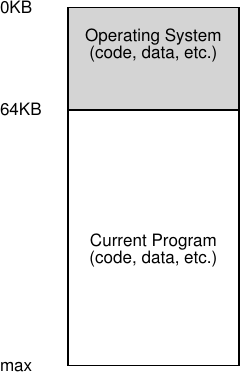
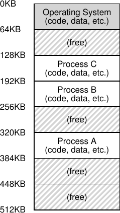
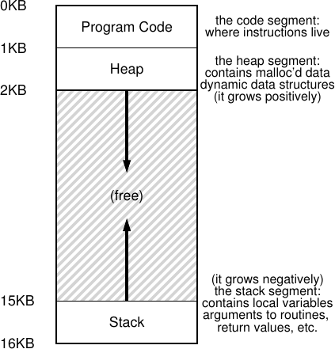

# الفصل 13: التجريد: فضاءات العناوين

في الأيام الأولى، كان بناء أنظمة الحاسوب سهلًا. تسأل: لماذا؟ لأن المستخدمين لم يتوقّعوا الكثير. فالمستخدمون المزعجون بتوقّعاتهم من «سهولة الاستعمال»، و«الأداء العالي»، و«الوثوقية»، وما إلى ذلك، هم الذين أوصلونا إلى كل هذه الصداع. في المرة القادمة التي تلتقي فيها أحد هؤلاء المستخدمين، اشكره على كل المشكلات التي سبّبها.

## 13.1 الأنظمة المبكرة

من منظور الذاكرة، لم تكن الآلات المبكرة تقدّم للمستخدمين قدرًا كبيرًا من التجريد. وبوجه أساسي، كانت الذاكرة المادية للآلة تبدو على نحو يشبه ما تراه في الشكل 13.1 (الصفحة 2).

كان نظام التشغيل مجموعة من الروتينات (مكتبة في الحقيقة) تشغل حيّزًا من الذاكرة (يبدأ في هذا المثال عند العنوان المادي 0)، ويكون هناك برنامج واحد قيد التشغيل (أي عملية) يشغل الآن حيّزًا من الذاكرة المادية (يبدأ في هذا المثال عند العنوان المادي 64 كيلوبايت) ويستعمل بقية الذاكرة. لم تكن الأوهام كثيرة هنا، ولم يكن المستخدم يتوقّع الكثير من نظام التشغيل. كانت الحياة يسيرة على مطوّري أنظمة التشغيل في تلك الأيام، أليس كذلك؟



**الشكل 13.1:** أنظمة التشغيل: الأيام الأولى

## 13.2 البرمجة المتعددة ومشاركة الزمن

بعد حين، ولأن الآلات كانت باهظة الثمن، بدأ الناس يقتسمون الآلات على نحو أنجع. وهكذا وُلد عصر البرمجة المتعددة [DV66]، الذي تكون فيه عمليات متعددة مستعدّة للتشغيل في وقت معيّن، فيتنقّل نظام التشغيل بينها، مثلًا حين تقرّر إحداها إجراء إدخال/إخراج. وقد زاد ذلك من الاستفادة الفعلية من المعالج. وكانت هذه الزيادات في الكفاءة مهمة خصوصًا في تلك الأيام التي كان يكلّف فيها الجهاز الواحد مئات الآلاف من الدولارات أو حتى الملايين (وأنت تظنّ أن حاسوبك الماكنتوش باهظ!).

وسرعان ما بدأ الناس يطلبون المزيد من الآلات، فوُلد عصر مشاركة الزمن [S59, L60, M62, M83]. فقد أدرك كثيرون على وجه التحديد قصور الحوسبة بالدفعات، لا سيّما على المبرمجين أنفسهم [CV65]، الذين سئموا دورات تصحيح البرامج الطويلة (غير الفعّالة من ثمّ). وصارت فكرة التفاعلية مهمة، إذ قد يستعمل كثير من المستخدمين آلة واحدة في الوقت نفسه، وكل واحد منهم ينتظر (أو يأمل) استجابة سريعة من مهامه قيد التنفيذ.

ومن طرق تنفيذ مشاركة الزمن أن تُشغّل عملية واحدة لوقت قصير، ممنوحةً وصولًا كاملًا إلى كل الذاكرة (الشكل 13.1)، ثم توقفها، فتحفظ كل حالتها في نوع من الأقراص (بما في ذلك كل الذاكرة المادية)، ثم تحمّل حالة عملية أخرى، وتشغّلها لوقت ما، وبذلك تنفّذ نوعًا من الاقتسام الخشن للآلة [M+63].

غير أن لهذا الأسلوب مشكلة كبيرة: إنه بطيء جدًا، خصوصًا مع نموّ الذاكرة. فمع أن حفظ حالة مستوى السجلات (عدّاد البرنامج، والسجلات للأغراض العامة، وما إلى ذلك) واستعادتها سريع نسبيًا، فإن حفظ محتويات الذاكرة كلها في القرص بطيء إلى حدّ مؤلم. ومن ثمّ نفضّل أن نُبقي العمليات في الذاكرة في أثناء التنقّل بينها، فيستطيع نظام التشغيل عندئذ أن ينفّذ مشاركة الزمن بكفاءة (كما يبيّن الشكل 13.2، الصفحة 3).

في المخطّط ثلاث عمليات (A وB وC)، ولكل منها جزء صغير من الذاكرة المادية البالغة 512 كيلوبايت. وبافتراض معالج واحد، يختار نظام التشغيل أن يشغّل إحدى العمليات (لنقل A)، بينما تنتظر الأخريان (B وC) في قائمة الانتظار الجاهزة.

ومع شيوع مشاركة الزمن أكثر، يمكنك أن تخمّن أن مطالب جديدة وُضعت على نظام التشغيل. فإتاحة وجود برامج متعددة في الذاكرة في الوقت نفسه تجعل الحماية مسألة مهمة؛ إذ لا تريد أن تستطيع عملية ما أن تقرأ ذاكرة عملية أخرى، أو الأسوأ من ذلك أن تكتب فيها.



**الشكل 13.2:** ثلاث عمليات: اقتسام الذاكرة

## 13.3 فضاء العناوين

غير أن علينا ألّا ننسى هؤلاء المستخدمين المزعجين، والوفاء بذلك يقتضي أن ينشئ نظام التشغيل تجريدًا سهل الاستعمال للذاكرة المادية. ونسمّي هذا التجريد فضاء العناوين، وهو رؤية البرنامج قيد التشغيل للذاكرة في النظام. وفهم هذا التجريد الأساسي للذاكرة في أنظمة التشغيل هو مفتاح فهم كيفية محاكاة الذاكرة افتراضيًا.

يضمّ فضاء عناوين العملية كل حالة الذاكرة للبرنامج قيد التشغيل. فمثلًا، على شيفرة البرنامج (أي التعليمات) أن تشغل حيّزًا من الذاكرة في مكان ما، ومن ثمّ فهي في فضاء العناوين. ويستعمل البرنامج، وهو يعمل، مكدّسًا ليتتبّع موضعه في سلسلة نداءات الدوالّ، وكذلك لتخصيص المتغيّرات المحلية وتمرير الوسائط وقيم العودة من الروتينات وإليها. وأخيرًا، يُستعمل الكومة للذاكرة المخصّصة ديناميكيًا والتي يديرها المستخدم، كتلك التي قد تحصل عليها من نداء `malloc()` في لغة C أو من `new` في لغة كائنية التوجّه مثل ++C أو Java. وبالطبع ثمة أشياء أخرى هناك أيضًا (كالمتغيّرات المهيّأة ساكنًا)، لكن لنفترض الآن هذه المكوّنات الثلاثة فقط: الشيفرة، والمكدّس، والكومة.

في مثال الشكل 13.3 (الصفحة 4)، لدينا فضاء عناوين صغير جدًا (16 كيلوبايت فقط)[^1]. فشيفرة البرنامج تشغل أعلى فضاء العناوين (تبدأ في هذا المثال عند 0، وتُحشر في أول كيلوبايت من فضاء العناوين). والشيفرة ساكنة (ومن ثمّ يسهل وضعها في الذاكرة)، فيمكننا وضعها في أعلى فضاء العناوين ونحن نعلم أنها لن تحتاج مساحة أكثر مع تشغيل البرنامج.



**الشكل 13.3:** مثال على فضاء عناوين

وبعد ذلك لدينا المنطقتان في فضاء العناوين اللتان قد تنموان (وتتقلّصان) في أثناء تشغيل البرنامج. وهما الكومة (في الأعلى) والمكدّس (في الأسفل). ونضعهما على هذا النحو لأن كليهما يريد أن ينمو، وبوضعهما عند طرفين متقابلين من فضاء العناوين نتيح لهما ذلك النمو: فعليهما فقط أن ينموا في اتجاهين متعاكسين. وهكذا تبدأ الكومة بعد الشيفرة مباشرة (عند 1 كيلوبايت) وتنمو نزولًا (مثلًا حين يطلب المستخدم مزيدًا من الذاكرة عبر `malloc()` )؛ ويبدأ المكدّس عند 16 كيلوبايت وينمو صعودًا (مثلًا حين يجري المستخدم نداء إجراء). غير أن هذا الوضع للمكدّس والكومة مجرّد عرف؛ إذ يمكنك ترتيب فضاء العناوين على نحو مغاير إن أردت (وكما سنرى لاحقًا، حين تتواجد خيوط متعددة في فضاء عناوين واحد، لا تعود ثمة طريقة جيدة لتقسيم فضاء العناوين على هذا النحو، للأسف).

وبالطبع، حين نصف فضاء العناوين فإننا نصف التجريد الذي يقدّمه نظام التشغيل للبرنامج قيد التشغيل. فالبرنامج ليس في الحقيقة في الذاكرة عند العناوين المادية من 0 إلى 16 كيلوبايت؛ بل يُحمَّل عند عنوان (أو عناوين) مادية اعتباطية. تأمّل العمليات A وB وC في الشكل 13.2؛ وهناك ترى كيف تُحمَّل كل عملية في الذاكرة عند عنوان مختلف. ومن هنا تنشأ المسألة:

> **جوهر المسألة: كيف نُحاكي الذاكرة افتراضيًا**
>
> كيف يستطيع نظام التشغيل بناء هذا التجريد لفضاء عناوين خاص، وربما كبير، لعمليات متعددة قيد التشغيل (كلها تتشارك الذاكرة) فوق ذاكرة مادية واحدة؟

حين يفعل نظام التشغيل ذلك نقول إنه يُحاكي الذاكرة افتراضيًا، لأن البرنامج قيد التشغيل يظنّ أنه محمّل في الذاكرة عند عنوان معيّن (لنقل 0) وله فضاء عناوين قد يكون كبيرًا جدًا (لنقل 32 بت أو 64 بت)؛ أما الواقع فمختلف تمامًا.

فمثلًا، حين تحاول العملية A في الشكل 13.2 إجراء تحميل عند العنوان 0 (وسنسمّيه عنوانًا افتراضيًا)، سيكون على نظام التشغيل، بالتعاون مع بعض الدعم العتادي، أن يضمن بأي وسيلة ألّا يذهب التحميل فعلًا إلى العنوان المادي 0 بل إلى العنوان المادي 320 كيلوبايت (حيث تُحمَّل A في الذاكرة). وهذا هو مفتاح محاكاة الذاكرة افتراضيًا، وهو ما يقوم عليه كل نظام حاسوب حديث في العالم.

## 13.4 الأهداف

وهكذا نصل إلى مهمّة نظام التشغيل في هذه المجموعة من الملاحظات: أن يُحاكي الذاكرة افتراضيًا. غير أن نظام التشغيل لن يُحاكي الذاكرة فحسب، بل سيفعل ذلك بأناقة. ولضمان أن يفعل ذلك، نحتاج إلى أهداف ترشدنا. وقد رأينا هذه الأهداف من قبل (تذكّر المقدّمة)، وسنراها مرة أخرى، لكنها تستحقّ التكرار بلا شك.

من الأهداف الرئيسة لنظام الذاكرة الافتراضية (VM) الشفافية[^2]. فعلى نظام التشغيل أن ينفّذ الذاكرة الافتراضية على نحو خفيّ عن البرنامج قيد التشغيل. ومن ثمّ لا ينبغي أن يكون البرنامج مدركًا لكون الذاكرة محاكاة افتراضية؛ بل يتصرّف كأنّ له ذاكرته المادية الخاصة. وفي الكواليس، يقوم نظام التشغيل (والعتاد) بكل العمل لتعدّد استعمال الذاكرة بين مهام كثيرة مختلفة، وبذلك ينفّذ الوهم.

وثمّة هدف آخر للذاكرة الافتراضية هو الكفاءة. فعلى نظام التشغيل أن يسعى إلى جعل المحاكاة الافتراضية أنجع ما يمكن، من حيث الزمن (أي بألّا يجعل البرامج تعمل ببطء أكبر كثيرًا) ومن حيث المساحة (أي بألّا يستعمل ذاكرة كثيرة جدًا للبنى اللازمة لدعم المحاكاة الافتراضية). وفي تنفيذ محاكاة افتراضية ناجعة زمنيًا، سيكون على نظام التشغيل أن يعتمد على دعم العتاد، بما في ذلك ميزات عتادية مثل TLBs (وسنتعلّم عنها في حينها).

وأخيرًا، ثمة هدف ثالث للذاكرة الافتراضية هو الحماية. فعلى نظام التشغيل أن يحرص على حماية العمليات بعضها من بعض، وكذلك حماية نظام التشغيل نفسه من العمليات. فحين تجري عملية ما تحميلًا أو خزنًا أو جلب تعليمة، ينبغي ألّا تستطيع الوصول إلى محتويات ذاكرة أي عملية أخرى أو إلى ذاكرة نظام التشغيل نفسه بأي وسيلة، ولا التأثير فيها (أي في أي شيء خارج فضاء عناوينها). وهكذا تتيح لنا الحماية خصيصة العزل بين العمليات؛ إذ ينبغي أن تعمل كل عملية في شرنقتها المعزولة، آمنة من عبث العمليات الأخرى المعطوبة أو حتى الخبيثة.

> **نصيحة: مبدأ العزل**
>
> العزل مبدأ أساسي في بناء أنظمة موثوقة. فإن كان كيانان معزولين بعضهما عن بعض عزلًا سليمًا، فهذا يعني أن أحدهما قد يفشل دون أن يؤثّر في الآخر. وتسعى أنظمة التشغيل إلى عزل العمليات بعضها عن بعض، فتمنع بذلك إحداها من إيذاء الأخرى. وباستعمال عزل الذاكرة، يضمن نظام التشغيل كذلك ألّا تؤثّر البرامج قيد التشغيل في عمل نظام التشغيل الذي يقوم عليه. بل إن بعض أنظمة التشغيل الحديثة تذهب في العزل أبعد، فتحاصر أجزاءً من نظام التشغيل بعيدًا عن أجزاء أخرى منه. ومن ثمّ قد توفّر هذه النوى الدقيقة [BH70, R+89, S+03] وثوقية أكبر من تصاميم النوى الكبيرة التقليدية.

وفي الفصول القادمة، سنركّز استكشافنا على الآليات الأساسية اللازمة لمحاكاة الذاكرة افتراضيًا، بما في ذلك دعم العتاد ونظام التشغيل. وسنبحث أيضًا في بعض السياسات الأكثر صلة التي ستلقاها في أنظمة التشغيل، ومنها كيفية إدارة المساحة الحرة وأيّ الصفحات نُخرج من الذاكرة حين تنفد المساحة. وبذلك سنبني فهمك لكيفية عمل نظام ذاكرة افتراضية حديث حقًا[^3].

## 13.5 الخلاصة

رأينا مقدّمة لنظام فرعي كبير من أنظمة التشغيل: الذاكرة الافتراضية. ونظام الذاكرة الافتراضية مسؤول عن توفير وهم فضاء عناوين كبير ومتناثر وخاص لكل برنامج قيد التشغيل؛ وكل فضاء عناوين افتراضي يضمّ كل تعليمات البرنامج وبياناته، ويمكن للبرنامج أن يشير إليها عبر عناوين افتراضية. وسيأخذ نظام التشغيل، بمساعدة جدّية من العتاد، كل إشارة من إشارات الذاكرة الافتراضية هذه ويحوّلها إلى عنوان مادي، يمكن تقديمه إلى الذاكرة المادية لجلب المعلومات المطلوبة أو تحديثها. وسيقدّم نظام التشغيل هذه الخدمة لعمليات كثيرة في وقت واحد، حريصًا على حماية البرامج بعضها من بعض وحماية نظام التشغيل. والمنهج كله يقتضي قدرًا كبيرًا من الآلية (أي كثيرًا من العتاد منخفض المستوى) إضافة إلى بعض السياسات الحيوية كي يعمل؛ وسنبدأ من الأسفل صعودًا، واصفين الآليات الحيوية أولًا. وهكذا نمضي!

> **استطراد: كل عنوان تراه افتراضي**
>
> هل كتبت يومًا برنامجًا بلغة C يطبع مؤشّرًا؟ القيمة التي تراها (عدد كبير، يُطبع غالبًا بالنظام الست عشري) عنوان افتراضي. وهل تساءلت يومًا أين توجد شيفرة برنامجك؟ يمكنك طباعة ذلك أيضًا، ونعم، إن أمكنك طباعته فهو أيضًا عنوان افتراضي. بل إن أي عنوان تراه كمبرمج لبرنامج على مستوى المستخدم هو عنوان افتراضي. ونظام التشغيل وحده، بحيله في محاكاة الذاكرة افتراضيًا، يعرف أين تقع هذه التعليمات وقيم البيانات في الذاكرة المادية للآلة. فلا تنسَ أبدًا: إن طبعت عنوانًا في برنامج فهو افتراضي، وهمٌ عن كيفية ترتيب الأشياء في الذاكرة؛ ونظام التشغيل (والعتاد) وحدهما يعرفان الحقيقة.
>
> وهذا برنامج صغير (`va.c`) يطبع مواقع روتين `main()` (حيث توجد الشيفرة)، وقيمة مخصّصة في الكومة يعيدها `malloc()`، وموقع عدد صحيح في المكدّس:
>
> ```
> 1   #include <stdio.h>
> 2   #include <stdlib.h>
> 3   int main(int argc, char *argv[]) {
> 4     printf("location of code : %p\n", main);
> 5     printf("location of heap : %p\n", malloc(100e6));
> 6     int x = 3;
> 7     printf("location of stack: %p\n", &x);
> 8     return x;
> 9   }
> ```
>
> وحين نشغّله على جهاز ماكنتوش 64 بت، نحصل على الخرج الآتي:
>
> ```
> location of code : 0x1095afe50
> location of heap : 0x1096008c0
> location of stack: 0x7fff691aea64
> ```
>
> ومن هذا ترى أن الشيفرة تأتي أولًا في فضاء العناوين، ثم الكومة، بينما يكون المكدّس في الطرف الآخر تمامًا من هذا الفضاء الافتراضي الكبير. وكل هذه العناوين افتراضية، وسيحوّلها نظام التشغيل والعتاد لجلب القيم من مواقعها المادية الحقيقية.

## المراجع

> [BH70] «The Nucleus of a Multiprogramming System» لبير برينك هانسن. Communications of the ACM، المجلّد 13، العدد 4، أبريل 1970. أول ورقة تقترح أن يكون نظام التشغيل، أو النواة، ركيزة صغيرة ومرنة لبناء أنظمة تشغيل مخصّصة؛ وقد عاد هذا الموضوع في تاريخ بحوث أنظمة التشغيل كلّه.

> [CV65] «Introduction and Overview of the Multics System» لـF. J. Corbato وV. A. Vyssotsky. مؤتمر الحاسوب المشترك الخريفي، 1965. ورقة Multics مبكّرة رائعة. وهنا الاقتباس العظيم عن مشاركة الزمن: «نشأ الحافز إلى مشاركة الزمن أولًا عند المبرمجين المحترفين، بسبب إحباطهم الدائم في تصحيح البرامج في منشآت المعالجة بالدفعات. ومن ثمّ كان الهدف الأصلي أن تُشارك أزمنة الحواسيب للسماح بوصول متزامن من أشخاص عدة، مع إعطاء كل واحد منهم وهم أن الآلة كلها تحت تصرّفه.»

> [DV66] «Programming Semantics for Multiprogrammed Computations» لجاك ب. دينيس وإيرل ك. ڤان هورن. Communications of the ACM، المجلّد 9، العدد 3، مارس 1966. ورقة مبكّرة (لكنها ليست الأولى) عن البرمجة المتعددة.

> [L60] «Man-Computer Symbiosis» لـJ. C. R. Licklider. IRE Transactions on Human Factors in Electronics، HFE-1:1، مارس 1960. ورقة طريفة عن كيفية دخول الحواسيب والناس في عصر من التكافل؛ إنها سابقة لزمنها بوضوح، لكنها قراءة بديعة مع ذلك.

> [M62] «Time-Sharing Computer Systems» لـJ. McCarthy. Management and the Computer of the Future، MIT Press، كامبريدج، ماساتشوستس، 1962. وهي على الأرجح أولى أوراق مكارثي المسجّلة عن مشاركة الزمن. وفي ورقة أخرى [M83] يزعم أنه كان يفكّر في الفكرة منذ 1957. وقد ترك مكارثي مجال الأنظمة ليصبح عملاقًا في الذكاء الاصطناعي في ستانفورد، بما في ذلك إنشاء لغة البرمجة LISP. انظر صفحته الرئيسية لمزيد من المعلومات: http://www-formal.stanford.edu/jmc/

> [M+63] «A Time-Sharing Debugging System for a Small Computer» لـJ. McCarthy وS. Boilen وE. Fredkin وJ. C. R. Licklider. AFIPS '63 (الربيع)، نيويورك، مايو 1963. مثال مبكّر عظيم لنظام كان يبدّل ذاكرة البرنامج إلى «الأسطوانة» حين لا يكون البرنامج قيد التشغيل، ثم يعيدها إلى ذاكرة «النواة المغناطيسية» حين يحين تشغيله.

> [M83] «Reminiscences on the History of Time Sharing» لجون مكارثي. 1983. متاح على: http://www-formal.stanford.edu/jmc/history/timesharing/timesharing.html. ملاحظة تاريخية بديعة عن مصدر فكرة مشاركة الزمن، وفيها بعض التشكيك في الذين ينسبون عمل ستراتشي [S59] إلى الريادة في هذا المجال.

> [NS07] «Valgrind: A Framework for Heavyweight Dynamic Binary Instrumentation» لـN. Nethercote وJ. Seward. PLDI 2007، سان دييغو، كاليفورنيا، يونيو 2007. Valgrind برنامج منقذ لمن يستعملون لغات غير آمنة مثل C. اقرأ هذه الورقة لتتعلّم تقنياته الرائعة في تجهيز الشيفرة الثنائية — إنها مبهرة حقًا.

> [R+89] «Mach: A System Software kernel» لـR. Rashid وD. Julin وD. Orr وR. Sanzi وR. Baron وA. Forin وD. Golub وM. Jones. COMPCON '89، فبراير 1989. ومع أنه ليس أول مشروع في النوى الدقيقة بالمعنى الدقيق، فإن مشروع Mach في جامعة كارنيغي ميلون كان معروفًا ومؤثّرًا؛ وهو ما يزال حيًّا اليوم في أعماق نظام Mac OS X.

> [S59] «Time Sharing in Large Fast Computers» لـC. Strachey. وقائع المؤتمر الدولي لمعالجة المعلومات، اليونسكو، يونيو 1959. من أوائل المراجع عن مشاركة الزمن.

> [S+03] «Improving the Reliability of Commodity Operating Systems» لـM. M. Swift وB. N. Bershad وH. M. Levy. SOSP '03. أول ورقة تبيّن كيف يمكن للتفكير الشبيه بالنوى الدقيقة أن يحسّن وثوقية أنظمة التشغيل.

## الواجب (شيفرة)

في هذا الواجب سنتعلّم فقط بضع أدوات مفيدة لفحص استعمال الذاكرة الافتراضية على الأنظمة المبنية على لينكس. وهذا سيكون تلميحًا وجيزًا إلى ما هو ممكن فحسب؛ سيكون عليك أن تتعمّق بنفسك لتصبح خبيرًا حقًا (كما هو الحال دائمًا!).

## الأسئلة

1. أول أداة لينكس ينبغي أن تجرّبها هي الأداة البسيطة جدًا `free`. اكتب أولًا `man free` واقرأ صفحة دليلها كلها؛ إنها قصيرة، لا تقلق!
2. الآن شغّل `free`، وربما ببعض الوسائط التي قد تكون مفيدة (مثل `-m`، لعرض مجاميع الذاكرة بالميغابايت). كم ذاكرة في نظامك؟ وكم منها حرّة؟ وهل تطابق هذه الأرقام حدسك؟
3. بعد ذلك، اكتب برنامجًا صغيرًا يستعمل قدرًا معيّنًا من الذاكرة، سمّه `memory-user.c`. ينبغي أن يأخذ هذا البرنامج وسيطًا واحدًا من سطر الأوامر: عدد الميغابايت من الذاكرة التي سيستعملها. وحين يُشغَّل، ينبغي أن يخصّص مصفوفة، ويجري عبرها باستمرار، فالمس كل عنصر. وعلى البرنامج أن يفعل ذلك بلا نهاية، أو ربما لمدّة معيّنة تُحدَّد أيضًا في سطر الأوامر.
4. الآن، في أثناء تشغيل برنامج `memory-user`، شغّل (في نافذة طرفية أخرى، لكن على الآلة نفسها) أداة `free`. كيف تتغيّر مجاميع استعمال الذاكرة حين يعمل برنامجك؟ وماذا عن حين تقتل برنامج `memory-user`؟ وهل تطابق الأرقام توقّعاتك؟ جرّب ذلك لمقادير مختلفة من استعمال الذاكرة. وماذا يحدث حين تستعمل مقادير كبيرة جدًا من الذاكرة؟
5. لنجرّب أداة أخرى، تُعرف بـ`pmap`. خذ وقتك واقرأ صفحة دليل `pmap` بالتفصيل.
6. لاستعمال `pmap`، عليك أن تعرف معرّف العملية التي تهمّك. ومن ثمّ شغّل أولًا `ps auxw` لترى قائمة بكل العمليات؛ ثم اختر واحدة مثيرة للاهتمام، كمتصرّح ويب. ويمكنك أن تستعمل برنامج `memory-user` في هذه الحالة أيضًا (بل يمكنك حتى أن تجعل ذلك البرنامج ينادي `getpid()` ويطبع معرّفه لتيسير الأمر عليك).
7. الآن شغّل `pmap` على بعض هذه العمليات، بوسائط مختلفة (مثل `-X`) لكشف تفاصيل كثيرة عن العملية. ماذا ترى؟ وكم كيانًا مختلفًا يتكوّن منه فضاء عناوين حديث، مقابل تصوّرنا البسيط للشيفرة والمكدّس والكومة؟
8. وأخيرًا، لنشغّل `pmap` على برنامج `memory-user`، بمقادير مختلفة من الذاكرة المستعملة. ماذا ترى هنا؟ وهل يطابق الخرج من `pmap` توقّعاتك؟

[^1]: سنستعمل كثيرًا أمثلة صغيرة كهذا، لأن (أ) تمثيل فضاء عناوين من 32 بت مكابدة، و(ب) الحساب أصعب. ونحن نحبّ الحساب البسيط.

[^2]: قد يكون استعمال كلمة «الشفافية» مربكًا بعض الشيء؛ فبعض الطلاب يظنّون أن «أن تكون شفافًا» يعني إبقاء كل شيء في العلن، أي ما ينبغي أن تكون عليه الحكومة. أما هنا فالمعنى عكسه: أن الوهم الذي يقدّمه نظام التشغيل ينبغي ألّا يكون مرئيًا للتطبيقات. ومن ثمّ فالنظام الشفاف في الاستعمال الشائع هو نظام يصعب ملاحظته، لا نظام يستجيب للطلبات كما ينصّ قانون حرية المعلومات.

[^3]: أو سنقنعك بأن تترك المقرّر. لكن تمهّل؛ فإن نجحت في اجتياز الذاكرة الافتراضية، فمن المرجّح أن تصل إلى النهاية كلها!
