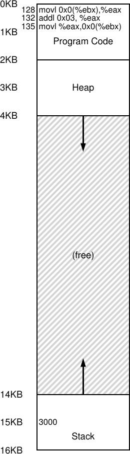
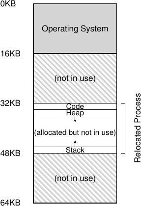
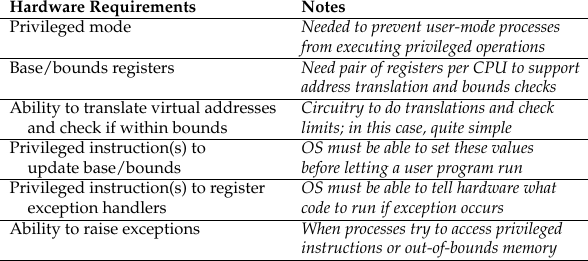
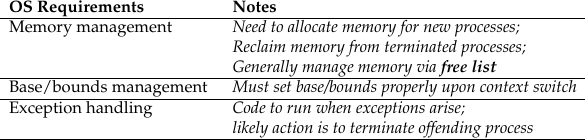
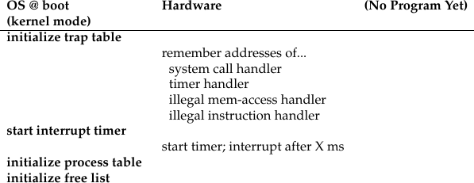
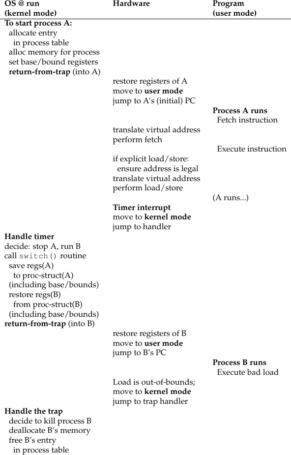

# الفصل 15: الآلية: ترجمة العناوين

حين طوّرنا محاكاة المعالج الافتراضية، ركّزنا على آلية عامة تُعرف باسم التنفيذ المباشر المحدود (أو LDE اختصارًا). والفكرة وراء التنفيذ المباشر المحدود بسيطة: دع البرنامج، في الأغلب، يعمل مباشرة على العتاد؛ لكن رتّب الأمور، في نقاط زمنية معيّنة ومفتاحية (كاستدعاء النظام من قبل عملية، أو عند حدوث مقاطعة مؤقّت)، بحيث يتدخّل نظام التشغيل ويتأكد من حدوث الشيء «الصحيح». وهكذا يحاول نظام التشغيل، بدعم قليل من العتاد، أن يبتعد قدر الإمكان عن طريق البرنامج العامل، كي يقدّم محاكاة افتراضية فعّالة؛ لكنه، بالتوسّط في تلك النقاط الزمنية الحرجة، يضمن احتفاظه بالسيطرة على العتاد. والكفاءة والسيطرة معًا هما هدفان رئيسيان من أهداف أي نظام تشغيل حديث.

وفي محاكاة الذاكرة افتراضيًا، سنتّبع استراتيجية مشابهة، فننال الكفاءة والسيطرة معًا وهما نقدّم المحاكاة الافتراضية المطلوبة. تقتضي الكفاءة أن نستفيد من دعم العتاد، الذي سيكون في البداية بدائيًا إلى حدٍّ كبير (بضعة سجلات فقط، مثلًا) لكنه سينمو ليصبح معقدًا إلى حدٍّ ما (على سبيل المثال: مخازن الترجمة المتعددة (TLB)، ودعم جداول الصفحات، وما إلى ذلك، كما سترى). وتستلزم السيطرة أن يضمن نظام التشغيل أنه لا يُسمح لأي تطبيق بالنفاذ إلى أي ذاكرة سوى ذاكرته؛ ولذلك، لحماية التطبيقات بعضها من بعض، ولحماية نظام التشغيل من التطبيقات، سنحتاج إلى مساعدة العتاد هنا أيضًا. وأخيرًا، سنحتاج من نظام الذاكرة الافتراضية إلى المزيد بقليل من حيث المرونة؛ وتحديدًا، نودّ أن تستطيع البرامج استخدام فضاءات عناوينها بالطريقة التي تريدها، فيصبح النظام أسهل في البرمجة. وهكذا نصل إلى جوهر المسألة المصقول:

> **جوهر المسألة: كيف نُحاكي الذاكرة افتراضيًا بكفاءة ومرونة**
>
> كيف يمكننا بناء محاكاة افتراضية فعّالة للذاكرة؟ كيف نوفّر المرونة التي تحتاجها التطبيقات؟ كيف نحتفظ بالسيطرة على مواقع الذاكرة التي يجوز للتطبيق النفاذ إليها، فنضمن تقييد وصول التطبيق إلى الذاكرة على الوجه الصحيح؟ وكيف نفعل كل ذلك بكفاءة؟

إن الأسلوب العام الذي سنستخدمه، والذي يمكنك اعتباره إضافة إلى مقاربتنا العامة للتنفيذ المباشر المحدود، هو ما يُشار إليه باسم ترجمة العناوين المدعومة بالعتاد، أو ترجمة العناوين اختصارًا. وبترجمة العناوين، يحوّل العتاد كل نفاذ إلى الذاكرة (كجلب تعليمة، أو تحميل، أو تخزين)، فيغيّر العنوان الافتراضي الذي تعطيه التعليمة إلى عنوان مادي يوجد فيه الأصل المطلوب فعلًا. وهكذا، عند كل مرجع إلى الذاكرة، ينفّذ العتاد ترجمة للعنوان كي يعيد توجيه مراجع ذاكرة التطبيق إلى مواقعها الحقيقية في الذاكرة.

وبالطبع لا يستطيع العتاد وحده محاكاة الذاكرة افتراضيًا، فهو يقدّم فقط الآلية منخفضة المستوى للقيام بذلك بكفاءة. أما نظام التشغيل فعليه أن يتدخّل في نقاط مفتاحية لتهيئة العتاد كي تحدث الترجمات الصحيحة؛ وعليه بالتالي أن يدير الذاكرة، فيتتبّع المواقع الحرة والمواقع المستخدمة، ويتدخّل بحكمة للحفاظ على السيطرة على كيفية استخدام الذاكرة.

ومرة أخرى، فإن غاية كل هذا العمل صنع وهم جميل: أن للبرنامج ذاكرة خاصة به، تقيم فيها شيفرته وبياناته. وخلف هذا الواقع الافتراضي تكمن حقيقة مادية قبيحة: أن برامج كثيرة تتقاسم الذاكرة فعلًا في الوقت نفسه، بينما يتنقل المعالج (أو المعالجات) بين تشغيل برنامج وتشغيل التالي. وبفضل المحاكاة الافتراضية، يحوّل نظام التشغيل (بمساعدة العتاد) الواقع الآلي القبيح إلى تجريد مفيد وقوي وسهل الاستخدام.

## 15.1 الافتراضات

ستكون محاولاتنا الأولى لمحاكاة الذاكرة افتراضيًا بسيطة جدًا، بل سخيفة إلى حدٍّ يثير الضحك. اضحك كما تشاء؛ فقريبًا سيكون نظام التشغيل هو من يضحك عليك، حين تحاول فهم خبايا مخازن الترجمة المتعددة، وجداول الصفحات متعددة المستويات، وعجائب تقنية أخرى. ألا تحب فكرة أن يضحك نظام التشغيل عليك؟ حسنًا، ربما نفد حظك إذن؛ فهكذا يعمل نظام التشغيل فحسب.

وتحديدًا، سنفترض الآن أن فضاء عناوين المستخدم يجب أن يُوضَع بشكل متصل في الذاكرة المادية. وسنفترض أيضًا، للتبسيط، أن حجم فضاء العناوين ليس كبيرًا كثيرًا؛ وتحديدًا، أنه أصغر من حجم الذاكرة المادية. وأخيرًا، سنفترض أن كل فضاء عناوين له الحجم نفسه بالضبط. لا تقلق إن بدت هذه الافتراضات غير واقعية؛ فسنخفّفها تدريجيًا، فنحقّق محاكاة افتراضية واقعية للذاكرة.

## 15.2 مثال

كي نفهم على نحو أفضل ما نحتاج إلى فعله لتنفيذ ترجمة العناوين، ولماذا نحتاج إلى هذه الآلية، لننظر إلى مثال بسيط. تخيّل عمليةً فضاء عناوينها كما هو مبيّن في الشكل 15.1. ما سنتفحّصه هنا هو تسلسل شيفرة قصير يحمّل قيمة من الذاكرة، ويزيدها بمقدار ثلاثة، ثم يخزّن القيمة عائدة إلى الذاكرة. يمكنك أن تتخيل أن تمثيل هذه الشيفرة بلغة C قد يبدو هكذا:

```
void func() {
    int x = 3000; // thanks, Perry.
    x = x + 3;    // line of code we are interested in
    ...
}
```

> **نصيحة: التوسّط قوي**
>
> التوسّط (interposition) تقنية عامة وقوية يُستفاد منها كثيرًا في أنظمة الحاسوب. ففي محاكاة الذاكرة افتراضيًا، سيتوسّط العتاد عند كل نفاذ إلى الذاكرة، ويترجم كل عنوان افتراضي تصدره العملية إلى عنوان مادي تُخزَّن فيه المعلومات المطلوبة فعلًا. لكن تقنية التوسّط العامة أوسع انطباقًا بكثير؛ ففي الواقع، يمكن التوسّط عند أي واجهة محدّدة جيدًا تقريبًا، لإضافة وظيفة جديدة أو تحسين جانب آخر من النظام. ومن المنافع المعتادة لهذه المقاربة الشفافية؛ إذ يحدث التوسّط غالبًا دون تغيير واجهة العميل، فلا يتطلب أي تعديل على ذلك العميل.

يحوّل المترجم هذا السطر من الشيفرة إلى لغة تجميع، قد تبدو شيئًا كهذا (بلغة تجميع x86). استخدم objdump على لينكس أو otool على ماك لتفكيكها:

```
 128: movl 0x0(%ebx), %eax    ;load 0+ebx into eax
 132: addl $0x03, %eax        ;add 3 to eax register
 135: movl %eax, 0x0(%ebx)    ;store eax back to mem
```

هذا المقطع من الشيفرة مباشر نسبيًا؛ إنه يفترض أن عنوان x قد وُضع في السجل ebx، ثم يحمّل القيمة الموجودة في ذلك العنوان إلى السجل العام eax باستخدام التعليمة movl (اختصارًا لـ «نقل الكلمة الطويلة»). وتضيف التعليمة التالية 3 إلى eax، وتخزّن التعليمة الأخيرة قيمة eax عائدة إلى الذاكرة في الموقع نفسه.

تأمّل في الشكل 15.1 (الصفحة 4) كيف تُوضَع الشيفرة والبيانات في فضاء عناوين العملية؛ فتسلسل الشيفرة ذو التعليمات الثلاث موجود في العنوان 128 (في قسم الشيفرة قرب الأعلى)، وقيمة المتغيّر x موجودة في العنوان 15 ك.ب (في المكدّس قرب الأسفل). والقيمة الابتدائية لـ x في الشكل هي 3000، كما هو مبيّن في موضعها على المكدّس.

وحين تُنفَّذ هذه التعليمات، تحدث نفاذات الذاكرة التالية من منظور العملية.

- جلب التعليمة الموجودة في العنوان 128
- تنفيذ هذه التعليمة (تحميل من العنوان 15 ك.ب)
- جلب التعليمة الموجودة في العنوان 132
- تنفيذ هذه التعليمة (من دون مرجع إلى الذاكرة)
- جلب التعليمة الموجودة في العنوان 135
- تنفيذ هذه التعليمة (تخزين في العنوان 15 ك.ب)



**الشكل 15.1:** عملية وفضاء عناوينها

من منظور البرنامج، يبدأ فضاء عناوينه من العنوان 0 وينمو إلى حدٍّ أقصى قدره 16 ك.ب؛ ويجب أن تقع كل مراجع الذاكرة التي يولّدها داخل هذه الحدود. لكن نظام التشغيل، كي يحاكي الذاكرة افتراضيًا، يريد وضع العملية في مكان آخر من الذاكرة المادية، لا بالضرورة في العنوان 0. وهكذا تواجهنا المسألة: كيف ننقل هذه العملية في الذاكرة بطريقة شفافة بالنسبة للعملية؟ كيف نوفّر وهم فضاء عناوين افتراضي يبدأ من 0، بينما يقع فضاء العناوين في الحقيقة في عنوان مادي آخر؟

وثمة مثال على ما قد تبدو عليه الذاكرة المادية بعد وضع فضاء عناوين هذه العملية فيها في الشكل 15.2. في الشكل، ترى نظام التشغيل يستخدم الخانة الأولى من الذاكرة المادية لنفسه، وأنه نقل العملية من المثال السابق إلى الخانة التي تبدأ عند العنوان المادي 32 ك.ب. والخانتان الأخريان حرّتان (16 ك.ب–32 ك.ب و48 ك.ب–64 ك.ب).



**الشكل 15.2:** الذاكرة المادية مع عملية واحدة منقولة

## 15.3 إعادة التوطين الديناميكي (المدعوم بالعتاد)

لكي نفهم شيئًا من ترجمة العناوين المدعومة بالعتاد، سنناقش أولًا صورتها الأولى. فقد أُدخلت في أولى آلات مشاركة الزمن في أواخر الخمسينيات فكرة بسيطة تُعرف باسم القاعدة والحدود؛ وتُعرف التقنية أيضًا باسم إعادة التوطين الديناميكي؛ وسنستخدم المصطلحين بالتبادل [SS74].

وتحديدًا، سنحتاج إلى سجلّين من العتاد داخل كل معالج: يُسمى أحدهما سجل القاعدة، والآخر سجل الحدود (ويُسمى أحيانًا سجل النهاية). وسيتيح لنا زوج القاعدة والحدود هذا وضع فضاء العناوين حيث نشاء في الذاكرة المادية، مع ضمان ألا تنفذ العملية إلا إلى فضاء عناوينها.

> **استطراد: إعادة التوطين البرمجية**
>
> في الأيام الأولى، قبل ظهور دعم العتاد، نفّذت بعض الأنظمة شكلًا خامًا من إعادة التوطين بوسائل برمجية بحتة. وتُعرف التقنية الأساسية باسم إعادة التوطين الساكن، وفيها يأخذ قطعة برمجية تُسمى المحمّل ملفًا تنفيذيًا على وشك التشغيل، ويعيد كتابة عناوينه لتصبح الإزاحة المطلوبة في الذاكرة المادية.
>
> فمثلًا، لو كانت تعليمة ما تحمّلًا من العنوان 1000 إلى سجل (مثل movl 1000, %eax)، وكان فضاء عناوين البرنامج قد حُمّل بدءًا من العنوان 3000 (لا من 0 كما يظن البرنامج)، لأعاد المحمّل كتابة التعليمة بإزاحة كل عنوان بمقدار 3000 (مثل movl 4000, %eax). وبهذه الطريقة تُحقّق إعادة توطين ساكنة بسيطة لفضاء عناوين العملية.
>
> لكن إعادة التوطين الساكن تعاني مشكلات كثيرة. فالأولى، والأهم، أنها لا توفر الحماية، إذ يمكن للعمليات توليد عناوين سيئة فتنفذ بذلك بغير حق إلى ذاكرة عمليات أخرى أو حتى إلى ذاكرة نظام التشغيل؛ وبصفة عامة، يُرجَّح أن دعم العتاد ضروري لحماية حقيقية [WL+93]. والثانية أن فضاء العناوين، بعد وضعه، يصعب نقله لاحقًا إلى موضع آخر [M65].

في هذه التهيئة، يُكتب كل برنامج ويُترجم كما لو أنه يُحمَّل في العنوان صفر. لكن حين يبدأ البرنامج بالعمل، يقرّر نظام التشغيل أين في الذاكرة المادية ينبغي تحميله، ويضبط سجل القاعدة على تلك القيمة. وفي المثال أعلاه، يقرّر نظام التشغيل تحميل العملية في العنوان المادي 32 ك.ب، ويضبط سجل القاعدة على هذه القيمة.

وتبدأ الأمور المثيرة في الحدوث حين تكون العملية عاملة. فحين تولّد العملية أي مرجع إلى الذاكرة، يترجمه المعالج على النحو التالي:

> العنوان المادي = العنوان الافتراضي + القاعدة

كل مرجع إلى الذاكرة تولّده العملية هو عنوان افتراضي؛ ويضيف العتاد بدوره محتوى سجل القاعدة إلى هذا العنوان، فيكون الناتج عنوانًا ماديًا يمكن إصداره إلى نظام الذاكرة.

كي نفهم هذا أفضل، لنتتبّع ما يحدث عند تنفيذ تعليمة واحدة. وتحديدًا، لننظر إلى تعليمة واحدة من تسلسلنا السابق:

```
128: movl 0x0(%ebx), %eax
```

عُدّاد البرنامج مضبوط على 128؛ وحين يحتاج العتاد إلى جلب هذه التعليمة، يضيف أولًا قيمتها إلى قيمة سجل القاعدة 32 ك.ب (32768) فيحصل على عنوان مادي هو 32896؛ ثم يجلب العتاد التعليمة من ذلك العنوان المادي. وبعد ذلك يبدأ المعالج تنفيذ التعليمة. وفي لحظة ما، تصدر العملية التحميل من العنوان الافتراضي 15 ك.ب، فيأخذه المعالج ويضيفه مرة أخرى إلى سجل القاعدة (32 ك.ب)، فيحصل على العنوان المادي النهائي 47 ك.ب، ومنه على المحتويات المطلوبة.

> **نصيحة: إعادة التوطين الديناميكي المدعومة بالعتاد**
>
> مع إعادة التوطين الديناميكي، يقطع القليل من العتاد شوطًا طويلًا. وتحديدًا، يُستخدم سجل القاعدة لتحويل العناوين الافتراضية (التي يولّدها البرنامج) إلى عناوين مادية. ويضمن سجل الحدود (أو النهاية) أن تقع هذه العناوين داخل حدود فضاء العناوين. ومعًا يوفّران محاكاة افتراضية بسيطة وفعّالة للذاكرة.

إن تحويل عنوان افتراضي إلى عنوان مادي هو بالضبط ما نسمّيه ترجمة العناوين؛ أي إن العتاد يأخذ عنوانًا افتراضيًا تظن العملية أنها تشير إليه، ويحوّله إلى عنوان مادي هو موضع البيانات في الواقع. ولأن نقل العنوان يحدث في وقت التشغيل، ولأن في إمكاننا نقل فضاءات العناوين حتى بعد بدء تشغيل العملية، تُعرف التقنية غالبًا باسم إعادة التوطين الديناميكي [M65].

ربما تسأل الآن: ماذا حدث لسجل الحدود (النهاية) ذاك؟ أليست هذه هي مقاربة القاعدة والحدود؟ إنها هي بالفعل. وكما خمّنت، فسجل الحدود موجود لمساعدة الحماية. وتحديدًا، سيتحقق المعالج أولًا من أن مرجع الذاكرة داخل الحدود، ليضمن مشروعيته؛ وفي المثال البسيط أعلاه، سيكون سجل الحدود مضبوطًا دومًا على 16 ك.ب. فإن ولّدت عملية عنوانًا افتراضيًا أكبر من الحدود (أو مساويًا لها)، أو سالبًا، سيرفع المعالج استثناءً، وسترَجَّح إنهاء العملية. وهكذا فغرض الحدود، كما ربما خمّنت، ضمان أن تكون كل العناوين التي تولّدها العملية مشروعة، وداخل «حدود» العملية.

ينبغي أن نلاحظ أن سجلَّي القاعدة والحدود بنيتان من العتاد محفوظتان على الشريحة (زوج لكل معالج). ويسمّي الناس أحيانًا الجزء من المعالج الذي يساعد في ترجمة العناوين وحدة إدارة الذاكرة (MMU)؛ وبينما نطوّر تقنيات أكثر تطورًا لإدارة الذاكرة، سنضيف مزيدًا من الدارات إلى وحدة إدارة الذاكرة.

وثمة كلمة جانبية صغيرة عن سجلات الحدود، التي يمكن تعريفها بإحدى طريقتين. في الأولى (كما سبق)، تحمل حجم فضاء العناوين، فيتحقق العتاد أولًا من العنوان الافتراضي مقابلها قبل إضافة القاعدة. وفي الثانية، تحمل العنوان المادي لنهاية فضاء العناوين، فيضيف العتاد القاعدة أولًا ثم يتأكد أن العنوان داخل الحدود. والطريقتان متكافئتان منطقيًا؛ وللتبسيط سنفترض عادةً الطريقة الأولى.

### مثال على الترجمات

كي نفهم ترجمة العناوين عبر القاعدة والحدود بمزيد من التفصيل، لننظر إلى مثال. تخيّل عمليةً فضاء عناوينها بحجم 4 ك.ب (نعم، صغير بصورة غير واقعية) وقد حُمّلت في العنوان المادي 16 ك.ب. وهذه نتائج عدد من ترجمات العناوين:

| العنوان الافتراضي | العنوان المادي |
| --- | --- |
| 0 | 16 ك.ب |
| 1 ك.ب | 17 ك.ب |
| 3000 | 19384 |
| 4400 | خطأ (خارج الحدود) |

وكما ترى من المثال، يسهل عليك أن تضيف عنوان القاعدة ببساطة إلى العنوان الافتراضي (الذي يمكن اعتباره بحق إزاحة داخل فضاء العناوين) لتحصل على العنوان المادي الناتج. وفقط إذا كان العنوان الافتراضي «كبيرًا جدًا» أو سالبًا سيكون الناتج خطأً يرفع استثناءً.

## 15.4 دعم العتاد: خلاصة

لنلخّص الآن الدعم الذي نحتاجه من العتاد (انظر أيضًا الشكل 15.3، الصفحة 9). أولًا، وكما نوقش في فصل محاكاة المعالج افتراضيًا، نحتاج إلى نمطين مختلفين للمعالج. يعمل نظام التشغيل في الوضع المميّز (أو وضع النواة)، حيث ينفذ إلى الآلة كلها؛ وتعمل التطبيقات في وضع المستخدم، حيث تحدّ قدراتها فيما يمكنها فعله. وتشير بتة واحدة، مخزّنة ربما في نوع من كلمة حالة المعالج، إلى النمط الذي يعمل به المعالج الآن؛ وعند مناسبات خاصة معيّنة (كاستدعاء نظام أو نوع آخر من الاستثناءات أو المقاطعات)، يبدّل المعالج النمطين.

وعلى العتاد أيضًا أن يوفّر سجلَّي القاعدة والحدود نفسيهما؛ فلكل معالج بالتالي زوج إضافي من السجلات، وهو جزء من وحدة إدارة الذاكرة (MMU) في المعالج. وحين يعمل برنامج مستخدم، سيترجم العتاد كل عنوان، بإضافة قيمة القاعدة إلى العنوان الافتراضي الذي يولّده برنامج المستخدم. وعلى العتاد أيضًا أن يكون قادرًا على التحقق من صلاحية العنوان، ويُنجَز ذلك باستخدام سجل الحدود وبعض الدارات داخل المعالج.

وعلى العتاد أن يوفّر تعليمات خاصة لتعديل سجلَّي القاعدة والحدود، كي يتيح لنظام التشغيل تغييرهما عند تشغيل عمليات مختلفة. وهذه التعليمات مميّزة؛ فلا يمكن تعديل السجلين إلا في وضع النواة (أو الوضع المميّز). تخيّل الخراب الذي يمكن لعملية مستخدم أن تُحدثه[^1] لو استطاعت تغيير سجل القاعدة كيفما شاءت أثناء عملها. تخيّل! ثم اطرد هذه الأفكار المظلمة من ذهنك بسرعة، فهي من الأهوال التي تُصنع منها الكوابيس.

> **استطراد: بنية بيانات — القائمة الحرة**
>
> على نظام التشغيل أن يتتبّع أجزاء الذاكرة الحرة غير المستخدمة، ليتمكّن من تخصيص الذاكرة للعمليات. ويمكن بالطبع استخدام بنى بيانات كثيرة مختلفة لهذه المهمة؛ وأبسطها (وهو ما سنفترضه هنا) القائمة الحرة، وهي ببساطة قائمة بنطاقات الذاكرة المادية غير المستخدمة حاليًا.



**الشكل 15.3:** إعادة التوطين الديناميكي: متطلبات العتاد

وأخيرًا، على المعالج أن يستطيع رفع الاستثناءات في الأحوال التي يحاول فيها برنامج مستخدم النفاذ إلى الذاكرة بغير حق (بعنوان «خارج الحدود»)؛ وفي هذه الحالة، ينبغي أن يوقف المعالج تنفيذ برنامج المستخدم ويرتّب تشغيل معالج استثناء «خارج الحدود» التابع لنظام التشغيل. وبعدها يستطيع معالج نظام التشغيل أن يحدّد كيفية التصرف، وهو في هذه الحالة سيُنهي العملية على الأرجح. وبالمثل، إذا حاول برنامج مستخدم تغيير قيم سجلَّي القاعدة والحدود (المميّزين)، فعلى المعالج أن يرفع استثناءً ويشغّل معالج «محاولة تنفيذ عملية مميّزة في وضع المستخدم». وعلى المعالج أيضًا أن يوفّر طريقة لإبلاغه بمواقع هذه المعالجات؛ ولذلك تلزم بضع تعليمات مميّزة إضافية.

## 15.5 قضايا نظام التشغيل

كما يوفّر العتاد ميزات جديدة لدعم إعادة التوطين الديناميكي، صارت عند نظام التشغيل قضايا جديدة عليه معالجتها؛ والجمع بين دعم العتاد وإدارة نظام التشغيل يقود إلى تنفيذ ذاكرة افتراضية بسيطة. وتحديدًا، ثمة نقاط حرجة قليلة يجب أن يتدخّل نظام التشغيل عندها كي ينفّذ نسختنا هذه من الذاكرة الافتراضية القائمة على القاعدة والحدود.

أولًا، على نظام التشغيل أن يتصرف عند إنشاء عملية، فيجد مكانًا لفضاء عناوينها في الذاكرة. ولحسن الحظ، وبالنظر إلى افتراضاتنا بأن كل فضاء عناوين (أ) أصغر من حجم الذاكرة المادية و(ب) له الحجم نفسه، فهذا سهل جدًا على نظام التشغيل؛ إذ يستطيع ببساطة أن ينظر إلى الذاكرة المادية كمصفوفة من الخانات، ويتتبّع ما إذا كانت كل خانة حرة أو مستخدمة. وعند إنشاء عملية جديدة، سيتعيّن على نظام التشغيل البحث في بنية بيانات (تُسمى غالبًا القائمة الحرة) عن مساحة لفضاء العناوين الجديد ثم تعليمه مستخدمًا. ومع فضاءات العناوين متغيّرة الحجم تصبح الحياة أعقد، لكننا سنترك هذا الشاغل لفصول قادمة.



**الشكل 15.4:** إعادة التوطين الديناميكي: مسؤوليات نظام التشغيل

لننظر إلى مثال. في الشكل 15.2 (الصفحة 5)، ترى نظام التشغيل يستخدم الخانة الأولى من الذاكرة المادية لنفسه، وأنه نقل العملية من المثال السابق إلى الخانة التي تبدأ عند العنوان المادي 32 ك.ب. والخانتان الأخريان حرّتان (16 ك.ب–32 ك.ب و48 ك.ب–64 ك.ب)؛ وعلى ذلك، ينبغي أن تتكوّن القائمة الحرة من هذين المُدخلين.

ثانيًا، على نظام التشغيل أن يقوم ببعض العمل عند إنهاء عملية (أي حين تنتهي بلطف، أو حين تُقتل قسرًا لأنها أساءت التصرف)، فيستعيد كل ذاكرتها لاستخدامها في عمليات أخرى أو في نظام التشغيل. وعند إنهاء العملية، يعيد نظام التشغيل ذاكرتها إلى القائمة الحرة، وينظّف أي بنى بيانات مرتبطة بها حسب الحاجة.

ثالثًا، على نظام التشغيل أيضًا أن ينفّذ بضع خطوات إضافية عند حدوث تبديل السياق. فليس على كل معالج سوى زوج واحد من سجلَّي القاعدة والحدود، وقيمه تختلف لكل برنامج عامل، إذ يُحمَّل كل برنامج في عنوان مادي مختلف في الذاكرة. وعلى ذلك، يجب على نظام التشغيل حفظ زوج القاعدة والحدود واستعادته عند تنقّله بين العمليات. وتحديدًا، حين يقرّر نظام التشغيل إيقاف عملية عاملة، عليه أن يحفظ قيم سجلَّي القاعدة والحدود في الذاكرة، في بنية خاصة بكل عملية كبنية العملية أو كتلة التحكم بالعملية (PCB). وبالمثل، حين يستأنف نظام التشغيل عمليةً عاملة (أو يشغّلها أول مرة)، عليه أن يضبط قيم القاعدة والحدود على المعالج على القيم الصحيحة لهذه العملية.

وينبغي أن نلاحظ أنه حين تتوقف عملية (أي حين لا تكون عاملة)، يمكن لنظام التشغيل بسهولة نسبية نقل فضاء عناوينها من موضع في الذاكرة إلى آخر. فكي ينقل فضاء عناوين عملية، يزيل نظام التشغيل العملية من الجدولة أولًا؛ ثم ينسخ فضاء العناوين من الموضع الحالي إلى الموضع الجديد؛ وأخيرًا يحدّث سجل القاعدة المحفوظ (في بنية العملية) ليشير إلى الموضع الجديد. وعند استئناف العملية، يُستعاد سجل قاعدتها (الجديد)، فتبدأ العمل من جديد، غافلةً عن أن تعليماتها وبياناتها صارت الآن في موضع جديد كليًا في الذاكرة.

رابعًا، على نظام التشغيل أن يوفّر معالجات الاستثناءات، أو الدوال التي تُستدعى، كما نوقش أعلاه؛ ويثبّت نظام التشغيل هذه المعالجات عند الإقلاع (بتعليمات مميّزة). فمثلًا، إذا حاولت عملية النفاذ إلى ذاكرة خارج حدودها، سيرفع المعالج استثناءً؛ وعلى نظام التشغيل أن يكون مستعدًا للتصرف عند ظهور هذا الاستثناء. وسيكون رد فعله المعتاد عدائيًا: سيُنهي العملية المخطئة على الأرجح. فعلى نظام التشغيل أن يكون شديد الحرص على حماية الآلة التي يعمل عليها، ولذلك لا يستسيغ محاولة عملية النفاذ إلى ذاكرة أو تنفيذ تعليمات ما كان لها ذلك. وداعًا أيها المخطئ؛ كان التعرف إليك لطيفًا.



**الشكل 15.5:** التنفيذ المباشر المحدود (إعادة التوطين الديناميكي) عند الإقلاع

يوضّح الشكلان 15.5 و15.6 (الصفحة 12) كثيرًا من تفاعل العتاد مع نظام التشغيل على خط زمني. فالشكل الأول يبيّن ما يفعله نظام التشغيل عند الإقلاع لتهيئة الآلة للاستخدام، والثاني يبيّن ما يحدث حين تبدأ عملية (العملية A) بالعمل؛ ولاحظ كيف يتعامل العتاد مع ترجمات ذاكرتها من دون تدخّل نظام التشغيل. وفي لحظة ما (وسط الشكل الثاني)، تحدث مقاطعة مؤقّت، فينتقل نظام التشغيل إلى العملية B، التي تنفّذ «تحميلًا سيئًا» (إلى عنوان ذاكرة غير مشروع)؛ وعند هذه النقطة، على نظام التشغيل أن يتدخّل، فيُنهي العملية وينظّف بتحرير ذاكرة B وإزالة مُدخلها من جدول العمليات. وكما ترى من الشكلين، ما زلنا نتبع المقاربة الأساسية للتنفيذ المباشر المحدود. ففي أغلب الأحيان، يكتفي نظام التشغيل بتهيئة العتاد على الوجه المناسب ويدع العملية تعمل مباشرة على المعالج؛ ولا يتعيّن عليه التدخّل إلا حين تسيء العملية التصرف.



**الشكل 15.6:** التنفيذ المباشر المحدود (إعادة التوطين الديناميكي) أثناء التشغيل

## 15.6 الخلاصة

وسّعنا في هذا الفصل مفهوم التنفيذ المباشر المحدود بآلية محدّدة تُستخدم في الذاكرة الافتراضية، تُعرف باسم ترجمة العناوين. وبترجمة العناوين، يستطيع نظام التشغيل التحكم في كل نفاذ من العملية إلى الذاكرة، فيضمن بقاء النفاذات داخل حدود فضاء العناوين. ومفتاح كفاءة هذه التقنية هو دعم العتاد، الذي ينفّذ الترجمة بسرعة عند كل نفاذ، فيحوّل العناوين الافتراضية (رؤية العملية للذاكرة) إلى عناوين مادية (الرؤية الحقيقية). ويُنفَّذ كل ذلك على نحو شفاف بالنسبة للعملية التي نُقلت؛ فلا تدري العملية أن مراجعها إلى الذاكرة تُترجم، فينشأ وهم بديع.

وقد رأينا أيضًا شكلًا معيّنًا من المحاكاة الافتراضية، يُعرف باسم القاعدة والحدود أو إعادة التوطين الديناميكي. والمحاكاة الافتراضية بالقاعدة والحدود فعّالة إلى حدٍّ كبير، إذ لا يلزم سوى قليل من المنطق الإضافي في العتاد لإضافة سجل قاعدة إلى العنوان الافتراضي والتحقق من وقوع العنوان الذي تولّده العملية داخل الحدود. وتوفّر القاعدة والحدود الحماية أيضًا؛ فيتعاون نظام التشغيل والعتاد لضمان ألا تولّد أي عملية مراجع ذاكرة خارج فضاء عناوينها. والحماية بالتأكيد أحد أهم أهداف نظام التشغيل؛ فمن دونها لا يستطيع نظام التشغيل التحكم في الآلة (فلو كانت العمليات حرّة في الكتابة فوق الذاكرة، لأمكنها بسهولة فعل أمور خبيثة كالكتابة فوق جدول الفخاخ والاستيلاء على النظام).

ومع الأسف، فإن تقنية إعادة التوطين الديناميكي البسيطة هذه لها أوجه قصور. فمثلًا، كما ترى في الشكل 15.2 (الصفحة 5)، تستخدم العملية المنقولة الذاكرة المادية من 32 ك.ب إلى 48 ك.ب؛ لكن لأن مكدّس العملية وكومتها ليسا كبيرين كثيرًا، فكل المساحة بينهما مهدورة ببساطة. ويُسمى هذا النوع من الهدر عادةً التجزئة الداخلية، إذ لا تُستخدم المساحة داخل الوحدة المخصّصة كلها (أي تتجزأ) فتهدر. وفي مقاربتنا الحالية، ومع أن الذاكرة المادية قد تكفي لعمليات أكثر، فإننا مقيّدون الآن بوضع فضاء العناوين في خانة ثابتة الحجم، فتنشأ التجزئة الداخلية[^2]. ولذلك سنحتاج إلى آلات أكثر تطورًا، كي نحاول استخدام الذاكرة المادية على نحو أفضل ونتجنّب التجزئة الداخلية. وستكون محاولتنا الأولى تعميمًا طفيفًا للقاعدة والحدود يُعرف باسم التقطيع، وسنناقشه بعد ذلك.

## المراجع

> [M65] «On Dynamic Program Relocation» لـW.C. McGee. IBM Systems Journal، المجلد 4:3، 1965، الصفحات 184–199. هذا البحث خلاصة لطيفة للأعمال المبكرة في إعادة التوطين الديناميكي، مع بعض الأساسيات في إعادة التوطين الساكن.

> [P90] «Relocating loader for MS-DOS .EXE executable files» لـKenneth D. A. Pillay. Microprocessors & Microsystems archive، المجلد 14:7 (سبتمبر 1990). مثال على محمّل يعيد التوطين لملفات MS-DOS. ليس الأول، بل مجرد مثال حديث نسبيًا على كيفية عمل هذا النظام.

> [SS74] «The Protection of Information in Computer Systems» لـJ. Saltzer وM. Schroeder. CACM، يوليو 1974. ومن هذا البحث: «The concepts of base-and-bound register and hardware-interpreted descriptors appeared, apparently independently, between 1957 and 1959 on three projects with diverse goals. At M.I.T., McCarthy suggested the base-and-bound idea as part of the memory protection system necessary to make time-sharing feasible. IBM independently developed the base-and-bound register as a mechanism to permit reliable multiprogramming of the Stretch (7030) computer system. At Burroughs, R. Barton suggested that hardware-interpreted descriptors would provide direct support for the naming scope rules of higher level languages in the B5000 computer system.» وجدنا هذا الاقتباس في صفحات مارك سمذرمان الرائعة عن التاريخ [S04]؛ انظرها لمزيد من المعلومات.

> [S04] «System Call Support» لـMark Smotherman. مايو 2004. people.cs.clemson.edu/˜mark/syscall.html. تاريخ أنيق لدعم استدعاء النظام. وقد جمع سمذرمان أيضًا بعض التاريخ المبكر لأمور كالمقاطعات وجوانب طريفة أخرى من تاريخ الحوسبة. انظر صفحاته على الويب لمزيد من التفاصيل.

> [WL+93] «Efficient Software-based Fault Isolation» لـRobert Wahbe وSteven Lucco وThomas E. Anderson وSusan L. Graham. SOSP '93. بحث بديع عن كيفية استخدام دعم المترجم لتقييد مراجع البرنامج إلى الذاكرة، من دون دعم العتاد. وقد أثار البحث اهتمامًا متجدّدًا بالتقنيات البرمجية لعزل مراجع الذاكرة.

> [W17] إجابة على حاشية: «Is there anything other than havoc that can be wreaked?» لـWaciuma Wanjohi. أكتوبر 2017. ومن المدهش أن هذا القارئ المغامر وجد الإجابة عبر أداة عرض Ngram من جوجل (متاحة على الرابط التالي: http://books.google.com/ngrams). والإجابة، بفضل السيد ونجوهي: «It's only since about 1970 that 'wreak havoc' has been more popular than 'wreak vengeance'. In the 1800s, the word wreak was almost always followed by 'his/their vengeance'.» فيبدو أن فعل wreak يعني أنك على طريق السوء، لكن لمن يفعلونه بعض الخيارات الآن على الأقل.

## الواجب (محاكاة)

يتيح لك البرنامج relocation.py أن ترى كيف تُنفَّذ ترجمات العناوين في نظام له سجلا القاعدة والحدود. انظر ملف README للتفاصيل.

## الأسئلة

1. شغّل البرنامج بالبذور 1 و2 و3، واحسب ما إذا كان كل عنوان افتراضي تولّده العملية داخل الحدود أو خارجها. وإن كان داخل الحدود، فاحسب الترجمة.
2. شغّله بهذه الأعلام: -s 0 -n 10. ما القيمة التي عليك ضبط -l (سجل الحدود) عليها لضمان وقوع كل العناوين الافتراضية المولّدة داخل الحدود؟
3. شغّله بهذه الأعلام: -s 1 -n 10 -l 100. ما أقصى قيمة يمكن ضبط base عليها بحيث يبقى فضاء العناوين كله داخل الذاكرة المادية؟
4. شغّل بعض المسائل نفسها أعلاه، لكن بفضاءات عناوين أكبر (-a) وذاكرات مادية أكبر (-p).
5. ما نسبة العناوين الافتراضية المولّدة عشوائيًا التي تكون صحيحة، بدلالة قيمة سجل الحدود؟ ارسم مخططًا من التشغيل ببذور عشوائية مختلفة، بقيم حدّ تتراوح من 0 حتى الحجم الأقصى لفضاء العناوين.

[^1]: هل ثمة شيء غير «الخراب» يمكن أن «يُحدث»؟ [W17]

[^2]: ثمّة حل مختلف قد يضع مكدّسًا ثابت الحجم داخل فضاء العناوين، أسفل منطقة الشيفرة مباشرةً، وكومةً تنمو أسفل ذلك. لكن هذا يحدّ المرونة بجعل الاستدعاء الذاتي والنداءات العميقة للدوال أمرًا صعبًا، ولذلك نأمل تجنّبه.
