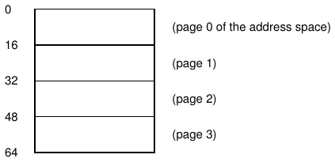
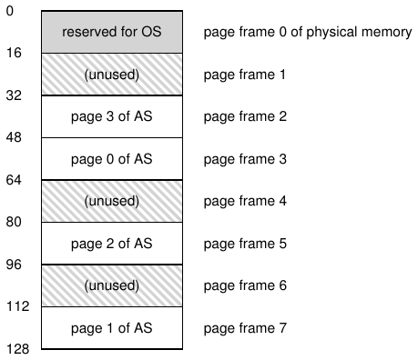
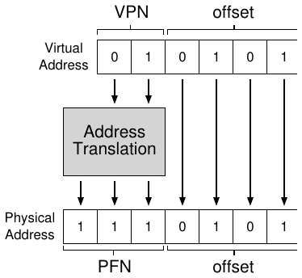
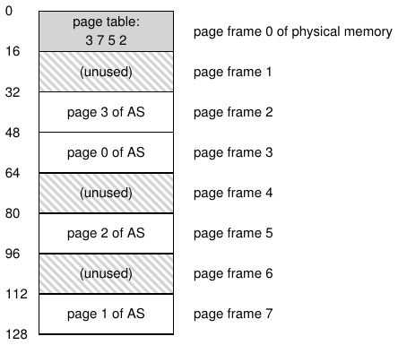
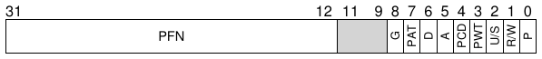
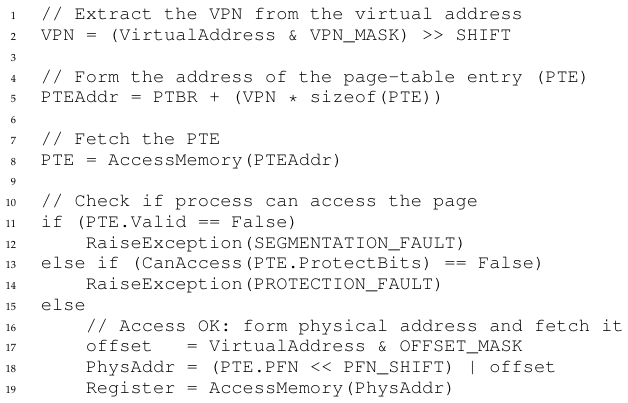
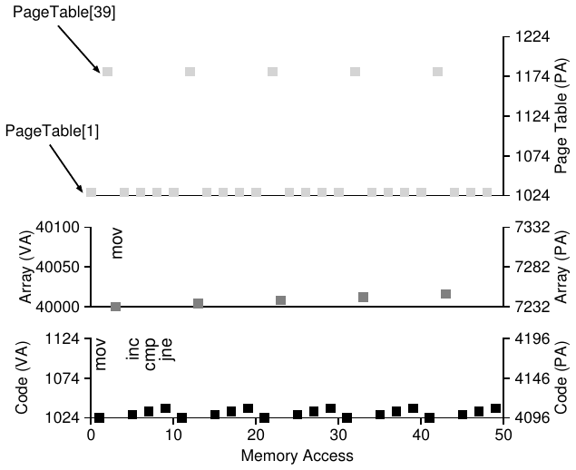

# الفصل 18: مقدمة في الترقيم الصفحي

يُقال أحيانًا إن نظام التشغيل يتبع أحد نهجين عند حل أي مشكلة من مشكلات إدارة المساحة تقريبًا. النهج الأول هو تقطيع الأشياء إلى قطع متغيّرة الحجم، كما رأينا مع التقطيع في الذاكرة الافتراضية. ولسوء الحظ، ينطوي هذا الحل على صعوبات متأصّلة. فحين تُقسَّم مساحة ما إلى كتل مختلفة الأحجام، قد تصبح المساحة نفسها مجزّأة، وبالتالي يصير التخصيص أكثر صعوبة بمرور الوقت.

لذا قد يكون من المفيد النظر في النهج الثاني: تقطيع المساحة إلى قطع ثابتة الحجم. وفي الذاكرة الافتراضية نسمّي هذه الفكرة الترقيم الصفحي، وهي راجعة إلى نظام مبكّر ومهم هو أطلس [KE+62, L78]. فبدلًا من تقسيم فضاء عناوين العملية إلى عدد من المقاطع المنطقية متغيّرة الحجم (مثل الشيفرة والكومة والمكدّس)، نقسّمه إلى وحدات ثابتة الحجم نسمّي كلًّا منها صفحة. وبالمقابل، ننظر إلى الذاكرة المادية بوصفها مصفوفة من الخانات ثابتة الحجم تُسمّى أطر الصفحات؛ ويستطيع كل إطار من هذه الأطر أن يحتوي صفحة واحدة من الذاكرة الافتراضية. والتحدي الذي يواجهنا هو:

> **جوهر المسألة: كيف نُحاكي الذاكرة افتراضيًا باستخدام الصفحات**
>
> كيف نستطيع أن نُحاكي الذاكرة افتراضيًا بالصفحات، بحيث نتجنّب مشكلات التقطيع؟ وما التقنيات الأساسية؟ وكيف نجعل تلك التقنيات تعمل بشكل جيد، بأدنى قدر من الكلفة الزائدة في المساحة والزمن؟

## 18.1 مثال بسيط ونظرة عامة

لنجعل هذا النهج أوضح، نعرضه بمثال بسيط. يعرض الشكل 18.1 (الصفحة 2) مثالًا لفضاء عناوين صغير جدًا، لا يتجاوز حجمه الكلي 64 بايت، وفيه أربع صفحات بحجم 16 بايت (الصفحات الافتراضية 0 و1 و2 و3). وفضاءات العناوين الحقيقية أكبر بكثير بالطبع، وهي غالبًا 32 بت وبالتالي 4 غيغابايت من فضاء العناوين، أو حتى 64 بت[^1]؛ وسنستخدم في الكتاب أمثلة صغيرة كثيرًا لتسهيل استيعابها.



**الشكل 18.1:** فضاء عناوين بسيط حجمه 64 بايت

تتكوّن الذاكرة المادية، كما يظهر في الشكل 18.2، هي الأخرى من عدد من الخانات ثابتة الحجم، وفي هذه الحالة ثمانية أطر صفحات (مما يعطي ذاكرة مادية بحجم 128 بايت، وهي أيضًا صغيرة إلى حدّ سخيف). وكما ترى في الرسم، فقد وُضعت صفحات فضاء العناوين الافتراضي في مواضع مختلفة عبر الذاكرة المادية؛ ويُظهر الرسم أيضًا أن نظام التشغيل يستخدم جزءًا من الذاكرة المادية لنفسه.



**الشكل 18.2:** فضاء عناوين بحجم 64 بايت في ذاكرة مادية بحجم 128 بايت

للترقيم الصفحي، كما سنرى، عدد من المزايا على مقارباتنا السابقة. ولعلّ أهم تحسين هو المرونة: فمع نهج ترقيم صفحي مكتمل النضج، سيستطيع النظام دعم تجريد فضاء العناوين بفعالية، بصرف النظر عن كيفية استخدام العملية لفضاء العناوين؛ فلن نفترض مثلًا شيئًا عن اتجاه نمو الكومة والمكدّس وعن كيفية استخدامهما.

وميزة أخرى هي بساطة إدارة المساحة الحرة التي يتيحها الترقيم الصفحي. فمثلًا، حين يرغب نظام التشغيل في وضع فضاء العناوين الصغير ذي الـ64 بايت لدينا في ذاكرتنا المادية ذات الأطر الثمانية، فإنه يجد ببساطة أربع صفحات حرة؛ وربما يحتفظ نظام التشغيل بقائمة حرة لكل الصفحات الحرة لهذا الغرض، فيلتقط منها أول أربع صفحات حرة. وفي المثال، وضع نظام التشغيل الصفحة الافتراضية 0 من فضاء العناوين (AS) في الإطار المادي 3، والصفحة الافتراضية 1 من فضاء العناوين في الإطار المادي 7، والصفحة 2 في الإطار 5، والصفحة 3 في الإطار 2. أما أطر الصفحات 1 و4 و6 فهي حرة حاليًا.

ولتسجيل موضع كل صفحة افتراضية من فضاء العناوين في الذاكرة المادية، يحتفظ نظام التشغيل عادةً ببنية بيانات خاصة بكل عملية تُعرف بجدول الصفحات. والدور الرئيسي لجدول الصفحات هو تخزين ترجمات العناوين لكل صفحة افتراضية من فضاء العناوين، وبذلك يعرّفنا على الموضع الذي تقيم فيه كل صفحة في الذاكرة المادية. وفي مثالنا البسيط (الشكل 18.2، الصفحة 2)، سيكون في جدول الصفحات إذن المدخلات الأربعة التالية: (الصفحة الافتراضية 0 ← الإطار المادي 3)، و(الصفحة الافتراضية 1 ← الإطار المادي 7)، و(الصفحة الافتراضية 2 ← الإطار المادي 5)، و(الصفحة الافتراضية 3 ← الإطار المادي 2).

من المهم أن نتذكّر أن جدول الصفحات هذا بنية بيانات خاصة بكل عملية (ومعظم بنى جداول الصفحات التي نناقشها بنى خاصة بكل عملية؛ ومن الاستثناءات التي سنتطرّق إليها جدول الصفحات المعكوس). فلو كان ثمة عملية أخرى تعمل في مثالنا أعلاه، لكان على نظام التشغيل أن يدير لها جدول صفحات مختلفًا، إذ من الواضح أن صفحاتها الافتراضية تُقابل صفحات مادية مختلفة (باستثناء أي مشاركة جارية).

الآن، صرنا نعرف ما يكفي لتنفيذ مثال على ترجمة العناوين. لنتخيّل أن العملية ذات فضاء العناوين الصغير (64 بايت) تنفّذ وصولًا إلى الذاكرة:

```
movl <virtual address>, %eax
```

وبالتحديد، لنُعطِ انتباهنا للتحميل الصريح للبيانات من العنوان <virtual address> إلى السجل eax (وبذلك نتجاهل جلب التعليمة الذي لا بد أنه حدث قبل ذلك).

ولكي نترجم هذا العنوان الافتراضي الذي ولّدته العملية، علينا أولًا أن نقسّمه إلى مكوّنين: رقم الصفحة الافتراضية (VPN)، والإزاحة داخل الصفحة. وفي هذا المثال، لأن فضاء العناوين الافتراضي للعملية يبلغ 64 بايت، نحتاج إلى 6 بتات إجمالًا لعنواننا الافتراضي (2 أس 6 = 64). وعليه يمكن تصوّر عنواننا الافتراضي كما يلي:

```
Va5 Va4 Va3 Va2 Va1 Va0
```

في هذا الرسم، Va5 هو أعلى بت في العنوان الافتراضي، وVa0 هو أدنى بت. ولأننا نعرف حجم الصفحة (16 بايت)، يمكننا أن نقسّم العنوان الافتراضي أكثر كما يلي:

```
VPN            offset
Va5 Va4 Va3 Va2 Va1 Va0
```

حجم الصفحة 16 بايت في فضاء عناوين بحجم 64 بايت؛ لذا نحتاج إلى القدرة على اختيار 4 صفحات، والبتان العلييان من العنوان يفعلان ذلك بالضبط. إذن لدينا رقم صفحة افتراضية (VPN) من بتين. أما البتات المتبقية فتخبرنا بالبايت الذي يهمّنا داخل الصفحة، وهي أربعة بتات في هذه الحالة؛ ونسمّي ذلك الإزاحة.

حين تولّد عملية ما عنوانًا افتراضيًا، يجب أن يتعاون نظام التشغيل والعتاد لترجمته إلى عنوان مادي ذي معنى. فلنفترض مثلًا أن التحميل أعلاه كان إلى العنوان الافتراضي 21:

```
movl 21, %eax
```

وبتحويل «21» إلى صيغتها الثنائية نحصل على «010101»، وبذلك نستطيع فحص هذا العنوان الافتراضي ومعرفة كيف ينقسم إلى رقم صفحة افتراضية (VPN) وإزاحة:

```
VPN            offset
0   1   0   1   0   1
```

إذن العنوان الافتراضي «21» يقع على البايت الخامس (البايت «0101») من الصفحة الافتراضية «01» (أو 1). وبفضل رقم صفحتنا الافتراضية، نستطيع الآن أن نفهرس جدول صفحاتنا ونجد الإطار المادي الذي تقيم فيه الصفحة الافتراضية 1. وفي جدول الصفحات أعلاه، رقم الإطار المادي (PFN) (ويُسمّى أحيانًا رقم الصفحة المادية أو PPN) هو 7 (وهو 111 بالنظام الثنائي). وهكذا نستطيع ترجمة هذا العنوان الافتراضي باستبدال رقم الصفحة الافتراضية برقم الإطار المادي، ثم إصدار التحميل إلى الذاكرة المادية (الشكل 18.3).



**الشكل 18.3:** عملية ترجمة العنوان

لاحظ أن الإزاحة تبقى كما هي (أي أنها لا تُترجم)، لأن الإزاحة تخبرنا فقط بالبايت الذي نريده داخل الصفحة. وعنواننا المادي النهائي هو 1110101 (117 بالنظام العشري)، وهو بالضبط الموضع الذي نريد أن يجلب منه التحميل بياناته (الشكل 18.2، الصفحة 2).

وبعد هذه النظرة العامة الأساسية، يمكننا الآن أن نطرح (ونأمل أن نجيب) بعض الأسئلة الأساسية التي قد تخطر لك بشأن الترقيم الصفحي. فمثلًا: أين تُخزَّن جداول الصفحات هذه؟ وما المحتوى النموذجي لجدول الصفحات، وما حجم هذه الجداول؟ وهل يجعل الترقيم الصفحي النظام (بالغ) البطء؟ عن هذه الأسئلة وغيرها من الأسئلة المستحبة نُجيب، جزئيًا على الأقل، في النص أدناه. تابع القراءة!

## 18.2 أين تُخزَّن جداول الصفحات؟

قد تصير جداول الصفحات كبيرة إلى حدّ مريع، أكبر بكثير من جدول المقاطع الصغير أو زوج القاعدة/الحدود الذي ناقشناه سابقًا. فمثلًا، تخيّل فضاء عناوين نموذجيًا من 32 بت، بصفحات بحجم 4 ك.ب. ينقسم هذا العنوان الافتراضي إلى رقم صفحة افتراضية من 20 بت وإزاحة من 12 بت (تذكّر أن 10 بتات ستكون مطلوبة لحجم صفحة 1 ك.ب، ونضيف بتين فقط للوصول إلى 4 ك.ب).

ورقم صفحة افتراضية من 20 بت يعني وجود 2 أس 20 ترجمة سيكون على نظام التشغيل أن يديرها لكل عملية (وهذا قرابة مليون)؛ وبافتراض أننا نحتاج إلى 4 بايت لكل مدخل في جدول الصفحات (PTE) لحمل الترجمة المادية وأي مواد أخرى نافعة، فإننا نحصل على 4 ميغابايت هائلة من الذاكرة المطلوبة لكل جدول صفحات! وهذا كبير جدًا. تخيّل الآن وجود 100 عملية تعمل: أي أن نظام التشغيل سيحتاج إلى 400 ميغابايت من الذاكرة لمجرد تلك الترجمات كلها! وحتى في العصر الحديث، حيث تملك الآلات غيغابايتات من الذاكرة، يبدو من الجنون قليلًا أن تُستخدم منها قطعة كبيرة لمجرد الترجمات، أليس كذلك؟ ولن نفكّر حتى في حجم جدول كهذا لفضاء عناوين من 64 بت؛ فذلك سيكون بشعًا للغاية وربما ينفّرك منه تمامًا.

> **استطراد: بنية بيانات — جدول الصفحات**
>
> من أهم بنى البيانات في النظام الفرعي لإدارة الذاكرة في أي نظام تشغيل حديث جدول الصفحات. وبوجه عام، يخزّن جدول الصفحات ترجمات العناوين من الافتراضي إلى المادي، وبذلك يعرّف النظام بالموضع الذي تقيم فيه كل صفحة من فضاء العناوين فعلًا في الذاكرة المادية. ولأن كل فضاء عناوين يتطلّب ترجمات كهذه، يوجد بوجه عام جدول صفحات واحد لكل عملية في النظام. أما البنية الدقيقة لجدول الصفحات فتحدّدها إما العتاد (الأنظمة الأقدم) وإما نظام التشغيل بقدر أكبر من المرونة (الأنظمة الحديثة).

ولأن جداول الصفحات بهذا الكبر، فإننا لا نحتفظ بأي عتاد خاص على الشريحة في وحدة إدارة الذاكرة لتخزين جدول صفحات العملية الجارية حاليًا. بل نخزّن جدول صفحات كل عملية في مكان ما من الذاكرة. ولنفترض الآن أن جداول الصفحات تقيم في ذاكرة مادية يديرها نظام التشغيل؛ وسنرى لاحقًا أن قدرًا كبيرًا من ذاكرة نظام التشغيل نفسه يمكن أن يُحاكى افتراضيًا، وبالتالي يمكن تخزين جداول الصفحات في ذاكرة نظام التشغيل الافتراضية (وحتى تبديلها إلى القرص)، لكن ذلك مربك أكثر من اللازم الآن، لذا سنتجاهله. وفي الشكل 18.4 (الصفحة 5) صورة لجدول صفحات في ذاكرة نظام التشغيل؛ أترى مجموعة الترجمات الصغيرة هناك؟



**الشكل 18.4:** مثال: جدول الصفحات في الذاكرة المادية للنواة

## 18.3 ماذا يوجد فعليًا في جدول الصفحات؟

لنتحدّث قليلًا عن تنظيم جدول الصفحات. إن جدول الصفحات مجرد بنية بيانات تُستخدم لتقابل العناوين الافتراضية (أو بالأحرى أرقام الصفحات الافتراضية) بالعناوين المادية (أرقام الأطر المادية). وعليه، فأي بنية بيانات قد تفي بالغرض. وأبسط صورة تُسمّى جدول الصفحات الخطي، وهو مجرد مصفوفة. يفهرس نظام التشغيل المصفوفة برقم الصفحة الافتراضية (VPN)، ويبحث عن مدخل جدول الصفحات (PTE) عند ذلك الفهرس لكي يجد رقم الإطار المادي (PFN) المطلوب. وسنفترض الآن هذه البنية الخطية البسيطة؛ وفي فصول لاحقة سنستخدم بنى بيانات أكثر تقدّمًا للمساعدة في حل بعض مشكلات الترقيم الصفحي.

أما بالنسبة لمحتوى كل مدخل من مدخلات جدول الصفحات، فلدينا فيه عدد من البتات المختلفة التي تستحق الفهم إلى حدّ ما. ومن الشائع وجود بت صلاحية يشير إلى ما إذا كانت الترجمة بعينها صالحة؛ فمثلًا، حين يبدأ برنامج في العمل، سيكون لديه شيفرة وكومة عند أحد طرفي فضاء عناوينه، والمكدّس عند الطرف الآخر. وستُعلَّم كل المساحة غير المستخدمة بينهما على أنها غير صالحة، فإن حاولت العملية الوصول إلى ذاكرة كهذه، ولّدت فخًا إلى نظام التشغيل، الذي سيُنهي العملية على الأرجح. إذن فبت الصلاحية جوهري لدعم فضاء عناوين متناثر؛ فبمجرد تعليم كل الصفحات غير المستخدمة في فضاء العناوين على أنها غير صالحة، نُزيل الحاجة إلى تخصيص أطر مادية لتلك الصفحات، وبذلك نوفّر قدرًا كبيرًا من الذاكرة.

وقد تكون لدينا أيضًا بتات حماية، تشير إلى ما إذا كان يمكن القراءة من الصفحة أو الكتابة إليها أو التنفيذ منها. وهنا أيضًا، فإن الوصول إلى صفحة بطريقة لا تسمح بها هذه البتات سيولّد فخًا إلى نظام التشغيل.



**الشكل 18.5:** مدخل جدول صفحات في معمارية x86 (PTE)

وثمة بتان آخران مهمّان لكننا لن نتحدّث عنهما كثيرًا الآن. فبت الحضور يشير إلى ما إذا كانت هذه الصفحة في الذاكرة المادية أو على القرص (أي أنها أُخرجت من الذاكرة بالتبديل). وسنفهم هذه الآلية أكثر حين ندرس كيفية تبديل أجزاء من فضاء العناوين إلى القرص لدعم فضاءات عناوين أكبر من الذاكرة المادية؛ فالتبديل يتيح لنظام التشغيل تحرير ذاكرة مادية بنقل الصفحات النادرة الاستخدام إلى القرص. وبت الاتّساخ شائع أيضًا، ويشير إلى ما إذا كانت الصفحة قد عُدّلت منذ إحضارها إلى الذاكرة.

ويُستخدم بت المرجع (ويُعرف أيضًا ببت الوصول) أحيانًا لتتبّع ما إذا كانت الصفحة قد جرى الوصول إليها، وهو نافع في تحديد الصفحات الشائعة التي ينبغي بالتالي الاحتفاظ بها في الذاكرة؛ وهذه المعرفة حرجة أثناء استبدال الصفحات، وهو موضوع سندرسه بتفصيل كبير في الفصول التالية.

يعرض الشكل 18.5 مثالًا على مدخل جدول صفحات من معمارية x86 [I09]. وهو يحتوي على بت حضور (P)؛ وبت قراءة/كتابة (R/W) يحدّد ما إذا كانت الكتابة إلى هذه الصفحة مسموحة؛ وبت مستخدم/مشرف (U/S) يحدّد ما إذا كانت عمليات وضع المستخدم تستطيع الوصول إلى الصفحة؛ وبضعة بتات (PWT وPCD وPAT وG) تحدّد كيفية عمل التخزين المؤقت العتادي لهذه الصفحات؛ وبت وصول (A) وبت اتّساخ (D)؛ وأخيرًا رقم الإطار المادي (PFN) نفسه.

اقرأ أدلة معمارية إنتل [I09] لمزيد من التفاصيل عن دعم الترقيم الصفحي في x86. لكن كن على حذر؛ فقراءة أدلة كهذه، مع أنها مفيدة للغاية (وضروية بالتأكيد لمن يكتبون شيفرة تستخدم جداول صفحات كهذه في نظام التشغيل)، قد تكون صعبة في البداية. الأمر يتطلّب قليلًا من الصبر وكثيرًا من الرغبة.

> **استطراد: لماذا لا يوجد بت صلاحية؟**
>
> قد تلاحظ أنه في مثال إنتل لا يوجد بتا صلاحية وحضور منفصلان، بل بت حضور واحد فقط (P). فإن كان ذلك البت مضبوطًا (P=1)، فمعناه أن الصفحة حاضرة وصالحة في آن واحد. وإن لم يكن (P=0)، فمعناه أن الصفحة قد لا تكون حاضرة في الذاكرة (لكنها صالحة)، أو قد لا تكون صالحة. والوصول إلى صفحة فيها P=0 سيؤدي إلى فخ إلى نظام التشغيل؛ وعلى نظام التشغيل حينها أن يستخدم بنى إضافية يحتفظ بها ليحدّد ما إذا كانت الصفحة صالحة (وينبغي بالتالي أن تُبدَّل إلى الداخل) أم لا (وبذلك يكون البرنامج يحاول الوصول إلى ذاكرة بصورة غير قانونية). وهذا النوع من التروّي شائع في العتاد، الذي غالبًا ما يوفّر الحد الأدنى من الميزات التي يستطيع نظام التشغيل أن يبني عليها خدمة كاملة.

## 18.4 الترقيم الصفحي: بطيء أيضًا

بوجود جداول الصفحات في الذاكرة، نعلم مسبقًا أنها قد تكون كبيرة أكثر من اللازم. وكما تبيّن، يمكنها أن تُبطئ الأشياء أيضًا. فمثلًا، خذ تعليمتنا البسيطة:

```
movl 21, %eax
```

ومرة أخرى، لنفحص فقط الإشارة الصريحة إلى العنوان 21 ولا نقلق بشأن جلب التعليمة. وفي هذا المثال، سنفترض أن العتاد ينفّذ الترجمة نيابة عنا. ولجلب البيانات المطلوبة، على النظام أولًا أن يترجم العنوان الافتراضي (21) إلى العنوان المادي الصحيح (117). لذا، قبل جلب البيانات من العنوان 117، على النظام أولًا أن يجلب مدخل جدول الصفحات المناسب من جدول صفحات العملية، وينفّذ الترجمة، ثم يحمّل البيانات من الذاكرة المادية.

وللقيام بذلك، على العتاد أن يعرف أين جدول الصفحات الخاص بالعملية الجارية حاليًا. ولنفترض الآن أن سجلًا واحدًا لقاعدة جدول الصفحات يحتوي على العنوان المادي لموضع البداية في جدول الصفحات. ولإيجاد موضع مدخل جدول الصفحات المطلوب، سيؤدي العتاد عندها الوظائف التالية:

```
VPN     = (VirtualAddress & VPN_MASK) >> SHIFT
PTEAddr = PageTableBaseRegister + (VPN * sizeof(PTE))
```

في مثالنا، سيُضبط VPN_MASK على 0x30 (أي 30 بالنظام السادس عشري، أو 110000 بالنظام الثنائي)، وهو يلتقط بتات رقم الصفحة الافتراضية من العنوان الافتراضي الكامل؛ أما SHIFT فيُضبط على 4 (عدد بتات الإزاحة)، بحيث نُنزل بتات رقم الصفحة الافتراضية لتشكّل رقم الصفحة الافتراضية الصحيح كعدد صحيح. فمثلًا، مع العنوان الافتراضي 21 (010101)، تحوّل المقابلة بالبتات هذه القيمة إلى 010000؛ ويحوّلها الإزاحة إلى 01، أي الصفحة الافتراضية 1، كما نريد. ثم نستخدم هذه القيمة فهرسًا في مصفوفة مدخلات جدول الصفحات التي يشير إليها سجل قاعدة جدول الصفحات.

وبمجرد معرفة هذا العنوان المادي، يستطيع العتاد أن يجلب مدخل جدول الصفحات من الذاكرة، ويستخرج رقم الإطار المادي، ويلحقه بإزاحة العنوان الافتراضي لتشكيل العنوان المادي المطلوب. وبالتحديد، يمكنك أن تتخيّل رقم الإطار المادي وقد أُزيح يسارًا بمقدار SHIFT، ثم أُجريت عليه عملية «أو» البتية مع الإزاحة لتشكيل العنوان النهائي كما يلي:

```
offset   = VirtualAddress & OFFSET_MASK
PhysAddr = (PFN << SHIFT) | offset
```

وأخيرًا، يستطيع العتاد أن يجلب البيانات المطلوبة من الذاكرة ويضعها في السجل eax. وهكذا نجح البرنامج في تحميل قيمة من الذاكرة!

وخلاصة لما سبق، نصف الآن البروتوكول الأولي لما يحدث عند كل إشارة إلى الذاكرة. يعرض الشكل 18.6 (الصفحة 9) هذا النهج. فعند كل إشارة إلى الذاكرة (سواء أكانت جلب تعليمة أم تحميلًا أو تخزينًا صريحًا)، يتطلّب الترقيم الصفحي منا إجراء إشارة إضافية واحدة إلى الذاكرة كي نجلب الترجمة أولًا من جدول الصفحات. وهذا قدر كبير من العمل! فالإشارات الإضافية إلى الذاكرة مكلفة، وهي في هذه الحالة ستبطئ العملية على الأرجح بمعامل اثنين أو أكثر.



**الشكل 18.6:** الوصول إلى الذاكرة مع الترقيم الصفحي

والآن يمكنك، كما نأمل، أن ترى أن ثمة مشكلتين حقيقيتين علينا حلّهما. فبدون تصميم دقيق للعتاد والبرمجيات معًا، ستجعل جداول الصفحات النظام يعمل ببطء أكثر من اللازم، وستشغل ذاكرة أكثر من اللازم أيضًا. ومع أنها تبدو حلًا عظيمًا لاحتياجاتنا في المحاكاة الافتراضية للذاكرة، فلا بد أولًا من التغلّب على هاتين المشكلتين الجوهريتين.

## 18.5 تتبّع الذاكرة

قبل أن نختم، نتتبّع الآن مثالًا بسيطًا للوصول إلى الذاكرة لنبيّن كل عمليات الوصول الناتجة التي تحدث عند استخدام الترقيم الصفحي. مقطع الشيفرة (بلغة C، في ملف يُسمّى array.c) الذي يهمّنا هو التالي:

```
int array[1000];
...
for (i = 0; i < 1000; i++)
    array[i] = 0;
```

ونُصرِّف array.c ونشغّله بالأوامر التالية:

```
prompt> gcc -o array array.c -Wall -O
prompt> ./array
```

بالطبع، لكي نفهم حقًا أي عمليات وصول إلى الذاكرة سيجريها مقطع الشيفرة هذا (الذي يهيّئ مصفوفة فحسب)، سيكون علينا أن نعرف (أو نفترض) أمورًا أخرى قليلة. أولًا، سيكون علينا أن نفكّك الملف التنفيذي الناتج (باستخدام objdump على لينكس، أو otool على ماك) لنرى أي تعليمات التجميع تُستخدم لتهيئة المصفوفة في حلقة. وهذه هي شيفرة التجميع الناتجة:

```
1024 movl $0x0,(%edi,%eax,4)
1028 incl %eax
1032 cmpl $0x03e8,%eax
1036 jne 1024
```

هذه الشيفرة، إن كنت تعرف قليلًا من x86، سهلة الفهم في الواقع[^2]. فالتعليمة الأولى تنقل القيمة صفر (المكتوبة $0x0) إلى العنوان الافتراضي لموضع المصفوفة؛ ويُحسب هذا العنوان بأخذ محتوى %edi وإضافة %eax مضروبًا في أربعة إليه. إذن يحمل %edi عنوان قاعدة المصفوفة، بينما يحمل %eax فهرس المصفوفة (i)؛ ونضرب في أربعة لأن المصفوفة مصفوفة أعداد صحيحة، حجم كل منها أربعة بايت.

وتزيد التعليمة الثانية فهرس المصفوفة المحفوظ في %eax، وتقارن التعليمة الثالثة محتوى ذلك السجل بالقيمة السادسة عشرة 0x03e8، أي 1000 بالنظام العشري. وإن أظهرت المقارنة أن القيمتين غير متساويتين بعد (وهو ما تختبره التعليمة jne)، تقفز التعليمة الرابعة عائدة إلى أعلى الحلقة.

ولفهم أي عمليات وصول إلى الذاكرة يجريها هذا التسلسل من التعليمات (على المستويين الافتراضي والمادي)، سيكون علينا أن نفترض شيئًا عن موضع مقطع الشيفرة والمصفوفة في الذاكرة الافتراضية، وكذلك عن محتوى جدول الصفحات وموضعه.

في هذا المثال، نفترض فضاء عناوين افتراضيًا بحجم 64 ك.ب (صغير إلى حدّ غير واقعي). ونفترض أيضًا حجم صفحة قدره 1 ك.ب.

وكل ما نحتاج إلى معرفته الآن هو محتوى جدول الصفحات وموضعه في الذاكرة المادية. لنفترض أن لدينا جدول صفحات خطيًا (قائمًا على مصفوفة) وأنه يقع عند العنوان المادي 1 ك.ب (1024).

أما محتواه، فليس ثمة سوى بضع صفحات افتراضية يهمّنا أن تكون مقابلة في هذا المثال. أولًا، ثمة الصفحة الافتراضية التي تقيم عليها الشيفرة. ولأن حجم الصفحة 1 ك.ب، فإن العنوان الافتراضي 1024 يقيم على الصفحة الثانية من فضاء العناوين الافتراضي (VPN=1، لأن VPN=0 هي الصفحة الأولى). لنفترض أن هذه الصفحة الافتراضية تُقابل الإطار المادي 4 (الصفحة الافتراضية 1 ← الإطار المادي 4).

ثم ثمة المصفوفة نفسها. حجمها 4000 بايت (1000 عدد صحيح)، ونفترض أنها تقيم عند العناوين الافتراضية من 40000 إلى 44000 (لا يشمل البايت الأخير). والصفحات الافتراضية لهذا المدى العشري هي من VPN=39 إلى VPN=42. لذا نحتاج إلى مقابلات لهذه الصفحات. لنفترض هذه المقابلات من الافتراضي إلى المادي في المثال: (الصفحة الافتراضية 39 ← الإطار المادي 7)، و(الصفحة الافتراضية 40 ← الإطار المادي 8)، و(الصفحة الافتراضية 41 ← الإطار المادي 9)، و(الصفحة الافتراضية 42 ← الإطار المادي 10).

نحن الآن جاهزون لتتبّع إشارات البرنامج إلى الذاكرة. فحين يعمل، ستولّد كل عملية جلب تعليمة إشارتين إلى الذاكرة: واحدة إلى جدول الصفحات لإيجاد الإطار المادي الذي تقيم فيه التعليمة، وأخرى إلى التعليمة نفسها لجلبها إلى المعالج لمعالجتها. وإضافة إلى ذلك، ثمة إشارة صريحة واحدة إلى الذاكرة على شكل التعليمة mov؛ وهذه تضيف أولًا وصولًا آخر إلى جدول الصفحات (لترجمة العنوان الافتراضي للمصفوفة إلى العنوان المادي الصحيح)، ثم الوصول إلى المصفوفة نفسها.

تُصوّر العملية بأكملها، بتكرارات الحلقة الخمسة الأولى، في الشكل 18.7 (الصفحة 11). يُظهر الرسم السفلي إشارات الذاكرة الخاصة بالتعليمات على المحور الصادي باللون الأسود (مع العناوين الافتراضية على اليسار، والعناوين المادية الفعلية على اليمين)؛ ويُظهر الرسم الأوسط عمليات الوصول إلى المصفوفة بلون رمادي داكن (مرة أخرى، الافتراضي على اليسار والمادي على اليمين)؛ وأخيرًا، يُظهر الرسم الأعلى عمليات الوصول إلى ذاكرة جدول الصفحات بلون رمادي فاتح (مادية فحسب، لأن جدول الصفحات في هذا المثال يقيم في الذاكرة المادية). ويُظهر المحور السيني، للتتبّع بأكمله، عمليات الوصول إلى الذاكرة عبر تكرارات الحلقة الخمسة الأولى؛ وهناك 10 عمليات وصول إلى الذاكرة في كل تكرار، تشمل أربع عمليات جلب تعليمات، وتحديثًا صريحًا واحدًا للذاكرة، وخمس عمليات وصول إلى جدول الصفحات لترجمة تلك الجلبات الأربع والتحديث الصريح الواحد.



**الشكل 18.7:** تتبّع للذاكرة الافتراضية (والمادية)

انظر إن كنت تستطيع أن تفهم الأنماط التي تظهر في هذا التصوير. وبالتحديد، ما الذي سيتغيّر مع استمرار الحلقة في العمل بعد هذه التكرارات الخمسة الأولى؟ وأي مواضع الذاكرة الجديدة ستُزار؟ أتستطيع أن تكتشف ذلك؟

كان هذا أبسط الأمثلة فقط (بضعة أسطر من شيفرة C)، ومع ذلك قد تكون الآن قادرًا على استشعار تعقيد فهم السلوك الفعلي لذاكرة التطبيقات الحقيقية. لا تقلق: فالأمر يصير أسوأ بالتأكيد، لأن الآليات التي نعتزم تقديمها لا تزيد هذه الماكينة المعقّدة إلا تعقيدًا. آسفون[^3]!

## 18.6 الخلاصة

قدّمنا مفهوم الترقيم الصفحي حلًّا لتحدّينا في المحاكاة الافتراضية للذاكرة. وللترقيم الصفحي مزايا كثيرة على المقاربات السابقة (مثل التقطيع). فأولًا، لا يؤدي إلى تجزئة خارجية، لأن الترقيم الصفحي (بحكم التصميم) يقسّم الذاكرة إلى وحدات ثابتة الحجم. وثانيًا، هو مرن تمامًا، إذ يمكّن من الاستخدام المتناثر لفضاءات العناوين الافتراضية.

غير أن تنفيذ دعم الترقيم الصفحي دون عناية سيؤدي إلى آلة أبطأ (بكثير من عمليات الوصول الإضافية إلى الذاكرة للوصول إلى جدول الصفحات) وإلى هدر في الذاكرة (إذ تمتلئ الذاكرة بجداول الصفحات بدل بيانات التطبيق النافعة). سيكون علينا إذن أن نفكّر قليلًا أكثر لنصل إلى نظام ترقيم صفحي لا يعمل فحسب، بل يعمل بشكل جيد. ولحسن الحظ، سيرينا الفصلان التاليان كيف نفعل ذلك.

## المراجع

> [KE+62] «One-level Storage System» لـT. Kilburn وD.B.G. Edwards وM.J. Lanigan وF.H. Sumner. IRE Trans. EC-11، العدد 2، 1962. أُعيد نشره في Bell وNewell، «Computer Structures: Readings and Examples». McGraw-Hill، نيويورك، 1971. كان نظام أطلس رائدًا في فكرة تقسيم الذاكرة إلى صفحات ثابتة الحجم، وكان بصورة من الصور شكلًا مبكّرًا من أفكار إدارة الذاكرة التي نراها في أنظمة الحاسوب الحديثة.

> [I09] «Intel 64 and IA-32 Architectures Software Developer's Manuals» إنتل، 2009. متاح على: http://www.intel.com/products/processor/manuals. واعتنِ بوجه خاص بـ«Volume 3A: System Programming Guide Part 1» و«Volume 3B: System Programming Guide Part 2».

> [L78] «The Manchester Mark I and Atlas: A Historical Perspective» لـS. H. Lavington. Communications of the ACM، المجلد 21:1، يناير 1978. هذه الورقة استعراض رائع لبعض تاريخ تطوير بعض أنظمة الحاسوب المهمة. وكما ننسى أحيانًا في الولايات المتحدة، فقد جاءت كثير من هذه الأفكار الجديدة من ما وراء البحار.

## الواجب (محاكاة)

في هذا الواجب ستستخدم برنامجًا بسيطًا يُعرف باسم paging-linear-translate.py، لترى إن كنت تفهم كيف تعمل ترجمة العناوين البسيطة من الافتراضي إلى المادي مع جداول الصفحات الخطية. انظر ملف README للتفاصيل.

## الأسئلة

1. قبل إجراء أي ترجمة، لنستخدم المحاكي لدراسة كيف يتغيّر حجم جداول الصفحات الخطية بتبدّل مختلف المعاملات. احسب حجم جداول الصفحات الخطية مع تغيّر المعاملات. وفيما يلي بعض المدخلات المقترحة؛ وباستخدام العلم `-v` تستطيع أن ترى كم مدخلًا من مدخلات جدول الصفحات قد امتلأ. أولًا، لفهم كيف يتغيّر حجم جدول الصفحات الخطي مع نمو فضاء العناوين، شغّل بالأعلام التالية:

```
-P 1k -a 1m -p 512m -v -n 0
-P 1k -a 2m -p 512m -v -n 0
-P 1k -a 4m -p 512m -v -n 0
```

2. ثم لنفهم كيف يتغيّر حجم جدول الصفحات الخطي مع نمو حجم الصفحة. قبل تشغيل أي من هذه، حاول التفكير في الاتجاهات المتوقّعة. كيف ينبغي أن يتغيّر حجم جدول الصفحات مع نمو فضاء العناوين؟ ومع نمو حجم الصفحة؟ ولماذا لا نستخدم صفحات كبيرة عمومًا؟

```
-P 1k -a 1m -p 512m -v -n 0
-P 2k -a 1m -p 512m -v -n 0
-P 4k -a 1m -p 512m -v -n 0
```

3. لنُجرِ الآن بعض الترجمات. ابدأ بأمثلة صغيرة، وغيّر عدد الصفحات المخصَّصة لفضاء العناوين بالعلم `-u`. ماذا يحدث مع زيادة النسبة المئوية للصفحات المخصَّصة في كل فضاء عناوين؟

```
-P 1k -a 16k -p 32k -v -u 0
-P 1k -a 16k -p 32k -v -u 25
-P 1k -a 16k -p 32k -v -u 50
-P 1k -a 16k -p 32k -v -u 75
-P 1k -a 16k -p 32k -v -u 100
```

4. لنجرّب الآن بعض البذور العشوائية المختلفة، وبعض معاملات فضاء العناوين المختلفة (والجنونية أحيانًا) للتنويع. أي من هذه التوليفات غير واقعي؟ ولماذا؟

```
-P 8   -a 32    -p 1024 -v -s 1
-P 8k  -a 32k   -p 1m   -v -s 2
-P 1m  -a 256m  -p 512m -v -s 3
```

5. استخدم البرنامج لتجربة بعض المسائل الأخرى. أتستطيع أن تجد حدود توقّف البرنامج عن العمل؟ فمثلًا، ماذا يحدث إن كان حجم فضاء العناوين أكبر من الذاكرة المادية؟

[^1]: من الصعب تصوّر فضاء عناوين بحجم 64 بت، فهو هائل إلى حدّ مذهل. وقد يفيد تشبيه: إن تصوّرت فضاء عناوين من 32 بت بحجم ملعب تنس، فإن فضاء عناوين من 64 بت يقارب حجم أوروبا (!).

[^2]: نحن نغش قليلًا هنا، إذ نفترض أن كل تعليمة بحجم أربعة بايت للتبسيط؛ وفي الواقع، تعليمات x86 متغيّرة الحجم.

[^3]: نحن لسنا آسفين حقًا. لكننا آسفون لأننا لسنا آسفين، إن كان لهذا معنى.
