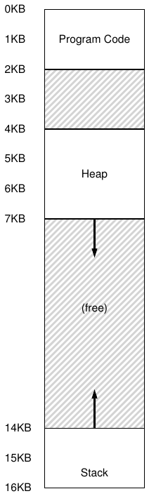
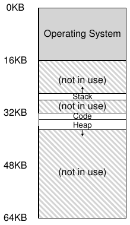
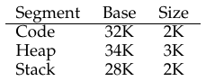
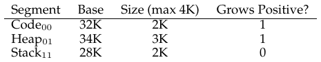
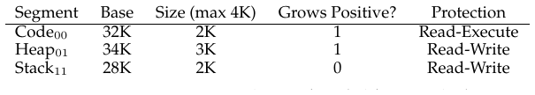
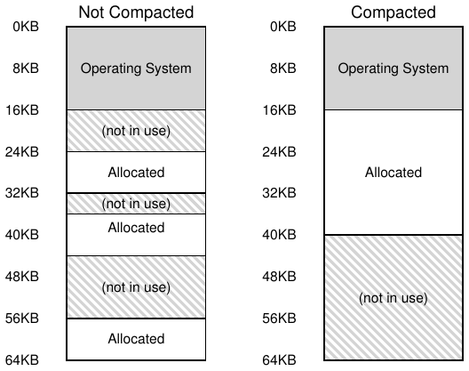

# الفصل 16: التقطيع

حتى الآن كنّا نضع فضاء العناوين كاملًا لكل عملية في الذاكرة. وبسجلي القاعدة والحدود يستطيع نظام التشغيل أن ينقل العمليات بسهولة إلى مواضع مختلفة من الذاكرة المادية. لكنك ربما لاحظت شيئًا مثيرًا في فضاءات العناوين هذه: ثمّة كتلة كبيرة من المساحة «الحرة» في الوسط تمامًا، بين المكدّس والكومة.

وكما تتخيّل من الشكل 16.1، فمع أن المساحة بين المكدّس والكومة ليست مستخدمة من قِبل العملية، فإنها ما تزال تستهلك ذاكرة مادية حين ننقل فضاء العناوين كاملًا إلى موضع ما في الذاكرة المادية؛ ومن ثمّ فالمقاربة البسيطة القائمة على زوج من سجلي القاعدة والحدود لمحاكاة الذاكرة افتراضيًا مقاربة مُهدِرة. وهي أيضًا تجعل تشغيل برنامج أمرًا صعبًا حين لا يتّسع فضاء العناوين كاملًا للذاكرة؛ ومن ثمّ فالقاعدة والحدود ليست بالمرونة التي نريدها. وهكذا:

> **جوهر المسألة: كيف ندعم فضاء عناوين كبيرًا**
>
> كيف ندعم فضاء عناوين كبيرًا فيه (احتمالًا) كثير من المساحة الحرة بين المكدّس والكومة؟ لاحظ أن الهدر في أمثلتنا، بفضاءات العناوين الصغيرة (التخيّلية)، لا يبدو سيئًا للغاية. لكن تخيّل فضاء عناوين بعرض 32 بت (حجمه 4 ج.ب)؛ فالبرنامج النموذجي لا يستخدم إلا ميغابايتات من الذاكرة، لكنه سيظل يطالب بأن يكون فضاء العناوين كله مقيمًا في الذاكرة.

## 16.1 التقطيع: قاعدة/حدود معمّمة

لحلّ هذه المشكلة وُلدت فكرة تُسمّى التقطيع. وهي فكرة قديمة جدًا، تعود على الأقل إلى أوائل ستينيات القرن الماضي [H61, G62]. والفكرة بسيطة: بدل أن يكون لدينا زوج واحد من القاعدة والحدود في وحدة إدارة الذاكرة، لمَ لا يكون لدينا زوج قاعدة وحدود لكل مقطع منطقي من فضاء العناوين؟ والمقطع ليس إلا جزءًا متصلًا من فضاء العناوين بطول معيّن، وفي فضاء عناويننا القياسي لدينا ثلاثة مقاطع مختلفة منطقيًا: الشيفرة، والمكدّس، والكومة. وما يتيحه التقطيع لنظام التشغيل هو وضع كل واحد من تلك المقاطع في موضع مختلف من الذاكرة المادية، ومن ثم تجنّب ملء الذاكرة المادية بفضاء عناوين افتراضي غير مستخدم.



**الشكل 16.1:** فضاء العناوين (مرة أخرى)

لننظر إلى مثال. افترض أننا نريد وضع فضاء العناوين من الشكل 16.1 في الذاكرة المادية. وبزوج قاعدة وحدود لكل مقطع، نستطيع أن نضع كل مقطع مستقلًا في الذاكرة المادية. فانظر مثلًا إلى الشكل 16.2 (الصفحة 3)؛ ترى فيه ذاكرة مادية بحجم 64 ك.ب تضمّ تلك المقاطع الثلاثة (و16 ك.ب محجوزة لنظام التشغيل).



**الشكل 16.2:** وضع المقاطع في الذاكرة المادية

وكما ترى في الرسم، لا تُخصَّص مساحة في الذاكرة المادية إلا للذاكرة المستخدمة، ومن ثم يمكن استيعاب فضاءات عناوين كبيرة فيها كميات ضخمة من العناوين غير المستخدمة (ونسمّيها أحيانًا فضاءات عناوين متناثرة).

والبنية العتادية اللازمة في وحدة إدارة الذاكرة لدعم التقطيع هي بالضبط ما تتوقّعه: في هذه الحالة مجموعة من ثلاثة أزواج من سجلات القاعدة والحدود. ويعرض الشكل 16.3 أدناه قيم السجلات للمثال السابق؛ وكل سجل حدود يحمل حجم مقطع.



**الشكل 16.3:** قيم سجلات المقاطع

ترى من الشكل أن مقطع الشيفرة موضوع عند العنوان المادي 32 ك.ب وحجمه 2 ك.ب، وأن مقطع الكومة موضوع عند 34 ك.ب وحجمه 3 ك.ب. وسجل الحجم هنا هو بالضبط سجل الحدود الذي قدّمناه سابقًا؛ فهو يخبر العتاد بعدد البايتات الصحيحة في هذا المقطع بالضبط (وبذلك يمكّن العتاد من تحديد متى قام البرنامج بوصول غير قانوني خارج تلك الحدود).

لنُجرِ ترجمة كمثال، باستخدام فضاء العناوين في الشكل 16.1. افترض أن إشارة وُجّهت إلى العنوان الافتراضي 100 (وهو في مقطع الشيفرة، كما ترى بصريًا في الشكل 16.1، الصفحة 2). وحين تقع الإشارة (في جلب تعليمة مثلًا)، يضيف العتاد قيمة القاعدة إلى الإزاحة داخل هذا المقطع (100 في هذه الحالة) للوصول إلى العنوان المادي المطلوب: 100 + 32 ك.ب، أو 32868. ثم يتحقق من أن العنوان داخل الحدود (100 أقل من 2 ك.ب)، فيجد أنه كذلك، ويصدر الإشارة إلى العنوان المادي 32868.

> **استطراد: خطأ التقطيع**
>
> ينشأ مصطلح خطأ التقطيع أو انتهاكه من وصول إلى الذاكرة على آلة مقطّعة إلى عنوان غير قانوني. ومن الطريف أن المصطلح بقي، حتى على الآلات التي لا دعم فيها للتقطيع إطلاقًا. أو من غير الطريف، إن لم تستطع أن تعرف لماذا تظل شيفرتك تُخطئ.

لننظر الآن إلى عنوان في الكومة، العنوان الافتراضي 4200 (ارجع مرة أخرى إلى الشكل 16.1). إن أضفنا العنوان الافتراضي 4200 إلى قاعدة الكومة (34 ك.ب) فقط، حصلنا على عنوان مادي هو 39016، وهو ليس العنوان المادي الصحيح. فما نحتاج إلى فعله أولًا هو استخراج الإزاحة داخل الكومة، أي تحديد أي بايت (أو بايتات) في هذا المقطع يشير إليه العنوان. ولأن الكومة تبدأ عند العنوان الافتراضي 4 ك.ب (4096)، فإزاحة 4200 هي في الواقع 4200 ناقص 4096، أي 104. ثم نأخذ هذه الإزاحة (104) ونضيفها إلى العنوان المادي في سجل القاعدة (34 ك.ب) لنحصل على النتيجة المطلوبة: 34920.

وماذا لو حاولنا الإشارة إلى عنوان غير قانوني (أي عنوان افتراضي 7 ك.ب أو أكبر)، وهو خارج نهاية الكومة؟ تستطيع أن تتخيّل ما سيحدث: يكتشف العتاد أن العنوان خارج الحدود، فيفخّ إلى نظام التشغيل، الأمر الذي يؤدي على الأرجح إلى إنهاء العملية المخالفة. والآن تعرف أصل المصطلح الشائع الذي يتعلّم كل مبرمجي لغة سي أن يرهبوه: انتهاك التقطيع أو خطأ التقطيع.

## 16.2 أي مقطع نشير إليه؟

يستخدم العتاد سجلات المقاطع أثناء الترجمة. فكيف يعرف الإزاحة داخل مقطع ما، وإلى أي مقطع يشير عنوان ما؟

ثمّة مقاربة شائعة، تُسمّى أحيانًا المقاربة الصريحة، وهي تجزئة فضاء العناوين إلى مقاطع بناءً على البتات العليا القليلة من العنوان الافتراضي؛ وقد استُخدمت هذه التقنية في نظام VAX/VMS [LL82]. في مثالنا أعلاه لدينا ثلاثة مقاطع؛ ومن ثم نحتاج إلى بتين لإنجاز مهمتنا. وإن استخدمنا البتّين العليين من عنواننا الافتراضي ذي الـ14 بت لاختيار المقطع، صار عنواننا الافتراضي هكذا:

```
13 12 11 10 9   8   7   6   5   4   3   2   1   0

Segment                      Offset
```

في مثالنا إذن، إن كان البتّان العليان 00، عرف العتاد أن العنوان الافتراضي في مقطع الشيفرة، فاستخدم زوج قاعدة وحدود الشيفرة لإعادة توطين العنوان في الموضع المادي الصحيح. وإن كان البتّان العليان 01، عرف العتاد أن العنوان في الكومة، فاستخدم قاعدة الكومة وحدودها. ولنأخذ عنوان الكومة الافتراضي من مثالنا السابق (4200) ونترجمه، تأكيدًا لهذه الفكرة. العنوان الافتراضي 4200، في صورته الثنائية، يُرى هكذا:

```
13 12 11 10 9   8   7   6   5   4   3   2   1   0
0  1  0  0  0   0   0   1   1   0   1   0   0   0

Segment                      Offset
```

وكما ترى من الصورة، يخبر البتّان العليان (01) العتاد بالمقطع الذي نشير إليه. والبتات الاثنتا عشرة السفلى هي الإزاحة داخل المقطع: 0000 0110 1000، أو ست عشري 0x068، أو 104 بالعشري. وهكذا يأخذ العتاد ببساطة أول بتين ليحدّد سجل المقطع الذي يستخدمه، ثم يأخذ البتات الاثنتي عشرة التالية بوصفها الإزاحة داخل المقطع. وبإضافة سجل القاعدة إلى الإزاحة يصل العتاد إلى العنوان المادي النهائي. ولاحظ أن الإزاحة تُيسّر فحص الحدود أيضًا: نستطيع ببساطة أن نتحقق هل الإزاحة أقل من الحدود؛ وإن لم تكن، فالعنوان غير قانوني. ومن ثم، لو كانت القاعدة والحدود مصفوفتين (بمدخل واحد لكل مقطع)، لفعل العتاد شيئًا كالآتي للحصول على العنوان المادي المطلوب:

```
1   // get top 2 bits of 14-bit VA
2   Segment = (VirtualAddress & SEG_MASK) >> SEG_SHIFT
3   // now get offset
4   Offset = VirtualAddress & OFFSET_MASK
5   if (Offset >= Bounds[Segment])
6       RaiseException(PROTECTION_FAULT)
7   else
8       PhysAddr = Base[Segment] + Offset
9       Register = AccessMemory(PhysAddr)
```

في مثالنا الجاري نستطيع أن نملأ قيم الثوابت أعلاه. وتحديدًا، تُضبط SEG_MASK على 0x3000، وSEG_SHIFT على 12، وOFFSET_MASK على 0xFFF.

وربما لاحظت أيضًا أننا، حين نستخدم البتّين العليين وليس لدينا إلا ثلاثة مقاطع (الشيفرة، والكومة، والمكدّس)، نترك مقطعًا واحدًا من فضاء العناوين بلا استخدام. وللاستفادة التامة من فضاء العناوين الافتراضي (وتجنّب مقطع غير مستخدم)، تضع بعض الأنظمة الشيفرة في المقطع نفسه الذي فيه الكومة، ومن ثم تستخدم بتًا واحدًا فقط لاختيار المقطع المستخدم [LL82].

وثمّة مسألة أخرى في استخدام البتات العليا لاختيار المقطع، هي أنه يحدّ من استخدام فضاء العناوين الافتراضي. وتحديدًا، كل مقطع محدود بحجم أقصى، وهو في مثالنا 4 ك.ب (فاستخدام البتّين العليين لاختيار المقاطع يعني تقطيع فضاء العناوين ذي الـ16 ك.ب إلى أربع قطع، أو 4 ك.ب في هذا المثال). وإن أراد برنامج عامل أن ينمّي مقطعًا (الكومة أو المكدّس مثلًا) بما يتجاوز ذلك الحد الأقصى، فليس له حيلة.

وثمّة طرائق أخرى للعتاد ليحدّد في أي مقطع يقع عنوان معيّن. ففي المقاربة الضمنية يحدّد العتاد المقطع بملاحظة كيفية تكوّن العنوان. فإن كان العنوان، على سبيل المثال، مولّدًا من عداد البرنامج (أي إنه جلب تعليمة)، فالعنوان داخل مقطع الشيفرة؛ وإن كان العنوان مبنيًا على مؤشر المكدّس أو مؤشر القاعدة، فلا بد أن يكون في مقطع المكدّس؛ وأي عنوان آخر لا بد أن يكون في الكومة.

## 16.3 ماذا عن المكدّس؟

حتى الآن أهملنا مكوّنًا مهمًا من مكوّنات فضاء العناوين: المكدّس. لقد نُقل المكدّس إلى العنوان المادي 28 ك.ب في الرسم أعلاه، لكن بفارق حرج واحد: إنه ينمو بالعكس (أي نحو العناوين الأدنى). ففي الذاكرة المادية «يبدأ» عند 28 ك.ب[^1] وينمو عائدًا إلى 26 ك.ب، وهو ما يقابل العنوانين الافتراضيين 16 ك.ب و14 ك.ب؛ ومن ثم يجب أن تسير الترجمة على نحو مختلف.

أول ما نحتاجه هو دعم عتادي إضافي صغير. فبدلًا من قيم القاعدة والحدود فقط، يحتاج العتاد أيضًا إلى معرفة الاتجاه الذي ينمو فيه المقطع (بتّة، مثلًا، تُضبط على 1 حين ينمو المقطع في الاتجاه الموجب، وعلى 0 حين ينمو في السالب). ورؤيتنا المحدّثة لما يتتبّعه العتاد تُرى في الشكل 16.4:



**الشكل 16.4:** سجلات المقاطع (مع دعم النمو السالب)

وبعد أن صار العتاد يفهم أن المقاطع يمكن أن تنمو في الاتجاه السالب، عليه الآن أن يترجم مثل هذه العناوين الافتراضية على نحو مختلف قليلًا. ولنأخذ عنوان مكدّس افتراضيًا كمثال ونترجمه لنفهم العملية.

في هذا المثال، افترض أننا نريد الوصول إلى العنوان الافتراضي 15 ك.ب، وهو ما ينبغي أن يُقابل العنوان المادي 27 ك.ب. وعنواننا الافتراضي، في صورته الثنائية، يُرى هكذا: 11 1100 0000 0000 (ست عشري 0x3C00). يستخدم العتاد البتّين العليين (11) لتعيين المقطع، لكن تبقى لدينا إزاحة مقدارها 3 ك.ب. وللحصول على الإزاحة السالبة الصحيحة، علينا أن نطرح الحجم الأقصى للمقطع من 3 ك.ب: في هذا المثال يمكن أن يكون المقطع 4 ك.ب، ومن ثم فالإزاحة السالبة الصحيحة هي 3 ك.ب ناقص 4 ك.ب، أي -1 ك.ب. ونضيف ببساطة الإزاحة السالبة (-1 ك.ب) إلى القاعدة (28 ك.ب) لنصل إلى العنوان المادي الصحيح: 27 ك.ب. ويمكن حساب فحص الحدود بالتأكّد من أن القيمة المطلقة للإزاحة السالبة أقل من حجم المقطع الحالي أو تساويه (2 ك.ب في هذه الحالة).

## 16.4 دعم المشاركة

مع نمو الدعم للتقطيع، أدرك مصمّمو الأنظمة سريعًا أنهم يستطيعون تحقيق أنواع جديدة من الكفاءة بدعم عتادي إضافي قليل. وتحديدًا، لتوفير الذاكرة، يفيد أحيانًا أن تُشارَك مقاطع ذاكرة معيّنة بين فضاءات العناوين. وعلى وجه الخصوص، فمشاركة الشيفرة شائعة وما تزال مستخدمة في الأنظمة اليوم.

وللدعم المشاركة نحتاج إلى دعم إضافي قليل من العتاد، في صورة بتات حماية. فالدعم الأساسي يضيف بضع بتات لكل مقطع، تشير إلى ما إذا كان البرنامج يستطيع أن يقرأ مقطعًا أو يكتب فيه، أو أن ينفّذ شيفرة تقع داخل المقطع. فبضبط مقطع شيفرة على القراءة فقط، يمكن مشاركة الشيفرة نفسها بين عمليات متعددة دون خوف على العزل؛ فبينما ما تزال كل عملية تظنّ أنها تنفذ إلى ذاكرتها الخاصة، يشارك نظام التشغيل الذاكرة سرًا على نحو لا تستطيع العملية تعديله، ومن ثم تُحفظ الوهم.

وثمّة مثال على المعلومات الإضافية التي يتتبّعها العتاد (ونظام التشغيل) في الشكل 16.5. وكما ترى، مقطع الشيفرة مضبوط على القراءة والتنفيذ، ومن ثم يمكن أن يُخطَّط المقطع المادي نفسه في الذاكرة في فضاءات عناوين افتراضية متعددة.



**الشكل 16.5:** قيم سجلات المقاطع (مع الحماية)

وببتات الحماية، ستتغيّر أيضًا الخوارزمية العتادية الموصوفة سابقًا. فإضافة إلى التحقق من أن عنوانًا افتراضيًا داخل الحدود، على العتاد أن يتحقق أيضًا من أن وصولًا معيّنًا مسموح. فإن حاولت إحدى عمليات المستخدم أن تكتب في مقطع للقراءة فقط، أو أن تنفّذ من مقطع غير قابل للتنفيذ، فعلى العتاد أن يرفع استثناءً، ويتيح بذلك لنظام التشغيل أن يتعامل مع العملية المخالفة.

## 16.5 التقطيع الناعم مقابل الخشن

ركّزت معظم أمثلتنا حتى الآن على أنظمة ليس فيها إلا بضعة مقاطع (أي الشيفرة والمكدّس والكومة)؛ ويمكن أن نعدّ هذا التقطيع خشنًا، لأنه يجزّئ فضاء العناوين إلى قطع كبيرة خشنة نسبيًا. لكن بعض الأنظمة المبكرة (مثل Multics [CV65, DD68]) كانت أكثر مرونة وأتاحت أن يتكوّن فضاء العناوين من عدد كبير من المقاطع الأصغر، ويُسمّى ذلك التقطيع الناعم.

ودعم مقاطع كثيرة يتطلب دعمًا عتاديًا أبعد من ذلك، بجدول مقاطع من نوع ما مخزّن في الذاكرة. وعادةً تدعم جداول المقاطع هذه إنشاء عدد هائل من المقاطع، فتمكّن النظام من استخدام المقاطع بطرائق أكثر مرونة مما ناقشناه حتى الآن. فمثلًا، كانت الآلات المبكرة كـ Burroughs B5000 تدعم آلاف المقاطع، وتتوقع من المترجم أن يجزّئ الشيفرة والبيانات إلى مقاطع منفصلة يدعمها نظام التشغيل والعتاد بعد ذلك [RK68]. وكان التفكير آنذاك أن نظام التشغيل، بوجود مقاطع ناعمة، يستطيع أن يعرف على نحو أفضل أي المقاطع مستخدمة وأيها ليس، فيستفيد من الذاكرة الرئيسية على نحو أنجع.



**الشكل 16.6:** ذاكرة غير مدموجة وأخرى مدموجة

## 16.6 دعم نظام التشغيل

ينبغي أن تكون لديك الآن فكرة أساسية عن كيفية عمل التقطيع. تُنقل قطع من فضاء العناوين إلى الذاكرة المادية أثناء عمل النظام، ومن ثم يتحقق توفير هائل في الذاكرة المادية مقارنةً بمقاربتنا الأبسط التي فيها زوج قاعدة/حدود واحد لفضاء العناوين كله. وتحديدًا، لا حاجة إلى تخصيص كل المساحة غير المستخدمة بين المكدّس والكومة في الذاكرة المادية، ما يتيح لنا أن نضمّ فضاءات عناوين أكثر في الذاكرة المادية، وأن ندعم فضاء عناوين افتراضيًا كبيرًا ومتناثرًا لكل عملية.

لكن التقطيع يثير عددًا من المسائل الجديدة لنظام التشغيل. الأولى قديمة: ماذا ينبغي أن يفعل نظام التشغيل عند تبديل السياق؟ ينبغي أن يكون تخمينك جيدًا الآن: لا بد من حفظ سجلات المقاطع واستعادتها. فمن الواضح أن لكل عملية فضاء عناوين افتراضيًا خاصًا بها، وعلى نظام التشغيل أن يحرص على إعداد هذه السجلات إعدادًا صحيحًا قبل أن يتيح للعملية أن تعمل مرة أخرى.

والثانية هي تفاعل نظام التشغيل حين تنمو المقاطع (أو تتقلّص ربما). فمثلًا، قد يستدعي برنامج malloc() لتخصيص كائن. وفي بعض الحالات تستطيع الكومة القائمة أن تلبّي الطلب، ومن ثم يجد malloc() مساحة حرة للكائن ويعيد مؤشرًا إليه إلى المستدعي. لكن في حالات أخرى قد يحتاج مقطع الكومة نفسه إلى النمو. وفي هذه الحالة تنفّذ مكتبة تخصيص الذاكرة نداء نظام لتنمية الكومة (مثل نداء النظام التقليدي sbrk() في يونكس). ثم يوفّر نظام التشغيل (عادةً) مساحة أكبر، فيحدّث سجل حجم المقطع إلى الحجم الجديد (الأكبر)، ويخبر المكتبة بالنجاح؛ فتستطيع المكتبة بعد ذلك أن تخصّص مساحة للكائن الجديد وتعود بالنجاح إلى البرنامج المستدعي. ولاحظ أن نظام التشغيل قد يرفض الطلب، إن لم تكن ثمّة ذاكرة مادية أخرى متاحة، أو إن رأى أن العملية المستدعية لديها من الذاكرة أكثر من اللازم أصلًا.

> **نصيحة: إذا وُجد ألف حل، فليس فيها حل عظيم**
>
> إن وجود هذا العدد الكبير من الخوارزميات المختلفة التي تحاول تقليل التجزئة الخارجية يشير إلى حقيقة أعمق: لا توجد طريقة واحدة «أفضل» لحلّ المسألة. ومن ثمّ نرضى بشيء معقول ونأمل أن يكون كافيًا. والحل الحقيقي الوحيد (كما سنرى في فصول قادمة) هو تجنّب المسألة من أصلها، بأن لا نخصّص الذاكرة أبدًا في قطع متغيّرة الحجم.

والمسألة الأخيرة، وربما الأهم، هي إدارة المساحة الحرة في الذاكرة المادية. فحين يُنشأ فضاء عناوين جديد، على نظام التشغيل أن يجد مساحة في الذاكرة المادية لمقاطعه. سابقًا كنا نفترض أن كل فضاء عناوين بالحجم نفسه، ومن ثم يمكن أن نعدّ الذاكرة المادية مجموعة خانات تناسبها العمليات. أما الآن فلدينا عدد من المقاطع لكل عملية، وكل مقطع قد يكون بحجم مختلف.

والمسألة العامة التي تنشأ هي أن الذاكرة المادية تمتلئ سريعًا بثقوب صغيرة من المساحة الحرة، فيصعب تخصيص مقاطع جديدة أو تنمية مقاطع قائمة. ونسمّي هذه المسألة التجزئة الخارجية [R69]؛ انظر الشكل 16.6 (يسارًا).

في المثال، تأتي عملية وتريد أن تخصّص مقطعًا بحجم 20 ك.ب. وفي ذلك المثال ثمّة 24 ك.ب حرة، لكنها ليست في مقطع متصل واحد (بل في ثلاث قطع غير متصلة). ومن ثم لا يستطيع نظام التشغيل تلبية طلب الـ20 ك.ب. وقد تنشأ مسائل مشابهة حين يصل طلب لتنمية مقطع؛ فإن لم تكن البايتات التالية من المساحة المادية متاحة، فعلى نظام التشغيل أن يرفض الطلب، حتى وإن كانت ثمّة بايتات حرة متاحة في موضع آخر من الذاكرة المادية.

وثمّة حل واحد لهذه المسألة هو دمج الذاكرة المادية بإعادة ترتيب المقاطع القائمة. فمثلًا، يستطيع نظام التشغيل أن يوقف العمليات العاملة أيًا كانت، وينسخ بياناتها إلى منطقة متصلة واحدة من الذاكرة، ويغيّر قيم سجلات مقاطعها لتشير إلى المواضع المادية الجديدة، فيحصل بذلك على امتداد كبير من الذاكرة الحرة يعمل فيه. وبهذا يمكّن نظام التشغيل طلب التخصيص الجديد من النجاح. لكن الدمج مكلف، لأن نسخ المقاطع عملية كثيفة الاستهلاك للذاكرة وتستهلك عمومًا قدرًا لا بأس به من زمن المعالج؛ انظر الشكل 16.6 (يمينًا) لرسم الذاكرة المادية المدموجة. والدمج أيضًا (ومن المفارقات) يجعل طلبات تنمية المقاطع القائمة عسيرة التلبية، وقد يفضي إلى مزيد من إعادة الترتيب لاستيعاب تلك الطلبات.

وقد تكون المقاربة الأبسط هي استخدام خوارزمية إدارة قائمة حرة تحاول أن تُبقي امتدادات كبيرة من الذاكرة متاحة للتخصيص. وثمّة حرفيًا مئات المقاربات التي سلكها الناس، ومنها خوارزميات كلاسيكية كالملاءمة الأفضل (وهي تُبقي قائمة بالمساحات الحرة وتعيد الأقرب حجمًا إلى التخصيص المطلوب للمستدعي)، والملاءمة الأسوأ، والملاءمة الأولى، ومخططات أعقد كخوارزمية الرفيق [K68]. وثمّة دراسة مسحية ممتازة لـ Wilson وآخرين هي نقطة بداية جيدة إن أردت أن تتعلّم أكثر عن هذه الخوارزميات [W+95]، أو يمكنك الانتظار حتى نغطي بعض الأساسيات في فصل لاحق. لكن للأسف، مهما كانت الخوارزمية ذكية، ستظل التجزئة الخارجية موجودة؛ والخوارزمية الجيدة هي التي تحاول تقليلها.

## 16.7 الخلاصة

يحلّ التقطيع عددًا من المسائل، ويعيننا على بناء محاكاة افتراضية للذاكرة أكثر فعالية. فإضافة إلى إعادة التوطين الديناميكي، يستطيع التقطيع أن يدعم فضاءات العناوين المتناثرة على نحو أفضل، بتجنّب الهدر المحتمل الهائل للذاكرة بين المقاطع المنطقية من فضاء العناوين. وهو سريع أيضًا، إذ إن الحساب الذي يتطلبه التقطيع سهل وملائم للعتاد؛ والكلفة الإضافية للترجمة ضئيلة. وثمّة فائدة جانبية تظهر أيضًا: مشاركة الشيفرة. فإن وُضعت الشيفرة في مقطع منفصل، فقد يكون ذلك المقطع قابلًا للمشاركة بين برامج متعددة عاملة.

لكن كما تعلّمنا، تخصيص مقاطع متغيّرة الحجم في الذاكرة يفضي إلى بعض المسائل التي نودّ التغلّب عليها. الأولى، كما نوقش أعلاه، هي التجزئة الخارجية. ولأن المقاطع متغيّرة الحجم، تُقطّع الذاكرة الحرة إلى قطع غريبة الحجم، ومن ثم يصير تلبية طلب تخصيص ذاكرة أمرًا صعبًا. ويمكن للمرء أن يجرّب خوارزميات ذكية [W+95] أو أن يدمج الذاكرة دوريًا، لكن المسألة جوهرية وعسيرة التجنّب.

والمسألة الثانية، وربما الأهم، هي أن التقطيع ما يزال غير مرن بما يكفي لدعم فضاء عناويننا المتناثر المعمّم تمامًا. فمثلًا، إن كان لدينا كومة كبيرة لكن قليلة الاستخدام في مقطع منطقي واحد، فلا بد أن تقيم الكومة كلها في الذاكرة كي يُنفَذ إليها. وبعبارة أخرى، إن لم يطابق نموذجنا لكيفية استخدام فضاء العناوين مطابقة تامة الطريقة التي صُمّم بها التقطيع الأساسي لدعمه، فالتقطيع لا يعمل جيدًا. ومن ثم نحتاج إلى إيجاد بعض الحلول الجديدة. هل أنت مستعد لإيجادها؟

## المراجع

> [CV65] «Introduction and Overview of the Multics System» لـF. J. Corbato وV. A. Vyssotsky. Fall Joint Computer Conference، 1965. واحدة من خمس أوراق قدّمت عن Multics في مؤتمر الحواسيب المشترك الخريفي؛ يا ليتني كنت ذبابة على جدار تلك الغرفة في ذلك اليوم!

> [DD68] «Virtual Memory, Processes, and Sharing in Multics» لـRobert C. Daley وJack B. Dennis. Communications of the ACM، المجلد 11:5، مايو 1968. ورقة مبكرة عن كيفية إجراء الربط الديناميكي في Multics، وقد كانت متقدمة جدًا على عصرها. ولم يجد الربط الديناميكي طريقه إلى الأنظمة إلا بعد نحو عشرين عامًا، إذ اقتضته مكتبات X-windows الكبيرة. ويقول بعضهم إن هذه المكتبات الكبيرة لـX11 كانت انتقام معهد ماساتشوستس للتكنولوجيا لرفع دعم الربط الديناميكي من الإصدارات المبكرة من يونكس!

> [G62] «Fact Segmentation» لـM. N. Greenfield. Proceedings of the SJCC، المجلد 21، مايو 1962. ورقة مبكرة أخرى عن التقطيع؛ مبكرة إلى حد أنها لا تحوي مراجع لأعمال أخرى.

> [H61] «Program Organization and Record Keeping for Dynamic Storage» لـA. W. Holt. Communications of the ACM، المجلد 4:10، أكتوبر 1961. ورقة مبكرة جدًا وصعبة القراءة عن التقطيع وبعض استخداماته.

> [I09] «Intel 64 and IA-32 Architectures Software Developer's Manuals» لـIntel. 2009. متاحة على: http://www.intel.com/products/processor/manuals. جرّب أن تقرأ عن التقطيع هنا (الفصل 3 في المجلد 3a)؛ سيصدع رأسك، قليلًا على الأقل.

> [K68] «The Art of Computer Programming: Volume I» لـDonald Knuth. Addison-Wesley، 1968. يشتهر Knuth لا بكتبه المبكرة عن فن برمجة الحاسوب فقط، بل بنظام التنضيد TeX الذي ما يزال أداة تنضيد قوية يستخدمها المحترفون اليوم، بل إنه نُضّع به هذا الكتاب نفسه. ومجلداته في الخوارزميات مرجع مبكر عظيم لكثير من الخوارزميات التي تقوم عليها أنظمة الحوسبة اليوم.

> [L83] «Hints for Computer Systems Design» لـButler Lampson. ACM Operating Systems Review، 15:5، أكتوبر 1983. كنز من النصائح الحكيمة عن كيفية بناء الأنظمة. صعبة القراءة في جلسة واحدة؛ خذها قليلًا قليلًا، كالنبيذ الجيد، أو كدليل مرجعي.

> [LL82] «Virtual Memory Management in the VAX/VMS Operating System» لـHenry M. Levy وPeter H. Lipman. IEEE Computer، المجلد 15:3، مارس 1982. نظام كلاسيكي لإدارة الذاكرة، فيه كثير من الحس السليم في تصميمه. وسندرسه بمزيد من التفصيل في فصل لاحق.

> [RK68] «Dynamic Storage Allocation Systems» لـB. Randell وC.J. Kuehner. Communications of the ACM، المجلد 11:5، مايو 1968. نظرة عامة جيدة على الفروق بين التصفيح والتقطيع، مع بعض النقاش التاريخي لآلات متنوعة.

> [R69] «A note on storage fragmentation and program segmentation» لـBrian Randell. Communications of the ACM، المجلد 12:7، يوليو 1969. واحدة من أوائل الأوراق التي ناقشت التجزئة.

> [W+95] «Dynamic Storage Allocation: A Survey and Critical Review» لـPaul R. Wilson وMark S. Johnstone وMichael Neely وDavid Boles. International Workshop on Memory Management، اسكتلندا، المملكة المتحدة، سبتمبر 1995. ورقة مسحية عظيمة عن مخصّصات الذاكرة.

## الواجب (محاكاة)

يتيح لك هذا البرنامج أن ترى كيف تُنفَّذ ترجمات العناوين في نظام فيه تقطيع. انظر README للتفاصيل.

## الأسئلة

1. لنستخدم أولًا فضاء عناوين صغيرًا لترجمة بعض العناوين. ثمّة مجموعة بسيطة من المعاملات مع بذور عشوائية مختلفة قليلًا؛ هل تستطيع ترجمة العناوين؟

- segmentation.py -a 128 -p 512 -b 0 -l 20 -B 512 -L 20 -s 0

- segmentation.py -a 128 -p 512 -b 0 -l 20 -B 512 -L 20 -s 1

- segmentation.py -a 128 -p 512 -b 0 -l 20 -B 512 -L 20 -s 2

2. لنرَ الآن هل نفهم فضاء العناوين الصغير هذا الذي بنيناه (باستخدام المعاملات من السؤال أعلاه). ما أعلى عنوان افتراضي قانوني في المقطع 0؟ وماذا عن أدنى عنوان افتراضي قانوني في المقطع 1؟ وما أدنى وأعلى عنوانين غير قانونيين في فضاء العناوين هذا كله؟ وأخيرًا، كيف تشغّل segmentation.py مع العلامة -A لتختبر هل أنت محق؟

3. لنقل إن لدينا فضاء عناوين صغيرًا بحجم 16 بايت في ذاكرة مادية بحجم 128 بايت. أي قاعدة وحدود تضبط كي يحصل المحاكي على نتائج الترجمة التالية لتدفق العناوين المحدّد: صحيح، صحيح، انتهاك، ...، انتهاك، صحيح، صحيح؟ افترض المعاملات التالية:

- segmentation.py -a 16 -p 128 -A 0,1,2,3,4,5,6,7,8,9,10,11,12,13,14,15 --b0 ? --l0 ? --b1 ? --l1 ?

4. افترض أننا نريد أن نولّد مسألة يكون فيها نحو 90% من العناوين الافتراضية المولّدة عشوائيًا صحيحة (لا انتهاكات تقطيع). كيف ينبغي أن تضبط المحاكي ليفعل ذلك؟ وأي المعاملات مهم للوصول إلى هذه النتيجة؟

5. هل تستطيع أن تشغّل المحاكي على نحو لا يكون فيه أي عنوان افتراضي صحيحًا؟ كيف؟

[^1]: مع أننا نقول، للتبسيط، إن المكدّس «يبدأ» عند 28 ك.ب، فإن هذه القيمة هي في الواقع البايت الذي يقع أسفل موضع المنطقة النامية عكسيًا مباشرةً؛ فأول بايت صحيح هو في الحقيقة 28 ك.ب ناقص 1. وفي المقابل، تبدأ المناطق النامية إلى الأمام عند عنوان أول بايت من المقطع. ونسلك هذه المقاربة لأنها تجعل الرياضيات اللازمة لحساب العنوان المادي مباشرة: فالعنوان المادي ليس إلا القاعدة زائد الإزاحة السالبة.
