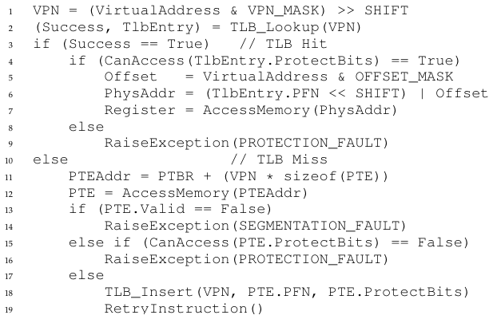
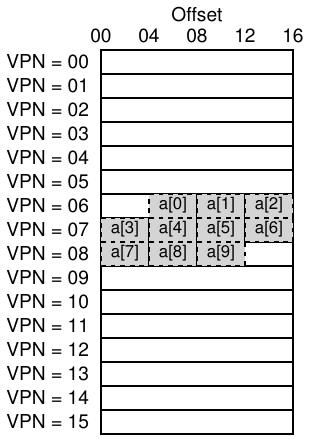
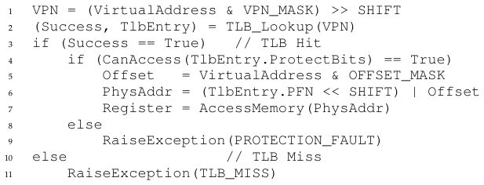
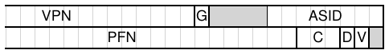
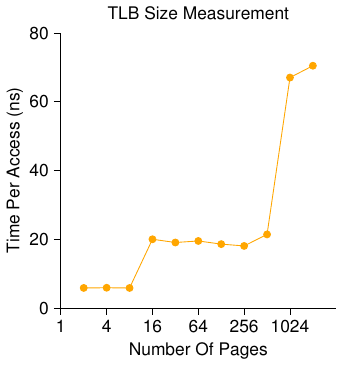

# الفصل 19: مخازن الترجمة المؤقتة (TLB)

قد يؤدّي استخدام الترقيم الصفحي بوصفه الآلية الأساسية لدعم الذاكرة الافتراضية إلى كلفة أداء عالية. فالترقيم الصفحي، إذ يقطّع فضاء العناوين إلى وحدات صغيرة ثابتة الحجم (أي الصفحات)، يحتاج إلى قدر كبير من معلومات المقابلة. ولأنّ معلومات المقابلة هذه تُخزَّن عمومًا في الذاكرة المادية، فإن الترقيم الصفحي يستلزم منطقيًا بحثًا إضافيًا في الذاكرة عن كل عنوان افتراضي يولّده البرنامج. والذهاب إلى الذاكرة بحثًا عن معلومات الترجمة قبل كل جلب تعليمة أو تحميل أو تخزين صريح بطيء إلى حدٍّ يحول دون ذلك. وهكذا نصل إلى مسألتنا:

> **جوهر المسألة: كيف نُسرّع ترجمة العناوين**
>
> كيف نستطيع أن نُسرّع ترجمة العناوين، وأن نتجنّب عمومًا البحث الإضافي في الذاكرة الذي يبدو أنّ الترقيم الصفحي يفرضه؟ وما دعم العتاد المطلوب؟ وأي مشاركة من نظام التشغيل نحتاج إليها؟

حين نريد أن نجعل الأشياء سريعة، يحتاج نظام التشغيل عادةً إلى بعض المساعدة، والمساعدة تأتي غالبًا من صديق نظام التشغيل القديم: العتاد. ولتسريع ترجمة العناوين سنضيف ما يُسمّى (لأسباب تاريخية [CP78]) مخزن الترجمة المؤقت، أو TLB [CG68, C95]. وTLB جزء من وحدة إدارة الذاكرة (MMU) في الشريحة، وهو ببساطة مخزن عتادي لأكثر مقابلات العناوين الافتراضية بالعناوين المادية شيوعًا؛ ولذلك سيكون اسم أدق له هو «مخزن ترجمة العناوين». وعند كل إشارة إلى الذاكرة الافتراضية، يفحص العتاد TLB أولًا ليرى هل الترجمة المطلوبة موجودة فيه؛ فإن كانت موجودة أُنجزت الترجمة (بسرعة) دون الحاجة إلى الرجوع إلى جدول الصفحات (الذي يحوي جميع الترجمات). وبفضل أثرها الهائل في الأداء، فإن مخازن TLB تجعل الذاكرة الافتراضية ممكنة بالمعنى الحقيقي [C95].

## 19.1 الخوارزمية الأساسية لمخزن الترجمة المؤقت



**الشكل 19.1:** خوارزمية التحكّم في TLB

يعرض الشكل 19.1 رسمًا تقريبيًا لكيفية تعامل العتاد مع ترجمة عنوان افتراضي، بافتراض جدول صفحات خطي بسيط (أي أن جدول الصفحات مصفوفة) وTLB يديره العتاد (أي أن العتاد يتولّى قدرًا كبيرًا من مسؤولية الوصول إلى جدول الصفحات؛ وسنشرح هذا أكثر فيما يأتي).

والخوارزمية التي يتّبعها العتاد تعمل هكذا: أولًا، استخرج رقم الصفحة الافتراضية (VPN) من العنوان الافتراضي (السطر 1 في الشكل 19.1)، ثم افحص هل يحمل TLB ترجمة هذا الـ VPN (السطر 2). فإن كان يحملها وقعت إصابة في TLB، أي أنّ TLB يحوي الترجمة. نجاح! نستطيع الآن استخراج رقم الإطار المادي (PFN) من مدخل TLB المعني، وضمّه إلى الإزاحة المأخوذة من العنوان الافتراضي الأصلي، وتكوين العنوان المادي المطلوب (PA)، ثم النفاذ إلى الذاكرة (الأسطر 5–7)، بافتراض ألّا تفشل فحوص الحماية (السطر 4).

أما إن لم يجد المعالج الترجمة في TLB (إخفاق في TLB)، فثمّة عمل إضافي. في هذا المثال ينفذ العتاد إلى جدول الصفحات ليجد الترجمة (السطران 11–12)، ثم، بافتراض أنّ الإشارة إلى الذاكرة الافتراضية التي ولّدتها العملية صالحة ومسموح بها (السطران 13 و15)، يحدّث TLB بالترجمة (السطر 18). وهذه المجموعة من الأفعال مكلفة، أساسًا بسبب البحث الإضافي في الذاكرة اللازم للنفاذ إلى جدول الصفحات (السطر 12). وأخيرًا، بعد تحديث TLB، يعيد العتاد محاولة تنفيذ التعليمة؛ وهذه المرة يجد الترجمة في TLB، فتُعالَج الإشارة إلى الذاكرة بسرعة.

وTLB، مثل كل المخازن المؤقتة، مبني على فرضية أنّ الترجمات موجودة في المخزن في الحالة الشائعة (أي أنها إصابات). فإن كان الأمر كذلك لم تُضف إلا كلفة صغيرة، لأن TLB يقع قريبًا من نواة المعالجة ومصمّم ليكون سريعًا جدًا. أما حين يقع إخفاق فتتحمّل كلفة الترقيم الصفحي العالية؛ إذ يجب النفاذ إلى جدول الصفحات لإيجاد الترجمة، فينتج بحث إضافي في الذاكرة (أو أكثر من بحث مع جداول صفحات أعقد). وإن تكرّر هذا كثيرًا فمن المرجّح أن يعمل البرنامج ببطء ملحوظ؛ فالنفاذ إلى الذاكرة، بالنسبة إلى معظم تعليمات المعالج، مكلف جدًا، وإخفاقات TLB تؤدّي إلى مزيد من النفاذ إلى الذاكرة. لذلك أملنا أن نتجنّب إخفاقات TLB قدر ما نستطيع.

## 19.2 مثال: الوصول إلى مصفوفة

لتوضيح عمل TLB، لنفحص تتبّعًا بسيطًا لعناوين افتراضية ونرَ كيف يمكن لـ TLB أن يحسّن أداءه. لنفترض في هذا المثال أنّ لدينا مصفوفة من عشرة أعداد صحيحة كل منها 4 بايتات في الذاكرة، تبدأ عند العنوان الافتراضي 100. ولنفترض كذلك أنّ لدينا فضاء عناوين افتراضية صغيرًا من 8 بتات، بصفحات حجمها 16 بايتًا؛ وهكذا ينقسم العنوان الافتراضي إلى VPN من 4 بتات (فهناك 16 صفحة افتراضية) وإزاحة من 4 بتات (فهناك 16 بايتًا في كل واحدة من تلك الصفحات).



**الشكل 19.2:** مثال: مصفوفة في فضاء عناوين صغير جدًا

يعرض الشكل 19.2 (الصفحة 4) المصفوفة موزّعة على الصفحات السادسة عشرة ذات الحجم 16 بايتًا في النظام. وكما ترى، يبدأ المدخل الأول للمصفوفة (a[0]) عند (VPN=06، الإزاحة=04)؛ ولا يتّسع في تلك الصفحة إلا ثلاثة أعداد صحيحة من 4 بايتات. وتستمر المصفوفة في الصفحة التالية (VPN=07)، حيث توجد المداخل الأربعة التالية (a[3] ... a[6]). وأخيرًا، تقع المداخل الثلاثة الأخيرة من المصفوفة ذات العشرة مداخل (a[7] ... a[9]) في الصفحة التالية من فضاء العناوين (VPN=08).

لننظر الآن في حلقة بسيطة تنفذ إلى كل عنصر من عناصر المصفوفة، حلقة تبدو هكذا في لغة سي:

```
int i, sum = 0;
for (i = 0; i < 10; i++) {
    sum += a[i];
}
```

وتبسيطًا، سنتظاهر بأنّ النفاذات إلى الذاكرة التي تولّدها الحلقة هي إلى المصفوفة وحدها (مُهملين المتغيّرين i وsum، وكذلك التعليمات نفسها). فعند النفاذ إلى أول عنصر من المصفوفة (a[0]) يرى المعالج تحميلًا من العنوان الافتراضي 100. ويستخرج العتاد الـ VPN منه (VPN=06)، ويستخدمه لفحص TLB بحثًا عن ترجمة صالحة. وبافتراض أنّ هذه أول مرة تنفذ فيها العملية إلى المصفوفة، ستكون النتيجة إخفاقًا في TLB.

والنفاذ التالي إلى a[1]، وهنا خبر سار: إصابة في TLB! لأنّ العنصر الثاني من المصفوفة مرصوص بجوار الأول، فهو يعيش في الصفحة نفسها؛ ولأننا نفذنا إلى هذه الصفحة أصلًا عند النفاذ إلى العنصر الأول من المصفوفة، فالترجمة محمّلة في TLB من قبل. ومن هنا سبب نجاحنا. والنفاذ إلى a[2] يلقى نجاحًا مماثلًا (إصابة أخرى)، لأنه هو أيضًا يعيش في الصفحة نفسها التي يعيش فيها a[0] وa[1].

وللأسف، حين تنفذ العملية إلى a[3] نصادف إخفاقًا آخر في TLB. لكن المداخل التالية (a[4] ... a[6]) ستُصيب في TLB مرة أخرى، لأنها كلها تقيم في الصفحة نفسها في الذاكرة.

وأخيرًا، يتسبّب النفاذ إلى a[7] في إخفاق أخير في TLB. فيرجع العتاد مرة أخرى إلى جدول الصفحات ليعرف موضع هذه الصفحة الافتراضية في الذاكرة المادية، ويحدّث TLB وفقًا لذلك. والنفاذان الأخيران (a[8] وa[9]) ينالان فائدة هذا التحديث؛ فحين يبحث العتاد عن ترجمتهما في TLB تنتج إصابتان إضافيتان.

ولنلخّص نشاط TLB خلال نفاذاتنا العشرة إلى المصفوفة: إخفاق، إصابة، إصابة، إخفاق، إصابة، إصابة، إصابة، إخفاق، إصابة، إصابة. وهكذا فإن معدّل إصابتنا في TLB، وهو عدد الإصابات مقسومًا على العدد الكلي للنفاذات، يساوي 70%. ومع أنّ هذا ليس عاليًا كثيرًا (فنحن نطمح فعلًا إلى معدّلات إصابة تقترب من 100%)، فهو ليس صفرًا، وقد يكون مفاجئًا. فرغم أنّ هذه أول مرة تنفذ فيها العملية إلى المصفوفة، فإن TLB يحسّن الأداء بفضل المحلية المكانية. فعناصر المصفوفة مرصوصة بإحكام في الصفحات (أي أنها قريبة بعضها من بعض في المكان)، ولذلك لا ينتج إخفاق في TLB إلا عند النفاذ الأول إلى عنصر في صفحة ما.

ولاحظ أيضًا الدور الذي يلعبه حجم الصفحة في هذا المثال. فلو كان حجم الصفحة ضعفَ الحجم فحسب (32 بايتًا بدل 16)، لكان النفاذ إلى المصفوفة يعاني إخفاقات أقل. وبما أنّ أحجام الصفحات المعتادة أقرب إلى 4 ك.ب، فإن هذا النوع من النفاذ الكثيف القائم على المصفوفات يحقق أداءً ممتازًا في TLB، فلا يصادف إلا إخفاقًا واحدًا عن كل صفحة من النفاذات.

> **نصيحة: استخدم التخزين المؤقت حين تستطيع**
>
> التخزين المؤقت أحد أكثر تقنيات الأداء جذرية في أنظمة الحاسوب، وهو تقنية تُستخدم مرارًا وتكرارًا لجعل «الحالة الشائعة سريعة» [HP06]. والفكرة وراء المخازن العتادية هي الاستفادة من المحلية في الإشارات إلى التعليمات والبيانات. وثمّة عادةً نوعان من المحلية: المحلية الزمنية والمحلية المكانية. فبالمحلية الزمنية تكون الفكرة أنّ تعليمةً أو عنصر بيانات نُفذ إليه حديثًا سيُنفذ إليه على الأرجح مرة أخرى قريبًا في المستقبل. فكّر في متغيّرات الحلقات أو في التعليمات داخل حلقة؛ فهي يُنفذ إليها مرارًا مع مرور الزمن. وبالمحلية المكانية تكون الفكرة أنّ البرنامج إذا نفذ إلى الذاكرة عند العنوان x فسيُنفذ على الأرجح قريبًا إلى ذاكرة قريبة من x. تصوّر هنا التدفّق المتتابع عبر مصفوفة ما، بالنفاذ إلى عنصر ثم إلى الذي يليه. وبالطبع تعتمد هاتان الخاصيتان على الطبيعة الدقيقة للبرنامج، ولذلك ليستا قانونين صارمين بل أشبه بقواعد عامة.
>
> والمخازن العتادية، سواء كانت للتعليمات أو للبيانات أو لترجمات العناوين (كما في TLB لدينا)، تستفيد من المحلية بأن تحتفظ بنُسخ من الذاكرة في ذاكرة صغيرة سريعة على الشريحة. فبدل أن يضطر إلى الذهاب إلى ذاكرة (بطيئة) لتلبية طلب، يستطيع المعالج أن يفحص أولًا هل توجد نسخة قريبة في مخزن مؤقت؛ فإن وُجدت أمكنه النفاذ إليها بسرعة (أي في دورات قليلة من دورات المعالج) وتجنّب قضاء الوقت المكلف اللازم للنفاذ إلى الذاكرة (نانو ثوانٍ كثيرة).
>
> وقد تتساءل: إذا كانت المخازن المؤقتة (مثل TLB) بهذه الروعة، فلماذا لا نصنع مخازن أكبر فحسب ونحتفظ بكل بياناتنا فيها؟ للأسف، هنا نصطدم بقوانين أكثر جذرية، كقوانين الفيزياء. فإن أردت مخزنًا سريعًا وجب أن يكون صغيرًا، لأن مسائل مثل سرعة الضوء وغيرها من القيود الفيزيائية تصير ذات صلة. وأي مخزن كبير بطبيعته بطيء، فينقض الغرض منه. وهكذا نبقى محبوسين مع مخازن صغيرة سريعة؛ ويبقى السؤال: كيف نستخدمها أفضل استخدام لتحسين الأداء؟

وثمّة نقطة أخيرة عن أداء TLB: إذا نفذت العملية، قريبًا بعد انتهاء هذه الحلقة، إلى المصفوفة مرة أخرى، فسنرى على الأرجح نتيجة أفضل، بافتراض أنّ لدينا TLB كبيرًا بما يكفي لتخزين الترجمات اللازمة: إصابة، إصابة، إصابة، إصابة، إصابة، إصابة، إصابة، إصابة، إصابة، إصابة. وفي هذه الحالة سيكون معدّل الإصابة في TLB عاليًا بسبب المحلية الزمنية، أي الإشارة السريعة مرة أخرى إلى عناصر الذاكرة على امتداد الزمن. وTLB، مثل أي مخزن مؤقت، يعتمد على المحلية المكانية والزمنية معًا للنجاح، وهما خاصيتان من خصائص البرنامج. فإن أظهر البرنامج المعني هذه المحلية (وكثير من البرامج يفعل)، فمن المرجّح أن يكون معدّل الإصابة في TLB عاليًا.

## 19.3 من يتولّى معالجة إخفاق TLB؟



**الشكل 19.3:** خوارزمية التحكّم في TLB (يعالجه نظام التشغيل)

ثمّة سؤال يجب أن نجيب عنه: من يتولّى معالجة الإخفاق في TLB؟ جوابان ممكنان: العتاد، أو البرمجيات (نظام التشغيل). ففي الأيام الغابرة كانت للعتاد مجموعات تعليمات معقدة (تُسمّى أحيانًا CISC، أي حواسيب مجموعات التعليمات المعقدة)، ولم يكن من بنى العتاد يثق كثيرًا بهؤلاء الناس الماكرين في نظام التشغيل. ولذلك كان العتاد يتولّى إخفاق TLB بالكامل. وللقيام بذلك يجب أن يعرف العتاد بدقة أين تقع جداول الصفحات في الذاكرة (عبر سجل قاعدة جدول الصفحات، المستخدم في السطر 11 من الشكل 19.1)، وأن يعرف صيغتها الدقيقة أيضًا؛ فعند الإخفاق كان العتاد «يمشي» على جدول الصفحات، فيجد مدخل جدول الصفحات الصحيح ويستخرج الترجمة المطلوبة، ويحدّث TLB بالترجمة، ويعيد محاولة تنفيذ التعليمة. ومن أمثلة المعماريات «الأقدم» التي لديها مخازن TLB يديرها العتاد معمارية إنتل x86، التي تستخدم جدول صفحات متعدد المستويات ثابتًا (انظر الفصل التالي للتفاصيل)؛ ويشير سجل CR3 إلى جدول الصفحات الحالي [I09].

أما المعماريات الأحدث (مثل MIPS R10k [H93] أو SPARC v9 من صن [WG00]، وكلاهما من حواسيب RISC، أي مجموعات التعليمات المختزلة) فلديها ما يُعرف بـ TLB الذي يديره نظام التشغيل. فعند إخفاق في TLB يرفع العتاد ببساطة استثناءً (السطر 11 في الشكل 19.3)، فيوقف تدفّق التعليمات الحالي، ويرفع مستوى الامتياز إلى وضع النواة، ويقفز إلى معالج فخّ. وكما قد تتوقّع، فإن معالج الفخّ هذا شيفرة داخل نظام التشغيل كُتبت لغرض معالجة إخفاقات TLB صراحةً. وحين يعمل، يبحث عن الترجمة في جدول الصفحات، ويستخدم تعليمات «مميّزة» خاصة لتحديث TLB، ثم يعود من الفخّ؛ وعند هذه النقطة يعيد العتاد محاولة تنفيذ التعليمة (فينتج إصابة في TLB).

ولنناقش تفصيلين مهمين. أولًا، تحتاج تعليمة العودة من الفخّ إلى أن تكون مختلفة قليلًا عن العودة من الفخّ التي رأيناها قبلًا عند خدمة استدعاء نظام. ففي الحالة الأخيرة ينبغي أن تستأنف العودة من الفخّ التنفيذ عند التعليمة التالية للفخّ الداخل إلى نظام التشغيل، تمامًا كما تعود العودة من استدعاء إجراء إلى التعليمة التي تلي الاستدعاء الإجراء مباشرة. أما في الحالة الأولى، أي عند العودة من فخّ معالجة إخفاق TLB، فيجب على العتاد أن يستأنف التنفيذ عند التعليمة التي تسبّبت في الفخّ؛ وهذه الإعادة تجعل التعليمة تُنفّذ مرة أخرى، فتنتهي هذه المرة بإصابة في TLB. وهكذا يجب على العتاد، بحسب طريقة حدوث الفخّ أو الاستثناء، أن يحفظ عدّاد برنامج مختلفًا عند الدخول إلى نظام التشغيل، ليستأنف على النحو الصحيح حين يحين ذلك.

> **استطراد: RISC مقابل CISC**
>
> في ثمانينيات القرن الماضي دارت معركة كبرى في مجتمع معمارية الحاسوب. ففي أحد الجانبين كان معسكر CISC، أي حوسبة مجموعات التعليمات المعقدة؛ وفي الجانب الآخر كان RISC، أي حوسبة مجموعات التعليمات المختزلة [PS81]. وكان على رأس جانب RISC ديفيد باترسون في بيركلي وجون هينيسي في ستانفورد (وهما أيضًا من مؤلفي بعض الكتب الشهيرة [HP06])، وإن نال جون كوك لاحقًا جائزة تورينغ عن عمله المبكّر في RISC [CM00].
>
> تميل مجموعات تعليمات CISC إلى أن تحوي تعليمات كثيرة، وكل تعليمة فيها قوية نسبيًا. فقد ترى مثلًا تعليمة نسخ سلسلة، تأخذ مؤشّرين وطولًا وتنسخ البايتات من المصدر إلى الوجهة. والفكرة وراء CISC أنّ التعليمات ينبغي أن تكون بدائيات عالية المستوى، لتسهيل استخدام لغة التجميع نفسها ولجعل الشيفرة أكثر إحكامًا.
>
> أما مجموعات تعليمات RISC فهي العكس تمامًا. وثمّة ملاحظة أساسية وراء RISC، هي أنّ مجموعات التعليمات هي في الحقيقة أهداف للمترجمات، وكل ما تريده المترجمات فعلًا هو بضعة بدائيات بسيطة تستخدمها لتوليد شيفرة عالية الأداء. ولذلك جادل أنصار RISC بأن ننتزع من العتاد أكبر قدر ممكن (وخصوصًا الشيفرة الدقيقة)، ونجعل ما تبقّى بسيطًا ومنتظمًا وسريعًا.
>
> في الأيام الأولى كان لشرائح RISC أثر هائل، إذ كانت أسرع بشكل ملحوظ [BC91]؛ فكُتبت أوراق كثيرة، وأُنشئت شركات قليلة (مثل MIPS وSun). لكن مع مرور الزمن أدخل مصنّعو CISC مثل إنتل تقنيات RISC كثيرة في نواة معالجاتهم، مثلًا بإضافة مراحل خط أنابيب مبكّرة تحوّل التعليمات المعقدة إلى تعليمات دقيقة يمكن معالجتها بعدها على نحو شبيه بـ RISC. وهذه الابتكارات، مع تزايد عدد الترانزستورات في كل شريحة، مكّنت CISC من البقاء منافسًا. والنتيجة النهائية أنّ الجدل خفت، وأنّ كلا نوعي المعالجات يمكن اليوم صنعه ليعمل بسرعة.

ثانيًا، حين يشغّل نظام التشغيل شيفرة معالجة إخفاق TLB، يحتاج إلى حرص زائد ألّا يتسبّب في سلسلة لا نهائية من إخفاقات TLB. وثمّة حلول كثيرة؛ فيمكنك مثلًا أن تُبقي معالجات إخفاق TLB في الذاكرة المادية (حيث لا تكون مقابلة، فلا تخضع لترجمة العناوين)، أو أن تحجز بعض المداخل في TLB لترجمات صالحة الدوام وتستخدم بعض خانات الترجمة الدائمة هذه لشيفرة المعالج نفسه؛ فهذه الترجمات المثبّتة تُصيب في TLB دائمًا.

والميزة الأساسية لمقاربة إدارة نظام التشغيل هي المرونة: إذ يستطيع نظام التشغيل أن يستخدم أي بنية بيانات يريدها لتنفيذ جدول الصفحات، دون أن يقتضي ذلك تغييرًا في العتاد. وميزة أخرى هي البساطة، كما يُرى في التحكّم بـ TLB (السطر 11 في الشكل 19.3، مقابل الأسطر 11–19 في الشكل 19.1). فالعتاد لا يفعل الكثير عند الإخفاق: يرفع استثناءً فقط ويترك لمعالج إخفاق TLB في نظام التشغيل بقية العمل.

> **استطراد: بت الصلاحية في TLB ليس بت الصلاحية في جدول الصفحات**
>
> من الأخطاء الشائعة الخلط بين بتات الصلاحية الموجودة في TLB وتلك الموجودة في جدول الصفحات. ففي جدول الصفحات، حين يُعلَّم مدخل جدول الصفحات (PTE) بأنه غير صالح، فهذا يعني أنّ الصفحة لم تُخصَّص للعملية، وينبغي ألّا ينفذ إليها برنامج يعمل على النحو الصحيح. والاستجابة المعتادة عند النفاذ إلى صفحة غير صالحة هي الفخّ إلى نظام التشغيل، الذي يستجيب بقتل العملية.
>
> أما بت الصلاحية في TLB فيشير ببساطة إلى هل يحوي مدخل TLB ترجمة صالحة أم لا. فعند إقلاع النظام، مثلًا، تكون الحالة الابتدائية الشائعة لكل مدخل في TLB هي أن يُضبط على غير صالح، لأنه لا توجد ترجمات عناوين مخزّنة فيه بعد. وما إن تُفعَّل الذاكرة الافتراضية وتبدأ البرامج بالعمل والنفاذ إلى فضاءات عناوينها الافتراضية، حتى يمتلئ TLB ببطء، فتمتلئه المداخل الصالحة سريعًا.
>
> وبت الصلاحية في TLB مفيد جدًا عند تبديل السياق أيضًا، كما سنناقش أكثر فيما يأتي. فبضبط كل مداخل TLB على غير صالحة يستطيع النظام أن يضمن ألّا تستخدم العملية التي ستُشغَّل ترجمة من عنوان افتراضي إلى عنوان مادي تخصّ عملية سابقة بالخطأ.

## 19.4 محتويات TLB: ماذا يوجد داخله؟

لننظر في محتويات TLB العتادي بتفصيل أكبر. قد يحوي TLB معتاد 32 أو 64 أو 128 مدخلًا، ويكون ما يُسمّى تامّ الترابط. وهذا يعني ببساطة أنّ أي ترجمة معطاة يمكن أن تكون في أي موضع في TLB، وأنّ العتاد سيبحث في TLB كله على التوازي ليجد الترجمة المطلوبة. وقد يبدو مدخل TLB هكذا:

```
VPN     PFN     other bits
```

لاحظ أنّ الـ VPN والـ PFN كلاهما موجود في كل مدخل، لأنّ الترجمة قد تنتهي في أي من هذه المواضع (بمصطلحات العتاد، يُعرف TLB بأنه مخزن تامّ الترابط). ويبحث العتاد في المداخل على التوازي ليرى هل ثمّة تطابق.

والأكثر إثارة للاهتمام هي «البتات الأخرى». فمثلًا يحوي TLB عادةً بت صلاحية يقول هل للمدخل ترجمة صالحة أم لا. وثمّة أيضًا بتات حماية شائعة، تحدّد كيف يمكن النفاذ إلى صفحة ما (كما في جدول الصفحات). فقد تُعلَّم صفحات الشيفرة مثلًا بالقراءة والتنفيذ، بينما تُعلَّم صفحات الكومة بالقراءة والكتابة. وقد تكون ثمّة حقول أخرى قليلة، منها معرّف فضاء العناوين وبت الاتّساخ وما إلى ذلك؛ انظر أدناه لمزيد من المعلومات.

## 19.5 مسألة TLB: تبديل السياق

مع مخازن TLB تنشأ مسائل جديدة عند التبديل بين العمليات (ومن ثمّ بين فضاءات العناوين). فالتحديد: يحوي TLB ترجمات من العناوين الافتراضية إلى المادية صالحة للعملية العاملة حاليًا فقط؛ وهذه الترجمات لا معنى لها بالنسبة إلى عمليات أخرى. ونتيجة لذلك، عند التبديل من عملية إلى أخرى، يجب على العتاد أو نظام التشغيل (أو كليهما) أن يحرص على ألّا تستخدم العملية التي ستُشغَّل بالخطأ ترجمات من عملية سابقة.

لفهم هذا الوضع أفضل، لننظر في مثال. حين تعمل إحدى العمليات (P1)، تفترض أنّ TLB قد يخزّن ترجمات صالحة لها، أي ترجمات تأتي من جدول صفحات P1. ولنفترض في هذا المثال أنّ الصفحة الافتراضية العاشرة في P1 مقابلة للإطار المادي 100.

ولنفترض في هذا المثال وجود عملية أخرى (P2)، وأنّ نظام التشغيل قد يقرّر قريبًا أن يبدّل السياق ويشغّلها. ولنفترض هنا أنّ الصفحة الافتراضية العاشرة في P2 مقابلة للإطار المادي 170. فلو كانت مداخل العمليتين في TLB، لكانت محتوياته هكذا:

```
VPN     PFN     valid   prot
 10     100       1     rwx
 —       —        0      —
 10     170       1     rwx
 —       —        0      —
```

في TLB أعلاه لدينا مشكلة واضحة: الـ VPN 10 يُترجم إلى PFN 100 (لدى P1) أو إلى PFN 170 (لدى P2)، لكنّ العتاد لا يستطيع التمييز بين المدخل المقصود لأي عملية. ولذلك نحتاج إلى مزيد من العمل كي يدعم TLB المحاكاة الافتراضية عبر عمليات متعددة على النحو الصحيح والناجع. وهكذا، جوهر مسألة:

> **جوهر المسألة: كيف ندير محتويات TLB عند تبديل السياق**
>
> عند تبديل السياق بين العمليات، لا معنى لترجمات العملية السابقة في TLB بالنسبة إلى العملية التي ستُشغَّل. فماذا ينبغي للعتاد أو لنظام التشغيل أن يفعل لحلّ هذه المشكلة؟

وثمّة عدد من الحلول الممكنة لهذه المشكلة. إحدى المقاربات أن تفرغ TLB ببساطة عند تبديل السياق، فتُخليه قبل تشغيل العملية التالية. وعلى نظام قائم على البرمجيات يمكن تحقيق ذلك بتعليمة عتادية صريحة (ومميّزة)؛ أما مع TLB يديره العتاد، فيمكن تنفيذ الإفراغ عند تغيير سجل قاعدة جدول الصفحات (ولاحظ أنّ نظام التشغيل يجب أن يغيّر هذا السجل عند تبديل السياق على أي حال). وفي كلتا الحالتين، لا تفعل عملية الإفراغ إلا ضبط كل بتات الصلاحية على 0، أي مسح محتويات TLB فعليًا.

وبإفراغ TLB عند كل تبديل سياق صار لدينا حلّ عامل، فلن تصادف عملية أبدًا بالخطأ ترجمات خاطئة في TLB. لكن ثمّة كلفة: فعند كل مرة تعمل فيها عملية، يجب أن تتحمّل إخفاقات في TLB وهي تلمس صفحات بياناتها وشيفرتها. وإن كان نظام التشغيل يبدّل بين العمليات كثيرًا فقد تكون هذه الكلفة عالية.

ولتقليل هذه الكلفة تضيف بعض الأنظمة دعمًا عتاديًا يتيح مشاركة TLB عبر تبديلات السياق. وعلى وجه الخصوص، توفّر بعض الأنظمة العتادية حقل معرّف فضاء العناوين (ASID) في TLB. ويمكنك أن تتصوّر الـ ASID بوصفه معرّف عملية (PID)، لكنه عادةً يحوي بتات أقل (مثلًا 8 بتات للـ ASID مقابل 32 بتًا للـ PID).

وإذا أخذنا مثال TLB السابق وأضفنا إليه معرّفات فضاء العناوين، صار واضحًا أنّ العمليات تستطيع مشاركة TLB بسهولة: فحقل ASID وحده يكفي للتمييز بين ترجمات متطابقة في ما عدا ذلك. وهذا تصوير لـ TLB مع حقل ASID المضاف:

```
VPN     PFN     valid   prot    ASID
 10     100       1     rwx      1
 —       —        0      —       —
 10     170       1     rwx      2
 —       —        0      —       —
```

وهكذا، بمعرّفات فضاء العناوين، يستطيع TLB أن يحمل ترجمات من عمليات مختلفة في الوقت نفسه دون أي التباس. وبالطبع يحتاج العتاد أيضًا إلى معرفة أي عملية تعمل حاليًا كي ينفّذ الترجمات، ولذلك على نظام التشغيل، عند تبديل السياق، أن يضبط سجلًا مميّزًا ما على ASID العملية الحالية.

وبمناسبة الحديث عن هذا، ربما فكّرت في حالة أخرى يكون فيها مدخلان في TLB متشابهين على نحو لافت. في هذا المثال مدخلان لعمليتين مختلفتين، لهما VPN مختلفان، يشيران إلى الصفحة المادية نفسها:

```
VPN     PFN     valid   prot    ASID
 10     101       1      r-x     1
 —       —        0      —       —
 50     101       1      r-x     2
 —       —        0      —       —
```

وقد ينشأ هذا الوضع مثلًا حين تتشارك عمليتان صفحةً ما (صفحة شيفرة مثلًا). في المثال أعلاه تتشارك العملية 1 الصفحة المادية 101 مع العملية 2؛ فتقابل P1 هذه الصفحة بالصفحة العاشرة من فضاء عناوينها، بينما تقابلها P2 بالصفحة الخمسين من فضاء عناوينها. ومشاركة صفحات الشيفرة (في الملفات التنفيذية أو المكتبات المشتركة) مفيدة لأنها تقلّل عدد الصفحات المادية المستخدمة، فتقلّل من كلفة الذاكرة.

## 19.6 مسألة: سياسة الإحلال

كما هو الحال مع أي مخزن مؤقت، وكذلك مع TLB، ثمّة مسألة أخرى يجب أن ننظر فيها هي الإحلال في المخزن. وتحديدًا، حين نُثبّت مدخلًا جديدًا في TLB يجب أن نستبدل مدخلًا قديمًا، وهنا السؤال: أيّها نستبدل؟

> **جوهر المسألة: كيف نصمّم سياسة إحلال TLB**
>
> أي مدخل في TLB ينبغي استبداله حين نضيف مدخلًا جديدًا؟ والهدف بالطبع تقليل معدّل الإخفاق (أو زيادة معدّل الإصابة)، ومن ثمّ تحسين الأداء.

وسندرس هذه السياسات بتفصيل ما حين نعالج مسألة تبديل الصفحات إلى القرص؛ وهنا سنسلّط الضوء على بضع سياسات معتادة فحسب. إحدى المقاربات الشائعة هي إخراج المدخل الأقل استخدامًا حدثًا، أي LRU. فـ LRU يحاول الاستفادة من المحلية في تدفّق الإشارات إلى الذاكرة، بافتراض أن من المرجّح أن يكون المدخل الذي لم يُستخدم حديثًا مرشّحًا جيدًا للإخراج. ومقاربة معتادة أخرى هي استعمال سياسة عشوائية تُخرج مقابلة من TLB عشوائيًا. وهذه السياسة مفيدة لبساطتها وقدرتها على تجنّب سلوكيات الحالات الحدّية؛ فمثلًا، تتصرف سياسة «معقولة» مثل LRU على نحو غير معقول تمامًا حين تتكرّر حلقة على n + 1 صفحة مع TLB حجمه n؛ في هذه الحالة يُخفق LRU عند كل نفاذ، بينما تبلي السياسة العشوائية بلاءً أفضل كثيرًا.

## 19.7 مدخل TLB حقيقي

أخيرًا، لننظر بإيجاز في TLB حقيقي. هذا المثال من معالج MIPS R4000 [H93]، وهو نظام حديث يستخدم مخازن TLB يديرها نظام التشغيل؛ ويمكن رؤية مدخل TLB في معالج MIPS مبسّطًا قليلًا في الشكل 19.4.

يدعم معالج MIPS R4000 فضاء عناوين من 32 بتًا بصفحات حجمها 4 ك.ب. ومن ثمّ نتوقّع VPN من 20 بتًا وإزاحة من 12 بتًا في عنواننا الافتراضي المعتاد. لكن، كما ترى في TLB، ثمّة 19 بتًا فقط للـ VPN؛ فقد اتضح أنّ عناوين المستخدم تأتي من نصف فضاء العناوين فحسب (والنصف الآخر محجوز للنواة)، ولذلك لا نحتاج إلا 19 بتًا من الـ VPN. ويُترجم الـ VPN إلى رقم إطار مادي (PFN) يبلغ 24 بتًا، ومن ثمّ يستطيع دعم أنظمة بذاكرة رئيسية (مادية) تبلغ 64 غ.ب (أي 2 أس 24 صفحة من 4 ك.ب).



**الشكل 19.4:** مدخل TLB في معالج MIPS

وثمّة بتات أخرى مثيرة للاهتمام في TLB الخاص بـ MIPS. فنرى بتًا عموميًا (G) يُستخدم للصفحات المشتركة عمومًا بين العمليات؛ فإن كان البت العمومي مضبوطًا تُهمَل قيمة ASID. ونرى أيضًا الـ ASID ذا الثماني بتات، الذي يستطيع نظام التشغيل استخدامه للتمييز بين فضاءات العناوين (كما وصفنا أعلاه). وسؤال لك: ماذا ينبغي لنظام التشغيل أن يفعل إن كانت ثمّة أكثر من 256 عملية (2 أس 8) تعمل في الوقت نفسه؟ وأخيرًا نرى 3 بتات تماسك (C) تحدّد كيف يُخزَّن صفحةٌ ما في المخزن المؤقت العتادي (وهذا يتجاوز نطاق هذه الملاحظات قليلًا)؛ وبت اتّساخ يُعلَّم عند الكتابة إلى الصفحة (وسنرى فائدته لاحقًا)؛ وبت صلاحية يخبر العتاد هل ثمّة ترجمة صالحة في المدخل. وثمّة أيضًا حقل قناع صفحة (غير معروض) يدعم أحجام صفحات متعددة؛ وسنرى لاحقًا لماذا قد يكون وجود صفحات أكبر مفيدًا. وأخيرًا، بعض بتات الـ 64 غير مستخدمة (مظلّلة بالرمادي في الرسم).

وعادةً ما تحوي مخازن TLB في MIPS 32 أو 64 من هذه المداخل، وأكثرها تستخدمه عمليات المستخدم حين تعمل. لكنّ بضعة منها محجوزة لنظام التشغيل. ويمكن لنظام التشغيل أن يضبط سجل تثبيت يخبر العتاد كم خانة في TLB يحجز لنظام التشغيل؛ ويستخدم نظام التشغيل هذه المقابلات المحجوزة لشيفرة وبيانات يريد النفاذ إليها في أوقات حرجة يكون فيها إخفاق TLB مشكلة (مثلًا داخل معالج إخفاق TLB).

ولأنّ TLB في MIPS يديره نظام التشغيل، فلا بدّ من تعليمات لتحديثه. ويوفّر MIPS أربع تعليمات من هذا النوع: TLBP، التي تتقصّى TLB لترى هل ثمّة ترجمة معيّنة فيه؛ وTLBR، التي تقرأ محتويات مدخل TLB إلى سجلات؛ وTLBWI، التي تستبدل مدخلًا معيّنًا؛ وTLBWR، التي تستبدل مدخلًا عشوائيًا. ويستخدم نظام التشغيل هذه التعليمات لإدارة محتويات TLB. ومن الحرج بالطبع أن تكون هذه التعليمات مميّزة؛ فتخيّل ما قد تفعله عملية مستخدم لو استطاعت تعديل محتويات TLB (تلميح: كل شيء تقريبًا، بما في ذلك الاستيلاء على الجهاز، أو تشغيل «نظام تشغيل» خبيث خاص بها، أو حتى جعل الشمس تختفي).

> **نصيحة: الذاكرة العشوائية ليست دائمًا عشوائية (قانون كولر)**
>
> يوحي مصطلح الذاكرة العشوائية، أو RAM، بأنك تستطيع النفاذ إلى أي جزء منها بسرعة مماثلة لأي جزء آخر. ومع أنه من الجيد عمومًا التفكير في RAM بهذه الطريقة، فإن النفاذ إلى صفحة معيّنة من الذاكرة قد يكون مكلفًا بسبب ميزات العتاد ونظام التشغيل مثل TLB، خصوصًا إن لم تكن تلك الصفحة مقابلة حاليًا في TLB لديك. ولذلك من الجيد دائمًا أن تتذكّر نصيحة التنفيذ هذه: RAM ليست دائمًا RAM. فالنفاذ العشوائي إلى فضاء عناوينك أحيانًا، خصوصًا إن تجاوز عدد الصفحات المنفذ إليها تغطية TLB، قد يؤدّي إلى عقوبات أداء شديدة. ولأنّ أحد مستشارينا، ديفيد كولر، كان يشير دائمًا إلى TLB بوصفه مصدر كثير من مشكلات الأداء، فقد أسمينا هذا القانون تكريمًا له: قانون كولر.

## 19.8 الخلاصة

لقد رأينا كيف يستطيع العتاد أن يساعدنا في جعل ترجمة العناوين أسرع. فبتوفير TLB صغير مخصّص على الشريحة بوصفه مخزن ترجمة عناوين، ستُعالَج معظم الإشارات إلى الذاكرة، كما نأمل، دون الحاجة إلى النفاذ إلى جدول الصفحات في الذاكرة الرئيسية. ومن ثمّ سيكون أداء البرنامج في الحالة الشائعة أشبه بالذاكرة غير المحاكاة افتراضيًا أصلًا، وهو إنجاز ممتاز لنظام تشغيل، وهو بالتأكيد جوهري لاستخدام الترقيم الصفحي في الأنظمة الحديثة.

لكن مخازن TLB لا تجعل الدنيا وردية لكل برنامج موجود. فإذا تجاوز عدد الصفحات التي ينفذ إليها البرنامج في فترة قصيرة عدد الصفحات التي تتّسع لها TLB، فسيولّد البرنامج عددًا كبيرًا من الإخفاقات، ومن ثمّ سيعمل ببطء أكبر بكثير. ونسمّي هذه الظاهرة تجاوز تغطية TLB، وقد تكون مشكلة كبيرة لبعض البرامج. وأحد الحلول، كما سنناقش في الفصل التالي، هو تضمين دعم لأحجام صفحات أكبر؛ فبمقابلة بنى بيانات رئيسية في مناطق من فضاء عناوين البرنامج تُقابل بصفحات أكبر، يمكن زيادة التغطية الفعّالة لـ TLB. وكثيرًا ما تستفيد برامج مثل نظام إدارة قواعد البيانات (DBMS) من دعم الصفحات الكبيرة، لأن لديها بنى بيانات معيّنة كبيرة ويُنفذ إليها عشوائيًا.

وثمّة مسألة أخرى في TLB جديرة بالذكر: فالنفاذ إلى TLB قد يصير عنق زجاجة في خط أنابيب المعالج بسهولة، خصوصًا مع ما يُسمّى المخزن المؤقت المفهرس ماديًا. فمع مثل هذا المخزن يجب أن تحدث ترجمة العناوين قبل النفاذ إلى المخزن، وهو ما قد يبطئ الأمور كثيرًا. وبسبب هذه المشكلة المحتملة بحث الناس في كل أنواع الطرق الذكية للنفاذ إلى المخازن المؤقتة بالعناوين الافتراضية، فيتجنّبون خطوة الترجمة المكلفة في حالة الإصابة في المخزن. ومثل هذا المخزن المؤقت المفهرس افتراضيًا يحلّ بعض مشكلات الأداء، لكنه يُدخل مسائل جديدة في تصميم العتاد أيضًا. راجع دراسة ويغنز الممتازة لمزيد من التفاصيل [W03].

## المراجع

> [BC91] «Performance from Architecture: Comparing a RISC and a CISC with Similar Hardware Organization» لـD. Bhandarkar وDouglas W. Clark. Communications of the ACM، سبتمبر 1991. مقارنة رائعة وعادلة بين RISC وCISC. والخلاصة: على عتاد متشابه كان RISC أفضل بنحو ثلاثة أضعاف في الأداء.

> [CM00] «The evolution of RISC technology at IBM» لـJohn Cocke وV. Markstein. IBM Journal of Research and Development، 44:1/2. ملخّص للأفكار والعمل وراء حاسوب IBM 801، الذي يعتبره كثيرون أول معالج RISC حقيقي.

> [C95] «The Core of the Black Canyon Computer Corporation» لـJohn Couleur. IEEE Annals of History of Computing، 17:4، 1995. في هذه الملاحظة التاريخية الشائقة يتحدّث كولور عن كيف اخترع TLB في عام 1964 وهو يعمل لدى GE، وعن التعاون المحظوظ الذي نشأ بعد ذلك مع فريق مشروع MAC في MIT.

> [CG68] «Shared-access Data Processing System» لـJohn F. Couleur وEdward L. Glaser. براءة اختراع 3412382، نوفمبر 1968. البراءة التي تحوي فكرة ذاكرة ترابطية لتخزين ترجمات العناوين. والفكرة، بحسب كولور، جاءت في عام 1964.

> [CP78] «The architecture of the IBM System/370» لـR.P. Case وA. Padegs. Communications of the ACM. 21:1، 73-96، يناير 1978. ربما كانت أول ورقة تستخدم مصطلح مخزن الترجمة المؤقت. وقد نشأ الاسم من الاسم التاريخي للمخزن المؤقت، الذي كان «مخزنًا جانبيًا» كما سمّاه مطوّرو نظام Atlas في جامعة مانشستر؛ فصار مخزن ترجمات العناوين «مخزن ترجمة مؤقتًا». ومع أنّ مصطلح «المخزن الجانبي» خرج من الاستعمال، يبدو أنّ TLB ظلّ عالقًا، لأي سبب كان.

> [H93] «MIPS R4000 Microprocessor User's Manual». لـJoe Heinrich. Prentice-Hall، يونيو 1993. متوفر على: http://cag.csail.mit.edu/raw/documents/R4400_Uman_book_Ed2.pdf. دليل، وهو دليل يُقرأ بسهولة مفاجئة. أم تراه كذلك؟

> [HP06] «Computer Architecture: A Quantitative Approach» لـJohn Hennessy وDavid Patterson. Morgan-Kaufmann، 2006. كتاب رائع عن معمارية الحاسوب. ولدينا تعلّق خاص بالطبعة الأولى الكلاسيكية.

> [I09] «Intel 64 and IA-32 Architectures Software Developer's Manuals» لـIntel، 2009. متوفر على: http://www.intel.com/products/processor/manuals. وانتبه خصوصًا إلى «Volume 3A: System Programming Guide» الجزء 1 و«Volume 3B: System Programming Guide Part 2».

> [PS81] «RISC-I: A Reduced Instruction Set VLSI Computer» لـD.A. Patterson وC.H. Sequin. ISCA '81، منيابوليس، مايو 1981. الورقة التي قدّمت مصطلح RISC وأطلقت سيلًا من البحث في تبسيط شرائح الحاسوب لأجل الأداء.

> [SB92] «CPU Performance Evaluation and Execution Time Prediction Using Narrow Spectrum Benchmarking» لـRafael H. Saavedra-Barrera. قسم EECS، جامعة كاليفورنيا في بيركلي. التقرير التقني رقم UCB/CSD-92-684، فبراير 1992. أطروحة رائعة عن كيفية توقّع زمن تنفيذ التطبيقات بتجزئتها إلى أجزاء مكوّنة ومعرفة كلفة كل جزء. وربما كان الجزء الأكثر إثارة للاهتمام الذي يخرج من هذا العمل هو أداة قياس تفاصيل هرم المخازن المؤقتة (الموصوفة في الفصل 5). احرص على النظر في الرسوم الرائعة الواردة فيه.

> [W03] «A Survey on the Interaction Between Caching, Translation and Protection» لـAdam Wiggins. جامعة نيو ساوث ويلز TR UNSW-CSE-TR-0321، أغسطس 2003. دراسة ممتازة لكيفية تفاعل مخازن TLB مع أجزاء أخرى من خط أنابيب المعالج، أي المخازن المؤقتة العتادية.

> [WG00] «The SPARC Architecture Manual: Version 9» لـDavid L. Weaver وTom Germond. SPARC International، سان خوسيه، كاليفورنيا، سبتمبر 2000. متوفر على: www.sparc.org/standards/SPARCV9.pdf. دليل آخر. أراهن أنك كنت تأمل في إحالة أمتع لإنهاء هذا الفصل.

## الواجب (قياس)

في هذا الواجب عليك قياس حجم TLB وكلفة النفاذ إليه. والفكرة مبنية على عمل سافيدرا-باريرا [SB92]، الذي طوّر طريقة بسيطة وجميلة لقياس جوانب كثيرة من هرم المخازن المؤقتة، كلها ببرنامج واحد بسيط يعمل على مستوى المستخدم. اقرأ عمله لمزيد من التفاصيل.

والفكرة الأساسية هي النفاذ إلى عدد من الصفحات داخل بنية بيانات كبيرة (مصفوفة مثلًا) وتوقيت تلك النفاذات. فلنقل مثلًا إنّ حجم TLB في آلة ما هو 4 (وهذا صغير جدًا، لكنه مفيد لأغراض هذه المناقشة). فإن كتبت برنامجًا يلمس 4 صفحات أو أقل، فكل نفاذ ينبغي أن يكون إصابة في TLB، ومن ثمّ سريعًا نسبيًا. لكن ما إن تلمس 5 صفحات أو أكثر، مرارًا في حلقة، حتى تقفز كلفة كل نفاذ فجأة إلى كلفة الإخفاق في TLB.

والشيفرة الأساسية للمرور على مصفوفة مرة واحدة ينبغي أن تبدو هكذا:

```
int jump = PAGESIZE / sizeof(int);
for (i = 0; i < NUMPAGES * jump; i += jump)
    a[i] += 1;
```

في هذه الحلقة يُحدَّث عدد صحيح واحد عن كل صفحة من المصفوفة a، حتى العدد الذي تحدّده NUMPAGES من الصفحات. وبتوقيت هذه الحلقة مرارًا (مثلًا بضع مئات من الملايين من المرات في حلقة أخرى حولها، أو بعدد المرات اللازم لتشغيلها بضع ثوانٍ)، تستطيع أن تقيس كم يستغرق كل نفاذ (في المتوسط). وبالبحث عن قفزات في الكلفة مع ازدياد NUMPAGES، يمكنك أن تحدّد تقريبًا حجم TLB من المستوى الأول، وأن تعرف هل يوجد TLB من مستوى ثانٍ (وما حجمه إن وُجد)، وأن تحصل عمومًا على تصوّر جيد لكيفية تأثير الإصابات والإخفاقات في TLB على الأداء.



**الشكل 19.5:** اكتشاف أحجام TLB وكلفة الإخفاق فيه

يعرض الشكل 19.5 (الصفحة 15) متوسط الزمن عن كل نفاذ مع ازدياد عدد الصفحات المنفذ إليها في الحلقة. وكما ترى في المنحنى، حين يُنفذ إلى صفحات قليلة (8 أو أقل) يكون متوسط زمن النفاذ نحو 5 نانو ثانية. وحين يُنفذ إلى 16 صفحة أو أكثر تحدث قفزة مفاجئة إلى نحو 20 نانو ثانية عن كل نفاذ. وتحدث قفزة أخيرة في الكلفة عند نحو 1024 صفحة، وعندها يستغرق كل نفاذ نحو 70 نانو ثانية. ومن هذه البيانات نستنتج أنّ ثمّة هرم TLB من مستويين؛ الأول صغير جدًا (يحوي على الأرجح بين 8 و16 مدخلًا)؛ والثاني أكبر لكنه أبطأ (يحوي نحو 512 مدخلًا). والفارق الكلي بين الإصابات في TLB من المستوى الأول والإخفاقات كبير جدًا، نحو أربعة عشر ضعفًا. أداء TLB مهم!

## الأسئلة

1. للتوقيت ستحتاج إلى مؤقّت (مثل gettimeofday()). ما مدى دقة هذا المؤقّت؟ وكم يجب أن تستغرق العملية كي تتمكّن من توقيتها بدقة؟ (سيساعدك هذا في تحديد عدد المرات التي ستحتاج فيها، داخل حلقة، إلى تكرار النفاذ إلى صفحة ما لتوقيته بنجاح)
2. اكتب البرنامج المسمّى tlb.c الذي يستطيع قياس كلفة النفاذ إلى كل صفحة تقريبًا. وينبغي أن تكون مدخلات البرنامج: عدد الصفحات التي ستُلمس وعدد المحاولات.
3. اكتب الآن سكربتًا بلغة البرمجة النصية المفضّلة لديك (bash؟) لتشغيل هذا البرنامج مع تغيير عدد الصفحات المنفذ إليها من 1 حتى بضعة آلاف، وربما بالزيادة بمقدار ضعف واحد في كل تكرار. شغّل السكربت على آلات مختلفة واجمع بعض البيانات. وكم محاولة تحتاج إلى الحصول على قياسات موثوقة؟
4. بعد ذلك، ارسم النتائج في منحنى يشبه المنحنى أعلاه. استخدم أداة جيدة مثل ploticus أو حتى zplot. فالتصوير البياني يجعل البيانات أسهل في الاستيعاب عادةً؛ فلماذا تظنّ ذلك؟
5. ثمّة أمر ينبغي الحذر منه هو تحسين المترجمات. فالمترجمات تفعل كل أنواع الأشياء الذكية، ومنها إزالة الحلقات التي تزيد قيمًا لا يستخدمها أي جزء آخر من البرنامج بعد ذلك. فكيف تضمن ألّا يزيل المترجم الحلقة الرئيسية أعلاه من مقدّر حجم TLB لديك؟
6. وثمّة أمر آخر ينبغي الحذر منه هو أنّ معظم الأنظمة اليوم تأتي بمعالجات متعددة، ولكل معالج بالطبع هرم TLB خاص به. فلتصل إلى قياسات جيدة حقًا، عليك أن تشغّل شيفرتك على معالج واحد فحسب، بدل أن تدع المجدول ينقلها من معالج إلى آخر. فكيف تفعل ذلك؟ (تلميح: ابحث عن «تثبيت خيط» على غوغل لبعض الدلائل) وماذا سيحدث إن لم تفعل ذلك وانتقلت الشيفرة من معالج إلى آخر؟
7. وثمّة مسألة أخرى قد تنشأ وتتعلّق بالتهيئة. فإن لم تهيّئ المصفوفة a أعلاه قبل النفاذ إليها، فسيكون النفاذ الأول إليها مكلفًا جدًا، بسبب كلف النفاذ الأولية مثل التصفير عند الطلب. فهل سيؤثر هذا في شيفرتك وتوقيتها؟ وماذا تستطيع فعلًا لموازنة هذه الكلف المحتملة؟
