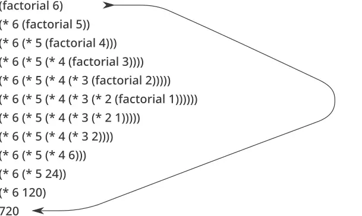
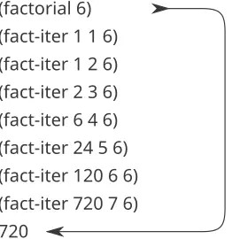
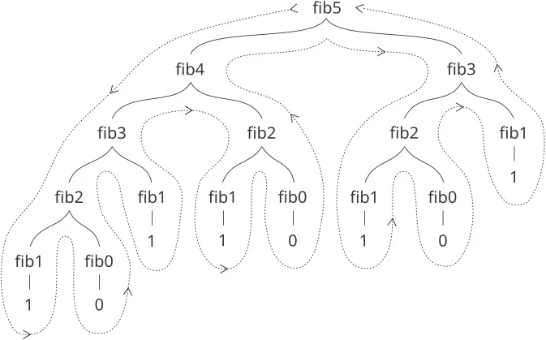

### 1.2 الإجراءات والعمليات التي تولّدها

لقد نظرنا حتى الآن في عناصر البرمجة: استخدمنا عمليات حسابية أولية، وركّبنا هذه العمليات، وجرّدنا هذه العمليات المركّبة بتعريفها كإجراءات مركّبة. لكن ذلك لا يكفي لنقول إننا نعرف كيف نبرمج. ووضعنا مماثل لوضع من تعلّم قواعد حركة القطع في الشطرنج لكنه لا يعرف شيئًا عن الافتتاحيات أو التكتيكات أو الاستراتيجية النموذجية. وكما هو حال لاعب الشطرنج المبتدئ، لا نعرف بعد الأنماط الشائعة للاستخدام في هذا المجال. تنقصنا المعرفة بأي النقلات جديرة بأن تُلعب (أي الإجراءات جديرة بأن تُعرَّف). وتنقصنا الخبرة للتنبؤ بعواقب القيام بنقلة (تنفيذ إجراء).

إن القدرة على تصوّر عواقب الأفعال قيد النظر أمر بالغ الأهمية لأن يصبح المرء مبرمجًا خبيرًا، تمامًا كما هو الحال في أي نشاط تركيبي إبداعي. فعند أن يصبح المرء مصوّرًا فوتوغرافيًا خبيرًا، مثلًا، عليه أن يتعلّم كيف ينظر إلى مشهد ويعرف مقدار عتمة كل منطقة عند طباعتها لكل اختيار ممكن لظروف التعريض والتحميض. وعندها فقط يستطيع أن يستدلّ عكسيًا، فيخطّط للتأطير والإضاءة والتعريض والتحميض للحصول على التأثيرات المرغوبة. وكذلك الأمر في البرمجة، حيث نخطّط لمسار الفعل الذي ستسلكه عملية، وحيث نتحكم في العملية عن طريق برنامج. ولكي نصبح خبراء، علينا أن نتعلّم تصوّر العمليات التي تولّدها أنماط مختلفة من الإجراءات. وفقط بعد أن نطوّر مثل هذه المهارة نستطيع أن نتعلّم بناء برامج تُظهر السلوك المرغوب على نحو موثوق.

الإجراء نمط للتطور المحلّي لعملية حسابية. وهو يحدّد كيف يُبنى كل طور من أطوار العملية على الطور السابق. ونودّ أن نتمكن من إصدار عبارات عن السلوك الكلي، أو *الشامل*، لعملية حُدِّد تطورها المحلّي بإجراء. وهذا أمر صعب جدًا عمومًا، لكن يمكننا على الأقل أن نحاول وصف بعض الأنماط النمطية لتطور العملية.

في هذا القسم سنفحص بعض «الأشكال» الشائعة للعمليات التي تولّدها إجراءات بسيطة. وسنبحث أيضًا في المعدلات التي تستهلك بها هذه العمليات موارد الحساب المهمة: الزمن والمساحة. والإجراءات التي سننظر فيها بسيطة جدًا. ودورها مثل دور أنماط الاختبار في التصوير الفوتوغرافي: أنماط نماذج مبسَّطة بإفراط، لا أمثلة عملية بحد ذاتها.

#### 1.2.1 التعاود الخطي والتكرار

نبدأ بالنظر في دالة العاملي، المعرَّفة بـ $n ! = n ⋅ ( n − 1 ) ⋅ ( n − 2 ) ⋯ 3 ⋅ 2 ⋅ 1.$ هناك طرق كثيرة لحساب العوامل. وإحدى الطرق هي الاستفادة من الملاحظة أن $n !$ يساوي $n$ مضروبًا في $( n − 1 ) !$ لأي عدد صحيح موجب $n$ : $n ! = n ⋅ [ ( n − 1 ) ⋅ ( n − 2 ) ⋯ 3 ⋅ 2 ⋅ 1 ] = n ⋅ ( n − 1 ) ! .$ وهكذا، يمكننا حساب $n !$ بحساب $( n − 1 ) !$ وضرب النتيجة في $n$ . وإذا أضفنا الشرط أن 1! يساوي 1، فإن هذه الملاحظة تُترجم مباشرة إلى إجراء:

```scheme
(define (factorial n)
  (if (= n 1) 
      1 
      (* n (factorial (- n 1)))))
```

يمكننا استخدام نموذج الاستبدال من [1.1.5](https://sarabander.github.io/sicp/html/1_002e1.xhtml#g_t1_002e1_002e5) لمشاهدة هذا الإجراء أثناء عمله في حساب 6!، كما هو مبيَّن في [الشكل 1.3](/book/sicp/c1-building-abstractions-with-procedures/1-2/).



**الشكل 1.3:** عملية تعاودية خطية لحساب 6!.

والآن لنأخذ منظورًا مختلفًا حول حساب العوامل. يمكننا وصف قاعدة لحساب $n !$ بتحديد أننا نضرب 1 في 2 أولًا، ثم نضرب النتيجة في 3، ثم في 4، وهكذا حتى نصل إلى $n$ . وبصورة أكثر رسمية، نحتفظ بجداء جارٍ، إلى جانب عدّاد يعدّ من 1 حتى $n$ . ويمكننا وصف الحساب بالقول إن العدّاد والجداء يتغيران في الوقت نفسه من خطوة إلى التي تليها وفقًا للقاعدة

```
product  $←$  counter * product
counter  $←$  counter + 1
```

ونشترط أن $n !$ هو قيمة الجداء عندما يتجاوز العدّاد $n$ .

ومرة أخرى، يمكننا إعادة صياغة وصفنا في صورة إجراء لحساب العوامل:[^29]

```scheme
(define (factorial n) 
  (fact-iter 1 1 n))

(define (fact-iter product counter max-count)
  (if (> counter max-count)
      product
      (fact-iter (* counter product)
                 (+ counter 1)
                 max-count)))
```

وكما في السابق، يمكننا استخدام نموذج الاستبدال لتصوّر عملية حساب 6!، كما هو مبيَّن في [الشكل 1.4](/book/sicp/c1-building-abstractions-with-procedures/1-2/).



**الشكل 1.4:** عملية تكرارية خطية لحساب 6!.

قارن بين العمليتين. فمن وجهة نظر ما، يبدوان متشابهين إلى حدّ يعسر معه التمييز بينهما. فكلتاهما تحسب الدالة الرياضية نفسها على المجال نفسه، وكلٌّ منهما تتطلب عددًا من الخطوات يتناسب مع $n$ لحساب $n !$ . بل إن كلتا العمليتين تنفّذان حتى المتتالية نفسها من الضرب، فتحصلان على المتتالية نفسها من الجداءات الجزئية. ومن ناحية أخرى، عندما ننظر في «أشكال» العمليتين، نجد أنهما تتطوران على نحو مختلف تمامًا.

تأمل العملية الأولى. يكشف نموذج الاستبدال شكلًا من التوسّع يعقبه انقباض، كما يدل عليه السهم في [الشكل 1.3](/book/sicp/c1-building-abstractions-with-procedures/1-2/). ويحدث التوسّع بينما تبني العملية سلسلة من *العمليات المؤجَّلة* (وهي في هذه الحالة سلسلة من الضرب). ويحدث الانقباض عند تنفيذ العمليات فعليًا. وهذا النوع من العمليات، الذي يتميّز بسلسلة من العمليات المؤجَّلة، يُسمى *عملية تعاودية*. ويتطلب تنفيذ هذه العملية أن يتعقّب المفسّر العمليات التي ستنفَّذ لاحقًا. وفي حساب $n !$ ، ينمو طول سلسلة الضرب المؤجَّل، ومن ثمّ مقدار المعلومات اللازمة لتعقّبها، خطيًا مع $n$ (أي يتناسب مع $n$ )، تمامًا كعدد الخطوات. وتُسمى مثل هذه العملية *عملية تعاودية خطية*.

وعلى النقيض، لا تنمو العملية الثانية ولا تتقلّص. وفي كل خطوة، كل ما نحتاج إلى تعقّبه، لأي $n$ ، هو القيم الحالية للمتغيّرات `product` و`counter` و`max-count`. ونسمي هذه *عملية تكرارية*. وعمومًا، العملية التكرارية هي التي يمكن تلخيص حالتها بعدد ثابت من *متغيّرات الحالة*، إلى جانب قاعدة ثابتة تصف كيف ينبغي تحديث متغيّرات الحالة بينما تنتقل العملية من حالة إلى حالة، واختبار انتهاء (اختياري) يحدّد الشروط التي ينبغي أن تنتهي عندها العملية. وفي حساب $n !$ ، ينمو عدد الخطوات المطلوبة خطيًا مع $n$ . وتُسمى مثل هذه العملية *عملية تكرارية خطية*.

ويمكن رؤية التباين بين العمليتين بطريقة أخرى. في الحالة التكرارية، تقدّم متغيّرات البرنامج وصفًا كاملًا لحالة العملية في أي نقطة. فلو أوقفنا الحساب بين الخطوات، لما احتجنا لاستئناف الحساب سوى تزويد المفسّر بقيم متغيّرات البرنامج الثلاثة. وليس الأمر كذلك مع العملية التعاودية. فهنا توجد بعض المعلومات «الخفيّة» الإضافية، التي يحتفظ بها المفسّر ولا تحتوي عليها متغيّرات البرنامج، والتي تدلّ على «موضع العملية» في أثناء تعاملها مع سلسلة العمليات المؤجَّلة. وكلما طالت السلسلة، وجب الاحتفاظ بمعلومات أكثر.[^30]

وعند المقابلة بين التكرار والتعاود، يجب أن نحرص على عدم الخلط بين فكرة *العملية* التعاودية وفكرة *الإجراء* التعاودي. فعندما نصف إجراءً بأنه تعاودي، فإننا نشير إلى الحقيقة النحوية القائلة إن تعريف الإجراء يشير (مباشرةً أو غير مباشرة) إلى الإجراء نفسه. لكن عندما نصف عملية بأنها تتبع نمطًا، لنقل، تعاوديًا خطيًا، فإننا نتحدّث عن كيفية تطور العملية، لا عن النحو الذي كُتب به الإجراء. وقد يبدو مُقلقًا أن نشير إلى إجراء تعاودي مثل `fact-iter` بأنه يولّد عملية تكرارية. غير أن العملية تكرارية فعلًا: فحالتها تُلتقط بالكامل بمتغيّرات حالتها الثلاثة، ولا يحتاج المفسّر إلى تعقّب سوى ثلاثة متغيّرات لتنفيذ العملية.

إنّ سببًا من أسباب الالتباس في التمييز بين العمليّة والإجراء هو أنّ معظم تنفيذات اللغات الشائعة (بما فيها Ada وPascal وC) مُصمَّمة على نحوٍ يجعل تفسير أيّ إجراءٍ تعاوديّ يستهلك مقدارًا من الذاكرة ينمو بعدد نداءات الإجراء، حتّى عندما تكون العمليّة الموصوفة، من حيث المبدأ، تكراريّة. ونتيجةً لذلك، لا تستطيع هذه اللغات وصف العمليّات التكراريّة إلّا باللجوء إلى «بنى حلقات» ذات أغراض خاصّة مثل `do` و`repeat` و`until` و`for` و`while`. أمّا تنفيذ Scheme الذي سننظر فيه في [الفصل 5](https://sarabander.github.io/sicp/html/Chapter-5.xhtml#Chapter-5) فلا يشاركنا هذا الخلل. فسوف ينفّذ العمليّة التكراريّة في مساحةٍ ثابتة، حتّى إذا كانت العمليّة التكراريّة موصوفةً بإجراءٍ تعاوديّ. ويُسمّى التنفيذ ذو هذه الخاصّيّة *تعاوديًّا ذيليًّا*. وبتنفيذ تعاوديّ ذيليّ، يمكن التعبير عن التكرار باستخدام آليّة نداء الإجراءات المعتادة، بحيث تصير بنى التكرار الخاصّة ذا فائدةٍ كسُكَرٍ نحويّ.[^31]

**تمرين 1.9:** يحدّد كلٌّ من الإجراءين التاليين طريقةً لجمع عددين صحيحين موجبين بدلالة الإجراء `inc`، الذي يزيد وسيطه بمقدار 1، والإجراء `dec`، الذي ينقص وسيطه بمقدار 1.

```scheme
(define (+ a b)
  (if (= a 0) 
      b 
      (inc (+ (dec a) b))))

(define (+ a b)
  (if (= a 0) 
      b 
      (+ (dec a) (inc b))))
```

باستخدام نموذج الاستبدال، صُوّر العمليّة التي يولّدها كلٌّ من الإجراءين عند تقييم `(+ 4 5)` . فهل هاتان العمليّتان تكراريّتان أم تعاوديّتان؟

**تمرين 1.10:** يحسب الإجراء التالي دالّةً رياضيّةً تُسمّى دالّة Ackermann.

```scheme
(define (A x y)
  (cond ((= y 0) 0)
        ((= x 0) (* 2 y))
        ((= y 1) 2)
        (else (A (- x 1)
                 (A x (- y 1))))))
```

ما قيم التعبيرات التالية؟

```scheme
(A 1 10)
(A 2 4)
(A 3 3)
```

تأمّل الإجراءات التالية، حيث `A` هو الإجراء المُعرَّف أعلاه:

```scheme
(define (f n) (A 0 n))
(define (g n) (A 1 n))
(define (h n) (A 2 n))
(define (k n) (* 5 n n))
```

أعطِ تعريفات رياضيّة موجزة للدوالّ التي تحسبها الإجراءات `f` و`g` و`h` لقيم العدد الصحيح الموجبة $n$ . فعلى سبيل المثال، يحسب `(k n)` القيمة $5 n^{2}$ .

#### 1.2.2 التعاود الشجريّ

هناك نمطٌ شائعٌ آخر من الاحتساب يُسمّى *التعاود الشجريّ*. فخذ مثلًا احتساب متتالية أعداد فيبوناتشي، التي يكون فيها كلّ عددٍ مجموع العددين السابقين:

0، 1، 1، 2، 3، 5، 8، 13، 21، ....

وبصورة عامّة، يمكن تعريف أعداد فيبوناتشي بالقاعدة $Fib ( n ) = \begin{cases} 0 & \text{if} n = 0 , \\ 1 & \text{if} n = 1 , \\ Fib ( n − 1 ) + Fib ( n − 2 ) & \text{otherwise} . \end{cases}$ ويمكننا ترجمة هذا التعريف مباشرةً إلى إجراءٍ تعاوديٍّ لاحتساب أعداد فيبوناتشي:

```scheme
(define (fib n)
  (cond ((= n 0) 0)
        ((= n 1) 1)
        (else (+ (fib (- n 1))
                 (fib (- n 2))))))
```

تأمّل نمط هذا الاحتساب. فلاحتساب `(fib 5)`، نحتسب `(fib 4)` و`(fib 3)`. ولاحتساب `(fib 4)`، نحتسب `(fib 3)` و`(fib 2)`. وبصورة عامّة، تبدو العمليّة المتطوّرة كأنّها شجرة، كما هو مبيَّن في [الشكل 1.5](/book/sicp/c1-building-abstractions-with-procedures/1-2/). ولاحِظ أنّ الفروع تتشعّب إلى فرعين في كلّ مستوى (إلّا في الأسفل)؛ وهذا يعكس حقيقة أنّ الإجراء `fib` يُنادي نفسه مرّتين في كلّ مرّةٍ يُستدعى فيها.



**الشكل 1.5:** العمليّة التعاوديّة الشجريّة المتولّدة عند احتساب `(fib 5)`.

هذا الإجراء تعليميٌّ بوصفه تعاودًا شجريًّا نموذجيًّا، لكنّه طريقةٌ فظيعةٌ لاحتساب أعداد فيبوناتشي لأنّه يؤدي إلى قدرٍ كبيرٍ من الاحتساب المُكرَّر. فلاحِظ في [الشكل 1.5](/book/sicp/c1-building-abstractions-with-procedures/1-2/) أنّ احتساب `(fib 3)` بكامله - وهو قرابة نصف العمل - مُكرَّر. وفي الحقيقة، ليس من الصعب إظهار أنّ عدد المرّات التي سيحتسب فيها الإجراء `(fib 1)` أو `(fib 0)` (وهو عدد الأوراق في الشجرة أعلاه، بصورة عامّة) هو بالضبط $Fib ( n + 1 )$ . ولمعرفة مدى سُوء هذا الأمر، يمكن إظهار أنّ قيمة $Fib ( n )$ تنمو أسّيًّا مع $n$ . وبشكلٍ أدقّ (انظر [تمرين 1.13](/book/sicp/c1-building-abstractions-with-procedures/1-2/))، فإنّ $Fib ( n )$ هو أقرب عددٍ صحيحٍ إلى $φ^{n} / \sqrt{5}$ ، حيث $φ = \frac{1 + \sqrt{5}}{2} ≈ 1.6180$ هي *النسبة الذهبيّة*، التي تحقّق المعادلة $φ^{2} = φ + 1.$ وبالتالي، فإنّ العمليّة تستخدم عددًا من الخطوات ينمو أسّيًّا مع المدخلات. ومن ناحية أخرى، فإنّ المساحة المطلوبة تنمو خطّيًّا فقط مع المدخلات، لأنّنا لا نحتاج إلى تعقّب إلّا العُقد التي تعلونا في الشجرة في أيّ نقطةٍ من الاحتساب. وبصورة عامّة، فإنّ عدد الخطوات التي تتطلّبها العمليّة التعاوديّة الشجريّة سيتناسب مع عدد العُقد في الشجرة، بينما ستتناسب المساحة المطلوبة مع أقصى عمقٍ للشجرة.

يمكننا أيضًا صياغة عمليّةٍ تكراريّةٍ لاحتساب أعداد فيبوناتشي. والفكرة هي استخدام زوجٍ من الأعداد الصحيحة $a$ و$b$ ، مُهيَّأٍ على $Fib(1) = 1$ و$Fib(0) = 0$ ، وتطبيق التحويلات المتزامنة مرارًا وتكرارًا

$a ← a + b , b ← a .$

ليس من الصعب إظهار أنّ، بعد تطبيق هذا التحويل $n$ مرّة، سيصبح $a$ و$b$ مساويين على الترتيب لـ$Fib ( n + 1 )$ و$Fib ( n )$ . وبالتالي، يمكننا احتساب أعداد فيبوناتشي تكرارًا باستخدام الإجراء

```scheme
(define (fib n) 
  (fib-iter 1 0 n))

(define (fib-iter a b count)
  (if (= count 0)
      b
      (fib-iter (+ a b) a (- count 1))))
```

هذه الطريقة الثانية لاحتساب $Fib ( n )$ تكرارٌ خطّيّ. والفرق في عدد الخطوات الذي تتطلّبه الطريقتان - إحداهما خطّيّة في $n$ ، والأخرى تنمو بسرعة $Fib ( n )$ نفسها - هائل، حتّى بالنسبة للمدخلات الصغيرة.

لا يجوز أن نستنتج من ذلك أنّ العمليّات التعاوديّة الشجريّة غير مفيدة. فعندما ننظر في العمليّات التي تعمل على بياناتٍ مهيكلةٍ هرميًّا بدلًا من الأعداد، سنجد أنّ التعاود الشجريّ أداةٌ طبيعيّةٌ وقويّة.[^32] ولكن حتّى في العمليّات العدديّة، يمكن أن تكون العمليّات التعاوديّة الشجريّة مفيدةً في مساعدتنا على فهم البرامج وتصميمها. فعلى سبيل المثال، وعلى الرغم من أنّ الإجراء `fib` الأوّل أقلّ كفاءةً بكثيرٍ من الثاني، فإنّه أكثر مباشرةً، إذ ليس سوى ترجمةً إلى Lisp لتعريف متتالية فيبوناتشي. وقد استلزمت صياغة الخوارزميّة التكراريّة ملاحظة أنّ الاحتساب يمكن إعادة صياغته تكرارًا بثلاثة متغيّرات حالة.

#### مثال: عدّ طرق إبدال النقود

لا يتطلّب الأمر إلّا القليل من الذكاء للتوصل إلى الخوارزميّة التكراريّة لأعداد فيبوناتشي. وعلى النقيض من ذلك، تأمّل المسألة التالية: كم طريقةً مختلفةً يمكننا بها إبدال مبلغ $1.00، إذا كانت العملات المتاحة هي أنصاف الدولار والربع دولار والدايمات والنيكلات والبنسات؟ وبصورةٍ أعمّ، فهل يمكننا كتابة إجراءٍ لحساب عدد طرق إبدال أيّ مبلغٍ معطى من النقود؟

لهذه المسألة حلٌّ بسيطٌ في صورة إجراءٍ تعاوديّ. فلنفترض أنّنا ننظر إلى أنواع العملات المتاحة كأنّها مرتّبةٌ في ترتيبٍ ما. وعندئذٍ يسري العلاقة التالية:

يساوي عدد طرق إبدال المبلغ $a$ باستخدام $n$ أنواعٍ من العملات

- عدد طرق إبدال المبلغ $a$ باستخدام كلّ أنواع العملات عدا النوع الأوّل، زائدًا
- عدد طرق إبدال المبلغ $a − d$ باستخدام كلّ أنواع العملات $n$ ، حيث $d$ هو فئة النوع الأوّل من العملات.

ولنرَ سبب صحّة ذلك، لاحِظ أنّ طرق إبدال النقود يمكن تقسيمها إلى مجموعتين: تلك التي لا تستخدم أيّ عملةٍ من النوع الأوّل، وتلك التي تستخدمه. وبالتالي، فإنّ العدد الكلّيّ لطرق إبدال مبلغٍ ما يساوي عدد طرق إبدال المبلغ دون استخدام أيّ عملةٍ من النوع الأوّل، زائدًا عدد طرق الإبدال على افتراض أنّنا نستخدم عملةً من النوع الأوّل. وهذا العدد الأخير يساوي عدد طرق إبدال المبلغ المتبقّي بعد استخدام عملةٍ من النوع الأوّل.

وبالتالي، يمكننا تقليص مسألة إبدال مبلغٍ معطى تقليصًا تعاوديًّا إلى مسألة إبدال مبالغ أصغر باستخدام أنواعٍ أقلّ من العملات. تأمّل قاعدة التقليص هذه بعناية، وأقنع نفسك بأنّنا نستطيع استخدامها لوصف خوارزميّةٍ إذا حدّدنا الحالات المنحطّة التالية:[^33]

- إذا كان $a$ يساوي 0 بالضبط، فينبغي أن نعدّ ذلك طريقةً واحدةً لإبدال النقود.
- إذا كان $a$ أقلّ من 0، فينبغي أن نعدّ ذلك صفر طريقةٍ لإبدال النقود.
- إذا كان $n$ يساوي 0، فينبغي أن نعدّ ذلك صفر طريقةٍ لإبدال النقود.

يمكننا بسهولةٍ ترجمة هذا الوصف إلى إجراءٍ تعاوديّ:

```scheme
(define (count-change amount)
  (cc amount 5))

(define (cc amount kinds-of-coins)
  (cond ((= amount 0) 1)
        ((or (< amount 0) 
             (= kinds-of-coins 0)) 
         0)
        (else 
         (+ (cc amount (- kinds-of-coins 1))
            (cc (- amount (first-denomination 
                           kinds-of-coins))
                kinds-of-coins)))))

(define (first-denomination kinds-of-coins)
  (cond ((= kinds-of-coins 1) 1)
        ((= kinds-of-coins 2) 5)
        ((= kinds-of-coins 3) 10)
        ((= kinds-of-coins 4) 25)
        ((= kinds-of-coins 5) 50)))
```

(يأخذ الإجراء `first-denomination` مدخلًا عدد أنواع العملات المتاحة ويعيد فئة النوع الأوّل. وهنا نحن ننظر إلى العملات كأنّها مرتّبةٌ من الأكبر إلى الأصغر، ولكن أيّ ترتيبٍ آخر يكفي كذلك.) ويمكننا الآن الإجابة عن سؤالنا الأصليّ حول إبدال الدولار الواحد:

```scheme
(count-change 100)
292
```

يولّد الإجراء `count-change` عمليّةً تعاوديّةً شجريّةً ذات تكراراتٍ زائدةٍ شبيهةٍ بتلك التي في تنفيذنا الأوّل لـ`fib`. (وسوف يستغرق احتساب ذلك العدد 292 وقتًا طويلًا.) ومن ناحية أخرى، فليس من الواضح كيف نُصمّم خوارزميّةً أفضل لاحتساب النتيجة، ونحن نترك هذه المسألة تحدّيًا. وقد دفعت الملاحظة القائلة إنّ العمليّة التعاوديّة الشجريّة قد تكون غير كفؤةٍ للغاية لكنّها غالبًا ما تكون سهلة التحديد والفهم، الناسَ إلى الاقتراح بأنّ المرء يمكن أن يجمع بين أفضل ما في العالمين بتصميم «مصرِّف ذكيّ» يستطيع تحويل الإجراءات التعاوديّة الشجريّة إلى إجراءاتٍ أكثر كفاءةً تحسب النتيجة ذاتها.[^34]

> **تمرين 1.11:** دالّةٌ $f$ مُعرَّفةٌ بالقاعدة أنّ $f ( n ) = n$ إذا كان $n < 3$ و$f ( n ) = f ( n − 1 ) + 2 f ( n − 2 ) + 3 f ( n − 3 )$ إذا كان $n ≥ 3$ . اكتب إجراءً يحسب $f$ بواسطة عمليّةٍ تعاوديّة. واكتب إجراءً يحسب $f$ بواسطة عمليّةٍ تكراريّة.

**تمرين 1.12:** يُسمّى نمط الأعداد التالي *مثلّث باسكال*.

```
         1
       1   1
     1   2   1
   1   3   3   1
 1   4   6   4   1
       . . .
```

الأعداد عند حافّة المثلّث كلّها 1، وكلّ عددٍ داخل المثلّث هو مجموع العددين الواقعين فوقه.[^35] واكتب إجراءً يحسب عناصر مثلّث باسكال بواسطة عمليّةٍ تعاوديّة.

> **تمرين 1.13:** أثبت أنّ $Fib ( n )$ هو أقرب عددٍ صحيحٍ إلى $φ^{n} / \sqrt{5}$ ، حيث $φ = ( 1 + \sqrt{5} ) / 2$ . تلميح: ليكن $ψ = ( 1 − \sqrt{5} ) / 2$ . استخدم الاستقراح وتعريف أعداد فيبوناتشي (انظر [1.2.2](/book/sicp/c1-building-abstractions-with-procedures/1-2/)) لتُثبت أنّ $Fib ( n ) = ( φ^{n} − ψ^{n} ) / \sqrt{5}$ .

#### 1.2.3 رُتب النموّ

توضّح الأمثلة السابقة أنّ العمليّات يمكن أن تختلف اختلافًا كبيرًا في المعدّلات التي تستهلك بها الموارد الاحتسابيّة. وإحدى الطرائق الملائمة لوصف هذا الاختلاف هي استخدام مفهوم *رتبة النموّ* للحصول على قياسٍ إجماليٍّ للموارد التي تتطلّبها العمليّة مع كِبَر المدخلات.

لتكن $n$ مُعاملًا يقيس حجم المسألة، ولتكن $R ( n )$ مقدار الموارد التي تتطلّبها العمليّة لمسألةٍ حجمها $n$ . وفي أمثلتنا السابقة أخذنا $n$ العدد الذي يُحتسب لأجله دالّةٌ معيّنة، ولكن ثمّة إمكانيّاتٍ أخرى. فعلى سبيل المثال، إذا كان هدفنا هو احتساب تقريبٍ للجذر التربيعيّ لعددٍ ما، فقد نأخذ $n$ عدد الأرقام المطلوبة في الدقّة. وفي ضرب المصفوفات قد نأخذ $n$ عدد الصفوف في المصفوفات. وبصورة عامّة، ثمّة عددٍ من خصائص المسألة التي يكون من المرغوب تحليل عمليّةٍ معيّنةٍ بالنسبة إليها. وبالمثل، قد تقيس $R ( n )$ عدد مسجّلات التخزين الداخليّ المستخدمة، وعدد عمليّات الآلة الأوليّة المنفَّذة، وكذلك غير ذلك. وفي الحواسيب التي تؤدّي عددًا ثابتًا من العمليّات في الوقت نفسه، سيكون الزمن المطلوب متناسبًا مع عدد عمليّات الآلة الأوليّة المنفَّذة.

نقول إنّ $R ( n )$ ذات رتبة نموّ $Θ ( f ( n ) )$ ، وتُكتب $R ( n ) = Θ ( f ( n ) )$ (وتُنطق «ثيتا التابعة لـ$f ( n )$ »)، إذا وجدت ثابتتان موجبتان $k_{1}$ و$k_{2}$ مستقلّتان عن $n$ بحيث يتحقّق $k_{1} f ( n ) ≤ R ( n ) ≤ k_{2} f ( n )$ لأيّ قيمةٍ كبيرةٍ بما يكفي من $n$ . (وبعبارةٍ أخرى، من أجل $n$ الكبيرة، تكون القيمة $R ( n )$ محصورةً بين $k_{1} f ( n )$ و$k_{2} f ( n )$ .)

فعلى سبيل المثال، فإنّ عدد الخطوات في العمليّة التعاوديّة الخطّيّة لاحتساب العامليّات الموصوفة في [1.2.1](/book/sicp/c1-building-abstractions-with-procedures/1-2/) ينمو تناسبًا مع مدخل $n$ . وبالتالي، فإنّ الخطوات التي تتطلّبها هذه العمليّة تنمو على الصورة $Θ ( n )$ . ورأينا أيضًا أنّ المساحة المطلوبة تنمو على الصورة $Θ ( n )$ . وأمّا في حالة العامليّات التكراريّة، فإنّ عدد الخطوات لا يزال $Θ ( n )$ ولكن المساحة هي $Θ ( 1 )$ - أي ثابتة.[^36] ويتطلّب احتساب فيبوناتشي التعاوديّ الشجريّ $Θ ( φ^{n} )$ خطوةً ومساحة $Θ ( n )$ ، حيث $φ$ هي النسبة الذهبيّة الموصوفة في [1.2.2](/book/sicp/c1-building-abstractions-with-procedures/1-2/).

إنّ رُتب النموّ لا تقدّم سوى وصفٍ خشنٍ لسلوك العمليّة. فعلى سبيل المثال، فإنّ العمليّة التي تتطلّب $n^{2}$ خطوةً، والعمليّة التي تتطلّب $1000 n^{2}$ خطوةً، والعمليّة التي تتطلّب $3 n^{2} + 10 n + 17$ خطوةً، كلّها ذات رتبة نموّ $Θ ( n^{2} )$ . ومن ناحية أخرى، فإنّ رتبة النموّ تقدّم إشارةً مفيدةً حول كيف نتوقّع أن يتغيّر سلوك العمليّة بتغيّرنا حجم المسألة. ففي العمليّة $Θ ( n )$ (الخطّيّة)، سيؤدّي مضاعفة الحجم إلى مضاعفة مقدار الموارد المستخدمة تقريبًا. وفي العمليّة الأسّيّة، ستؤدّي كلّ زيادةٍ في حجم المسألة إلى ضرب استخدام الموارد في عاملٍ ثابت. وفي الجزء المتبقّي من [1.2](/book/sicp/c1-building-abstractions-with-procedures/1-2/) سنفحص خوارزميّتين رتبة نموّهما لوغاريتميّة، بحيث تؤدّي مضاعفة حجم المسألة إلى زيادة متطلّب الموارد بمقدارٍ ثابت.

> **تمرين 1.14:** ارسم الشجرة التي توضّح العمليّة التي يولّدها الإجراء `count-change` المذكور في [1.2.2](/book/sicp/c1-building-abstractions-with-procedures/1-2/) عند إبدال 11 سنتًا. فما رُتب نموّ المساحة وعدد الخطوات التي تستخدمها هذه العمليّة بازدياد المبلغ المطلوب إبداله؟

**تمرين 1.15:** يمكن احتساب جيب زاويةٍ (محدَّدةٍ بالراديان) بالاستفادة من التقريب $sin ⁡ x ≈ x$ إذا كان $x$ صغيرًا بما يكفي، ومن المتطابقة المثلّثاتيّة $sin ⁡ x = 3 sin ⁡ \frac{x}{3} − 4 sin^{3} ⁡ \frac{x}{3}$ لتقليص حجم وسيط الجيب. (ولأغراض هذا التمرين، تُعتبر الزاوية «صغيرةً بما يكفي» إذا كان مقدارها لا يزيد على 0.1 راديان.) وهذه الأفكار مُدمجةٌ في الإجراءات التالية:

```scheme
(define (cube x) (* x x x))
(define (p x) (- (* 3 x) (* 4 (cube x))))
(define (sine angle)
   (if (not (> (abs angle) 0.1))
       angle
       (p (sine (/ angle 3.0)))))
```

1. كم مرّةً يُطبَّق الإجراء `p` عند تقييم `(sine 12.15)`؟
2. فما رتبة النموّ في المساحة وعدد الخطوات (كدالّةٍ في $a$ ) التي تستخدمها العمليّة التي يولّدها الإجراء `sine` عند تقييم `(sine a)`؟

#### 1.2.4 الأسّ

تأمّل مسألة احتساب أسّ عددٍ معطى. فنحن نريد إجراءً يأخذ وسيطَين أساسًا $b$ وأُسًّا $n$ عددًا صحيحًا موجبًا، ويحسب $b^{n}$ . وإحدى الطرائق لفعل ذلك هي التعريف التعاوديّ $b^{n} = b ⋅ b^{n − 1} , b^{0} = 1 ,$ الذي يترجم بسهولةٍ إلى الإجراء

```scheme
(define (expt b n)
  (if (= n 0) 
      1 
      (* b (expt b (- n 1)))))
```

وهذه عمليّةٌ تعاوديّةٌ خطّيّة، تتطلّب $Θ ( n )$ خطوةً و$Θ ( n )$ مساحة. وتمامًا كما في حالة العامليّات، يمكننا بصياغةٍ سهلةٍ صياغة تكرارٍ خطّيٍّ مكافئ:

```scheme
(define (expt b n) 
  (expt-iter b n 1))

(define (expt-iter b counter product)
  (if (= counter 0)
      product
      (expt-iter b
                 (- counter 1)
                 (* b product))))
```

تتطلّب هذه النسخة $Θ ( n )$ خطوةً و$Θ ( 1 )$ مساحة.

يمكننا احتساب الأسس بخطواتٍ أقلّ باستخدام التربيع المتكرّر. فعلى سبيل المثال، بدلًا من احتساب $b^{8}$ على الصورة $b ⋅ ( b ⋅ ( b ⋅ ( b ⋅ ( b ⋅ ( b ⋅ ( b ⋅ b ) ) ) ) ) ) ,$ يمكننا احتسابها بثلاث عمليّات ضرب: $b^{2} = b ⋅ b , b^{4} = b^{2} ⋅ b^{2} , b^{8} = b^{4} ⋅ b^{4} .$ وهذه الطريقة تنجح على نحوٍ حسنٍ مع الأسس التي هي قوى للعدد 2. ونستطيع أيضًا الاستفادة من التربيع المتكرّر في احتساب الأسس بصورة عامّة إذا استخدمنا القاعدة $b^{n} = ( b^{n / 2} )^{2} if n is even , b^{n} = b ⋅ b^{n − 1} if n is odd .$ ويمكننا التعبير عن هذه الطريقة في صورة إجراء:

```scheme
(define (fast-expt b n)
  (cond ((= n 0) 
         1)
        ((even? n) 
         (square (fast-expt b (/ n 2))))
        (else 
         (* b (fast-expt b (- n 1))))))
```

حيث يُعرَّف المسند الذي يختبر كون عددٍ صحيحٍ زوجيًّا بدلالة الإجراء الأوّليّ `remainder` بواسطة

```scheme
(define (even? n)
  (= (remainder n 2) 0))
```

تنمو العمليّة التي يتطوّرها الإجراء `fast-expt` لوغاريتميًّا مع $n$ في كلّ من المساحة وعدد الخطوات. ولرؤية ذلك، لاحِظ أنّ احتساب $b^{2 n}$ باستخدام `fast-expt` لا يتطلّب سوى عمليّة ضربٍ إضافيّةٍ واحدةً مقارنةً باحتساب $b^{n}$ . وبالتالي، فإنّ حجم الأُسّ الذي نستطيع احتسابه يتضاعف (تقريبًا) مع كلّ عمليّة ضربٍ جديدةٍ يُتاح لنا أداؤها. وهكذا، فإنّ عدد عمليّات الضرب المطلوبة لأُسٍّ قيمته $n$ ينمو بسرعةٍ تقارب سرعة لوغاريتم $n$ للأساس 2. وللعمليّة نموٌّ من رتبة $Θ ( log ⁡ n )$ .[^37]

يصبح الفرق بين نموّ $Θ ( log ⁡ n )$ ونموّ $Θ ( n )$ لافتًا مع كِبَر $n$ . فعلى سبيل المثال، يتطلّب `fast-expt` من أجل $n$ = 1000 أربع عشرة عمليّة ضربٍ فقط.[^38] ومن الممكن أيضًا استخدام فكرة التربيع المتكرّر لاستنباط خوارزميّةٍ تكراريّةٍ تحسب الأسس بعددٍ لوغاريتميٍّ من الخطوات (انظر [تمرين 1.16](/book/sicp/c1-building-abstractions-with-procedures/1-2/))، على الرغم من أنّ ذلك، كما هو الحال في الغالب مع الخوارزميّات التكراريّة، لا يُكتب على نحوٍ مباشرٍ كالخوارزميّة التعاوديّة.[^39]

> **تمرين 1.16:** صمّم إجراءً يتطوّر فيه أسٌّ بعمليّةٍ تكراريّةٍ تستخدم التربيع المتكرّر وتستخدم عددًا لوغاريتميًّا من الخطوات، كما يفعل `fast-expt` . (تلميح: باستخدام الملاحظة أنّ $( b^{n / 2} )^{2} = ( b^{2} )^{n / 2}$ ، أبقِ، إلى جانب الأُسّ $n$ والأساس $b$ ، متغيّر حالةٍ إضافيًّا $a$ ، وعرّف تحويل الحالة بحيث يبقى الجداء $a b^{n}$ دون تغييرٍ من حالةٍ إلى أخرى. وفي بداية العمليّة يُؤخذ $a$ قيمته 1، وتُعطى الإجابة بقيمة $a$ في نهاية العمليّة. وبصورة عامّة، فإنّ تقنيّة تعريف *مقدارٍ ثابتٍ* يبقى دون تغييرٍ من حالةٍ إلى أخرى طريقةٌ قويّةٌ للتفكير في تصميم الخوارزميّات التكراريّة.)

**تمرين 1.17:** تستند خوارزميّات الأسّ الواردة في هذا القسم على أداء الأسّ عن طريق الضرب المتكرّر. وبطريقةٍ مشابهة، يمكن أداء ضرب الأعداد الصحيحة عن طريق الجمع المتكرّر. والإجراء الضربي التالي (الذي يُفترض فيه أنّ لغتنا تستطيع الجمع فقط لا الضرب) نظيرٌ للإجراء `expt`:

```scheme
(define (* a b)
  (if (= b 0)
      0
      (+ a (* a (- b 1)))))
```

تتطلّب هذه الخوارزميّة عددًا من الخطوات خطّيًّا في `b`. والآن فلنفترض أنّنا نُدرج، إلى جانب الجمع، عمليّتَي `double` ، التي تضاعف عددًا صحيحًا، و`halve` ، التي تقسم عددًا صحيحًا (زوجيًّا) على 2. وباستخدام هاتين العمليّتين، صمّم إجراءً ضربيًّا نظيرًا لـ`fast-expt` يستخدم عددًا لوغاريتميًّا من الخطوات.

> **تمرين 1.18:** باستخدام نتيجتَي [تمرين 1.16](/book/sicp/c1-building-abstractions-with-procedures/1-2/) و[تمرين 1.17](/book/sicp/c1-building-abstractions-with-procedures/1-2/)، استنبط إجراءً يولّد عمليّةً تكراريّةً لضرب عددين صحيحين بدلالة الجمع والمضاعفة والتنصيف، ويستخدم عددًا لوغاريتميًّا من الخطوات.[^40]

**تمرين 1.19:** ثمّة خوارزميّةٌ ذات حيلةٍ لاحتساب أعداد فيبوناتشي بعددٍ لوغاريتميٍّ من الخطوات. تذكّر تحويل متغيّري الحالة $a$ و$b$ في عمليّة `fib-iter` المذكورة في [1.2.2](/book/sicp/c1-building-abstractions-with-procedures/1-2/): $a ← a + b$ و$b ← a$ . ووسِم هذا التحويل بالرمز $T$ ، ولاحِظ أنّ تطبيق $T$ مرارًا وتكرارًا $n$ مرّةً، بدءًا من 1 و0، يُنتج الزوج $Fib ( n + 1 )$ و$Fib ( n )$ . وبعبارةٍ أخرى، فإنّ أعداد فيبوناتشي تُنتَج بتطبيق $T^{n}$ ، أي الأُسّ $n^{th}$ للتحويل $T$ ، بدءًا بالزوج (1, 0). والآن فكّر في $T$ كأنّه الحالة الخاصّة من $p = 0$ و$q = 1$ في عائلةٍ من التحويلات $T_{p q}$ ، حيث يحوّل $T_{p q}$ الزوج $( a , b )$ وفقًا للقاعدتين $a ← b q + a q + a p$ و$b ← b p + a q$ . وأظهر أنّه إذا طبّقنا تحويلًا من نوع $T_{p q}$ مرّتين، فإنّ الأثر هو نفسُه أثر استخدام تحويلٍ وحيدٍ من الشكل $T_{p^{′} q^{′}}$ ، واحسب $p^{′}$ و$q^{′}$ بدلالة $p$ و$q$ . وهذا يمنحنا طريقةً صريحةً لتربيع هذه التحويلات، وبالتالي نستطيع احتساب $T^{n}$ باستخدام التربيع المتكرّر، كما في الإجراء `fast-expt` . واجمع كلّ هذا معًا لتُكمل الإجراء التالي، الذي يعمل بعددٍ لوغاريتميٍّ من الخطوات:[^41]

```scheme
(define (fib n)
  (fib-iter 1 0 0 1 n))

(define (fib-iter a b p q count)
  (cond ((= count 0) 
         b)
        ((even? count)
         (fib-iter a
                   b
                   ⟨??⟩  ;compute p'
                   ⟨??⟩  ;compute q'
                   (/ count 2)))
        (else 
         (fib-iter (+ (* b q) 
                      (* a q) 
                      (* a p))
                   (+ (* b p) 
                      (* a q))
                   p
                   q
                   (- count 1)))))
```

#### 1.2.5 القواسم المشتركة الكبرى

القاسم المشترك الأكبر (GCD) لعددين صحيحين $a$ و$b$ يُعرَّف بأنه أكبر عددٍ صحيحٍ يقسم كلاً من $a$ و$b$ دون باقٍ. فعلى سبيل المثال، فإنّ القاسم المشترك الأكبر للعددين 16 و28 هو 4. وفي [الفصل 2](https://sarabander.github.io/sicp/html/Chapter-2.xhtml#Chapter-2)، عندما نبحث في كيفيّة تنفيذ الحساب على الأعداد الكسريّة، سنحتاج إلى القدرة على احتساب القواسم المشتركة الكبرى بغرض اختزال الأعداد الكسريّة إلى أبسط صورة. (ولاختزال عددٍ كسريٍّ إلى أبسط صورة، ينبغي أن نقسم كلًّا من البسط والمقام على قاسمهما المشترك الأكبر. فعلى سبيل المثال، فإنّ 16/28 يُختزل إلى 4/7.) وإحدى طرائق إيجاد القاسم المشترك الأكبر لعددين صحيحين هي تحليل كلٍّ منهما إلى عوامل والبحث عن عوامل مشتركة، ولكن ثمّة خوارزميّة مشهورة أكفأُ من ذلك بكثير.

تقوم فكرة الخوارزميّة على الملاحظة أنّهُ، إذا كان $r$ هو الباقي عند قسمة $a$ على $b$ ، فإنّ القواسم المشتركة للعددين $a$ و$b$ هي بالضبط القواسم المشتركة نفسها للعددين $b$ و$r$ . وبالتالي، فيمكننا استخدام المعادلة

```
GCD(a,b) = GCD(b,r)
```

لاختزال مسألة احتساب GCD إلى مسألة احتساب GCD لأزواجٍ من الأعداد الصحيحة أصغرَ فأصغر اختزالًا متتاليًّا. فعلى سبيل المثال،

```
GCD(206,40) = GCD(40,6)
            = GCD(6,4)
            = GCD(4,2)
            = GCD(2,0) = 2
```

يُختزل GCD(206, 40) إلى GCD(2, 0)، وهو 2. ويمكن إظهار أنّ الانطلاق بأيّ عددين صحيحين موجبين وأداء اختزالاتٍ متكرّرة سيُنتج دائمًا في النهاية زوجًا ثاني عدديه هو 0. وحينئذٍ يكون GCD هو العدد الآخر في الزوج. وتُعرَف هذه الطريقة في احتساب GCD بـ*خوارزميّة إقليدس*.[^42]

من السهل التعبير عن خوارزميّة إقليدس في صورة إجراء:

```scheme
(define (gcd a b)
  (if (= b 0)
      a
      (gcd b (remainder a b))))
```

يولّد هذا عمليّةً تكراريّةً، ويتناسب عدد خطواتها مع لوغاريتم الأعداد الداخلة فيه.

إنّ كون عدد الخطوات التي تتطلّبها خوارزميّة إقليدس ينمو نموًّا لوغاريتميًّا يحمل علاقةً مثيرةً للاهتمام بأعداد فيبوناتشي:

> **مبرهنة لامي:** إذا تطلّبت خوارزميّة إقليدس $k$ خطواتٍ لاحتساب GCD زوجٍ ما، فإنّ العدد الأصغر في الزوج لا بدّ أن يكون أكبر من أو مساويًا للعدد الفيبوناتشيّ $k^{th}$ .[^43]

يمكننا استخدام هذه المبرهنة للحصول على تصوّرٍ لرتبة نموّ خوارميّة إقليدس. فليكن $n$ هو الأصغر من مدخلَي الإجراء. فإن استغرقت العمليّة $k$ خطواتٍ، فإنّه لا بدّ أنّ $n ≥ Fib ( k ) ≈ φ^{k} / \sqrt{5}$ . وبالتالي، فإنّ عدد الخطوات $k$ ينمو بسرعةٍ تناسب سرعة لوغاريتم $n$ للأساس $φ$ . ومن ثمّ، فإنّ رتبة النموّ هي $Θ ( log ⁡ n )$ .

> **تمرين 1.20:** إنّ العمليّة التي يولّدها إجراءٌ ما تابعةٌ بطبيعة الحال لقواعد التي يستخدمها المفسّر. فكمثالٍ على ذلك، تأمّل إجراء `gcd` التكراريّ المعطى أعلاه. فلنفترض أنّنا كنّا سنفسّر هذا الإجراء باستخدام التقييم بالترتيب الاعتياديّ، كما نُوقش في [1.1.5](https://sarabander.github.io/sicp/html/1_002e1.xhtml#g_t1_002e1_002e5). (وقاعدة التقييم بالترتيب الاعتياديّ من أجل `if` موصوفةٌ في [التمرين 1.5](https://sarabander.github.io/sicp/html/1_002e1.xhtml#Exercise-1_002e5).) وباستخدام نموذج الاستبدال (للترتيب الاعتياديّ)، صُوّر العمليّة المتولّدة عند تقييم `(gcd 206 40)` وأشِر إلى عمليّات `remainder` التي تُؤدّى فعلًا. فكم عمليّة `remainder` تُؤدّى فعلًا في التقييم بالترتيب الاعتياديّ لـ`(gcd 206 40)`؟ وفي التقييم بالترتيب التطبيقيّ؟

#### 1.2.6 مثال: اختبار الأوّليّة

يصف هذا القسم طريقتين للتحقّق من أوّليّة عددٍ صحيحٍ $n$ ، إحداهما برتبة نموّ $Θ ( \sqrt{n} )$ ، وأخرى «احتماليّة» برتبة نموّ $Θ ( log ⁡ n )$ . وتقترح التمارين في نهاية هذا القسم مشاريع برمجيّةً تقوم على هذه الخوارميّات.

#### البحث عن القواسم

منذ القديم، أثار الرياضيّون إعجابهم مسائل تتعلّق بالأعداد الأوّليّة، وعمل كثيرٌ من الناس على مسألة تحديد طرائق لاختبار ما إذا كانت الأعداد أوّليّة. وإحدى طرائق اختبار أوّليّة عددٍ ما هي إيجاد قواسم ذلك العدد. والبرنامج التالي يجد أصغر قاسمٍ صحيحٍ (أكبر من 1) لعددٍ معطى $n$ . وهو يفعل ذلك على نحوٍ مباشر، باختبار قابلية قسمة $n$ على أعدادٍ صحيحةٍ متتاليةٍ بدءًا من 2.

```scheme
(define (smallest-divisor n)
  (find-divisor n 2))

(define (find-divisor n test-divisor)
  (cond ((> (square test-divisor) n) 
         n)
        ((divides? test-divisor n) 
         test-divisor)
        (else (find-divisor 
               n 
               (+ test-divisor 1)))))

(define (divides? a b)
  (= (remainder b a) 0))
```

يمكننا اختبار ما إذا كان عددٌ ما أوّليًّا على النحو التالي: $n$ عددٌ أوّليّ إذا وفقط إذا كان $n$ هو أصغر قاسمٍ له.

```scheme
(define (prime? n)
  (= n (smallest-divisor n)))
```

إنّ اختبار الانتهاء في `find-divisor` يقوم على حقيقة أنّهُ إذا لم يكن $n$ أوّليًّا فإنّه لا بدّ أن يكون له قاسمٌ أصغر من أو مساوٍ لـ$\sqrt{n}$ .[^44] وهذا يعني أنّ الخوارزميّة لا تحتاج إلى اختبار إلّا القواسم بين 1 و$\sqrt{n}$ . ونتيجةً لذلك، فإنّ عدد الخطوات اللازم لتحديد أنّ $n$ أوّليّ ستكون له رتبة نموّ $Θ ( \sqrt{n} )$ .

#### اختبار فيرما

إنّ اختبار الأوّليّة ذا الرتبة $Θ ( log ⁡ n )$ يقوم على نتيجةٍ من نظريّة الأعداد تُعرَف بالمبرهنة الصغرى لفيرما.[^45]

> **المبرهنة الصغرى لفيرما:** إذا كان $n$ عددًا أوّليًّا وكان $a$ أيّ عددٍ صحيحٍ موجبٍ أصغر من $n$ ، فإنّ رفع $a$ إلى القوّة $n^{th}$ يُنتج عددًا مطابقًا لـ$a$ بقياس $n$ .

((ويُقال عن عددين إنّهما *مطابقان بقياس* $n$ إذا كان لهما الباقي نفسه عند قسمتهما على $n$ . ويُشار أيضًا إلى باقي عددٍ $a$ عند قسمته على $n$ بـ*باقي* $a$ *بقياس* $n$ ، أو ببساطةٍ بـ$a$ *بقياس* $n$ .))

فإذا لم يكن $n$ أوّليًّا، فإنّ معظم الأعداد $a < n$ عمومًا لن تحقّق العلاقةَ أعلاه. وهذا يؤدّي إلى الخوارزميّة التالية لاختبار الأوّليّة: بُعطى عددٍ $n$ ، انتقِ عددًا عشوائيًّا $a < n$ واحتسب باقي $a^{n}$ بقياس $n$ . فإن لم تكن النتيجة مساويةً لـ$a$ ، فإنّ $n$ ليس أوّليًّا بيقين. وإذا كانت هي $a$ ، فإنّ الاحتمالات تُرجّح أنّ $n$ أوّليّ. والآن انتقِ عددًا عشوائيًّا آخر $a$ واختبره بالطريقة ذاتها. فإن حقّق المعادلة كذلك، أمكننا الاطمئنان أكثر إلى أنّ $n$ أوّليّ. وبمحاولة قيمٍ أكثر فأكثر من $a$ ، يمكننا أن نزيد اطمئناننا إلى النتيجة. وتُعرَف هذه الخوارزميّة باختبار فيرما.

ولتنفيذ اختبار فيرما، نحتاج إلى إجراءٍ يحتسب أُسّ عددٍ بقياس عددٍ آخر:

```scheme
(define (expmod base exp m)
  (cond ((= exp 0) 1)
        ((even? exp)
         (remainder 
          (square (expmod base (/ exp 2) m))
          m))
        (else
         (remainder 
          (* base (expmod base (- exp 1) m))
          m))))
```

هذا يشبه إلى حدٍّ بعيد إجراء `fast-expt` في [1.2.4](/book/sicp/c1-building-abstractions-with-procedures/1-2/). فهو يستخدم التربيع المتتالي، بحيث ينمو عدد الخطوات نموًّا لوغاريتميًّا مع الأُسّ.[^46]

ويُؤدّى اختبار فيرما بانتقاء عشوائيٍّ عددٍ $a$ بين 1 و$n − 1$ ضِمنًا، والتحقّق من كون باقي القوّة $n^{th}$ للعدد $a$ بقياس $n$ مساويًا لـ$a$ . ويُنتقى العدد العشوائيّ $a$ باستخدام الإجراء `random`، الذي نفترض أنّه مُضمَّنٌ كأوّليّةٍ في Scheme. ويُعيد `random` عددًا صحيحًا غير سالب أصغرَ من مُدخله الصحيح. وبالتالي، فلكي نحصل على عددٍ عشوائيٍّ بين 1 و$n − 1$ ، ننادي `random` بمُدخلٍ قيمته $n − 1$ ونضيف 1 إلى النتيجة:

```scheme
(define (fermat-test n)
  (define (try-it a)
    (= (expmod a n n) a))
  (try-it (+ 1 (random (- n 1)))))
```

الإجراء التالي يؤدّي الاختبار عددًا معطى من المرّات، كما يحدّده وسيطٌ له. وقيمتُه صحيحة إذا نجح الاختبار في كلّ مرّة، وخاطئة إلّا ذلك.

```scheme
(define (fast-prime? n times)
  (cond ((= times 0) true)
        ((fermat-test n) 
         (fast-prime? n (- times 1)))
        (else false)))
```

#### الطرائق الاحتماليّة

يختلف اختبار فيرما في طابعه عن معظم الخوارزميات المألوفة، التي يُحتسب فيها جوابٌ مضمونٌ صحّتُهُ. فأمّا هنا، فالجواب المحصَل عليه صحيحٌ على الأرجح فقط. وبأدقّ من ذلك، فإنّه إذا أخفق $n$ في اختبار فيرما مرّةً ما، فيمكننا أن نتيقّن أنّ $n$ ليس أوّليًّا. ولكن حقيقة نجاح $n$ في الاختبار، مع كونها دلالةً قويّةً للغاية، لا تزال ليست ضمانًا بأنّ $n$ أوّليّ. وما نحبّ أن نقوله هو أنّه من أجل أيّ عددٍ $n$ ، إذا أدّينا الاختبار عددًا كافيًا من المرّات ووجدنا أنّ $n$ ينجح فيه دائمًا، فإنّ احتمال الخطأ في اختبارنا للأوّليّة يمكن أن يُجعَل صغيرًا كما نشاء.

للأسف، هذا الادّعاء ليس صحيحًا تمامًا. فثمّة أعدادٌ تُخدع اختبار فيرما فعلًا: أعدادٌ $n$ غير أوّليّة ومع ذلك تحمل الخاصيّة أنّ $a^{n}$ مطابقٌ لـ$a$ بقياس $n$ لجميع الأعداد الصحيحة $a < n$ . وهذه الأعداد نادرةٌ للغاية، لذا فإنّ اختبار فيرما موثوقٌ إلى حدٍّ كبيرٍ في الممارسة.[^47]

ثمّة تنويعاتٌ من اختبار فيرما لا يمكن خداعها. وفي هذه الاختبارات، كما في طريقة فيرما، يُختبر كون عددٍ صحيحٍ $n$ أوّليًّا بانتقاء عددٍ صحيحٍ عشوائيٍّ $a < n$ والتحقّق من شرطٍ ما يعتمد على $n$ و$a$ . (انظر [التمرين 1.28](/book/sicp/c1-building-abstractions-with-procedures/1-2/) لمثالٍ على اختبارٍ كهذا.) ومن ناحية أخرى، وعلى خلاف اختبار فيرما، يمكن للمرء أن يُثبت أنّه، من أجل أيّ $n$ ، فإنّ الشرط لا يتحقّق لمعظم الأعداد الصحيحة $a < n$ إلّا إذا كان $n$ أوّليًّا. وبالتالي، فإنّه إذا نجح $n$ في الاختبار من أجل اختيارٍ عشوائيٍّ ما لـ$a$ ، فإنّ الاحتمالات تُرجّح أنّ $n$ أوّليّ. وإذا نجح $n$ في الاختبار من أجل اختيارين عشوائيَّين لـ$a$ ، فإنّ الاحتمالات تُرجّح أنّ $n$ أوّليّ بثلاثة أرباعٍ أو تزيد. وبأداء الاختبار بقيمٍ منتقاةٍ عشوائيًّا أكثر فأكثر من $a$ يمكننا أن نجعل احتمال الخطأ صغيرًا كما نشاء.

إنّ وجود اختباراتٍ يمكن للمرء أن يُثبت أنّ احتمال الخطأ فيها يصير صغيرًا بغير حدّ، قد أثار اهتمامًا بخوارزميات من هذا النوع، التي صارت تُعرَف بـ*الخوارزميات الاحتماليّة*. وثمّة نشاطٌ بحثيٌّ كبيرٌ في هذا المجال، وقد طُبِّقت الخوارزميات الاحتماليّة بإثمارٍ في حقولٍ كثيرة.[^48]

> **تمرين 1.21:** استخدم إجراء `smallest-divisor` لإيجاد أصغر قاسمٍ لكلّ عددٍ من الأعداد التالية: 199، و1999، و19999.

**تمرين 1.22:** تتضمّن معظم تنفيذات Lisp أوّليّةً تُسمّى `runtime` تُعيد عددًا صحيحًا يُحدّد مقدار الزمن الذي كان النظام يعمل فيه (مقيسًا، مثلًا، بالميكروثواني). وإجراء `timed-prime-test` التالي، عند مناداته بعددٍ صحيحٍ $n$ ، يطبع $n$ ويفحص ما إذا كان $n$ أوّليًّا. فإن كان $n$ أوّليًّا، يطبع الإجراء ثلاث نجماتٍ متبوعةً بمقدار الزمن المستخدم في أداء الاختبار.

```scheme
(define (timed-prime-test n)
  (newline)
  (display n)
  (start-prime-test n (runtime)))
```

```scheme
(define (start-prime-test n start-time)
  (if (prime? n)
      (report-prime (- (runtime) 
                       start-time))))
```

```scheme
(define (report-prime elapsed-time)
  (display " *** ")
  (display elapsed-time))
```

وباستخدام هذا الإجراء، اكتب إجراءً `search-for-primes` يفحص أوّليّة أعدادٍ صحيحةٍ فرديّةٍ متتاليةٍ في مدىً محدّد. واستخدم إجراءك لإيجاد أصغر ثلاثة أعدادٍ أوّليّةٍ أكبر من 1000؛ وأكبر من 10.000؛ وأكبر من 100.000؛ وأكبر من 1.000.000. ولاحِظ الزمن اللازم لاختبار كلّ عددٍ أوّليّ. وبما أنّ خوارزميّة الاختبار لها رتبة نموّ $Θ ( \sqrt{n} )$ ، فينبغي أن تتوقّع أنّ اختبار الأعداد الأوّليّة حول 10.000 ينبغي أن يستغرق نحو $\sqrt{10}$ أضعاف ما يستغرقه اختبار الأعداد الأوّليّة حول 1000. فهل تؤكّد بيانات التوقيت التي حصلتَها ذلك؟ وإلى أيّ مدى تؤكّد بيانات 100.000 و1.000.000 تنبّؤ $Θ ( \sqrt{n} )$ ؟ وهل نتيجتك متوافقةٌ مع الفكرة القائلة إنّ البرامج على حاسوبك تعمل في زمنٍ يتناسب مع عدد الخطوات التي يتطلّبها الاحتساب؟

> **تمرين 1.23:** إنّ إجراء `smallest-divisor` المبيَّن في بداية هذا القسم يؤدّي كثيرًا من الاختبارات غير الضروريّة: فبعد أن يتحقّق من قابلية العدد للقسمة على 2، لا فائدة من التحقّق من قابلية العدد للقسمة على أيّ عددٍ زوجيٍّ أكبر منه. وهذا يُشير إلى أنّ القيم التي تُستخدم لـ`test-divisor` ينبغي ألّا تكون 2، و3، و4، و5، و6، و…، بل 2، و3، و5، و7، و9، و…. ولتنفيذ هذا التغيير، عرّف إجراءً `next` يُعيد 3 إذا كان مُدخله مساويًا لـ2 ويُعيد مُدخله زائد 2 وإلّا. وعَدّل إجراء `smallest-divisor` ليستخدم `(next test-divisor)` بدلًا من `(+ test-divisor 1)` . ومع إدخال هذه النسخة المعدّلة من `smallest-divisor` في `timed-prime-test` ، أدِّ الاختبار لكلّ عددٍ من الأعداد الـ 12 الأوّليّة التي وُجِدت في [التمرين 1.22](/book/sicp/c1-building-abstractions-with-procedures/1-2/) . وبما أنّ هذا التعديل يُنصّف عدد خطوات الاختبار، فينبغي أن تتوقّع أن يعمل أسرع بنحو مرّتين. فهل يتأكّد هذا التوقّع؟ فإن لم يكن كذلك، فما النسبة المرصودة لسرعتَي الخوارزميّتين، وكيف تُفسّر حقيقة أنّها مختلفة عن 2؟

> **تمرين 1.24:** عَدّل إجراء `timed-prime-test` من [التمرين 1.22](/book/sicp/c1-building-abstractions-with-procedures/1-2/) ليستخدم `fast-prime?` (طريقة فيرما)، واختبر كلّ عددٍ من الأعداد الـ 12 الأوّليّة التي وجدتَها في ذلك التمرين. وبما أنّ اختبار فيرما له نموّ $Θ ( log ⁡ n )$ ، فكيف تتوقّع أن يُقارن زمن اختبار الأعداد الأوّليّة قرب 1.000.000 بالزمن اللازم لاختبار الأعداد الأوّليّة قرب 1000؟ فهل تؤكّد بياناتك ذلك؟ وهل يمكنك تفسير أيّ تباينٍ تجده؟

**تمرين 1.25:** تشكو أليسا بي. هاكر من أنّنا بذلنا جهدًا إضافيًّا كثيرًا في كتابة `expmod` . فهي تقول، في النهاية، بما أنّنا نعرف سلفًا كيف نحتسب الأسّات، كان بوسعنا أن نكتب ببساطةٍ

```scheme
(define (expmod base exp m)
  (remainder (fast-expt base exp) m))
```

أفهي محقّة؟ أوسيخدم هذا الإجراء مُختبِرَ الأعداد الأوّليّة السريع لدينا خدمةً حسنةً بالقدر نفسه؟ فسّر.

**تمرين 1.26:** يجد لويس ريزنر صعوبةً كبيرةً في أداء [التمرين 1.24](/book/sicp/c1-building-abstractions-with-procedures/1-2/) . فيبدو أنّ اختباره `fast-prime?` يعمل أبطأ من اختباره `prime?` . فيستدعي لويس صديقته إيفا لو أتور لتساعده. وعندما يفحصان شيفرة لويس، يجدان أنّه قد أعاد كتابة إجراء `expmod` ليستخدم ضربًا صريحًا، بدلًا من مناداة `square` :

```scheme
(define (expmod base exp m)
  (cond ((= exp 0) 1)
        ((even? exp)
         (remainder 
          (* (expmod base (/ exp 2) m)
             (expmod base (/ exp 2) m))
          m))
        (else
         (remainder 
          (* base 
             (expmod base (- exp 1) m))
          m))))
```

«لا أرى أيّ فرقٍ يمكن أن يُحدِثه ذلك»، يقول لويس. «وأنا أرى»، تقول إيفا. «بكتابتك الإجراء على ذلك النحو، فإنّك قد حوّلت العمليّة $Θ ( log ⁡ n )$ إلى عمليّة $Θ ( n )$ .» فسّر.

> **تمرين 1.27:** أظهِر أنّ أعداد كارميكل المسرودة في [الحاشية 47](/book/sicp/c1-building-abstractions-with-procedures/1-2/) تُخدع اختبار فيرما فعلًا. أي اكتب إجراءً يأخذ عددًا صحيحًا $n$ ويختبر ما إذا كان $a^{n}$ مطابقًا لـ$a$ بقياس $n$ لكلّ $a < n$ ، وجرّب إجراءك على أعداد كارميكل المعطاة.

> **تمرين 1.28:** إحدى تنويعات اختبار فيرما التي لا يمكن خداعها تُسمّى *اختبار ميلر-رابين* ([Miller 1976](https://sarabander.github.io/sicp/html/References.xhtml#Miller-1976); [Rabin 1980](https://sarabander.github.io/sicp/html/References.xhtml#Rabin-1980)). وهذا يبدأ من صورةٍ بديلةٍ للمبرهنة الصغرى لفيرما، التي تنصّ على أنّه إذا كان $n$ عددًا أوّليًّا وكان $a$ أيّ عددٍ صحيحٍ موجبٍ أصغر من $n$ ، فإنّ رفع $a$ إلى القوّة $( n − 1 )$ -st يُنتج عددًا مطابقًا لـ1 بقياس $n$ . ولاكتشاف أوّليّة عددٍ $n$ باختبار ميلر-رابين، ننتقي عددًا عشوائيًّا $a < n$ ونرفع $a$ إلى القوّة $( n − 1 )$ -st بقياس $n$ باستخدام إجراء `expmod` . ولكن كلّما أدّينا خطوة التربيع في `expmod` ، نتحقّق مما إذا كنّا قد كشفنا عن «جذرٍ تربيعيٍّ غير تافهٍ للعدد 1 بقياس $n$ »، أي عددٍ لا يساوي 1 أو $n − 1$ ومربّعه يساوي 1 بقياس $n$ . ويمكن إثبات أنّه إذا وُجِد جذرٌ تربيعيٌّ غير تافهٍ للعدد 1، فإنّ $n$ ليس أوّليًّا. ويمكن كذلك إثبات أنّه إذا كان $n$ عددًا فرديًّا غير أوّليّ، فإنّ احتساب $a^{n − 1}$ بهذه الطريقة سيكشف عن جذرٍ تربيعيٍّ غير تافهٍ للعدد 1 بقياس $n$ من أجل نصف أعداد $a < n$ على الأقلّ. (وهذا هو السبب في أنّ اختبار ميلر-رابين لا يمكن خداعه.) وعَدّل إجراء `expmod` ليُشير إذا كشف عن جذرٍ تربيعيٍّ غير تافهٍ للعدد 1، واستخدم هذا لتنفيذ اختبار ميلر-رابين بإجراءٍ نظيرٍ لـ`fermat-test` . وتحقّق من إجراءك باختبار أعدادٍ أوّليّةٍ وغير أوّليّةٍ معروفةٍ مختلفة. تلميح: إحدى الطرائق الملائمة لجعل `expmod` يُشير هي أن يُعيد 0.


[^29]: نفترض هنا أنّ `read` ومختلف عمليّات الطباعة متاحةٌ كعمليّات آلةٍ أوّليّة، وهذا مفيدٌ لمحاكاتنا، لكنّه غير واقعيّ إطلاقًا في الممارسة. فهذه في الحقيقة عمليّات شديدة التعقيد. وفي الممارسة، كانت ستُنفّذ باستخدام عمليّات إدخالٍ وإخراجٍ منخفضة المستوى، مثل نقل محارف مفردةٍ إلى جهازٍ ومنه. ولدعم عمليّة `get-global-environment` نُعرّف ```scheme (define the-global-environment (setup-environment)) (define (get-global-environment) the-global-environment) ```

[^30]: ثمّة أخطاء أخرى نودّ أن يتعامل معها المفسّر، لكنّها ليست بهذه البساطة. انظر [التمرين 5.30](/book/sicp/c5-computing-with-register-machines/5-4/).

[^31]: كان بوسعنا إجراء تهيئة المكدس بعد الأخطاء فقط، لكنّ إجراءها في حلقة المُشغّل سيكون مريحًا لمراقبة أداء المُقيّم، كما سنُبيّن أدناه.

[^32]: للأسفّ، هذا هو الحال الطبيعيّ في أنظمة اللغات التقليديّة المبنيّة على المصرّفات، مثل C. ففي UNIX(tm) «يفرغ النظام لبَّه»، وفي DOS/Windows(tm) يصير كسولًا. أمّا Macintosh(tm) فيعرض صورة قنبلةٍ منفجرةٍ ويعرض عليك فرصة إعادة تشغيل الحاسوب—إن كنت محظوظًا.

[^33]: هذا بيانٌ نظريّ. فنحن لا ندّعي أنّ مسارات البيانات الخاصّة بالمُقيّم مجموعةٌ مناسبةٌ أو فعّالةٌ بشكلٍ خاصّ لتكون مسارات حاسوبٍ عامّ الغرض. فهي مثلًا غير جيّدةٍ لتنفيذ حسابات النقاط العائمة عالية الأداء أو الحسابات التي تتلاعب بكثافةٍ بمتجهات البتّات.

[^34]: في الواقع، بوسع الآلة التي تُشغّل الشيفرة المصرّفة أن تكون أبسط من آلة المفسّر، لأنّنا لن نستخدم المسجّلين `exp` و`unev`. فقد كان المفسّر يستخدمهما للاحتفاظ بقطعٍ من التعابير غير المُقيَّمة. أمّا مع المصرّف، فهذه التعابير تُبنى في الشيفرة المصرّفة التي ستُشغّلها آلة المسجّلات. ولغير هذا السبب، لا نحتاج إلى عمليّات الآلة التي تتعامل مع صياغة التعابير. لكنّ الشيفرة المصرّفة ستستخدم بعض عمليّات آلةٍ إضافيّة (لتمثيل كائنات الإجراءات المصرّفة) لم تظهر في آلة المُقيّم ذي المتحكّم الصريح.

[^35]: لكن لاحظ أنّ مصرّفنا برنامج Scheme، وأنّ إجراءات الصياغة التي يستخدمها للتلاعب بالتعابير هي إجراءات Scheme الفعليّة المستخدمة مع المُقيّم الحلقيّ الوسيط. أمّا في المُقيّم ذي المتحكّم الصريح، فقد افترضنا أنّ عمليّات صياغةٍ مكافئةً متاحةٌ كعمليّاتٍ لآلة المسجّلات. (وبالطبع، عندما حاكينا آلة المسجّلات في Scheme، استخدمنا إجراءات Scheme الفعليّة في محاكاة آلة المسجّلات خاصّتنا.)

[^36]: يستخدم هذا الإجراء ميزةً من Lisp تُسمّى *الاقتباس الخلفيّ (backquote)* (أو *شبه الاقتباس (quasiquote)*) وهي مفيدةٌ لبناء القوائم. فتسبيق قائمةٍ برمز الاقتباس الخلفيّ أشبه باقتباسها، إلّا أنّ أيّ شيءٍ في القائمة يُعلَّم بفاصلةٍ يُقيَّم. فمثلًا، إذا كانت قيمة `linkage` هي الرمز `branch25`، فإنّ التعبير ```scheme `((goto (label ,linkage))) ```

[^37]: لا يمكننا ببساطةٍ استخدام الأسماء `true-branch` و`false-branch` و`after-if` كما وردت أعلاه، لأنّ البرنامج قد يحوي أكثر من `if` واحد. فالمصرّف يستخدم الإجراء `make-label` لتوليد الأسماء. و`Make-label` يأخذ رمزًا كمعطىً ويُعيد رمزًا جديدًا يبدأ بالرمز المعطى. فمثلًا، كانت نداءات `(make-label 'a)` المتتالية تُعيد `a1` و`a2` وهكذا. ويمكن تنفيذ `Make-label` على نحوٍ يشبه توليد أسماء المتغيّرات الفريدة في لغة الاستعلام، كما يلي: ```scheme (define label-counter 0) (define (new-label-number) (set! label-counter (+ 1 label-counter)) label-counter) (define (make-label name) (string->symbol (string-append (symbol->string name) (number->string (new-label-number))))) ```

[^38]: نحتاج إلى عمليّات آلةٍ لتنفيذ بنية بياناتٍ لتمثيل الإجراءات المصرّفة، تقابل البنيّة الخاصّة بالإجراءات المركّبة الموصوفة في [4.1.3](https://sarabander.github.io/sicp/html/4_002e1.xhtml#g_t4_002e1_002e3): ```scheme (define (make-compiled-procedure entry env) (list 'compiled-procedure entry env)) (define (compiled-procedure? proc) (tagged-list? proc 'compiled-procedure)) (define (compiled-procedure-entry c-proc) (cadr c-proc)) (define (compiled-procedure-env c-proc) (caddr c-proc)) ```

[^39]: في الحقيقة، نُشير إلى خطأٍ عندما لا يكون الهدف `val` والوصلة `return`، إذ إنّ المكان الوحيد الذي نطلب فيه وصلات `return` هو تصريف الإجراءات، واصطلاحنا أنّ الإجراءات تُعيد قيمها في `val`.

[^40]: قد يبدو جعلُ مصرّفٍ يُنتج شيفرةً تعاوديّةً ذيليًّا فكرةً مباشرة. لكنّ معظم مصرّفات اللغات الشائعة، ومنها C وPascal، لا تفعل ذلك، ولذلك لا تستطيع هذه اللغات تمثيل العمليّات التكراريّة بالنداء الإجرائيّ وحده. وتكمُن صعوبة التعاوب الذيلي في هذه اللغات في أنّ تنفيذها تستخدم المكدس لتخزين معطيات الإجراءات ومتغيّراتها المحليّة فضلًا عن عناوين العودة. أمّا تنفيذات Scheme الموضحة في هذا الكتاب فتخزّن المعطيات والمتغيّرات في ذاكرةٍ تُجمَّع كانقالًا. والسبب في استخدام المكدس للمتغيّرات والمعطيات هو تفادي الحاجة إلى جمع القمامة في لغاتٍ لما كانت تتطلّبه لولا ذلك، ويُعتقد عمومًا أنّه أكفّ. وتستطيع مصرّفات Lisp المتطوّرة، في الواقع، استخدام المكدس للمعطيات دون أن تُفسد التعاوب الذيليّ. (انظر [هانسون 1990](https://sarabander.github.io/sicp/html/References.xhtml#Hanson-1990) لوصفٍ له.) ثمّة جدلٌ أيضًا حول ما إذا كان تخصيص المكدس أكفّ فعلًا من جمع القمامة في المقام الأوّل، لكنّ التفاصيل يبدو أنّها مرتهنةٌ بدقائق دقيقة في بنية الحاسوب. (انظر [آبل 1987](https://sarabander.github.io/sicp/html/References.xhtml#Appel-1987) و[ميلر وروزاس 1994](https://sarabander.github.io/sicp/html/References.xhtml#Miller-and-Rozas-1994) لرأيين متعارضين في هذه المسألة.)

[^41]: المتغيّر `all-regs` مربوطٌ بأسماء كلّ المسجّلات: ```scheme (define all-regs '(env proc val argl continue)) ```

[^42]: لاحظ أنّ `preserving` ينادي `append` بثلاثة معطيات. ومع أنّ تعريف `append` المعروض في هذا الكتاب لا يقبل إلّا معطيين، فإنّ Scheme يوفّر قياسيًّا إجراء `append` يأخذ عددًا اعتباطيًّا من المعطيات.

[^43]: لقد استخدمنا الرمز `+` نفسه هنا للدلالة على كلٍّ من إجراء لغة المصدر وعمليّة الآلة. وبشكلٍ عام، لن توجد مقابلةٌ واحدٌ بواحدٍ بين أوّليّات لغة المصدر وأوّليّات الآلة.

[^44]: جعل الأوّليّات كلماتٍ محجوزة هو فكرةٌ سيّئةٌ عمومًا، إذ لا يستطيع المستخدم حينها إعادة ربط هذه الأسماء بإجراءاتٍ مختلفة. والأسوأ من ذلك، أنّ إضافة كلماتٍ محجوزةً إلى مصرّفٍ قيد الاستخدام ستجعل البرامج الموجودة التي تُعرِّف إجراءاتٍ بهذه الأسماء تتوقّف عن العمل. انظر [التمرين 5.44](/book/sicp/c5-computing-with-register-machines/5-5/) لأفكارٍ عن كيفيّة تجنّب هذه المشكلة.

[^45]: لا يصحّ هذا إذا سمحنا بتعريفاتٍ داخليّة، إلّا إذا استخرجناه بالمسح. انظر [التمرين 5.43](/book/sicp/c5-computing-with-register-machines/5-5/).

[^46]: هذا هو التعديل المطلوب على البحث عن المتغيّرات إذا نُفّذت طريقة الاستخراج لإزالة التعريفات الداخليّة ([التمرين 5.43](/book/sicp/c5-computing-with-register-machines/5-5/)). وسنحتاج إلى إزالة هذه التعريفات لكي تعمل العنونة المعجميّة.

[^47]: لا يمكن استخدام العناوين المعجميّة للوصول إلى المتغيّرات في البيئة العامّة، لأنّ هذه الأسماء يمكن تعريفها وإعادة تعريفها تفاعليًّا في أيّ وقت. فمع استخراج التعريفات الداخليّة، كما في [التمرين 5.43](/book/sicp/c5-computing-with-register-machines/5-5/)، تكون التعريفات الوحيدة التي يراها المصرّف هي التعريفات على المستوى الأعلى، وهي التي تعمل على البيئة العامّة. ولا يتسبّب تصريف تعريفٍ في إدخال الاسم المعرَّف في بيئة وقت التصريف.

[^48]: وبالطبع، الإجراءات المصرّفة كالإجراءات المُفسَّرة مركّبةٌ (غير أوّليّة). واتّفاقًا مع المصطلحات المستخدمة في المُقيّم ذي المتحكّم الصريح، سنستخدم في هذا القسم «مركّب» بمعنى مُفسَّر (مقابلًا لمصرَّف).