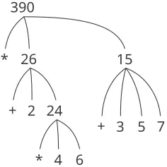
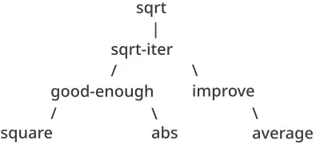

> أفعال العقل، حين يبسط سلطانه على الأفكار البسيطة، هي ثلاثةٌ أساسًا: 1. الجمع: تركيب عدّة أفكار بسيطة في فكرةٍ مركّبةٍ واحدة، وبذلك تُصنَع جميع الأفكار المركّبة. 2. الثاني: إحضار فكرتين، بسيطةً كانتا أو مركّبتين، ووضعهما إحداهما إلى جانب الأخرى بحيث يرى العقلُهما معًا بلمحةٍ واحدة، دون أن يوحّدهما في فكرةٍ واحدة، وبذلك يحصل على جميع أفكاره عن العلاقات. 3. الثالث: فصلها عن جميع الأفكار الأخرى التي ترافقها في وجودها الحقيقيّ؛ وهذا ما يُسمّى التجريد، وبذلك تُصنَع جميع أفكاره العامّة. —John Locke, An Essay Concerning Human Understanding (1690)

نحن على وشك دراسة فكرة *العمليّة الحسابيّة (computational process)*. فالعمليّات الحسابيّة كائناتٌ مجرّدةٌ تسكن الحواسيب. وبينما تتطوّر، تُعالج العمليّات كائناتٍ مجرّدةً أخرى تُسمّى *البيانات (data)*. وتطوّر العمليّة يوجّهه نمطٌ من القواعد يُسمّى *البرنامج (program)*. والناس يُنشئون البرامج لتوجيه العمليّات. في الحقيقة، إنّا نستحضر أرواح الحاسوب بتعاويذنا.

والعمليّة الحسابيّة تشبه حقًّا فكرة الساحر عن الرّوح. فلا يمكن رؤيتها أو لمسها، وهي ليست مركّبةً من المادّة إطلاقًا. لكنّها واقعيّةٌ للغاية. فهي قادرة على أداء عملٍ فكريّ. وقادرة على الإجابة عن الأسئلة. وقادرة على التأثير في العالم بإنفاق المال في مصرفٍ أو بالتحكّم في ذراع روبوتٍ في مصنع. والبرامج التي نستخدمها لاستحضار العمليّات تشبه تعاويذ الساحر. وهي مركّبةٌ بعنايةٍ من تعبيراتٍ رمزيّةٍ في *لغات البرمجة (programming languages)* الغامضة والأسرارية التي تُحدّد المهام التي نريد من عمليّاتنا أداءها.

والعمليّة الحسابيّة، في حاسوبٍ يعمل على نحوٍ صحيح، تُنفّذ البرامج بدقّةٍ وإحكام. وهكذا، وعلى غرار تلميذ الساحر، ينبغي على المبرمجين المبتدئين أن يتعلّموا فهم عواقب استحضارهم وتوقّعها. فحتّى الأخطاء الصغيرة (المسماة عادةً *العلل (bugs)* أو *الخلل (glitches)*) في البرامج يمكن أن تكون لها عواقبُ معقّدةٌ وغير متوقّعة.

ومن حسن الحظّ، فإنّ تعلّم البرمجة أقلّ خطرًا بكثيرٍ من تعلّم السحر، لأنّ الأرواح التي نتعامل معها محتجزةٌ بطريقةٍ مريحةٍ في مكانٍ آمن. أمّا البرمجة في العالم الواقعيّ، فهي تتطلّب عنايةً وخبرةً وحكمة. فإنّ خللًا صغيرًا في برنامجٍ للتصميم بمساعدة الحاسوب، مثلًا، يمكن أن يؤدّي إلى انهيارٍ كارثيٍّ لطائرةٍ أو لسدٍّ أو إلى تدمير روبوت صناعيّ لنفسه.

يمتلك مهندسو البرمجيّات المتمكّنون قدرةً على تنظيم البرامج بحيث يمكنهم أن يكونوا على يقينٍ معقولٍ بأنّ العمليّات الناتجة ستؤدّي المهام المقصودة. وهم قادرون على تصوّر سلوك أنظمتهم مسبقًا. ويعرفون كيف يُبنون البرامج حتّى لا يؤدّي ظهور المسائل غير المتوقّعة إلى عواقبَ كارثيّة، وحين تنشأ المسائل فعلًا فإنّهم *يُصحّحون (debug)* برامجهم. فإنّ الأنظمة الحسابيّة المصمّمة تصميمًا حسنًا، كالسيّارات المصمّمة تصميمًا حسنًا أو المفاعلات النوويّة، تُصمَّم على نحوٍ وحدانيّ، بحيث يمكن بناء أجزائها واستبدالها وتصحيحها كلًّا على حدة.

#### البرمجة بلغة Lisp

نحتاج إلى لغةٍ ملائمةٍ لوصف العمليّات، وسنستخدم لهذا الغرض لغة البرمجة Lisp. فكما تُعبَّر أفكارنا اليوميّة عادةً بلغتنا الطبيعيّة (كالإنجليزيّة أو الفرنسيّة أو اليابانيّة)، وكما تُعبَّر أوصاف الظواهر الكمّيّة بالترميزات الرياضيّة، فإنّ أفكارنا الإجرائيّة ستُعبَّر عنها بـLisp. وقد اختُرعت Lisp في أواخر خمسينيّات القرن العشرين كصياغةٍ رسميّةٍ للاستدلال على استخدام أنواعٍ معيّنةٍ من التعبيرات المنطقيّة، المسماة *معادلات التعاود (recursion equations)*، كنموذجٍ للاحتساب. وقد تصوّرها جون مكارثي وهي مستندةٌ إلى ورقته «الدوالّ العودية والتعابير الرمزيّة وحوسبتها بالآلة» ([مكارثي 1960](https://sarabander.github.io/sicp/html/References.xhtml#McCarthy-1960)).

رغم نشأتها كصياغةٍ رياضيّة، فإنّ Lisp لغةُ برمجةٍ عمليّة. و*المفسّر (interpreter)* آلةٌ تنفّذ العمليّات الموصوفة بلغة Lisp. وقد نُفّذ أوّل مفسّر Lisp على يد مكارثي بمساعدة زملائه وطلابه في مجموعة الذكاء الاصطناعي في مختبر أبحاث الإلكترونيات وفي مركز الحوسبة، وكلاهما في MIT. واسم Lisp مشتقٌ من عبارة LISt Processing، أي معالجة القوائم، وقد صُمّمت لتوفير قدرات معالجة الرموز لمهاجمة مسائل برمجةٍ كالتفاضل والتكامل الرمزيّين للتعبيرات الجبريّة. وقد أُضيفت لهذا الغرض كائناتُ بياناتٍ جديدة تُعرف بالذرّات والقوائم، وهي التي ميّزتها تمييزًا باهرًا عن جميع لغات ذلك العهد.

ولم تكن Lisp نتاجَ جهدٍ تصميميٍّ منظّم، بل تطوّرت تطوّرًا غير رسميٍّ وتجريبيًّا استجابةً لاحتياجات المستخدمين ولاعتبارات التنفيذ العمليّة. واستمرّ تطوّر Lisp غير الرسميّ على مرّ السنين، ولمجتمع مستخدمي Lisp مقاومةٌ تقليديّةٌ لمحاولات إصدار أيّ تعريف «رسميّ» للغة. وقد مكّن هذا التطوّر، مع المرونة والأناقة في التصوّر الأوّل، Lisp - وهي ثاني أقدم لغةٍ شائعة الاستخدام اليوم (ولا تزيد عليها في العمر إلّا Fortran) - من التكيّف باستمرارٍ لاستيعاب أحدث الأفكار عن تصميم البرامج. وهكذا، صارت Lisp الآن عائلةً من اللهجات، تتشابه في معظم الخصائص الأصليّة وقد تختلف اختلافًا جوهريًّا في نواحٍ عدّة. ولهجة Lisp المستخدمة في هذا الكتاب تُسمّى Scheme.

وبسبب طابعها التجريبيّ وتأكيدها على معالجة الرموز، كانت Lisp غير كفؤةٍ على الإطلاق في الحسابات العدديّة في بادئ الأمر، على الأقلّ بالمقارنة مع Fortran. وعلى مرّ السنين، مع ذلك، طُوّرت مُصرّفات Lisp تترجم البرامج إلى شيفرة آليّة قادرة على أداء الحسابات العدديّة بكفاءةٍ معقولة. وللتطبيقات الخاصّة، استُخدمت Lisp بفعّيّةٍ كبيرة. ورغم أنّ Lisp لم تتغلّب بعد على سمعتها القديمة كلغةٍ ميؤوس من كفاءتها، فإنّها تُستخدم اليوم في تطبيقاتٍ كثيرةٍ ليس الهمّ المركزيّ فيها هو الكفاءة. فقد صارت Lisp - مثلًا - لغةً مختارةً لأغلفة نظم التشغيل (shell) ولغات التوسعة للمحرّرات ونظم التصميم بمساعدة الحاسوب.

فإن لم تكن Lisp لغةً سائدةً، فلماذا نستخدمها إطارًا لمناقشتنا للبرمجة؟ لأنّ اللغة تمتلك خصائص فريدة تجعلها وسطًا ممتازًا لدراسة بنيات البرمجة وبنيات البيانات المهمّة، ولربطها بالخصائص اللغويّة التي تدعمها. وأهمّ هذه الخصائص أنّ أوصاف Lisp للعمليّات، المسماة *الإجراءات (procedures)*، يمكن أن تُُمثَّل وتُعالَجَ بذاتها كبيانات Lisp. وأهمّيّة هذا أنّ هناك تقنيّاتٍ قويّةً لتصميم البرامج تعتمد على القدرة على طمس التمييز التقليديّ بين البيانات «السلبيّة» والعمليّات «النشطة». فكما سنكتشف، فإنّ مرونة Lisp في معاملة الإجراءات كبياناتٍ تجعلها إحدى أكثر اللغات ملاءمةً الموجودة لاستكشاف هذه التقنيّات. والقدرة على تمثيل الإجراءات كبيانات تجعل Lisp أيضًا لغةً ممتازةً لكتابة البرامج التي يجب أن تعالج برامجًا أخرى كبيانات، كالمفسّرات والمُصرّفات التي تدعم لغات الحاسوب. وفوق هذه الاعتبارات كلّها، فإنّ البرمجة بـLisp متعةٌ عظيمة.


### 1.1 عناصر البرمجة

لغة البرمجة القويّة أكثر من مجرّد وسيلةٍ لتكليف الحاسوب بأداء المهام. فإنّ اللغة تخدم أيضًا بوصفها إطارًا نُنظّم داخله أفكارنا عن العمليّات. لذلك، حين نصف لغةً، ينبغي أن نُعير اهتمامًا خاصًّا للوسائل التي توفّرها اللغة لدمج الأفكار البسيطة لتكوين أفكار أكثر تعقيدًا. ولكلّ لغةٍ قويّةٍ ثلاث آليّاتٍ لإنجاز ذلك:

- **التعابير الأوّليّة (primitive expressions)**، التي تمثّل أبسط الكيانات التي تعنى بها اللغة،
- **وسائل التركيب (means of combination)**، التي تُبنى بها العناصر المركّبة من عناصر أبسط منها، و
- **وسائل التجريد (means of abstraction)**، التي تُسمّى بها العناصر المركّبة وتُعالَج كوحداتٍ.

في البرمجة، نتعامل مع نوعين من العناصر: الإجراءات والبيانات. (وسنكتشف لاحقًا أنّها ليست متمايزةً بهذا القدر حقًّا.) فبصورةٍ غير رسميّة، البيانات هي «المادّة» التي نريد معالجتها، والإجراءات هي أوصاف القواعد لمعالجة البيانات. لذلك، ينبغي لأيّ لغة برمجةٍ قويّةٍ أن تكون قادرة على وصف البيانات الأوّليّة والإجراءات الأوّليّة، وأن تكون لها طرائقٌ لتركيب الإجراءات والبيانات ولتجريدهما.

في هذا الفصل سنتعامل مع بيانات عدديّة بسيطة فقط، حتّى نتمكّن من التركيز على قواعد بناء الإجراءات.[^4] وفي الفصول اللاحقة سنرى أنّ هذه القواعد ذاتها تسمح لنا ببناء إجراءاتٍ تعالجة البيانات المركّبة كذلك.

#### 1.1.1 التعابير

وهناك طريقةٌ سهلةٌ للانطلاق في البرمجة، وهي أن نفحص بعض التفاعلات النموذجيّة مع مفسّرٍ للهجة Scheme من Lisp. فتخيّل أنّك جالسٌ أمام طرفيّة حاسوب. فتكتب *تعبيرًا (expression)*، فيستجيب المفسّر بعرض نتيجة *تقييمه (evaluating)* لذلك التعبير.

أحد أنواع التعبيرات الأوّليّة التي قد تكتبها هو العدد. (وبأكثر دقّة، التعبير الذي تكتبه يتكوّن من الأرقام التي تمثّل العدد في الأساس 10.) فإن قدّمت لـLisp عددًا

```scheme
486
```

فسيستجيب المفسّر بالطباعة[^5]

```scheme
486
```

والتعابير التي تمثّل الأعداد يمكن أن تُدمج بتعبيرٍ يمثّل إجراءً أوّليًّا (كـ`+` أو `*`) لتكوين تعبيرٍ مركّبٍ يمثّل تطبيق الإجراء على تلك الأعداد. على سبيل المثال:

```scheme
(+ 137 349)
486

(- 1000 334)
666

(* 5 99)
495

(/ 10 5)
2

(+ 2.7 10)
12.7
```

والتعابير كهذه، المشكّلة بتحديد قائمةٍ من التعابير داخل قوسين للإشارة إلى تطبيق الإجراء، تُسمّى *التركيبات (combinations)*. ويُسمّى العنصر الأيسر في القائمة *المشغّل (operator)*، وتُسمّى العناصر الأخرى *العوامل (operands)*. وقيمة التركيب تُحصَل بتطبيق الإجراء الذي يُحدّده المشغّل على *المعطيات (arguments)* التي هي قيم العوامل.

ويُعرف اصطلاح وضع المشغّل إلى يسار العوامل باسم *الترميز البادئ (prefix notation)*، وقد يكون مربكًا بعض الشيء في البداية لأنّه يبتعد ابتعادًا جوهريًّا عن الاصطلاح الرياضيّ المعتاد. غير أنّ الترميز البادئ له عدّة مزايا، منها أنّه يقبل إجراءاتٍ قد تأخذ عددًا اعتباطيًّا من المعطيات، كما في الأمثلة التالية:

```scheme
(+ 21 35 12 7)
75

(* 25 4 12)
1200
```

فلا يمكن أن ينشأ التباس، لأنّ المشغّل هو دائمًا العنصر الأيسر، والتركيبَ كلّه محدَّدٌ بالأقواس.

وميزةٌ ثانية للترميز البادئ هي أنّه يمتدّ امتدادًا مباشرًا ليسمح بأن تكون التركيبات *متداخلة (nested)*، أي أن تكون عناصر التركيب تركيبًا بذاته:

```scheme
(+ (* 3 5) (- 10 6))
19
```

ولا يوجد حدّ (من حيث المبدأ) لعمق هذا التداخل وللتعقيد الكلّيّ للتعابير التي يقدر مفسّر Lisp على تقييمها. ونحن البشر الذين نضلّل بتعابيرَ ما تزال بسيطةً نسبيًّا مثل

```scheme
(+ (* 3 (+ (* 2 4) (+ 3 5))) (+ (- 10 7) 6))
```

والتي سيقيّمها المفسّر دون تردّدٍ فتُعطي 57. ويمكننا أن نساعد أنفسنا بكتابة تعبيرٍ كهذا في الصيغة

```scheme
(+ (* 3
      (+ (* 2 4)
         (+ 3 5)))
   (+ (- 10 7)
      6))
```

اتّباعًا لاصطلاح تنسيقٍ يُعرف بـ*الطبع الأنيق (pretty-printing)*، وفيه تُكتب كلّ تركيبةٍ طويلةٍ بحيث تُحاذى العوامل رأسيًّا. فتظهر الإزاحات الناتجة بنية التعبير بيانًا واضحًا.[^6]

وحتّى مع التعابير المعقّدة، يعمل المفسّر دائمًا في الدورة الأساسيّة ذاتها: فيقرأ تعبيرًا من الطرفيّة، ويقيّم التعبير، ويطبع النتيجة. وهذا النمط من التشغيل يُعبَّر عنه غالبًا بالقول إنّ المفسّر يعمل في *حلقة القراءة والتقييم والطباعة (read-eval-print loop)*. ولاحِظ على وجه الخصوص أنّه ليس ضروريًّا أن تُعطي المفسّر تعليماتٍ صريحةً بطبع قيمة التعبير.[^7]

#### 1.1.2 التسمية والبيئة

وجانبٌ بالغ الأهمّيّة في لغة البرمجة هو ما توفّره من وسائل لاستخدام الأسماء للإشارة إلى الكائنات الحاسوبيّة. فنحن نقول إنّ الاسم يدلّ على *متغيّر (variable)* *قيمتُهُ (value)* هي الكائن.

في لهجة Scheme من Lisp، نُسمّي الأشياء بـ`define`. فبكتابة

```scheme
(define size 2)
```

فإنّ المفسّر (interpreter) يربط القيمة 2 بالاسم `size`.[^8] وحين يُربط الاسم `size` بالعدد 2، يمكننا أن نشير إلى القيمة 2 بالاسم:

```scheme
size
2

(* 5 size)
10
```

وهذه أمثلةٌ إضافيّةٌ على استخدام `define`:

```scheme
(define pi 3.14159)
(define radius 10)

(* pi (* radius radius))
314.159

(define circumference (* 2 pi radius))

circumference
62.8318
```

فـ`Define` أبسط وسائل التجريد في لغتنا، إذ يسمح لنا باستخدام أسماءٍ بسيطة للإشارة إلى نتائج عمليّاتٍ مركّبة، كـ`circumference` المحسوبة أعلاه. وبصورةٍ عامّة، قد تكون للكائنات الحاسوبيّة بنى معقّدةٌ جدًّا، وكان من غير الملائم للغاية أن نحتفظ بتفاصيلها ونعيدها في كلّ مرّةٍ نريد استخدامها. فحقًّا، إنّ البرامج المعقّدة تُبنى خطوةً بخطوة، من كائناتٍ حاسوبيّةٍ بتعقيدٍ متزايد. ويجعل المفسّر هذا البناء المتدرّج للبرنامج ملائمًا على وجه الخصوص، لأنّه يمكن إنشاء روابط الاسم-الكائن تدريجيًّا في تفاعلاتٍ متعاقبة. وهذه الميزة تشجّع على التطوير والاختبار التدريجيّين للبرامج، وهي مسؤولةٌ إلى حدٍّ كبيرٍ عن حقيقة أنّ برنامج Lisp يتكوّن عادةً من عددٍ كبيرٍ من الإجراءات البسيطة نسبيًّا.

وينبغي أن يكون واضحًا أنّ إمكان ربط القيم بالرموز واسترجاعها لاحقًا يعني أنّ المفسّر يجب أن يحتفظ بنوعٍ من الذاكرة التي تتابع أزواج الاسم-الكائن. وهذه الذاكرة تُسمّى *البيئة (environment)* (وبأكثر دقّة *البيئة العامّة (global environment)*، إذ سنرى لاحقًا أنّ الاحتساب قد يشمل عددًا من البيئات المختلفة).[^9]

#### 1.1.3 تقييم التركيبات

وأحد أهدافنا في هذا الفصل هو عزل القضايا المتعلّقة بالتفكير الإجرائيّ. وعلى سبيل المثال، لنفترض أنّ المفسّر نفسه يُتْبِع إجراءً عند تقييمه التركيبات.

> ولتقييم تركيبةٍ، افعل ما يلي: قيّم التعابير الجزئيّة للتركيبة.
> > طبّق الإجراء الذي هو قيمة التعبير الجزئيّ الأيسر (المشغّل) على المعطيات التي هي قيم التعبيرات الجزئيّة الأخرى (العوامل).
> > 

حتّى هذه القاعدة البسيطة تُبرز بعض النقاط المهمّة عن العمليّات بصورةٍ عامّة. فأوّلًا، لاحظ أنّ الخطوة الأولى تقضي بأنّه لإنجاز عمليّة تقييم تركيبةٍ ما، يجب أن نؤدّي أوّلًا عمليّة التقييم على كلّ عنصرٍ من عناصر التركيبة. وبذلك، فقاعدة التقييم *تعاوديّة (recursive)* بطبيعتها؛ أي أنّها تتضمّن، كإحدى خطواتها، الحاجة إلى استحضار القاعدة نفسها.[^10]

ولاحظ كيف يمكن أن تُستخدم فكرة التعاود باختصارٍ للتعبير عمّا كان سيُنظر إليه، في حالة تركيبةٍ متداخلةٍ بعمق، على أنّه عمليّةٌ معقّدةٌ إلى حدٍّ ما. فمثلًا، تقييم

```scheme
(* (+ 2 (* 4 6)) (+ 3 5 7))
```

يتطلّب تطبيق قاعدة التقييم على أربع تركيباتٍ مختلفة. ويمكننا الحصول على صورةٍ عن هذه العمليّة بتمثيل التركيبة في شكل شجرة، كما هو موضّح في [الشكل 1.1](/book/sicp/c1-building-abstractions-with-procedures/index/). فكلّ تركيبةٍ تُصوَّر بعقدةٍ لها أفرعٌ تقابل المشغّل وعوامل التركيبة الآتية منها. وتمثّل العُقَد النهائيّة (أي العُقَد التي لا تأتي منها أفرع) إمّا مشغّلاتٍ وإمّا أعداد. وبالنظر إلى التقييم من منظور الشجرة، يمكننا أن نتخيّل أنّ قيم العوامل تتسرّب إلى الأعلى، بدءًا من العُقَد النهائيّة ثم تجتمع عند مستوياتٍ أعلى فأعلى. وبصورةٍ عامّة، سنرى أنّ التعاود تقنيّةٌ بالغة القوّة للتعامل مع الكائنات الهرميّة الشبيهة بالأشجار. وفي الواقع، فإنّ صيغة «تسرّب القيم إلى الأعلى» من قاعدة التقييم مثالٌ على نوعٍ عامّ من العمليّات يُعرف بـ*التراكم الشجريّ (tree accumulation)*.



**الشكل 1.1:** تمثيل شجريّ، يُظهر قيمة كلّ تركيبةٍ جزئيّة.

تاليًا، لاحظ أنّ التطبيق المتكرّر للخطوة الأولى يصل بنا إلى النقطة التي نحتاج فيها إلى تقييم، لا تركيباتٍ، بل تعابيرَ أوّليّةً كالأعداد والمشغّلات المدمجة أو أسماءٍ أخرى. ونتعامل مع الحالات الأوّليّة بالنصّ على أنّ

- قيم الأعداد هي الأعداد التي تُسمّيها،
- قيم المشغّلات المدمجة هي تسلسلات تعليمات الآلة التي تؤدّي العمليّات المقابلة، و
- قيم الأسماء الأخرى هي الكائنات المرتبطة بتلك الأسماء في البيئة.

ويمكننا اعتبار القاعدة الثانية حالةً خاصّة من الثالثة بالنصّ على أنّ رموزًا مثل `+` و`*` مُدرجةٌ أيضًا في البيئة العامّة، ومرتبطةٌ بتسلسلات تعليمات الآلة التي هي «قيمُها». والنقطة الجوهريّة التي ينبغي ملاحظتها هي دور البيئة في تحديد معنى الرموز في التعابير. ففي لغةٍ تفاعليّةٍ مثل Lisp، لا معنى للكلام عن قيمة تعبيرٍ مثل `(+ x 1)` دون تحديد أيّ معلوماتٍ عن البيئة التي تمنح معنىً للرمز `x` (أو حتّى للرمز `+`). فكما سنرى في [الفصل 3](https://sarabander.github.io/sicp/html/Chapter-3.xhtml#Chapter-3)، فإنّ المفهوم العامّ للبيئة بوصفها سياقًا تجري فيه عمليّة التقييم سيؤدّي دورًا مهمًّا في فهمنا لتنفيذ البرنامج.

ولاحظ أنّ قاعدة التقييم المعطاة أعلاه لا تتعامل مع التعريفات. فمثلًا، تقييم `(define x 3)` لا يطبّق `define` على معطيين، أحدهما قيمة الرمز `x` والآخر هو 3، إذ إنّ غرض `define` هو بالضبط ربط `x` بقيمة. (أي أنّ `(define x 3)` ليس تركيبةً.)

وتُسمّى هذه الاستثناءات على قاعدة التقييم العامّة *الصيغ الخاصّة (special forms)*. و`Define` هي المثال الوحيد على صيغةٍ خاصّةٍ رأيناها حتّى الآن، لكنّنا سنقابل أخرى قريبًا. ولكلّ صيغةٍ خاصّةٍ قاعدة تقييمٍ خاصّة بها. وأنواع التعابير المختلفة (كلٌّ مع قاعدة التقييم المرافقة لها) تُشكّل صياغة لغة البرمجة. وبالمقارنة مع معظم لغات البرمجة الأخرى، فإنّ Lisp ذات صياغةٍ بسيطةٍ جدًّا؛ أي أنّ قاعدة تقييم التعابير يمكن وصفها بقاعدة عامّة بسيطة مع قواعد متخصّصة لعددٍ صغيرٍ من الصيغ الخاصّة.[^11]

#### 1.1.4 الإجراءات المركّبة

لقد حدّدنا في Lisp بعض العناصر التي يجب أن تظهر في كلّ لغة برمجةٍ قويّة:

- الأعداد والعمليّات الحسابيّة بيانات وإجراءات أوّليّة.
- تداخل التركيبات يُوفّر وسيلةً لتركيب العمليّات.
- التعريفات التي تربط الأسماء بالقيم تُوفّر وسيلةً محدودةً للتجريد.

والآن سنتعلّم عن *تعريفات الإجراءات (procedure definitions)*، وهي تقنيّة تجريدٍ أكثر قوّةٍ بكثيرٍ تُعطى بها للعمليّة المركّبة اسمٌ ثم يُشار إليها كوحدةٍ.

نبدأ بفحص كيف نُعبّر عن فكرة «التربيع». فقد نقول: «لكي تُربّع شيئًا، اضربه في نفسه». ويُعبَّر عن هذا في لغتنا كما يلي

```scheme
(define (square x) (* x x))
```

ويمكننا فهم هذا على النحو التالي:

```
(define (square x)    (*       x       x))
  |      |      |      |       |       |
 To square something, multiply it by itself.
```

فلدينا هنا *إجراءٌ مركّب (compound procedure)*، وقد أُعطي الاسم `square`. فالإجراء يمثّل عمليّة ضرب شيءٍ في نفسه. وأُعطي الشيء الذي سيُضرب اسمٌ محلّيٌّ، `x`، يلعب الدور نفسه الذي يلعبه الضمير في اللغة الطبيعيّة. وتقييم التعريف يُنشئ هذا الإجراء المركّب ويربطه بالاسم `square`.[^12]

والصورة العامّة لتعريف الإجراء هي

```scheme
(define (⟨name⟩ ⟨formal parameters⟩) ⟨body⟩)
```

والـ`⟨`الاسم`⟩` رمزٌ يُربط بتعريف الإجراء في البيئة، و`⟨`الوسائط الشكلية`⟩` هي الأسماء المستخدمة داخل `⟨`الجسم`⟩` للإشارة إلى الوسائط المطابقة للإجراء، و`⟨`الجسم`⟩` تعبيرٌ سيُنتج قيمة تطبيق الإجراء حين تُستبدل الوسائط الشكلية بالمعطيات الفعليّة التي يُطبَّق عليها الإجراء. ويُجمَّع `⟨`الاسم`⟩` و`⟨`الوسائط الشكلية`⟩` بين قوسين، تمامًا كما هما في نداءٍ فعليّ للإجراء المعرَّف.

وبعد تعريف `square`، يمكننا الآن استخدامه:

```scheme
(square 21)
441

(square (+ 2 5))
49

(square (square 3))
81
```

ويمكننا أيضًا استخدام `square` كوحدة بناءٍ في تعريف إجراءاتٍ أخرى. فمثلًا، $x^{2} + y^{2}$ يمكن التعبير عنه بـ

```scheme
(+ (square x) (square y))
```

ويمكننا بسهولةٍ تعريف إجراءٍ `sum-of-squares` يُعطي، لأيّ عددين كمعطيات، مجموع مربّعيهما:

```scheme
(define (sum-of-squares x y)
  (+ (square x) (square y)))

(sum-of-squares 3 4)
25
```

والآن يمكننا استخدام `sum-of-squares` كوحدة بناءٍ في بناء إجراءاتٍ أخرى:

```scheme
(define (f a)
  (sum-of-squares (+ a 1) (* a 2)))

(f 5)
136
```

والإجراءات المركّبة تُستخدم بالطريقة ذاتها تمامًا كالإجراءات الأوّليّة. فحقًّا، لا يمكن للمرء أن يعرف - بالنظر إلى تعريف `sum-of-squares` المعطى أعلاه - ما إذا كان `square` مدمجًا في المفسّر، مثل `+` و`*`، أو معرَّفًا كإجراءٍ مركّب.

#### 1.1.5 نموذج الاستبدال لتطبيق الإجراء

ولتقييم تركيبةٍ مشغّلها إجراءٌ مركّب، يتبع المفسّر العمليّةَ ذاتها التي يتبعها من أجل التركيبات التي مشغّلاتها إجراءات أوّليّة، والتي وصفناها في [1.1.3](/book/sicp/c1-building-abstractions-with-procedures/index/). أي أنّ المفسّر يقيّم عناصر التركيبة ثم يطبّق الإجراء (وهو قيمة مشغّل التركيبة) على المعطيات (وهي قيم عوامل التركيبة).

ويمكننا أن نفترض أنّ آليّة تطبيق الإجراءات الأوّليّة على المعطيات مدمجةٌ في المفسّر. وأمّا بالنسبة للإجراءات المركّبة، فعملية التطبيق تكون كما يلي:

> ولتطبيق إجراءٍ مركّب على معطياتٍ، قيّم جسم الإجراء باستبدال كلّ وسيطٍ شكليّ بالمعطى المطابق له.

ولتوضيح هذه العمليّة، لنُقيّم التركيبة

```scheme
(f 5)
```

حيث `f` هو الإجراء المعرَّف في [1.1.4](/book/sicp/c1-building-abstractions-with-procedures/index/). نبدأ باسترجاع جسم `f`:

```scheme
(sum-of-squares (+ a 1) (* a 2))
```

ثم نستبدل الوسيط الشكليّ `a` بالمعطى 5:

```scheme
(sum-of-squares (+ 5 1) (* 5 2))
```

وبذلك، تنحلّ المسألة إلى تقييم تركيبةٍ ذات عاملين ومشغّلٍ هو `sum-of-squares`. وتقييم هذا التركيب يشمل ثلاث مسائل جزئيّة. فيجب أن نقيّم المشغّل للحصول على الإجراء الذي سيُطبَّق، ويجب أن نقيّم العوامل للحصول على المعطيات. فإنّ `(+ 5 1)` يُنتج 6 و`(* 5 2)` يُنتج 10، فيجب أن نطبّق الإجراء `sum-of-squares` على 6 و10. وهذه القيم تُستبدل بالوسائط الشكلية `x` و`y` في جسم `sum-of-squares`، فتنحلّ التعبير إلى

```scheme
(+ (square 6) (square 10))
```

فإن استخدمنا تعريف `square`، انحلّ هذا إلى

```scheme
(+ (* 6 6) (* 10 10))
```

والذي ينحلّ بالضرب إلى

```scheme
(+ 36 100)
```

وأخيرًا إلى

```scheme
136
```

والعمليّة التي وصفناها للتوّ تُسمّى *نموذج الاستبدال (substitution model)* لتطبيق الإجراءات. ويمكن اعتبارها نموذجًا تحدّد «معنى» تطبيق الإجراء، بالقدر الذي تخصّ فيه الإجراءات الواردة في هذا الفصل. غير أنّ هناك نقطتين ينبغي التشديد عليهما:

- والغرض من الاستبدال هو مساعدتنا على التفكير في تطبيق الإجراء، لا توفير وصفٍ لكيفية عمل المفسّر فعليًّا. فالمفسّرات النموذجيّة لا تُقيّم تطبيقات الإجراءات بمعالجة نصّ الإجراء لاستبدال القيم بالوسائط الشكليّة. وفي الممارسة، يُنْجَز «الاستبدال» باستخدام بيئةٍ محلّيّةٍ للوسائط الشكليّة. وسنناقش هذا بتوسّعٍ أكبر في [الفصل 3](https://sarabander.github.io/sicp/html/Chapter-3.xhtml#Chapter-3) و[الفصل 4](https://sarabander.github.io/sicp/html/Chapter-4.xhtml#Chapter-4) حين نفحص تنفيذ مفسّرٍ بتفصيلٍ أكبر.
- وعلى مدى هذا الكتاب، سنُقدّم سلسلةً من النماذج المتعاقبة في تعقيدها لكيفية عمل المفسّرات، تتوّج بتنفيذٍ كاملٍ لمفسّرٍ ومُصرِّفٍ في [الفصل 5](https://sarabander.github.io/sicp/html/Chapter-5.xhtml#Chapter-5). فنموذج الاستبدال هو أوّل هذه النماذج فقط - طريقةٌ للانطلاق في التفكير رسميًّا في عمليّة التقييم. وبصورةٍ عامّة، حين نُنمذج الظواهر في العلم والهندسة، نبدأ بنماذج مبسّطة غير كاملة. وحين نفحص الأشياء بتفصيلٍ أكبر، تصبح هذه النماذج البسيطة غير كافية ويجب استبدالها بنماذج أكثر دقّة. ونموذج الاستبدال ليس استثناءً من ذلك. وعلى وجه الخصوص، حين نتناول في [الفصل 3](https://sarabander.github.io/sicp/html/Chapter-3.xhtml#Chapter-3) استخدام الإجراءات مع «البيانات القابلة للتغيير»، فسنرى أنّ نموذج الاستبدال يتعطّل ويجب استبداله بنموذجٍ أكثر تعقيدًا لتطبيق الإجراءات.[^15]

#### الترتيب التطبيقيّ مقابل الترتيب الاعتياديّ

فبحسب وصف التقييم المعطى في [1.1.3](/book/sicp/c1-building-abstractions-with-procedures/index/)، يُقيّم المفسّر المشغّل والعوامل أوّلًا ثم يطبّق الإجراء الناتج على المعطيات الناتجة. وهذه ليست الطريقة الوحيدة لأداء التقييم. فنموذج تقييمٍ بديلٍ لن يقيّم العوامل حتّى تحتاج قيمُها. بل سيستبدل أوّلًا تعبيرات العوامل بالوسائط حتّى يحصل على تعبيرٍ يتضمّن مشغّلاتٍ أوّليّةً فقط، ثم يُجرى التقييم. فإن كنّا قد استخدمنا هذه الطريقة، لسار تقييم `(f 5)` تبعًا لتسلسل التوسّعات

```scheme
(sum-of-squares (+ 5 1) (* 5 2))

(+ (square (+ 5 1)) 
   (square (* 5 2)))

(+ (* (+ 5 1) (+ 5 1)) 
   (* (* 5 2) (* 5 2)))
```

تتبعه الاحتسابات (reductions)

```scheme
(+ (* 6 6) 
   (* 10 10))

(+ 36 100)

136
```

وهذا يُعطي الجواب نفسه الذي أعطاه نموذج التقييم السابق، لكنّ العمليّة مختلفة. وعلى وجه الخصوص، فإنّ تقييم `(+ 5 1)` و`(* 5 2)` يُجرى مرّتين هنا، مقابلًا لاختزال التعبير `(* x x)` باستبدال `x` على التوالي بـ`(+ 5 1)` و`(* 5 2)`.

وتُعرف طريقة التقييم البديلة هذه - «التوسيع الكامل ثم الاحتساب» - باسم *التقييم بالترتيب الاعتياديّ (normal-order evaluation)*، بخلاف طريقة «تقييم المعطيات ثم التطبيق» التي يستخدمها المفسّر فعلًا، والتي تُسمّى *التقييم بالترتيب التطبيقيّ (applicative-order evaluation)*. ويمكن إثبات أنّ هذين الأسلوبين يُنتجان القيمة نفسها، من أجل تطبيقات الإجراءات التي يمكن نمذجتها باستخدام الاستبدال (بما في ذلك جميع الإجراءات في الفصلين الأولين من هذا الكتاب) والتي تُنتج قيمًا مشروعة. (انظر [التمرين 1.5](/book/sicp/c1-building-abstractions-with-procedures/index/) لمثالٍ على قيمةٍ «غير مشروعة» لا يُعطي فيها التقييم بالترتيب الاعتياديّ والتقييم بالترتيب التطبيقيّ النتيجة نفسها.)

تستخدم Lisp التقييم بالترتيب التطبيقيّ، جزئيًّا بسبب الكفاءة الإضافيّة المتحصّلة من تجنّب التقييم المتكرّر لتعبيراتٍ مثل `(+ 5 1)` و`(* 5 2)` المذكورين أعلاه، والأهمّ من ذلك، لأنّ التقييم بالترتيب الاعتياديّ يصبح أعقدَ بكثيرٍ في التعامل حين نترك عالم الإجراءات التي يمكن نمذجتها بالاستبدال. ومن جهةٍ أخرى، قد يكون التقييم بالترتيب الاعتياديّ أداةً بالغة القيمة، وسنفحص بعض تبعاته في [الفصل 3](https://sarabander.github.io/sicp/html/Chapter-3.xhtml#Chapter-3) و[الفصل 4](https://sarabander.github.io/sicp/html/Chapter-4.xhtml#Chapter-4).[^16]

#### 1.1.6 التعابير الشرطيّة والمسندات

والقوّة التعبيريّة لصنف الإجراءات التي يمكننا تعريفها في هذه المرحلة محدودةٌ جدًّا، لأنّه ليس لدينا طريقةٌ لإجراء الاختبارات ولأداء عمليّاتٍ مختلفة بحسب نتيجة الاختبار. فنحن لا نستطيع، مثلًا، تعريف إجراءٍ يحسب القيمة المطلقة لعددٍ باختبار ما إذا كان العدد موجبًا أو سالبًا أو صفرًا واتّخاذ إجراءاتٍ مختلفة في الحالات المختلفة وفقًا للقاعدة $| x | = \begin{cases} x & \text{if} x > 0 , \\ 0 & \text{if} x = 0 , \\ − x & \text{if} x < 0. \end{cases}$ وهذا البناء يُسمّى *تحليل الحالات (case analysis)*، وهناك صيغةٌ خاصّةٌ في Lisp لترميز تحليل حالاتٍ كهذا. وتُسمّى `cond` (وهو اختصارٌ لـ«conditional»)، وتُستخدم كما يلي:

```scheme
(define (abs x)
  (cond ((> x 0) x)
        ((= x 0) 0)
        ((< x 0) (- x))))
```

الصيغة العامّة للتعبير الشرطيّ هي

```scheme
(cond (⟨p₁⟩ ⟨e₁⟩)
      (⟨p₂⟩ ⟨e₂⟩)
      …
      (⟨pₙ⟩ ⟨eₙ⟩))
```

وهي تتألّف من الرمز `cond` متبوعًا بأزواجٍ من التعابير محاطةً بأقواس

```scheme
(⟨p⟩ ⟨e⟩)
```

تُسمّى *بنودًا* (clauses). أوّل تعبيرٍ في كلّ زوجٍ هو *مُسَيِّم* (predicate) — أيّ تعبيرٌ تُفَسَّر قيمته على أنّها إمّا صحيحة أو خاطئة.[^17]

تُقيَّم التعابير الشرطيّة على النحو الآتي. يُقيَّم المسيّم $⟨ p_{1} ⟩$ أوّلًا. فإن كانت قيمته خاطئة، قُيِّم $⟨ p_{2} ⟩$. فإن كانت قيمة $⟨ p_{2} ⟩$ خاطئة هي أيضًا، قُيِّم $⟨ p_{3} ⟩$. ويستمرّ هذا الإجراء حتّى يُعثَر على مُسَيِّمٍ قيمته صحيحة، وحينئذٍ يعيد المفسّر قيمة *التعبير الناتج* $⟨ e ⟩$ المقابل في البند، قيمةً للتعبير الشرطيّ. فإن لم يُعثَر على أيّ $⟨ p ⟩$ ذي قيمةٍ صحيحة، كانت قيمة `cond` غير محدّدة.

تُستخدَم كلمة *مُسَيِّم* للإجراءات التي تعيد قيمة صحيحة أو خاطئة، وكذلك للتعبيرات التي تُقيَّم إلى قيمة صحيحة أو خاطئة. ويستخدم إجراء القيمة المطلقة `abs` المسيّمات الأوّليّة `>` و`<` و`=`.[^18] وهي تأخذ عددين كمعطىين وتختبر ما إذا كان العدد الأوّل، على الترتيب، أكبر من العدد الثاني أو أصغر منه أو مساويًا له، فتعيد القيمة صحيحة أو خاطئة وفقًا لذلك.

وهناك طريقة أخرى لكتابة إجراء القيمة المطلقة، وهي

```scheme
(define (abs x)
  (cond ((< x 0) (- x))
        (else x)))
```

ويمكن التعبير عنها بالإنجليزيّة قولًا: «إذا كان $x$ أصغر من صفر فأعِد $− x$ ؛ وإلّا فأعِد $x$ .» والرمز `else` رمزٌ خاصّ يمكن استخدامه بدلًا من $⟨ p ⟩$ في البند الأخير من `cond`. وهذا يجعل `cond` يعيد قيمة $⟨ e ⟩$ المقابلة كلّما تمّ تجاوز جميع البنود السابقة. وفي الحقيقة، يمكن استخدام أيّ تعبيرٍ يُقيَّم دائمًا إلى قيمةٍ صحيحة في موضع $⟨ p ⟩$ هنا.

وهذه طريقة أخرى بعد لكتابة إجراء القيمة المطلقة:

```scheme
(define (abs x)
  (if (< x 0)
      (- x)
      x))
```

تستخدم هذه الصيغة الصيغة الخاصّة `if`، وهو نوعٌ مقيَّد من الشرطيّ يمكن استخدامه حين توجد حالتان بالضبط في تحليل الحالات. والصيغة العامّة لتعبير `if` هي

```scheme
(if ⟨predicate⟩ ⟨consequent⟩ ⟨alternative⟩)
```

ولتقييم تعبير `if`، يبدأ المفسّر بتقييم الجزء `⟨`predicate`⟩` من التعبير. فإن قُيّم `⟨`predicate`⟩` إلى قيمة صحيحة، قيّم المفسّر حينها `⟨`consequent`⟩` وأعاد قيمته. وإلّا قيّم `⟨`alternative`⟩` وأعاد قيمته.[^19]

وبالإضافة إلى المسيّمات الأوّليّة مثل ``، هناك عمليّات التركيب المنطقيّ التي تتيح لنا بناء مسيّماتٍ مركّبة. وأكثرها استخدامًا هي:

- `(and ⟨e₁⟩ … ⟨eₙ⟩)` يقيّم المفسّر التعبيرات `⟨`e`⟩` واحدًا واحدًا، من اليسار إلى اليمين. فإن قُيّم أيّ `⟨`e`⟩` إلى القيمة خاطئة، كانت قيمة تعبير `and` خاطئة، ولم تُقيَّم بقيّة `⟨`e`⟩`. فإن قُيّمت جميع `⟨`e`⟩` إلى قيمٍ صحيحة، كانت قيمة تعبير `and` قيمة آخرها.
- `(or ⟨e₁⟩ … ⟨eₙ⟩)` يقيّم المفسّر التعبيرات `⟨`e`⟩` واحدًا واحدًا، من اليسار إلى اليمين. فإن قُيّم أيّ `⟨`e`⟩` إلى قيمة صحيحة، أُعيدت تلك القيمة قيمةً لتعبير `or`، ولم تُقيَّم بقيّة `⟨`e`⟩`. فإن قُيّمت جميع `⟨`e`⟩` إلى القيمة خاطئة، كانت قيمة تعبير `or` خاطئة.
- `(not ⟨e⟩)` قيمة تعبير `not` صحيحة عندما يُقيَّم التعبير `⟨`e`⟩` إلى القيمة خاطئة، وخاطئة فيما عدا ذلك.

لاحِظ أنّ `and` و`or` صيغتان خاصّتان، لا إجراءان، لأنّ التعابير الفرعيّة لا تُقيَّم كلّها بالضرورة. وأمّا `not` فإجراءٌ اعتياديّ.

ومثالٌ على كيفية استخدام هذه العمليّات، يمكن التعبير عن شرط كون العدد $x$ في المدى $5 < x < 10$ بـ

```scheme
(and (> x 5) (< x 10))
```

ومثالٌ آخر، يمكننا تعريف مُسَيِّمٍ لاختبار ما إذا كان عددٌ أكبر من أو يساوي عددًا آخر بـ

```scheme
(define (>= x y) 
  (or (> x y) (= x y)))
```

أو بدلًا من ذلك بـ

```scheme
(define (>= x y) 
  (not (< x y)))
```

**التمرين 1.1:** فيما يلي تتاليٌ من التعبيرات. فما هي النتيجة التي يطبعها المفسّر استجابةً لكلّ تعبير؟ وافترض أنّ التتالي يُقيَّم بالترتيب الذي قُدّم به.

```scheme
10
(+ 5 3 4)
(- 9 1)
(/ 6 2)
(+ (* 2 4) (- 4 6))
(define a 3)
(define b (+ a 1))
(+ a b (* a b))
(= a b)
(if (and (> b a) (< b (* a b)))
    b
    a)
(cond ((= a 4) 6)
      ((= b 4) (+ 6 7 a))
      (else 25))
(+ 2 (if (> b a) b a))
(* (cond ((> a b) a)
         ((< a b) b)
         (else -1))
   (+ a 1))
```

> **التمرين 1.2:** حوّل التعبير الآتي إلى صيغةٍ سابقة (prefix form):
> > $\frac{5 + 4 + ( 2 − ( 3 − ( 6 + \frac{4}{5} ) ) )}{3 ( 6 − 2 ) ( 2 − 7 )} .$
> > 

> **التمرين 1.3:** عرّف إجراءً يأخذ ثلاثة أعداد كمعطياتٍ ويعيد مجموع مربّعي العددين الأكبر.

**التمرين 1.4:** لاحِظ أنّ نموذجنا للتقييم يسمح بتركيباتٍ معاملاتها تعابير مركّبة. واستخدم هذه الملاحظة لوصف سلوك الإجراء الآتي:

```scheme
(define (a-plus-abs-b a b)
  ((if (> b 0) + -) a b))
```

**التمرين 1.5:** ابتكر بن بيتدِل اختبارًا لتحديد ما إذا كان المفسّر الذي يواجهه يستخدم التقييم بالترتيب التطبيقيّ أم التقييم بالترتيب الاعتياديّ. وهو يُعرّف الإجراءين الآتيين:

```scheme
(define (p) (p))

(define (test x y) 
  (if (= x 0) 
      0 
      y))
```

ثمّ يُقيّم التعبير

```scheme
(test 0 (p))
```

فأيّ سلوك سيلاحظه بن مع مفسّر يستخدم التقييم بالترتيب التطبيقيّ؟ وأيّ سلوك سيلاحظه مع مفسّر يستخدم التقييم بالترتيب الاعتياديّ؟ فسّر إجابتك. (وافترض أنّ قاعدة تقييم الصيغة الخاصّة `if` هي ذاتها سواء استخدم المفسّر الترتيب الاعتياديّ أم الترتيب التطبيقيّ: يُقيَّم تعبير المُسَيِّم أوّلًا، والنتيجة تحدّد ما إذا كان سيُقيَّم التعبير الناتج أم التعبير البديل.)

#### 1.1.7 مثال: الجذور التربيعيّة بطريقة نيوتن

الإجراءات، كما قُدِّمت أعلاه، أشبه كثيرًا بالدوالّ الرياضيّة الاعتياديّة. فهي تحدّد قيمةً تتحدّد بوسيطٍ واحد أو أكثر. لكن هناك فرقًا مهمًّا بين الدوالّ الرياضيّة وإجراءات الحاسوب. فالإجراءات يجب أن تكون فعّالة.

وبوصفها مثالًا على ذلك، تأمّل مسألة احتساب الجذور التربيعيّة. فيمكننا تعريف دالّة الجذر التربيعيّ بأنّها $\sqrt{x} = the y such that y ≥ 0 and y^{2} = x .$ وهذا يصف دالّةً رياضيّةً مشروعةً تمامًا. فيمكننا استخدامها للتعرّف على ما إذا كان عددٌ هو الجذر التربيعيّ لعددٍ آخر، أو لاستنتاج حقائق عن الجذور التربيعيّة عمومًا. ومن جانبٍ آخر، فإنّ هذا التعريف لا يصف إجراءً. بل إنّه لا يخبرنا بشيءٍ تقريبًا عن كيفيّة إيجاد الجذر التربيعيّ لعددٍ معطًى فعليًّا. ولن يفيد الأمر في شيءٍ إعادة صياغة هذا التعريف بما يشبه Lisp:

```scheme
(define (sqrt x)
  (the y (and (>= y 0) 
              (= (square y) x))))
```

وهذا لا يفعل سوى إثارة المسألة من جديد.

والتناقض بين الدالّة والإجراء انعكاسٌ للتمييز العامّ بين وصف خصائص الأشياء ووصف كيفيّة فعل الأشياء، أو - كما يُشار إليه أحيانًا - التمييز بين المعرفة الإعلانيّة والمعرفة الأمرة. ففي الرياضيّات نعنى عادةً بالأوصاف الإعلانيّة (ما هو)، بينما نعنى في علوم الحاسوب عادةً بالأوصاف الأمرة (كيف).[^20]

وكيف يحتسب المرء الجذور التربيعيّة؟ أكثر الطرق شيوعًا هو استخدام طريقة نيوتن في التقريبات المتعاقبة، التي تقول إنّه كلّما كان لدينا تخمينٌ $y$ لقيمة الجذر التربيعيّ لعددٍ $x$ ، فيمكننا إجراء معالجةٍ بسيطة للحصول على تخمينٍ أفضل (أقرب إلى الجذر التربيعيّ الحقيقيّ) بحساب متوسّط $y$ مع $x / y$ .[^21] فعلى سبيل المثال، يمكننا احتساب الجذر التربيعيّ للعدد 2 على النحو الآتي. وليكن تخميننا الأوّل 1:

```
Guess     Quotient      Average

1         (2/1)  = 2    ((2 + 1)/2)  = 1.5

1.5       (2/1.5)       ((1.3333 + 1.5)/2)
            = 1.3333      = 1.4167

1.4167    (2/1.4167)    ((1.4167 + 1.4118)/2) 
            = 1.4118      = 1.4142  

1.4142    ...           ...
```

وبمواصلة هذا الإجراء، نحصل على تقريباتٍ أفضل فأفضل للجذر التربيعيّ.

والآن لنُصغِ الإجراء بمصطلحات الإجراءات. فنبدأ بقيمةٍ للعدد تحت الجذر (العدد الذي نحاول احتساب جذره التربيعيّ) وبقيمةٍ للتخمين. فإن كان التخمين جيّدًا بما يكفي لأغراضنا، فقد انتهينا؛ وإلّا فعلينا تكرار الإجراء بتخمينٍ مُحسَّن. ونكتب هذه الاستراتيجيّة الأساسيّة كإجراء:

```scheme
(define (sqrt-iter guess x)
  (if (good-enough? guess x)
      guess
      (sqrt-iter (improve guess x) x)))
```

وقد حُسِّن التخمين بحساب متوسّطه مع حاصل قسمة العدد تحت الجذر على التخمين القديم:

```scheme
(define (improve guess x)
  (average guess (/ x guess)))
```

حيث

```scheme
(define (average x y) 
  (/ (+ x y) 2))
```

وعلينا أيضًا أن نقول ما نعنيه بـ«جيّد بما يكفي». فالصيغة الآتية تفي بالغرض للتوضيح، لكنّها ليست اختبارًا جيّدًا حقًّا. (انظر [التمرين 1.7](/book/sicp/c1-building-abstractions-with-procedures/index/).) والفكرة هي تحسين الإجابة حتّى تصير قريبةً بالقدر الذي يقلّ فيه مربّعها عن العدد تحت الجذر بأقلّ من تسامحٍ محدّدٍ مسبقًا (هنا 0.001):[^22]

```scheme
(define (good-enough? guess x)
  (< (abs (- (square guess) x)) 0.001))
```

وأخيرًا، نحتاج إلى طريقةٍ للانطلاق. فعلى سبيل المثال، يمكننا دائمًا التخمين بأنّ الجذر التربيعيّ لأيّ عدد هو 1:[^23]

```scheme
(define (sqrt x)
  (sqrt-iter 1.0 x))
```

فإذا أدخلنا هذه التعريفات إلى المفسّر، أمكننا استخدام `sqrt` تمامًا كما نستخدم أيّ إجراء:

```scheme
(sqrt 9)
3.00009155413138

(sqrt (+ 100 37))
11.704699917758145

(sqrt (+ (sqrt 2) (sqrt 3)))
1.7739279023207892

(square (sqrt 1000))
1000.000369924366
```

ويُظهر برنامج `sqrt` أيضًا أنّ اللغة الإجرائيّة البسيطة التي قدّمناها حتى الآن تكفي لكتابة أيّ برنامجٍ رقميٍّ خالصٍ يمكن للمرء كتابته بـC أو Pascal مثلًا. وقد يبدو هذا مفاجئًا، إذ لم نُدرج في لغتنا أيّ بنية تكرارية (حلقات) تُوجّه الحاسوب لفعل شيءٍ ما مرارًا وتكرارًا. ومن جانبٍ آخر، يُظهر `sqrt-iter` كيف يمكن تحقيق التكرار دون أيّ بنيةٍ خاصّة سوى القدرة الاعتياديّة على نداء إجراء.[^24]

**التمرين 1.6:** لا ترى أليسا بي. هاكر لماذا ينبغي توفير `if` كصيغةٍ خاصّة. «فلماذا لا أُنشئها كإجراءٍ اعتياديّ بدلالة `cond`؟» كما تسأل. وتؤكّد صديقتها إيفا لو أتور أنّ ذلك ممكن فعلًا، وهي تُعرّف نسخةً جديدة من `if`:

```scheme
(define (new-if predicate 
                then-clause 
                else-clause)
  (cond (predicate then-clause)
        (else else-clause)))
```

وتُظهر إيفا البرنامج لأليسا:

```scheme
(new-if (= 2 3) 0 5)
5

(new-if (= 1 1) 0 5)
0
```

مسرورةً، تستخدم أليسا `new-if` لإعادة كتابة برنامج الجذر التربيعيّ:

```scheme
(define (sqrt-iter guess x)
  (new-if (good-enough? guess x)
          guess
          (sqrt-iter (improve guess x) x)))
```

ماذا يحدث عندما تحاول أليسا استخدام هذا لاحتساب الجذور التربيعيّة؟ فسّر.

> **التمرين 1.7:** الاختبار `good-enough?` المستخدم في احتساب الجذور التربيعيّة لن يكون فعّالًا جدًّا في إيجاد جذور الأعداد الصغيرة جدًّا. أيضًا، في الحواسيب الحقيقيّة، تُجرى العمليّات الحسابيّة شبه دائمًا بدقّةٍ محدودة. وهذا يجعل اختبارنا غير كافٍ للأعداد الكبيرة جدًّا. فسّر هذين القولين، مع أمثلة تُظهر كيف يفشل الاختبار للأعداد الصغيرة والكبيرة. والاستراتيجيّة البديلة لتنفيذ `good-enough?` هي مراقبة كيف يتغيّر `guess` من دورة تكرارٍ إلى التالية والتوقّف عندما يكون التغيّر جزءًا صغيرًا جدًّا من التخمين. صمّم إجراءً للجذر التربيعيّ يستخدم هذا النوع من اختبار النهاية. فهل يعمل هذا عملًا أفضل للأعداد الصغيرة والكبيرة؟

> **التمرين 1.8:** طريقة نيوتن للجذور التكعيبيّة تقوم على حقيقة أنّّه إذا كان $y$ تقريبًا للجذر التكعيبيّ لـ$x$ ، فإنّ تقريبًا أفضل يُعطى بالقيمة
> > $\frac{x / y^{2} + 2 y}{3} .$
> > استخدم هذه الصيغة لتنفيذ إجراءٍ للجذر التكعيبيّ مماثلٍ لإجراء الجذر التربيعيّ. (وفي [1.3.4](https://sarabander.github.io/sicp/html/1_002e3.xhtml#g_t1_002e3_002e4) سنرى كيف نُنفّذ طريقة نيوتن بصورةٍ عامّةٍ بوصفها تجريدًا لإجراء الجذر التربيعيّ وإجراء الجذر التكعيبيّ.)

#### 1.1.8 الإجراءات كتجريداتٍ على هيئة صناديق سوداء

`sqrt` هو أوّل مثالٍ لدينا عن إجراءٍ مُعرَّف بمجموعةٍ من الإجراءات مُعرَّفة بعضها بدلالة بعض. لاحِظ أنّ تعريف `sqrt-iter` *تعاوديّ*؛ أيّ أنّ الإجراء مُعرَّف بدلالة ذاته. وقد تكون فكرة القدرة على تعريف إجراءٍ بدلالة ذاته مقلقة؛ فقد يبدو من غير الواضح كيف يمكن لمثل هذا التعريف «الدائريّ» أن يكون مفهومًا أصلًا، ناهيك عن أن يحدّد إجراءً محدّدًا تحديدًا حسنًا ينفّذه الحاسوب. وسيُناقَش هذا بعنايةٍ أكبر في [1.2](https://sarabander.github.io/sicp/html/1_002e2.xhtml#g_t1_002e2). لكن دعنا أوّلًا نأخذ بنظر الاعتبار بعض النقاط المهمّة الأخرى التي يُظهرها مثال `sqrt`.

لاحِظ أنّ مسألة احتساب الجذور التربيعيّة تنقسم انقسامًا طبيعيًّا إلى عددٍ من المسائل الفرعيّة: كيف نحدّد ما إذا كان التخمين جيّدًا بما يكفي، وكيف نحسّن تخمين، وهكذا. وتُنجَز كلٌّ من هذه المهامّ بإجراءٍ منفصل. ويمكن النظر إلى برنامج `sqrt` بأكمله بوصفه عنقودًا من الإجراءات (كما هو موضّح في [الشكل 1.2](/book/sicp/c1-building-abstractions-with-procedures/index/)) يعكس تفكيك المسألة إلى مسائلَ فرعيّة.



**الشكل 1.2:** التفكيك الإجرائيّ لبرنامج `sqrt`.

وأهمّيّة استراتيجيّة التفكيك هذه ليست في تقسيم البرنامج إلى أجزاءٍ فحسب. ففي النهاية، يمكننا أخذ أيّ برنامجٍ كبيرٍ وتقسيمه إلى أجزاء — الأسطر العشرة الأولى، ثمّ الأسطر العشرة التالية، وهكذا. بل المهمّ هو أنّ كلَّ إجراءٍ ينجز مهمّةً قابلةً للتحديد يمكن استخدامها كوحدةٍ (module) في تعريف إجراءاتٍ أخرى. فعلى سبيل المثال، عندما نُعرّف الإجراء `good-enough?` بدلالة `square`، فإنّنا نستطيع اعتبار إجراء `square` «صندوقًا أسود». فنحن في تلك اللحظة غير معنيّين *بكيفيّة* احتساب الإجراء لنتيجته، بل بحقيقة أنّه يحتسب المربّع فقط. ويمكن حجز تفاصيل كيفيّة احتساب المربّع للنظر فيها في وقتٍ لاحق. وبالفعل، بقدر ما يخصّ الإجراء `good-enough?`، فإنّ `square` ليس إجراءً بالمعنى الدقيق بل هو تجريدٌ لإجراء، ما يُسمّى *تجريدًا إجرائيًّا*. وعلى مستوى التجريد هذا، فإنّ أيّ إجراء يحتسب المربّع جيّدٌ بالقدر ذاته.

وبالتالي، إذا نظرنا إلى القيم التي تعيدها فحسب، فإنّ الإجراءين الآتيين لتربيع عددٍ يجب أن يكونا غير قابلين للتمييز. فكلٌّ منهما يأخذ معطًى عدديًّا ويُنتج مربّع ذلك العدد قيمةً له.[^25]

```scheme
(define (square x) (* x x))

(define (square x) 
  (exp (double (log x))))

(define (double x) (+ x x))
```

إذن، يجب أن يكون تعريف الإجراء قادرًا على حجب التفاصيل. فقد لا يكون مستخدمو الإجراء هم الذين كتبوه، بل ربّما حصلوا عليه من مبرمجٍ آخر بوصفه صندوقًا أسود. ولا ينبغي أن يحتاج المستخدم إلى معرفة كيفيّة تنفيذ الإجراء لكي يستخدمه.

#### الأسماء المحليّة

وأحد تفاصيل تنفيذ الإجراء التي لا ينبغي أن تهمّ مستخدم الإجراء هو اختيار المُنفِّذ لأسماء الوسائط الشكليّة للإجراء. وبالتالي، يجب ألّا يكون الإجراءان الآتيان قابلين للتمييز:

```scheme
(define (square x) (* x x))
(define (square y) (* y y))
```

وهذا المبدأ — أنّ معنَى الإجراء يجب أن يكون مستقلًّا عن أسماء الوسائط التي استخدمها مؤلّفه — يبدو في ظاهره بديهيًّا، لكنّ نتائجه عميقة. وأبسط نتيجة هي أنّ أسماء وسائط الإجراء يجب أن تكون محليّة لجسم الإجراء. فعلى سبيل المثال، لقد استخدمنا `square` في تعريف `good-enough?` في إجراء الجذر التربيعيّ:

```scheme
(define (good-enough? guess x)
  (< (abs (- (square guess) x)) 0.001))
```

وقصد مؤلّف `good-enough?` هو تحديد ما إذا كان مربّع الوسيط الأوّل يقع ضمن تسامحٍ معطى من الوسيط الثاني. ونرى أنّ مؤلّف `good-enough?` استخدم الاسم `guess` للإشارة إلى الوسيط الأوّل والاسم `x` للإشارة إلى الوسيط الثاني. ووسيط `square` هو `guess`. فإن استخدم مؤلّف `square` الاسم `x` (كما أعلاه) للإشارة إلى ذلك الوسيط، نرى أنّ `x` في `good-enough?` يجب أن يكون `x` مغايرًا لذاك الموجود في `square`. فيجب ألّا يؤثّر تشغيل الإجراء `square` في قيمة `x` التي يستخدمها `good-enough?`، لأنّ `good-enough?` قد يحتاج إلى تلك القيمة من `x` بعد أن ينتهي `square` من الاحتساب.

فلو لم تكن الوسائط محليّة لأجسام إجراءاتها فإنّ الوسيط `x` في `square` يمكن أن يُخَلَط بالوسيط `x` في `good-enough?`، وسيعتمد سلوك `good-enough?` على أيّ نسخة من `square` نستخدمها. وعندها لن يكون `square` الصندوق الأسود الذي أردناه.

وللوسيط الشكليّ للإجراء دورٌ خاصّ للغاية في تعريف الإجراء، إذ لا يهمّ أيّ اسم يحمله الوسيط الشكليّ. ويُسمّى مثل هذا الاسم *متغيّرًا مُقيَّدًا*، ونقول إنّ تعريف الإجراء *يُقيِّد* وسائطه الشكليّة. ولا يتغيّر معنى تعريف الإجراء إذا أُعيد تسمية متغيّرٍ مُقيَّدٍ تسميةً متّسقةً في جميع أنحاء التعريف.[^26] فإن كان المتغيّر غير مُقيَّد، نقول إنّه *حرّ*. ومجموعة التعابير التي يحدّد الربط اسمًا لها تُسمّى *نطاق* ذلك الاسم. وفي تعريف الإجراء، فإنّ المتغيّرات المُقيَّدة المُعلَنة كوسائط شكليّة للإجراء لها جسم الإجراء نطاقًا.

في تعريف `good-enough?` أعلاه، فإنّ `guess` و`x` متغيّران مُقيَّدان ولكن ` *capturing* المتغيّر `abs`. لكنّه كان سيتغيّر من حرّ إلى مُقيَّد.) ومع ذلك، فمعنى `good-enough?` ليس مستقلًّا عن أسماء متغيّراته الحرّة. فهو يعتمد حتمًا على الحقيقة (الخارجة عن هذا التعريف) أنّ الرمز `abs` يُسمّي إجراءً لاحتساب القيمة المطلقة لعدد. وسيحسب `good-enough?` دالّةً مختلفة إذا استبدلنا `cos` بـ`abs` في تعريفه.

#### التعريفات الداخليّة والبنية الكتليّة

ولدينا نوعٌ واحد من عزل الأسماء متاحٌ لنا حتى الآن: الوسائط الشكليّة للإجراء محليّة لجسم الإجراء. ويُظهر برنامج الجذر التربيعيّ طريقة أخرى نرغب بها في التحكّم في استخدام الأسماء. فالبرنامج القائم يتألّف من إجراءاتٍ منفصلة:

```scheme
(define (sqrt x) 
  (sqrt-iter 1.0 x))

(define (sqrt-iter guess x)
  (if (good-enough? guess x)
      guess
      (sqrt-iter (improve guess x) x)))

(define (good-enough? guess x)
  (< (abs (- (square guess) x)) 0.001))

(define (improve guess x)
  (average guess (/ x guess)))
```

ومشكلة هذا البرنامج أنّ الإجراء الوحيد المُهمّ لمستخدمي `sqrt` هو `sqrt`. أمّا الإجراءات الأخرى (`sqrt-iter`، و`good-enough?`، و`improve`) فإنّها تُشوّش أذهانهم فحسب. فقد لا يُعرّفون أيّ إجراءٍ آخر اسمه `good-enough?` كجزءٍ من برنامجٍ آخر ليعمل مع برنامج الجذر التربيعيّ، لأنّ `sqrt` يحتاج إليه. والمشكلة بالغة الحدّة بشكلٍ خاصّ في بناء النظمّ الكبيرة بواسطة مبرمجين منفصلين كثيرين. فعلى سبيل المثال، في بناء مكتبةٍ كبيرةٍ من الإجراءات العدديّة، تُحتسب كثير من الدوالّ العدديّة بتقريباتٍ متعاقبة، وبالتالي قد يكون لها إجراءاتٌ مساعدةٌ تُسمّى `good-enough?` و`improve`. ونحن نرغب في توطين الإجراءات الفرعيّة، بإخفائها داخل `sqrt` حتّى يتمكّن `sqrt` من التعايش مع تقريباتٍ متعاقبة أخرى، لكلٍّ منها إجراء `good-enough?` خاصّ بها. ولتمكين هذا، نسمح للإجراء بأن يكون له تعريفات داخليّة محليّة لذلك الإجراء. فعلى سبيل المثال، في مسألة الجذر التربيعيّ يمكننا كتابة

```scheme
(define (sqrt x)
  (define (good-enough? guess x)
    (< (abs (- (square guess) x)) 0.001))
  (define (improve guess x)
    (average guess (/ x guess)))
  (define (sqrt-iter guess x)
    (if (good-enough? guess x)
        guess
        (sqrt-iter (improve guess x) x)))
  (sqrt-iter 1.0 x))
```

وهذا التداخل للتعريفات، الذي يُسمّى *البنية الكتليّة* (block structure)، هو في الأساس الحلّ الصحيح لأبسط مسألةٍ في تحزيم الأسماء. لكن هناك فكرة أفضل تختبئ هنا. فبالإضافة إلى إدخال تعريفات الإجراءات المساعدة إلى الداخل، يمكننا تبسيطها. وبما أنّ `x` مُقيَّد في تعريف `sqrt`، فإنّ الإجراءات `good-enough?` و`improve` و`sqrt-iter`، المُعرَّفة داخليًّا في `sqrt`، تقع في نطاق `x`. وبالتالي، فليس من الضروريّ تمرير `x` صراحةً إلى كلٍّ من هذه الإجراءات. وبدلًا من ذلك، نسمح لـ`x` بأن يكون متغيّرًا حرًّا في التعريفات الداخليّة، كما هو موضّح أدناه. وحينها تأخذ `x` قيمتها من المعطى الذي يُنادى به الإجراء المحيط `sqrt`. ويُسمّى هذا النظام *النطاق المعجميّ* (lexical scoping).[^27]

```scheme
(define (sqrt x)
  (define (good-enough? guess)
    (< (abs (- (square guess) x)) 0.001))
  (define (improve guess)
    (average guess (/ x guess)))
  (define (sqrt-iter guess)
    (if (good-enough? guess)
        guess
        (sqrt-iter (improve guess))))
  (sqrt-iter 1.0))
```

وسنستخدم بنية الكتل على نطاق واسع لمساعدتنا في تقسيم البرامج الكبيرة إلى أجزاء قابلة للمعالجة.[^28] وقد نشأت فكرة بنية الكتل مع لغة البرمجة Algol 60. وهي تظهر في معظم لغات البرمجة المتقدمة، وتُعدّ أداة مهمة للمساعدة في تنظيم بناء البرامج الكبيرة.


[^4]: استخدام إجراء `receive` هنا طريقةٌ لجعل `extract-labels` يُعيد فعليًّا قيمتين—`labels` و`insts`—دون أن نُشكّل صراحةً بنية بيانات مركّبةٍ للاحتفاظ بهما. ثمّة تنفيذٌ بديل يُعيد زوجًا صريحًا من القيم، وهو ```scheme (define (extract-labels text) (if (null? text) (cons '() '()) (let ((result (extract-labels (cdr text)))) (let ((insts (car result)) (labels (cdr result))) (let ((next-inst (car text))) (if (symbol? next-inst) (cons insts (cons (make-label-entry next-inst insts) labels)) (cons (cons (make-instruction next-inst) insts) labels))))))) ```

[^5]: كان بوسعنا تمثيل الذاكرة كقوائمَ من العناصر. لكن زمن الوصول لم يكن ليكون حينها مستقلًّا عن الفهرس، إذ إنّ الوصول إلى العنصر رقم $undefined$ في قائمةٍ يتطلّب $undefined$ عمليّة `cdr`.

[^6]: تكاملًا، ينبغي أن نُحدّد عمليّة `make-vector` تبني المتجهات. لكن في التطبيق الحاضر سنستخدم المتجهات فقط لنمذجة تقسيماتٍ ثابتةٍ من ذاكرة الحاسوب.

[^7]: هذه هي الفكرة عينها الخاصةّ بـ«البيانات الموسومة (tagged data)» التي أوردناها في [الفصل 2](https://sarabander.github.io/sicp/html/Chapter-2.xhtml#Chapter-2) للتعامل مع العمليّات العامّة. لكن هنا تُدرَج أنواع البيانات في مستوى الآلة الأوّليّ بدلًا من بنائها باستخدام القوائم.

[^8]: يمكن ترميز معلومات النوع بطرائق متنوّعة، حسب تفاصيل الآلة التي سيُنفّذ عليها نظام Lisp. وستعتمد كفاءة تنفيذ برامج Lisp بقوةٍ على مدى حكمة هذا الخيار، لكن من الصعب صياغة قواعد تصميمٍ عامّةٍ للخيارات الجيّدة. وأبسط طريقةٍ لتنفيذ المؤشّرات الموسومة بالنوع هي تخصيص مجموعةٍ ثابتةٍ من البتّات في كلّ مؤشّرٍ لتكون *حقل النوع* الذي يُرمز نوع البيانات. وتشمل الأسئلة المهمّة الواجب تناولها عند تصميم مثل هذا التمثيل ما يلي: كم بتّةٍ للنوع تلزم؟ وما الحجم الذي يجب أن تبلغه مؤشرات المتجهات؟ ومدى كفاءة استخدام تعليمات الآلة الأوّليّة في التلاعب بحقول نوع المؤشرات؟ وتُوصف الآلات التي تتضمّن عتادًا خاصًّا للتعامل الفعّال مع حقول النوع بأنّها *ذات بنيةٍ موسومة (tagged architectures)*.

[^9]: يحدّد هذا القصد في تمثيل الأعداد ما إذا كان يمكن استخدام `eq?`، الذي يختبر تساوي المؤشرات، لاختبار تساوي الأعداد. فإذا احتوى المؤشّر على العدد نفسه، كانت للأعداد المتساوية المؤشّر نفسه. أمّا إذا احتوى المؤشّر على فهرس موضعٍ يُخزَّن فيه العدد، فلن يكون مضمونًا أن تكون للمتساوي من الأعداد مؤشرات متساوية إلّا إذا حرصنا على ألّا نخزّن العدد نفسه في أكثر من موضعٍ واحد.

[^10]: هذا أشبه بكتابة عددٍ كتسلسلٍ من الأرقام، إلّا أنّ كلّ «رقم» هنا عددٌ يتراوح بين الصفر وأكبر عددٍ يمكن تخزينه في مؤشّرٍ واحد.

[^11]: ثمّة طرق أخرى لإيجاد مواضع تخزينٍ حرّة. فيمكننا مثلًا ربط كلّ الأزواج غير المستخدمة بعضها ببعض في *قائمةٍ حرّة (free list)*. إنّ مواضعنا الحرّة متتالية (وبالتالي يمكن الوصول إليها بزيادة مؤشّرٍ) لأنّنا نستخدم جامع قمامةٍ ضاغطًا، كما سنرى في [5.3.2](/book/sicp/c5-computing-with-register-machines/5-3/).

[^12]: هذا هو في الجوهر تنفيذ `cons` بدلالة `set-car!` و`set-cdr!`، على النحو الموصوف في [3.3.1](https://sarabander.github.io/sicp/html/3_002e3.xhtml#g_t3_002e3_002e1). والعمليّة `get-new-pair` المستخدمة في ذلك التنفيذ تُنجَز هنا بواسطة المؤشّر `free`.

[^15]: ابتكر هذه الفكرة مينسكي ونفّذها أوّل مرّة، كجزءٍ من تنفيذ Lisp على آلة PDP-1 في مختبر أبحاث الإلكترونيات في MIT. وطوّرها [فينيتشيل ويوكيلسون (1969)](https://sarabander.github.io/sicp/html/References.xhtml#Fenichel-and-Yochelson-_00281969_0029) لاستخدامها في تنفيذ Lisp الخاصّ بنظام المشاركة الزمنيّة Multics. ثمّ طور [بايكر (1978)](https://sarabander.github.io/sicp/html/References.xhtml#Baker-_00281978_0029) نسخةً «في الزمن الحقيقي» من الطريقة، لا تتطلّب وقوف الاحتساب أثناء جمع القمامة. وامتدّت فكرة بايكر على يد هيويت وليبرمان ومون (انظر [ليبرمان وهيويت 1983](https://sarabander.github.io/sicp/html/References.xhtml#Lieberman-and-Hewitt-1983)) لتستفيد من أنّ بعض البنى أكثر تقلّبًا وبعضها الآخر أكثر ديمومة. وثمّة تقنيّة أخرى شائعة لجمع القمامة هي طريقة *الكي والمسح (mark-sweep)*. وتتمثّل في تقفّي كلّ البنى القابلة للوصول من مسجّلات الآلة ووسم كلّ زوجٍ نصل إليه. ثمّ نمسح الذاكرة كلّها، وكلّ موضعٍ غير موسومٍ «يُكنس» كانقالًا للقمامة ويُتاح لإعادة الاستخدام. ويمكن العثور على مناقشةٍ كاملةٍ لطريقة الكي والمسح في [ألين 1978](https://sarabander.github.io/sicp/html/References.xhtml#Allen-1978). أمّا خوارزميّة مينسكي-فينيتشيل-يوكيلسون فهي الخوارزميّة السائدة في الأنظمة كبيرة الذاكرة، لأنّها لا تفحص إلّا الجزء المفيد من الذاكرة. وهذا بخلاف الكي والمسح، حيث ينبغي لمرحلة الكنس أن تفحص الذاكرة كلّها. وميزةٌ ثانية لطريقة التوقّف والنسخ أنّها جامع قمامةٍ *ضاغط (compacting)*. أي أنّ البيانات المفيدة ستنُقل في نهاية مرحلة جمع القمامة إلى مواضع ذاكرةٍ متتالية، مع ضغط كلّ الأزواج النفاية خارجها. وقد يكون هذا اعتبارًا بالغ الأهميّة للأداء في الآلات ذات الذاكرة الافتراضيّة، حيث قد يتطلّب الوصول إلى عناوين ذاكرةٍ متباعدةٍ بعيدًا عمليّاتِ تبديل صفحاتٍ إضافيّة.

[^16]: لا تتضمّن قائمة المسجّلات هذه المسجّلات التي يستخدمها نظام تخصيص التخزين—`root` و`the-cars` و`the-cdrs` وغيرها من المسجّلات التي ستُعرَّف في هذا القسم.

[^17]: اصطلح على مصطلح *القلب المكسور (broken heart)* ديفيد كريسي، الذي كتب جامع قمامةٍ للغة MDL، وهي لهجةٌ من Lisp طُوّرت في MIT في أوائل سبعينيّات القرن العشرين.

[^18]: يستخدم جامع القمامة المُسَيِّم منخفض المستوى `pointer-to-pair?` بدلًا من عمليّة بنية القوائم `pair?`، لأنّه قد توجد في نظامٍ حقيقيّ أمورٌ شتّى تُعامَل معاملة الأزواج لأغراض جمع القمامة. ففي نظامٍ من أنظمة Scheme مطابق لمعيار IEEE، مثلًا، قد يُنفّذ كائن الإجراء كنوعٍ خاصّ من «الزوج» لا يحقّقه المسيّم `pair?`. ولأغراض المحاكاة، يمكن تنفيذ `pointer-to-pair?` بدلالة `pair?`.

[^19]: انظر [باتالي وآخرون 1982](https://sarabander.github.io/sicp/html/References.xhtml#Batali-et-al_002e-1982) لمزيدٍ من المعلومات عن الرقاقة وعن الطريقة التي صُمّمت بها.

[^20]: في متحكّمنا، يُكتب التوزيع كسلسلةٍ من تعليمتَي `test` و`branch`. وبدلًا من ذلك، كان في الإمكان كتابته بأسلوبٍ موجَّهٍ بالبيانات (وكذلك سيكون الأمر في نظامٍ حقيقيّ على الأرجح) لتجنّب الحاجة إلى إجراء اختباراتٍ متسلسلةٍ وتسهيل تعريف أنواع تعبيراتٍ جديدة. ومن المرجّح أنّ آلةً مصمّمةً لتشغيل Lisp تتضمّن تعليمة `dispatch-on-type` تُنفّذ مثل هذه التوزيعات الموجَّهة بالبيانات بكفاءة.

[^21]: هذه نقطة مهمّةٌ وإنّما خفيّةٌ في ترجمة الخوارزميّات من لغةٍ إجرائيّة، مثل Lisp، إلى لغة آلات المسجّلات. فبدلًا من حفظ ما يلزم فقط، كان بوسعنا حفظ كلّ المسجّلات (عدا `val`) قبل كلّ نداءٍ تعاوديّ. ويُسمّى هذا نظامَ المكدس المؤطَّر. وهذا ينجح، لكنّه قد يحفظ مسجّلاتٍ أكثر من اللازم؛ وقد يكون هذا اعتبارًا مهمًّا في نظامٍ تكون فيه عمليّات المكدس مكلفة. كما أنّ حفظ مسجّلاتٍ لن تُحتاج محتوياتها لاحقًا قد يُبقي بياناتٍ لا فائدة منها كان يمكن جمعها كانقالًا، فتتفرّغ مساحتها لإعادة الاستخدام.

[^22]: نضيف إلى إجراءات بنية البيانات الخاصّة بالمُقيّم الواردة في [4.1.3](https://sarabander.github.io/sicp/html/4_002e1.xhtml#g_t4_002e1_002e3) الإجراءَين التاليين للتلاعب بقوائم المعطيات: ```scheme (define (empty-arglist) '()) (define (adjoin-arg arg arglist) (append arglist (list arg))) ```

[^23]: يُعرَف تحسين معاملة المُعامل الأخير معاملةً خاصّةً باسم *التعاوب الذيلي في evlis* (انظر [واند 1980](https://sarabander.github.io/sicp/html/References.xhtml#Wand-1980)). وكان بوسعنا أن نكون أكفأ قليلًا في حلقة تقييم المعطيات لو جعلنا تقييم المُعامل الأوّل حالةً خاصّةً أيضًا. وهو ما كان سيسمح لنا بتأجيل تهيئة `argl` حتّى بعد تقييم المُعامل الأوّل، تفاديًا لحفظ `argl` في هذه الحالة. والمصرّف الوارد في [5.5](https://sarabander.github.io/sicp/html/5_002e5.xhtml#g_t5_002e5) يُجري هذا التحسين. (قارن بإجراء `construct-arglist` الوارد في [5.5.3](https://sarabander.github.io/sicp/html/5_002e5.xhtml#g_t5_002e5_002e3).)

[^24]: يحدّد ترتيب تقييم المُعاملات في المُقيّم الحلقيّ الوسيط بترتيب تقييم معطيات `cons` في الإجراء `list-of-values` الوارد في [4.1.1](https://sarabander.github.io/sicp/html/4_002e1.xhtml#g_t4_002e1_002e1) (انظر [التمرين 4.1](https://sarabander.github.io/sicp/html/4_002e1.xhtml#Exercise-4_002e1)).

[^25]: رأينا في [5.1](https://sarabander.github.io/sicp/html/5_002e1.xhtml#g_t5_002e1) كيف نُنفّذ عمليّةً كهذه بآلة مسجّلاتٍ لا مكدس لها؛ إذ كانت حالة العمليّة تُخزَّن في مجموعةٍ ثابتةٍ من المسجّلات.

[^26]: هذا التنفيذ للتعاوب الذيلي في `ev-sequence` نوعٌ من تقنيّة تحسينٍ معروفةٍ يستخدمها كثيرٌ من المصرّفات. فعند تصريف إجراءٍ ينتهي بنداء إجراء، يمكن استبدال النداء بقفزةٍ إلى نقطة دخول الإجراء المندىّ. وبناء هذه الاستراتيجيّة في المفسّر، كما فعلنا في هذا القسم، يُوفّر التحسين بصورةٍ موحّدةٍ في اللغة كلّها.

[^27]: يمكننا تعريف `no-more-exps?` كما يلي: ```scheme (define (no-more-exps? seq) (null? seq)) ```

[^28]: هذا ليس غشًّا حقًّا. ففي تنفيذٍ فعليٍّ مبنيٍّ من الصفر، كنّا سنستخدم مُقيّمنا ذا المتحكّم الصريح لتفسير برنامج Scheme يُجري تحويلاتٍ على مستوى المصدر، مثل `cond->if`، في مرحلة صياغةٍ تجري قبل التنفيذ.