### 2.2 البيانات الهرميّة وخاصّيّة الإغلاق

كما رأينا، توفّر الأزواج (pairs) مادّةَ لصقٍ أوّليّةً يمكننا استخدامها لبناء كائنات بياناتٍ مركّبة. ويُظهر [الشكل 2.2](/book/sicp/c2-building-abstractions-with-data/2-2/) طريقةً قياسيّةً لتصوّر زوجٍ — في هذه الحالة، الزوج المتشكّل بـ`(cons 1 2)`. في هذا التمثيل، الذي يُسمّى *ترميز الصناديق والمؤشّرات (box-and-pointer notation)*، يُعرَض كلّ كائنٍ بمثابة *مؤشّر (pointer)* إلى صندوق. وصندوق الكائن الأوّليّ يحتوي تمثيلًا للكائن. فمثلًا، صندوق العدد يحتوي رقمًا. وأمّا صندوق الزوج فهو صندوقٌ مزدوجٌ في الحقيقة، جزءه الأيسر يحتوي (مؤشّرًا إلى) `car` الزوج وجزؤه الأيمن يحتوي `cdr`.

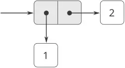

**الشكل 2.2:** تمثيل `(cons 1 2)` بالصناديق والمؤشّرات.

وقد رأينا بالفعل أنّ `cons` يمكن استخدامه لدمج لا الأعداد فحسب بل الأزواج أيضًا. (وأنت قد استفدت من هذه الحقيقة، أو كان ينبغي لك ذلك، عند أداء [التمرين 2.2](https://sarabander.github.io/sicp/html/2_002e1.xhtml#Exercise-2_002e2) و[التمرين 2.3](https://sarabander.github.io/sicp/html/2_002e1.xhtml#Exercise-2_002e3).) ونتيجةً لذلك، توفّر الأزواج لبنةَ بناءٍ عامّةً نستطيع بها تشييد جميع أنواع بنيات البيانات. ويُظهر [الشكل 2.3](/book/sicp/c2-building-abstractions-with-data/2-2/) طريقتين لاستخدام الأزواج في دمج الأعداد 1، و2، و3، و4.

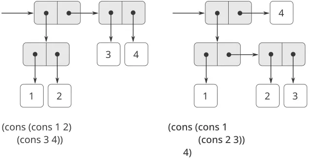

**الشكل 2.3:** طريقتان لدمج الأعداد 1، و2، و3، و4 باستخدام الأزواج.

إنّ القدرة على إنشاء أزواجٍ عناصرها أزواجٌ هي جوهر أهمّيّة بنية القائمة بوصفها أداةً تمثيليّة. ونحن نشير إلى هذه القدرة بـ*خاصّيّة الإغلاق (closure property)* لـ`cons`. وبصورةٍ عامّة، فإنّ عمليّةً لدمج كائنات البيانات تُحقّق خاصّيّة الإغلاق إذا كانت نتائج دمج الأشياء بتلك العمليّة قابلةً بذاتها للدمج باستخدام العمليّة ذاتها.[^6] والإغلاق هو مفتاح القوّة في أيّ وسيلةِ دمجٍ لأنّه يسمح لنا بإنشاء بنى *هرميّة* — بنىً مركّبةٍ من أجزاء، هي بذاتها مركّبةٌ من أجزاء، وهكذا.

فمنذ بداية [الفصل 1](https://sarabander.github.io/sicp/html/Chapter-1.xhtml#Chapter-1)، استخدمنا الإغلاق استخدامًا جوهريًّا في تعاملنا مع الإجراءات، لأنّ جميع البرامج إلّا أبسطها تعتمد على حقيقة أنّ عناصر التركيب يمكن أن تكون تركيبًا بذاتها. وفي هذا القسم نتناول تبعات الإغلاق بالنسبة للبيانات المركّبة. فنحن نصف بعض التقنيّات المتعارَف عليها لاستخدام الأزواج في تمثيل التسلسلات والأشجار، ونعرض لغةً رسوميّةً تُجسّد الإغلاق بطريقةٍ بالغة الوضوح.[^7]

#### 2.2.1 تمثيل التسلسلات

إحدى البنيات المفيدة التي نستطيع تشييدها بالأزواج هي *التسلسل (sequence)* — مجموعةٌ مرتَّبةٌ من كائنات البيانات. ثمّة، بالطبع، طرائقُ كثيرةٌ لتمثيل التسلسلات بدلالة الأزواج. وأحد التمثيلات المباشرة على نحوٍ خاصّ موضَّحٌ في [الشكل 2.4](/book/sicp/c2-building-abstractions-with-data/2-2/)، حيث يُتمثَّل التسلسل 1، و2، و3، و4 سلسلةً من الأزواج. فالـ`car` لكلّ زوجٍ هو العنصر المقابل له في السلسلة، والـ`cdr` للزوج هو الزوج التالي في السلسلة. والـ`cdr` للزوج الأخير يُشير إلى نهاية التسلسل بالإشارة إلى قيمةٍ مميّزةٍ ليست زوجًا، وهي مُتمثَّلة في مخطّطات الصناديق والمؤشّرات بخطٍّ قطريّ وفي البرامج بقيمة المتغيّر `nil`. ويُبنى التسلسل كلُّه بعمليّات `cons` متداخلة:

```scheme
(cons 1
      (cons 2
            (cons 3
                  (cons 4 nil))))
```

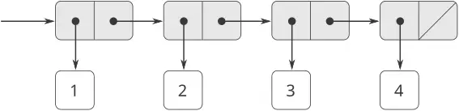

**الشكل 2.4:** التسلسل 1، و2، و3، و4 مُمثَّلًا سلسلةً من الأزواج.

إنّ تسلسلًا كهذا من الأزواج، المتشكّل بعمليّات `cons` متداخلة، يُسمّى *قائمة (list)*، وتوفّر Scheme أوّليًّا يُسمّى `list` للمساعدة في بناء القوائم.[^8] ويمكن إنتاج التسلسل أعلاه بـ`(list 1 2 3 4)`. وبصورةٍ عامّة،

```scheme
(list ⟨a₁⟩ ⟨a₂⟩ … ⟨aₙ⟩)
```

وهو مكافئٌ لـ

```scheme
(cons ⟨a₁⟩
      (cons ⟨a₂⟩
            (cons …
                  (cons ⟨aₙ⟩
                        nil)…)))
```

تطبع نظم Lisp القوائم اصطلاحًا بطباعة تسلسل العناصر محاطًا بأقواس. وبذلك، فإنّ كائن البيانات في [الشكل 2.4](/book/sicp/c2-building-abstractions-with-data/2-2/) يُطبع بالشكل `(1 2 3 4)`:

```scheme
(define one-through-four (list 1 2 3 4))

one-through-four
(1 2 3 4)
```

احرص على ألّا تخلط بين التعبير `(list 1 2 3 4)` والقائمة `(1 2 3 4)`، وهي النتيجة المتحصّلة عند تقييم التعبير. فإنّ محاولة تقييم التعبير `(1 2 3 4)` ستُطلق إشارة خطأٍ عندما يحاول المفسّر تطبيق الإجراء `1` على المعطيات `2`، و`3`، و`4`.

يمكننا النظر إلى `car` على أنّه ينتقي أوّل عنصر في القائمة، وإلى `cdr` على أنّه ينتقي القائمة الفرعيّة المكوّنة من جميع العناصر عدا الأوّل. ويمكن استخدام تطبيقات `car` و`cdr` المتداخلة لاستخراج العنصر الثاني، والثالث، والعناصر اللاحقة في القائمة.[^9] والباني `cons` يُنتج قائمةً شبيهة بالأصليّة، لكن مع عنصرٍ إضافيّ في البداية.

```scheme
(car one-through-four)
1

(cdr one-through-four)
(2 3 4)

(car (cdr one-through-four))
2

(cons 10 one-through-four)
(10 1 2 3 4)

(cons 5 one-through-four)
(5 1 2 3 4)
```

قيمة `nil`، المستخدمة لإنهاء سلسلة الأزواج، يمكن النظر إليها بوصفها تسلسلًا لا عناصر له، وهو *القائمة الفارغة (empty list)*. وكلمة *nil* اختصارٌ للكلمة اللاتينيّة *nihil*، التي تعني «لا شيء».[^10]

#### عمليّات القوائم

يُرافق استخدام الأزواج في تمثيل تسلسلات العناصر كقوائم تقنيّاتٌ برمجةٍ متعارَف عليها لمعالجة القوائم بالتنزّل المتتالي بـ`cdr` عبرها. فمثلًا، يأخذ الإجراء `list-ref` كمعطياتٍ قائمةً وعددًا $n$ ويُعيد العنصر $n^{th}$ من القائمة. ومن المتعارف عليه ترقيم عناصر القائمة ابتداءً من 0. وطريقة احتساب `list-ref` هي الآتية:

- من أجل $n = 0$ ، ينبغي أن يُعيد `list-ref` الـ`car` للقائمة.
- وإلّا، فينبغي أن يُعيد `list-ref` العنصر $( n − 1 )$ -st من `cdr` القائمة.

```scheme
(define (list-ref items n)
  (if (= n 0)
      (car items)
      (list-ref (cdr items) 
                (- n 1))))

(define squares 
  (list 1 4 9 16 25))

(list-ref squares 3)
16
```

غالبًا ما نتنزّل بـ`cdr` عبر القائمة كلّها. ولمساعدتنا في ذلك، تتضمّن Scheme مُسَيِّمًا أوّليًّا يُسمّى `null?`، يختبر ما إذا كان معطاه هو القائمة الفارغة. والإجراء `length`، الذي يُعيد عدد العناصر في قائمةٍ، يُجسّد هذا النمط الاستخداميّ النموذجيّ:

```scheme
(define (length items)
  (if (null? items)
      0
      (+ 1 (length (cdr items)))))

(define odds
  (list 1 3 5 7))

(length odds)
4
```

يُنفّذ الإجراء `length` خطةً تعاوديّةً بسيطة. وخطوة الاختزال هي:

- إنّ `length` أيّ قائمةٍ يساوي 1 زائد `length` الـ`cdr` منها.

وهذا يُطبَّق تتاليًّا حتّى نصل إلى الحالة الأساسيّة:

- إنّ `length` القائمة الفارغة هو 0.

ويمكننا أيضًا احتساب `length` بأسلوبٍ تكراريّ:

```scheme
(define (length items)
  (define (length-iter a count)
    (if (null? a)
        count
        (length-iter (cdr a) 
                     (+ 1 count))))
  (length-iter items 0))
```

وثمّة تقنيّةٌ برمجةٍ متعارَف عليها أخرى، وهي «تجميع قائمة الجواب بـ`cons`» أثناء التنزّل بـ`cdr` عبر قائمةٍ، كما في الإجراء `append`، الذي يأخذ قائمتين كمعطياتٍ ويدمج عناصرهما لإنتاج قائمةٍ جديدة:

```scheme
(append squares odds)
(1 4 9 16 25 1 3 5 7)

(append odds squares)
(1 3 5 7 1 4 9 16 25)
```

يُنفّذ `Append` أيضًا باستخدام خطةٍ تعاوديّة. ولدمج (`append`) القائمتين `list1` و`list2`، افعل الآتي:

- إذا كانت `list1` هي القائمة الفارغة، فالنتيجة هي `list2` فحسب.
- وإلّا، فادمج (`append`) الـ`cdr` لـ`list1` مع `list2`، وثبّت (`cons`) الـ`car` لـ`list1` في رأس النتيجة:

```scheme
(define (append list1 list2)
  (if (null? list1)
      list2
      (cons (car list1) 
            (append (cdr list1) 
                    list2))))
```

**التمرين 2.17:** عرّف إجراءً `last-pair` يُعيد القائمة التي تحتوي العنصر الأخير لقائمةٍ معطاةٍ (غير فارغة) فقط:

```scheme
(last-pair (list 23 72 149 34))
(34)
```

**التمرين 2.18:** عرّف إجراءً `reverse` يأخذ قائمةً كمعطى ويُعيد قائمةً بالعناصر ذاتها بترتيبٍ معكوس:

```scheme
(reverse (list 1 4 9 16 25))
(25 16 9 4 1)
```

**التمرين 2.19:** تأمّل برنامج عدّ النقود الوارد في [1.2.2](https://sarabander.github.io/sicp/html/1_002e2.xhtml#g_t1_002e2_002e2). سيكون من الجميل أن نتمكّن من تغيير العملة التي يستخدمها البرنامج بسهولة، حتّى نتمكّن من احتساب عدد طرائق صرف جنيه إسترليني مثلًا. فبالبرنامج مكتوبًا كما هو، فإنّ المعرفة بالعملة موزّعةٌ جزئيًّا في الإجراء `first-denomination` وجزئيًّا في الإجراء `count-change` (الذي يعلم أنّ ثمّة خمسة أنواعٍ من عملات الولايات المتّحدة). وسيكون من الأجمل أن نتمكّن من تزويد البرنامج بقائمة العملات التي تُستخدم في الصرف.

نريد إعادة كتابة الإجراء `cc` بحيث يكون معطاه الثاني قائمةً بقيم العملات التي ستُستخدم بدلًا من عددٍ صحيحٍ يحدّد أيّ العملات تُستخدم. وحينها يمكن أن تكون لدينا قوائم تُعرّف كلّ نوعٍ من العملات:

```scheme
(define us-coins 
  (list 50 25 10 5 1))

(define uk-coins 
  (list 100 50 20 10 5 2 1 0.5))
```

ويمكننا حينها مناداة `cc` على النحو الآتي:

```scheme
(cc 100 us-coins)
292
```

سيتطلّب القيام بذلك تغيير برنامج `cc` إلى حدٍّ ما. فسيظلّ بالشكل ذاته، لكنّه سيصل إلى معطاه الثاني بطريقةٍ مختلفة، كما يلي:

```scheme
(define (cc amount coin-values)
  (cond ((= amount 0) 
         1)
        ((or (< amount 0) 
             (no-more? coin-values)) 
         0)
        (else
         (+ (cc 
             amount
             (except-first-denomination 
              coin-values))
            (cc 
             (- amount
                (first-denomination 
                 coin-values))
             coin-values)))))
```

عرّف الإجراءات `first-denomination`، و`except-first-denomination`، و`no-more?` بدلالة عمليّاتٍ أوّليّةٍ على بنيات القوائم. فهل يؤثّر ترتيب القائمة `coin-values` في الجواب الذي يُنتجه `cc`؟ ولماذا أو لماذا لا؟

**التمرين 2.20:** تأخذ الإجراءات `+`، و`*`، و`list` أعدادًا اعتباطيّةً من المعطيات. وإحدى طرائق تعريف إجراءاتٍ كهذا هي استخدام `define` مع *الترميز ذي النقطة في الذيل (dotted-tail notation)*. ففي تعريف الإجراء، فإنّ قائمة الوسائط التي تحتوي نقطةً قبل اسم الوسيط الأخير تُشير إلى أنّه حين يُنادى الإجراء، فإنّ الوسائط الأوّليّة (إن وُجِدت) ستكون لها المعطيات الأوّليّة قيمًا، كالمعتاد، لكنّ قيمة الوسيط الأخير ستكون *قائمةً* بأيّ معطياتٍ متبقّية. فمثلًا، إذا كان لدينا التعريف

```scheme
(define (f x y . z) ⟨body⟩)
```

فإنّ الإجراء `f` يمكن مناداته بمعطيين أو أكثر. فإن قيّمنا

```scheme
(f 1 2 3 4 5 6)
```

فإنّه في جسم `f`، سيكون `x` هو 1، و`y` هو 2، و`z` هو القائمة `(3 4 5 6)`. وبالنظر إلى التعريف

```scheme
(define (g . w) ⟨body⟩)
```

فإنّ الإجراء `g` يمكن مناداته بصفر من المعطيات أو أكثر. فإن قيّمنا

```scheme
(g 1 2 3 4 5 6)
```

فإنّه في جسم `g`، سيكون `w` هو القائمة `(1 2 3 4 5 6)`.[^11]

استخدم هذا الترميز لكتابة إجراءٍ `same-parity` يأخذ عددًا صحيحًا أو أكثر ويُعيد قائمةً بجميع المعطيات التي تتّسم بالتكافؤ نفسه (زوجيّةً أو فرديّةً) كما المعطى الأوّل. فمثلًا،

```scheme
(same-parity 1 2 3 4 5 6 7)
(1 3 5 7)

(same-parity 2 3 4 5 6 7)
(2 4 6)
```

#### الرسم الخرائطي على القوائم

إحدى العمليّات المفيدة للغاية هي تطبيق تحويلٍ ما على كلّ عنصرٍ في قائمةٍ وإنتاج قائمة النتائج. فمثلًا، يضرب الإجراء الآتي كلّ عددٍ في قائمةٍ في معاملٍ معطًى:

```scheme
(define (scale-list items factor)
  (if (null? items)
      nil
      (cons (* (car items) factor)
            (scale-list (cdr items) 
                        factor))))

(scale-list (list 1 2 3 4 5) 10)
(10 20 30 40 50)
```

يمكننا تجريد هذه الفكرة العامّة والتقاطها بوصفها نمطًا مشتركًا مُعبَّرًا عنه بإجراءٍ من رتبةٍ عليا، تمامًا كما في [1.3](https://sarabander.github.io/sicp/html/1_002e3.xhtml#g_t1_002e3). والإجراء عليا الرتبة هنا يُسمّى `map`. و`Map` يأخذ كمعطياتٍ إجراءً ذا معطى واحد وقائمةً، ويُعيد قائمةَ النتائج الناتجة عن تطبيق الإجراء على كلّ عنصرٍ في القائمة:[^12]

```scheme
(define (map proc items)
  (if (null? items)
      nil
      (cons (proc (car items))
            (map proc (cdr items)))))

(map abs (list -10 2.5 -11.6 17))
(10 2.5 11.6 17)

(map (lambda (x) (* x x)) (list 1 2 3 4))
(1 4 9 16)
```

والآن يمكننا إعطاء تعريفٍ جديد لـ`scale-list` بدلالة `map`:

```scheme
(define (scale-list items factor)
  (map (lambda (x) (* x factor))
       items))
```

إنّ `Map` بناءٌ مهمّ، لا لأنه يلتقط نمطًا مشتركًا فحسب، بل لأنه يُرسّي مستوىً أعلى من التجريد في التعامل مع القوائم. ففي تعريف `scale-list` الأصليّ، تجذب بنية البرنامج التعاوديّة الانتباه إلى المعالجة العنصريّة للقائمة. أمّا تعريف `scale-list` بدلالة `map` فيحجب ذلك المستوى من التفصيل ويُبرز أنّ الضرب في معاملٍ يحوّل قائمةَ عناصرٍ إلى قائمة نتائج. والفرق بين التعريفين ليس أنّ الحاسوب يؤدّي عمليّةً مختلفة (فهو لا يفعل ذلك)، بل أنّنا نفكّر في العمليّة تفكيرًا مختلفًا. وفي الواقع، يساعد `map` في إرساء حاجز تجريدٍ يعزل تنفيذ الإجراءات التي تحوّل القوائم عن تفاصيل كيفيّة استخراج عناصر القائمة ودمجها. ومثل الحواجز المبيّنة في [الشكل 2.1](https://sarabander.github.io/sicp/html/2_002e1.xhtml#Figure-2_002e1)، يمنحنا هذا التجريد مرونةَ تغيير التفاصيل منخفضة المستوى لكيفيّة تنفيذ التسلسلات، مع الحفاظ على الإطار المفاهيميّ للعمليّات التي تحوّل التسلسلات إلى تسلسلات. ويوسّع القسم [2.2.3](/book/sicp/c2-building-abstractions-with-data/2-2/) هذا الاستخدام للتسلسلات بوصفها إطارًا لتنظيم البرامج.

**التمرين 2.21:** يأخذ الإجراء `square-list` قائمة أعداد كمعطى ويُعيد قائمةً بمربّعات تلك الأعداد.

```scheme
(square-list (list 1 2 3 4))
(1 4 9 16)
```

إليك تعريفان مختلفان لـ`square-list`. أكمل كليهما بسدّ التعابير الناقصة:

```scheme
(define (square-list items)
  (if (null? items)
      nil
      (cons ⟨??⟩ ⟨??⟩)))

(define (square-list items)
  (map ⟨??⟩ ⟨??⟩))
```

**التمرين 2.22:** يحاول لويس ريزنر إعادة كتابة إجراء `square-list` الأوّل في [التمرين 2.21](/book/sicp/c2-building-abstractions-with-data/2-2/) بحيث يولّد عمليّةً تكراريّة:

```scheme
(define (square-list items)
  (define (iter things answer)
    (if (null? things)
        answer
        (iter (cdr things)
              (cons (square (car things))
                    answer))))
  (iter items nil))
```

للأسف، إنّ تعريف `square-list` بهذه الطريقة يُنتج قائمة الإجابة بترتيبٍ معكوسٍ عن المراد. لماذا؟

ثم يحاول لويس إصلاح علّته بتبادل الوسيطين إلى `cons`:

```scheme
(define (square-list items)
  (define (iter things answer)
    (if (null? things)
        answer
        (iter (cdr things)
              (cons answer
                    (square 
                     (car things))))))
  (iter items nil))
```

وهذا لا ينجح أيضًا. فسّر.

**التمرين 2.23:** الإجراء `for-each` شبيهٌ بـ`map`. وهو يأخذ كوسائطَ إجراءً وقائمةَ عناصر. غير أنّه، بدلًا من تكوين قائمةٍ بالنتائج، يُطبّق `for-each` الإجراء على كلّ عنصرٍ بدوره، من اليسار إلى اليمين. والقيم المُعادة من تطبيق الإجراء على العناصر لا تُستخدم إطلاقًا—يُستخدم `for-each` مع إجراءاتٍ تؤدّي فعلًا، كالطبع. فعلى سبيل المثال،

```scheme
(for-each 
 (lambda (x) (newline) (display x))
 (list 57 321 88))

57
321
88
```

والقيمة المُعادة من نداء `for-each` (غير موضّحةٍ أعلاه) يمكن أن تكون شيئًا اعتباطيًّا، مثل true. فأعطِ تنفيذًا لـ`for-each`.

#### 2.2.2 البنى الهرميّة

إنّ تمثيل التسلسلات بدلالة القوائم يتعمّم تعمّمًا طبيعيًّا لتمثيل تسلسلاتٍ قد تكون عناصرها هي نفسها تسلسلات. فعلى سبيل المثال، يمكننا اعتبار الكائن `((1 2) 3 4)` المُنشأ بـ

```scheme
(cons (list 1 2) (list 3 4))
```

قائمةً من ثلاثة عناصر، أوّلُها قائمةٌ بذاته، `(1 2)`. وإنّ ذلك لمُستفادٌ من الصورة التي تُطبع بها النتيجة بواسطة المفسّر. ويُظهر [الشكل 2.5](/book/sicp/c2-building-abstractions-with-data/2-2/) تمثيل هذه البنية بدلالة الأزواج.

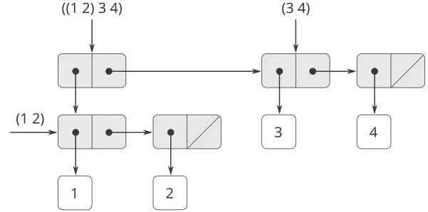

**الشكل 2.5:** بنيةٌ مُشكَّلةٌ بـ`(cons (list 1 2) (list 3 4))`.

وثمّة طريقةٌ أخرى للنظر إلى التسلسلات التي عناصرها تسلسلات، وهي اعتبارها *أشجارًا (trees)*. فعناصر التسلسل هي فروع الشجرة، والعناصر التي هي تسلسلاتٌ بذاتها هي أشجارٌ فرعيّة. ويُظهر [الشكل 2.6](/book/sicp/c2-building-abstractions-with-data/2-2/) البنية في [الشكل 2.5](/book/sicp/c2-building-abstractions-with-data/2-2/) من منظور الشجرة.

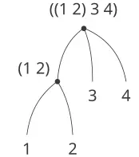

**الشكل 2.6:** بنية القائمة في [الشكل 2.5](/book/sicp/c2-building-abstractions-with-data/2-2/) من منظور الشجرة.

والتعاود أداةٌ طبيعيّةٌ للتعامل مع بنى الأشجار، إذ يمكننا غالبًا اختزال العمليّات على الأشجار إلى عمليّاتٍ على فروعها، التي تختزل بدورها إلى عمليّاتٍ على فروع الفروع، وهكذا، حتّى نصل إلى أوراق الشجرة. فكمثالٍ على ذلك، قارن الإجراء `length` في [2.2.1](/book/sicp/c2-building-abstractions-with-data/2-2/) بالإجراء `count-leaves`، الذي يُعيد العدد الكلّي لأوراق شجرة:

```scheme
(define x (cons (list 1 2) (list 3 4)))
```

```scheme
(length x)
3
```

```scheme
(count-leaves x)
4

(list x x)
(((1 2) 3 4) ((1 2) 3 4))

(length (list x x))
2

(count-leaves (list x x))
8
```

ولتنفيذ `count-leaves`، تذكّر الخطة التعاوديّة لاحتساب `length`:

- `Length` قائمة `x` هو 1 زائد `length` الـ`cdr` لـ`x`.
- `Length` القائمة الفارغة هو 0.

أمّا `count-leaves` فهو شبيه. وأمّا القيمة من أجل القائمة الفارغة فهي نفسها:

- `count-leaves` القائمة الفارغة يساوي 0.

لكن في خطوة الاختزال، حيث نُزيل الـ`car` من القائمة، ينبغي أن نأخذ في الحسبان أنّ الـ`car` قد يكون هو نفسه شجرةً نحتاج إلى إحصاء أوراقها. وبالتالي، فإنّ خطوة الاختزال الملائمة هي

- `count-leaves` شجرة `x` يساوي `count-leaves` الـ`car` لـ`x` زائد `count-leaves` الـ`cdr` لـ`x`.

وأخيرًا، فبأخذ `car`s نصل إلى أوراقَ فعليّة، لذا نحتاج إلى حالة أساسٍ أخرى:

- `count-leaves` ورقةٍ هو 1.

ومعاونةً في كتابة الإجراءات التعاوديّة على الأشجار، توفّر Scheme المسيّم الأوّلي `pair?`، الذي يختبر ما إذا كان مُدخله زوجًا. وإليك الإجراء الكامل:[^13]

```scheme
(define (count-leaves x)
  (cond ((null? x) 0)
        ((not (pair? x)) 1)
        (else (+ (count-leaves (car x))
                 (count-leaves (cdr x))))))
```

> **التمرين 2.24:** لنفترض أنّنا قيّمنا التعبير `(list 1 (list 2 (list 3 4)))`. فأعطِ النتيجة التي يطبعها المفسّر، وبنية الصناديق والمؤشّرات المقابلة، وتأويل هذا بوصفه شجرةً (كما في [الشكل 2.6](/book/sicp/c2-building-abstractions-with-data/2-2/)).

**التمرين 2.25:** أعطِ تركيباتٍ من `car`s و`cdr`s ستنتزع 7 من كلّ واحدة من القوائم التالية:

```scheme
(1 3 (5 7) 9)
((7))
(1 (2 (3 (4 (5 (6 7))))))
```

**التمرين 2.26:** لنفترض أنّنا عرّفنا `x` و`y` ليكونا قائمتين:

```scheme
(define x (list 1 2 3))
(define y (list 4 5 6))
```

فما النتيجة التي يطبعها المفسّر استجابةً لتقييم كلّ واحدٍ من التعابير التالية:

```scheme
(append x y)
(cons x y)
(list x y)
```

**التمرين 2.27:** عدّل إجراءك `reverse` من [التمرين 2.18](/book/sicp/c2-building-abstractions-with-data/2-2/) لتُنتج إجراءً هو `deep-reverse` يأخذ قائمةً كمعطىً ويُعيد قيمته قائمةً عناصرها معكوسةٌ وجميع قوائمها الفرعيّة معكوسةٌ عكسًا عميقًا كذلك. فعلى سبيل المثال،

```scheme
(define x 
  (list (list 1 2) (list 3 4)))

x
((1 2) (3 4))

(reverse x)
((3 4) (1 2))

(deep-reverse x)
((4 3) (2 1))
```

**التمرين 2.28:** اكتب إجراءً هو `fringe` يأخذ كمعطىً شجرةً (ممثَّلةً كقائمة) ويُعيد قائمةً عناصرها هي جميع أوراق الشجرة مرتَّبةً من اليسار إلى اليمين. فعلى سبيل المثال،

```scheme
(define x 
  (list (list 1 2) (list 3 4)))

(fringe x)
(1 2 3 4)

(fringe (list x x))
(1 2 3 4 1 2 3 4)
```

**التمرين 2.29:** يتكوّن المِهْبَل الثنائيّ من فرعين، فرعٍ أيسر وفرعٍ أيمن. وكلّ فرعٍ هو قضيبٌ ذو طولٍ معيّن، يتدلّى منه إمّا ثقلٌ وإمّا مِهْبَلٌ ثنائيٌّ آخر. ويمكننا تمثيل المِهْبَل الثنائيّ باستخدام بياناتٍ مركّبةٍ وذلك بإنشائه من فرعين (فعلى سبيل المثال، باستخدام `list`):

```scheme
(define (make-mobile left right)
  (list left right))
```

أمّا الفرع فيُبنى من `length` (الذي ينبغي أن يكون عددًا) مع `structure`، الذي قد يكون إمّا عددًا (يمثّل ثقلًا بسيطًا) وإمّا مِهْبَلًا آخر:

```scheme
(define (make-branch length structure)
  (list length structure))
```

فاكتب المُنَتقيات المُقابلة `left-branch` و`right-branch`، التي تُعيد فروض المِهْبَل، و`branch-length` و`branch-structure`، التي تُعيد مكوّنات الفرع. وباستخدام مُنَتقياتك، عرّف إجراءً هو `total-weight` يُعيد الثقل الكلّي لمِهْبَلٍ ما. ويُقال عن مِهْبَلٍ إنّه *متوازنٌ* إذا كان عزم الالتواء الذي يُطبّقه فرعه الأيسر العلويّ مساويًا لذاك الذي يُطبّقه فرعه الأيمن العلويّ (أي إذا كان طول القضيب الأيسر مضروبًا في الثقل المتدلّي من ذاك القضيب مساويًا للجداء المقابل من الجهة اليمنى) وإذا كان كلٌّ من المِهْبَلات الفرعيّة المتدلّية من فروضه متوازنًا. فصمّم مسيّمًا يختبر ما إذا كان المِهْبَل الثنائيّ متوازنًا. ولنفترض أنّنا غيّرنا تمثيل المِهْبَلات بحيث تصير البواني هي

```scheme
(define (make-mobile left right)
  (cons left right))

(define (make-branch length structure)
  (cons length structure))
```

فما القدر الذي يتعيّن عليك تغييره في برامجك للتحوّل إلى التمثيل الجديد؟

#### الإسناد على الأشجار

فكما أنّ `map` تجريدٌ قويٌّ للتعامل مع التسلسلات، فإنّ `map` مع التعاوب تجريدٌ قويٌّ للتعامل مع الأشجار. فعلى سبيل المثال، يأخذ الإجراء `scale-tree`، النظير لـ`scale-list` في [2.2.1](/book/sicp/c2-building-abstractions-with-data/2-2/)، كوسائطَ معاملًا عدديًّا وشجرةً أوراقها أعداد. وهو يُعيد شجرةً بالشكل نفسه، حيث يُضرب كلّ عددٍ في المعامل. والخطة التعاوديّة لـ`scale-tree` شبيهةٌ بتلك الخاصّة بـ`count-leaves`:

```scheme
(define (scale-tree tree factor)
  (cond ((null? tree) nil)
        ((not (pair? tree)) 
         (* tree factor))
        (else
         (cons (scale-tree (car tree) 
                           factor)
               (scale-tree (cdr tree) 
                           factor)))))

(scale-tree (list 1 
                  (list 2 (list 3 4) 5) 
                  (list 6 7))
            10)

(10 (20 (30 40) 50) (60 70))
```

وثمّة طريقةٌ أخرى لتنفيذ `scale-tree`، وهي اعتبار الشجرة تسلسلًا من الأشجار الفرعيّة واستخدام `map`. فنُسند على التسلسل، مُكبّرين كلّ شجرةٍ فرعيّةٍ بدورها، ونُعيد قائمة النتائج. وفي الحالة الأساسّة، حيث تكون الشجرة ورقةً، نضرب ببساطةٍ في المعامل:

```scheme
(define (scale-tree tree factor)
  (map (lambda (sub-tree)
         (if (pair? sub-tree)
             (scale-tree sub-tree factor)
             (* sub-tree factor)))
       tree))
```

ويمكن تنفيذ كثيرٍ من عمليّات الأشجار بتركيباتٍ مشابهةٍ من عمليّات التسلسلات والتعاوب.

**التمرين 2.30:** عرّف إجراءً هو `square-tree` نظيرًا لإجراء `square-list` في [التمرين 2.21](/book/sicp/c2-building-abstractions-with-data/2-2/). أي أنّ `square-tree` ينبغي أن يسلك سلوكًا كما يلي:

```scheme
(square-tree
 (list 1
       (list 2 (list 3 4) 5)
       (list 6 7)))
(1 (4 (9 16) 25) (36 49))
```

فعرّف `square-tree` مباشرةً (أي دون استخدام أيّ إجراءاتٍ عليا الرتبة) وكذلك باستخدام `map` والتعاوب.

**التمرين 2.31:** جرّد إجابتك على [التمرين 2.30](/book/sicp/c2-building-abstractions-with-data/2-2/) لتُنتج إجراءً هو `tree-map` بالخاصّيّة أنّ `square-tree` يمكن تعريفه كـ

```scheme
(define (square-tree tree) 
  (tree-map square tree))
```

**التمرين 2.32:** يمكننا تمثيل مجموعةٍ كقائمةٍ من عناصرٍ متمايزة، ويمكننا تمثيل مجموعة جميع المجموعات الفرعيّة للمجموعة كقائمةٍ من القوائم. فعلى سبيل المثال، إذا كانت المجموعة هي `(1 2 3)`، فإنّ مجموعة جميع المجموعات الفرعيّة هي `(() (3) (2) (2 3) (1) (1 3) (1 2) (1 2 3))`. فأكمل التعريف التالي لإجراءٍ يولّد مجموعة المجموعات الفرعيّة لمجموعةٍ ما، وأعطِ تفسيرًا واضحًا لسبب نجاحه:

```scheme
(define (subsets s)
  (if (null? s)
      (list nil)
      (let ((rest (subsets (cdr s))))
        (append rest (map ⟨??⟩ rest)))))
```

#### 2.2.3 التسلسلات كَوَاجهاتٍ اعتياديّة

وفي العمل مع البيانات المركّبة، أكّدنا كيف يسمح لنا تجريد البيانات بتصميم برامجٍ دون أن نتشابك في تفاصيل تمثيلات البيانات، وكيف يحفظ لنا التجريد المرونة اللازمة لتجربة تمثيلاتٍ بديلة. وفي هذا القسم، نستعرض مبدأً تصميميًّا قويًّا آخر للعمل مع بنى البيانات—ألا وهو استخدام *الوَاجهات الاعتياديّة*.

في [1.3](https://sarabander.github.io/sicp/html/1_002e3.xhtml#g_t1_002e3) رأينا كيف يمكن لتجريدات البرامج، المنفَّذةً كإجراءاتٍ عليا الرتبة، أن تلتقط الأنماط الشائعة في البرامج التي تتعامل مع بياناتٍ عدديّة. وإنّ قدرتنا على صياغة عمليّاتٍ نظيرةٍ للعمل مع بياناتٍ مركّبةٍ تعتمد اعتمادًا حاسمًا على الأسلوب الذي نعالج به بنى بياناتنا. فتأمّل مثلًا الإجراء التالي، النظير لإجراء `count-leaves` في [2.2.2](/book/sicp/c2-building-abstractions-with-data/2-2/)، الذي يأخذ شجرةً كمعطىً ويحتسب مجموع مربّعات الأوراق الفرديّة:

```scheme
(define (sum-odd-squares tree)
  (cond ((null? tree) 0)
        ((not (pair? tree))
         (if (odd? tree) (square tree) 0))
        (else (+ (sum-odd-squares 
                  (car tree))
                 (sum-odd-squares 
                  (cdr tree))))))
```

أمّا في الظّاهر، فهذا الإجراء مختلفٌ كلّ الاختلاف عن الإجراء التالي، الذي يبني قائمةً بجميع أعداد فيبوناتشي الزوجيّة $Fib ( k )$ ، حيث $k$ لا تزيد على عددٍ صحيحٍ معطىً $n$ :

```scheme
(define (even-fibs n)
  (define (next k)
    (if (> k n)
        nil
        (let ((f (fib k)))
          (if (even? f)
              (cons f (next (+ k 1)))
              (next (+ k 1))))))
  (next 0))
```

وعلى الرغم من أنّ هذين الإجراءين مختلفان بنيويًّا اختلافًا كبيرًا، فإنّ وصفًا أكثر تجريدًا للاحتسابين يكشف عن قدرٍ كبيرٍ من التشابه. فالبرنامج الأوّل

- يُعدّد أوراق شجرة؛
- يرشّحها، منتقيًا الفرديّة منها؛
- يُربّع كلّ واحدٍ من المُنتقى؛ و
- يُراكم النتائج باستخدام `+`، بدءًا من 0.

أمّا البرنامج الثاني

- يُعدّد الأعداد الصحيحة من 0 إلى $n$ ؛
- يحتسب عدد فيبوناتشي لكلّ عددٍ صحيح؛
- يرشّحها، منتقيًا الزوجيّة منها؛ و
- يُراكم النتائج باستخدام `cons`، بدءًا من القائمة الفارغة.

سيجد مهندسُ معالجة الإشارات من الطبيعيّ أن يُصوّر هذه العمليّات بدلالة إشاراتٍ تتدفّق عبر تتابعٍ من المراحل، كلٌّ منها ينفّذ جزءًا من خطة البرنامج، كما هو موضّح في [الشكل 2.7](/book/sicp/c2-building-abstractions-with-data/2-2/). ففي `sum-odd-squares`، نبدأ بـ*mُعَدِّد (enumerator)*، الذي يُولّد «إشارة» تتكوّن من أوراق شجرةٍ معطاة. وهذه الإشارة تُمرَّر عبر *مرشّح (filter)*، يُقصي جميع العناصر عدا الفرديّة. ثمّ تُمرَّر الإشارة الناتجة بدورها عبر *إسناد (map)*، وهو «محوّلٌ» يُطبّق الإجراء `square` على كلّ عنصر. ثمّ يُغذّى خرج الإسناد إلى *مُراكم (accumulator)*، الذي يجمع العناصر باستخدام `+`، بدءًا من 0 أوّليّة. أمّا خطة `even-fibs` فهي نظيرة.

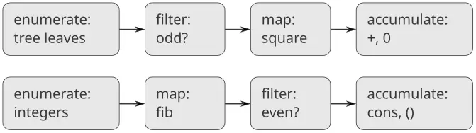

**الشكل 2.7:** تكشف خطط تدفّق الإشارة الخاصّة بالإجراءين `sum-odd-squares` (أعلى) و`even-fibs` (أسفل) عن القاسم المشترك بين البرنامجين.

وللأسف، فإنّ تعريفَي الإجراءين المذكورين أعلاه لا يُظهران بنية تدفّق الإشارة هذه. فعلى سبيل المثال، إذا فحصنا الإجراء `sum-odd-squares`، نجد أنّ الإعداد منفَّذٌ جزئيًّا باختبارَي `null?` و`pair?` وجزئيًّا بالبنية التعاوديّة الشجريّة للإجراء. وبشكلٍ مماثل، نجد التراكم جزءًا منه في الاختبارات وجزءًا منه في الجمع المستخدم في التعاوب. وبصورةٍ عامّة، ليس ثمّة أجزاءٌ متمايزةٌ في أيّ من الإجراءين تقابل العناصر في وصف تدفّق الإشارة. فإجراءانا يُفكّكان الاحتساب بطريقةٍ مختلفة، يبثّان الإعداد في البرنامج كله ويمزجانه بالإسناد والترشيح والتراكم. ولو كنّا قادرين على تنظيم برامجنا بحيث تصير بنية تدفّق الإشارة ظاهرةً في الإجراءات التي نكتبها، لَزاد ذلك وضوح الشيفرة الناتجة مفهوميًّا.

#### عمليّات التسلسلات

ومفتاح تنظيم البرامج بحيث تعكس بنية تدفّق الإشارة على نحوٍ أوضح هو التركيز على «الإشارات» التي تتدفّق من مرحلةٍ في العمليّة إلى المرحلة التالية. فإذا مثّلنا هذه الإشارات كقوائم، أمكننا استخدام عمليّات القوائم لتنفيذ المعالجة في كلّ مرحلة. فعلى سبيل المثال، يمكننا تنفيذ مراحل الإسناد في مخطّطات تدفّق الإشارة باستخدام الإجراء `map` من [2.2.1](/book/sicp/c2-building-abstractions-with-data/2-2/):

```scheme
(map square (list 1 2 3 4 5))
(1 4 9 16 25)
```

وأمّا ترشيح تسلسلٍ لانتقاء العناصر التي تحقّق مسيّمًا معيَّنًا فقط فيُنجَز بـ

```scheme
(define (filter predicate sequence)
  (cond ((null? sequence) nil)
        ((predicate (car sequence))
         (cons (car sequence)
               (filter predicate 
                       (cdr sequence))))
        (else  (filter predicate 
                       (cdr sequence)))))
```

فعلى سبيل المثال،

```scheme
(filter odd? (list 1 2 3 4 5))
(1 3 5)
```

ويمكن تنفيذ التراكمات (accumulations) بالإجراء

```scheme
(define (accumulate op initial sequence)
  (if (null? sequence)
      initial
      (op (car sequence)
          (accumulate op 
                      initial 
                      (cdr sequence)))))

(accumulate + 0 (list 1 2 3 4 5))
15
(accumulate * 1 (list 1 2 3 4 5))
120
(accumulate cons nil (list 1 2 3 4 5))
(1 2 3 4 5)
```

وكلّ ما يبقى لتنفيذ مخططات تدفق الإشارة (signal-flow diagrams) هو تعداد التسلسل من العناصر التي ستُعالَج. وبالنسبة إلى `even-fibs`، نحتاج إلى توليد تسلسل الأعداد الصحيحة في مدىً معطًى، وهو ما يمكننا فعله كما يلي:

```scheme
(define (enumerate-interval low high)
  (if (> low high)
      nil
      (cons low 
            (enumerate-interval 
             (+ low 1) 
             high))))

(enumerate-interval 2 7)
(2 3 4 5 6 7)
```

ولتعداد (enumerate) أوراق شجرةٍ، يمكننا استخدام[^14]

```scheme
(define (enumerate-tree tree)
  (cond ((null? tree) nil)
        ((not (pair? tree)) (list tree))
        (else (append 
               (enumerate-tree (car tree))
               (enumerate-tree (cdr tree))))))

(enumerate-tree (list 1 (list 2 (list 3 4)) 5))
(1 2 3 4 5)
```

ويمكننا الآن إعادة صياغة `sum-odd-squares` و`even-fibs` كما في مخططات تدفق الإشارة. فبالنسبة إلى `sum-odd-squares`، نُعدِّد (enumerate) تسلسل أوراق الشجرة، ونُرَشِّحه (filter) لنحتفظ بالأعداد الفرديّة وحدها في التسلسل، ونُربّع كلّ عنصر، ونجمع النتائج:

```scheme
(define (sum-odd-squares tree)
  (accumulate 
   +
   0
   (map square
        (filter odd?
                (enumerate-tree tree)))))
```

وبالنسبة إلى `even-fibs`، نُعدِّد الأعداد الصحيحة من 0 إلى $n$ ، ونُولِّد عدد فيبوناتشي لكلّ عددٍ من هذه الأعداد، ونُرَشِّح التسلسل الناتج لنحتفظ بالعناصر الزوجيّة وحدها، ونُتراكِم النتائج (accumulate) في قائمة:

```scheme
(define (even-fibs n)
  (accumulate 
   cons
   nil
   (filter even?
           (map fib
                (enumerate-interval 0 n)))))
```

وقيمة التعبير عن البرامج كعمليّاتٍ تسلسليّةٍ هي أنّ ذلك يساعدنا على جعل تصاميم برامجنا وحدانيّةً (modular)، أي مبنيّةً بدمج أجزاءٍ مستقلّةٍ نسبيًّا. ويمكننا تشجيع التصميم الوحدانيّ بتوفير مكتبة (library) من المكوّنات المعياريّة إلى جانب واجهةٍ اعتياديّةٍ (conventional interface) لربط المكوّنات بطرائقٍ مرنةٍ.

والبناء الوحدانيّ استراتيجيّةٌ قويّةٌ للتحكّم في التعقيد في التصميم الهندسيّ. ففي تطبيقات معالجة الإشارة (signal processing) الواقعيّة، مثلًا، يبني المصمّمون بانتظامٍ أنظمةً بربط عناصرَ متتاليةٍ منتقاةٍ من عائلاتٍ معياريّةٍ من المرشّحات (filters) والمحوّلات (transducers). وعلى نحوٍ مماثل، تُوفّر عمليّات التسلسل مكتبةً من عناصر البرامج المعياريّة التي يمكننا مزجها ومطابقتها. فعلى سبيل المثال، يمكننا إعادة استخدام أجزاءٍ من الإجراءين `sum-odd-squares` و`even-fibs` في برنامجٍ يبني قائمةً بمربّعات أوّل $n + 1$ عدد فيبوناتشي:

```scheme
(define (list-fib-squares n)
  (accumulate 
   cons
   nil
   (map square
        (map fib
             (enumerate-interval 0 n)))))

(list-fib-squares 10)
(0 1 1 4 9 25 64 169 441 1156 3025)
```

ويمكننا إعادة ترتيب الأجزاء واستخدامها في احتساب حاصل ضرب مربّعات الأعداد الصحيحة الفرديّة في تسلسلٍ ما:

```scheme
(define 
  (product-of-squares-of-odd-elements
   sequence)
  (accumulate 
   *
   1
   (map square (filter odd? sequence))))

(product-of-squares-of-odd-elements 
 (list 1 2 3 4 5))
225
```

ويمكننا أيضًا صياغة تطبيقات معالجة البيانات (data processing) الاعتياديّة بدلالة عمليّات التسلسل. فلنفترض أنّ لدينا تسلسلًا من سجلّات الموظفين (personnel records) ونريد إيجاد راتب المبرمج الأعلى أجرًا (highest-paid programmer). ولنفترض أنّ لدينا منتقيًّا (selector) اسمه `salary` يُعيد راتب سجلّ، ومسيِّمًا (predicate) اسمه `programmer?` يختبر فيما إذا كان السجلّ لمبرمجٍ. فيمكننا حينئذٍ الكتابة

```scheme
(define 
  (salary-of-highest-paid-programmer
   records)
  (accumulate 
   max
   0
   (map salary
        (filter programmer? records))))
```

وهذه الأمثلة لا تُعطي سوى لمحةٍ عن المدى الواسع من العمليّات التي يمكن التعبير عنها كعمليّاتٍ تسلسليّةٍ.[^15]

والتسلسلات، المنفَّذة هنا كقوائم، تعمل كواجهةٍ اعتياديّةٍ (conventional interface) تسمح لنا بدمج وحدات المعالجة. وإضافةً إلى ذلك، حين نمثّل البنى تمثيلًا موحّدًا كتسلسلاتٍ، فإنّنا نُركّز اعتماديات بنية البيانات في برامجنا على عددٍ قليلٍ من عمليّات التسلسل. وبتغيير هذه، يمكننا تجربة تمثيلاتٍ بديلةٍ للتسلسلات، دون المساس بالتصميم الكلّيّ لبرامجنا. وسنستغلّ هذه القدرة في [3.5](https://sarabander.github.io/sicp/html/3_002e5.xhtml#g_t3_002e5)، حين نُعمّم نمط معالجة التسلسلات ليقرّ بتسلسلاتٍ لا نهائيّةٍ (infinite sequences).

**التمرين 2.33:** أكمل التعابير الناقصة لإتمام التعريفات الآتية لبعض عمليّات التلاعب الأساسيّة بالقوائم، على هيئة تراكماتٍ:

```scheme
(define (map p sequence)
  (accumulate (lambda (x y) ⟨??⟩) 
              nil sequence))

(define (append seq1 seq2)
  (accumulate cons ⟨??⟩ ⟨??⟩))

(define (length sequence)
  (accumulate ⟨??⟩ 0 sequence))
```

**التمرين 2.34:** يمكن صياغة تقييم كثير حدودٍ في $x$ عند قيمةٍ معطاةٍ من $x$ كتراكمٍ. فنُقيّم كثير الحدود $a_{n} x^{n} + a_{n − 1} x^{n − 1} + ⋯ + a_{1} x + a_{0}$ باستخدام خوارزميّةٍ معروفةٍ تُسمّى *قاعدة هورنر (Horner’s rule)*، وهي تبني الاحتساب على الشكل $( … ( a_{n} x + a_{n − 1} ) x + ⋯ + a_{1} ) x + a_{0} .$ وبعبارةٍ أخرى، نبدأ من $a_{n}$ ، ونضرب في $x$ ، ونضيف $a_{n − 1}$ ، ونضرب في $x$ ، وهكذا، حتّى نبلغ $a_{0}$ .[^16]

وأكمل القالب الآتي لإنتاج إجراءٍ يُقيّم كثير حدودٍ باستخدام قاعدة هورنر. وافترض أنّ معاملات كثير الحدود مرتّبةٌ في تسلسلٍ، من $a_{0}$ إلى $a_{n}$ .

```scheme
(define 
  (horner-eval x coefficient-sequence)
  (accumulate 
   (lambda (this-coeff higher-terms)
     ⟨??⟩)
   0
   coefficient-sequence))
```

فعلى سبيل المثال، لاحتساب $1 + 3 x + 5 x^{3} + x^{5}$ عند $x = 2$ ستُقيّم

```scheme
(horner-eval 2 (list 1 3 0 5 0 1))
```

**التمرين 2.35:** أعِد تعريف `count-leaves` الوارد في [2.2.2](/book/sicp/c2-building-abstractions-with-data/2-2/) كتراكمٍ:

```scheme
(define (count-leaves t)
  (accumulate ⟨??⟩ ⟨??⟩ (map ⟨??⟩ ⟨??⟩)))
```

**التمرين 2.36:** الإجراء `accumulate-n` شبيهٌ بـ`accumulate`، إلّا أنّه يأخذ كمعطاه الثالث تسلسلًا من التسلسلات، ويُفترض أنّ جميعها تملك العدد نفسه من العناصر. وهو يُطبّق إجراء التراكم المعيَّن لدمج جميع العناصر الأوّلة من التسلسلات، وجميع العناصر الثانية من التسلسلات، وهكذا، ويُعيد تسلسلًا من النتائج. فعلى سبيل المثال، إذا كان `s` تسلسلًا يحتوي على أربعة تسلسلاتٍ، `((1 2 3) (4 5 6) (7 8 9) (10 11 12)),` فينبغي أن تكون قيمة `(accumulate-n + 0 s)` هي التسلسل `(22 26 30)`. وأكمل التعابير الناقصة في التعريف الآتي لـ`accumulate-n`:

```scheme
(define (accumulate-n op init seqs)
  (if (null? (car seqs))
      nil
      (cons (accumulate op init ⟨??⟩)
            (accumulate-n op init ⟨??⟩))))
```

**التمرين 2.37:** لنفترض أنّنا نمثّل المتجهات (vectors) **v** = $( v_{i} )$ كتسلسلاتٍ من الأعداد، والمصفوفات (matrices) **m** = $( m_{i j} )$ كتسلسلاتٍ من المتجهات (صفوف المصفوفة). فعلى سبيل المثال، المصفوفة $( 1 2 3 4 4 5 6 6 6 7 8 9 )$ ممثَّلةٌ بالتسلسل `((1 2 3 4) (4 5 6 6) (6 7 8 9))`. وبهذا التمثيل، يمكننا استخدام عمليّات التسلسل للتعبير موجزٍ عن عمليّات المتجهات والمصفوفات الأساسيّة. وهذه العمليّات (الموصوفة في أيّ كتابٍ عن جبر المصفوفات) هي الآتية: $(dot-product v w) returns the sum Σ_{i} v_{i} w_{i} ; (matrix-*-vector m v) returns the vector t , where t_{i} = Σ_{j} m_{i j} v_{j} ; (matrix-*-matrix m n) returns the matrix p , where p_{i j} = Σ_{k} m_{i k} n_{k j} ; (transpose m) returns the matrix n , where n_{i j} = m_{j i} .$ ويمكننا تعريف الجداء القياسيّ (dot product) كالآتي[^17]

```scheme
(define (dot-product v w)
  (accumulate + 0 (map * v w)))
```

وأكمل التعابير الناقصة في الإجراءات الآتية لاحتساب عمليّات المصفوفات الأخرى. (والإجراء `accumulate-n` معرَّفٌ في [التمرين 2.36](/book/sicp/c2-building-abstractions-with-data/2-2/).)

```scheme
(define (matrix-*-vector m v)
  (map ⟨??⟩ m))

(define (transpose mat)
  (accumulate-n ⟨??⟩ ⟨??⟩ mat))

(define (matrix-*-matrix m n)
  (let ((cols (transpose n)))
    (map ⟨??⟩ m)))
```

**التمرين 2.38:** الإجراء `accumulate` يُعرَف أيضًا باسم `fold-right`، لأنّه يدمج العنصر الأوّل من التسلسل مع نتيجة دمج جميع العناصر الواقعة إلى اليمين. وهناك أيضًا `fold-left`، وهو شبيهٌ بـ`fold-right`، إلّا أنّه يدمج العناصر عاملًا في الاتجاه المعاكس:

```scheme
(define (fold-left op initial sequence)
  (define (iter result rest)
    (if (null? rest)
        result
        (iter (op result (car rest))
              (cdr rest))))
  (iter initial sequence))
```

ما هي قيم

```scheme
(fold-right / 1 (list 1 2 3))
(fold-left  / 1 (list 1 2 3))
(fold-right list nil (list 1 2 3))
(fold-left  list nil (list 1 2 3))
```

اذكر خاصّيّةً ينبغي أن يحقّقها `op` لضمان أن يُنتج `fold-right` و`fold-left` القيمَ نفسها لأيّ تسلسلٍ.

**التمرين 2.39:** أكمل التعريفات الآتية للإجراء `reverse` ([التمرين 2.18](/book/sicp/c2-building-abstractions-with-data/2-2/)) بدلالة `fold-right` و`fold-left` الواردين في [التمرين 2.38](/book/sicp/c2-building-abstractions-with-data/2-2/):

```scheme
(define (reverse sequence)
  (fold-right 
   (lambda (x y) ⟨??⟩) nil sequence))

(define (reverse sequence)
  (fold-left 
   (lambda (x y) ⟨??⟩) nil sequence))
```

#### التعيينات المتداخلة

ويمكننا توسيع نمط التسلسل ليشمل احتساباتٍ كثيرةً تُعبَّر عنها عادةً باستخدام حلقاتٍ متداخلةٍ (nested loops).[^18] وانظر هذه المسألة: إذا أُعطي عددٌ صحيحٌ موجب $n$ ، فأوجد جميع الأزواج المرتّبة (ordered pairs) من الأعداد الصحيحة الموجبة المتمايزة $i$ و$j$ ، حيث $1 ≤ j < i ≤ n$ ، بحيث يكون المجموع $i + j$ أوّليًّا (prime). فعلى سبيل المثال، إذا كان $n$ هو 6، فإنّ الأزواج هي الآتية: $i 2 3 4 4 5 6 6 j 1 2 1 3 2 1 5 i + j 3 5 5 7 7 7 11$ والطريقة الطبيعيّة لتنظيم هذا الاحتساب هي توليد تسلسل جميع الأزواج المرتّبة من الأعداد الصحيحة الموجبة الأصغر من أو المساوية لـ$n$ ، ثمّ الترشيح لاختيار تلك الأزواج التي يكون مجموعها أوّليًّا، ثمّ - لكلّ زوجٍ $( i , j )$ يجتاز المرشّح - إنتاج الثلاثيّة $( i , j , i + j )$ .

وهذه طريقةٌ لتوليد تسلسل الأزواج: لكلّ عددٍ صحيحٍ $i ≤ n$ ، عُدِّد الأعداد $j < i$ ، ولكلّ $i$ و$j$ هكذا وُلِّد الزوج $( i , j )$ . وبدلالة عمليّات التسلسل، نعيّن (map) على التسلسل `(enumerate-interval 1 n)`. ولكلّ $i$ في هذا التسلسل، نعيّن على التسلسل `(enumerate-interval 1 (- i 1))`. ولكلّ $j$ في هذا التسلسل الأخير، نُولِّد الزوج `(list i j)`. وهذا يُعطينا تسلسلًا من الأزواج لكلّ $i$ . ودمج جميع التسلسلات لجميع قيم $i$ (بالتراكم باستخدام `append`) يُنتج التسلسل المطلوب من الأزواج:[^19]

```scheme
(accumulate 
 append
 nil
 (map (lambda (i)
        (map (lambda (j) 
               (list i j))
             (enumerate-interval 1 (- i 1))))
      (enumerate-interval 1 n)))
```

إنّ تركيب التعيين والتراكم بـ`append` شائعٌ إلى هذا الحدّ في هذا النوع من البرامج، حتّى إنّنا سنعزله كإجراءٍ منفصل:

```scheme
(define (flatmap proc seq)
  (accumulate append nil (map proc seq)))
```

والآن رُشِّح تسلسل الأزواج هذا لإيجاد تلك التي يكون مجموعها أوّليًّا. فمسيِّم الترشيح يُنادى لكلّ عنصرٍ من التسلسل، ومعطاه زوجٌ ينبغي أن يستخرج منه العددين الصحيحين. ومن ثمّ، المسيِّم الذي يُطبَّق على كلّ عنصر في التسلسل هو

```scheme
(define (prime-sum? pair)
  (prime? (+ (car pair) (cadr pair))))
```

وأخيرًا، وُلِّد تسلسل النتائج بالتعيين على الأزواج المُرَشَّحة باستخدام الإجراء الآتي، الذي يبني ثلاثيّةً تتألّف من عنصري الزوج إلى جانب مجموعهما:

```scheme
(define (make-pair-sum pair)
  (list (car pair) 
        (cadr pair) 
        (+ (car pair) (cadr pair))))
```

وجميع هذه الخطوات مجتمعةً تُعطي الإجراء الكامل:

```scheme
(define (prime-sum-pairs n)
  (map make-pair-sum
       (filter 
        prime-sum?
        (flatmap
         (lambda (i)
           (map (lambda (j) 
                  (list i j))
                (enumerate-interval 
                 1 
                 (- i 1))))
         (enumerate-interval 1 n)))))
```

والتعيينات المتداخلة مفيدةٌ أيضًا للتسلسلات الأخرى غير تلك التي تُعدِّد المديات. فلنفترض أنّنا نريد توليد جميع تبديلات (permutations) مجموعةٍ $S ;$ أي جميع طرق ترتيب عناصر المجموعة. فعلى سبيل المثال، تبديلات ${ 1 , 2 , 3 }$ هي ${ 1 , 2 , 3 }$ ، ${ 1 , 3 , 2 }$ ، ${ 2 , 1 , 3 }$ ، ${ 2 , 3 , 1 }$ ، ${ 3 , 1 , 2 }$ ، و${ 3 , 2 , 1 }$ . وهذه خطّةٌ لتوليد تبديلات $S$ : لكلّ عنصرٍ $x$ في $S$ ، وُلِّد تعاوديًّا تسلسل تبديلات المجموعة $S − x$ ،[^20] وألحِق $x$ بمقدّمة كلٍّ منها. وهذا يُعطي، لكلّ $x$ في $S$ ، تسلسل تبديلات $S$ التي تبدأ بـ$x$ . ودمج هذه التسلسلات لجميع قيم $x$ يُعطي جميع تبديلات $S$ :[^21]

```scheme
(define (permutations s)
  (if (null? s)   ; empty set?
      (list nil)  ; sequence containing empty set
      (flatmap (lambda (x)
                 (map (lambda (p) 
                        (cons x p))
                      (permutations 
                       (remove x s))))
               s)))
```

لاحِظ كيف تُرجِع هذه الاستراتيجيّة مسألة توليد تبديلات $S$ إلى مسألة توليد تبديلات مجموعاتٍ ذات عناصرَ أقلّ من $S$ . وفي الحالة النهائيّة، نهبط إلى القائمة الخالية، التي تمثّل مجموعةً لا عناصر لها. ومن أجل ذلك، نُولِّد `(list nil)`، وهو تسلسلٌ ذو عنصرٍ واحد، هو المجموعة الخالية. والإجراء `remove` المستخدم في `permutations` يُعيد جميع العناصر في تسلسلٍ معطًى فيما عدا عنصرًا معطًى. ويمكن التعبير عن ذلك بترشيحٍ بسيط:

```scheme
(define (remove item sequence)
  (filter (lambda (x) (not (= x item)))
          sequence))
```

> **التمرين 2.40:** عرّف إجراءً `unique-pairs` يُولِّد، إذا أُعطي عددٌ صحيحٌ $n$ ، تسلسل الأزواج $( i , j )$ حيث $1 ≤ j < i ≤ n$ . واستخدم `unique-pairs` لتبسيط تعريف `prime-sum-pairs` المعطى أعلاه.

> **التمرين 2.41:** اكتب إجراءً لإيجاد جميع الثلاثيّات المرتّبة من الأعداد الصحيحة الموجبة المتمايزة $i$ و$j$ و$k$ الأصغر من أو المساوية لعددٍ صحيحٍ معطًى $n$ والتي يساوي مجموعها عددًا صحيحًا معطًى $s$ .

> **التمرين 2.42:** تسأل «أحجية الملكات الثماني» كيف يمكن وضع ثماني ملكات على رقعة الشطرنج بحيث لا تكون أيّ ملكةٍ تحت الكشّ من أيٍّ منهنّ (أي أنّه لا توجد ملكتان في الصفّ نفسه أو العمود نفسه أو القطر نفسه). وحلٌّ ممكنٌ موضّحٌ في [الشكل 2.8](/book/sicp/c2-building-abstractions-with-data/2-2/). وإحدى طرق حلّ الأحجية هي العمل على امتداد الرقعة، بوضع ملكةٍ في كلّ عمود. فمتى وضعنا $k − 1$ ملكة، يجب أن نضع الملكة الـ$k^{th}$ في موضعٍ لا تتعارض فيه مع أيٍّ من الملكات الموجودة أصلًا على الرقعة. ويمكننا صياغة هذا المنهج تعاوديًّا: افترض أنّنا قد ولّدنا بالفعل تسلسل جميع الطرق الممكنة لوضع $k − 1$ ملكة في أوّل $k − 1$ عمودًا من الرقعة. ولكلّ من هذه الطرق، وُلِّد مجموعةً موسّعةً من المواضع بوضع ملكةٍ في كلّ صفٍّ من العمود الـ$k^{th}$. والآن رُشِّح هذه المواضع، مُبقيًا فقط تلك التي تكون الملكة في العمود الـ$k^{th}$ آمنةً فيها بالنسبة إلى الملكات الأخرى. وهذا يُنتج تسلسل جميع الطرق لوضع $k$ ملكة في أوّل $k$ عمودًا. وبمواصلة هذا الإجراء، فلن نُنتج حلًّا واحدًا فحسب، بل جميع حلول الأحجية.
> > 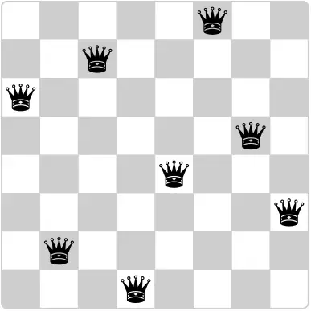
> > **الشكل 2.8:** حلٌّ ممكنٌ لأحجية الملكات الثماني.
> > 

ونُنفّذ هذا الحلّ كإجراءٍ `queens`، يُعيد تسلسل جميع حلول مسألة وضع $n$ ملكة على رقعة شطرنجٍ $n × n$ . و`Queens` له إجراءٌ داخليٌّ `queen-cols` يُعيد تسلسل جميع الطرق لوضع الملكات في أوّل $k$ عمودًا من الرقعة.

```scheme
(define (queens board-size)
  (define (queen-cols k)
    (if (= k 0)
        (list empty-board)
        (filter
         (lambda (positions) 
           (safe? k positions))
         (flatmap
          (lambda (rest-of-queens)
            (map (lambda (new-row)
                   (adjoin-position 
                    new-row 
                    k 
                    rest-of-queens))
                 (enumerate-interval 
                  1 
                  board-size)))
          (queen-cols (- k 1))))))
  (queen-cols board-size))
```

في هذا الإجراء، يمثّل `rest-of-queens` طريقةً لتموضع $k − 1$ من الملكات في الأعمدة الـ$k − 1$ الأولى، ويمثّل `new-row` صفًّا مقترحًا لوضع ملكة العمود الـ$k^{th}$. أكمل البرنامج بتنفيذ التمثيل الخاصّ بمجموعات مواضع الرقعة، بما في ذلك الإجراء `adjoin-position`، الذي يُضيف موضع صفّ-عمود جديد إلى مجموعة من المواضع، و`empty-board`، الذي يمثّل مجموعةً خاليةً من المواضع. وعليك أيضًا كتابة الإجراء `safe?`، الذي يحدّد، من أجل مجموعة من المواضع، ما إذا كانت ملكة العمود الـ$k^{th}$ في مأمنٍ من الأخريات. (ولاحِظ أنّنا نحتاج فقط إلى التحقّق ممّا إذا كانت الملكة الجديدة في مأمنٍ، أمّا الملكات الأخرى فمضمونٌ بالفعل أنّها في مأمنٍ من بعضها بعضًا.)

**التمرين 2.43:** يمرّ لويس ريزنر بوقتٍ عصيبٍ للغاية في أداء [التمرين 2.42](/book/sicp/c2-building-abstractions-with-data/2-2/). فإجراء `queens` الخاصّ به يبدو أنه يعمل، لكنّه يعمل ببطءٍ بالغ. (ولم يتمكّن لويس قطّ من الانتظار طويلًا بما يكفي لأن يحلّه حتّى حالة $6 × 6$.) وحين سأل لويس إيفا لو أتور طالبًا المساعدة، أشارت إلى أنّه بدّل ترتيب التعيينات المتداخلة في `flatmap`، كاتبةً إيّاه على الصورة

```scheme
(flatmap
 (lambda (new-row)
   (map (lambda (rest-of-queens)
          (adjoin-position 
           new-row k rest-of-queens))
        (queen-cols (- k 1))))
 (enumerate-interval 1 board-size))
```

اشرح لماذا يؤدّي هذا التبديل إلى جعل البرنامج يعمل ببطء. وقدّر كم من الوقت سيستغرقه برنامج لويس لحلّ أحجية الملكات الثماني، بافتراض أنّ البرنامج في [التمرين 2.42](/book/sicp/c2-building-abstractions-with-data/2-2/) يحلّ الأحجية في زمنٍ قدره $T$.

#### 2.2.4 مثال: لغة رسم الصور

يقدّم هذا القسم لغةً بسيطةً لرسم الصور توضّح قوّة تجريد البيانات والإغلاق، وتستثمر أيضًا الإجراءات ذات الرتبة العليا على نحوٍ جوهريّ. وقد صُمّمت اللغة لتسهيل التجريب بأنماطٍ كالتي في [الشكل 2.9](/book/sicp/c2-building-abstractions-with-data/2-2/)، وهي مركّبةٌ من عناصر مُكرَّرةٍ مُزاحةٍ ومُكبَّرةٍ.[^22] ففي هذه اللغة، تُُمثَّل كائنات البيانات التي تُدمَج بوصفها إجراءاتٍ لا ببنيةٍ قائمةٍ على القوائم. فكما أنّ `cons`، الذي يحقّق خاصّيّة الإغلاق، أتاح لنا بناء بنية قوائم معقّدةٍ تعسّفيًّا بسهولة، فإنّ عمليّات هذه اللغة، التي تحقّق هي أيضًا خاصّيّة الإغلاق، تتيح لنا بناء أنماطٍ معقّدةٍ تعسّفيًّا بسهولة.

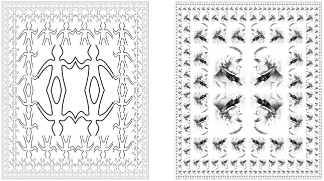

**الشكل 2.9:** تصاميم أُنشئت بلغة الرسم.

#### لغة الرسم

حين بدأنا دراسة البرمجة في [1.1](https://sarabander.github.io/sicp/html/1_002e1.xhtml#g_t1_002e1)، أكّدنا على أهمّيّة وصف لغةٍ بالتركيز على أوّليّات اللغة ووسائل تركيبها ووسائل تجريدها. وسنتبع هذا الإطار هنا.

وجزءٌ من أناقة لغة الرسم هذه أنّ هناك نوعًا واحدًا فقط من العناصر، يُسمّى *الرسّام (painter)*. فالرسّام يرسم صورةً تُزاح وتُكبَّر لتتناسب مع إطارٍ مُعيَّنٍ على شكل متوازي أضلاع. فمثلًا، هناك رسّامٌ أوّليٌّ سنُسمّيه `wave` يرسم رسمًا خطّيًّا بدائيًّا، كما في [الشكل 2.10](/book/sicp/c2-building-abstractions-with-data/2-2/). وشكل الرسم الفعليّ يعتمد على الإطار، فالصور الأربع كلّها في الشكل 2.10 أُنتجت بالرسّام `wave` عينه، لكن بالنسبة إلى أربعة إطاراتٍ مختلفةٍ. ويمكن أن تكون الرسّامون أكثر تعقيدًا من هذا: فالرسّام الأوّلي المسمّى `rogers` يرسم صورةً لمؤسّس MIT، وليام بارتون روجرز، كما في [الشكل 2.11](/book/sicp/c2-building-abstractions-with-data/2-2/).[^23] والصور الأربع في الشكل 2.11 مرسومةٌ بالنسبة إلى الإطارات الأربعة عينها التي رُسمت بها صور `wave` في الشكل 2.10.

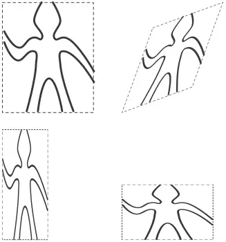

**الشكل 2.10:** صور أُنتجت بالرسّام `wave`، بالنسبة إلى أربعة إطاراتٍ مختلفةٍ. والإطارات، الموضّحة بخطوطٍ منقّطةٍ، ليست جزءًا من الصور.

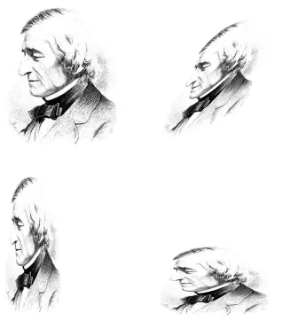

**الشكل 2.11:** صور وليام بارتون روجرز، المؤسّس والرئيس الأوّل لـMIT، مرسومةً بالنسبة إلى الإطارات الأربعة عينها كما في [الشكل 2.10](/book/sicp/c2-building-abstractions-with-data/2-2/) (الصورة الأصليّة من ويكيميديا كومنز).

ولدمج الصور، نستخدم عمليّاتٍ متنوّعةً تبني رسّامين جديدين من رسّامين مُعطَيين. فمثلًا، تأخذ العمليّة `beside` رسّامين وتُنتج رسّامًا مركّبًا جديدًا يرسم صورة الرسّام الأوّل في النصف الأيسر للإطار وصورة الرسّام الثاني في النصف الأيمن للإطار. وبالمثل، تأخذ `below` رسّامين وتُنتج رسّامًا مركّبًا يرسم صورة الرسّام الأوّل تحت صورة الرسّام الثاني. وبعض العمليّات تحوّل رسّامًا واحدًا لإنتاج رسّامٍ جديد. فمثلًا، تأخذ `flip-vert` رسّامًا وتُنتج رسّامًا يرسم صورته مقلوبةً رأسيًّا، وتُنتج `flip-horiz` رسّامًا يرسم صورة الرسّام الأصليّ معكوسةً من اليسار إلى اليمين.

يُظهر [الشكل 2.12](/book/sicp/c2-building-abstractions-with-data/2-2/) رسم رسّامٍ يُسمّى `wave4` بُني على مرحلتين بالانطلاق من `wave`:

```scheme
(define wave2 (beside wave (flip-vert wave)))
(define wave4 (below wave2 wave2))
```

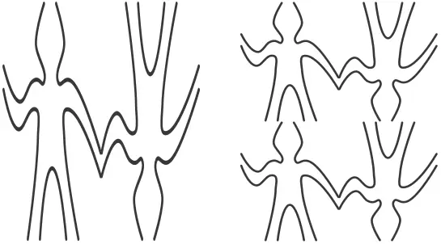

**الشكل 2.12:** إنشاء شكلٍ معقّد، بالانطلاق من الرسّام `wave` في [الشكل 2.10](/book/sicp/c2-building-abstractions-with-data/2-2/).

عند بناء صورةٍ معقّدةٍ على هذا النحو، نستثمر حقيقة أنّ الرسّامين منغلقون بالنسبة إلى وسائل تركيب اللغة. فـ`beside` أو `below` لرّسّامين هي نفسها رسّام؛ وبالتالي، يمكننا استخدامها كعنصرٍ في صنع رسّامين أكثر تعقيدًا. وكما هو الحال في بناء بنية القوائم باستخدام `cons`، فإنّ انغلاق بياناتنا بالنسبة إلى وسائل التركيب أمرٌ حاسمٌ في القدرة على إنشاء بنياتٍ معقّدةٍ باستخدام عمليّاتٍ قليلةٍ فقط.

حين نتمكّن من دمج الرسّامين، نودّ أن نكون قادرين على تجريد أنماطٍ نموذجيّةٍ لدمج الرسّامين. وسنُنفّذ عمليّات الرسم كإجراءات Scheme. وهذا يعني أنّنا لا نحتاج إلى آليّة تجريدٍ خاصّةٍ في لغة الرسم: فبما أنّ وسائل التركيب إجراءات Scheme اعتياديّة، فإنّنا نمتلك تلقائيًّا القدرة على فعل أيّ شيءٍ بعمليّات الرسم يمكننا فعله بالإجراءات. فمثلًا، يمكننا تجريد النمط في `wave4` كالآتي

```scheme
(define (flipped-pairs painter)
  (let ((painter2 
         (beside painter 
                 (flip-vert painter))))
    (below painter2 painter2)))
```

وتعريف `wave4` بوصفه حالةً من هذا النمط:

```scheme
(define wave4 (flipped-pairs wave))
```

ويمكننا تعريف عمليّاتٍ تعاوديّةٍ أيضًا. وهذه واحدةٌ تجعل الرسّامين ينقسمون ويتفرّعون نحو اليمين كما في [الشكل 2.13](/book/sicp/c2-building-abstractions-with-data/2-2/) و[الشكل 2.14](/book/sicp/c2-building-abstractions-with-data/2-2/):

```scheme
(define (right-split painter n)
  (if (= n 0)
      painter
      (let ((smaller (right-split painter 
                                  (- n 1))))
        (beside painter 
                (below smaller smaller)))))
```

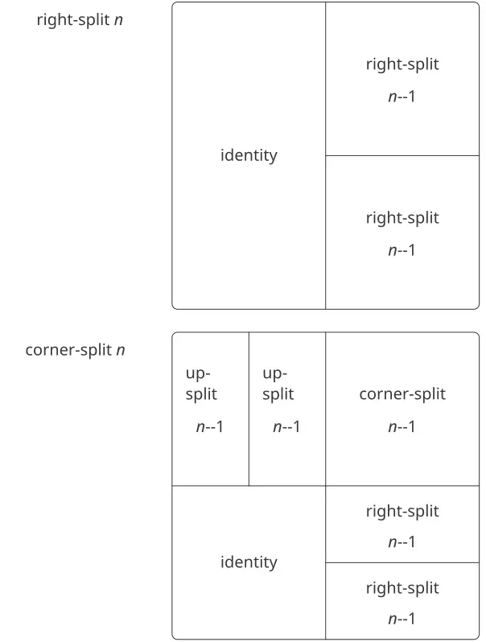

**الشكل 2.13:** مخطّطات تعاوديّة لـ`right-split` و`corner-split`.

ويمكننا إنتاج أنماطٍ متوازنةٍ بالتفرّع نحو الأعلى فضلًا عن التفرّع نحو اليمين (انظر [التمرين 2.44](/book/sicp/c2-building-abstractions-with-data/2-2/) و[الشكل 2.13](/book/sicp/c2-building-abstractions-with-data/2-2/) و[الشكل 2.14](/book/sicp/c2-building-abstractions-with-data/2-2/)):

```scheme
(define (corner-split painter n)
  (if (= n 0)
      painter
      (let ((up (up-split painter (- n 1)))
            (right (right-split painter 
                                (- n 1))))
        (let ((top-left (beside up up))
              (bottom-right (below right 
                                   right))
              (corner (corner-split painter 
                                    (- n 1))))
          (beside (below painter top-left)
                  (below bottom-right 
                         corner))))))
```

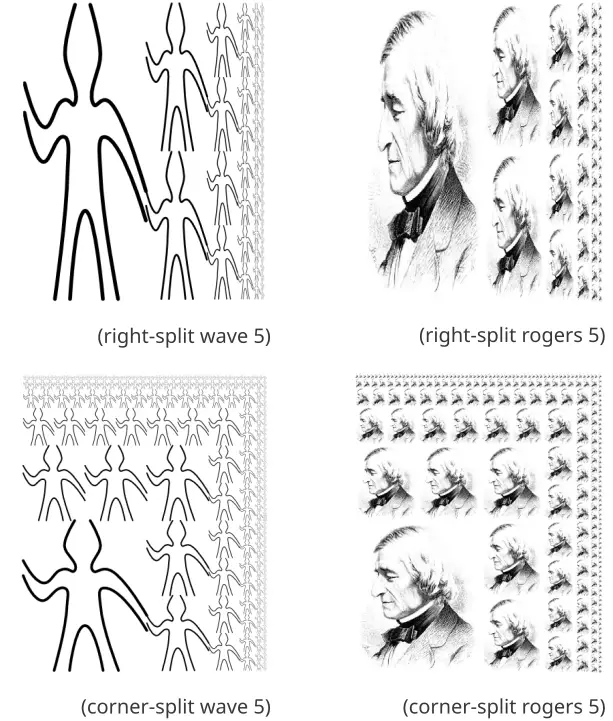

**الشكل 2.14:** العمليّتان التعاوديتان `right-split` و`corner-split` مطبَّقتين على الرسّامين `wave` و`rogers`. ودمج أربع رَسومات `corner-split` يُنتج تصاميم `square-limit` متناظرةً كما في [الشكل 2.9](/book/sicp/c2-building-abstractions-with-data/2-2/).

بوضع أربع نسخٍ من `corner-split` على النحو الملائم، نحصل على نمطٍ يُسمّى `square-limit`، تطبيقه على `wave` و`rogers` موضّحٌ في [الشكل 2.9](/book/sicp/c2-building-abstractions-with-data/2-2/):

```scheme
(define (square-limit painter n)
  (let ((quarter (corner-split painter n)))
    (let ((half (beside (flip-horiz quarter) 
                        quarter)))
      (below (flip-vert half) half))))
```

> **التمرين 2.44:** عرّف الإجراء `up-split` الذي يستخدمه `corner-split`. فهو شبيهٌ بـ`right-split`، إلّا أنّه يبدّل أدوار `below` و`beside`.

#### عمليّات ذات رتبةٍ عليا

فضلًا عن تجريد أنماط دمج الرسّامين، يمكننا العمل في مستوى أعلى، مُجَرِّدين أنماط دمج عمليّات الرسم. أي أنّه يمكننا اعتبار عمليّات الرسم عناصرَ للتلاعب بها، وكتابة وسائل تركيبٍ لهذه العناصر، وهي إجراءاتٌ تأخذ عمليّات رسمٍ كمعطياتٍ وتُنشئ عمليّات رسمٍ جديدة.

فمثلًا، يُنظّم كلٌّ من `flipped-pairs` و`square-limit` أربع نسخٍ من صورة رسّامٍ في نمطٍ مربّعيّ؛ وهما لا يختلفان إلّا في كيفيّة توجيه النسخ. وإحدى طرائق تجريد نمط دمج الرسّامين هي بالإجراء الآتي، الذي يأخذ أربع عمليّات رسمٍ أحاديّة المعطى ويُنتج عمليّة رسمٍ تحوّل رسّامًا مُعطًى بتلك العمليّات الأربع وتُنظّم النتائج في مربّع. والتحويلات `Tl` و`tr` و`bl` و`br` هي التحويلات التي تُطبَّق على النسخة العلوية اليسرى والنسخة العلوية اليمنى والنسخة السفلية اليسرى والنسخة السفلية اليمنى، على الترتيب.

```scheme
(define (square-of-four tl tr bl br)
  (lambda (painter)
    (let ((top (beside (tl painter) 
                       (tr painter)))
          (bottom (beside (bl painter) 
                          (br painter))))
      (below bottom top))))
```

وبعدئذٍ يمكن تعريف `flipped-pairs` بدلالة `square-of-four` كالآتي:[^24]

```scheme
(define (flipped-pairs painter)
  (let ((combine4 
         (square-of-four identity 
                         flip-vert
                         identity 
                         flip-vert)))
    (combine4 painter)))
```

ويمكن التعبير عن `square-limit` كالآتي:[^25]

```scheme
(define (square-limit painter n)
  (let ((combine4 
         (square-of-four flip-horiz 
                         identity
                         rotate180 
                         flip-vert)))
    (combine4 (corner-split painter n))))
```

**التمرين 2.45:** يمكن التعبير عن `Right-split` و`up-split` كحالتين من عمليّة تقسيمٍ عامّة. عرّف إجراءً `split` بالخاصّيّة أنّ تقييم

```scheme
(define right-split (split beside below))
(define up-split (split below beside))
```

يُنتج الإجراءين `right-split` و`up-split` بالسلوك نفسه الذي للإجراءين المعرَّفين سابقًا.

#### الإطارات

قبل أن نُبيّن كيف تُنفَّذ الرسّامون ووسائل تركيبهم، ينبغي أن نُفكّر أوّلًا في الإطارات. ويمكن وصف الإطار بثلاثة متجهات، متجه أصلٍ ومتجهي حافتَين. ومتجه الأصل يحدّد إزاحة أصل الإطار عن أصلٍ مطلقٍ معيّنٍ في المستوى، ومتجها الحافتين يحدّدان إزاحتي زاويتي الإطار عن أصله. فإذا كانت الحافتان متعامدتين، سيكون الإطار مستطيلًا. وإلّا فسيكون الإطار متوازي أضلاعٍ أكثر عمومًا.

يُظهر [الشكل 2.15](/book/sicp/c2-building-abstractions-with-data/2-2/) إطارًا ومتجهاته المرتبطة به. وتماشيًا مع تجريد البيانات، لا يلزم أن نُحدّد بعد كيف تُُمثَّل الإطارات، عدا أن نقول إنّ هناك بانِيًا `make-frame` يأخذ ثلاثة متجهاتٍ ويُنتج إطارًا، وثلاثة مُنتَقٍيات مناظرة `origin-frame` و`edge1-frame` و`edge2-frame` (انظر [التمرين 2.47](/book/sicp/c2-building-abstractions-with-data/2-2/)).

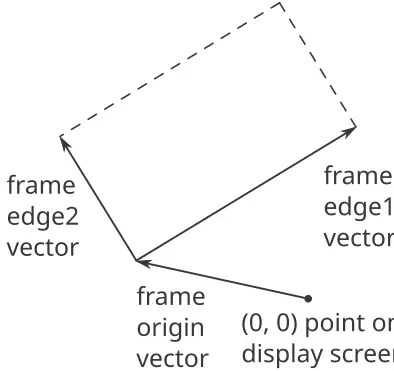

**الشكل 2.15:** يُوصَف الإطار بثلاثة متجهات: أصلٌ وحافتان.

سنستخدم الإحداثيّات في المربّع الوحدويّ $( 0 ≤ x , y ≤ 1 )$ لتحديد الصور. ومع كلّ إطارٍ، نربط *خريطة إحداثيّات الإطار (frame coordinate map)*، التي ستُستخدم لإزاحة الصور وتكبيرها لتتناسب مع الإطار. وتُحوّل الخريطة المربّع الوحدويّ إلى الإطار بربط المتجه $v = ( x , y )$ بالمجموع المتجهيّ $Origin(Frame) + x ⋅ Edge_{1} (Frame) + y ⋅ Edge_{2} (Frame) .$ فمثلًا، يُربط (0, 0) بأصل الإطار، و(1, 1) بالرأس القُطريّ المقابل للأصل، و(0.5, 0.5) بمركز الإطار. ويمكننا إنشاء خريطة إحداثيّات إطارٍ بالإجراء الآتي:[^26]

```scheme
(define (frame-coord-map frame)
  (lambda (v)
    (add-vect
     (origin-frame frame)
     (add-vect 
      (scale-vect (xcor-vect v)
                  (edge1-frame frame))
      (scale-vect (ycor-vect v)
                  (edge2-frame frame))))))
```

لاحِظ أنّ تطبيق `frame-coord-map` على إطارٍ يُعيد إجراءً يُعيد، حين يُعطى متجهًا، متجهًا. فإذا كان المتجه المعطى في المربّع الوحدويّ، فإنّ المتجه الناتج سيكون في الإطار. فمثلًا،

```scheme
((frame-coord-map a-frame) (make-vect 0 0))
```

يُعيد المتجه نفسه الذي تُعيده

```scheme
(origin-frame a-frame)
```

> **التمرين 2.46:** يمكن تمثيل المتجه الثنائيّ الأبعاد $v$ الممتدّ من الأصل إلى نقطةٍ بزوجٍ يتألّف من إحداثي $x$ وإحداثي $y$. نَفِّذ تجريد بياناتٍ للمتجهات بتقديم بانٍ `make-vect` ومُنتَقٍيات مناظرة `xcor-vect` و`ycor-vect`. وبدلالة مُنتَقٍياتك وبانيك، نَفِّذ الإجراءات `add-vect` و`sub-vect` و`scale-vect` التي تؤدّي عمليّات جمع المتجهات وطرحها وضرب متجهٍ في مقدارٍ قياسيّ: $( x_{1} , y_{1} ) + ( x_{2} , y_{2} ) = ( x_{1} + x_{2} , y_{1} + y_{2} ) , ( x_{1} , y_{1} ) − ( x_{2} , y_{2} ) = ( x_{1} − x_{2} , y_{1} − y_{2} ) , s ⋅ ( x , y ) = ( s x , s y ) .$

**التمرين 2.47:** في ما يلي بانِيان محتملان للإطارات:

```scheme
(define (make-frame origin edge1 edge2)
  (list origin edge1 edge2))

(define (make-frame origin edge1 edge2)
  (cons origin (cons edge1 edge2)))
```

من أجل كلّ بانٍ، قدّم المُنتَقِيات الملائمة لإنتاج تنفيذٍ للإطارات.

#### الرسّامون

يُُمثَّل الرسّام بإجراءٍ يرسم، حين يُعطى إطارًا كمعطى، صورةً معيّنةً مُزاحةً ومُكبَّرةً لتتناسب مع الإطار. أي أنّنا إذا كان `p` رسّامًا و`f` إطارًا، فإنّنا نُنتج صورة `p` في `f` بنداء `p` وإعطائها `f` كمعطى.

وتفاصيل كيفيّة تنفيذ الرسّامين الأوّليّين تعتمد على الخصائص الخاصّة لنظام الرسوميّات ونوع الصورة المطلوب رسمها. فمثلًا، لنفترض أنّ لدينا إجراءً `draw-line` يرسم خطًّا على الشاشة بين نقطتين محدَّدتين. فحينئذٍ يمكننا إنشاء رسّامين للرسوم الخطّيّة، كالرسّام `wave` في [الشكل 2.10](/book/sicp/c2-building-abstractions-with-data/2-2/)، من قوائم قطعٍ خطّيّةٍ كالآتي:[^27]

```scheme
(define (segments->painter segment-list)
  (lambda (frame)
    (for-each
     (lambda (segment)
       (draw-line
        ((frame-coord-map frame) 
         (start-segment segment))
        ((frame-coord-map frame) 
         (end-segment segment))))
     segment-list)))
```

والقطع مُعطاةٌ باستخدام إحداثيّاتٍ بالنسبة إلى المربّع الوحدويّ. ومن أجل كلّ قطعٍ في القائمة، يحوّل الرسّام نهايتَي القطع بخريطة إحداثيّات الإطار ويرسم خطًّا بين النقطتين المحوَّلتين.

إنّ تمثيل الرسّامين بإجراءاتٍ يُقيم حاجز تجريدٍ قويًّا في لغة الرسم. فيمكننا إنشاء جميع أنواع الرسّامين الأوّليّين ومزجها، بناءً على مجموعةٍ متنوّعةٍ من قدرات الرسوميّات. وتفاصيل تنفيذهم لا تهمّ. فأيّ إجراءٍ يمكن أن يقوم مقام رسّامٍ، شريطة أن يأخذ إطارًا كمعطى ويرسم شيئًا مُكبَّرًا ليتناسب مع الإطار.[^28]

> **التمرين 2.48:** يمكن تمثيل قطعةٍ خطّيّةٍ موجّهةٍ في المستوى بزوجٍ من المتجهات، المتجه الممتدّ من الأصل إلى نقطة بداية القطعة، والمتجه الممتدّ من الأصل إلى نقطة نهايتها. واستخدم تمثيلك للمتجهات من [التمرين 2.46](/book/sicp/c2-building-abstractions-with-data/2-2/) لتعريف تمثيلٍ للقطع ببانٍ `make-segment` ومُنتَقٍيات `start-segment` و`end-segment`.

> **التمرين 2.49:** استخدم `segments->painter` لتعريف الرسّامين الأوّليّين الآتيين: الرسّام الذي يرسم المحيط الخارجيّ للإطار المُعيَّن.
> > الرسّام الذي يرسم شكل «X» بوصل الزوايا المتقابلة للإطار.
> > الرسّام الذي يرسم شكلًا ماسيًّا بوصل نقاط منتصف أضلاع الإطار.
> > الرسّام `wave`.
> > 

#### تحويل الرسّامين ودمجهم

والعمليّة على الرسّامين (كـ`flip-vert` أو `beside`) تعمل بإنشاء رسّامٍ ينادي الرسّامين الأصليّين بالنسبة إلى إطاراتٍ مُستنبطةٍ من الإطار المعطى. وهكذا، مثلًا، لا يلزم أن يعرف `flip-vert` كيف يعمل رسّامٌ ما لكي يقلبه، بل يلزمه فقط أن يعرف كيف يقلب إطارًا رأسًا على عقب: فالرسّام المقلوب يستخدم الرسّام الأصليّ فحسب، لكن في إطارٍ مقلوب.

وتقوم عمليّات الرسم على الإجراء `transform-painter`، الذي يأخذ كمعطياتٍ رسّامًا ومعلوماتٍ عن كيفيّة تحويل إطارٍ ويُنتج رسّامًا جديدًا. فالرسّام المحوَّل، حين يُنادى على إطارٍ، يحوّل الإطار ثم ينادي الرسّام الأصليّ على الإطار المحوَّل. ومعطيات `transform-painter` هي نقاطٌ (مُمثَّلةٌ كمتجهاتٍ) تُحدّد زوايا الإطار الجديد: فعند ربطها في الإطار، تحدّد النقطة الأولى أصل الإطار الجديد، وتحدّد النقطتان الأخريان نهايتي متجهي حافتيه. وبالتالي، فإنّ المعطيات الواقعة داخل المربّع الوحدويّ تُحدّد إطارًا محتوىً داخل الإطار الأصليّ.

```scheme
(define (transform-painter 
         painter origin corner1 corner2)
  (lambda (frame)
    (let ((m (frame-coord-map frame)))
      (let ((new-origin (m origin)))
        (painter (make-frame new-origin
                  (sub-vect (m corner1) 
                            new-origin)
                  (sub-vect (m corner2)
                            new-origin)))))))
```

وهذه هي كيفيّة قلب صور الرسّامين رأسيًّا:

```scheme
(define (flip-vert painter)
  (transform-painter 
   painter
   (make-vect 0.0 1.0)   ; new origin
   (make-vect 1.0 1.0)   ; new end of edge1
   (make-vect 0.0 0.0))) ; new end of edge2
```

وباستخدام `transform-painter`، يمكننا تعريف تحويلاتٍ جديدةٍ بسهولة. فمثلًا، يمكننا تعريف رسّامٍ يُصغّر صورته إلى الربع العلوي الأيمن من الإطار المُعطى له:

```scheme
(define (shrink-to-upper-right painter)
  (transform-painter painter
                     (make-vect 0.5 0.5)
                     (make-vect 1.0 0.5)
                     (make-vect 0.5 1.0)))
```

وتحويلاتٌ أخرى تُدوّر الصور عكس عقارب الساعة 90 درجةً[^29]

```scheme
(define (rotate90 painter)
  (transform-painter painter
                     (make-vect 1.0 0.0)
                     (make-vect 1.0 1.0)
                     (make-vect 0.0 0.0)))
```

أو تُضغط الصور نحو مركز الإطار:[^30]

```scheme
(define (squash-inwards painter)
  (transform-painter painter
                     (make-vect 0.0 0.0)
                     (make-vect 0.65 0.35)
                     (make-vect 0.35 0.65)))
```

وتحويل الإطار هو أيضًا مفتاح تعريف وسائل دمج رسّامين أو أكثر. فالإجراء `beside`، مثلًا، يأخذ رسّامين، ويحوّلهما ليرسما في النصفين الأيسر والأيمن من إطارٍ معطى على الترتيب، ويُنتج رسّامًا مركّبًا جديدًا. وحين يُعطى الرسّام المركّب إطارًا، ينادي الرسّام المحوَّل الأوّل ليرسم في النصف الأيسر للإطار، وينادي الرسّام المحوَّل الثاني ليرسم في النصف الأيمن للإطار:

```scheme
(define (beside painter1 painter2)
  (let ((split-point (make-vect 0.5 0.0)))
    (let ((paint-left  (transform-painter 
                        painter1
                        (make-vect 0.0 0.0)
                        split-point
                        (make-vect 0.0 1.0)))
          (paint-right (transform-painter
                        painter2
                        split-point
                        (make-vect 1.0 0.0)
                        (make-vect 0.5 1.0))))
      (lambda (frame)
        (paint-left frame)
        (paint-right frame)))))
```

لاحِظ كيف يجعل تجريد بيانات الرسّامين (painter data abstraction)، ولا سيّما تمثيل الرسّامين بوصفهم إجراءات، تنفيذ `beside` سهلًا. فالإجراء `beside` لا يحتاج إلى معرفة أيّ شيءٍ عن تفاصيل الرسّامين المكوّنين سوى أنّ كلّ رسّامٍ سيرسم شيئًا ما في إطاره المخصّص.

> **تمرين 2.50:** عرّف التحويل `flip-horiz`، الذي يقلب الرسّامين أفقيًّا، وتحويلاتٍ تُدوّر الرسّامين عكس اتجاه عقارب الساعة بمقدار 180 درجة و270 درجة.

> **تمرين 2.51:** عرّف عمليّة `below` من أجل الرسّامين. تأخذ `below` رسّامين كمعطيات. والرسّام الناتج، إذا أُعطي إطارًا، يرسم بالرسّام الأوّل في أسفل الإطار وبالرسّام الثاني في أعلاه. عرّف `below` بطريقتين مختلفتين—أوّلًا بكتابة إجراءٍ مماثلٍ لإجراء `beside` المعطى أعلاه، وثانيًا بدلالة `beside` وعمليّات تدويرٍ ملائمةٍ (من [التمرين 2.50](/book/sicp/c2-building-abstractions-with-data/2-2/)).

#### مستويات اللغة من أجل تصميم متين

إنّ لغة الصورة تطبّق بعضَ الأفكار الحاسمة التي استعرضناها عن التجريد بالإجراءات والبيانات. فالتجاريد الأساسيّة للبيانات، أي الرسّامين، مُنفَّذةٌ باستخدام تمثيلاتٍ إجرائيّة، وهذا ما يمكّن اللغة من معالجة قدرات الرسم الأساسيّة المختلفة معاملةً موحّدة. ووسائل التركيب تحقّق خاصّيّة الإغلاق، وهو ما يسمح لنا ببناء تصاميمَ معقّدةٍ بسهولة. وأخيرًا، فإنّ جميع أدوات تجريد الإجراءات مُتاحةٌ لنا لأجل تجريد وسائل تركيب الرسّامين.

وقد ألقينا أيضًا لمحةً عن فكرةٍ حاسمةٍ أخرى عن اللغات وتصميم البرامج. وهي مقاربة *التصميم الطبقيّ (stratified design)*، أي المفهوم القائل بأنّ النظم المعقّدة ينبغي أن تُبنى على هيئة تسلسلٍ من المستويات الموصوفة باستخدام تسلسلٍ من اللغات. فكلّ مستوىٍ يُبنَى بتركيب أجزاءَ تُعتبر أوّليّةً على ذلك المستوى، والأجزاء المبنيّة على كلّ مستوىٍ تُستخدم كأوّليّاتٍ على المستوى التالي. واللغة المستخدمة على كلّ مستوىٍ من التصميم الطبقيّ لها أوّليّات، ووسائل تركيب، ووسائل تجريدٍ ملائمةً لذلك المستوى من التفصيل.

والتصميم الطبقيّ سائدٌ في هندسة النظم المعقّدة. فمثلًا، في هندسة الحاسوب، تُركَّب المقاومات والترانزستورات (وتُوصَف بلغة الدارات التناظريّة) لإنتاج أجزاءَ كبوابات AND وبوابات OR، وهي التي تشكّل أوّليّات لغة تصميم الدارات الرقميّة.[^31] وهذه الأجزاء تُركَّب لبناء المعالجات، وبنى النواقل (bus)، وأنظمة الذاكرة، التي تُركَّب بدورها لتشكيل الحواسيب، باستخدام لغاتٍ ملائمةٍ لهندسة الحاسوب. والحواسيب تُركَّب لتشكيل أنظمةٍ موزّعة، باستخدام لغاتٍ ملائمةٍ لوصف ترابط الشبكات، وهكذا.

وكمثالٍ صغيرٍ على التصميم الطبقيّ، فإنّ لغة الصورة التي نعمل بها تستخدم عناصرَ أوّليّةً (رسّامين أوّليّين) تُنشأ باستخدام لغةٍ تحدّد النقاط والخطوط لتوفير قوائم مقاطع الخطوط من أجل `segments->painter`، أو تفاصيل التظليل من أجل رسّامٍ كـ`rogers`. وقد ركّز الجزء الأكبر من وصفنا للغة الصورة على تركيب هذه الأوّليّات، باستخدام مزيّجاتٍ هندسيّةٍ كـ`beside` و`below`. وقد عملنا أيضًا على مستوى أعلى، باعتبار `beside` و`below` أوّليّاتٍ تُعالَج في لغةٍ عمليّاتها، كـ`square-of-four` مثلًا، تصوّر أنماطًا شائعةً لتركيب المزيّجات الهندسيّة.

والتصميم الطبقيّ يساعد على جعل البرامج *متينة (robust)*، أي أنّه يجعل من المرجّح أن تستدعي التغييرات الصغيرة في المواصفة تغييراتٍ صغيرةً مقابلةً في البرنامج. فمثلًا، لنفترض أنّنا أردنا تغيير الصورة المبنيّة على `wave` والمبيّنة في [الشكل 2.9](/book/sicp/c2-building-abstractions-with-data/2-2/). فيمكننا العمل على المستوى الأدنى لتغيير المظهر التفصيليّ لعنصر `wave`؛ ويمكننا العمل على المستوى الأوسط لتغيير الطريقة التي يُكرّر بها `corner-split` العنصر `wave`؛ ويمكننا العمل على المستوى الأعلى لتغيير الطريقة التي يرتّب بها `square-limit` النسخ الأربع من الزاوية. وبصورةٍ عامّة، فإنّ كلّ مستوىٍ من التصميم الطبقيّ يوفّر معجمًا مختلفًا للتعبير عن خصائص النظام، ونوعًا مختلفًا من القدرة على تغييره.

> **تمرين 2.52:** أجرِ تغييراتٍ على حدود المربّع الخاص بـ`wave` المبيّن في [الشكل 2.9](/book/sicp/c2-building-abstractions-with-data/2-2/) بالعمل على كلّ من المستويات الموصوفة أعلاه. وبالأخصّ: أضف بعض المقاطع إلى رسّام `wave` الأوّل في [التمرين 2.49](/book/sicp/c2-building-abstractions-with-data/2-2/) (لإضافة ابتسامةٍ مثلًا).
> > غيّر النمط الذي يبنيه `corner-split` (مثلًا، باستخدام نسخةٍ واحدة فقط من صورتَي `up-split` و`right-split` بدلًا من نسختين).
> > عَدّل النسخة من `square-limit` التي تستخدم `square-of-four` بحيث تُجمّع الزوايا في نمطٍ مختلف. (مثلًا، يمكنك أن تجعل مستر روجرز الكبير ينظر إلى الخارج من كلّ زاويةٍ من زوايا المربّع.)
> > 


[^6]: تكاملًا، ينبغي أن نُحدّد عمليّة `make-vector` تبني المتجهات. لكن في التطبيق الحاضر سنستخدم المتجهات فقط لنمذجة تقسيماتٍ ثابتةٍ من ذاكرة الحاسوب.

[^7]: هذه هي الفكرة عينها الخاصةّ بـ«البيانات الموسومة (tagged data)» التي أوردناها في [الفصل 2](https://sarabander.github.io/sicp/html/Chapter-2.xhtml#Chapter-2) للتعامل مع العمليّات العامّة. لكن هنا تُدرَج أنواع البيانات في مستوى الآلة الأوّليّ بدلًا من بنائها باستخدام القوائم.

[^8]: يمكن ترميز معلومات النوع بطرائق متنوّعة، حسب تفاصيل الآلة التي سيُنفّذ عليها نظام Lisp. وستعتمد كفاءة تنفيذ برامج Lisp بقوةٍ على مدى حكمة هذا الخيار، لكن من الصعب صياغة قواعد تصميمٍ عامّةٍ للخيارات الجيّدة. وأبسط طريقةٍ لتنفيذ المؤشّرات الموسومة بالنوع هي تخصيص مجموعةٍ ثابتةٍ من البتّات في كلّ مؤشّرٍ لتكون *حقل النوع* الذي يُرمز نوع البيانات. وتشمل الأسئلة المهمّة الواجب تناولها عند تصميم مثل هذا التمثيل ما يلي: كم بتّةٍ للنوع تلزم؟ وما الحجم الذي يجب أن تبلغه مؤشرات المتجهات؟ ومدى كفاءة استخدام تعليمات الآلة الأوّليّة في التلاعب بحقول نوع المؤشرات؟ وتُوصف الآلات التي تتضمّن عتادًا خاصًّا للتعامل الفعّال مع حقول النوع بأنّها *ذات بنيةٍ موسومة (tagged architectures)*.

[^9]: يحدّد هذا القصد في تمثيل الأعداد ما إذا كان يمكن استخدام `eq?`، الذي يختبر تساوي المؤشرات، لاختبار تساوي الأعداد. فإذا احتوى المؤشّر على العدد نفسه، كانت للأعداد المتساوية المؤشّر نفسه. أمّا إذا احتوى المؤشّر على فهرس موضعٍ يُخزَّن فيه العدد، فلن يكون مضمونًا أن تكون للمتساوي من الأعداد مؤشرات متساوية إلّا إذا حرصنا على ألّا نخزّن العدد نفسه في أكثر من موضعٍ واحد.

[^10]: هذا أشبه بكتابة عددٍ كتسلسلٍ من الأرقام، إلّا أنّ كلّ «رقم» هنا عددٌ يتراوح بين الصفر وأكبر عددٍ يمكن تخزينه في مؤشّرٍ واحد.

[^11]: ثمّة طرق أخرى لإيجاد مواضع تخزينٍ حرّة. فيمكننا مثلًا ربط كلّ الأزواج غير المستخدمة بعضها ببعض في *قائمةٍ حرّة (free list)*. إنّ مواضعنا الحرّة متتالية (وبالتالي يمكن الوصول إليها بزيادة مؤشّرٍ) لأنّنا نستخدم جامع قمامةٍ ضاغطًا، كما سنرى في [5.3.2](/book/sicp/c5-computing-with-register-machines/5-3/).

[^12]: هذا هو في الجوهر تنفيذ `cons` بدلالة `set-car!` و`set-cdr!`، على النحو الموصوف في [3.3.1](https://sarabander.github.io/sicp/html/3_002e3.xhtml#g_t3_002e3_002e1). والعمليّة `get-new-pair` المستخدمة في ذلك التنفيذ تُنجَز هنا بواسطة المؤشّر `free`.

[^13]: قد لا يبقى هذا صحيحًا في المستقبل، لأنّ الذاكرات قد تكبر حدًّا يستحيل معه نفاد الذاكرة الحرّة في عمر الحاسوب. ففي السنة نحو $undefined$ ميكروثانية، فلو أنّنا نُنشئ `cons` مرّةً كلّ ميكروثانية، لأضحى يلزمنا نحو $undefined$ خليّةٍ من الذاكرة لبناء آلةٍ تعمل ثلاثين سنةً دون أن تنفد ذاكرتها. وتبدو هذه الكميّة من الذاكرة سخيفةً بمعايير اليوم، لكنّها ليست مستحيلةً فيزيائيًّا. ومن جهةٍ أخرى، تصبح المعالجات أسرع فأسرع، وقد يضمّ حاسوب المستقبل أعدادًا كبيرةً من المعالجات تعمل على التوازي على ذاكرةٍ واحدة، فقد يصبح ممكنًا استهلاك الذاكرة أسرع بكثيرٍ ممّا افترضناه.

[^14]: نفترض هنا أنّ المكدس ممثَّلٌ كقائمةٍ على النحو الموضح في [5.3.1](/book/sicp/c5-computing-with-register-machines/5-3/)، بحيث تكون عناصر المكدس قابلةً للوصول عبر المؤشّر الكائن في مسجّل المكدس.

[^15]: ابتكر هذه الفكرة مينسكي ونفّذها أوّل مرّة، كجزءٍ من تنفيذ Lisp على آلة PDP-1 في مختبر أبحاث الإلكترونيات في MIT. وطوّرها [فينيتشيل ويوكيلسون (1969)](https://sarabander.github.io/sicp/html/References.xhtml#Fenichel-and-Yochelson-_00281969_0029) لاستخدامها في تنفيذ Lisp الخاصّ بنظام المشاركة الزمنيّة Multics. ثمّ طور [بايكر (1978)](https://sarabander.github.io/sicp/html/References.xhtml#Baker-_00281978_0029) نسخةً «في الزمن الحقيقي» من الطريقة، لا تتطلّب وقوف الاحتساب أثناء جمع القمامة. وامتدّت فكرة بايكر على يد هيويت وليبرمان ومون (انظر [ليبرمان وهيويت 1983](https://sarabander.github.io/sicp/html/References.xhtml#Lieberman-and-Hewitt-1983)) لتستفيد من أنّ بعض البنى أكثر تقلّبًا وبعضها الآخر أكثر ديمومة. وثمّة تقنيّة أخرى شائعة لجمع القمامة هي طريقة *الكي والمسح (mark-sweep)*. وتتمثّل في تقفّي كلّ البنى القابلة للوصول من مسجّلات الآلة ووسم كلّ زوجٍ نصل إليه. ثمّ نمسح الذاكرة كلّها، وكلّ موضعٍ غير موسومٍ «يُكنس» كانقالًا للقمامة ويُتاح لإعادة الاستخدام. ويمكن العثور على مناقشةٍ كاملةٍ لطريقة الكي والمسح في [ألين 1978](https://sarabander.github.io/sicp/html/References.xhtml#Allen-1978). أمّا خوارزميّة مينسكي-فينيتشيل-يوكيلسون فهي الخوارزميّة السائدة في الأنظمة كبيرة الذاكرة، لأنّها لا تفحص إلّا الجزء المفيد من الذاكرة. وهذا بخلاف الكي والمسح، حيث ينبغي لمرحلة الكنس أن تفحص الذاكرة كلّها. وميزةٌ ثانية لطريقة التوقّف والنسخ أنّها جامع قمامةٍ *ضاغط (compacting)*. أي أنّ البيانات المفيدة ستنُقل في نهاية مرحلة جمع القمامة إلى مواضع ذاكرةٍ متتالية، مع ضغط كلّ الأزواج النفاية خارجها. وقد يكون هذا اعتبارًا بالغ الأهميّة للأداء في الآلات ذات الذاكرة الافتراضيّة، حيث قد يتطلّب الوصول إلى عناوين ذاكرةٍ متباعدةٍ بعيدًا عمليّاتِ تبديل صفحاتٍ إضافيّة.

[^16]: لا تتضمّن قائمة المسجّلات هذه المسجّلات التي يستخدمها نظام تخصيص التخزين—`root` و`the-cars` و`the-cdrs` وغيرها من المسجّلات التي ستُعرَّف في هذا القسم.

[^17]: اصطلح على مصطلح *القلب المكسور (broken heart)* ديفيد كريسي، الذي كتب جامع قمامةٍ للغة MDL، وهي لهجةٌ من Lisp طُوّرت في MIT في أوائل سبعينيّات القرن العشرين.

[^18]: يستخدم جامع القمامة المُسَيِّم منخفض المستوى `pointer-to-pair?` بدلًا من عمليّة بنية القوائم `pair?`، لأنّه قد توجد في نظامٍ حقيقيّ أمورٌ شتّى تُعامَل معاملة الأزواج لأغراض جمع القمامة. ففي نظامٍ من أنظمة Scheme مطابق لمعيار IEEE، مثلًا، قد يُنفّذ كائن الإجراء كنوعٍ خاصّ من «الزوج» لا يحقّقه المسيّم `pair?`. ولأغراض المحاكاة، يمكن تنفيذ `pointer-to-pair?` بدلالة `pair?`.

[^19]: انظر [باتالي وآخرون 1982](https://sarabander.github.io/sicp/html/References.xhtml#Batali-et-al_002e-1982) لمزيدٍ من المعلومات عن الرقاقة وعن الطريقة التي صُمّمت بها.

[^20]: في متحكّمنا، يُكتب التوزيع كسلسلةٍ من تعليمتَي `test` و`branch`. وبدلًا من ذلك، كان في الإمكان كتابته بأسلوبٍ موجَّهٍ بالبيانات (وكذلك سيكون الأمر في نظامٍ حقيقيّ على الأرجح) لتجنّب الحاجة إلى إجراء اختباراتٍ متسلسلةٍ وتسهيل تعريف أنواع تعبيراتٍ جديدة. ومن المرجّح أنّ آلةً مصمّمةً لتشغيل Lisp تتضمّن تعليمة `dispatch-on-type` تُنفّذ مثل هذه التوزيعات الموجَّهة بالبيانات بكفاءة.

[^21]: هذه نقطة مهمّةٌ وإنّما خفيّةٌ في ترجمة الخوارزميّات من لغةٍ إجرائيّة، مثل Lisp، إلى لغة آلات المسجّلات. فبدلًا من حفظ ما يلزم فقط، كان بوسعنا حفظ كلّ المسجّلات (عدا `val`) قبل كلّ نداءٍ تعاوديّ. ويُسمّى هذا نظامَ المكدس المؤطَّر. وهذا ينجح، لكنّه قد يحفظ مسجّلاتٍ أكثر من اللازم؛ وقد يكون هذا اعتبارًا مهمًّا في نظامٍ تكون فيه عمليّات المكدس مكلفة. كما أنّ حفظ مسجّلاتٍ لن تُحتاج محتوياتها لاحقًا قد يُبقي بياناتٍ لا فائدة منها كان يمكن جمعها كانقالًا، فتتفرّغ مساحتها لإعادة الاستخدام.

[^22]: نضيف إلى إجراءات بنية البيانات الخاصّة بالمُقيّم الواردة في [4.1.3](https://sarabander.github.io/sicp/html/4_002e1.xhtml#g_t4_002e1_002e3) الإجراءَين التاليين للتلاعب بقوائم المعطيات: ```scheme (define (empty-arglist) '()) (define (adjoin-arg arg arglist) (append arglist (list arg))) ```

[^23]: يُعرَف تحسين معاملة المُعامل الأخير معاملةً خاصّةً باسم *التعاوب الذيلي في evlis* (انظر [واند 1980](https://sarabander.github.io/sicp/html/References.xhtml#Wand-1980)). وكان بوسعنا أن نكون أكفأ قليلًا في حلقة تقييم المعطيات لو جعلنا تقييم المُعامل الأوّل حالةً خاصّةً أيضًا. وهو ما كان سيسمح لنا بتأجيل تهيئة `argl` حتّى بعد تقييم المُعامل الأوّل، تفاديًا لحفظ `argl` في هذه الحالة. والمصرّف الوارد في [5.5](https://sarabander.github.io/sicp/html/5_002e5.xhtml#g_t5_002e5) يُجري هذا التحسين. (قارن بإجراء `construct-arglist` الوارد في [5.5.3](https://sarabander.github.io/sicp/html/5_002e5.xhtml#g_t5_002e5_002e3).)

[^24]: يحدّد ترتيب تقييم المُعاملات في المُقيّم الحلقيّ الوسيط بترتيب تقييم معطيات `cons` في الإجراء `list-of-values` الوارد في [4.1.1](https://sarabander.github.io/sicp/html/4_002e1.xhtml#g_t4_002e1_002e1) (انظر [التمرين 4.1](https://sarabander.github.io/sicp/html/4_002e1.xhtml#Exercise-4_002e1)).

[^25]: رأينا في [5.1](https://sarabander.github.io/sicp/html/5_002e1.xhtml#g_t5_002e1) كيف نُنفّذ عمليّةً كهذه بآلة مسجّلاتٍ لا مكدس لها؛ إذ كانت حالة العمليّة تُخزَّن في مجموعةٍ ثابتةٍ من المسجّلات.

[^26]: هذا التنفيذ للتعاوب الذيلي في `ev-sequence` نوعٌ من تقنيّة تحسينٍ معروفةٍ يستخدمها كثيرٌ من المصرّفات. فعند تصريف إجراءٍ ينتهي بنداء إجراء، يمكن استبدال النداء بقفزةٍ إلى نقطة دخول الإجراء المندىّ. وبناء هذه الاستراتيجيّة في المفسّر، كما فعلنا في هذا القسم، يُوفّر التحسين بصورةٍ موحّدةٍ في اللغة كلّها.

[^27]: يمكننا تعريف `no-more-exps?` كما يلي: ```scheme (define (no-more-exps? seq) (null? seq)) ```

[^28]: هذا ليس غشًّا حقًّا. ففي تنفيذٍ فعليٍّ مبنيٍّ من الصفر، كنّا سنستخدم مُقيّمنا ذا المتحكّم الصريح لتفسير برنامج Scheme يُجري تحويلاتٍ على مستوى المصدر، مثل `cond->if`، في مرحلة صياغةٍ تجري قبل التنفيذ.

[^29]: نفترض هنا أنّ `read` ومختلف عمليّات الطباعة متاحةٌ كعمليّات آلةٍ أوّليّة، وهذا مفيدٌ لمحاكاتنا، لكنّه غير واقعيّ إطلاقًا في الممارسة. فهذه في الحقيقة عمليّات شديدة التعقيد. وفي الممارسة، كانت ستُنفّذ باستخدام عمليّات إدخالٍ وإخراجٍ منخفضة المستوى، مثل نقل محارف مفردةٍ إلى جهازٍ ومنه. ولدعم عمليّة `get-global-environment` نُعرّف ```scheme (define the-global-environment (setup-environment)) (define (get-global-environment) the-global-environment) ```

[^30]: ثمّة أخطاء أخرى نودّ أن يتعامل معها المفسّر، لكنّها ليست بهذه البساطة. انظر [التمرين 5.30](/book/sicp/c5-computing-with-register-machines/5-4/).

[^31]: كان بوسعنا إجراء تهيئة المكدس بعد الأخطاء فقط، لكنّ إجراءها في حلقة المُشغّل سيكون مريحًا لمراقبة أداء المُقيّم، كما سنُبيّن أدناه.