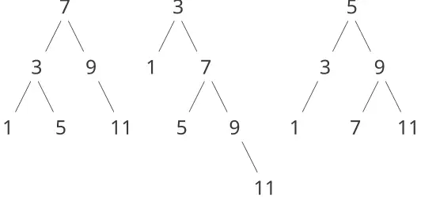
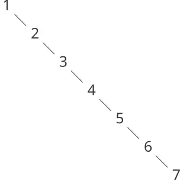
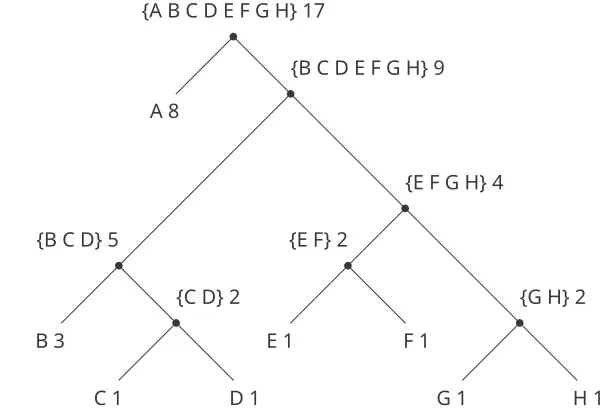

### 2.3 البيانات الرمزيّة

جميع كائنات البيانات المركّبة التي استخدمناها حتّى الآن كانت مبنيةً في نهاية المطاف من الأعداد. وفي هذا القسم نوسّع القدرة التمثيليّة للغتنا بإدخال القدرة على العمل مع رموزٍ اعتباطيّةٍ بوصفها بيانات.

#### 2.3.1 الاقتباس

إذا أمكننا تشكيل بياناتٍ مركّبةٍ باستخدام الرموز، فيمكننا أن نحصل على قوائمَ مثل

```scheme
(a b c d)
(23 45 17)
((Norah 12) 
 (Molly 9) 
 (Anna 7) 
 (Lauren 6) 
 (Charlotte 4))
```

ويمكن أن تبدو القوائم التي تحتوي على رموزٍ تمامًا كتعبيرات لغتنا:

```scheme
(* (+ 23 45) (+ x 9))
(define (fact n) 
  (if (= n 1) 
      1 
      (* n (fact (- n 1)))))
```

ومن أجل معالجة الرموز نحتاج إلى عنصرٍ جديدٍ في لغتنا: القدرة على *اقتباس (quote)* كائن بيانات. فلنفترض أنّنا نريد بناء القائمة `(a b)`. فلا يمكننا تحقيق ذلك بـ`(list a b)`، لأنّ هذا التعبير يبني قائمةً من *قيم* `a` و`b` بدلًا من الرموز ذاتها. وهذه المسألة معروفةٌ جيّدًا في سياق اللغات الطبيعيّة، حيث يمكن اعتبار الكلمات والجُمل إمّا كياناتٍ دلاليّةٍ وإمّا كسلاسلَ محرفيّةٍ (كياناتٍ صياغيّة). والممارسة الشائعة في اللغات الطبيعيّة هي استخدام علامات التنصيص للإشارة إلى أنّ كلمةً أو جملةً يُتعامل معها حرفيًّا بوصفها سلسلةً من المحارف. فعلى سبيل المثال، فإنّ الحرف الأوّل من «جون» هو «ج» بيّنًا. فإن قلنا لشخصٍ ما «قل اسمك بصوت عالٍ»، فنتوقّع أن نسمع اسم ذلك الشخص. ولكن إن قلنا لشخصٍ ما «قل ‹اسمك› بصوت عالٍ»، فنتوقّع أن نسمع الكلمتين «اسمك». ولاحِظ أنّنا مُلزَمون بتداخل علامات التنصيص لوصف ما قد يقوله شخصٌ آخر.[^32]

ويمكننا اتّباع الممارسة ذاتها لتحديد القوائم والرموز التي يُتعامل معها بوصفها كائنات بيانات لا تعبيراتٍ يُقيَّم. غير أنّ صيغة الاقتباس التي نستخدمها تختلف عن صيغة اللغات الطبيعيّة في أنّنا نضع علامة تنصيص (وتقليديًّا، رمز التنصيص المفرد `'`) في بداية الكائن المُراد اقتباسه فقط. ويمكننا الاكتفاء بذلك في صياغة Scheme لأنّنا نعتمد على الفراغات والأقواس في تحديد حدود الكائنات. وهكذا، فإنّ معنى محرف التنصيص المفرد هو اقتباس الكائن التالي.[^33]

يمكننا الآن التمييز بين الرموز وقيمها:

```scheme
(define a 1)
(define b 2)

(list a b)
(1 2)

(list 'a 'b)
(a b)

(list 'a b)
(a 2)
```

ويسمح الاقتباس أيضًا بكتابة كائناتٍ مركّبةٍ باستخدام التمثيل المطبوع المعتاد للقوائم:[^34]

```scheme
(car '(a b c))
a

(cdr '(a b c))
(b c)
```

واتّفاقًا مع هذا، يمكننا الحصول على القائمة الفارغة بتقييم `'()`، وبالتّالي الاستغناء عن المتغيّر `nil`.

وهناك أوّليّةٌ إضافيّةٌ تُستخدم في معالجة الرموز، وهي `eq?`، التي تأخذ رمزين كمعطيات وتختبر كونَهما الرمز نفسه.[^35] وباستخدام `eq?`، نستطيع تنفيذ إجراءٍ مفيدٍ يُسمّى `memq`. ويأخذ هذا معطيين، رمزًا وقائمةً. فإن لم يكن الرمز محتوىً في القائمة (أي أنّه ليس `eq?` لأيّ عنصرٍ فيها)، فإنّ `memq` يُعيد false. وإلّا، فإنّه يُعيد القائمة الجزئيّة من القائمة بدءًا من أوّل ظهورٍ للرمز:

```scheme
(define (memq item x)
  (cond ((null? x) false)
        ((eq? item (car x)) x)
        (else (memq item (cdr x)))))
```

فعلى سبيل المثال، قيمة

```scheme
(memq 'apple '(pear banana prune))
```

هي false، بينما قيمة

```scheme
(memq 'apple '(x (apple sauce) y apple pear))
```

هو `(apple pear)`.

**تمرين 2.53:** ماذا سيطبعه المفسّر استجابةً لتقييم كلّ من التعبيرات التالية؟

```scheme
(list 'a 'b 'c)
(list (list 'george))
(cdr '((x1 x2) (y1 y2)))
(cadr '((x1 x2) (y1 y2)))
(pair? (car '(a short list)))
(memq 'red '((red shoes) (blue socks)))
(memq 'red '(red shoes blue socks))
```

**تمرين 2.54:** يُقال عن قائمتين إنّهما `equal?` إذا احتوتا على عناصرَ متساويةٍ مرتّبةٍ في الترتيب نفسه. فمثلًا،

```scheme
(equal? '(this is a list) 
        '(this is a list))
```

فالقيمة true، لكن

```scheme
(equal? '(this is a list) 
        '(this (is a) list))
```

أمّا القيمة فهي false. وبصورةٍ أدقّ، يمكننا تعريف `equal?` بشكلٍ تعاوديٍّ بدلالة مساواة الرموز الأساسيّة `eq?`، بقولنا إنّ `a` و`b` هما `equal?` إذا كانا رمزين والرمزان `eq?`، أو إذا كانا قائمتين بحيث يكون `(car a)` بـ`equal?` مساويًا لـ`(car b)` ويكون `(cdr a)` بـ`equal?` مساويًا لـ`(cdr b)`. وباستخدام هذه الفكرة، نُفِّذ `equal?` بوصفه إجراءً.[^36]

**تمرين 2.55:** تكتب إيفا لو أتور إلى المفسّر التعبير

```scheme
(car ''abracadabra)
```

ولدهشتها، يطبعه المفسّر من جديد `quote`. اشرح.

#### 2.3.2 مثال: التفاضل الرمزيّ

وكتوضيحٍ على معالجة الرموز، وتوضيحٍ إضافيٍّ على تجريد البيانات، تأمّل تصميم إجراءٍ يؤدي التفاضل الرمزيّ للتعبيرات الجبريّة. فنحن نريد من الإجراء أن يأخذ تعبيرًا جبريًّا ومتغيّرًا كمعطيات ويعيد مشتقّة التعبير بدلالة المتغيّر. فمثلًا، إذا كانت معطيات الإجراء هي $a x^{2} + b x + c$ و$x$ ، فينبغي أن يعيد الإجراء $2 a x + b$ . والتفاضل الرمزيّ ذو أهمّيّة تاريخيّة خاصّة في Lisp. فقد كان أحد الأمثلة المحرّضة وراء تطوير لغة حاسوبٍ لمعالجة الرموز. وبالإضافة إلى ذلك، فقد مثّل بداية خطّ البحث الذي أدّى إلى تطوير نظمٍ قويّةٍ للعمل الرياضيّ الرمزيّ، التي يستخدمها حاليًّا عددٌ متزايدٌ من الرياضياتيّين التطبيقيّين والفيزيائيّين.

وعند تطوير برنامج التفاضل الرمزيّ، سنتبع استراتيجيّة تجريد البيانات ذاتها التي اتبعناها عند تطوير نظام الأعداد الكسريّة في [2.1.1](https://sarabander.github.io/sicp/html/2_002e1.xhtml#g_t2_002e1_002e1). أي أنّنا سنعرّف أوّلًا خوارزميّة تفاضلٍ تعمل على كائناتٍ مجرّدةٍ كـ«المجاميع»، و«المضروبات»، و«المتغيّرات» دون القلق بشأن كيف سيُمثَّل أيٌّ منها. وبعد ذلك فقط سنتناول مسألة التمثيل.

#### برنامج التفاضل ببيانات مجرّدة

ومن أجل إبقاء الأمور بسيطة، سننظر في برنامج تفاضلٍ رمزيّ بسيطٍ للغاية يعالج تعبيراتٍ مبنيةً باستخدام عمليّتَي الجمع والضرب فقط وبمعطيين. ويمكن أداء تفاضل أيّ تعبيرٍ كهذا بتطبيق قواعد الاختزال التالية: $\frac{d c}{d x} = 0 , for c a constant or a variable different from x ,$ $\frac{d x}{d x} = 1 , \frac{d ( u + v )}{d x} = \frac{d u}{d x} + \frac{d v}{d x} , \frac{d ( u v )}{d x} = u \frac{d v}{d x} + v \frac{d u}{d x} .$ ولاحِظ أنّ القاعدتين الأخيرتين تعاوديّتان بطبيعتهما. أي أنّنا للحصول على مشتقّة مجموعٍ نجد أوّلًا مشتقّات الحدود ثمّ نجمعها. وكلّ حدٍّ من الحدود قد يكون بدوره تعبيرًا يحتاج إلى التفكيك. وتفكيك الأجزاء إلى أجزاءَ أصغر فأصغر سيُنتج في النهاية أجزاءً إمّا ثوابتَ وإمّا متغيّرات، ومشقّاتها ستكون إمّا 0 وإمّا 1.

ولتجسيد هذه القواعد في إجراءٍ ننغمس في قليلٍ من التفكير بالأمانيّ، كما فعلنا عند تصميم تنفيذ الأعداد الكسريّة. فلو كانت لدينا وسيلةٌ لتمثيل التعبيرات الجبريّة، لأمكننا أن نقول ما إذا كان التعبير مجموعًا، أم مضروبًا، أم ثابتًا، أم متغيّرًا. وأمكننا استخلاص أجزاء التعبير. فمن أجل المجموع مثلًا، نريد أن نكون قادرين على استخلاص المُضَاف (addend) والمُضَاف إليه (augend). وينبغي أيضًا أن نكون قادرين على بناء تعبيراتٍ من أجزاء. فلنفترض أنّ لدينا سلفًا إجراءاتٍ تُنفّذ المُحدِّدات (selectors) والبنّاءات (constructors) والمسيّمات (predicates) التالية:

```
(variable? e)          Is e a variable?
(same-variable? v1 v2) Are v1 and v2 the same variable?
(sum? e)               Is e a sum?
(addend e)             Addend of the sum e.
(augend e)             Augend of the sum e.
(make-sum a1 a2)       Construct the sum of a1 and a2.
(product? e)           Is e a product?
(multiplier e)         Multiplier of the product e.
(multiplicand e)       Multiplicand of the product e.
(make-product m1 m2)   Construct the product of m1 and m2.
```

وباستخدام هذه، ومع المسيّم الأوّليّ `number?` الذي يحدّد الأعداد، نستطيع التعبير عن قواعد التفاضل بالإجراء التالي:

```scheme
(define (deriv exp var)
  (cond ((number? exp) 0)
        ((variable? exp)
         (if (same-variable? exp var) 1 0))
        ((sum? exp)
         (make-sum (deriv (addend exp) var)
                   (deriv (augend exp) var)))
        ((product? exp)
         (make-sum
          (make-product 
           (multiplier exp)
           (deriv (multiplicand exp) var))
          (make-product 
           (deriv (multiplier exp) var)
           (multiplicand exp))))
        (else (error "unknown expression 
                      type: DERIV" exp))))
```

والإجراء `deriv` هذا يتضمّن خوارزميّة التفاضل كاملةً. وبما أنّه معبَّرٌ عنه بدلالة بياناتٍ مجرّدة، فإنّه سيعمل مهما اختَرنا كيف نمثّل التعبيرات الجبريّة، طالما نصمّم مجموعةً ملائمةً من المُحدِّدات والبنّاءات. وهذه هي المسألة التي ينبغي أن نتناولها تاليًا.

#### تمثيل التعبيرات الجبريّة

يمكننا تصوّر طرائقَ كثيرةً لاستخدام بنية القوائم لتمثيل التعبيرات الجبريّة. فمثلًا، يمكننا استخدام قوائمَ من الرموز تعكس الترميز الجبريّ المعتاد، فنمثّل $a x + b$ بالقائمة `(a * x + b)`. غير أنّ أحد الخيارات المباشرة بصورةٍ خاصّةٍ هو استخدام الترميز البادئ ذي الأقواس نفسه الذي تستخدمه Lisp للتركيبات؛ أي أن نمثّل $a x + b$ بـ`(+ (* a x) b)`. وحينئذٍ يكون تمثيل البيانات الخاصّ بمسألة التفاضل كما يلي:

والمتغيّرات هي رموز. وهي تُعرَّف بالمسيّم الأوّل `symbol?`:

```scheme
(define (variable? x) (symbol? x))
```

والمتغيّران متساويان إذا كانت الرموز التي تمثّلهما `eq?`:

```scheme
(define (same-variable? v1 v2)
  (and (variable? v1)
       (variable? v2)
       (eq? v1 v2)))
```

والمجاميع والمضروبات تُبنى كقوائم:

```scheme
(define (make-sum a1 a2) (list '+ a1 a2))
(define (make-product m1 m2) (list '* m1 m2))
```

والمجموع قائمةٌ أوّل عنصرٍ فيها هو الرمز `+`:

```scheme
(define (sum? x)
  (and (pair? x) (eq? (car x) '+)))
```

والمُضَاف هو العنصر الثاني من قائمة المجموع:

```scheme
(define (addend s) (cadr s))
```

والمُضَاف إليه هو العنصر الثالث من قائمة المجموع:

```scheme
(define (augend s) (caddr s))
```

والمضروب قائمةٌ أوّل عنصرها هو الرمز `*`:

```scheme
(define (product? x)
  (and (pair? x) (eq? (car x) '*)))
```

والمضروب هو العنصر الثاني من قائمة الضرب:

```scheme
(define (multiplier p) (cadr p))
```

والمضروب فيه هو العنصر الثالث من قائمة الضرب:

```scheme
(define (multiplicand p) (caddr p))
```

وهكذا، لا نحتاج إلّا إلى الجمع بين هذه وبين الخوارزميّة كما تجسّدها `deriv` كي نحصل على برنامج تفاضلٍ رمزيّ يعمل. فلننظر في بعض الأمثلة على سلوكه:

```scheme
(deriv '(+ x 3) 'x)
(+ 1 0)

(deriv '(* x y) 'x)
(+ (* x 0) (* 1 y))

(deriv '(* (* x y) (+ x 3)) 'x)
(+ (* (* x y) (+ 1 0))
   (* (+ (* x 0) (* 1 y))
      (+  x 3)))
```

وإنّ البرنامج يُنتج إجاباتٍ صحيحة؛ غير أنّها غير مُبسَّطة. من الصحيح أنّ $\frac{d ( x y )}{d x} = x ⋅ 0 + 1 ⋅ y ,$ ولكنّنا نريد من البرنامج أن يعلم أنّ $x ⋅ 0 = 0$ ، و$1 ⋅ y = y$ ، و$0 + y = y$ . وكان ينبغي أن تكون الإجابة عن المثال الثاني هي `y` ببساطة. وكما يُظهر المثال الثالث، فإنّ هذه تصير مسألةً جسيمة عندما تكون التعابير معقّدة.

وصعوبتنا تشبه إلى حدٍّ كبيرٍ تلك التي واجهناها مع تنفيذ الأعداد الكسريّة: فنحن لم نُبسّط الإجابات إلى أبسط صورة. ولتحقيق تبسيط الأعداد الكسريّة، احتجنا إلى تغيير البنّاءات والمُحدِّدات في التنفيذ فقط. ويمكننا اتّباع استراتيجيّة مشابهة هنا. فلن نُغيّر `deriv` إطلاقًا. وبدلًا من ذلك، سنُغيّر `make-sum` بحيث إذا كان كلٌّ من الحدّين عددًا، فإنّ `make-sum` يجمعهما ويعيد مجموعهما. وأيضًا، إذا كان أحد الحدّين 0، فإنّ `make-sum` يعيد الحدّ الآخر:

```scheme
(define (make-sum a1 a2)
  (cond ((=number? a1 0) a2)
        ((=number? a2 0) a1)
        ((and (number? a1) (number? a2)) 
         (+ a1 a2))
        (else (list '+ a1 a2))))
```

وهذا يستخدم الإجراء `=number?`، الذي يتحقّق ممّا إذا كان تعبيرٌ ما مساويًا لعددٍ معطى:

```scheme
(define (=number? exp num)
  (and (number? exp) (= exp num)))
```

وبالمثل، سنُغيّر `make-product` ليدمج القاعدتين بأنّ صفرًا مضروبًا في أيّ شيءٍ يساوي 0، وأنّ واحدًا مضروبًا في أيّ شيءٍ يساوي ذلك الشيء نفسه:

```scheme
(define (make-product m1 m2)
  (cond ((or (=number? m1 0) 
             (=number? m2 0)) 
         0)
        ((=number? m1 1) m2)
        ((=number? m2 1) m1)
        ((and (number? m1) (number? m2)) 
         (* m1 m2))
        (else (list '* m1 m2))))
```

وإليك كيف تعمل هذه النسخة على أمثلتنا الثلاثة:

```scheme
(deriv '(+ x 3) 'x)
1

(deriv '(* x y) 'x)
y

(deriv '(* (* x y) (+ x 3)) 'x)
(+ (* x y) (* y (+ x 3)))
```

وعلى الرغم من أنّ هذا تحسينٌ كبير، إلّا أنّ المثال الثالث يُظهر أنّ الطريق لا يزال طويلًا قبل أن نحصل على برنامجٍ يضع التعابير في صورةٍ قد نتفّق على أنّها «الأبسط». ومسألة التبسيط الجبريّ معقّدةٌ لأنّه، من بين أسبابٍ أخرى، قد تكون صورةٌ ما أبسطَ صورةٍ لغرضٍ ما وغيرَ أبسطِ صورةٍ لغرضٍ آخر.

> **تمرين 2.56:** أظهِر كيف نُوسّع المُفاضِلَ الأساسيّ ليتعامل مع أنواعٍ أكثر من التعبيرات. فنفّذ مثلًا قاعدة التفاضل $\frac{d ( u^{n} )}{d x} = n u^{n − 1} \frac{d u}{d x}$ بإضافة بندٍ جديد إلى برنامج `deriv` وتعريف الإجراءات الملائمة `exponentiation?`، و`base`، و`exponent`، و`make-exponentiation`. (يمكنك استخدام الرمز `**` للدلالة على الأُسّ.) وادمج القاعدتين بأنّ أيّ شيءٍ مرفوع إلى الأُسّ 0 يساوي 1، وأنّ أيّ شيءٍ مرفوع إلى الأُسّ 1 يساوي ذلك الشيء نفسه.

**تمرين 2.57:** وسّع برنامج التفاضل ليتعامل مع مجاميعَ ومضروباتٍ لها عددٌ اعتراضيٌّ (اثنان أو أكثر) من الحدود. وحينئذٍ يمكن التعبير عن المثال الأخير أعلاه كما يلي:

```scheme
(deriv '(* x y (+ x 3)) 'x)
```

حاول فعل ذلك بتغيير تمثيل المجاميع والمضروبات فقط، دون تغيير الإجراء `deriv` إطلاقًا. فإنّ `addend` المجموع مثلًا هو الحدّ الأوّل، و`augend` هو مجموع بقيّة الحدود.

> **تمرين 2.58:** لنفترض أنّنا نريد تعديل برنامج التفاضل بحيث يعمل بالترميز الرياضيّ المعتاد، حيث يكون `+` و`*` مشغّلين داخلين (infix) لا بادئين (prefix). وبما أنّ برنامج التفاضل معرَّفٌ بدلالة بياناتٍ مجرّدة، فيمكننا تعديله ليعمل مع تمثيلاتٍ مختلفةٍ للتعبيرات بتغيير المسيّمات والمُحدِّدات والبنّاءات التي تُحدّد تمثيل التعبيرات الجبريّة التي سيعمل عليها المُفاضِل فقط. أظهِر كيف نفعل ذلك كي نُفاضل تعبيراتٍ جبريّةً مقدَّمةً بالصيغة الداخلية، مثل `(x + (3 * (x + (y + 2))))`. ولتبسيط المهمّة، افترض أنّ `+` و`*` يأخذان معطيين دائمًا، وأنّ التعابير مُحاطةٌ بالأقواس بالكامل.
> > وتصير المسألة أصعبَ بكثيرٍ إذا سمحنا بالترميز الجبريّ المعياريّ، مثل `(x + 3 * (x + y + 2))`، الذي يُسقط الأقواس غير الضروريّة ويفترض أنّ الضرب يُنجَز قبل الجمع. فهل يمكنك تصميم مسيّماتٍ ومُحدِّداتٍ وبنّاءاتٍ ملائمةٍ لهذا الترميز بحيث يظلّ برنامج المشتقّات لدينا يعمل؟
> > 

#### 2.3.3 مثال: تمثيل المجموعات

في الأمثلة السابقة بنينا تمثيلاتٍ لنوعين من كائنات البيانات المركّبة: الأعداد الكسريّة والتعبيرات الجبريّة. وفي أحد هذه الأمثلة كان لدينا الخيار بين تبسيط (اختزال) التعبيرات إمّا وقت البناء وإمّا وقت الانتقاء، لكن بخلاف ذلك كان اختيار تمثيل هذه البنى من حيث القوائم مباشرًا. وحين ننتقل إلى تمثيل المجموعات، لا يكون اختيار التمثيل بهذه الوضوح. فإنّ هناك عددًا من التمثيلات الممكنة، وهي تختلف اختلافًا جوهريًّا عن بعضها البعض في عدّة نواحٍ.

وبصورةٍ غير رسميّة، فإنّ المجموعة هي مجرّد تجميعٍ لكائناتٍ متمايزة. ولإعطاء تعريفٍ أدقّ يمكننا استخدام منهج تجريد البيانات. أي أنّنا نعرّف «المجموعة» بتحديد العمليّات التي ستُستخدم على المجموعات. وهذه هي `union-set`، و`intersection-set`، و`element-of-set?`، و`adjoin-set`. و`element-of-set?` مسيّمٌ يحدّد ما إذا كان عنصرٌ معطى ما عضوًا في مجموعة. و`adjoin-set` يأخذ كائنًا ومجموعةً كمعطيات ويعيد مجموعةً تحتوي على عناصر المجموعة الأصليّة والعنصر الملاحَق أيضًا. و`union-set` يحسب اتحاد مجموعتين، وهو المجموعة التي تحتوي على كلّ عنصرٍ يظهر في أيّ من المعطيين. و`intersection-set` يحسب تقاطع مجموعتين، وهو المجموعة التي تحتوي فقط على العناصر التي تظهر في كلا المعطيين. ومن وجهة نظر تجريد البيانات، فنحن أحرارٌ في تصميم أيّ تمثيلٍ يُنفّذ هذه العمليّات بما يتّفق مع التأويلات المعطاة أعلاه.[^37]

#### المجموعات كقوائم غير مرتّبة

إحدى طرق تمثيل المجموعة (set) هي قائمةٌ بعناصرها لا يظهر فيها أيّ عنصرٍ أكثر من مرّة. والمجموعة الخالية تُعبَّر عنها بالقائمة الخالية. وفي هذا التمثيل، الإجراء `element-of-set?` شبيهٌ بالإجراء `memq` المذكور في [2.3.1](/book/sicp/c2-building-abstractions-with-data/2-3/). وهو يستخدم `equal?` بدلًا من `eq?` حتّى لا يلزم أن تكون عناصر المجموعة رموزًا:

```scheme
(define (element-of-set? x set)
  (cond ((null? set) false)
        ((equal? x (car set)) true)
        (else (element-of-set? x (cdr set)))))
```

وباستخدامه، يمكننا كتابة `adjoin-set`. فإن كان الكائن المطلوب إضافته موجودًا في المجموعة فعلًا، فإنّنا نُعيد المجموعة كما هي. وإلّا، فإنّنا نستخدم `cons` لإضافة الكائن إلى القائمة التي تمثّل المجموعة:

```scheme
(define (adjoin-set x set)
  (if (element-of-set? x set)
      set
      (cons x set)))
```

ومن أجل `intersection-set`، يمكننا استخدام استراتيجيّة تعاوديّة. فإن كنّا نعرف كيف نُشكّل تقاطع `set2` مع `cdr` الخاصّ بـ`set1`، فلا يبقى علينا إلّا أن نُقرّر ما إذا كنّا سنُضمّن `car` الخاصّ بـ`set1` في هذا التقاطع. لكنّ ذلك مرتهنٌ بكون `(car set1)` موجودًا في `set2` أيضًا. وهذا هو الإجراء الناتج:

```scheme
(define (intersection-set set1 set2)
  (cond ((or (null? set1) (null? set2)) 
         '())
        ((element-of-set? (car set1) set2)
         (cons (car set1)
               (intersection-set (cdr set1) 
                                 set2)))
        (else (intersection-set (cdr set1) 
                                set2))))
```

وفي تصميم التمثيل، إحدى المسائل التي ينبغي أن نُعيرها اهتمامنا هي الكفاءة. فتأمّل عدد الخطوات التي تتطلّبها عمليّاتنا على المجموعات. فبما أنّها جميعًا تستخدم `element-of-set?`، فإنّ سرعة هذه العمليّة تؤثّر تأثيرًا كبيرًا على كفاءة تنفيذ المجموعة ككلّ. والآن، من أجل التحقّق ممّا إذا كان كائنٌ ما عضوًا في مجموعة، قد يضطرّ `element-of-set?` إلى تمشيط المجموعة برمّتها. (وفي أسوأ الحالات، يتبيّن أنّ الكائن ليس في المجموعة.) وبالتالي، فإن كانت المجموعة تضمّ $n$ عنصرًا، فإنّ `element-of-set?` قد يستغرق حتّى $n$ خطوة. وهكذا، فإنّ عدد الخطوات المطلوبة ينمو نموًّا يقابل $Θ ( n )$ . وعدد الخطوات التي يتطلّبها `adjoin-set`، الذي يستخدم هذه العمليّة، ينمو كذلك نحو $Θ ( n )$ . وأمّا `intersection-set`، الذي يُجري فحص `element-of-set?` لكلّ عنصرٍ من عناصر `set1`، فإنّ عدد الخطوات المطلوب ينمو بجداء حجمَي المجموعتين المعنيّتين، أي $Θ ( n^{2} )$ من أجل مجموعتين حجم كلٍّ منهما $n$ . والشيء نفسه سيصدق على `union-set`.

> **التمرين 2.59:** نفّذ عمليّة `union-set` من أجل تمثيل المجموعات بالقوائم غير المرتّبة.

> **التمرين 2.60:** حدّدنا أنّ المجموعة ستُمثَّل بقائمةٍ خالية من التكرار. والآن، افترض أنّنا نسمح بالتكرار. فمثلًا، يمكن تمثيل المجموعة ${ 1 , 2 , 3 }$ بالقائمة `(2 3 2 1 3 2 2)`. صمّم إجراءات `element-of-set?` و`adjoin-set` و`union-set` و`intersection-set` تعمل على هذا التمثيل. فكيف تُقارن كفاءة كلٍّ منها بكفاءة الإجراء المقابل في التمثيل الخالي من التكرار؟ وهل ثمّة تطبيقاتٌ كنتَ ستستخدم فيها هذا التمثيل تفضيلًا له على التمثيل الخالي من التكرار؟

#### المجموعات كقوائم مرتّبة

إحدى طرائق تسريع عمليّاتنا على المجموعات هي تغيير التمثيل بحيث تُدرَج عناصر المجموعة بترتيبٍ تصاعديّ. ولكي نفعل ذلك، نحتاج إلى طريقةٍ ما لمقارنة كائنين بحيث نستطيع القول أيّهما أكبر. فمثلًا، يمكننا مقارنة الرموز ترتيبًا معجميًّا، أو يمكننا الاتّفاق على طريقةٍ ما لإسناد عددٍ فريدٍ إلى كائنٍ ثمّ مقارنة العناصر بمقارنة الأعداد المقابلة لها. ولكي تبقي مناقشتنا بسيطة، سنقتصر على الحالة التي تكون فيها عناصر المجموعة أعدادًا، حتّى نستطيع مقارنة العناصر باستخدام `>` و`<`. وسنُمثّل مجموعة الأعداد بإدراج عناصرها بترتيبٍ تصاعديّ. فبينما كان تمثيلنا الأوّل أعلاه يسمح لنا بتمثيل المجموعة ${ 1 , 3 , 6 , 10 }$ بإدراج العناصر بأيّ ترتيبٍ، فإنّ تمثيلنا الجديد لا يسمح إلّا بالقائمة `(1 3 6 10)`.

تظهر إحدى مزايا الترتيب في `element-of-set?`: فعند التحقّق من وجود عنصرٍ ما، لم نعد مضطرّين إلى تمشيط المجموعة برمّتها. فإن وصلنا إلى عنصرٍ من المجموعة أكبر من العنصر الذي نبحث عنه، فإنّنا نعلم أنّ العنصر ليس في المجموعة:

```scheme
(define (element-of-set? x set)
  (cond ((null? set) false)
        ((= x (car set)) true)
        ((< x (car set)) false)
        (else (element-of-set? x (cdr set)))))
```

فكم خطوةً يُوفّرها هذا؟ في أسوأ الحالات، قد يكون العنصر الذي نبحث عنه هو أكبر عنصرٍ في المجموعة، فيكون عدد الخطوات هو نفسُه كما في التمثيل غير المرتّب. ومن جانبٍ آخر، فإن كنّا نبحث عن عناصرَ كثيرةٍ مختلفة الأحجام، فيمكننا أن نتوقّع أنّنا سنكون قادرين أحيانًا على إيقاف البحث عند نقطةٍ قريبةٍ من بداية القائمة، وأنّنا سنكون في أحيانٍ أخرى مضطرّين إلى فحص معظم القائمة. وفي المتوسّط، ينبغي أن نتوقّع فحص نحو نصف عناصر المجموعة. وهكذا، فإنّ متوسّط عدد الخطوات المطلوبة سيكون قرابة $n / 2$ . وهذا لا يزال نموًّا من رتبة $Θ ( n )$ ، لكنّه يُوفّر علينا، في المتوسّط، عامل 2 في عدد الخطوات مُقارنةً بالتنفيذ السابق.

ونحصل على تسريعٍ أكثر إذهالًا مع `intersection-set`. ففي التمثيل غير المرتّب، تطلّبت هذه العمليّة $Θ ( n^{2} )$ خطوة، لأنّنا كنّا نُجري تمشيطًا كاملًا لـ`set2` من أجل كلّ عنصرٍ من عناصر `set1`. لكنّ مع التمثيل المرتّب، يمكننا استخدام طريقةٍ أُذكى. ابدأ بمقارنة العنصرين الأوّلين، `x1` و`x2`، في المجموعتين. فإن كان `x1` مساويًا لـ`x2`، فإنّ ذلك يُعطينا عنصرًا من التقاطع، وبقيّة التقاطع هي تقاطع `cdr` كلٍّ من المجموعتين. وأمّا إن كان `x1` أصغر من `x2`، فبما أنّ `x2` هو أصغر عنصرٍ في `set2`، فيمكننا أن نستنتج مباشرةً أنّ `x1` لا يمكن أن يظهر في أيّ موضعٍ من `set2`، وبالتالي فهو ليس في التقاطع. وعليه، فإنّ التقاطع يساوي تقاطع `set2` مع `cdr` الخاصّ بـ`set1`. وبطريقةٍ مشابهة، فإن كان `x2` أصغر من `x1`، فإنّ التقاطع يُعطى بتقاطع `set1` مع `cdr` الخاصّ بـ`set2`. وهذا هو الإجراء:

```scheme
(define (intersection-set set1 set2)
  (if (or (null? set1) (null? set2))
      '()
      (let ((x1 (car set1)) (x2 (car set2)))
        (cond ((= x1 x2)
               (cons x1 (intersection-set 
                         (cdr set1)
                         (cdr set2))))
              ((< x1 x2) (intersection-set 
                          (cdr set1) 
                          set2))
              ((< x2 x1) (intersection-set 
                          set1 
                          (cdr set2)))))))
```

ولتقدير عدد الخطوات التي تتطلّبها هذه العمليّة، لاحِظ أنّنا في كلّ خطوةٍ نُخفّض مسألة التقاطع إلى احتساب تقاطعات مجموعاتٍ أصغر — بإزالة أوّل عنصرٍ من `set1` أو `set2` أو من كليهما. وهكذا، فإنّ عدد الخطوات المطلوب هو على الأكثر مجموع حجمَي `set1` و`set2`، بدلًا من جداء الحجمين كما في التمثيل غير المرتّب. وهذا نموٌّ من رتبة $Θ ( n )$ بدلًا من $Θ ( n^{2} )$ — تسريعٌ كبير، حتّى من أجل مجموعاتٍ متوسّطة الحجم.

> **التمرين 2.61:** أعطِ تنفيذًا لـ`adjoin-set` باستخدام التمثيل المرتّب. وبتحليلٍ مشابهٍ للتحليل المتعلّق بـ`element-of-set?`، أظهِر كيف نستفيد من الترتيب لإنتاج إجراءٍ يتطلّب، في المتوسّط، قرابة نصف عدد الخطوات التي يتطلّبها التمثيل غير المرتّب.

> **التمرين 2.62:** أعطِ تنفيذًا رتبة نموّه $Θ ( n )$ لـ`union-set` من أجل المجموعات الممثّلة كقوائمَ مرتّبة.

#### المجموعات كأشجار ثنائيّة

يمكننا فعل ما هو أفضل من تمثيل القوائم المرتّبة بترتيب عناصر المجموعة في صورة شجرة. فكلّ عقدةٍ في الشجرة تحمل عنصرًا واحدًا من المجموعة، يُسمّى «المُدخَل» (entry) في تلك العقدة، ورابطًا إلى كلٍّ من عقدتين أُخريين (قد تكونان خاليتين). والرابط «الأيسر» يُشير إلى العناصر الأصغر من العنصر الموجود في العقدة، والرابط «الأيمن» يُشير إلى العناصر الأكبر منه. ويُظهر [الشكل 2.16](/book/sicp/c2-building-abstractions-with-data/2-3/) بعض الأشجار التي تمثّل المجموعة ${ 1 , 3 , 5 , 7 , 9 , 11 }$ . والمجموعة نفسها قد تُُمثَّل بشجرةٍ بعدّة طرقٍ مختلفة. والشرط الوحيد الذي نُلزم به أنفسنا من أجل تمثيلٍ صحيحٍ هو أن تكون جميع العناصر في الشجرة الفرعيّة اليسرى أصغر من مُدخَل العقدة، وأن تكون جميع العناصر في الشجرة الفرعيّة اليمنى أكبر منه.



**الشكل 2.16:** أشجارٌ ثنائيّةٌ مختلفة تمثّل المجموعة ${ 1 , 3 , 5 , 7 , 9 , 11 }$ .

وميزة تمثيل الأشجار هي هذه: افترض أنّنا نريد التحقّق ممّا إذا كان عددٌ $x$ موجودًا في مجموعة. فنبدأ بمقارنة $x$ بالمُدخَل الموجود في العقدة العليا. فإن كان $x$ أصغر منه، فإنّنا نعلم أنّنا لا نحتاج إلّا إلى البحث في الشجرة الفرعيّة اليسرى؛ وإن كان $x$ أكبر، فإنّنا لا نحتاج إلّا إلى البحث في الشجرة الفرعيّة اليمنى. والآن، فإن كانت الشجرة «متوازنة»، فإنّ كلًّا من هاتين الشجرتين الفرعيّتين سيكون قرابة نصف حجم الشجرة الأصليّة. وهكذا، فقد خفّضنا في خطوةٍ واحدة مسألة البحث في شجرةٍ حجمها $n$ إلى البحث في شجرةٍ حجمها $n / 2$ . وبما أنّ حجم الشجرة يتنصف في كلّ خطوةٍ، فينبغي أن نتوقّع أنّ عدد الخطوات اللازم للبحث في شجرةٍ حجمها $n$ ينمو نموًّا يقابل $Θ ( log ⁡ n )$ .[^38] ومن أجل المجموعات الكبيرة، سيكون هذا تسريعًا مهمًّا مُقارنةً بالتمثيلات السابقة.

يمكننا تمثيل الأشجار باستخدام القوائم. فكلّ عقدةٍ ستكون قائمةً من ثلاثة بنود: مُدخَل العقدة، والشجرة الفرعيّة اليسرى، والشجرة الفرعيّة اليمنى. وأمّا إذا كانت الشجرة الفرعيّة اليسرى أو اليمنى هي القائمة الخالية، فذلك يُشير إلى عدم وجود شجرةٍ فرعيّةٍ موصولة في ذلك الموضع. ويمكننا وصف هذا التمثيل بالإجراءات الآتية:[^39]

```scheme
(define (entry tree) (car tree))
(define (left-branch tree) (cadr tree))
(define (right-branch tree) (caddr tree))
(define (make-tree entry left right)
  (list entry left right))
```

والآن يمكننا كتابة إجراء `element-of-set?` باستخدام الاستراتيجيّة الموصوفة أعلاه:

```scheme
(define (element-of-set? x set)
  (cond ((null? set) false)
        ((= x (entry set)) true)
        ((< x (entry set))
         (element-of-set? 
          x 
          (left-branch set)))
        ((> x (entry set))
         (element-of-set? 
          x 
          (right-branch set)))))
```

وإضافة عنصرٍ إلى مجموعةٍ تُنفَّذ بطريقةٍ مشابهة، وهي تتطلّب كذلك $Θ ( log ⁡ n )$ خطوة. فلكي نُضيف عنصرًا `x`، نقارن `x` بمُدخَل العقدة لتحديد ما إذا كان ينبغي إضافة `x` إلى الفرع الأيمن أم إلى الفرع الأيسر، وبعد إضافة `x` إلى الفرع المناسب، نُعيد تجميع هذا الفرع المُنشأ حديثًا مع المُدخَل الأصليّ والفرع الآخر. فإن كان `x` مساويًا للمُدخَل، فإنّنا نُعيد العقدة كما هي. وإن طُلِب منّا إضافة `x` إلى شجرةٍ خالية، فإنّنا نُنشئ شجرةً يكون `x` فيها هو المُدخَل ويكون فرعاها الأيمن والأيسر خاليين. وهذا هو الإجراء:

```scheme
(define (adjoin-set x set)
  (cond ((null? set) (make-tree x '() '()))
        ((= x (entry set)) set)
        ((< x (entry set))
         (make-tree 
          (entry set)
          (adjoin-set x (left-branch set))
          (right-branch set)))
        ((> x (entry set))
         (make-tree
          (entry set)
          (left-branch set)
          (adjoin-set x (right-branch set))))))
```

إنّ الادّعاء السابق بأنّ البحث في الشجرة يمكن أداؤه بعددٍ لوغاريتميٍّ من الخطوات يقوم على افتراض أنّ الشجرة «متوازنة»، أي أنّ الشجرة الفرعيّة اليسرى والشجرة الفرعيّة اليمنى لكلّ شجرةٍ تضمّان العدد نفسه من العناصر تقريبًا، بحيث تحتوي كلّ شجرةٍ فرعيّةٍ على قرابة نصف عناصر الشجرة الأمّ. ولكن كيف يمكننا أن نتيقّن من أنّ الأشجار التي نُنشئها ستكون متوازنة؟ فحتّى إن كنّا بدأنا بشجرةٍ متوازنة، فإنّ إضافة عناصرٍ بـ`adjoin-set` قد تُنتج نتيجةً غير متوازنة. وبما أنّ موضع العنصر المُضاف حديثًا مرتهنٌ بكيفيّة مقارنة العنصر بالبنود الموجودة في المجموعة فعلًا، فيمكننا أن نتوقّع أنّه إن أضفنا عناصرٍ «عشوائيًّا» فإنّ الشجرة ستُميل إلى التوازن في المتوسّط. ولكنّ هذا ليس ضمانًا. فمثلًا، إن بدأنا بمجموعةٍ خاليةٍ وأضفنا الأعداد من 1 إلى 7 بالتتالي، فإنّنا ننتهي بالشجرة غير المتوازنة إلى حدٍّ كبير الموضّحة في [الشكل 2.17](/book/sicp/c2-building-abstractions-with-data/2-3/). ففي هذه الشجرة، جميع الأشجار الفرعيّة اليسرى خالية، وليس لها بذلك أيّ ميزةٍ على قائمةٍ مرتّبةٍ بسيطة. وإحدى طرائق حلّ هذه المسألة هي تعريف عمليّةٍ تُحوّل شجرةً اعتباطيّةً إلى شجرةٍ متوازنةٍ بالعناصر نفسها. وبعدها يمكننا أداء هذا التحويل بعد كلّ بضع عمليّات `adjoin-set` لكي نُبقي مجموعتنا متوازنة. وثمّة طرائق أُخرى لحلّ هذه المسألة، أكثرها يتضمّن تصميم بنى بياناتٍ جديدة يمكن أداء البحث والإدخال فيها كلاهما بـ$Θ ( log ⁡ n )$ خطوة.[^40]



**الشكل 2.17:** شجرةٌ غير متوازنةٍ ناتجةٌ عن إضافة الأعداد من 1 إلى 7 بالتتالي.

**التمرين 2.63:** كلٌّ من الإجراءين الآتيين يُحوّل شجرةً ثنائيّةً إلى قائمة.

```scheme
(define (tree->list-1 tree)
  (if (null? tree)
      '()
      (append 
       (tree->list-1 
        (left-branch tree))
       (cons (entry tree)
             (tree->list-1 
              (right-branch tree))))))

(define (tree->list-2 tree)
  (define (copy-to-list tree result-list)
    (if (null? tree)
        result-list
        (copy-to-list 
         (left-branch tree)
         (cons (entry tree)
               (copy-to-list 
                (right-branch tree)
                result-list)))))
  (copy-to-list tree '()))
```

1. فهل يُنتج الإجراءان النتيجة نفسها من أجل كلّ شجرة؟ فإن لم يكونا كذلك، فكيف تختلف النتائج؟ وأيّ قوائم يُنتجها الإجراءان من أجل الأشجار في [الشكل 2.16](/book/sicp/c2-building-abstractions-with-data/2-3/)؟
2. فهل للإجراءين رتبة النموّ نفسها في عدد الخطوات اللازم لتحويل شجرةٍ متوازنةٍ لها $n$ عنصرًا إلى قائمة؟ فإن لم تكونا متساويتين، فأيّهما ينمو أبطأ؟

**التمرين 2.64:** الإجراء `list->tree` الآتي يُحوّل قائمةً مرتّبةً إلى شجرةٍ ثنائيّةٍ متوازنة. والإجراء المساعد `partial-tree` يأخذ كمعطيين عددًا صحيحًا $n$ وقائمةً من $n$ عنصرٍ على الأقلّ، ويُنشئ شجرةً متوازنةً تحتوي أوّل $n$ عنصرًا من القائمة. والنتيجة التي يُعيدها `partial-tree` هي زوجٌ (مُشكَّلٌ بـ`cons`) `car` الخاصّ به هو الشجرة المُنشأة، و`cdr` الخاصّ به هو قائمة العناصر غير المُضمَّنة في الشجرة.

```scheme
(define (list->tree elements)
  (car (partial-tree 
        elements (length elements))))

(define (partial-tree elts n)
  (if (= n 0)
      (cons '() elts)
      (let ((left-size 
             (quotient (- n 1) 2)))
        (let ((left-result 
               (partial-tree 
                elts left-size)))
          (let ((left-tree 
                 (car left-result))
                (non-left-elts 
                 (cdr left-result))
                (right-size 
                 (- n (+ left-size 1))))
            (let ((this-entry 
                   (car non-left-elts))
                  (right-result 
                   (partial-tree 
                    (cdr non-left-elts)
                    right-size)))
              (let ((right-tree 
                     (car right-result))
                    (remaining-elts 
                     (cdr right-result)))
                (cons (make-tree this-entry 
                                 left-tree 
                                 right-tree)
                      remaining-elts))))))))
```

1. اكتب فقرةً قصيرةً تُفسّر بأوضح ما تستطيع كيف يعمل `partial-tree`. وارسم الشجرة التي يُنتجها `list->tree` من أجل القائمة `(1 3 5 7 9 11)`.
2. فما رتبة النموّ في عدد الخطوات التي يتطلّبها `list->tree` لتحويل قائمةٍ من $n$ عنصر؟

> **التمرين 2.65:** استخدم نتائج [التمرين 2.63](/book/sicp/c2-building-abstractions-with-data/2-3/) و[التمرين 2.64](/book/sicp/c2-building-abstractions-with-data/2-3/) لإعطاء تنفيذاتٍ رتبة نموّها $Θ ( n )$ لـ`union-set` و`intersection-set` من أجل المجموعات المُنفَّذة كأشجارٍ ثنائيّةٍ (متوازنة).[^41]

#### المجموعات واسترجاع المعلومات

لقد فحصنا خيارات استخدام القوائم لتمثيل المجموعات، ورأينا كيف يمكن أن يكون لاختيار تمثيلٍ ما لكائن بياناتٍ أثرٌ كبيرٌ على أداء البرامج التي تستخدم تلك البيانات. وهناك سببٌ آخر للتركيز على المجموعات هو أنّ التقنيّات المناقشة هنا تظهر مرّةً بعد أخرى في التطبيقات التي تتضمّن استرجاع المعلومات.

تأمّل قاعدة بياناتٍ تحتوي عددًا كبيرًا من السجلّات الفرديّة، كملفّات العاملين في شركةٍ أو العمليات الماليّة في نظامٍ محاسبيّ. فإنّ نظام إدارة البيانات النموذجيّ يقضي قدرًا كبيرًا من الوقت في الوصول إلى البيانات في السجلّات أو تعديلها، ولذلك يتطلّب طريقةً فعّالةً للوصول إلى السجلّات. ويُنجَز ذلك بتحديد جزءٍ من كلّ سجلٍّ ليقوم بدور *مفتاح* تعريفيّ. ويمكن أن يكون المفتاح أيّ شيءٍ يُعرِّف السجلّ تعريفًا فريدًا. فمن أجل ملفّ عامل، قد يكون رقم هويّة الموظّف. ومن أجل نظامٍ محاسبيّ، قد يكون رقم العمليّة الماليّة. وأيًّا كان المفتاح، فإنّنا حين نُعرّف السجلّ كبنية بياناتٍ، ينبغي أن نُضمّن إجراءً مُنتقِيًا `key` يُسترجِع المفتاح المرتبط بسجلٍّ معطًى.

والآن نُمثّل قاعدة البيانات كمجموعةٍ من السجلّات. ولكي نُحدّد موضع السجلّ ذي مفتاحٍ معطًى، نستخدم إجراءً `lookup` يأخذ كمعطيين مفتاحًا وقاعدة بياناتٍ، ويُعيد السجلّ الذي يحمل ذلك المفتاح، أو القيمة false إن لم يكن هناك سجلٌّ كهذا. والإجراء `lookup` مُنفَّذٌ بالطريقة نفسها تقريبًا كـ`element-of-set?`. فمثلًا، إن كانت مجموعة السجلّات مُنفَّذةً كقائمةٍ غير مرتّبة، فقد نستخدم

```scheme
(define (lookup given-key set-of-records)
  (cond ((null? set-of-records) false)
        ((equal? given-key 
                 (key (car set-of-records)))
         (car set-of-records))
        (else 
         (lookup given-key 
                 (cdr set-of-records)))))
```

وبالطبع، ثمّة طرائق أفضل لتمثيل المجموعات الكبيرة من تمثيلها كقوائمَ غير مرتّبةٍ. فإنّ أنظمة استرجاع المعلومات التي يجب الوصول إلى السجلّات فيها وصولًا «عشوائيًّا» تُنفَّذ عادةً بطريقةٍ تعتمد على الأشجار، كتمثيل الأشجار الثنائيّة المناقَش سابقًا. ومن أجل تصميم نظامٍ كهذا، يمكن أن تكون منهجيّة تجريد البيانات عونًا كبيرًا. فيستطيع المصمّم أن يُنشئ تنفيذًا أوّليًّا باستخدام تمثيلٍ بسيطٍ مباشرٍ كالقوائم غير المرتّبة. وهذا سيكون غير ملائمٍ للنظام النهائيّ، لكنّه قد يكون مفيدًا في توفير قاعدة بياناتٍ «سريعةٍ وخشنة» يُختبر بها بقيّة النظام. ولاحقًا، يمكن تعديل تمثيل البيانات ليصبح أكثر تطورًا. فإن كانت قاعدة البيانات تُستخدَم بدلالة المُنتقِيَات والبانيات المجرّدة، فإنّ هذا التغيير في التمثيل لن يفرض أيّ تغييراتٍ على بقيّة النظام.

> **التمرين 2.66:** نفّذ إجراء `lookup` من أجل الحالة التي تكون فيها مجموعة السجلّات مبنيّةً كشجرةٍ ثنائيّةٍ مرتّبةٍ وفقًا للقيم العدديّة للمفاتيح.

#### 2.3.4 مثال: أشجار ترميز هافمان

يُوفّر هذا القسم تدريبًا على استخدام بنية القوائم وتجريد البيانات للتلاعب بالمجموعات والأشجار. والتطبيق هنا هو على طرائق تمثيل البيانات كتسلسلاتٍ من الآحاد والأصفار (البتّات). فمثلًا، تُشفّر الشيفرة المعياريّة ASCII المستخدمة لتمثيل النصوص في الحواسيب كلّ حرفٍ كتسلسلٍ من سبع بتّات. ويسمح لنا استخدام سبع بتّات بالتمييز بين $2^{7}$ ، أو 128، من الحروف المختلفة الممكنة. وبصورةٍ عامّة، إن كنّا نريد التمييز بين $n$ رمزًا مختلفًا، فسنحتاج إلى استخدام $log_{2} ⁡ n$ بِتّة لكلّ رمز. فإن كانت جميع رسائلنا مُكوَّنةً من الرموز الثمانية A، وB، وC، وD، وE، وF، وG، وH، فيمكننا اختيار شيفرةٍ بثلاث بتّات لكلّ حرف، مثلًا:

```
A 000  C 010  E 100  G 110
B 001  D 011  F 101  H 111
```

وباستخدام هذه الشيفرة، فإنّ الرسالة

```
BACADAEAFABBAAAGAH
```

تُشفَّر كسلسلةٍ من 54 بِتّة

```
001000010000011000100000101
000001001000000000110000111
```

وتُعرَف الشيفرات كـASCII والشيفرة الخاصّة بالحروف من A إلى H أعلاه بأنّها شيفرات *ثابتة الطول*، لأنّها تمثّل كلّ رمزٍ في الرسالة بالعدد نفسه من البتّات. ومن المفيد أحيانًا استخدام شيفرات *متغيّرة الطول*، التي قد تُُمثَّل فيها رموزٌ مختلفة بأعدادٍ مختلفةٍ من البتّات. فمثلًا، لا تستخدم شيفرة مورس العدد نفسه من النقاط والشرطات لكلّ حرفٍ من حروف الأبجديّة. وعلى وجه الخصوص، فإنّ الحرف E، وهو الحرف الأكثر تكرارًا، يُمثَّل بنقطةٍ واحدة. وبصورةٍ عامّة، إن كانت رسائلنا على نحوٍ تظهر فيه بعض الرموز بتكرارٍ كبيرٍ جدًّا وبعضها بتكرارٍ نادرٍ جدًّا، فيمكننا ترميز البيانات بكفاءةٍ أكبر (أي باستخدام عددٍ أقلّ من البتّات لكلّ رسالة) إن أسندنا شيفراتٍ أقصر إلى الرموز المتكرّرة. فتأمّل شيفرة الحروف من A إلى H البديلة الآتية:

```
A 0    C 1010  E 1100  G 1110
B 100  D 1011  F 1101  H 1111
```

وباستخدام هذه الشيفرة، فإنّ الرسالة نفسها المذكورة أعلاه تُشفَّر كالسلسلة

```
100010100101101100011
010100100000111001111
```

تحتوي هذه السلسلة 42 بِتّة، وبذلك تُوفّر أكثر من 20% من المساحة مُقارنةً بالشيفرة ثابتة الطول الموضّحة أعلاه.

إحدى صعوبات استخدام شيفرةٍ متغيّرة الطول هي معرفة متى تكون قد وصلت إلى نهاية رمزٍ أثناء قراءة تسلسلٍ من الأصفار والآحاد. وتحلّ شيفرة مورس هذه المسألة باستخدام *شيفرة فواصل* خاصّة (وهي في هذه الحالة وقفةٌ زمنيّة) بعد تسلسل النقاط والشرطات الخاصّ بكلّ حرف. والحلّ الآخر هو تصميم الشيفرة على نحوٍ لا تكون فيه الشيفرة الكاملة لأيّ رمزٍ بدايةً (أي *بادئة*) لشيفرة رمزٍ آخر. وتُسمّى الشيفرة كهذه *شيفرة بادئة*. ففي المثال أعلاه، يُشفَّر الحرف A بـ0 ويُشفَّر الحرف B بـ100، فلا يمكن لأيّ رمزٍ آخر أن يملك شيفرةً تبدأ بـ0 أو بـ100.

وبصورةٍ عامّة، يمكننا تحقيق توفيراتٍ كبيرةٍ إن استخدمنا شيفرات بادئة متغيّرة الطول تستفيد من التردّدات النسبيّة للرموز في الرسائل المطلوب ترميزها. وتُسمّى إحدى الطرائق الخاصّة لفعل ذلك طريقة ترميز هافمان، نسبةً إلى مكتشفها، دافيد هافمان. ويمكن تمثيل شيفرة هافمان كشجرةٍ ثنائيّةٍ أوراقها هي الرموز المُرَمَّزة. وعند كلّ عقدةٍ غير طرفيّةٍ من الشجرة، توجد مجموعةٌ تحتوي جميع الرموز الموجودة في الأوراق الكائنة أسفل العقدة. وبالإضافة إلى ذلك، يُسنَد إلى كلّ رمزٍ في ورقةٍ وزنٌ (وهو تردّده النسبيّ)، وتحتوي كلّ عقدةٍ غير طرفيّةٍ على وزنٍ هو مجموع أوزان جميع الأوراق الكائنة أسفلها. والأوزان لا تُستخدم في عمليّة الترميز أو فكّ الترميز. وسنرى أدناه كيف تُستخدم للمساعدة في بناء الشجرة.

ويُظهر [الشكل 2.18](/book/sicp/c2-building-abstractions-with-data/2-3/) شجرة هافمان الخاصّة بشيفرة الحروف من A إلى H المُعطاة أعلاه. وتُشير الأوزان في الأوراق إلى أنّ الشجرة صُمّمت من أجل رسائلٍ يظهر فيها الحرف A بتردّدٍ نسبيٍّ قدره 8، ويظهر فيها الحرف B بتردّدٍ نسبيٍّ قدره 3، ويظهر كلٌّ من الحروف الأخرى بتردّدٍ نسبيٍّ قدره 1.



**الشكل 2.18:** شجرة ترميز هافمان.

وبإعطائنا شجرة هافمان، يمكننا إيجاد ترميز أيّ رمزٍ بالانطلاق من الجذر والنزول حتّى نصل إلى الورقة التي تحمل الرمز. ففي كلّ مرّةٍ ننزل فيها عبر فرعٍ أيسر نُضيف 0 إلى الشيفرة، وفي كلّ مرّةٍ ننزل فيها عبر فرعٍ أيمن نُضيف 1. (ونحن نُقرّر أيّ فرعٍ نتّبعه بفحص أيّ الفرعين هو إمّا عقدة ورقة الرمز وإمّا يحتوي الرمز في مجموعةٍ.) فمثلًا، فإنّنا بالانطلاق من جذر الشجرة في [الشكل 2.18](/book/sicp/c2-building-abstractions-with-data/2-3/)، نصل إلى ورقة الحرف D باتّباع فرعٍ أيمن، ثمّ فرعٍ أيسر، ثمّ فرعٍ أيمن، ثمّ فرعٍ أيمن؛ وبذلك، فإنّ شيفرة الحرف D هي 1011.

ولفكّ ترميز تسلسلٍ من البتّات باستخدام شجرة هافمان، نبدأ من الجذر ونستخدم الأصفار والآحاد المتعاقبة في تسلسل البتّات لتحديد ما إذا كنّا سننزل عبر الفرع الأيسر أم الفرع الأيمن. ففي كلّ مرّةٍ نصل فيها إلى ورقةٍ، نكون قد أنشأنا رمزًا جديدًا في الرسالة، وعند تلك النقطة نبدأ من جديدٍ من جذر الشجرة لإيجاد الرمز التالي. فمثلًا، لنفترض أنّنا أُعطينا الشجرة أعلاه والتسلسل 10001010. فإنّنا بالانطلاق من الجذر ننزل عبر الفرع الأيمن (إذ أوّل بِتّة في السلسلة هي 1)، ثمّ عبر الفرع الأيسر (إذ البِتّة الثانية هي 0)، ثمّ عبر الفرع الأيسر (إذ البِتّة الثالثة هي 0 كذلك). وهذا يصل بنا إلى ورقة الحرف B، وبذلك يكون أوّل رمزٍ في الرسالة المفكوكة الترميز هو B. والآن نبدأ مرّةً أخرى من الجذر، ونُحرّك يسارًا لأنّ البِتّة التالية في السلسلة هي 0. وهذا يصل بنا إلى ورقة الحرف A. ثمّ نبدأ مرّةً أخرى من الجذر مع بقيّة السلسلة 1010، فنُحرّك يمينًا، ويسارًا، ويمينًا، ويسارًا، ونصل إلى C. وهكذا، فإنّ الرسالة بأكملها هي BAC.

#### توليد أشجار هافمان

وبإعطائنا «أبجديّة» من الرموز وتردّداتها النسبيّة، فكيف نُنشئ الشيفرة «الأفضل»؟ (وبعبارةٍ أُخرى، أيّ شجرةٍ ستُرمِّز الرسائل بأقلّ عددٍ من البتّات؟) لقد أعطانا هافمان خوارزميّةً لفعل ذلك، وأظهر أنّ الشيفرة الناتجة هي فعلًا أفضل شيفرةٍ متغيّرة الطول من أجل الرسائل التي تطابق فيها التردّدات النسبيّة للرموز التردّدات التي بُنيت الشيفرة وفقًا لها. ولن نُثبت هنا أمثليّة شيفرات هافمان، لكنّنا سنُبيّن كيف تُبنى أشجار هافمان.[^42]

إنّ خوارزميّة توليد شجرة هافمان بسيطةٌ جدًّا. والفكرة هي ترتيب الشجرة بحيث تظهر الرموز ذات التردّد الأدنى في أقصى بُعدٍ عن الجذر. ابدأ بمجموعة عُقَد الأوراق، التي تحتوي الرموز وتردّداتها، كما تحدّدها البيانات الأوّليّة التي يُفترض بناء الشيفرة منها. والآن ابحث عن ورقتين ذواتَي أقلّ وزنين، وادمجهما لإنتاج عقدةٍ تكون هاتان العقدتان فرعيها الأيسر والأيمن. ووزن العقدة الجديدة هو مجموع الوزنين. وأزِل الورقتين من المجموعة الأصليّة وعوّضهما بهذه العقدة الجديدة. والآن تابع هذه العمليّة. ففي كلّ خطوةٍ، ادمج عقدتين ذواتَي أصغر وزنين، بإزالتهما من المجموعة وعوّضهما بعقدةٍ تكون هاتان فرعيها الأيسر والأيمن. وتتوقّف العمليّة عندما لا يبقى إلّا عقدةٌ واحدة، وهي جذر الشجرة بأكملها. وهذه هي الطريقة التي وُلِّدت بها شجرة هافمان الخاصّة بـ[الشكل 2.18](/book/sicp/c2-building-abstractions-with-data/2-3/):

```
Initial {(A 8) (B 3) (C 1) (D 1) 
leaves   (E 1) (F 1) (G 1) (H 1)}

Merge   {(A 8) (B 3) ({C D} 2) 
         (E 1) (F 1) (G 1) (H 1)}

Merge   {(A 8) (B 3) ({C D} 2) 
         ({E F} 2) (G 1) (H 1)}

Merge   {(A 8) (B 3) ({C D} 2) 
         ({E F} 2) ({G H} 2)}

Merge   {(A 8) (B 3) ({C D} 2) 
         ({E F G H} 4)}

Merge   {(A 8) ({B C D} 5) 
         ({E F G H} 4)}

Merge   {(A 8) ({B C D E F G H} 9)}

Final   {({A B C D E F G H} 17)}
merge
```

فالخوارزميّة لا تحدّد شجرةً فريدةً دائمًا، لأنّه قد لا تكون هناك عقدٌ فريدةٌ ذات أقلّ وزنٍ في كلّ خطوةٍ. وكذلك، فإنّ اختيار الترتيب الذي تُدمَج به العقدتان (أيّهما سيكون الفرع الأيمن وأيّهما سيكون الفرع الأيسر) اعتباطيّ.

#### تمثيل أشجار هافمان

وفي التمارين أدناه، سنعمل مع نظامٍ يستخدم أشجار هافمان لترميز الرسائل وفكّ ترميزها، ويُولّد أشجار هافمان وفقًا للخوارزميّة الموصوفة إجمالًا أعلاه. وسنبدأ بمناقشة كيف تُُمثَّل الأشجار.

وتُُمثَّل أوراق الشجرة بقائمةٍ تتكوّن من الرمز `leaf`، والرمز الموجود في الورقة، والوزن:

```scheme
(define (make-leaf symbol weight)
  (list 'leaf symbol weight))
(define (leaf? object)
  (eq? (car object) 'leaf))
(define (symbol-leaf x) (cadr x))
(define (weight-leaf x) (caddr x))
```

وأمّا الشجرة العامّة فستكون قائمةً تتضمّن فرعًا أيسر، وفرعًا أيمن، ومجموعة رموز، ووزنًا. ومجموعة الرموز ستكون ببساطةٍ قائمةً بالرموز، لا بعض تمثيلات المجموعات الأكثر تطورًا. وحين نُنشئ شجرةً بدمج عقدتين، فإنّنا نحصل على وزن الشجرة كمجموع أوزان العقدتين، وعلى مجموعة الرموز كاتّحاد مجموعة الرموز الخاصّتين بالعقدتين. وبما أنّ مجموعات الرموز عندنا ممثّلةٌ كقوائم، فيمكننا تكوين الاتّحاد باستخدام الإجراء `append` الذي عرّفناه في [2.2.1](https://sarabander.github.io/sicp/html/2_002e2.xhtml#g_t2_002e2_002e1):

```scheme
(define (make-code-tree left right)
  (list left
        right
        (append (symbols left) 
                (symbols right))
        (+ (weight left) (weight right))))
```

فإن أنشأنا شجرةً بهذه الطريقة، فإنّنا نملك المُنتقِيَات الآتية:

```scheme
(define (left-branch tree) (car tree))
(define (right-branch tree) (cadr tree))

(define (symbols tree)
  (if (leaf? tree)
      (list (symbol-leaf tree))
      (caddr tree)))

(define (weight tree)
  (if (leaf? tree)
      (weight-leaf tree)
      (cadddr tree)))
```

ينبغي أن يفعل الإجراءان `symbols` و`weight` شيئًا مختلفًا بعض الشيء بحسب ما إذا كانا قد دُعيا بورقةٍ أو بشجرةٍ عامّة. وهذان مثالان بسيطان على *الإجراءات العامّة (generic procedures)* (أي الإجراءات التي تستطيع معالجة أكثر من نوعٍ واحدٍ من البيانات)، وسيكون لنا الكثير لنتحدّث عنه بشأنها في [2.4](https://sarabander.github.io/sicp/html/2_002e4.xhtml#g_t2_002e4) و[2.5](https://sarabander.github.io/sicp/html/2_002e5.xhtml#g_t2_002e5).

#### إجراء فكّ الترميز

يُنفّذ الإجراء الآتي خوارزميّة فكّ الترميز. وهو يأخذ كمعطياتٍ قائمةً من الأصفار والآحاد، بالإضافة إلى شجرة هافمان.

```scheme
(define (decode bits tree)
  (define (decode-1 bits current-branch)
    (if (null? bits)
        '()
        (let ((next-branch
               (choose-branch 
                (car bits) 
                current-branch)))
          (if (leaf? next-branch)
              (cons 
               (symbol-leaf next-branch)
               (decode-1 (cdr bits) tree))
              (decode-1 (cdr bits) 
                        next-branch)))))
  (decode-1 bits tree))

(define (choose-branch bit branch)
  (cond ((= bit 0) (left-branch branch))
        ((= bit 1) (right-branch branch))
        (else (error "bad bit: 
               CHOOSE-BRANCH" bit))))
```

يأخذ الإجراء `decode-1` معطيين: قائمة البتّات المتبقّية والموضع الحاليّ في الشجرة. وهو يواصل التحرّك «نزولًا» في الشجرة، فيختار فرعًا أيسر أو أيمن بحسب ما إذا كانت البِتّة التالية في القائمة صفرًا أو واحدًا. (ويتحقّق ذلك بالإجراء `choose-branch`.) وحين يصل إلى ورقةٍ، يُعيد الرمز الموجود في تلك الورقة بوصفه الرمز التالي في الرسالة، عن طريق إلحاقه (`cons`) بنتيجة فكّ ترميز بقيّة الرسالة، منطلقًا من جذر الشجرة. لاحِظ فحص الخطأ في البند الأخير من `choose-branch`، الذي يحتجّ إذا وجد الإجراء شيئًا آخر غير الصفر أو الواحد في بيانات الدخل.

#### مجموعات العناصر الموزونة

في تمثيلنا للأشجار، تحتوي كلّ عقدةٍ غير طرفيّةٍ على مجموعةٍ من الرموز، وقد مثّلناها كقائمةٍ بسيطة. غير أنّ خوارزميّة توليد الأشجار المناقشة أعلاه تتطلّب منّا أيضًا أن نعمل مع مجموعاتٍ من الأوراق والأشجار، بدمج العنصرين الأصغرين تباعًا. وبما أنّنا سنُطالب بإيجاد العنصر الأصغر في مجموعةٍ بشكلٍ متكرّر، فمن الملائم استخدام تمثيلٍ مرتّبٍ لهذا النوع من المجموعات.

سنُمثّل مجموعةً من الأوراق والأشجار كقائمةٍ من العناصر، مرتّبةً بترتيبٍ متزايدٍ بحسب الوزن. وإنّ الإجراء `adjoin-set` الآتي لبناء المجموعات شبيهٌ بالذي وُصف في [Exercise 2.61](/book/sicp/c2-building-abstractions-with-data/2-3/)؛ غير أنّ العناصر تُقارَن بأوزانها، وأنّ العنصر الذي يُضاف إلى المجموعة ليس موجودًا فيها أصلًا.

```scheme
(define (adjoin-set x set)
  (cond ((null? set) (list x))
        ((< (weight x) (weight (car set))) 
         (cons x set))
        (else 
         (cons (car set)
               (adjoin-set x (cdr set))))))
```

يأخذ الإجراء الآتي قائمةً من أزواج الرمز والتردّد مثل `((A 4) (B 2) (C 1) (D 1))` ويبني مجموعةً أوّليّةً مرتّبةً من الأوراق، جاهزةً للدمج وفقًا لخوارزميّة هافمان:

```scheme
(define (make-leaf-set pairs)
  (if (null? pairs)
      '()
      (let ((pair (car pairs)))
        (adjoin-set 
         (make-leaf (car pair)    ; symbol
                    (cadr pair))  ; frequency
         (make-leaf-set (cdr pairs))))))
```

**التمرين 2.67:** عرّف شجرة ترميزٍ ورسالةً نموذجيّةً:

```scheme
(define sample-tree
  (make-code-tree 
   (make-leaf 'A 4)
   (make-code-tree
    (make-leaf 'B 2)
    (make-code-tree 
     (make-leaf 'D 1)
     (make-leaf 'C 1)))))

(define sample-message 
  '(0 1 1 0 0 1 0 1 0 1 1 1 0))
```

استخدم الإجراء `decode` لفكّ ترميز الرسالة، وأعطِ النتيجة.

**التمرين 2.68:** يأخذ الإجراء `encode` كمعطياتٍ رسالةً وشجرةً، ويُنتج قائمة البتّات التي تُعطي الرسالة المرمّزة.

```scheme
(define (encode message tree)
  (if (null? message)
      '()
      (append 
       (encode-symbol (car message) 
                      tree)
       (encode (cdr message) tree))))
```

إنّ `encode-symbol` إجراءٌ عليك أنت كتابته، يُعيد قائمة البتّات التي تُشفّر رمزًا معطًى وفقًا لشجرةٍ معطاة. وعليك أن تُصمّم `encode-symbol` بحيث يُشير إلى خطأٍ إذا لم يكن الرمز موجودًا في الشجرة أصلًا. اختبر إجراءك بترميز النتيجة التي حصلت عليها في [Exercise 2.67](/book/sicp/c2-building-abstractions-with-data/2-3/) بشجرة النموذج، وانظر هل هي مطابقةٌ لرسالة النموذج الأصليّة أم لا.

**التمرين 2.69:** يأخذ الإجراء الآتي كمعطاه قائمةً من أزواج الرمز والتردّد (حيث لا يظهر أيّ رمزٍ في أكثر من زوجٍ واحدٍ) ويُولّد شجرة ترميز هافمان وفقًا لخوارزميّة هافمان.

```scheme
(define (generate-huffman-tree pairs)
  (successive-merge 
   (make-leaf-set pairs)))
```

إنّ `make-leaf-set` هو الإجراء المُعطى أعلاه الذي يحوّل قائمة الأزواج إلى مجموعةٍ مرتّبةٍ من الأوراق. و`successive-merge` هو الإجراء الذي عليك كتابته، باستخدام `make-code-tree` لدمج عناصر المجموعة الأقلّ وزنًا تباعًا حتّى لا يبقى إلّا عنصرٌ واحد، وهو شجرة هافمان المطلوبة. (وهذا الإجراء يحتاج إلى بعض الحذر بعض الشيء، لكنّه ليس معقّدًا حقًّا. فإن وجدت نفسك تُصمّم إجراءً معقّدًا، فأنت تُخطئ على الأرجح. ويمكنك أن تستفيد استفادةً كبيرةً من حقيقة أنّنا نستخدم تمثيلًا لمجموعةٍ مرتّبة.)

**التمرين 2.70:** صُمّم أبجديّةٌ من ثمانية رموزٍ بالتردّدات النسبيّة المرافقة لها لترميز كلمات أغاني الروك الخمسينيّة بكفاءة. (ولاحِظ أنّ «رموز» «الأبجديّة» لا يلزم أن تكون حروفًا فرديّة.)

```
A    2    NA  16
BOOM 1    SHA  3
GET  2    YIP  9
JOB  2    WAH  1
```

استخدم `generate-huffman-tree` ([التمرين 2.69](/book/sicp/c2-building-abstractions-with-data/2-3/)) لتوليد شجرة هافمان مناظرة، واستخدم `encode` ([التمرين 2.68](/book/sicp/c2-building-abstractions-with-data/2-3/)) لترميز الرسالة الآتية:

```
Get a job
Sha na na na na na na na na

Get a job
Sha na na na na na na na na

Wah yip yip yip yip 
yip yip yip yip yip
Sha boom
```

كم بِتّة يلزم للترميز؟ وما هو أصغر عددٍ من البتّات يكون لازمًا لترميز هذا اللحن لو استخدمنا شيفرةً ثابتة الطول لأبجديّة الرموز الثمانية؟

> **التمرين 2.71:** لنفترض أنّ لدينا شجرة هافمان لأبجديّةٍ تحتوي $n$ رمزًا، وأنّ التردّدات النسبيّة للرموز هي $1 , 2 , 4 , … , 2^{n − 1}$ . ارسم الشجرة من أجل $n = 5$ ؛ ومن أجل $n = 10$ . في شجرةٍ كهذه (من أجل $n$ عامّة) فكم بِتّة يلزم لترميز الرمز الأكثر تكرارًا؟ والرمز الأقلّ تكرارًا؟

> **التمرين 2.72:** تأمّل إجراء الترميز الذي صمّمته في [التمرين 2.68](/book/sicp/c2-building-abstractions-with-data/2-3/). ما هو رتبة النمو في عدد الخطوات اللازمة لترميز رمزٍ واحد؟ تأكّد من إدراج عدد الخطوات اللازمة للبحث في قائمة الرموز عند كلّ عقدةٍ تُصادَف. والإجابة عن هذا السؤال بصورةٍ عامّة صعبة. فتأمّل الحالة الخاصّة التي تكون فيها التردّدات النسبيّة للرموز $n$ كما هي موصوفة في [التمرين 2.71](/book/sicp/c2-building-abstractions-with-data/2-3/)، وأعطِ رتبة النمو (كدالّةٍ في $n$ ) لعدد الخطوات اللازمة لترميز الرمزين الأكثر تكرارًا والأقلّ تكرارًا في الأبجديّة.


[^32]: للأسفّ، هذا هو الحال الطبيعيّ في أنظمة اللغات التقليديّة المبنيّة على المصرّفات، مثل C. ففي UNIX(tm) «يفرغ النظام لبَّه»، وفي DOS/Windows(tm) يصير كسولًا. أمّا Macintosh(tm) فيعرض صورة قنبلةٍ منفجرةٍ ويعرض عليك فرصة إعادة تشغيل الحاسوب—إن كنت محظوظًا.

[^33]: هذا بيانٌ نظريّ. فنحن لا ندّعي أنّ مسارات البيانات الخاصّة بالمُقيّم مجموعةٌ مناسبةٌ أو فعّالةٌ بشكلٍ خاصّ لتكون مسارات حاسوبٍ عامّ الغرض. فهي مثلًا غير جيّدةٍ لتنفيذ حسابات النقاط العائمة عالية الأداء أو الحسابات التي تتلاعب بكثافةٍ بمتجهات البتّات.

[^34]: في الواقع، بوسع الآلة التي تُشغّل الشيفرة المصرّفة أن تكون أبسط من آلة المفسّر، لأنّنا لن نستخدم المسجّلين `exp` و`unev`. فقد كان المفسّر يستخدمهما للاحتفاظ بقطعٍ من التعابير غير المُقيَّمة. أمّا مع المصرّف، فهذه التعابير تُبنى في الشيفرة المصرّفة التي ستُشغّلها آلة المسجّلات. ولغير هذا السبب، لا نحتاج إلى عمليّات الآلة التي تتعامل مع صياغة التعابير. لكنّ الشيفرة المصرّفة ستستخدم بعض عمليّات آلةٍ إضافيّة (لتمثيل كائنات الإجراءات المصرّفة) لم تظهر في آلة المُقيّم ذي المتحكّم الصريح.

[^35]: لكن لاحظ أنّ مصرّفنا برنامج Scheme، وأنّ إجراءات الصياغة التي يستخدمها للتلاعب بالتعابير هي إجراءات Scheme الفعليّة المستخدمة مع المُقيّم الحلقيّ الوسيط. أمّا في المُقيّم ذي المتحكّم الصريح، فقد افترضنا أنّ عمليّات صياغةٍ مكافئةً متاحةٌ كعمليّاتٍ لآلة المسجّلات. (وبالطبع، عندما حاكينا آلة المسجّلات في Scheme، استخدمنا إجراءات Scheme الفعليّة في محاكاة آلة المسجّلات خاصّتنا.)

[^36]: يستخدم هذا الإجراء ميزةً من Lisp تُسمّى *الاقتباس الخلفيّ (backquote)* (أو *شبه الاقتباس (quasiquote)*) وهي مفيدةٌ لبناء القوائم. فتسبيق قائمةٍ برمز الاقتباس الخلفيّ أشبه باقتباسها، إلّا أنّ أيّ شيءٍ في القائمة يُعلَّم بفاصلةٍ يُقيَّم. فمثلًا، إذا كانت قيمة `linkage` هي الرمز `branch25`، فإنّ التعبير ```scheme `((goto (label ,linkage))) ```

[^37]: لا يمكننا ببساطةٍ استخدام الأسماء `true-branch` و`false-branch` و`after-if` كما وردت أعلاه، لأنّ البرنامج قد يحوي أكثر من `if` واحد. فالمصرّف يستخدم الإجراء `make-label` لتوليد الأسماء. و`Make-label` يأخذ رمزًا كمعطىً ويُعيد رمزًا جديدًا يبدأ بالرمز المعطى. فمثلًا، كانت نداءات `(make-label 'a)` المتتالية تُعيد `a1` و`a2` وهكذا. ويمكن تنفيذ `Make-label` على نحوٍ يشبه توليد أسماء المتغيّرات الفريدة في لغة الاستعلام، كما يلي: ```scheme (define label-counter 0) (define (new-label-number) (set! label-counter (+ 1 label-counter)) label-counter) (define (make-label name) (string->symbol (string-append (symbol->string name) (number->string (new-label-number))))) ```

[^38]: نحتاج إلى عمليّات آلةٍ لتنفيذ بنية بياناتٍ لتمثيل الإجراءات المصرّفة، تقابل البنيّة الخاصّة بالإجراءات المركّبة الموصوفة في [4.1.3](https://sarabander.github.io/sicp/html/4_002e1.xhtml#g_t4_002e1_002e3): ```scheme (define (make-compiled-procedure entry env) (list 'compiled-procedure entry env)) (define (compiled-procedure? proc) (tagged-list? proc 'compiled-procedure)) (define (compiled-procedure-entry c-proc) (cadr c-proc)) (define (compiled-procedure-env c-proc) (caddr c-proc)) ```

[^39]: في الحقيقة، نُشير إلى خطأٍ عندما لا يكون الهدف `val` والوصلة `return`، إذ إنّ المكان الوحيد الذي نطلب فيه وصلات `return` هو تصريف الإجراءات، واصطلاحنا أنّ الإجراءات تُعيد قيمها في `val`.

[^40]: قد يبدو جعلُ مصرّفٍ يُنتج شيفرةً تعاوديّةً ذيليًّا فكرةً مباشرة. لكنّ معظم مصرّفات اللغات الشائعة، ومنها C وPascal، لا تفعل ذلك، ولذلك لا تستطيع هذه اللغات تمثيل العمليّات التكراريّة بالنداء الإجرائيّ وحده. وتكمُن صعوبة التعاوب الذيلي في هذه اللغات في أنّ تنفيذها تستخدم المكدس لتخزين معطيات الإجراءات ومتغيّراتها المحليّة فضلًا عن عناوين العودة. أمّا تنفيذات Scheme الموضحة في هذا الكتاب فتخزّن المعطيات والمتغيّرات في ذاكرةٍ تُجمَّع كانقالًا. والسبب في استخدام المكدس للمتغيّرات والمعطيات هو تفادي الحاجة إلى جمع القمامة في لغاتٍ لما كانت تتطلّبه لولا ذلك، ويُعتقد عمومًا أنّه أكفّ. وتستطيع مصرّفات Lisp المتطوّرة، في الواقع، استخدام المكدس للمعطيات دون أن تُفسد التعاوب الذيليّ. (انظر [هانسون 1990](https://sarabander.github.io/sicp/html/References.xhtml#Hanson-1990) لوصفٍ له.) ثمّة جدلٌ أيضًا حول ما إذا كان تخصيص المكدس أكفّ فعلًا من جمع القمامة في المقام الأوّل، لكنّ التفاصيل يبدو أنّها مرتهنةٌ بدقائق دقيقة في بنية الحاسوب. (انظر [آبل 1987](https://sarabander.github.io/sicp/html/References.xhtml#Appel-1987) و[ميلر وروزاس 1994](https://sarabander.github.io/sicp/html/References.xhtml#Miller-and-Rozas-1994) لرأيين متعارضين في هذه المسألة.)

[^41]: المتغيّر `all-regs` مربوطٌ بأسماء كلّ المسجّلات: ```scheme (define all-regs '(env proc val argl continue)) ```

[^42]: لاحظ أنّ `preserving` ينادي `append` بثلاثة معطيات. ومع أنّ تعريف `append` المعروض في هذا الكتاب لا يقبل إلّا معطيين، فإنّ Scheme يوفّر قياسيًّا إجراء `append` يأخذ عددًا اعتباطيًّا من المعطيات.