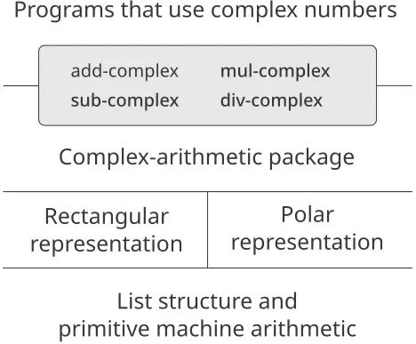
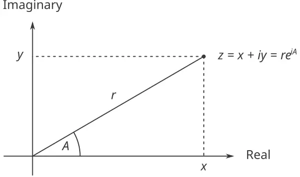
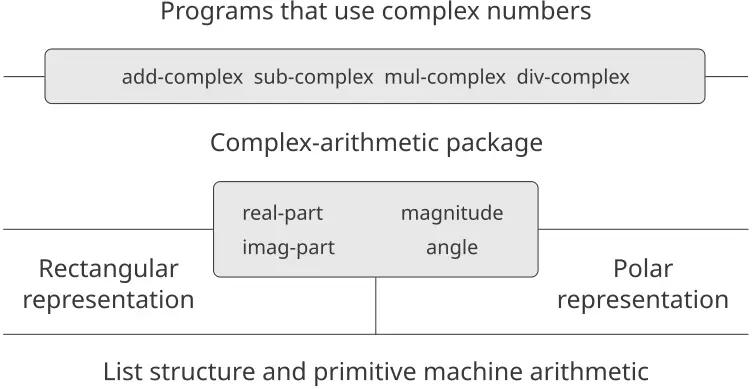
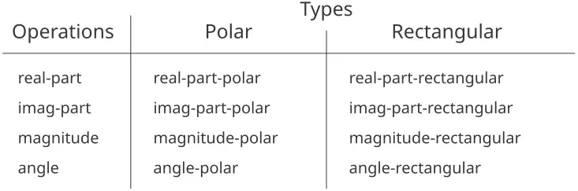

### 2.4 تمثيلات متعدّدة للبيانات المجرّدة

لقد عرّفنا تجريد البيانات (data abstraction)، وهو منهجيّةٌ لبناء النظم بحيث يمكن تحديد الكثير من البرنامج بشكلٍ مستقلّ عن الخيارات الداخلة في تنفيذ كائنات البيانات التي يعالجها البرنامج. فمثلًا، رأينا في [2.1.1](https://sarabander.github.io/sicp/html/2_002e1.xhtml#g_t2_002e1_002e1) كيف نفصل بين مهمّة تصميم برنامجٍ يستخدم الأعداد النسبيّة وبين مهمّة تنفيذ الأعداد النسبيّة بدلالة الآليّات الأوّليّة للغة الحاسوب في بناء البيانات المركّبة. وكانت الفكرة الجوهريّة هي إقامة حاجز تجريدٍ (abstraction barrier) - وهو في هذه الحالة المُنتقِيّات والبواني الخاصّة بالأعداد النسبيّة (`make-rat` و`numer` و`denom`) - يعزل طريقة استخدام الأعداد النسبيّة عن تمثيلها الأساسيّ بدلالة بنية القوائم. ويقوم حاجز تجريدٍ شبيهٌ يعزل تفاصيل الإجراءات التي تؤدّي الحساب على الأعداد النسبيّة (`add-rat` و`sub-rat` و`mul-rat` و`div-rat`) عن الإجراءات ذات «المستوى الأعلى» التي تستخدم الأعداد النسبيّة. وللبرنامج الناتج البنية الموضّحة في [الشكل 2.1](https://sarabander.github.io/sicp/html/2_002e1.xhtml#Figure-2_002e1).

وحواجز تجريد البيانات هذه أدواتٌ قويّةٌ للتحكّم في التعقيد. فبعزل التمثيلات الأساسيّة لكائنات البيانات، يمكننا تقسيم مهمّة تصميم برنامجٍ كبيرٍ إلى مهامّ أصغر يمكن أداؤها كلٌّ على حدة. غير أنّ هذا النوع من تجريد البيانات ليس قويًّا بما يكفي بعد، لأنّه قد لا يكون من المنطقيّ دائمًا الكلام عن «التمثيل الأساسيّ» لكائن بياناتٍ ما.

فمن ناحية، قد يوجد أكثر من تمثيلٍ مفيدٍ لكائن بياناتٍ واحد، وقد نرغب في تصميم نظمٍ قادرةٍ على التعامل مع تمثيلاتٍ متعدّدة. ولنأخذ مثالًا بسيطًا، قد تُُمثَّل الأعداد المركّبة بطريقتين شبه مكافئتين: بالتمثيل المستطيل (جزء حقيقيّ وجزء تخيّليّ) وبالتمثيل القطريّ (مقدار وزاوية). فأحيانًا يكون التمثيل المستطيل أنسب، وأحيانًا يكون التمثيل القطريّ أنسب. وفي الحقيقة، إنّه من المنطقيّ تمامًا تخيّل نظامٍ تُُمثَّل فيه الأعداد المركّبة بطريقتي التمثيل هاتين، وتعمل فيه الإجراءات المعالجة للأعداد المركّبة مع أيّ من التمثيلين.

والأهمّ من ذلك، أنّ نظم البرمجة تُصمَّم غالبًا على يد أشخاصٍ كثيرين يعملون على مدى فتراتٍ زمنيّةٍ ممتدّة، وتخضع لمتطلّباتٍ تتغيّر مع مرور الوقت. وفي بيئةٍ كهذه، ليس ممكنًا ببساطةٍ أن يتّفق الجميع مسبقًا على خيارات تمثيل البيانات. ولذلك، بالإضافة إلى حواجز تجريد البيانات التي تعزل التمثيل عن الاستخدام، نحتاج إلى حواجز تجريدٍ تعزل خيارات التصميم المختلفة بعضها عن بعض وتسمح للخيارات المختلفة بالتعايش في برنامجٍ واحد. وفوق ذلك، وبما أنّ البرامج الكبيرة تُنشأ غالبًا بدمج وحداتٍ قائمةٍ مسبقًا صُمّمت كلٌّ على حدة، فنحن نحتاج إلى اصطلاحاتٍ تسمح للمبرمجين بإدماج الوحدات في نظمٍ أكبر *إدماجًا جمعيًّا (additive)*، أي دون الحاجة إلى إعادة تصميم هذه الوحدات أو إعادة تنفيذها.

في هذا القسم، سنتعلّم كيف نتعامل مع بياناتٍ قد تُنمَّم بطرائق مختلفةٍ من قِبل أجزاء مختلفةٍ من البرنامج. وهذا يتطلّب بناء *إجراءات عامّة (generic procedures)* - أي الإجراءات التي تستطيع العمل على بياناتٍ قد تُنمَّم بأكثر من طريقةٍ واحدة. وإنّ تقنيّتنا الرئيسيّة لبناء الإجراءات العامّة ستكون العمل بدلالة كائنات بياناتٍ ذات *أوسمة أنواع (type tags)*، أي كائنات بياناتٍ تتضمّن معلوماتٍ صريحةً عن كيفيّة معالجتها. وسنناقش أيضًا *البرمجة الموجَّهة بالبيانات (data-directed programming)*، وهي استراتيجيّة تنفيذٍ قويّةٌ وملائمةٌ لتجميع النظم التي لها عمليّات عامّة إدماجًا جمعيًّا.

نبدأ بمثال الأعداد المركّبة البسيط. وسنرى كيف تُتيح لنا أوسمة الأنواع وأسلوب البرمجة الموجَّهة بالبيانات تصميم تمثيلين منفصلين - مستطيل وقطريّ - للأعداد المركّبة مع الحفاظ على مفهوم كائن بياناتٍ «عدد مركّب» مجرّد. وسنُحقّق ذلك بتعريف إجراءات للحساب على الأعداد المركّبة (`add-complex` و`sub-complex` و`mul-complex` و`div-complex`) بدلالة مُنتقِيّات عامّة تنفذ إلى أجزاء العدد المركّب بصورةٍ مستقلّةٍ عن كيفيّة تمثيل العدد. ونظام الأعداد المركّبة الناتج، كما هو موضّح في [الشكل 2.19](/book/sicp/c2-building-abstractions-with-data/2-4/)، يحتوي على نوعين مختلفين من حواجز التجريد. وحواجز التجريد «الأفقيّة» تؤدّي الدور نفسه الذي تؤدّيه الحواجز في [الشكل 2.1](https://sarabander.github.io/sicp/html/2_002e1.xhtml#Figure-2_002e1). فهي تعزل العمليّات «ذات المستوى الأعلى» عن التمثيلات «ذات المستوى الأدنى». وبالإضافة إلى ذلك، هناك حاجزٌ «عموديّ» يمنحنا القدرة على تصميم تمثيلات بديلةٍ وتثبيتها كلٌّ على حدة.



**الشكل 2.19:** حواجز تجريد البيانات في نظام الأعداد المركّبة.

في [2.5](https://sarabander.github.io/sicp/html/2_002e5.xhtml#g_t2_002e5) سنُبيّن كيف نستخدم أوسمة الأنواع وأسلوب البرمجة الموجَّهة بالبيانات لتطوير حزمة حسابٍ عامّة. وهذه تُوفّر إجراءات (`add` و`mul` وغيرها) يمكن استخدامها للتلاعب بجميع أنواع «الأعداد»، ويمكن توسعتها بسهولةٍ حين يلزم نوعٌ جديدٌ من الأعداد. وفي [2.5.3](https://sarabander.github.io/sicp/html/2_002e5.xhtml#g_t2_002e5_002e3)، سنُبيّن كيف نستخدم الحساب العامّ في نظامٍ يؤدّي الجبر الرمزيّ.

#### 2.4.1 تمثيلات الأعداد المركّبة

سنُطوّر نظامًا يؤدّي عمليّات الحساب على الأعداد المركّبة، بوصفه مثالًا بسيطًا لكنّه غير واقعيٍّ على برنامجٍ يستخدم عمليّاتٍ عامّة. ونبدأ بمناقشة تمثيلين معقولين للأعداد المركّبة كأزواجٍ مرتّبة: التمثيل المستطيل (جزء حقيقيّ وجزء تخيّليّ) والتمثيل القطريّ (مقدار وزاوية).[^43] وسيُظهر القسم [2.4.2](/book/sicp/c2-building-abstractions-with-data/2-4/) كيف يمكن جعل التمثيلين يتعايشان في نظامٍ واحدٍ باستخدام أوسمة الأنواع والعمليّات العامّة.

مثلها مثل الأعداد النسبيّة، تُنمَّم الأعداد المركّبة بصورةٍ طبيعيّةٍ كأزواجٍ مرتّبة. ويمكن النظر إلى مجموعة الأعداد المركّبة بوصفها فضاءً ثنائيّ الأبعاد له محوران متعامدان، المحور «الحقيقيّ» والمحور «التخيّليّ». (انظر [الشكل 2.20](/book/sicp/c2-building-abstractions-with-data/2-4/).) ومن هذا المنظور، يمكن النظر إلى العدد المركّب $z = x + i y$ (حيث $i^{2} = −1$ ) بوصفه النقطة في المستوى التي إحداثيّها الحقيقيّ هو $x$ وإحداثيّها التخيّليّ هو $y$ . وجمع الأعداد المركّبة ينحلّ في هذا التمثيل إلى جمع الإحداثيّات: $Real-part ( z_{1} + z_{2} ) = Real-part ( z_{1} ) + Real-part ( z_{2} ) , Imaginary-part ( z_{1} + z_{2} ) = Imaginary-part ( z_{1} ) + Imaginary-part ( z_{2} ) .$



**الشكل 2.20:** الأعداد المركّبة كنقاطٍ في المستوى.

وعند ضرب الأعداد المركّبة، يكون من الأنسب التفكير بدلالة تمثيل العدد المركّب بالتمثيل القطريّ، كمقدارٍ وزاوية ( $r$ و$A$ في [الشكل 2.20](/book/sicp/c2-building-abstractions-with-data/2-4/)). وحاصل ضرب عددين مركّبين هو المتجه الناتج عن تمديد أحد العددين المركّبين بطول الآخر ثمّ تدويره بالزاوية الخاصّة بالآخر: $Magnitude ( z_{1} ⋅ z_{2} ) = Magnitude ( z_{1} ) ⋅ Magnitude ( z_{2} ) , Angle ( z_{1} ⋅ z_{2} ) = Angle ( z_{1} ) + Angle ( z_{2} ) .$

وبذلك، فهناك تمثيلان مختلفان للأعداد المركّبة، كلٌّ منهما مناسبٌ لعمليّاتٍ مختلفة. ومع ذلك، فمن وجهة نظر شخصٍ يكتب برنامجًا يستخدم الأعداد المركّبة، فإنّ مبدأ تجريد البيانات يقترح أن تتوفّر جميع العمليّات المعالجة للأعداد المركّبة بغضّ النظر عن التمثيل الذي يستخدمه الحاسوب. فمثلًا، كثيرًا ما يكون من المفيد القدرة على إيجاد مقدار عددٍ مركّبٍ محدَّدٍ بإحداثيّاتٍ مستطيلة. وبالمثل، كثيرًا ما يكون من المفيد القدرة على تحديد الجزء الحقيقيّ لعددٍ مركّبٍ محدَّدٍ بإحداثيّاتٍ قطبيّة.

لتصميم نظامٍ كهذا، يمكننا اتّباع الاستراتيجيّة نفسها لتجريد البيانات التي اتّبعناها في تصميم حزمة الأعداد النسبيّة في [2.1.1](https://sarabander.github.io/sicp/html/2_002e1.xhtml#g_t2_002e1_002e1). افترض أنّ العمليّات على الأعداد المركّبة مُنفَّذة بدلالة أربعة مُنتقِيّات: `real-part` و`imag-part` و`magnitude` و`angle`. وافترض أيضًا أنّ لدينا إجراءين لبناء الأعداد المركّبة: يُعيد `make-from-real-imag` عددًا مركّبًا بجزءٍ حقيقيّ وجزءٍ تخيّليّ محدَّدين، ويُعيد `make-from-mag-ang` عددًا مركّبًا بمقدارٍ وزاويةٍ محدَّدين. وهذه الإجراءات لها الخاصّيّة أنّّه، لأيّ عددٍ مركّبٍ `z`، كلٌّ من

```scheme
(make-from-real-imag (real-part z) 
                     (imag-part z))
```

و

```scheme
(make-from-mag-ang (magnitude z) 
                   (angle z))
```

تُنتج أعدادًا مركّبةً مساويةً لـ`z`.

باستخدام هذه البواني وهذه المُنتقِيّات، يمكننا تنفيذ الحساب على الأعداد المركّبة باستخدام «البيانات المجرّدة» التي يحدّدها البواني والمُنتقِيّات، تمامًا كما فعلنا مع الأعداد النسبيّة في [2.1.1](https://sarabander.github.io/sicp/html/2_002e1.xhtml#g_t2_002e1_002e1). وكما هو موضّح في الصيغ أعلاه، فيمكننا جمع الأعداد المركّبة وطرحها بدلالة الجزأين الحقيقيّ والتخيّليّ، بينما نضرب الأعداد المركّبة ونقسمها بدلالة المقدارين والزاويتين:

```scheme
(define (add-complex z1 z2)
  (make-from-real-imag 
   (+ (real-part z1) (real-part z2))
   (+ (imag-part z1) (imag-part z2))))

(define (sub-complex z1 z2)
  (make-from-real-imag 
   (- (real-part z1) (real-part z2))
   (- (imag-part z1) (imag-part z2))))

(define (mul-complex z1 z2)
  (make-from-mag-ang 
   (* (magnitude z1) (magnitude z2))
   (+ (angle z1) (angle z2))))

(define (div-complex z1 z2)
  (make-from-mag-ang 
   (/ (magnitude z1) (magnitude z2))
   (- (angle z1) (angle z2))))
```

لاكتمال حزمة الأعداد المركّبة، يجب أن نختار تمثيلًا، وأن نُنفّذ البواني والمُنتقِيّات بدلالة الأعداد الأوّليّة وبنية القوائم الأوّليّة. وهناك طريقتان واضحتان لفعل ذلك: فيمكننا تمثيل العدد المركّب «بالتمثيل المستطيل» كزوجٍ (جزء حقيقيّ، جزء تخيّليّ) أو «بالتمثيل القطريّ» كزوجٍ (مقدار، زاوية). فأيّهما نختار؟

حتّى نجعل الخيارات المختلفة ملموسة، تخيّل أنّ هناك مبرمجَين، بن بيتدِل وأليسا بي. هاكر، يُصمّم كلٌّ منهما على حدةٍ تمثيلًا لنظام الأعداد المركّبة. فيختار بن تمثيل الأعداد المركّبة بالتمثيل المستطيل. وبهذا الخيار، يكون انتقاء الجزأين الحقيقيّ والتخيّليّ لعددٍ مركّبٍ مباشرًا، تمامًا كبناء عددٍ مركّبٍ بجزءٍ حقيقيّ وجزءٍ تخيّليّ معطيين. أمّا لإيجاد المقدار والزاوية، أو لبناء عددٍ مركّبٍ بمقدارٍ وزاويةٍ معطيين، فإنّه يستخدم العلاقات المثلثيّة

$x = r cos ⁡ A , y = r sin ⁡ A , r = \sqrt{x^{2} + y^{2} ,} A = arctan ⁡ ( y , x ) ,$

التي تربط الجزأين الحقيقيّ والتخيّليّ $( x , y )$ بالمقدار والزاوية $( r , A )$ .[^44] ولذلك، يتعيّن تمثيل بن بالمُنتقِيّات والبواني الآتية:

```scheme
(define (real-part z) (car z))
(define (imag-part z) (cdr z))

(define (magnitude z)
  (sqrt (+ (square (real-part z)) 
           (square (imag-part z)))))

(define (angle z)
  (atan (imag-part z) (real-part z)))

(define (make-from-real-imag x y) 
  (cons x y))

(define (make-from-mag-ang r a)
  (cons (* r (cos a)) (* r (sin a))))
```

أمّا أليسا، فعلى العكس، تختار تمثيل الأعداد المركّبة بالتمثيل القطريّ. فبالنسبة لها، يكون انتقاء المقدار والزاوية مباشرًا، لكنّها مضطرة إلى استخدام العلاقات المثلثيّة للحصول على الجزأين الحقيقيّ والتخيّليّ. وتمثيل أليسا هو:

```scheme
(define (real-part z)
  (* (magnitude z) (cos (angle z))))

(define (imag-part z)
  (* (magnitude z) (sin (angle z))))

(define (magnitude z) (car z))
(define (angle z) (cdr z))

(define (make-from-real-imag x y)
  (cons (sqrt (+ (square x) (square y)))
        (atan y x)))

(define (make-from-mag-ang r a) 
  (cons r a))
```

يضمن انضباط تجريد البيانات أنّ التنفيذ نفسه للإجراءات `add-complex` و`sub-complex` و`mul-complex` و`div-complex` سيعمل مع تمثيل بن أو مع تمثيل أليسا.

#### 2.4.2 البيانات المَوْسومة

إحدى طرائق النظر إلى تجريد البيانات هي النظر إليه بوصفه تطبيقًا لـ«مبدأ أقلّ التزام». فعند تنفيذ نظام الأعداد المركّبة في [2.4.1](/book/sicp/c2-building-abstractions-with-data/2-4/)، يمكننا استخدام إمّا تمثيل بن المستطيل وإمّا تمثيل أليسا القطريّ. وحاجز التجريد المُقام بالمُنتقِيّات والبواني يسمح لنا بتأجيل اختيار تمثيلٍ ملموسٍ لكائنات بياناتنا إلى آخر لحظةٍ ممكنة، وبذلك نحتفظ بأقصى مرونةٍ ممكنةٍ في تصميم نظامنا.

ويمكن التوسّع في مبدأ أقلّ الالتزام إلى حدودٍ أشدّ حتّى من ذلك. فإن أردنا، فيمكننا الحفاظ على غموض التمثيل حتّى *بعد* أن نُصمّم المُنتقِيّات والبواني، ونختار استخدام تمثيل بن *و*تمثيل أليسا معًا. غير أنّ ضَمّ التمثيلين في نظامٍ واحدٍ يتطلّب منّا طريقةً ما للتمييز بين البيانات ذات التمثيل القطريّ والبيانات ذات التمثيل المستطيل. وإلّا، فلو طُلب منّا، مثلًا، إيجاد `magnitude` الزوج (3, 4)، فلن نعرف هل نُجيب بـ5 (بقراءة العدد بالتمثيل المستطيل) أم بـ3 (بقراءة العدد بالتمثيل القطريّ). وطريقةٌ مباشرةٌ لإنجاز هذا التمييز هي إدراج *وسم نوع (type tag)* - وهو الرمز `rectangular` أو `polar` - كجزءٍ من كلّ عددٍ مركّب. وحين نحتاج حينئذٍ إلى معالجة عددٍ مركّبٍ، يمكننا استخدام الوسم لتحديد أيّ المُنتقِيّات نطبّق.

لكي نتعامل مع البيانات المَوْسومة، سنفترض أنّ لدينا إجراءين، `type-tag` و`contents`، يستخرجان من كائن البيانات الوسم والمحتويات الفعليّة (الإحداثيّات القطريّة أو المستطيلة، في حالة العدد المركّب). وسنفترض أيضًا وجود إجراءٍ `attach-tag` يأخذ وسمًا ومحتويات ويُنتج كائن بياناتٍ موسومًا. وأحد الطرق المباشرة لتنفيذ ذلك هو استخدام بنية القوائم الاعتياديّة:

```scheme
(define (attach-tag type-tag contents)
  (cons type-tag contents))

(define (type-tag datum)
  (if (pair? datum)
      (car datum)
      (error "Bad tagged datum: 
              TYPE-TAG" datum)))

(define (contents datum)
  (if (pair? datum)
      (cdr datum)
      (error "Bad tagged datum: 
              CONTENTS" datum)))
```

باستخدام هذه الإجراءات، يمكننا تعريف مُسَيِّمَين، `rectangular?` و`polar?`، يتعرّفان على الأعداد المستطيلة والأعداد القطريّة على الترتيب:

```scheme
(define (rectangular? z)
  (eq? (type-tag z) 'rectangular))

(define (polar? z)
  (eq? (type-tag z) 'polar))
```

وباستخدام أوسمة الأنواع، يمكن لبن وأليسا الآن تعديل شيفرتيهما بحيث يتعايش تمثيلاهما المختلفان في النظام نفسه. فكلّما يبني بن عددًا مركّبًا، فإنّه يوسمه بأنّه مستطيل. وكلّما تبني أليسا عددًا مركّبًا، فإنّها توسمه بأنّه قطريّ. وبالإضافة إلى ذلك، يجب على بن وأليسا أن يضمنا ألّا تتعارض أسماء إجراءاتهما. وإحدى طرائق فعل ذلك هي أن يُلحق بن اللاحقة `rectangular` باسم كلّ إجراءٍ من إجراءات تمثيله، وأن تُلحق أليسا اللاحقة `polar` بأسماء إجراءاتها. وهذه هي نسخة بن المُعدَّلة من التمثيل المستطيل الواردة في [2.4.1](/book/sicp/c2-building-abstractions-with-data/2-4/):

```scheme
(define (real-part-rectangular z) (car z))
(define (imag-part-rectangular z) (cdr z))

(define (magnitude-rectangular z)
  (sqrt (+ (square (real-part-rectangular z))
           (square (imag-part-rectangular z)))))

(define (angle-rectangular z)
  (atan (imag-part-rectangular z)
        (real-part-rectangular z)))

(define (make-from-real-imag-rectangular x y)
  (attach-tag 'rectangular (cons x y)))

(define (make-from-mag-ang-rectangular r a)
  (attach-tag 
   'rectangular
   (cons (* r (cos a)) (* r (sin a)))))
```

وهذه هي نسخة أليسا المُعدَّلة من التمثيل القطريّ:

```scheme
(define (real-part-polar z)
  (* (magnitude-polar z) 
     (cos (angle-polar z))))

(define (imag-part-polar z)
  (* (magnitude-polar z) 
     (sin (angle-polar z))))

(define (magnitude-polar z) (car z))
(define (angle-polar z) (cdr z))

(define (make-from-real-imag-polar x y)
  (attach-tag 
   'polar
   (cons (sqrt (+ (square x) (square y)))
         (atan y x))))

(define (make-from-mag-ang-polar r a)
  (attach-tag 'polar (cons r a)))
```

يُنفَّذ كلّ مُنتقٍ عامّ (generic selector) بإجراءٍ يفحص وسم (tag) معطاه ويستدعي الإجراء المناسب لمعالجة البيانات من ذلك النوع. فمثلًا، للحصول على الجزء الحقيقيّ لعددٍ مركّب، يفحص `real-part` الوسم ليحدّد هل يستخدم `real-part-rectangular` الذي كتبه بن أم `real-part-polar` الذي كتبته أليسا. وفي كلتا الحالتين، نستخدم `contents` لاستخراج البيان المجرّد غير الموسوم ونرسله إلى الإجراء المستطيل أو القطبيّ بحسب الحاجة:

```scheme
(define (real-part z)
  (cond ((rectangular? z)
         (real-part-rectangular (contents z)))
        ((polar? z)
         (real-part-polar (contents z)))
        (else (error "Unknown type: 
               REAL-PART" z))))

(define (imag-part z)
  (cond ((rectangular? z)
         (imag-part-rectangular (contents z)))
        ((polar? z)
         (imag-part-polar (contents z)))
        (else (error "Unknown type: 
               IMAG-PART" z))))

(define (magnitude z)
  (cond ((rectangular? z)
         (magnitude-rectangular (contents z)))
        ((polar? z)
         (magnitude-polar (contents z)))
        (else (error "Unknown type: 
               MAGNITUDE" z))))

(define (angle z)
  (cond ((rectangular? z)
         (angle-rectangular (contents z)))
        ((polar? z)
         (angle-polar (contents z)))
        (else (error "Unknown type: 
               ANGLE" z))))
```

ولتنفيذ عمليّات الحساب على الأعداد المركّبة، يمكننا استخدام الإجراءات نفسها `add-complex` و`sub-complex` و`mul-complex` و`div-complex` الواردة في [2.4.1](/book/sicp/c2-building-abstractions-with-data/2-4/)، إذ المُنتقِيّات التي تستدعيها عامّة، وبذلك ستعمل مع أيّ من التمثيلين. فمثلًا، ما زال الإجراء `add-complex` كما هو:

```scheme
(define (add-complex z1 z2)
  (make-from-real-imag 
   (+ (real-part z1) (real-part z2))
   (+ (imag-part z1) (imag-part z2))))
```

وأخيرًا، يجب أن نختار هل نُبنِي الأعداد المركّبة باستخدام تمثيل بن أم تمثيل أليسا. وأحد الخيارات المعقولة هو بناء الأعداد المستطيلة كلّما توفّر لدينا الجزء الحقيقيّ والجزء التخيّليّ، وبناء الأعداد القطبيّة كلّما توفّر لدينا المقدار والزاوية:

```scheme
(define (make-from-real-imag x y)
  (make-from-real-imag-rectangular x y))

(define (make-from-mag-ang r a)
  (make-from-mag-ang-polar r a))
```

إنّ نظام الأعداد المركّبة الناتج له البنية الموضحة في [الشكل 2.21](/book/sicp/c2-building-abstractions-with-data/2-4/). وقد فُكِّك النظام إلى ثلاثة أجزاءٍ مستقلّةٍ نسبيًّا: عمليّات الحساب على الأعداد المركّبة، وتنفيذ أليسا للتمثيل القطبيّ، وتنفيذ بن للتمثيل المستطيل. وكان يمكن كتابة التنفيذين القطبيّ والمستطيل على يد بن وأليسا عاملين كلٌّ على حدة، ويمكن استخدام كلٍّ منهما بوصفه تمثيلًا أساسيًّا من قِبل مبرمجٍ ثالثٍ يُنفّذ إجراءات الحساب على الأعداد المركّبة بدلالة واجهة البواني والمُنتقِيّات المجرّدة.



**الشكل 2.21:** بنية نظام الحساب العامّ على الأعداد المركّبة.

لأنّ كلّ كائن بياناتٍ مَوْسومٌ بنوعه، فإنّ المُنتقِيّات تشتغل على البيانات بصورةٍ عامّة. أي أنّ كلّ مُنتقٍ مُعرَّفٌ بأنّ له سلوكًا يتوقّف على النوع الخاصّ للبيانات التي يُطبَّق عليها. ولاحِظ الآليّة العامّة لربط التمثيلات المتفرّقة: فداخل تنفيذ تمثيلٍ معيّن (مثلًا حزمة أليسا القطبيّة) يكون العدد المركّب زوجًا غير موسوم (مقدار، زاوية). وحين يعمل مُنتقٍ عامّ على عددٍ من نوع `polar`، فإنّه ينزع الوسم ويمرّر المحتويات إلى شيفرة أليسا. وبالعكس، حين تبني أليسا عددًا للاستخدام العامّ، فإنها توسمه بنوعٍ حتّى يتعرّف عليه الإجراءات ذات المستوى الأعلى كما ينبغي. وهذا النظام في نزع الأوسمة وإلحاقها كلّما انتقلت كائنات البيانات من مستوى إلى آخر قد يكون استراتيجيّةً تنظيميّةً مهمّة، كما سنرى في [2.5](https://sarabander.github.io/sicp/html/2_002e5.xhtml#g_t2_002e5).

#### 2.4.3 البرمجة الموجَّهة بالبيانات والجمعيّة

تُسمّى الاستراتيجيّة العامّة المتمثّلة في فحص نوع البيان واستدعاء إجراءٍ مناسب *التوجيه بحسب النوع (dispatching on type)*. وهذه استراتيجيّة قويّة لتحقيق الوحدانيّة في تصميم النظم. ومن ناحية أخرى، فإنّ تنفيذ التوجيه كما في [2.4.2](/book/sicp/c2-building-abstractions-with-data/2-4/) له نقطتا ضعفٍ مهمّتان. والضعف الأوّل أنّ إجراءات الواجهة العامّة (`real-part` و`imag-part` و`magnitude` و`angle`) يجب أن تعرف جميع التمثيلات المختلفة. فمثلًا، لنفترض أنّنا أردنا إدخال تمثيلٍ جديدٍ للأعداد المركّبة في نظام الأعداد المركّبة لدينا. فسنحتاج إلى ربط هذا التمثيل بنوع، ثمّ إضافة بندٍ إلى كلّ واحدٍ من إجراءات الواجهة العامّة ليفحص النوع الجديد ويطبّق المُنتقِي المناسب لذلك التمثيل.

والضعف الآخر في التقنيّة أنّنا ورغم إمكان تصميم التمثيلات الفرديّة كلٌّ على حدة، يجب أن نضمن ألّا يحمل إجراءان في النظام بأكمله الاسم نفسه. ولهذا اضطرّ بن وأليسا إلى تغيير أسماء إجراءاتهما الأصليّة الواردة في [2.4.1](/book/sicp/c2-building-abstractions-with-data/2-4/).

والمسألة الكامنة وراء هذين الضعفين هي أنّ التقنيّة المستخدمة في تنفيذ الواجهات العامّة ليست *جمعيّة (additive)*. فالشخص الذي يُنفّذ إجراءات المُنتقِي العامّة يجب أن يُعدّل تلك الإجراءات في كلّ مرّةٍ يُثبَّت فيها تمثيلٌ جديد، والناس الذين يربطون التمثيلات الفرديّة يجب أن يُعدّلوا شيفراتهم لتفادي تعارض الأسماء. وفي كلٍّ من هاتين الحالتين، فإنّ التعديلات الواجب إجراؤها على الشيفرة مباشرة، لكن لا بدّ من إجرائها مع ذلك، وهذا مصدرٌ للإزعاج والخطأ. وهذا ليس مشكلةً كبيرةً في نظام الأعداد المركّبة في وضعه الحاليّ، لكن لنفترض أنّ هناك ليس تمثيلين بل مئاتٍ من التمثيلات المختلفة للأعداد المركّبة. ولنفترض أيضًا أنّ هناك مُنتقِيّات عامّة كثيرة يجب صيانتها في واجهة البيانات المجرّدة. ولنفترض، في الحقيقة، أنّ أحدًا من المبرمجين لا يعرف جميع إجراءات الواجهة ولا جميع التمثيلات. فالمشكلة حقيقيّة ويجب مواجهتها في برامج مثل نظم إدارة قواعد البيانات واسعة النطاق.

ما نحتاجه هو وسيلةٌ لوحدنة تصميم النظم إلى حدٍّ أبعد. وتوفّرها تقنيّة البرمجة المعروفة بـ*البرمجة الموجَّهة بالبيانات (data-directed programming)*. ولتفهّم كيف تعمل البرمجة الموجَّهة بالبيانات، ابدأ بالملاحظة أنّنا كلّما تعاملنا مع مجموعةٍ من العمليّات العامّة المشتركة بين مجموعةٍ من الأنواع المختلفة، فإنّنا في الواقع نتعامل مع جدولٍ ثنائيّ الأبعاد يحتوي العمليّات الممكنة على أحد المحورين والأنواع الممكنة على المحور الآخر. ومدخلات الجدول هي الإجراءات التي تُنفّذ كلّ عمليّةٍ لكلّ نوعٍ من المعطيات المقدَّمة. وفي نظام الأعداد المركّبة المطوَّر في القسم السابق، فإنّ المطابقة بين اسم العمليّة ونوع البيانات والإجراء الفعليّ كانت موزّعةً على البنود الشرطيّة المختلفة في إجراءات الواجهة العامّة. لكنّ المعلومات نفسها كان يمكن تنظيمها في جدول، كما هو موضح في [الشكل 2.22](/book/sicp/c2-building-abstractions-with-data/2-4/).



**Figure 2.22:** Table of operations for the complex-number system.

إنّ البرمجة الموجَّهة بالبيانات هي تقنيّة تصميم البرامج للعمل مع مثل هذا الجدول مباشرةً. فقد نُفّذنا سابقًا الآليّة التي تربط شيفرة الحساب على الأعداد المركّبة بحزمتَي التمثيل بوصفها مجموعةً من الإجراءات يؤدّي كلٌّ منها توجيهًا صريحًا بحسب النوع. وهنا سنُنفّذ الواجهة بإجراءٍ واحدٍ يبحث في الجدول عن تركيبة اسم العمليّة ونوع المعطى ليجد الإجراء الصحيح الذي ينبغي تطبيقه، ثمّ يطبّقه على محتويات المعطى. فإذا فعلنا ذلك، فحتّى نُضيف حزمة تمثيلٍ جديدةٍ إلى النظام فإنّنا لا نحتاج إلى تغيير أيّ إجراءٍ قائم؛ فكلّ ما نحتاجه هو إضافة مدخلاتٍ جديدةٍ إلى الجدول.

ولتنفيذ هذه الخطة، افترض أنّ لدينا إجراءين، `put` و`get`، للتلاعب بجدول العمليّات والأنواع:

- `(put ⟨op⟩ ⟨type⟩ ⟨item⟩)` يُثبّت `⟨`item`⟩` في الجدول، مفهرَسًا بـ`⟨`op`⟩` و`⟨`type`⟩`.
- `(get ⟨op⟩ ⟨type⟩)` يبحث عن `⟨`op`⟩` و`⟨`type`⟩` في الجدول ويعيد العنصر الذي يجده هناك. فإن لم يُعثر على عنصر، فإنّ `get` يعيد القيمة false.

وفي الوقت الحاليّ، يمكننا الافتراض أنّ `put` و`get` مُدمَجَان في لغتنا. وفي [الفصل 3](https://sarabander.github.io/sicp/html/Chapter-3.xhtml#Chapter-3) ([3.3.3](https://sarabander.github.io/sicp/html/3_002e3.xhtml#g_t3_002e3_002e3)) سنرى كيف نُنفّذ هذه العمليّات وغيرها من عمليّات التلاعب بالجداول.

وهكذا يمكن استخدام البرمجة الموجَّهة بالبيانات في نظام الأعداد المركّبة. فأمّا بن، الذي طوّر التمثيل المستطيل، فيُنفّذ شيفرته تمامًا كما فعل في الأصل. فهو يُعرّف مجموعةً من الإجراءات، أو *حزمة (package)*، ويربطها ببقيّة النظام بإضافة مدخلاتٍ إلى الجدول تُخبر النظام كيف يعمل على الأعداد المستطيلة. وهذا يتحقّق باستدعاء الإجراء الآتي:

```scheme
(define (install-rectangular-package)
  ;; internal procedures
  (define (real-part z) (car z))
  (define (imag-part z) (cdr z))
  (define (make-from-real-imag x y) 
    (cons x y))
  (define (magnitude z)
    (sqrt (+ (square (real-part z))
             (square (imag-part z)))))
  (define (angle z)
    (atan (imag-part z) (real-part z)))
  (define (make-from-mag-ang r a)
    (cons (* r (cos a)) (* r (sin a))))
  ;; interface to the rest of the system
  (define (tag x) 
    (attach-tag 'rectangular x))
  (put 'real-part '(rectangular) real-part)
  (put 'imag-part '(rectangular) imag-part)
  (put 'magnitude '(rectangular) magnitude)
  (put 'angle '(rectangular) angle)
  (put 'make-from-real-imag 'rectangular
       (lambda (x y) 
         (tag (make-from-real-imag x y))))
  (put 'make-from-mag-ang 'rectangular
       (lambda (r a) 
         (tag (make-from-mag-ang r a))))
  'done)
```

لاحِظ أنّ الإجراءات الداخليّة هنا هي الإجراءات نفسها الواردة في [2.4.1](/book/sicp/c2-building-abstractions-with-data/2-4/) التي كتبها بن عندما كان يعمل منفردًا. ولا يلزم أيّ تغييرٍ لربطها ببقيّة النظام. وبالإضافة إلى ذلك، فبما أنّ تعريفات الإجراءات هذه داخليّةٌ في إجراء التثبيت، فإنّ بن لا يقلق من تعارض الأسماء مع إجراءاتٍ أخرى خارج الحزمة المستطيلة. ولربط هذه الإجراءات ببقيّة النظام، يُثبِّت بن إجراء `real-part` الخاصّ به تحت اسم العمليّة `real-part` والنوع `(rectangular)`، وكذلك الحال بالنسبة إلى المُنتقِيّات الأخرى.[^45] وتُعرّف الواجهة أيضًا البواني التي سيستخدمها النظام الخارجيّ.[^46] وهذه مطابقةٌ للبواني التي عرّفها بن داخليًّا، فيما عدا أنّها تُلحق الوسم.

وحزمة أليسا القطبيّة مماثلة:

```scheme
(define (install-polar-package)
  ;; internal procedures
  (define (magnitude z) (car z))
  (define (angle z) (cdr z))
  (define (make-from-mag-ang r a) (cons r a))
  (define (real-part z)
    (* (magnitude z) (cos (angle z))))
  (define (imag-part z)
    (* (magnitude z) (sin (angle z))))
  (define (make-from-real-imag x y)
    (cons (sqrt (+ (square x) (square y)))
          (atan y x)))
  ;; interface to the rest of the system
  (define (tag x) (attach-tag 'polar x))
  (put 'real-part '(polar) real-part)
  (put 'imag-part '(polar) imag-part)
  (put 'magnitude '(polar) magnitude)
  (put 'angle '(polar) angle)
  (put 'make-from-real-imag 'polar
       (lambda (x y) 
         (tag (make-from-real-imag x y))))
  (put 'make-from-mag-ang 'polar
       (lambda (r a) 
         (tag (make-from-mag-ang r a))))
  'done)
```

ورغم أنّ بن وأليسا كلًّا منهما لا يزالان يستخدمان إجراءاتهما الأصليّة المعرّفةً بالأسماء نفسها التي يستخدمها كلٌّ منهما للآخر (مثل `real-part`)، فإنّ هذه التعريفات أصبحت داخليّةً في إجراءاتٍ مختلفة (انظر [1.1.8](https://sarabander.github.io/sicp/html/1_002e1.xhtml#g_t1_002e1_002e8))، فلا يقع تعارضٌ في الأسماء.

تَصِل مُنتقِيّات الحساب على الأعداد المركّبة إلى الجدول بوساطة إجراء «عمليّة» عامّ يُسمّى `apply-generic`، وهو يُطبّق عمليّةً عامّةً على بعض المعطيات. و`apply-generic` يبحث في الجدول تحت اسم العمليّة وأنواع المعطيات ويطبّق الإجراء الناتج إن كان موجودًا:[^47]

```scheme
(define (apply-generic op . args)
  (let ((type-tags (map type-tag args)))
    (let ((proc (get op type-tags)))
      (if proc
          (apply proc (map contents args))
          (error
            "No method for these types: 
             APPLY-GENERIC"
            (list op type-tags))))))
```

وباستخدام `apply-generic`، يمكننا تعريف مُنتقِيّاتنا العامّة كما يأتي:

```scheme
(define (real-part z) 
  (apply-generic 'real-part z))
(define (imag-part z) 
  (apply-generic 'imag-part z))
(define (magnitude z) 
  (apply-generic 'magnitude z))
(define (angle z) 
  (apply-generic 'angle z))
```

ولاحِظ أنّ هذه لا تتغيّر إطلاقًا إن أُضيف تمثيلٌ جديدٌ إلى النظام.

ويمكننا أيضًا استخراج البواني التي ستستخدمها البرامج الخارجيّة عن الحزم من الجدول، وذلك لبناء أعدادٍ مركّبةٍ من الأجزاء الحقيقيّة والتخيّليّة ومن المقادير والزوايا. فكما في [2.4.2](/book/sicp/c2-building-abstractions-with-data/2-4/)، نُبنِي الأعداد المستطيلة كلّما توفّر لدينا الجزء الحقيقيّ والجزء التخيّليّ، والأعداد القطبيّة كلّما توفّر لدينا المقدار والزاوية:

```scheme
(define (make-from-real-imag x y)
  ((get 'make-from-real-imag 
        'rectangular) 
   x y))

(define (make-from-mag-ang r a)
  ((get 'make-from-mag-ang 
        'polar) 
   r a))
```

**التمرين 2.73:** وصفت [2.3.2](https://sarabander.github.io/sicp/html/2_002e3.xhtml#g_t2_002e3_002e2) برنامجًا يُؤدّي الاشتقاق الرمزيّ:

```scheme
(define (deriv exp var)
  (cond ((number? exp) 0)
        ((variable? exp) 
         (if (same-variable? exp var) 1 0))
        ((sum? exp)
         (make-sum (deriv (addend exp) var)
                   (deriv (augend exp) var)))
        ((product? exp)
         (make-sum
           (make-product 
            (multiplier exp)
            (deriv (multiplicand exp) var))
           (make-product 
            (deriv (multiplier exp) var)
            (multiplicand exp))))
        ⟨more rules can be added here⟩
        (else (error "unknown expression type:
                      DERIV" exp))))
```

يمكننا اعتبار هذا البرنامج مؤدّيًا توجيهًا بحسب نوع التعبير المطلوب اشتقاقه. وفي هذا الموقف، يكون «وسم النوع» الخاصّ بالبيان هو رمز المؤثّل الجبريّ (مثل `+`) والعمليّة التي تُؤدّى هي `deriv`. ويمكننا تحويل هذا البرنامج إلى النمط الموجَّه بالبيانات بإعادة كتابة إجراء الاشتقاق الأساسيّ كما يأتي:

```scheme
(define (deriv exp var)
   (cond ((number? exp) 0)
         ((variable? exp) 
           (if (same-variable? exp var) 
               1 
               0))
         (else ((get 'deriv (operator exp)) 
                (operands exp) 
                var))))

(define (operator exp) (car exp))
(define (operands exp) (cdr exp))
```

اشرح ما جرى أعلاه. فلماذا لا نستطيع استيعاب المُسَيِّمَين `number?` و`variable?` في التوجيه الموجَّه بالبيانات؟ واكتب الإجراءات الخاصّة باشتقاق المجاميع والجداءات، والشيفرة المساعدة اللازمة لتثبيتها في الجدول الذي يستخدمه البرنامج أعلاه. واختر أيّ قاعدة اشتقاقٍ إضافيّةٍ تحبّها، مثل القاعدة الخاصّة بالأسّ ([التمرين 2.56](https://sarabander.github.io/sicp/html/2_002e3.xhtml#Exercise-2_002e56))، وثبّتها في هذا النظام الموجَّه بالبيانات. وفي هذه المُعالِجة الجبريّة البسيطة، يكون نوع التعبير هو المؤثّل الجبريّ الذي يربطه معًا. لكن لنفترض أنّنا فهرسنا الإجراءات بالعكس، بحيث صار سطر التوجيه في `deriv` كالآتي:

```scheme
((get (operator exp) 'deriv) 
 (operands exp) var)
```

فما التعديلات المقتضاة في نظام الاشتقاق؟

> **التمرين 2.74:** شركة «Insatiable Enterprises, Inc.» هي شركةٌ عملاقةٌ لامركزيّةٌ للغاية، تتكوّن من عددٍ كبيرٍ من الأقسام المستقلّة المنتشرة في أنحاء العالم. وقد رُبطت تسهيلات الشركة الحاسوبيّة للتوّ بعضها ببعض بوساطة نظامٍ ذكيّ للواجهة مع الشبكة يجعل الشبكة بأكملها تبدو لأيّ مستخدمٍ حاسوبًا واحدًا. ورئيسة شركة Insatiable، في محاولتها الأولى لاستغلال قدرة الشبكة على استخراج المعلومات الإداريّة من ملفّات الأقسام، تفزع حين تكتشف أنّ جميع ملفّات الأقسام - وإن كانت قد نُفّذت كبنيات بياناتٍ في Scheme - تختلف بنية البيانات الخاصّة المستخدمة من قسمٍ إلى آخر. ويُدعى مديرو الأقسام على عجلٍ إلى اجتماعٍ للبحث عن استراتيجيّةٍ لدمج الملفّات تُلبّي احتياجات المقرّ الرئيسيّ مع الحفاظ على الاستقلاليّة القائمة للأقسام. وأرِ كيف يمكن تنفيذ مثل هذه الاستراتيجيّة بالبرمجة الموجَّهة بالبيانات. فعلى سبيل المثال، لنفترض أنّ سجلّات العاملين في كلّ قسمٍ تتكوّن من ملفٍّ واحدٍ يحتوي مجموعةً من السجلّات مفهرسةً بأسماء العاملين. وبنية المجموعة تختلف من قسمٍ إلى آخر. وبالإضافة إلى ذلك، فإنّ سجلّ كلّ عاملٍ هو بذاته مجموعةٌ (ذات بنيةٍ مختلفة من قسمٍ إلى آخر) تحتوي معلوماتٍ مفهرسةً تحت معرّفاتٍ مثل `address` و`salary`. وبالتحديد: نُنفّذ للمقرّ الرئيسيّ إجراء `get-record` يسترجع سجلّ عاملٍ محدَّدٍ من ملفّ عمالٍ محدَّد. وينبغي أن يكون الإجراء قابلًا للتطبيق على ملفّ أيّ قسم. واشرح كيف ينبغي بنيّة ملفّات الأقسام الفرديّة. وبالتحديد، ما معلومات النوع التي يجب توفيرها؟
> > نُنفّذ للمقرّ الرئيسيّ إجراء `get-salary` يعيد معلومات الراتب من سجلّ عاملٍ معطىً من ملفّ عمالٍ في أيّ قسم. فكيف ينبغي بنيّة السجلّ حتّى تعمل هذه العمليّة؟
> > نُنفّذ للمقرّ الرئيسيّ إجراء `find-employee-record`. وينبغي أن يبحث هذا الإجراء في ملفّات جميع الأقسام عن سجلّ عاملٍ معطىً ويعيد ذلك السجلّ. وافترض أنّ هذا الإجراء يأخذ كمعطياتٍ اسم العامل وقائمةً بملفّات جميع الأقسام.
> > عندما تستحوذ Insatiable على شركةٍ جديدة، فأيّ تغييراتٍ يجب إجراؤها لإدماج معلومات العاملين الجديدة في النظام المركزيّ؟
> > 

#### تمرير الرسائل

الفكرة المحوريّة في البرمجة الموجَّهة بالبيانات هي معالجة العمليّات العامّة في البرامج بالتصرّف صراحةً مع جداول العمليّات والأنواع، مثل الجدول في [الشكل 2.22](/book/sicp/c2-building-abstractions-with-data/2-4/). وقد نظّم نمط البرمجة الذي استخدمناه في [2.4.2](/book/sicp/c2-building-abstractions-with-data/2-4/) التوجيه المطلوب بحسب النوع بجعل كلّ عمليّةٍ تتولّى توجيهها بنفسها. وهذا يفكّك في الواقع جدول العمليّات والأنواع إلى صفوف، بحيث يمثّل كلّ إجراء عمليّةٍ عامّة صفًّا من الجدول.

أمّا الاستراتيجيّة البديلة في التنفيذ فهي تفكيك الجدول إلى أعمدة، وبدلًا من استخدام «عمليّات ذكيّة» توجّه بحسب أنواع البيانات، العمل مع «كائنات بيانات ذكيّة» توجّه بحسب أسماء العمليّات. ويمكننا فعل ذلك بترتيب الأمور بحيث يُمثَّل كائن البيانات - مثل العدد المستطيل - بإجراءٍ يأخذ اسم العمليّة المطلوبة مدخلًا ويؤدّي العمليّة المُشار إليها. وفي نظامٍ مثل هذا، يمكن كتابة `make-from-real-imag` على النحو الآتي:

```scheme
(define (make-from-real-imag x y)
  (define (dispatch op)
    (cond ((eq? op 'real-part) x)
          ((eq? op 'imag-part) y)
          ((eq? op 'magnitude)
           (sqrt (+ (square x) (square y))))
          ((eq? op 'angle) (atan y x))
          (else
           (error "Unknown op: 
            MAKE-FROM-REAL-IMAG" op))))
  dispatch)
```

أمّا إجراء `apply-generic` المطابق، وهو يُطبّق عمليّةً عامّةً على معطىً، فإنّه الآن يغذّي كائن البيانات باسم العمليّة ويترك الكائن يقوم بالعمل:[^48]

```scheme
(define (apply-generic op arg) (arg op))
```

لاحِظ أنّ القيمة التي يعيدها `make-from-real-imag` هي إجراء - وهو إجراء `dispatch` الداخليّ. وهذا هو الإجراء الذي يُستدعى حين يطلب `apply-generic` أداء عمليّةٍ ما.

يُسمّى هذا النمط من البرمجة *تمرير الرسائل (message passing)*. واسمه مستمدٌ من تصوّر كائن البيانات ككيانٍ يستقبل اسم العمليّة المطلوبة بوصفه «رسالة». وقد رأينا مثلًا على تمرير الرسائل سابقًا في [2.1.3](https://sarabander.github.io/sicp/html/2_002e1.xhtml#g_t2_002e1_002e3)، حيث رأينا كيف يمكن تعريف `cons` و`car` و`cdr` دون أيّ كائنات بياناتٍ بل بإجراءاتٍ فقط. وهنا نرى أنّ تمرير الرسائل ليس خُدعةً رياضيّةً بل تقنيّةً مفيدةً لتنظيم النظم ذات العمليّات العامّة. وفي بقية هذا الفصل سنواصل استخدام البرمجة الموجَّهة بالبيانات، لا تمرير الرسائل، لمناقشة عمليّات الحساب العامّة. وفي [الفصل 3](https://sarabander.github.io/sicp/html/Chapter-3.xhtml#Chapter-3) سنعود إلى تمرير الرسائل، وسنرى أنّه قد يكون أداةً قويّةً لبناء برامج المحاكاة.

> **التمرين 2.75:** نُنفّذ الباني `make-from-mag-ang` بنمط تمرير الرسائل. وينبغي أن يكون هذا الإجراء مماثلًا لإجراء `make-from-real-imag` المعطى أعلاه.

> **التمرين 2.76:** مع تطوّر نظامٍ كبيرٍ ذي عمليّاتٍ عامّة، قد تصير هناك حاجةٌ إلى أنواعٍ جديدةٍ من كائنات البيانات أو إلى عمليّاتٍ جديدة. وبالنسبة إلى كلٍّ من الاستراتيجيّات الثلاث - العمليّات العامّة ذات التوجيه الصريح، والنمط الموجَّه بالبيانات، ونمط تمرير الرسائل - صِف التعديلات التي يجب إجراؤها على نظامٍ ما لإضافة أنواعٍ أو عمليّاتٍ جديدة. فأيّ تنظيمٍ يكون أنسب لنظامٍ يجب إضافة أنواعٍ جديدةٍ إليه كثيرًا؟ وأيّها يكون أنسب لنظامٍ يجب إضافة عمليّاتٍ جديدةٍ إليه كثيرًا؟


[^43]: لقد استخدمنا الرمز `+` نفسه هنا للدلالة على كلٍّ من إجراء لغة المصدر وعمليّة الآلة. وبشكلٍ عام، لن توجد مقابلةٌ واحدٌ بواحدٍ بين أوّليّات لغة المصدر وأوّليّات الآلة.

[^44]: جعل الأوّليّات كلماتٍ محجوزة هو فكرةٌ سيّئةٌ عمومًا، إذ لا يستطيع المستخدم حينها إعادة ربط هذه الأسماء بإجراءاتٍ مختلفة. والأسوأ من ذلك، أنّ إضافة كلماتٍ محجوزةً إلى مصرّفٍ قيد الاستخدام ستجعل البرامج الموجودة التي تُعرِّف إجراءاتٍ بهذه الأسماء تتوقّف عن العمل. انظر [التمرين 5.44](/book/sicp/c5-computing-with-register-machines/5-5/) لأفكارٍ عن كيفيّة تجنّب هذه المشكلة.

[^45]: لا يصحّ هذا إذا سمحنا بتعريفاتٍ داخليّة، إلّا إذا استخرجناه بالمسح. انظر [التمرين 5.43](/book/sicp/c5-computing-with-register-machines/5-5/).

[^46]: هذا هو التعديل المطلوب على البحث عن المتغيّرات إذا نُفّذت طريقة الاستخراج لإزالة التعريفات الداخليّة ([التمرين 5.43](/book/sicp/c5-computing-with-register-machines/5-5/)). وسنحتاج إلى إزالة هذه التعريفات لكي تعمل العنونة المعجميّة.

[^47]: لا يمكن استخدام العناوين المعجميّة للوصول إلى المتغيّرات في البيئة العامّة، لأنّ هذه الأسماء يمكن تعريفها وإعادة تعريفها تفاعليًّا في أيّ وقت. فمع استخراج التعريفات الداخليّة، كما في [التمرين 5.43](/book/sicp/c5-computing-with-register-machines/5-5/)، تكون التعريفات الوحيدة التي يراها المصرّف هي التعريفات على المستوى الأعلى، وهي التي تعمل على البيئة العامّة. ولا يتسبّب تصريف تعريفٍ في إدخال الاسم المعرَّف في بيئة وقت التصريف.

[^48]: وبالطبع، الإجراءات المصرّفة كالإجراءات المُفسَّرة مركّبةٌ (غير أوّليّة). واتّفاقًا مع المصطلحات المستخدمة في المُقيّم ذي المتحكّم الصريح، سنستخدم في هذا القسم «مركّب» بمعنى مُفسَّر (مقابلًا لمصرَّف).