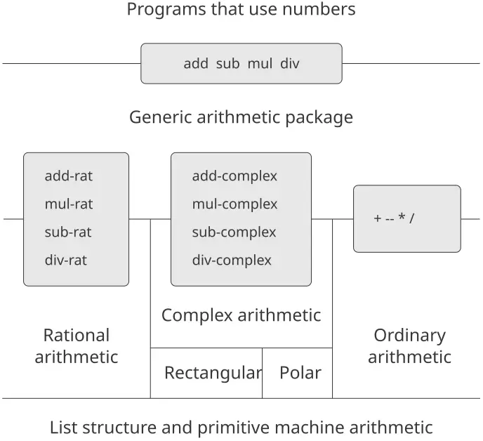
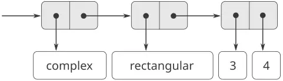
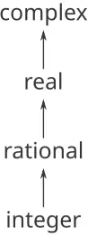
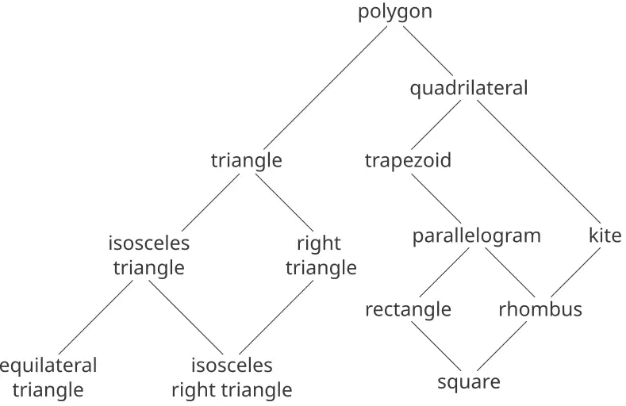

### 2.5 أنظمة ذات عمليّات عامّة

في القسم السابق، رأينا كيف نصمّم نظمًا يمكن تمثيل كائنات البيانات فيها بأكثر من طريقةٍ واحدة. والفكرة المحوريّة هي ربط الشيفرة التي تحدّد عمليّات البيانات بالتمثيلات المتعدّدة بوساطة إجراءات واجهةٍ عامّة. والآن سنرى كيف نستخدم هذه الفكرة نفسها لا لتحديد عمليّاتٍ عامّةٍ على تمثيلاتٍ مختلفةٍ فحسب، بل أيضًا لتحديد عمليّاتٍ عامّةٍ على أنواعٍ مختلفةٍ من المعطيات. فقد رأينا سابقًا عدّة حزمٍ مختلفةٍ لعمليّات الحساب: الحساب الأوّليّ (`+` و`-` و`*` و`/`) المدمج في لغتنا، والحساب على الأعداد الكسريّة (`add-rat` و`sub-rat` و`mul-rat` و`div-rat`) الوارد في [2.1.1](https://sarabander.github.io/sicp/html/2_002e1.xhtml#g_t2_002e1_002e1)، والحساب على الأعداد المركّبة الذي نُفّذناه في [2.4.3](https://sarabander.github.io/sicp/html/2_002e4.xhtml#g_t2_002e4_002e3). وسنستخدم الآن تقنيّات البرمجة الموجَّهة بالبيانات لبناء حزمةٍ من عمليّات الحساب تُدمج جميع حزم الحساب التي بنيناها سابقًا.

يُظهر [الشكل 2.23](/book/sicp/c2-building-abstractions-with-data/2-5/) بنية النظام الذي سنبنيه. ولاحِظ حواجز التجريد. فمن منظور من يستخدم «الأعداد»، هناك إجراءٌ واحدٌ هو `add` يعمل على أيّ أعدادٍ تُعطى له. و`add` جزءٌ من واجهةٍ عامّةٍ تسمح بالنفاذ الموحّد إلى حزم الحساب الاعتياديّ والحساب الكسريّ والحساب المركّب المتفرّقة من قِبل البرامج التي تستخدم الأعداد. وأيّ حزمة حسابٍ فرديّة (مثل الحزمة المركّبة) قد يُنفَذ إليها هي نفسها بوساطة إجراءاتٍ عامّة (مثل `add-complex`) تجمع حزمًا صُمّمت لتمثيلاتٍ مختلفة (مثل المستطيلة والقطبيّة). وبالإضافة إلى ذلك، فإنّ بنية النظام جمعيّة، بحيث يمكن تصميم حزم الحساب الفرديّة كلٌّ على حدة ثمّ جمعها لإنتاج نظام حسابٍ عامّ.



**الشكل 2.23:** نظام حسابيّ عامّ.

#### 2.5.1 عمليّات الحساب العامّة

إنّ مهمّة تصميم عمليّات الحساب العامّة مماثلةٌ لمهمّة تصميم العمليّات العامّة على الأعداد المركّبة. فنودّ - مثلًا - أن يكون لدينا إجراء جمعٍ عامّ هو `add` يتصرّف كالجمع الأوّليّ الاعتياديّ `+` على الأعداد الاعتياديّة، وكـ`add-rat` على الأعداد الكسريّة، وكـ`add-complex` على الأعداد المركّبة. ويمكننا تنفيذ `add`، وسائر عمليّات الحساب العامّة، باتّباع الاستراتيجيّة نفسها التي استخدمنها في [2.4.3](https://sarabander.github.io/sicp/html/2_002e4.xhtml#g_t2_002e4_002e3) لتنفيذ المُنتقِيّات العامّة للأعداد المركّبة. فسنُلحق وسم نوعٍ بكلّ نوعٍ من الأعداد ونجعل الإجراء العامّ يوجّه إلى الحزمة المناسبة بحسب نوع بيانات معطياته.

وتُعرَّف إجراءات الحساب العامّة كما يأتي:

```scheme
(define (add x y) (apply-generic 'add x y))
(define (sub x y) (apply-generic 'sub x y))
(define (mul x y) (apply-generic 'mul x y))
(define (div x y) (apply-generic 'div x y))
```

نبدأ بتثبيت حزمةٍ لمعالجة الأعداد *الاعتياديّة*، أي الأعداد الأوّليّة في لغتنا. وسَنَوسم هذه بالرمز `scheme-number`. وعمليّات الحساب في هذه الحزمة هي إجراءات الحساب الأوّليّة (فلا حاجة إلى تعريف إجراءاتٍ إضافيّةٍ لمعالجة الأعداد غير الموسومة). وبما أنّ كلًّا من هذه العمليّات يأخذ معطيين، فإنّها تُثبَّت في الجدول مفهرسةً بالقائمة `(scheme-number scheme-number)`:

```scheme
(define (install-scheme-number-package)
  (define (tag x)
    (attach-tag 'scheme-number x))
  (put 'add '(scheme-number scheme-number)
       (lambda (x y) (tag (+ x y))))
  (put 'sub '(scheme-number scheme-number)
       (lambda (x y) (tag (- x y))))
  (put 'mul '(scheme-number scheme-number)
       (lambda (x y) (tag (* x y))))
  (put 'div '(scheme-number scheme-number)
       (lambda (x y) (tag (/ x y))))
  (put 'make 'scheme-number
       (lambda (x) (tag x)))
  'done)
```

سيُنشئ مستخدمو حزمة Scheme-number أعدادًا اعتياديّةً موسومةً (tagged) بواسطة الإجراء:

```scheme
(define (make-scheme-number n)
  ((get 'make 'scheme-number) n))
```

وبعد أن صار هيكل نظام الحساب العامّ في مكانه، يمكننا بسهولةٍ إدخال أنواعٍ جديدةٍ من الأعداد. وهذه حزمةٌ تؤدّي الحساب الكسريّ. ولاحِظ أنّنا، بفضل الجمعيّة، نستطيع استخدام شيفرة الأعداد الكسريّة الواردة في [2.1.1](https://sarabander.github.io/sicp/html/2_002e1.xhtml#g_t2_002e1_002e1) دون تعديلٍ بوصفها الإجراءات الداخليّة في الحزمة:

```scheme
(define (install-rational-package)
  ;; internal procedures
  (define (numer x) (car x))
  (define (denom x) (cdr x))
  (define (make-rat n d)
    (let ((g (gcd n d)))
      (cons (/ n g) (/ d g))))
  (define (add-rat x y)
    (make-rat (+ (* (numer x) (denom y))
                 (* (numer y) (denom x)))
              (* (denom x) (denom y))))
  (define (sub-rat x y)
    (make-rat (- (* (numer x) (denom y))
                 (* (numer y) (denom x)))
              (* (denom x) (denom y))))
  (define (mul-rat x y)
    (make-rat (* (numer x) (numer y))
              (* (denom x) (denom y))))
  (define (div-rat x y)
    (make-rat (* (numer x) (denom y))
              (* (denom x) (numer y))))
  ;; interface to rest of the system
  (define (tag x) (attach-tag 'rational x))
  (put 'add '(rational rational)
       (lambda (x y) (tag (add-rat x y))))
  (put 'sub '(rational rational)
       (lambda (x y) (tag (sub-rat x y))))
  (put 'mul '(rational rational)
       (lambda (x y) (tag (mul-rat x y))))
  (put 'div '(rational rational)
       (lambda (x y) (tag (div-rat x y))))
  (put 'make 'rational
       (lambda (n d) (tag (make-rat n d))))
  'done)

(define (make-rational n d)
  ((get 'make 'rational) n d))
```

ويمكننا تثبيت حزمةٍ شبيهةٍ للتعامل مع الأعداد المركّبة باستخدام الوسم `complex`. وعند إنشاء الحزمة نستخرج من الجدول العمليّتين `make-from-real-imag` و`make-from-mag-ang` اللتين عرّفتهما الحزمتان المستطيلة والقطبيّة. وتسمح لنا الجمعيّة باستخدام الإجراءات `add-complex` و`sub-complex` و`mul-complex` و`div-complex` ذاتها الواردة في [2.4.1](https://sarabander.github.io/sicp/html/2_002e4.xhtml#g_t2_002e4_002e1) بوصفها العمليّات الداخليّة.

```scheme
(define (install-complex-package)
  ;; imported procedures from rectangular 
  ;; and polar packages
  (define (make-from-real-imag x y)
    ((get 'make-from-real-imag 
          'rectangular) 
     x y))
  (define (make-from-mag-ang r a)
    ((get 'make-from-mag-ang 'polar) 
     r a))
  ;; internal procedures
  (define (add-complex z1 z2)
    (make-from-real-imag 
     (+ (real-part z1) (real-part z2))
     (+ (imag-part z1) (imag-part z2))))
  (define (sub-complex z1 z2)
    (make-from-real-imag 
     (- (real-part z1) (real-part z2))
     (- (imag-part z1) (imag-part z2))))
  (define (mul-complex z1 z2)
    (make-from-mag-ang 
     (* (magnitude z1) (magnitude z2))
     (+ (angle z1) (angle z2))))
  (define (div-complex z1 z2)
    (make-from-mag-ang 
     (/ (magnitude z1) (magnitude z2))
     (- (angle z1) (angle z2))))
  ;; interface to rest of the system
  (define (tag z) (attach-tag 'complex z))
  (put 'add '(complex complex)
       (lambda (z1 z2) 
         (tag (add-complex z1 z2))))
  (put 'sub '(complex complex)
       (lambda (z1 z2) 
         (tag (sub-complex z1 z2))))
  (put 'mul '(complex complex)
       (lambda (z1 z2) 
         (tag (mul-complex z1 z2))))
  (put 'div '(complex complex)
       (lambda (z1 z2) 
         (tag (div-complex z1 z2))))
  (put 'make-from-real-imag 'complex
       (lambda (x y) 
         (tag (make-from-real-imag x y))))
  (put 'make-from-mag-ang 'complex
       (lambda (r a) 
         (tag (make-from-mag-ang r a))))
  'done)
```

وتستطيع البرامج الواقعة خارج حزمة الأعداد المركّبة بناء أعدادٍ مركّبةٍ إمّا من الأجزاء الحقيقيّة والتخيّليّة وإمّا من المقادير والزوايا. ولاحِظ كيف تُصدَّر الإجراءات الكامنة، المعرَّفة أصلًا في الحزمتين المستطيلة والقطبيّة، إلى حزمة الأعداد المركّبة، ثم تُصدَّر من هناك إلى العالم الخارجيّ.

```scheme
(define (make-complex-from-real-imag x y)
  ((get 'make-from-real-imag 'complex) x y))
(define (make-complex-from-mag-ang r a)
  ((get 'make-from-mag-ang 'complex) r a))
```

ما لدينا هنا هو نظام وسمٍ من مستويين. فالعدد المركّب النموذجيّ، مثل $3 + 4 i$ في الصيغة المستطيلة، سيُمثَّل كما هو موضّح في [الشكل 2.24](/book/sicp/c2-building-abstractions-with-data/2-5/). ويُستخدم الوسم الخارجيّ (`complex`) لتوجيه العدد إلى حزمة الأعداد المركّبة. وحالما يصير داخل حزمة الأعداد المركّبة، يُستخدم الوسم التالي (`rectangular`) لتوجيه العدد إلى الحزمة المستطيلة. وفي نظامٍ كبيرٍ ومعقّدٍ قد تكون هناك مستوياتٌ عديدةٌ، تتصل كلٌّ منها بما يليها بواسطة عمليّاتٍ عامّة. وحين يُمرَّر كائن البيانات «إلى الأسفل»، يُجرَّد الوسم الخارجيّ المستخدم في توجيهه إلى الحزمة المناسبة (بتطبيق `contents`) ويصير مستوى الوسم التالي (إن وُجد) مرئيًّا ليُستخدم في مزيدٍ من التوزيع.



**الشكل 2.24:** تمثيل $3 + 4 i$ في الصيغة المستطيلة.

في الحزمتين أعلاه، استخدمنا `add-rat` و`add-complex` وسائر الإجراءات الحسابيّة تمامًا كما كُتبت أصلًا. غير أنّ هذه التعريفات، متى صارت داخليّةً في إجراءات تثبيتٍ مختلفة، فإنّها لم تعُد تحتاج إلى أسماءٍ متمايزةٍ بعضها عن بعض: فيمكننا تسميتها ببساطةٍ `add` و`sub` و`mul` و`div` في الحزمتين معًا.

**التمرين 2.77:** يحاول لويس ريزنر تقييم التعبير `(magnitude z)` حيث `z` هو الكائن الموضّح في [الشكل 2.24](/book/sicp/c2-building-abstractions-with-data/2-5/). وإلى حدّ دهشته، فبدلًا من الجواب 5 يحصل على رسالة خطأٍ من `apply-generic` تقول إنّه لا توجد طريقة للعمليّة `magnitude` على الأنواع `(complex)`. فيعرض هذا التفاعل على أليسا بي. هاكر التي تقول: «المشكلة هي أنّ محدِّدات الأعداد المركّبة لم تُعرَّف قطّ من أجل الأعداد `complex`، بل من أجل الأعداد `polar` و`rectangular` فقط. وكلّ ما عليك فعله ليعمل هذا هو إضافة الآتي إلى حزمة `complex`:»

```scheme
(put 'real-part '(complex) real-part)
(put 'imag-part '(complex) imag-part)
(put 'magnitude '(complex) magnitude)
(put 'angle '(complex) angle)
```

صُف بتفصيلٍ سبب نجاح هذا. ومثلًا، تعقّب جميع الإجراءات المستدعاة في تقييم التعبير `(magnitude z)` حيث `z` هو الكائن الموضّح في [الشكل 2.24](/book/sicp/c2-building-abstractions-with-data/2-5/). وعلى وجه الخصوص، كم مرّةً يُنادى `apply-generic`؟ وما الإجراء الذي يُوزَّع إليه في كلّ حالة؟

> **التمرين 2.78:** إنّ الإجراءات الداخليّة في حزمة `scheme-number` ليست في جوهرها إلّا نداءاتٍ للإجراءات الأوّليّة `+` و`-` ونحوها. ولم يكن ممكنًا استخدام أوّليّات اللغة مباشرةً لأنّ نظام وسم النوع الذي لدينا يتطلّب أن يكون لكلّ كائن بياناتٍ نوعٌ ملحقٌ به. لكنّ جميع تنفيذات Lisp تملك في الحقيقة نظام أنواعٍ تستخدمه داخليًّا. والمسيّمات الأوّليّة مثل `symbol?` و`number?` تحدّد ما إذا كانت كائنات البيانات تنتمي إلى أنواعٍ معيّنة. فعَدّل تعريفات `type-tag` و`contents` و`attach-tag` الواردة في [2.4.2](https://sarabander.github.io/sicp/html/2_002e4.xhtml#g_t2_002e4_002e2) بحيث يستفيد نظامنا العامّ من نظام أنواع Scheme الداخليّ. أي أنّ النظام ينبغي أن يعمل كما كان يعمل، إلّا أنّ الأعداد الاعتياديّة ينبغي أن تُُمثَّل ببساطةٍ كأرقام Scheme بدلًا من أزواجٍ يكون `car` كلٍّ منها هو الرمز `scheme-number`.

> **التمرين 2.79:** عرّف مسيّمًا عامًّا للمساواة هو `equ?` يختبر تساوي عددين، وثبّته في حزمة الحساب العامّ. وينبغي أن تعمل هذه العمليّة مع الأعداد الاعتياديّة والكسريّة والمركّبة.

> **التمرين 2.80:** عرّف مسيّمًا عامًّا هو `=zero?` يختبر ما إذا كان معطاه صفرًا، وثبّته في حزمة الحساب العامّ. وينبغي أن تعمل هذه العمليّة مع الأعداد الاعتياديّة والكسريّة والمركّبة.

#### 2.5.2 الجمع بين بيانات من أنواع مختلفة

رأينا كيف نُعرّف نظامًا حسابيًّا موحّدًا يشمل الأعداد الاعتياديّة والمركّبة والكسريّة وأيّ نوع عددٍ آخر قد نُقدّر اختراعه، لكنّنا أهمَلنا مسألةً مهمّة. فالعمليّات التي عرّفناها حتّى الآن تعامل أنواع البيانات المختلفة باعتبارها مستقلّةً تمامًا. وهكذا، توجد حزمٌ منفصلةٌ لجمع عددين اعتياديّين، مثلًا، أو عددين مركّبين. وما لم نفكّر فيه بعد هو أنّ من ذي المعنى تعريف عمليّاتٍ تتجاوز حدود الأنواع، كإضافة عددٍ مركّبٍ إلى عددٍ اعتياديّ. وقد بذلنا جهدًا كبيرًا في إدخال حواجزَ بين أجزاء برامجنا حتّى يُمكن تطويرها وفهمها كلٌّ على حدة. ونودّ أن نُدخل العمليّات العابرة للأنواع بطريقةٍ محكومةٍ بعنايةٍ، حتّى نتمكّن من دعمها دون انتهاك حدود وحدانيّتنا انتهاكًا جسيمًا.

إحدى طرائق التعامل مع العمليّات العابرة للأنواع هي تصميم إجراءٍ مختلفٍ لكلّ تركيبةٍ ممكنةٍ من الأنواع التي تكون العمليّة صالحةً لها. فمثلًا، يمكننا توسيع حزمة الأعداد المركّبة بحيث تُوفّر إجراءً لجمع الأعداد المركّبة مع الأعداد الاعتياديّة وتُثبّته في الجدول باستخدام الوسم `(complex scheme-number)`:[^49]

```scheme
(define (add-complex-to-schemenum z x)
  (make-from-real-imag (+ (real-part z) x)
                       (imag-part z)))

(put 'add 
     '(complex scheme-number)
     (lambda (z x) 
       (tag (add-complex-to-schemenum z x))))
```

هذه التقنيّة تُجدي، لكنّها متعثّرة. فمع نظامٍ كهذا، لا تقتصر كلفة إدخال نوعٍ جديد على بناء حزمة الإجراءات الخاصّة بذلك النوع، بل تشمل أيضًا بناء الإجراءات التي تُنفّذ العمليّات العابرة للأنواع وتثبيتها. ويمكن أن تكون هذه بسهولةٍ شيفرةً أكثر كثيرًا ممّا يلزم لتعريف العمليّات على النوع ذاته. وهذه الطريقة تُضعف أيضًا قدرتنا على دمج حزمٍ منفصلةٍ جمعًا، أو على الأقلّ تحدّ المدى الذي يحتاج معه منفّذو الحزم الفرديّة إلى مراعاة الحزم الأخرى. فمثلًا، في المثال أعلاه، يبدو من المعقول أن تكون معالجة العمليّات المختلطة على الأعداد المركّبة والأعداد الاعتياديّة من مسؤوليّة حزمة الأعداد المركّبة. أمّا جمع الأعداد الكسريّة والأعداد المركّبة فيمكن أن تنجزه حزمة الأعداد المركّبة، أو حزمة الأعداد الكسريّة، أو حزمةٌ ثالثةٌ تستخدم عمليّاتٍ مستخرجةً من هاتين الحزمتين. وقد تكون صياغة سياسيّاتٍ متناسقةٍ لتقسيم المسؤوليّة بين الحزم مهمّةً ساحقةً في تصميم أنظمةٍ كثيرة الحزم والعمليّات العابرة للأنواع.

#### الإكراه

في الحالة العامّة المتمثّلة في عمليّاتٍ غير مترابطةٍ إطلاقًا تعمل على أنواعٍ غير مترابطةٍ إطلاقًا، فإنّ تنفيذ عمليّاتٍ صريحةٍ عابرةٍ للأنواع، على رغم تعثّره، هو أفضلُ ما يمكن للمرء أن يأمله. لكنّنا نستطيع لحسن الحظّ أن نأتي بأفضلَ من ذلك عادةً بالاستفادة من بنيةٍ إضافيّةٍ قد تكون كامنةً في نظام أنواعنا. فكثيرًا ما لا تكون أنواع البيانات مختلفة الاستقلال تمامًا، وقد توجد طرائقٌ يمكن بها النظر إلى كائنات نوعٍ ما على أنّها من نوعٍ آخر. وتُسمّى هذه العمليّة *الإكراه (coercion)*. فمثلًا، إذا طُلب منّا أن نجمع حسابيًّا عددًا اعتياديًّا مع عددٍ مركّبٍ، فيمكننا النظر إلى العدد الاعتياديّ بوصفه عددًا مركّبًا جزءه التخيّليّ صفر. وهذا يحوّل المسألة إلى جمع عددين مركّبين، وهو ما يمكن التعامل معه بالطريقة المعتادة بواسطة حزمة الحساب المركّب.

وبصورةٍ عامّة، يمكننا تنفيذ هذه الفكرة بتصميم إجراءات إكراهٍ تحوّل كائنًا من نوعٍ ما إلى كائنٍ مكافئٍ من نوعٍ آخر. وهذا إجراء إكراهٍ نموذجيّ، يحوّل عددًا اعتياديًّا معطىً إلى عددٍ مركّبٍ جزؤه الحقيقيّ هو ذلك العدد وجزؤه التخيّليّ صفر:

```scheme
(define (scheme-number->complex n)
  (make-complex-from-real-imag 
   (contents n) 0))
```

نُثبّت إجراءات الإكراه هذه في جدول إكراهٍ خاصّ، مُفهرَسٍ باسمَي النوعين:

```scheme
(put-coercion 'scheme-number 'complex 
              scheme-number->complex)
```

(ونحن نفترض توفّر إجراءَي `put-coercion` و`get-coercion` للتلاعب بهذا الجدول.) وبصورةٍ عامّة، ستكون بعض خانات الجدول فارغة، لأنّه ليس ممكنًا على العموم إكراه كائن بياناتٍ اعتباطيّ من كلّ نوعٍ إلى جميع الأنواع الأخرى. فمثلًا، لا توجد طريقة لإكراه عددٍ مركّبٍ اعتباطيّ إلى عددٍ اعتياديّ، فلن يكون هناك إجراء `complex->scheme-number` عامٌّ مُدرَجٌ في الجدول.

وبمجرّد إعداد جدول الإكراه، يمكننا التعامل مع الإكراه بطريقةٍ موحّدةٍ بتعديل إجراء `apply-generic` الوارد في [2.4.3](https://sarabander.github.io/sicp/html/2_002e4.xhtml#g_t2_002e4_002e3). وحين يُطلَب تطبيق عمليّةٍ ما، نتحقّق أوّلًا ممّا إذا كانت العمليّة معرَّفةً لأنواع المعطيات، تمامًا كما قبل. فإن كانت كذلك، نُوزّع إلى الإجراء الموجود في جدول العمليّات والأنواع. وإلّا فنجرّب الإكراه. وللتبسيط، لن نفكّر إلّا في حالة وجود مُدخَلين.[^50] فنفحص جدول الإكراه لنرى ما إذا كانت كائنات النوع الأوّل يمكن إكراهها إلى النوع الثاني. فإن كان ممكنًا، فنُكرِه المعطى الأوّل ونُعيد تجريب العمليّة. وإن كانت كائنات النوع الأوّل لا يمكن إكراهها على العموم إلى النوع الثاني، فنجرّب الإكراه بالاتجاه المعاكس لنرى هل توجد طريقة لإكراه المعطى الثاني إلى نوع المعطى الأوّل. وأخيرًا، إن لم تكن هناك طريقةٌ معروفةٌ لإكراه أيّ النوعين إلى النوع الآخر، فإنّنا نستسلم. وهذا هو الإجراء:

```scheme
(define (apply-generic op . args)
  (let ((type-tags (map type-tag args)))
    (let ((proc (get op type-tags)))
      (if proc
          (apply proc (map contents args))
          (if (= (length args) 2)
              (let ((type1 (car type-tags))
                    (type2 (cadr type-tags))
                    (a1 (car args))
                    (a2 (cadr args)))
                (let ((t1->t2 
                       (get-coercion type1
                                     type2))
                      (t2->t1 
                       (get-coercion type2 
                                     type1)))
                  (cond (t1->t2
                         (apply-generic 
                          op (t1->t2 a1) a2))
                        (t2->t1
                         (apply-generic 
                          op a1 (t2->t1 a2)))
                        (else
                         (error 
                          "No method for 
                           these types"
                          (list 
                           op 
                           type-tags))))))
              (error 
               "No method for these types"
               (list op type-tags)))))))
```

لهذا المخطّط الإكراهيّ مزايا كثيرة على طريقة تعريف عمليّاتٍ صريحةٍ عابرةٍ للأنواع، كما بُيّن أعلاه. فرغم أنّنا ما نزال نحتاج إلى كتابة إجراءات إكراهٍ لربط الأنواع (وربّما $n^{2}$ إجراءً لنظامٍ فيه $n$ أنواع)، فإنّنا نحتاج إلى كتابة إجراءٍ واحدٍ فقط لكلّ زوجٍ من الأنواع بدلًا من إجراءٍ مختلفٍ لكلّ مجموعةٍ من الأنواع ولكلّ عمليّةٍ عامّة.[^51] وما نعتمد عليه هنا هو حقيقة أنّ التحويل المناسب بين الأنواع يعتمد على الأنواع ذاتها وحدها، لا على العمليّة المطلوب تطبيقها.

ومن ناحية أخرى، قد توجد تطبيقاتٌ لا يكون مخطّط الإكراه الذي لدينا عامًّا بالقدر الكافي من أجلها. فإنّه حتّى حين لا يمكن تحويل أيّ من الكائنين المطلوب جمعهما إلى نوع الآخر، فقد يظلّ أداء العمليّة ممكنًا بتحويل الكائنين معًا إلى نوعٍ ثالث. ولكي نتعامل مع هذا القدر من التعقيد مع الحفاظ على وحدانيّة برامجنا، فإنّه من الضروريّ عادةً بناء أنظمةٍ تستفيد من بنيةٍ أبعدَ في العلاقات بين الأنواع، كما سنناقش تاليًا.

#### تسلسلات الأنواع

اعتمد مخطّط الإكراه المعروض أعلاه على وجود علاقاتٍ طبيعيّةٍ بين أزواج الأنواع. وكثيرًا ما تكون هناك بنيةٌ أكثر «شموليّةً» في كيفية ارتباط الأنواع المختلفة بعضها ببعض. فمثلًا، لنفترض أنّنا نبني نظام حسابٍ عامّ للتعامل مع الأعداد الصحيحة والكسريّة والحقيقيّة والمركّبة. وفي نظامٍ كهذا، فمن الطبيعيّ جدًّا اعتبار العدد الصحيح نوعًا خاصًّا من العدد الكسريّ، وهو بدوره نوعٌ خاصٌّ من العدد الحقيقيّ، وهو بدوره نوعٌ خاصٌّ من العدد المركّب. وما لدينا فعلًا هو ما يُسمّى *تسلسل أنواع (hierarchy of types)*، تكون فيه، مثلًا، الأعداد الصحيحة *نوعًا فرعيًّا (subtype)* من الأعداد الكسريّة (أي أنّ أيّ عمليّةٍ يمكن تطبيقها على عددٍ كسريٍّ يمكن تطبيقها تلقائيًّا على عددٍ صحيح). وبالعكس، نقول إنّ الأعداد الكسريّة تُشكّل *نوعًا أعلى (supertype)* من الأعداد الصحيحة. والتسلسل المعيّن الذي لدينا هنا هو من نوعٍ بالغ البساطة، يكون فيه لكلّ نوعٍ نوعٌ أعلى واحدٌ على الأكثرّ ونوعٌ فرعيٌّ واحدٌ على الأكثرّ. وهذه البنية، التي تُسمّى *برجًا (tower)*، موضّحةٌ في [الشكل 2.25](/book/sicp/c2-building-abstractions-with-data/2-5/).



**الشكل 2.25:** برج من الأنواع.

فإن كان لدينا بنية برجٍ، فإنّنا نستطيع تبسيط مسألة إضافة نوعٍ جديدٍ إلى التسلسل تبسيطًا كبيرًا، إذ ما علينا إلّا أن نُحدّد كيف يُدَمَج النوع الجديد في النوع الأعلى التالي له وكيف يكون هو النوع الأعلى للنوع الذي تحته. فمثلًا، إذا أردنا جمع عددٍ صحيحٍ مع عددٍ مركّبٍ، فليس علينا أن نُعرّف صراحةً إجراء إكراهٍ خاصًّا `integer->complex`. وبدلًا من ذلك، نُعرّف كيف يمكن تحويل عددٍ صحيحٍ إلى عددٍ كسريّ، وكيف يُحوَّل العدد الكسريّ إلى عددٍ حقيقيّ، وكيف يُحوَّل العدد الحقيقيّ إلى عددٍ مركّب. ثمّ نسمح للنظام بتحويل العدد الصحيح إلى عددٍ مركّبٍ عبر هذه الخطوات، ثمّ نجمع العددين المركّبين.

ويمكننا إعادة تصميم إجراء `apply-generic` على النحو الآتي: فمن أجل كلّ نوعٍ، نحتاج إلى توفير إجراء `raise` «يرفع» كائنات ذلك النوع مستوىً واحدًا في البرج. وحين يلزم أن يعمل النظام على كائناتٍ من أنواعٍ مختلفة، فإنّه يستطيع رفع الأنواع الأدنى تباعًا حتّى تصير جميع الكائنات في المستوى ذاته داخل البرج. (و[التمرين 2.83](/book/sicp/c2-building-abstractions-with-data/2-5/) و[التمرين 2.84](/book/sicp/c2-building-abstractions-with-data/2-5/) يتناولان تفاصيل تنفيذ استراتيجيّةٍ كهذه.)

وميزةٌ أخرى للبرج هي أنّنا نستطيع تنفيذ فكرة أنّ كلّ نوعٍ «يَرِث» جميع العمليّات المعرَّفة على نوعٍ أعلى منه. فمثلًا، إن لم نُوفّر إجراءً خاصًّا لإيجاد الجزء الحقيقيّ لعددٍ صحيحٍ، فينبغي أن نتوقّع مع ذلك أنّ `real-part` سيُعرَّف للأعداد الصحيحة بحقيقة أنّ الأعداد الصحيحة نوعٌ فرعيٌّ من الأعداد المركّبة. وفي البرج، يمكننا ترتيب الأمر ليحدث هذا بطريقةٍ موحّدةٍ بتعديل `apply-generic`. فإن لم تكن العمليّة المطلوبة معرَّفةً مباشرةً لنوع الكائن المعطى، نرفع الكائن إلى نوعه الأعلى ونُعيد المحاولة. وهكذا نصعد البرج زحفًا، محوّلين معطانا أثناء ذلك، حتّى نجد إمّا مستوىً يمكن أداء العمليّة المطلوبة عنده، وإمّا نصطدم بالقمة (وحينها نستسلم).

وثمّة ميزةٌ أخرى للبرج على تسلسلٍ أكثر عموميّةً، وهي أنّه يُتيح لنا طريقةً بسيطةً لـ«إنزال» كائن بياناتٍ إلى أبسط تمثيلٍ له. فمثلًا، إذا أضفنا $2 + 3 i$ إلى $4 − 3 i$، فسيكون من الجميل الحصول على الجواب كالعدد الصحيح 6 بدلًا من العدد المركّب $6 + 0 i$ . ويناقش [التمرين 2.85](/book/sicp/c2-building-abstractions-with-data/2-5/) طريقةً لتنفيذ عمليّة إنزالٍ كهذه. (والحيلة هي أنّنا نحتاج إلى طريقةٍ عامّةٍ للتمييز بين تلك الكائنات التي يمكن إنزالها، مثل $6 + 0 i$، وتلك التي لا يمكن إنزالها، مثل $6 + 2 i$.)

#### أوجه القصور في التسلسلات

فإن كانت أنواع البيانات في نظامنا قابلةً للترتيب في برجٍ ترتيبًا طبيعيًّا، فإنّ ذلك يُبسّط مسائل التعامل مع العمليّات العامّة على الأنواع المختلفة تبسيطًا كبيرًا، كما رأينا. لكنّ ذلك، للأسف، ليس هو الحال عادةً. ويوضّح [الشكل 2.26](/book/sicp/c2-building-abstractions-with-data/2-5/) ترتيبًا أكثر تعقيدًا لأنواعٍ مختلطة، يُظهر هذا الترتيب العلاقات بين أنواعٍ مختلفةٍ من الأشكال الهندسيّة. فنرى أنّ النوع، بصورةٍ عامّة، قد يكون له أكثر من نوعٍ فرعيٍّ واحد. فالمثلّثات والرباعيّات، مثلًا، كلاهما نوعان فرعيّان من المضلّعات. وبالإضافة إلى ذلك، قد يكون للنوع أكثر من نوعٍ أعلى واحدٍ. فمثلًا، يمكن النظر إلى المثلّث القائم متساوي الساقين إمّا بوصفه مثلّثًا متساوي الساقين وإمّا بوصفه مثلّثًا قائمًا. وهذه المسألة المتعلّقة بتعدّد الأنواع العليا شائكةٌ بصورةٍ خاصّة، إذ تعني أنّه لا توجد طريقةٌ وحيدةٌ لـ«رفع» نوعٍ في التسلسل. وقد يتطلّب إيجاد النوع الأعلى «الصحيح» الذي تُطبَّق فيه عمليّةٌ على كائنٍ بحثًا واسعًا في شبكة الأنواع بأكملها من جانب إجراءٍ مثل `apply-generic`. وبما أنّ للنوع أنواعٌ فرعيّةٌ متعدّدةٌ عمومًا، فهناك مسألةٌ مماثلةٌ في إكراه قيمةٍ «إلى الأسفل» في تسلسل الأنواع. فالتعامل مع أعدادٍ كبيرةٍ من الأنواع المترابطة مع الحفاظ في الوقت نفسه على وحدانيّة تصميم الأنظمة الكبيرة أمرٌ صعبٌ جدًّا، وهو مجالٌ لكثيرٍ من الأبحاث الجارية.[^52]



**الشكل 2.26:** العلاقات بين أنواع الأشكال الهندسيّة.

**التمرين 2.81:** لاحَظ لويس ريزنر أنّ `apply-generic` قد يحاول إكراه المعطيات إلى نوع بعضها بعضًا حتّى ولو كانت من النوع ذاته أصلًا. ولذلك، بحسب منطقه، فإنّ علينا وضع إجراءاتٍ في جدول الإكراه *تُكرِهُ* مُدخلات كلّ نوعٍ إلى نوعها هي نفسها. فمثلًا، بالإضافة إلى إكراه `scheme-number->complex` الموضّح أعلاه، سيفعل الآتي:

```scheme
(define (scheme-number->scheme-number n) n)
(define (complex->complex z) z)

(put-coercion 'scheme-number 'scheme-number
              scheme-number->scheme-number)

(put-coercion 'complex 'complex 
              complex->complex)
```

ومع تثبيت إجراءات إكراه لويس، فماذا يحدث إذا نُودي `apply-generic` بمعطيّن من نوع `scheme-number` أو بمعطيّن من نوع `complex` من أجل عمليّةٍ غير موجودةٍ في الجدول لتلك الأنواع؟ فمثلًا، لنفترض أنّنا عرّفنا عمليّة أُسٍّ عامّة:

```scheme
(define (exp x y) 
  (apply-generic 'exp x y))
```

ووضعنا إجراءً للأُسّ في حزمة Scheme-number، ولكن ليس في أيّ حزمةٍ أخرى:

```scheme
;; following added to Scheme-number package
(put 'exp 
     '(scheme-number scheme-number)
     (lambda (x y) 
       (tag (expt x y)))) 
       ; using primitive expt
```

فماذا يحدث إذا نادينا `exp` بعددين مركّبين كمعطيّن؟

فهل لويس محقٌّ في أنّه كان لا بدّ من فعل شيءٍ بشأن الإكراه مع معطياتٍ من النوع ذاته، أم أنّ `apply-generic` يعمل صحيحًا كما هو؟ عَدّل `apply-generic` كي لا يُحاول الإكراه إذا كان المعطيّان من النوع ذاته.

> **التمرين 2.82:** أظهِر كيف تُعمّم `apply-generic` للتعامل مع الإكراه في الحالة العامّة للمعطيات المتعدّدة. وإحدى الاستراتيجيّات هي محاولة إكراه جميع المعطيات إلى نوع المعطى الأوّل، ثمّ إلى نوع المعطى الثاني، وهكذا. وأعطِ مثالًا لحالةٍ لا تكون فيها هذه الاستراتيجيّة (وكذلك النسخة الثنائيّة المعطاة أعلاه) عامّةً بالقدر الكافي. (تلميح: انظر في الحالة التي توجد فيها بعض عمليّات الأنواع المختلطة المناسبة في الجدول والتي لن تُجرَّب.)

> **التمرين 2.83:** لنفترض أنّك تصمّم نظام حسابٍ عامّ للتعامل مع برج الأنواع الموضّح في [الشكل 2.25](/book/sicp/c2-building-abstractions-with-data/2-5/): صحيح، وكسريّ، وحقيقيّ، ومركّب. فمن أجل كلّ نوعٍ (عدا المركّب)، صمّم إجراءً يرفع كائنات ذلك النوع مستوىً واحدًا في البرج. وأظهِر كيف تُثبّت عمليّة `raise` عامّةً تعمل من أجل كلّ نوعٍ (عدا المركّب).

> **التمرين 2.84:** باستخدام عمليّة `raise` الواردة في [التمرين 2.83](/book/sicp/c2-building-abstractions-with-data/2-5/)، عَدّل إجراء `apply-generic` بحيث يُكرِه معطيّيه ليكونا من النوع ذاته بطريقة الرفع المتتالي، كما نُوقش في هذا القسم. وستحتاج إلى ابتكار طريقةٍ لاختبار أيّ النوعين أعلى في البرج. وافعل ذلك بطريقةٍ «متوافقة» مع بقيّة النظام ولا تؤدّي إلى مشاكلَ عند إضافة مستوياتٍ جديدةٍ إلى البرج.

> **التمرين 2.85:** ذكر هذا القسم طريقةً لـ«تبسيط» كائن بياناتٍ بإنزاله في برج الأنواع إلى أدنى حدٍّ ممكن. صمّم إجراء `drop` يُنجز ذلك من أجل البرج الموصوف في [التمرين 2.83](/book/sicp/c2-building-abstractions-with-data/2-5/). والمفتاح هو أن تقرّر، بطريقةٍ عامّةٍ ما، ما إذا كان الكائن يمكن إنزاله أم لا. فمثلًا، يمكن إنزال العدد المركّب $1.5 + 0 i$ إلى `real`، ويمكن إنزال العدد المركّب $1 + 0 i$ إلى `integer`، أمّا العدد المركّب $2 + 3 i$ فلا يمكن إنزاله إطلاقًا. وهذه خطةٌ لتحديد ما إذا كان الكائن يمكن إنزاله: ابدأ بتعريف عمليّة عامّةٍ `project` «تُسقِط» كائنًا إلى الأسفل في البرج. فمثلًا، إنّ إسقاط عددٍ مركّبٍ ينطوي على إلقاء الجزء التخيّليّ بعيدًا. وبعدها يمكن إنزال عددٍ متى كان، حين نُسقِطه بـ`project` ونرفع النتيجة بـ`raise` عودةً إلى النوع الذي بدأنا به، ننتهي إلى شيءٍ مساوٍ لما بدأنا به. وأظهِر كيف تُنفَّذ هذه الفكرة بالتفصيل، بكتابة إجراء `drop` يُنزّل كائنًا إلى أدنى حدٍّ ممكن. وستحتاج إلى تصميم عمليّات الإسقاط المختلفة[^53] وتثبيت `project` بوصفها عمليّةً عامّةً في النظام. وستحتاج أيضًا إلى الاستفادة من مسيّم مساواةٍ عامّ، كالموصوف في [التمرين 2.79](/book/sicp/c2-building-abstractions-with-data/2-5/). وأخيرًا، استخدم `drop` لإعادة كتابة `apply-generic` الوارد في [التمرين 2.84](/book/sicp/c2-building-abstractions-with-data/2-5/) بحيث «يُبسّط» أجوبته.

> **التمرين 2.86:** لنفترض أنّنا نريد التعامل مع أعدادٍ مركّبةٍ يمكن أن تكون أجزاؤها الحقيقيّة، وأجزاؤها التخيّليّة، ومقاديرها، وزواياها إمّا أعدادًا اعتياديّةً أو أعدادًا كسريّةً أو أعدادًا أخرى قد نرغب في إضافتها إلى النظام. صُغ ونفّذ التغييرات اللازمة في النظام لاستيعاب ذلك. وستكون مضطرًّا إلى تعريف عمليّاتٍ مثل `sine` و`cosine` تكون عامّةً على الأعداد الاعتياديّة والكسريّة.

#### 2.5.3 مثال: الجبر الرمزيّ

إنّ التلاعب بالتعبيرات الجبريّة الرمزيّة عمليّةٌ معقّدةٌ تُبيّن كثيرًا من أصعب المسائل التي تقع في تصميم الأنظمة واسعة النطاق. فأيّ تعبيرٍ جبريّ، بصورةٍ عامّة، يمكن النظر إليه بوصفه بنيةً هرميّةً، شجرةً من المشغّلات المطبَّقة على العوامل. ونستطيع بناء التعبيرات الجبريّة بالانطلاق من مجموعةٍ من الكائنات الأوّليّة، كالثوابت والمتغيّرات، وتركيب هذه بعضها إلى بعضٍ بواسطة مشغّلاتٍ جبريّةٍ، كالجمع والضرب. وكما في اللغات الأخرى، فإنّنا نُشكّل تجريداتٍ تُمكّننا من الإشارة إلى الكائنات المركّبة بعباراتٍ بسيطة. والتجريدات النموذجيّة في الجبر الرمزيّ هي أفكارٌ مثل التركيب الخطّيّ، وكثير الحدود، والدالّة النسبيّة، والدالّة المثلّثاتيّة. ونستطيع اعتبار هذه «أنواعًا» مركّبةً، وهي مفيدةٌ غالبًا في توجيه معالجة التعبيرات. فمثلًا، يمكننا وصف التعبير $x^{2} sin ⁡ ( y^{2} + 1 ) + x cos ⁡ 2 y + cos ⁡ ( y^{3} − 2 y^{2} )$ بوصفه كثيرةَ حدودٍ في $x$ معاملاتها دوالّ مثلّثاتيّةٌ لكثيرات حدودٍ في $y$ معاملاتها أعدادٌ صحيحة.

لن نحاول تطوير نظامٍ كاملٍ للتلاعب الجبريّ هنا. فإنّ مثل هذه الأنظمة برامجٌ بالغة التعقيد، تجسّد معرفةً جبريّةً عميقةً وخوارزميّاتٍ أنيقة. وما سنفعله هو النظر إلى جزءٍ بسيطٍ لكنّه مهمٌّ من التلاعب الجبريّ: حساب كثيرات الحدود. وسنُبيّن أنواع القرارات التي يواجهها مصمّم نظامٍ كهذا، وكيف يُطبّق أفكار البيانات المجرّدة والعمليّات العامّة للمساعدة في تنظيم هذا الجهد.

#### الحساب على كثيرات الحدود

أوّل مهمّةٍ في تصميم نظامٍ لأداء الحساب على كثيرات الحدود هي أن نقرّر ما هو كثيرة الحدود تمامًا. فكثيرات الحدود تُعرَّف عادةً نسبةً إلى متغيّراتٍ معيّنةٍ (وهي *المجاهيل (indeterminates)* للكثيرة). وللتبسيط، سنقصر أنفسنا على كثيرات حدودٍ لها مجهولٌ واحدٌ فقط (*كثيرات حدودٍ أحاديّة المجهول (univariate polynomials)*).[^54] وسنُعرِّف كثيرة الحدود بوصفها مجموعَ حدودٍ، كلٌّ منها إمّا معامل، وإمّا قوّةٌ للمجهول، وإمّا جداءَ معاملٍ وقوّةٍ للمجهول. والمعامل يُعرَّف بوصفه تعبيرًا جبريًّا لا يعتمد على مجهول كثيرة الحدود. فمثلًا، إنّ $5 x^{2} + 3 x + 7$ كثيرةَ حدودٍ بسيطةٌ في $x$ ، وإنّ $( y^{2} + 1 ) x^{3} + ( 2 y ) x + 1$ كثيرةَ حدودٍ في $x$ معاملاتها كثيرات حدودٍ في $y$ .

إنّنا نتجنّب منذ الآن بعض المسائل الشائكة. فهل أوّل هاتين الكثريتين هي نفسها كثيرة الحدود $5 y^{2} + 3 y + 7$ ، أم لا؟ وقد يكون الجواب المعقول «نعم، إذا كنّا ننظر إلى كثيرة الحدود بوصفها دالّةً رياضيّةً محضة، لكن لا، إذا كنّا ننظر إليها بوصفها صيغةً نحويّة.» والكثيرة الثانية مكافئةٌ جبريًّا لكثيرة حدودٍ في $y$ معاملاتها كثيرات حدودٍ في $x$ . فهل ينبغي لنظامنا أن يتعرّف على ذلك، أم لا؟ وبالإضافة إلى ذلك، هناك طرائق أخرى لتمثيل كثيرة الحدود—فمثلًا، بوصفها جداءَ عواملٍ، أو (من أجل كثيرة حدودٍ أحاديّة المجهول) بوصفها مجموعة الجذور، أو بوصفها قائمةً بقيم كثيرة الحدود في مجموعةٍ محدَّدةٍ من النقاط.[^55] ونستطيع تجاوز هذه الأسئلة بالحكم بأنّ «كثيرة الحدود» في نظام التلاعب الجبريّ الذي لدينا ستكون صيغةً نحويّةً معيّنةً، لا معناها الرياضيّ الكامن.

والعلينا الآن أن ننظر في كيفية أداء الحساب على كثيرات الحدود. ففي هذا النظام البسيط، لن ننظر إلّا في الجمع والضرب. وبالإضافة إلى ذلك، سنُصرّ على أن يكون لكثيرتَي الحدود المطلوب دمجهما المجهول ذاته.

سنتناول تصميم نظامنا باتّباع نظام البيانات المجرّدة المألوف. وسنمثّل كثيرات الحدود باستخدام بنية بياناتٍ تُسمّى *كثيرةَ حدود (poly)*، تتكوّن من متغيّرٍ ومجموعةٍ من الحدود. ونحن نفترض أنّ لدينا مُنتقيَين (selectors) `variable` و`term-list` يستخرجان هذين الجزأين من كثيرة الحدود، وبانٍ (constructor) `make-poly` يُجمّع كثيرةَ حدودٍ من متغيّرٍ معطى وقائمة حدود. والمتغيّر لن يكون إلّا رمزًا، فيمكننا استخدام إجراء `same-variable?` الوارد في [2.3.2](https://sarabander.github.io/sicp/html/2_002e3.xhtml#g_t2_002e3_002e2) لمقارنة المتغيّرات. والإجراءات الآتية تُعرِّف جمع كثيرات الحدود وضربها:

```scheme
(define (add-poly p1 p2)
  (if (same-variable? (variable p1) 
                      (variable p2))
      (make-poly 
       (variable p1)
       (add-terms (term-list p1)
                  (term-list p2)))
      (error "Polys not in same var: 
              ADD-POLY"
             (list p1 p2))))

(define (mul-poly p1 p2)
  (if (same-variable? (variable p1) 
                      (variable p2))
      (make-poly 
       (variable p1)
       (mul-terms (term-list p1)
                  (term-list p2)))
      (error "Polys not in same var: 
              MUL-POLY"
             (list p1 p2))))
```

ولإدخال كثيرات الحدود في نظام الحساب العامّ خاصّتنا، نحتاج إلى تزويدها بأوسمة أنواع. وسنستخدم الوسم `polynomial`، وسنُثبّت العمليّات المناسبة على كثيرات الحدود الموسومة في جدول العمليّات. وسنُضمّن جميع شيفرتنا في إجراء تثبيتٍ من أجل حزمة كثيرات الحدود، شبيهٍ بتلك الواردة في [2.5.1](/book/sicp/c2-building-abstractions-with-data/2-5/):

```scheme
(define (install-polynomial-package)
  ;; internal procedures
  ;; representation of poly
  (define (make-poly variable term-list)
    (cons variable term-list))
  (define (variable p) (car p))
  (define (term-list p) (cdr p))
  ⟨procedures same-variable? 
   and variable? from section 2.3.2⟩

  ;; representation of terms and term lists
  ⟨procedures adjoin-term … coeff 
  from text below⟩

  (define (add-poly p1 p2) …)
  ⟨procedures used by add-poly⟩
  (define (mul-poly p1 p2) …)
  ⟨procedures used by mul-poly⟩

  ;; interface to rest of the system
  (define (tag p) (attach-tag 'polynomial p))
  (put 'add '(polynomial polynomial)
       (lambda (p1 p2) 
         (tag (add-poly p1 p2))))
  (put 'mul '(polynomial polynomial)
       (lambda (p1 p2) 
         (tag (mul-poly p1 p2))))
  (put 'make 'polynomial
       (lambda (var terms) 
         (tag (make-poly var terms))))
  'done)
```

يُجرى جمع كثيرات الحدود (polynomials) حدًّا حدًّا. فيجب جمع الحدود من الرتبة ذاتها (أيّ ذات القوة ذاتها في المجهول) بعضها إلى بعضٍ. ويتمّ ذلك بتكوين حدٍّ جديدٍ من الرتبة ذاتها يكون معاملُه مجموع معامِلي الحدود المُضَافة. وأمّا الحدود في أحد الحدّين المضافَين التي لا يقابلها في الآخر حدٌّ من الرتبة ذاتها فهي تُتراكم ببساطةٍ في كثير الحدود الحاصل الجاري بنائه.

لكي نعالج قوائم الحدود، سنفترض أنّ لدينا بانٍ (constructor) هو `the-empty-termlist` يعيد قائمة حدود فارغة، وبانٍ هو `adjoin-term` يُلحق حدًّا جديدًا بقائمة حدود. وسنفترض أيضًا أنّ لدينا مُسَيِّمًا هو `empty-termlist?` يخبرنا عمّا إذا كانت قائمة حدود معيّنة فارغة، ومُنتقيًا (selector) هو `first-term` يستخرج الحدّ ذا الرتبة الأعلى من قائمة حدود، ومُنتقيًا هو `rest-terms` يعيد كلّ الحدود عدا ذي الرتبة الأعلى. ولكي نعالج الحدود، سنفترض أنّ لدينا بانٍ هو `make-term` يبني حدًّا له رتبةٌ ومعاملٌ مُعطَيان، ومُنتقيين هما `order` و`coeff` يعيدان، على الترتيب، رتبة الحدّ ومعاملَه. وتتيح لنا هذه العمليّات اعتبار الحدود وقوائم الحدود جميعًا تجريداتٍ للبيانات (data abstractions)، يمكننا الاشتغال بتمثيلاتها الملموسة كلًّا على حدة.

وهذا هو الإجراء الذي يبني قائمة الحدود الخاصّة بمجموع كثيرَي حدود:[^56]

```scheme
(define (add-terms L1 L2)
  (cond ((empty-termlist? L1) L2)
        ((empty-termlist? L2) L1)
        (else
         (let ((t1 (first-term L1)) 
               (t2 (first-term L2)))
           (cond ((> (order t1) (order t2))
                  (adjoin-term
                   t1 
                   (add-terms (rest-terms L1) 
                              L2)))
                 ((< (order t1) (order t2))
                  (adjoin-term
                   t2 
                   (add-terms 
                    L1 
                    (rest-terms L2))))
                 (else
                  (adjoin-term
                   (make-term 
                    (order t1)
                    (add (coeff t1) 
                         (coeff t2)))
                   (add-terms 
                    (rest-terms L1)
                    (rest-terms L2)))))))))
```

وأهمّ ما ينبغي ملاحظته هنا أنّنا استخدمنا إجراء الجمع العامّ `add` في جمع معامِلي الحدود التي تُجمَع بعضها إلى بعضٍ. ولهذا عواقب جسيمة، كما سنرى أدناه.

لكي نضرب قائمتَي حدود، نضرب كلّ حدّ من القائمة الأولى بجميع حدود القائمة الأخرى، مستخدمين بشكلٍ متكرّرٍ `mul-term-by-all-terms` الذي يضرب حدًّا معيّنًا بجميع حدود قائمة حدود معيّنة. وتُتراكم قوائم الحدود الناتجة (واحدةٌ لكلّ حدّ من القائمة الأولى) في مجموع. وأمّا ضرب حدّين فينتج عنه حدٌّ رتبتُه مجموع رتبتَي العاملين ومعاملُه حاصل ضرب معاملَي العاملين:

```scheme
(define (mul-terms L1 L2)
  (if (empty-termlist? L1)
      (the-empty-termlist)
      (add-terms 
       (mul-term-by-all-terms 
        (first-term L1) L2)
       (mul-terms (rest-terms L1) L2))))

(define (mul-term-by-all-terms t1 L)
  (if (empty-termlist? L)
      (the-empty-termlist)
      (let ((t2 (first-term L)))
        (adjoin-term
         (make-term 
          (+ (order t1) (order t2))
          (mul (coeff t1) (coeff t2)))
         (mul-term-by-all-terms 
          t1 
          (rest-terms L))))))
```

وهذا في الحقيقة كلّ ما يتعلّق بجمع كثيرات الحدود وضربها. ولاحِظ أنّنا، بما أنّنا نعالج الحدود باستخدام إجراءَي الجمع والضرب العامّين `add` و`mul`، فإنّ حزمة كثيرات الحدود خاصّتنا قادرةٌ تلقائيًّا على معالجة أيّ نوعٍ من المعاملات تعرفه حزمة الحساب العامّ. فإذا أدرجنا آلية إكراه مثل إحدى الآليّات المناقشة في [2.5.2](/book/sicp/c2-building-abstractions-with-data/2-5/)، صرنا قادرين تلقائيًّا كذلك على معالجة العمليّات على كثيرات حدود ذات أنواع معاملات مختلفة، مثل $[ 3 x^{2} + ( 2 + 3 i ) x + 7 ] ⋅ [ x^{4} + \frac{2}{3} x^{2} + ( 5 + 3 i ) ] .$ وبما أنّنا ثبّتنا إجراءَي جمع كثيرات الحدود وضربها `add-poly` و`mul-poly` في نظام الحساب العامّ بوصفهما عمليتَي `add` و`mul` للنوع `polynomial`، فإنّ نظامنا قادرٌ تلقائيًّا كذلك على معالجة عمليّاتٍ على كثيرات الحدود مثل $[ ( y + 1 ) x^{2} + ( y^{2} + 1 ) x + ( y − 1 ) ] ⋅ [ ( y − 2 ) x + ( y^{3} + 7 ) ] .$ والسبب أنّ النظام، حين يحاول جمع المعاملات بعضها إلى بعضٍ، يوحّد عبر `add` و`mul`. وبما أنّ المعاملات هي نفسها كثيرات حدود (في $y$ )، فإنّها ستُجمَع باستخدام `add-poly` و`mul-poly`. والنتيجة نوعٌ من «التعاود الموجّه بالبيانات (data-directed recursion)» فيه، مثلًا، يؤدّي نداءٌ إلى `mul-poly` إلى نداءاتٍ تعاوديّةٍ إلى `mul-poly` لكي تُضرب المعاملات. ولو كانت معاملات المعاملات هي نفسها كثيرات حدود (كما قد يُستخدم لتمثيل كثيرات الحدود في ثلاثة متغيّرات)، لكان اتّجاه البيانات يضمن أنّ النظام يتابع مستوى آخر من النداءات التعاوديّة، وهكذا عبر ما يمتدّ إليه البناء بحسب ما تملي به بنية البيانات.[^57]

#### تمثيل قوائم الحدود

وأخيرًا، لا بدّ لنا من مواجهة مهمّة تنفيذ تمثيلٍ حسنٍ لقوائم الحدود. فإنّ قائمة الحدود هي في الواقع مجموعةٌ من المعاملات مُفتاحها رتبة الحدّ. وبالتالي، يمكن تطبيق أيّ من طرائق تمثيل المجموعات، كما نُوقشت في [2.3.3](https://sarabander.github.io/sicp/html/2_002e3.xhtml#g_t2_002e3_002e3)، على هذه المهمّة. ومن جهة أخرى، فإنّ إجراءَي `add-terms` و`mul-terms` ينفذان إلى قوائم الحدود تسلسليًّا دائمًا من الرتبة الأعلى إلى الأدنى. وعليه، فسوف نستخدم نوعًا ما من تمثيل القائمة المرتّبة.

وكيف ينبغي لنا أن نُبنّي القائمة التي تمثّل قائمة الحدود؟ وأحد الاعتبارات هو «كثافة» كثيرات الحدود التي ننوي معالجتها. فيُقال عن كثير الحدود إنّه *كثيف (dense)* إذا كانت له معاملات غير صفرية في الحدود ذات معظم الرتب. وأمّا إذا كانت له حدودٌ صفريةٌ كثيرة فيُقال عنه إنّه *متناثر (sparse)*. فمثلًا، $A : x^{5} + 2 x^{4} + 3 x^{2} − 2 x − 5$ كثير حدود كثيف، بينما $B : x^{100} + 2 x^{2} + 1$ متناثر.

إنّ قوائم حدود كثيرات الحدود الكثيفة تُُمثَّل بأقصى كفاءةٍ كقوائم من المعاملات. فمثلًا، يمكن تمثيل $A$ أعلاه تمثيلًا حسنًا بالقائمة `(1 2 0 3 -2 -5)`. ورتبة الحدّ في هذا التمثيل هي طول القائمة الفرعيّة التي تبدأ بمعامل ذلك الحدّ، ناقصًا واحدًا.[^58] وسيكون هذا تمثيلًا فظيعًا لكثير حدود متناثرٍ مثل $B$ : إذ سيكون هناك قائمةٌ عملاقةٌ من الأصفار تتخلّلها حدود غير صفرية وحيدةٌ قليلة. وأمّا التمثيل الأكثر معقوليّةً لقائمة حدود كثير الحدود المتناثر فهو قائمةٌ بالحدود غير الصفرية، حيث كلّ حدّ قائمةٌ تحتوي رتبة الحدّ ومعاملَ تلك الرتبة. وفي هذا المخطّط، يُُمثَّل كثير الحدود $B$ بكفاءةٍ بالقائمة `((100 1) (2 2) (0 1))`. وبما أنّ معظم عمليّات معالجة كثيرات الحدود تُجرى على كثيرات الحدود المتناثرة، فإنّنا سنستخدم هذه الطريقة. وسنفترض أنّ قوائم الحدود مُمثَّلةٌ كقوائمٍ من الحدود، مرتّبةٍ من الحدّ ذي الرتبة الأعلى إلى الحدّ ذي الرتبة الأدنى. وبمجرّد اتّخاذنا هذا القرار، يصبح تنفيذ المُنتقيات والبانِياء الخاصّين بالحدود وبقوائم الحدود مباشرًا:[^59]

```scheme
(define (adjoin-term term term-list)
  (if (=zero? (coeff term))
      term-list
      (cons term term-list)))
(define (the-empty-termlist) '())
(define (first-term term-list) (car term-list))
(define (rest-terms term-list) (cdr term-list))
(define (empty-termlist? term-list) 
  (null? term-list))
(define (make-term order coeff) 
  (list order coeff))
(define (order term) (car term))
(define (coeff term) (cadr term))
```

حيث `=zero?` كما عُرِّف في [التمرين 2.80](/book/sicp/c2-building-abstractions-with-data/2-5/). (انظر أيضًا [التمرين 2.87](/book/sicp/c2-building-abstractions-with-data/2-5/) أدناه.)

وسينشئ مستخدمو حزمة كثيرات الحدود كثيرات حدود (موسومة) بالإجراء:

```scheme
(define (make-polynomial var terms)
  ((get 'make 'polynomial) var terms))
```

> **التمرين 2.87:** ثبّت `=zero?` لكثيرات الحدود في حزمة الحساب العامّ. سيتيح ذلك لـ`adjoin-term` العمل مع كثيرات حدود معاملاتها هي نفسها كثيرات حدود.

> **التمرين 2.88:** وسّع نظام كثيرات الحدود ليضمّ طرح كثيرات الحدود. (تلميح: قد تجد من المفيد تعريف عمليّة نفي عامّة.)

> **التمرين 2.89:** عرّف إجراءات تنفّذ تمثيل قوائم الحدود الموصوف أعلاه بصورةٍ مناسبةٍ لكثيرات الحدود الكثيفة.

> **التمرين 2.90:** لنفترض رغبتنا في امتلاك نظامٍ لكثيرات الحدود يعمل جيّدًا مع المتناثرة والكثيفة على حدٍّ سواء. وإحدى طرائق فعل ذلك هي السماح بنوعَي تمثيل قوائم الحدود في نظامنا. والحالة شبيهة بمثال العدد المركّب الوارد في [2.4](https://sarabander.github.io/sicp/html/2_002e4.xhtml#g_t2_002e4)، حيث سمحنا بكلٍّ من التمثيلين المستطيّل والقطبيّ. ولكي نفعل ذلك، ينبغي لنا أن نميّز أنواع قوائم الحدود المختلفة وأن نجعل العمليّات على قوائم الحدود عامّة. فأعِد تصميم نظام كثيرات الحدود لتنفيذ هذا التعميم. وهذا جهدٌ كبير، لا تغييرٌ موضعيّ.

**التمرين 2.91:** يمكن قسمة كثير الحدود أحاديّ المتغيّر على آخر لإنتاج حاصلٍ كثيرة حدود وباقٍ كثيرة حدود. فمثلًا، $\frac{x^{5} − 1}{x^{2} − 1} = x^{3} + x , remainder x − 1.$ ويمكن أداء القسمة بالقسمة المطوّلة. أي أنّنا نقسم الحدّ ذا الرتبة الأعلى من المقسوم على الحدّ ذا الرتبة الأعلى من المقسوم عليه. والنتيجة هي الحدّ الأوّل من الحاصل. ثمّ نضرب النتيجة في المقسوم عليه، ونطرح ذلك من المقسوم، وننتج بقيّة الجواب بالقسمة التعاوديّة للفارق على المقسوم عليه. ونتوقّف عندما تتجاوز رتبة المقسوم عليه رتبة المقسوم ونعلن المقسوم باقيًا. وكذلك، إذا صار المقسوم صفرًا في أيّ حين، نعيد صفرًا حاصلًا وباقيًا.

يمكننا تصميم إجراء `div-poly` على نمط `add-poly` و`mul-poly`. ويفحص الإجراء ما إذا كان كثيرا الحدود لهما المتغيّر ذاته. فإن كان الأمر كذلك، فإنّ `div-poly` ينزع المتغيّر ويمرّر المسألة إلى `div-terms` الذي يؤدّي عمليّة القسمة على قوائم الحدود. وأخيرًا، يعيد `Div-poly` إلحاق المتغيّر بالنتيجة التي يزوّده بها `div-terms`. ومن الملائم تصميم `div-terms` ليحتسب الحاصل والباقي معًا. ويمكن أن يأخذ `Div-terms` قائمتَي حدود كمعطيات ويعيد قائمةً بقائمة الحدود الحاصلة وقائمة الحدود الباقية.

أكمل التعريف التالي لـ`div-terms` بملء التعابير الناقصة. واستخدم ذلك لتنفيذ `div-poly` الذي يأخذ كثيرَي حدود كمعطيات ويعيد قائمةً بالحاصل والباقي.

```scheme
(define (div-terms L1 L2)
  (if (empty-termlist? L1)
      (list (the-empty-termlist) 
            (the-empty-termlist))
      (let ((t1 (first-term L1))
            (t2 (first-term L2)))
        (if (> (order t2) (order t1))
            (list (the-empty-termlist) L1)
            (let ((new-c (div (coeff t1) 
                              (coeff t2)))
                  (new-o (- (order t1) 
                            (order t2))))
              (let ((rest-of-result
                     ⟨compute rest of result 
                     recursively⟩ ))
                ⟨form complete result⟩ ))))))
```

#### تسلسلات الأنواع في الجبر الرمزيّ

يُبيّن نظام كثيرات الحدود خاصّتنا كيف أنّ كائنات نوعٍ واحدٍ (كثيرات الحدود) قد تكون في الحقيقة كائنات مركّبة لها كائنات من أنواعٍ عدّة مختلفةٍ أجزاءً. ولا يطرح هذا صعوبة حقيقيّةً في تعريف العمليّات العامّة. فكلّ ما نحتاجه هو تثبيت عمليّات عامّة مناسبةٍ لإجراء المعالجات اللازمة لأجزاء الأنواع المركّبة. وقد رأينا في الحقيقة أنّ كثيرات الحدود تشكّل نوعًا من «تجريد البيانات التعاوديّ»، إذ قد تكون أجزاء كثير الحدود هي نفسها كثيرات حدود. ويمكن لعمليّاتنا العامّة وأسلوبنا في البرمجة الموجّهة بالبيانات أن يتعامل مع هذا التعقيد دون عناءٍ كبير.

ومن جهة أخرى، فإنّ جبر كثيرات الحدود نظامٌ لا يمكن ترتيب أنواع بياناته ترتيبًا طبيعيًّا في برج. فمثلًا، من الممكن أن تكون هناك كثيرات حدود في $x$ معاملاتها كثيرات حدود في $y$. ومن الممكن أيضًا أن تكون هناك كثيرات حدود في $y$ معاملاتها كثيرات حدود في $x$. ولا أيٌّ من هذين النوعين «أعلى» من الآخر بأيّ نحوٍ طبيعيّ، مع أنّ الجمع بين عناصر من كلّ مجموعةٍ لازمٌ في أغلب الأحيان. وهناك طرائق عدّة لفعل ذلك. وأحد الاحتمالات تحويل أحد كثيرَي الحدود إلى نوع الآخر بفكّه وإعادة ترتيب حدوده بحيث يكون لكثيرَي الحدود المتغيّر الرئيس ذاته. ويمكننا فرض بنيةٍ شبيهة بالبرج على هذا بترتيب المتغيّرات، وبالتالي تحويل أيّ كثير حدود دائمًا إلى «صيغة نموذجيّة» يكون فيها المتغيّر ذو الأولويّة الأعلى مسيطرًا والمتغيّرات ذوات الأولويّة الأدنى مدفونةً في المعاملات. وهذه الاستراتيجيّة تنجح نجاحًا حسنًا إلى حدّ ما، إلّا أنّ التحويل قد يفكّ كثير الحدود بغير حاجةٍ، فيصعب قراءته وربّما تقلّ كفاءته في المعالجة. وأمّا استراتيجيّة البرج فليست طبيعيّةً قطعًا لهذا المجال ولا لأيّ مجالٍ يستطيع المستخدم فيه أن يبتكر أنواعًا جديدةً ديناميكيًّا باستخدام أنواعٍ قديمةٍ في صيغ تركيبٍ مختلفة، كالدوالّ المثلثيّة ومتسلسلات القوى والتكاملات.

ولا ينبغي أن يكون مفاجئًا أنّ التحكّم في الإكراه مسألة جدّيّة في تصميم أنظمة الجبر الرمزيّ واسعة النطاق. فإنّ الكثير من تعقيد مثل هذه الأنظمة يتعلّق بالعلاقات بين أنواعٍ متنوّعة. والحقّ أنّ من العدل القول إنّنا لا نفهم الإكراه فهمًا تامًّا بعد. في الحقيقة، إنّنا لا نفهم مفهوم نوع البيانات فهمًا تامًّا بعد. ومع ذلك، فإنّ ما نعرفه يزوّدنا بمبادئ قويّة للهيكلة والوحدانية تدعم تصميم الأنظمة الكبرى.

> **التمرين 2.92:** بفرض ترتيبٍ على المتغيّرات، وسّع حزمة كثيرات الحدود بحيث يعمل جمع كثيرات الحدود وضربها مع كثيرات الحدود في متغيّراتٍ مختلفة. (وهذا ليس بالسهل!)

#### تمرين موسّع: الدوالّ النسبيّة

يمكننا توسيع نظام الحساب العامّ خاصّتنا ليضمّ *الدوالّ النسبيّة (rational functions)*. وهذه «كسور» بسطُها ومقامُها كثيرات حدود، مثل $\frac{x + 1}{x^{3} − 1} .$ وينبغي للنظام أن يكون قادرًا على جمع الدوالّ النسبيّة وطرحها وضربها وقسمتها، وعلى أداء احتساباتٍ مثل $\frac{x + 1}{x^{3} − 1} + \frac{x}{x^{2} − 1} = \frac{x^{3} + 2 x^{2} + 3 x + 1}{x^{4} + x^{3} − x − 1} .$ (وهنا بُسِّط المجموع بإزالة العوامل المشتركة. أمّا «الضرب التصافيّ» الاعتيادي لأنتج كثير حدود من الدرجة الرابعة على كثير حدود من الدرجة الخامسة.)

فإذا عدّلنا حزمة الحساب الكسريّ خاصّتنا بحيث تستخدم العمليّات العامّة، فإنّها ستفعل ما نريده، إلّا فيما يخصّ مسألة اختزال الكسور إلى أدنى حدود.

**التمرين 2.93:** عدّل حزمة الحساب الكسريّ لتستخدم العمليّات العامّة، لكن غيّر `make-rat` بحيث لا تحاول اختزال الكسور إلى أدنى حدود. واختبر نظامك بنداء `make-rational` على كثيرَي حدود لإنتاج دالّة نسبيّة:

```scheme
(define p1 (make-polynomial 'x '((2 1) (0 1))))
(define p2 (make-polynomial 'x '((3 1) (0 1))))
(define rf (make-rational p2 p1))
```

والآن أضف `rf` إلى نفسه باستخدام `add`. ستلاحظ أنّ إجراء الجمع هذا لا يختزل الكسور إلى أدنى حدود.

يمكننا اختزال كسور كثيرات الحدود إلى أدنى حدود باستخدام الفكرة ذاتها التي استخدمناها مع الأعداد الصحيحة: تعديل `make-rat` بحيث يقسم البسط والمقام على القاسم المشترك الأكبر لهما. ومفهوم «القاسم المشترك الأكبر» مفهومٌ ذو معنىً لكثيرات الحدود. في الحقيقة، يمكننا احتساب القاسم المشترك الأكبر (GCD) لكثيرَي حدود باستخدام خوارزميّة أقليدس مماثلةٍ في الجوهر لتلك التي تعمل مع الأعداد الصحيحة.[^60] وأمّا النسخة الخاصّة بالأعداد الصحيحة فهي

```scheme
(define (gcd a b)
  (if (= b 0)
      a
      (gcd b (remainder a b))))
```

وباستخدام هذا، يمكننا إجراء التعديل البديهي لتعريف عمليّة القاسم المشترك الأكبر التي تعمل على قوائم الحدود:

```scheme
(define (gcd-terms a b)
  (if (empty-termlist? b)
      a
      (gcd-terms b (remainder-terms a b))))
```

حيث ينتقي `remainder-terms` مكوّن الباقي من القائمة التي تعيدها عمليّة قسمة قوائم الحدود `div-terms` والتي نُفّذت في [التمرين 2.91](/book/sicp/c2-building-abstractions-with-data/2-5/).

**التمرين 2.94:** باستخدام `div-terms`، نفّذ الإجراء `remainder-terms` واستخدم ذلك لتعريف `gcd-terms` كما أعلاه. والآن اكتب إجراء `gcd-poly` يحتسب القاسم المشترك الأكبر لكثيرَي حدود. (وينبغي للإجراء أن يشير بخطأٍ إذا لم يكن كثيرا الحدود في المتغيّر ذاته.) وثبّت في النظام عمليّة عامّة `greatest-common-divisor` تُختزل إلى `gcd-poly` لكثيرات الحدود وإلى `gcd` الاعتياديّة للأعداد الاعتياديّة. وكاختبار، جرّب

```scheme
(define p1 
  (make-polynomial 
   'x '((4 1) (3 -1) (2 -2) (1 2))))

(define p2 
  (make-polynomial 
   'x '((3 1) (1 -1))))

(greatest-common-divisor p1 p2)
```

وتحقّق من نتيجتك يدويًّا.

> **التمرين 2.95:** عرّف $P_{1}$ و$P_{2}$ و$P_{3}$ بحيث تكون كثيرات الحدود $P_{1} : x^{2} − 2 x + 1 , P_{2} : 11 x^{2} + 7 , P_{3} : 13 x + 5.$ والآن عرّف $Q_{1}$ بحيث يكون حاصل ضرب $P_{1}$ في $P_{2}$ ، و$Q_{2}$ بحيث يكون حاصل ضرب $P_{1}$ في $P_{3}$ ، واستخدم `greatest-common-divisor` ([التمرين 2.94](/book/sicp/c2-building-abstractions-with-data/2-5/)) لاحتساب القاسم المشترك الأكبر لـ$Q_{1}$ و$Q_{2}$ . ولاحِظ أنّ الجواب ليس هو $P_{1}$ . وهذا المثال يُدخل عمليّاتٍ على أعدادٍ غير صحيحةٍ في الاحتساب، مسبّبةً صعوباتٍ لخوارزميّة القاسم المشترك الأكبر.[^61] ولتفهم ما يحدث، جرّب تتبّع `gcd-terms` أثناء احتساب القاسم المشترك الأكبر، أو جرّب أداء القسمة يدويًّا.

يمكننا حلّ المسألة التي أظهرها [التمرين 2.95](/book/sicp/c2-building-abstractions-with-data/2-5/) إذا استخدمنا التعديل التالي لخوارزميّة القاسم المشترك الأكبر (وهي التي تعمل حقًّا في حالة كثيرات الحدود ذات المعاملات الصحيحة فقط). فقبل أداء أيّ قسمةٍ لكثيرات الحدود في احتساب القاسم المشترك الأكبر، نضرب المقسوم في عامل ثابتٍ صحيحٍ، مُختارٍ ليضمن ألّا تنشأ كسورٌ أثناء عمليّة القسمة. وسيختلف جوابنا عن القاسم المشترك الأكبر الحقيقيّ بعاملٍ ثابتٍ صحيحٍ، لكنّ هذا لا يهمّ في حالة اختزال الدوالّ النسبيّة إلى أدنى حدود؛ إذ سيُستخدم القاسم المشترك الأكبر في قسمة البسط والمقام، فيلغي عامل الثابت الصحيح.

وبأكثر دقّة، إذا كان $P$ و$Q$ كثيرَي حدود، فلتجعل $O_{1}$ رتبة $P$ (أي رتبة الحدّ الأكبر في $P$ ) وليكن $O_{2}$ رتبة $Q$ . وليكن $c$ المعامل الأوّل لـ$Q$ . فيمكن إثبات أنّنا، إذا ضربنا $P$ في *عامل التصحيح (integerizing factor)* $c^{1 + O_{1} − O_{2}}$ ، فإنّ كثير الحدود الناتج يمكن قسمته على $Q$ باستخدام خوارزميّة `div-terms` من دون إدخال أيّ كسور. وعمليّة ضرب المقسوم في هذا الثابت ثمّ القسمة تُسمّى أحيانًا *القسمة الكاذبة (pseudodivision)* لـ$P$ على $Q$ . وأمّا باقي القسمة فيُسمّى *الباقي الكاذب (pseudoremainder)*.

> **التمرين 2.96:** نفّذ الإجراء `pseudoremainder-terms`، الذي هو تمامًا مثل `remainder-terms` إلّا أنّه يضرب المقسوم في عامل التصحيح الموصوف أعلاه قبل نداء `div-terms`. وعدّل `gcd-terms` ليستخدم `pseudoremainder-terms`، وتأكّد أنّ `greatest-common-divisor` ينتج الآن جوابًا بمعاملاتٍ صحيحةٍ على المثال الوارد في [التمرين 2.95](/book/sicp/c2-building-abstractions-with-data/2-5/).
> > أصبح للقاسم المشترك الأكبر الآن معاملاتٌ صحيحة، لكنّها أكبر من معاملات $P_{1}$ . عدّل `gcd-terms` بحيث يزيل العوامل المشتركة من معاملات الجواب بقسمة جميع المعاملات على قاسمها المشترك الأكبر (الصحيح).
> > 

وهكذا، هذه هي طريقة اختزال الدالّة النسبيّة إلى أدنى حدود:

- احتسب القاسم المشترك الأكبر للبسط والمقام، باستخدام نسخة `gcd-terms` الواردة في [التمرين 2.96](/book/sicp/c2-building-abstractions-with-data/2-5/).
- عندما تحصل على القاسم المشترك الأكبر، اضرب البسط والمقام في عامل التصحيح ذاته قبل القسمة على القاسم المشترك الأكبر، بحيث لا تُدخل القسمة على القاسم المشترك الأكبر أيّ معاملاتٍ غير صحيحة. وبوصفه عاملًا، يمكنك استخدام المعامل الأوّل للقاسم المشترك الأكبر مرفوعًا إلى القوة $1 + O_{1} − O_{2}$ ، حيث $O_{2}$ رتبة القاسم المشترك الأكبر و$O_{1}$ هو أكبر رتبتين للبسط والمقام. وهذا سيضمن أنّ قسمة البسط والمقام على القاسم المشترك الأكبر لن تُدخل أيّ كسور.
- وستكون نتيجة هذه العمليّة بسطًا ومقامًا ذوي معاملاتٍ صحيحة. وغالبًا ما ستكون المعاملات كبيرةً جدًّا بسبب كلّ عوامل التصحيح، لذا فإنّ الخطوة الأخيرة هي إزالة العوامل الزائدة باحتساب القاسم المشترك الأكبر (الصحيح) لجميع معاملات البسط والمقام والقسمة على هذا العامل.

**التمرين 2.97:**

نفّذ هذه الخوارزميّة كإجراءٍ `reduce-terms` يأخذ قائمتَي حدود `n` و`d` كمعطيات ويعيد قائمتَي `nn` و`dd`، وهما `n` و`d` مختزلتان إلى أدنى حدودٍ وفقًا للخوارزميّة المعطاة أعلاه. واكتب أيضًا إجراء `reduce-poly`، شبيهًا بـ`add-poly`، يفحص ما إذا كان كثيرا الحدود لهما المتغيّر ذاته. فإن كان الأمر كذلك، فإنّ `reduce-poly` ينزع المتغيّر ويمرّر المسألة إلى `reduce-terms`، ثمّ يعيد إلحاق المتغيّر بقائمتَي الحدود التي يزوّده بها `reduce-terms`. وعرّف إجراءً شبيهًا بـ`reduce-terms` يؤدّي ما كان `make-rat` الأصليّ يؤدّيه للأعداد الصحيحة:

```scheme
(define (reduce-integers n d)
  (let ((g (gcd n d)))
    (list (/ n g) (/ d g))))
```

وعرّف `reduce` كعمليّةٍ عامّةٍ تنادي `apply-generic` لتوحّد إلى `reduce-poly` (لمعطيات `polynomial`) أو إلى `reduce-integers` (لمعطيات `scheme-number`). ويمكنك الآن أن تجعل حزمة الحساب الكسريّ تختزل الكسور إلى أدنى حدودٍ بسهولةٍ بجعل `make-rat` ينادي `reduce` قبل أن يجمّع البسط والمقام المعطيين لتكوين عددٍ كسريّ. والنظام الآن يتعامل مع التعابير النسبيّة في الأعداد الصحيحة أو في كثيرات الحدود. ولتختبر برنامجك، جرّب المثال الوارد في بداية هذا التمرين الموسّع:

```scheme
(define p1 
  (make-polynomial 'x '((1 1) (0 1))))
(define p2 
  (make-polynomial 'x '((3 1) (0 -1))))
(define p3 
  (make-polynomial 'x '((1 1))))
(define p4 
  (make-polynomial 'x '((2 1) (0 -1))))
(define rf1 (make-rational p1 p2))
(define rf2 (make-rational p3 p4))
(add rf1 rf2)
```

وانظر إن كنت ستحصل على الجواب الصحيح، مختزلًا إلى أدنى حدودٍ اختزالًا صحيحًا.

إنّ احتساب القاسم المشترك الأكبر هو قلب أيّ نظامٍ يؤدّي عمليّاتٍ على الدوالّ النسبيّة. فالخوارزميّة المستخدمة أعلاه، على مباشرة رياضيّتها، بطيئةٌ للغاية. ويعود البطء جزئيًّا إلى العدد الكبير من عمليّات القسمة، وجزئيًّا إلى الحجم الهائل للمعاملات الوسيطة التي تولّدها القسمات الكاذبة. وأحد المجالات الفعّالة في تطوير أنظمة الجبر الرمزيّ هو تصميم خوارزميّاتٍ أفضل لاحتساب القواسم المشتركة الكبرى لكثيرات الحدود.[^62]


[^49]: وحيث إنّ آلة المُقيّم تبدأ الآن بـ`branch`، ينبغي لنا دائمًا تهيئة المسجّل `flag` قبل تشغيل آلة المُقيّم. ولتشغيل الآلة على حلقة القراءة-التقييم-الطباعة المعتادة، كان بوسعنا استخدام ```scheme (define (start-eceval) (set! the-global-environment (setup-environment)) (set-register-contents! eceval 'flag false) (start eceval)) ```

[^50]: وبما أنّ الإجراء المصرّف كائنٌ قد يحاول النظام طباعته، نُعدّل أيضًا عمليّة طباعة النظام `user-print` (الواردة في [4.1.4](https://sarabander.github.io/sicp/html/4_002e1.xhtml#g_t4_002e1_002e4)) حتّى لا تحاول طباعة مكوّنات الإجراء المصرّف: ```scheme (define (user-print object) (cond ((compound-procedure? object) (display (list 'compound-procedure (procedure-parameters object) (procedure-body object) '))) ((compiled-procedure? object) (display ')) (else (display object)))) ```

[^51]: وبوسعنا أن نفعل أفضل من ذلك بتمديد المصرّف للسماح للشيفرة المصرّفة بنداء الإجراءات المُفسَّرة. انظر [التمرين 5.47](/book/sicp/c5-computing-with-register-machines/5-5/).

[^52]: مستقلًّا عن استراتيجيّة التنفيذ، نتحمّل عبئًا إضافيًّا كبيرًا إذا أصرَرنا على كشف الأخطاء التي تقع أثناء تنفيذ برنامج المستخدم والإشارة إليها، بدلًا من السّماح لها بإسقاط النظام أو إنتاج إجابات خاطئة. فمثلًا، يمكن كشف مرجع مصفوفةٍ خارج الحدود بالتحقّق من صلاحيّة المرجع قبل إجرائه. غير أنّ عبء التحقّق قد يبلغ أضعاف كلفة مرجع المصفوفة نفسه، وعلى المبرمج أن يوزن بين السرعة والأمان في تحديد مدى رغبته في مثل هذا التحقّق. وينبغي لمصرّفٍ جيّدٍ أن يكون قادرًا على إنتاج شيفرةٍ تتضمّن مثل هذه التحقّقات، وأن يتجنّب التحقّقات الزائدة، وأن يسمح للمبرمجين بالتحكّم في مدى فحوص الأخطاء ونوعها في الشيفرة المصرّفة. أمّا مصرّفات اللغات الشائعة، مثل C وC++، فلا تُدخل إلّا القليل جدًّا من عمليّات التحقّق من الأخطاء في الشيفرة العاملة، حتّى تجري الأمور بأسرع ما يمكن. ونتيجةً لذلك، يقع على عاتق المبرمجين تدبير التحقّق من الأخطاء صراحةً. ومؤسفٌ أنّ الناس يغفلون عن ذلك كثيرًا، حتّى في التطبيقات الحرجة حيث لا يكون هناك قيدٌ على السرعة. فبرامجهم تعيش حياةً سريعةً وخطرة. فمثلًا، استغلّت «الدودة» (Worm) الشهيرة التي شلّت الإنترنت عام 1988 فشل نظام التشغيل UNIX(tm) في التحقّق من أنّ مخزَن الإدخال قد فاض في عفريت finger. (انظر [سبافورد 1989](https://sarabander.github.io/sicp/html/References.xhtml#Spafford-1989).)

[^53]: وبالطبع، مع كلٍّ من استراتيجيّة التفسير واستراتيجيّة التصريف، يتحتّم علينا أيضًا أن نُنفّذ للآلة الجديدة تخصيص التخزين، والإدخال والإخراج، وكلّ العمليّات المتنوّعة التي أخذناها كـ«أوّليّات» في مناقشتنا للمُقيّم والمصرّف. وإحدى استراتيجيّات تقليل العمل هنا هي كتابة أكبر عددٍ ممكن من هذه العمليّات في Lisp ثمّ تصريفها للآلة الجديدة. وفي النهاية، يندرج كلّ شيءٍ في نواةٍ صغيرة (مثل جمع القمامة وآليّة تطبيق أوّليّات الآلة الفعليّة) تُكتب يدويًّا للآلة الجديدة.

[^54]: تؤدّي هذه الاستراتيجيّة إلى اختباراتٍ ممتعةٍ لصحّة المصرّف، مثل التحقّق ممّا إذا كان تصريف برنامجٍ على الآلة الجديدة، باستخدام المصرّف المصرَّف، مطابقًا لتصريف البرنامج على نظام Lisp الأصليّ. وتتبّع مصدر الفروقات أمرٌ ممتعٌ لكنّه مُحبطٌ غالبًا، لأنّ النتائج حسّاسةٌ للغاية حتّى لأدقّ التفاصيل.

[^55]: اخترنا تنفيذ المقيّم المتأخّر في [4.2](https://sarabander.github.io/sicp/html/4_002e2.xhtml#g_t4_002e2) بوصفه تعديلًا على المقيّم الحلقيّ الوسيط الاعتياديّ الوارد في [4.1.1](https://sarabander.github.io/sicp/html/4_002e1.xhtml#g_t4_002e1_002e1). وعلى النقيض، سنُأسيس مقيّم `amb` على المقيّم المُحلِّل الوارد في [4.1.7](https://sarabander.github.io/sicp/html/4_002e1.xhtml#g_t4_002e1_002e7)، لأنّ إجراءات التنفيذ في ذلك المقيّم تُوفّر إطارًا مريحًا لتنفيذ التتبّع الرجعيّ.

[^56]: نفترض أنّ المقيّم يدعم `let` (انظر [التمرين 4.22](https://sarabander.github.io/sicp/html/4_002e1.xhtml#Exercise-4_002e22))، التي استخدمناها في برامجنا غير الحتميّة.

[^57]: لم نقلق بشأن إلغاء التعريفات، إذ يُمكننا الافتراض بأنّ التعريفات الداخليّة مُستخرَجة بالمسح ([4.1.6](https://sarabander.github.io/sicp/html/4_002e1.xhtml#g_t4_002e1_002e6)).

[^58]: لقد نما البرمجة المنطقيّة انطلاقًا من تاريخ طويل من البحث في الإثبات الآليّ للنظريّات. فبرامج إثبات النظريّات المبكّرة لم تكن تقدر على تحقيق شيء يُذكر تقريبًا، لأنّها كانت تبحث بحثًا شاملًا في فضاء البراهين الممكنة. وكان الاختراق الكبير الذي جعل مثل هذا البحث احتمالًا هو اكتشاف *خوارزميّة التوحيد* و*مبدأ الاستنتاج* في أوائل الستينيّات ([Robinson 1965](https://sarabander.github.io/sicp/html/References.xhtml#Robinson-1965)). وقد استُخدِم الاستنتاج، على سبيل المثال، على يد [Green and Raphael (1968)](https://sarabander.github.io/sicp/html/References.xhtml#Green-and-Raphael-_00281968_0029) (انظر أيضًا [Green 1969](https://sarabander.github.io/sicp/html/References.xhtml#Green-1969)) كأساس لنظام استنتاجيّ للإجابة عن الأسئلة. وخلال معظم هذه الفترة، ركّز الباحثون على خوارزميّات يَضمَنون إيجاد برهان إن وُجد. وكان من الصعب التحكّم في مثل هذه الخوارزميّات وتوجيهها نحو برهان. وأدرك [Hewitt (1969)](https://sarabander.github.io/sicp/html/References.xhtml#Hewitt-_00281969_0029) إمكانيّة دمج بُنية التحكّم في لغة برمجة مع عمليّات نظامٍ للتلاعب المنطقيّ، وهو ما أدّى إلى العمل في البحث الآليّ المذكور في [4.3.1](https://sarabander.github.io/sicp/html/4_002e3.xhtml#g_t4_002e3_002e1) ([الحاشية 250](https://sarabander.github.io/sicp/html/4_002e3.xhtml#Footnote-250)). وفي الوقت نفسه الذي كان يُنفَّذ فيه ذلك، كان كولميرو، في مرسيليا، يُطوّر منظومات قائمة على القواعد للتلاعب باللغة الطبيعيّة (انظر [Colmerauer et al. 1973](https://sarabander.github.io/sicp/html/References.xhtml#Colmerauer-et-al_002e-1973)). وقد اخترع لغة برمجة تُسمّى Prolog لتمثيل تلك القواعد. وأدرك [Kowalski (1973; 1979)](https://sarabander.github.io/sicp/html/References.xhtml#Kowalski-_00281973_003b-1979_0029)، في إدنبرة، أنّ تنفيذ برنامج Prolog يُمكن تفسيره بأنّه إثبات للنظريّات (باستخدام تقنيّة إثبات تُسمّى الاستنتاج بجُمل هورن الخطيّة). وأدّى دمج الخيطين الأخيرين إلى حركة البرمجة المنطقيّة. وبالتالي، في إسناد الفضل في تطوير البرمجة المنطقيّة، يُمكن للفرنسيّين الإشارة إلى نشأة Prolog في جامعة مرسيليا، في حين يُمكن للبريطانيّين تسليط الضوء على العمل في جامعة إدنبرة. ووفقًا لأهل MIT، فقد طُوِّرَت البرمجة المنطقيّة على يد هذه المجموعات في محاولة لاستيعاب ما كان هيويت يتحدّث عنه في أطروحة دكتوراه بليغة لكنها غامضة. وللتاريخ البرمجة المنطقيّة، انظر [Robinson 1983](https://sarabander.github.io/sicp/html/References.xhtml#Robinson-1983).

[^59]: لرؤية التقابل بين القواعد والإجراء، دع `x` في الإجراء (حيث يكون `x` غير فارغ) يُقابِل `(cons u v)` في القاعدة. ثمّ يكون `z` في القاعدة هو `append` كُلًّا من `(cdr x)` و `y`.

[^60]: هذا لا يُخفّف بالتأكيد عن المُستخدِم مشكلة كيفيّة حساب الجواب بأكملها. فهناك العديد من مجموعات القواعد المتكافئة رياضيًّا المختلفة لصياغة علاقة `append`، لا يُمكن تحويل بعضها فقط إلى أجهزة فعّالة للحساب في أيّ اتّجاه. وبالإضافة إلى ذلك، فإنّ معلومات «ما هو» لا تُعطي أحيانًا أيّ دلالة «كيف» يُحسَب جواب. فعلى سبيل المثال، تأمّل مشكلة حساب $undefined$ بحيث $undefined$ .

[^61]: بلغ الاهتمام بالبرمجة المنطقيّة ذروته في أوائل الثمانينيّات عندما بدأت الحكومة اليابانيّة مشروعًا طموحًا يهدف إلى بناء حواسيب فائقة السرعة مُحسَّنة لتشغيل لغات البرمجة المنطقيّة. وكانت سرعة هذه الحواسيب ستُقاس بـ LIPS (الاستنتاجات المنطقيّة في الثانية) بدلًا من FLOPS (عمليّات الفاصلة العائمة في الثانية) المعتادة. وعلى الرغم من نجاح المشروع في تطوير عتادٍ وبرمجيّات كما كان مُخطَّطًا له أصلاً، فإنّ صناعة الحاسوب الدوليّة سلكت اتجاهًا مختلفًا. انظر [Feigenbaum and Shrobe 1993](https://sarabander.github.io/sicp/html/References.xhtml#Feigenbaum-and-Shrobe-1993) من أجل تقييم عامّ للمشروع اليابانيّ. وقد انتقل مُجتمَع البرمجة المنطقيّة أيضًا إلى النظر في البرمجة العلائقيّة القائمة على تقنيّات غير مطابقة الأنماط البسيطة، مثل القدرة على التصرّف مع القيود العدديّة مثل تلك المُوضيَّحة في منظومة انتشار القيود الواردة في [3.3.5](https://sarabander.github.io/sicp/html/3_002e3.xhtml#g_t3_002e3_002e5).

[^62]: هذا يستخدم صياغة الذيل المنقّط التي طُرِحَت في [التمرين 2.20](https://sarabander.github.io/sicp/html/2_002e2.xhtml#Exercise-2_002e20).