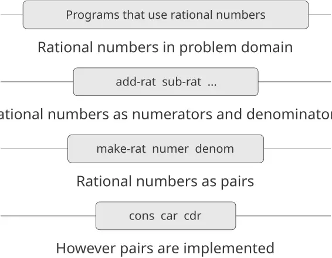

> نأتي الآن إلى الخطوة الحاسمة في التجريد الرياضيّ: ننسى ما ترمز إليه الرموز. … [الرياضيّ] لا يلزم أن يبقى عاطلًا؛ فهناك عمليّاتٌ كثيرةٌ قد يجريها على هذه الرموز، دون أن ينظر قطّ إلى الأشياء التي ترمز إليها. —هرمان فايل، طريقة التفكير الرياضيّة

تركّزنا في [الفصل 1](https://sarabander.github.io/sicp/html/Chapter-1.xhtml#Chapter-1) على العمليّات الحسابيّة وعلى دور الإجراءات في تصميم البرامج. فرأينا كيف نستخدم البيانات الأوّليّة (الأعداد) والعمليّات الأوّليّة (العمليّات الحسابيّة)، وكيف نُركّب الإجراءات لتكوين إجراءاتٍ مركّبةٍ عبر التركيب والتعبيرات الشرطيّة واستخدام الوسائط، وكيف نُجرّد الإجراءات باستخدام `define`. ورأينا أنّ الإجراء يمكن اعتباره نمطًا للتطوّر المحليّ لعمليّة، وصنّفنا بعض الأنماط الشائعة للعمليّات كما تتجسّد في الإجراءات، وتفكّرنا فيها، وأجرينا تحليلاتٍ خوارزميّةً بسيطةً لها. ورأينا أيضًا أنّ الإجراءات من الرتبة العليا تعزّز قوّة لغتنا بتمكيننا من التلاعب بالطرق العامّة للاحتساب، ومن التفكير من خلالها. وهذا كثيرٌ من جوهر البرمجة.

سوف ننظر في هذا الفصل إلى بياناتٍ أكثر تعقيدًا. فجميع الإجراءات في الفصل 1 تعمل على بياناتٍ عدديّةٍ بسيطة، والبيانات البسيطة غير كافيّة للعديد من المسائل التي نرغب في معالجتها بالاحتساب. والبرامج تُصمَّم عادةً لنمذجة ظواهر معقّدة، وأكثر ما يكون المرء مضطرًّا إلى بناء كائناتٍ حسابيّةٍ لها عدّة أجزاء، وذلك لنمذجة ظواهر العالم الواقعيّ التي لها عدّة جوانب. وبذلك، فإنّا حيث كان تركيزنا في الفصل 1 على بناء التجريدات بتركيب الإجراءات لتكوين إجراءاتٍ مركّبة، فإنّنا نتوجّه في هذا الفصل إلى جانبٍ رئيسيّ آخر لأيّ لغة برمجة: الوسيلة التي توفّرها لبناء التجريدات بتركيب كائنات البيانات لتكوين *بياناتٍ مركّبة (compound data)*.

لماذا نريد البيانات المركّبة في لغة برمجةٍ؟ لنحو السبب ذاتها التي تجعلنا نريد الإجراءات المركّبة: لنرفع المستوى المفاهيميّ الذي نُصمّم عنده برامجنا، ولنزيد وحدانيّة تصميماتنا، ولنعزّز القوّة التعبيريّة للغتنا. فكما أنّ القدرة على تعريف الإجراءات تُمكّننا من التعامل مع العمليّات على مستوى مفاهيميّ أعلى من مستوى العمليّات الأوّليّة للغة، فإنّ القدرة على بناء كائنات البيانات المركّبة تُمكّننا من التعامل مع البيانات على مستوى مفاهيميّ أعلى من مستوى كائنات البيانات الأوّليّة للغة.

تأمّل مهمّة تصميم نظامٍ لأداء العمليّات الحسابيّة على الأعداد الكسريّة. يمكننا أن نتخيّل عمليّةً `add-rat` تأخذ عددين كسريّين وتُنتج مجموعهما. ومن منظور البيانات البسيطة، يمكن النظر إلى العدد الكسريّ كعددين صحيحين: بسطٌ ومقام. وبذلك، يمكننا تصميم برنامجٍ يُعبَّر فيه عن كلّ عددٍ كسريّ بعددين صحيحين (بسطٌ ومقام)، وحيث يُنفَّذ `add-rat` بإجراءين (أحدهما يُنتج بسط المجموع والآخر يُنتج مقامه). لكنّ ذلك سيكون أمرًا عسيرًا، لأنّنا سنحتاج إذن إلى تتبّع أيّ بسطٍ يقابل أيّ مقامٍ صراحةً. ففي نظامٍ يُقصد به أداء عمليّاتٍ كثيرةٍ على أعدادٍ كسريّةٍ كثيرة، فإنّ تفاصيل مسك الدفاتر كهذه ستُشوّش البرامج تشويشًا كبيرًا، فضلًا عمّا ستفعله بعقولنا. لَكان أفضلَ كثيرًا لو استطعنا «لصق» بسطٍ ومقامٍ معًا لتكوين زوجٍ - وهو *كائن بيانات مركّب* - تستطيع برامجنا التلاعب به بطريقةٍ متّسقةٍ مع اعتبار العدد الكسريّ وحدةً مفاهيميّةً واحدة.

واستخدام البيانات المركّبة يُمكّننا أيضًا من زيادة وحدانيّة برامجنا. فإذا استطعنا التلاعب بالأعداد الكسريّة مباشرةً بوصفها كائناتٍ بحقّة ذاتها، فسنقدر على فصل الجزء من برنامجنا الذي يعنى بالأعداد الكسريّة في ذاتها عن تفاصيل كيفيّة تمثيل الأعداد الكسريّة بأزواجٍ من الأعداد الصحيحة. وأمّا التقنيّة العامّة في عزل أجزاء البرنامج التي تعنى بكيفيّة تمثيل كائنات البيانات عن أجزاء البرنامج التي تعنى بكيفيّة استخدام كائنات البيانات، فهي منهجيّة تصميمٍ قويّةٌ تُسمّى *تجريد البيانات (data abstraction)*. وسنرى كيف يجعل تجريد البيانات تصميم البرامج وصيانتها وتعديلها أسهلَ بكثيرٍ.

ويؤدّي استخدام البيانات المركّبة إلى زيادةٍ حقيقيّةٍ في القوّة التعبيريّة للغة البرمجة لدينا. تأمّل فكرة تكوين «تركيب خطّيّ» $a x + b y$ . فقد نرغب في كتابة إجراءٍ يقبل $a$ و$b$ و$x$ و$y$ كمعطياتٍ ويعيد قيمة $a x + b y$ . ولا يطرح هذا أيّ صعوبةٍ إذا كان على المعطيات أن تكون أعدادًا، لأنّنا نستطيع بسهولةٍ تعريف الإجراء

```scheme
(define (linear-combination a b x y)
  (+ (* a x) (* b y)))
```

لكن افترض أنّنا لا نعني بالأعداد فقط. افترض أنّنا نرغب في التعبير، من حيث الإجراءات، عن الفكرة القائلة إنّه يمكن تكوين تركيباتٍ خطّيّةٍ كلّما عُرِّف الجمع والضرب - للأعداد الكسريّة، أو الأعداد المركّبة، أو كثيرات الحدود، أو أيّ شيءٍ آخر. ويمكننا التعبير عن هذا كإجراءٍ على الصيغة

```scheme
(define (linear-combination a b x y)
  (add (mul a x) (mul b y)))
```

حيث `add` و`mul` ليسا الإجراءين الأوّليّين `+` و`*`، بل شيئان أكثر تعقيدًا سيؤدّيان العمليّات المناسبة لأيّ أنواع بياناتٍ نمرّرها كمعطيات `a` و`b` و`x` و`y`. والنقطة الجوهريّة هي أنّ الشيء الوحيد الذي ينبغي أن يعرفه `linear-combination` عن `a` و`b` و`x` و`y` هو أنّ الإجراءين `add` و`mul` سيؤدّيان التلاعبات المناسبة. فمن منظور الإجراء `linear-combination`، لا صلة لما هي `a` و`b` و`x` و`y`، وأقلّ صلةً بعدُ بكيفيّة تمثيلها من حيث بياناتٍ أكثر أوّليّة. ويُظهر هذا المثال ذاته أهمّيّة أن توفّر لغة البرمجة لدينا القدرة على التلاعب بالكائنات المركّبة مباشرةً: فدون ذلك، لا سبيل لإجراءٍ كـ`linear-combination` لتمرير معطياته إلى `add` و`mul` دون أن يضطرّ إلى معرفة بنيتها المفصّلة.[^1]

نبدأ هذا الفصل بتنفيذ نظام العمليّات الحسابيّة للأعداد الكسريّة المذكور أعلاه. وسيشكّل هذا الخلفيّة لمناقشتنا للبيانات المركّبة وتجريد البيانات. وكما هو الحال مع الإجراءات المركّبة، فإنّ المسألة الرئيسيّة الواجب معالجتها هي التجريد كتقنيّةٍ لمواجهة التعقيد، وسنرى كيف يمكّننا تجريد البيانات من إقامة *حواجز تجريد (abstraction barriers)* مناسبةٍ بين أجزاء البرنامج المختلفة.

وسنرى أنّ مفتاح تكوين البيانات المركّبة هو أنّ لغة البرمجة ينبغي أن توفّر نوعًا من «اللصق» بحيث يمكن جمع كائنات البيانات معًا لتكوين كائنات بياناتٍ أكثر تعقيدًا. وهناك أنواعٌ كثيرةٌ ممكنةٌ من اللصق. فإنّا سنكتشف كيف نُكوّن بياناتٍ مركّبةً دون أيّ عمليّاتٍ خاصّةٍ «للبيانات» على الإطلاق، بل باستخدام الإجراءات فقط. وسيطمس هذا التمييز بين «الإجراء» و«البيانات» تطميسًا أكبر، وهو الذي كان قد بدأ يتضعضع نحو نهاية الفصل 1. وسنستكشف أيضًا بعض التقنيّات المتعارف عليها لتمثيل التسلسلات والأشجار. وإحدى الأفكار الرئيسيّة في التعامل مع البيانات المركّبة هي مفهوم *الإغلاق (closure)* - وهو أنّ اللصق الذي نستخدمه لجمع كائنات البيانات ينبغي أن يسمح لنا بجمع كائنات البيانات الأوّليّة لا فحسب، بل كائنات البيانات المركّبة كذلك. وفكرة رئيسيّة أخرى أنّ كائنات البيانات المركّبة يمكن أن تخدم بوصفها *واجهاتٍ متعارف عليها (conventional interfaces)* لجمع وحدات البرنامج بطرائق التجميع والتبادل. ونوضّح بعض هذه الأفكار بتقديم لغة رسوميّات بسيطةٍ تستثمر الإغلاق.

ثم سنزيد القوّة التمثيليّة للغتنا بإدخال *تعبيراتٍ رمزيّة (symbolic expressions)* - أي بياناتٍ يمكن أن تكون أجزاؤها الأوّليّة رموزًا اعتراضيّةً بدلًا من الأعداد فقط. ونحن نستكشف بدائل مختلفة لتمثيل مجموعات الكائنات. وسنجد أنّّه، كما أنّ دالّةً عدديّةً معيّنةً يمكن احتسابها بعديدٍ من العمليّات الحسابيّة المختلفة، فهناك طرائق كثيرة يمكن أن تُعبَّر بها بنية بياناتٍ معيّنةً من حيث كائناتٍ أبسط منها، وأنّ اختيار التمثيل يمكن أن يكون له أثرٌ مهمٌّ على المتطلّبات الزمنيّة والمكانيّة للعمليّات التي تتلاعب بالبيانات. وسنبحث هذه الأفكار في سياق التفاضل الرمزيّ، وتمثيل المجموعات، وترميز المعلومات.

وسنتناول تاليًا مسألة العمل مع بياناتٍ قد تُمثَّل بطرائق مختلفة في أجزاء مختلفة من البرنامج. وهذا يستدعي الحاجة إلى تنفيذ *عمليّاتٍ عامّة (generic operations)*، وهي التي ينبغي لها أن تتعامل مع أنواعٍ كثيرةٍ مختلفةٍ من البيانات. والحفاظ على الوحدانيّة بحضور العمليّات العامّة يتطلّب حواجز تجريدٍ أقوى ممّا يمكن إقامته بتجريد البيانات البسيط وحده. وعلى وجه الخصوص، فإنّا نُقدّم *البرمجة الموجَّهة بالبيانات (data-directed programming)* كتقنيّةٍ تسمح بأن يُصمَّم التمثيل الفرديّ للبيانات على انفراد، ثم تُجمع التمثيلات *جمعًا إضافيًّا (additively)* (أي دون تعديل). ولتوضيح قوّة هذا المنهج في تصميم النظم، نُغلق الفصل بتطبيق ما تعلّمناه على تنفيذ حزمةٍ لأداء العمليّات الحسابيّة الرمزيّة على كثيرات الحدود، والتي يمكن أن تكون معاملاتها أعدادًا صحيحة، أو أعدادًا كسريّة، أو أعدادًا مركّبة، أو حتّى كثيرات حدودٍ أخرى.


### 2.1 مقدّمة في تجريد البيانات

لقد لاحظنا في [1.1.8](https://sarabander.github.io/sicp/html/1_002e1.xhtml#g_t1_002e1_002e8) أنّ الإجراء المستخدم كعنصرٍ في إنشاء إجراءٍ أكثر تعقيدًا يمكن اعتباره لا مجرّد مجموعةٍ من العمليّات الخاصّة فحسب، بل تجريدًا إجرائيًّا أيضًا. أي أنّ تفاصيل كيفيّة تنفيذ الإجراء يمكن إخفاؤها، ويمكن استبدال الإجراء نفسه بأيّ إجراءٍ آخر ذي سلوكٍ كلّيٍّ مماثل. وبعبارة أخرى، فبوسعنا أن نُجرّد بحيث نفصل الطريقة التي سيُستخدم فيها الإجراء عن تفاصيل كيفيّة تنفيذه من حيث إجراءاتٍ أكثر أوّليّة. والمفهوم الموازي للبيانات المركّبة يُسمّى *تجريد البيانات (data abstraction)*. وتجريد البيانات منهجيّةٌ تُمكّننا من عزل كيفيّة استخدام كائن بيانات مركّب عن تفاصيل كيفيّة بنائه من كائنات بياناتٍ أكثر أوّليّة.

والفكرة الأساسيّة في تجريد البيانات هي بناءة البرامج التي ستستخدم كائنات البيانات المركّبة بحيث تعمل على «بياناتٍ مجرّدة». أي أنّ برامجنا ينبغي أن تستخدم البيانات على نحوٍ لا يفترض عنها شيئًا ليس ضروريًّا على نحوٍ حتميّ لأداء المهمّة بين اليدين. وفي الوقت نفسه، يُعرَّف تمثيلٌ «ملموس» للبيانات مستقلًّا عن البرامج التي تستخدم البيانات. والواجهة بين هذين الجزأين من نظامنا ستكون مجموعةً من الإجراءات، تُسمّى *المحدِّدات (selectors)* و*البانيّات (constructors)*، والتي تنفّذ البيانات المجرّدة من حيث التمثيل الملموس. ولتوضيح هذه التقنيّة، سنُفكّر في كيفيّة تصميم مجموعةٍ من الإجراءات للتلاعب بالأعداد الكسريّة.

#### 2.1.1 مثال: العمليّات الحسابيّة للأعداد الكسريّة

لنفترض أنّنا نريد أداء العمليّات الحسابيّة على الأعداد الكسريّة. ونريد أن نكون قادرين على جمعها وطرحها وضربها وقسمتها، وعلى اختبار ما إذا كان عددان كسريّان متساويين.

لنبدأ بافتراض أنّ لدينا بالفعل طريقةً لبناء عددٍ كسريّ من بسطٍ ومقام. ونفترض أيضًا أنّّه، إذا أُعطي عددٌ كسريّ، فلدينا طريقةٌ لاستخراج (أو تحديد) بسطه ومقامه. ولنفترض أيضًا أنّ البانيّ والمحدِّدات متاحةٌ بوصفها إجراءات:

- يُعيد `(make-rat ⟨n⟩ ⟨d⟩)` العددَ الكسريّ الذي بسطه هو العدد الصحيح `⟨n⟩` ومقامه هو العدد الصحيح `⟨d⟩`.
- يُعيد `(numer ⟨x⟩)` بسط العدد الكسريّ `⟨x⟩`.
- يُعيد `(denom ⟨x⟩)` مقام العدد الكسريّ `⟨x⟩`.

نحن نستخدم هنا استراتيجيّة قويّة في التركيب: *التفكير الأمنيويّ (wishful thinking)*. فنحن لم نقل بعد كيف يُعبَّر عن العدد الكسريّ، أو كيف ينبغي تنفيذ الإجراءين `numer` و`denom` والبانيّ `make-rat`. ومع ذلك، فلو كان لدينا هذه الإجراءات الثلاثة، لاستطعنا آنذاك أن نجمع ونطرح ونضرب ونقسم ونختبر التساوي باستخدام العلاقات التالية: $\frac{n_{1}}{d_{1}} + \frac{n_{2}}{d_{2}} = \frac{n_{1} d_{2} + n_{2} d_{1}}{d_{1} d_{2}} , \frac{n_{1}}{d_{1}} − \frac{n_{2}}{d_{2}} = \frac{n_{1} d_{2} − n_{2} d_{1}}{d_{1} d_{2}} , \frac{n_{1}}{d_{1}} × \frac{n_{2}}{d_{2}} = \frac{n_{1} n_{2}}{d_{1} d_{2}} , \frac{n_{1} / d_{1}}{n_{2} / d_{2}} = \frac{n_{1} d_{2}}{d_{1} n_{2}} , \frac{n_{1}}{d_{1}} = \frac{n_{2}}{d_{2}} i f a n d o n l y i f n_{1} d_{2} = n_{2} d_{1} .$ ونستطيع التعبير عن هذه القواعد كإجراءات:

```scheme
(define (add-rat x y)
  (make-rat (+ (* (numer x) (denom y))
               (* (numer y) (denom x)))
            (* (denom x) (denom y))))

(define (sub-rat x y)
  (make-rat (- (* (numer x) (denom y))
               (* (numer y) (denom x)))
            (* (denom x) (denom y))))

(define (mul-rat x y)
  (make-rat (* (numer x) (numer y))
            (* (denom x) (denom y))))

(define (div-rat x y)
  (make-rat (* (numer x) (denom y))
            (* (denom x) (numer y))))

(define (equal-rat? x y)
  (= (* (numer x) (denom y))
     (* (numer y) (denom x))))
```

صار لدينا الآن العمليّات على الأعداد الكسريّة معرَّفةً من حيث إجراءات التحديد والبناء `numer` و`denom` و`make-rat`. لكننا لم نُعرّفها بعد. وما نحتاجه هو طريقةٌ ما للصق بسطٍ ومقامٍ معًا لتكوين عددٍ كسريّ.

#### الأزواج

وليتيح لنا تنفيذ المستوى الملموس من تجريد البيانات، توفّر لغتنا بنيةً مركّبةً تُسمّى *زوجًا (pair)*، والتي يمكن بناؤها بالإجراء الأوّليّ `cons`. وهذا الإجراء يأخذ معطيين ويعيد كائن بياناتٍ مركّبًا يحتوي المعطيين كجزأين. وبإعطائنا زوجًا، نستطيع استخراج جزأيه باستخدام الإجراءين الأوّليّين `car` و`cdr`.[^2] وهكذا، فيمكننا استخدام `cons` و`car` و`cdr` كما يلي:

```scheme
(define x (cons 1 2))

(car x)
1

(cdr x)
2
```

لاحِظ أنّ الزوج كائن بياناتٍ يمكن إعطاؤه اسمٌ ثم التلاعب به، تمامًا مثل كائن البيانات الأوّليّ. فضلًا عن ذلك، فيمكن استخدام `cons` لتكوين أزواجٍ عناصرها أزواج، وهكذا:

```scheme
(define x (cons 1 2))
(define y (cons 3 4))
(define z (cons x y))

(car (car z))
1

(car (cdr z))
3
```

سنرى في [2.2](https://sarabander.github.io/sicp/html/2_002e2.xhtml#g_t2_002e2) كيف تعني هذه القدرة على جمع الأزواج أنّ الأزواج يمكن استخدامها وحداتِ بناءٍ عامّة الغرض لإنشاء جميع أنواع بنيات البيانات المعقّدة. فالأوّليّة الوحيدة للبيانات المركّبة، وهي *الزوج*، المنفّذة بالإجراءات `cons` و`car` و`cdr`، هي اللصق الوحيد الذي نحتاجه. وتُسمّى كائنات البيانات المبنية من الأزواج بياناتٍ *مبنيّة على القوائم (list-structured)*.

#### تمثيل الأعداد الكسريّة

تُتيح الأزواج طريقةً طبيعيّةً لإتمام نظام الأعداد الكسريّة. فما عليك إلّا أن تمثّل العدد الكسريّ بزوجٍ من عددين صحيحين: بسطٌ ومقام. وحينئذٍ يُنفَّذ `make-rat` و`numer` و`denom` بسهولةٍ كما يلي:[^3]

```scheme
(define (make-rat n d) (cons n d))
(define (numer x) (car x))
(define (denom x) (cdr x))
```

وكذلك، فإنّه لعرض نتائج احتساباتنا، يمكننا طباعة الأعداد الكسريّة بطباعة البسط، ثم شرطة مائلة، ثم المقام:[^4]

```scheme
(define (print-rat x)
  (newline)
  (display (numer x))
  (display "/")
  (display (denom x)))
```

يمكننا الآن تجربة إجراءاتنا للأعداد الكسريّة:

```scheme
(define one-half (make-rat 1 2))
(print-rat one-half)
1/2

(define one-third (make-rat 1 3))
(print-rat
 (add-rat one-half one-third))
5/6

(print-rat
 (mul-rat one-half one-third))
1/6

(print-rat
 (add-rat one-third one-third))
6/9
```

كما يُظهر المثال الأخير، فإنّ تنفيذنا لا يُختزل الأعداد الكسريّة إلى أبسط صورة. ونستطيع معالجة هذا بتغيير `make-rat`. فإذا كان لدينا إجراءٌ `gcd` مثل الإجراء الوارد في [1.2.5](https://sarabander.github.io/sicp/html/1_002e2.xhtml#g_t1_002e2_002e5) والذي يُنتج القاسم المشترك الأكبر لعددين صحيحين، فنستطيع استخدام `gcd` لاختزال البسط والمقام إلى أبسط صورهما قبل بناء الزوج:

```scheme
(define (make-rat n d)
  (let ((g (gcd n d)))
    (cons (/ n g) 
          (/ d g))))
```

فإنّا نحصل الآن على

```scheme
(print-rat 
 (add-rat one-third one-third))
2/3
```

كما هو مطلوب. وقد أُنجز هذا التعديل بتغيير البانيّ `make-rat` دون تغيير أيّ من الإجراءات (مثل `add-rat` و`mul-rat`) التي تنفّذ العمليّات الفعليّة.

> **التمرين 2.1:** عرّف نسخةً أفضل من `make-rat` تتعامل مع المعطيات الموجبة والسالبة جميعًا. وينبغي لـ`Make-rat` أن يُوحّد الإشارة بحيث إن كان العدد الكسريّ موجبًا، فالبسط والمقام كلاهما موجب، وإن كان العدد الكسريّ سالبًا، فالبسط وحده هو السالب.

#### 2.1.2 حواجز التجريد

وقبل المواصلة بمزيدٍ من الأمثلة على البيانات المركّبة وتجريد البيانات، دعنا ننظر في بعض القضايا التي أثارها مثال العدد الكسريّ. فقد عرّفنا العمليّات على الأعداد الكسريّة من حيث بانيّ `make-rat` ومحدِّدين `numer` و`denom`. وبصورةٍ عامّة، فإنّ الفكرة الكامنة في تجريد البيانات هي تحديد مجموعةٍ أساسيّةٍ من العمليّات لكلّ نوعٍ من كائنات البيانات، والتي ستُعبَّر بها جميع التلاعبات بكائنات البيانات من ذلك النوع، ثم استخدام تلك العمليّات وحدها في التلاعب بالبيانات.

يمكننا تصوّر بنية نظام الأعداد الكسريّة كما هو موضّح في [الشكل 2.1](/book/sicp/c2-building-abstractions-with-data/index/). فالخطوط الأفقيّة تمثّل *حواجز تجريد* تعزل «مستويات» مختلفة للنظام. فعند كلّ مستوىٍ، يفصل الحاجز البرامج (أعلاه) التي تستخدم تجريد البيانات عن البرامج (أسفله) التي تنفّذ تجريد البيانات. والبرامج التي تستخدم الأعداد الكسريّة تتلاعب بها حصريًّا من حيث الإجراءات التي تُوفّرها حزمة العدد الكسريّ «للاستخدام العامّ»: `add-rat` و`sub-rat` و`mul-rat` و`div-rat` و`equal-rat?`. وهذه، بدورها، تُنفَّذ حصريًّا من حيث البانيّ والمحدِّدين `make-rat` و`numer` و`denom`، والذين يُنفَّذون بدورهم من حيث الأزواج. وتفاصيل كيفيّة تنفيذ الأزواج لا صلة لها ببقيّة حزمة العدد الكسريّ ما دام يمكن التلاعب بالأزواج باستخدام `cons` و`car` و`cdr`. وفي الواقع، فإنّ الإجراءات عند كلّ مستوىٍ هي الواجهات التي تُعرِّف حواجز التجريد وتصل المستويات المختلفة.



**الشكل 2.1:** حواجز تجريد البيانات في حزمة العدد الكسريّ.

ولهذه الفكرة البسيطة مزايا كثيرة. ومن مزاياها أنّها تجعل البرامج أسهلَ بكثيرٍ في الصيانة والتعديل. فأيّ بنية بياناتٍ معقّدةٍ يمكن تمثيلها بطرائق متنوّعة باستخدام بنيات البيانات الأوّليّة التي توفّرها لغة البرمجة. وبالطبع، فإنّ اختيار التمثيل يؤثّر في البرامج التي تعمل عليه؛ وبذلك، فلو كان التمثيل سيُغيَّر في وقتٍ لاحقٍ، فقد تضطرّ جميع تلك البرامج إلى التعديل وفقًا لذلك. وقد تكون هذه المهمّة مستهلكةً للوقت ومكلفةً في البرامج الكبيرة، ما لم يُحْبَس الاعتماد على التمثيل بحكم التصميم في وحداتِ برنامجٍ قليلةٍ جدًّا.

فمثلًا، فإنّ طريقةً بديلةً لمعالجة مسألة اختزال الأعداد الكسريّة إلى أبسط صورة هي أداء الاختزال كلّما نصل إلى أجزاء عددٍ كسريّ، بدلًا من حين نبنيه. وهذا يؤدّي إلى إجراءات بناءٍ وتحديدٍ مختلفة:

```scheme
(define (make-rat n d)
  (cons n d))

(define (numer x)
  (let ((g (gcd (car x) (cdr x))))
    (/ (car x) g)))

(define (denom x)
  (let ((g (gcd (car x) (cdr x))))
    (/ (cdr x) g)))
```

يكمن الفرق بين هذا التنفيذ والتنفيذ السابق في وقت احتسابنا لـ`gcd`. فإذا كنّا في استخدامنا المعتاد للأعداد الكسريّة نصل إلى بسط الأعداد الكسريّة ذاتها ومقاماتها مرّاتٍ كثيرة، فسيكون الأفضل احتساب `gcd` حين تُبنى الأعداد الكسريّة. وإلّا، فقد نكون أحسنَ حالًا بأن ننتظر حتّى وقت الوصول لاحتساب `gcd`. وعلى أيّ حال، فإنّا حين ننتقل من تمثيلٍ إلى آخر، لا يتحتّم تعديل الإجراءات `add-rat` و`sub-rat` وما شابهها إطلاقًا.

وقصر الاعتماد على التمثيل على بضعة إجراءاتِ واجهةٍ يساعدنا على تصميم البرامج كما يساعدنا على تعديلها، لأنّه يسمح لنا بالمحافظة على المرونة اللازمة للنظر في تنفيذاتٍ بديلة. ولمواصلة مثالنا البسيط، لنفترض أنّنا نُصمّم حزمة عددٍ كسريّ ولا نستطيع في البادئ حسم ما إذا كنّا سنؤدّي الـ`gcd` في وقت البناء أم في وقت التحديد. فإنّ منهجيّة تجريد البيانات تعطينا طريقةً لتأخير ذلك القرار دون فقدان القدرة على إحراز التقدّم في بقيّة النظام.

**التمرين 2.2:** فكّر في مسألة تمثيل قطع المستقيم في مستوًى. يُعبَّر عن كلّ قطعةٍ بزوجٍ من النقاط: نقطة بدايةٍ ونقطة نهاية. عرّف بانيًّا `make-segment` ومحدِّدين `start-segment` و`end-segment` يُعرِّفان تمثيل القطع من حيث النقاط. فضلًا عن ذلك، يمكن تمثيل النقطة بزوجٍ من الأعداد: الإحداثيّ $x$ والإحداثيّ $y$. ووفقًا لذلك، حدّد بانيًّا `make-point` ومحدِّدين `x-point` و`y-point` يُعرِّفان هذا التمثيل. وأخيرًا، باستخدام محدِّديك وبانيّيك، عرّف إجراءً `midpoint-segment` يأخذ قطعةَ مستقيمٍ كمعطىً ويعيد نقطة منتصفها (أي النقطة التي إحداثيّاها متوسّط إحداثيّي طرفيها). ولتجربة إجراءاتك، ستحتاج إلى طريقةٍ لطباعة النقاط:

```scheme
(define (print-point p)
  (newline)
  (display "(")
  (display (x-point p))
  (display ",")
  (display (y-point p))
  (display ")"))
```

> **التمرين 2.3:** نفّذ تمثيلًا للمستطيلات في مستوًى. (تلميح: قد ترغب في الاستعانة بـ[التمرين 2.2](/book/sicp/c2-building-abstractions-with-data/index/).) وبناءً على بانيّيك ومحدِّديك، أنشئ إجراءاتٍ تحسب محيط مستطيلٍ معطىً ومساحته. ثم نفّذ تمثيلًا مختلفًا للمستطيلات. فهل تستطيع تصميم نظامك بحواجز تجريدٍ مناسبة، بحيث تعمل الإجراءات ذاتها للمحيط والمساحة باستخدام أيّ التمثيلين؟

#### 2.1.3 ما المقصود بالبيانات؟

بدأنا تنفيذ العدد الكسريّ في [2.1.1](/book/sicp/c2-building-abstractions-with-data/index/) بتنفيذ العمليّات على الأعداد الكسريّة `add-rat` و`sub-rat` وما شابهها من حيث ثلاثة إجراءاتٍ غير محدّدةٍ: `make-rat` و`numer` و`denom`. وعند تلك النقطة، كان بإمكاننا أن نفكّر في العمليّات بوصفها معرَّفةً من حيث كائنات بيانات - أعداد كسريّة وبسط ومقام - كان سلوكها محدَّدًا بالإجراءات الثلاثة الأخيرة.

لكن ما المقصود بالبيانات (*data*) بالضبط؟ ولا يكفي القول إنّها «كلّ ما يُنفَّذ بالمحدِّدات والبانيّات المعطاة». فمن الواضح أنّ ليس كلّ مجموعة اعتراضيّة من ثلاثة إجراءاتٍ يمكن أن تخدم أساسًا مناسبًا لتنفيذ العدد الكسريّ. فنحن نحتاج إلى ضمان أنّّه، إذا بنينا عددًا كسريًّا `x` من زوجٍ من الأعداد الصحيحة `n` و`d`، فإنّ استخراج `numer` و`denom` من `x` وقسمتهما ينبغي أن يُنتج النتيجة ذاتها التي تُنتجها قسمة `n` على `d`. وبعبارة أخرى، ينبغي لـ`make-rat` و`numer` و`denom` أن تُحقّق الشرط القائم بأنّه، لأيّ عددٍ صحيح `n` وأيّ عددٍ صحيح غير صفريّ `d`، إذا كان `x` هو `(make-rat n d)`، فإنّ $\frac{(numer x)}{(denom x)} = \frac{n}{d} .$ وفي الحقيقة، فإنّ هذا هو الشرط الوحيد الذي ينبغي لـ`make-rat` و`numer` و`denom` أن تفي به لتشكيل أساسٍ مناسبٍ لتمثيل العدد الكسريّ. وبصورةٍ عامّة، فيمكننا أن نفكّر في البيانات بوصفها معرَّفةً بمجموعةٍ ما من محدِّداتٍ وبانيّات، جنبًا إلى جنبٍ مع شروطٍ محدَّدةٍ ينبغي لهذه الإجراءات أن تفي بها لتكون تمثيلًا صالحًا.[^5]

وهذا المنظور يمكن أن يخدم لا لتعريف كائنات بياناتٍ «عالية المستوى» فقط، كالأعداد الكسريّة، بل أيضًا كائناتٍ أدنى مستوىً. فتأمّل مفهوم الزوج، الذي استخدمناه لتعريف أعدادنا الكسريّة. فنحن لم نقل قطّ ما الزوج فعلًا، بل قلنا فقط إنّ اللغة توفّر الإجراءات `cons` و`car` و`cdr` للتلاعب بالأزواج. لكن الشيء الوحيد الذي نحتاج إلى معرفته عن هذه العمليّات الثلاث هو أنّنا إذا لصقنا كائنين معًا باستخدام `cons`، فسنستطيع استرجاع الكائنين باستخدام `car` و`cdr`. أي أنّ العمليّات تُحقّق الشرط القائم بأنّه، لأيّ كائنين `x` و`y`، إذا كان `z` هو `(cons x y)` فإنّ `(car z)` هو `x` و`(cdr z)` هو `y`. فإنّا ذكرنا أنّ هذه الإجراءات الثلاثة مُدرجةٌ كأوّليّاتٍ في لغتنا. ومع ذلك، فإنّ أيّ ثلاثيّةٍ من الإجراءات تُحقّق الشرط الوارد أعلاه يمكن استخدامها أساسًا لتنفيذ الأزواج. ويوضّح هذا بشكلٍ لافتٍ أنّنا نستطيع تنفيذ `cons` و`car` و`cdr` دون استخدام أيّ بنيات بياناتٍ إطلاقًا، بل باستخدام الإجراءات فقط. وها هي التعريفات:

```scheme
(define (cons x y)
  (define (dispatch m)
    (cond ((= m 0) x)
          ((= m 1) y)
          (else 
           (error "Argument not 0 or 1:
                   CONS" m))))
  dispatch)

(define (car z) (z 0))
(define (cdr z) (z 1))
```

وهذا الاستخدام للإجراءات لا يقابل شيئًا يشبه مفهومنا البديهيّ عمّا ينبغي أن تكون عليه البيانات. ومع ذلك، فكلّ ما يلزمنا لإظهار أنّ هذه طريقةٌ صالحةٌ لتمثيل الأزواج هو أن نتحقّق من أنّ هذه الإجراءات تُحقّق الشرط المعطى أعلاه.

والنقطة الدقيقة التي يلزم ملاحظتها هي أنّ القيمة التي يُعيدها `(cons x y)` هي إجراء - أي الإجراء المعرَّف داخليًّا `dispatch`، الذي يأخذ معطىً واحدًا ويُعيد إمّا `x` وإمّا `y` بحسب ما إذا كان المعطى 0 أو 1. وعلى النحو المقابل، فإنّ `(car z)` مُعرَّفٌ بأنّه يُطبّق `z` على 0. ومن ثمّ، فإن كان `z` هو الإجراء المُكّون بـ`(cons x y)`، فإنّ تطبيق `z` على 0 سيُعطي `x`. وهكذا، فقد أظهرنا أنّ `(car (cons x y))` يُعطي `x` كما هو مطلوب. وبالطريقة ذاتها، فإنّ `(cdr (cons x y))` يُطبّق الإجراء الذي يُعيده `(cons x y)` على 1، وهو ما يُعيد `y`. وبالتالي، فإنّ هذا التنفيذ الإجرائيّ للأزواج تنفيذٌ صالح، وإذا كنّا نصل إلى الأزواج باستخدام `cons` و`car` و`cdr` وحدها، فلن نستطيع التمييز بين هذا التنفيذ وتنفيذٍ يستخدم بنيات بياناتٍ «حقيقيّة».

وقصدي من عرض التمثيل الإجرائيّ للأزواج ليس أنّ لغتنا تعمل على هذا النحو (فإنّ Scheme، ونظم Lisp بصفةٍ عامّة، تُنفّذ الأزواج مباشرةً، لأسباب تعلّق بالكفاءة)، بل إنّها *تستطيع* أن تعمل على هذا النحو. فالتمثيل الإجرائيّ، على الرغم من غموضه، طريقةٌ ملائمةٌ تمامًا لتمثيل الأزواج، بما أنّه يفي بالشروط الوحيدة التي يلزم للأزواج أن تفي بها. ويُظهر هذا المثال أيضًا أنّ القدرة على التلاعب بالإجراءات بوصفها كائناتٍ تُوفّر تلقائيًّا القدرة على تمثيل البيانات المركّبة. وقد يبدو هذا غرابةً الآن، لكن تمثيلات البيانات الإجرائيّة ستلعب دورًا مركزيًّا في ذخيرتنا البرمجيّة. ويُسمّى هذا الأسلوب من البرمجة *تمرير الرسائل (message passing)*، وسنستخدمه أداةً أساسيّةً في [الفصل 3](https://sarabander.github.io/sicp/html/Chapter-3.xhtml#Chapter-3) حين نعالج قضايا النمذجة والمحاكاة.

**التمرين 2.4:** ها هو تمثيلٌ إجرائيٌّ بديلٌ للأزواج. وبالنسبة لهذا التمثيل، تحقّق من أنّ `(car (cons x y))` يُعطي `x` لأيّ كائنين `x` و`y`.

```scheme
(define (cons x y) 
  (lambda (m) (m x y)))

(define (car z) 
  (z (lambda (p q) p)))
```

وما التعريف المقابل لـ`cdr`؟ (تلميح: للتحقّق من أنّ هذا يعمل، استعن بنموذج الاستبدال الوارد في [1.1.5](https://sarabander.github.io/sicp/html/1_002e1.xhtml#g_t1_002e1_002e5).)

> **التمرين 2.5:** أظهر أنّنا نستطيع تمثيل أزواج الأعداد الصحيحة غير السالبة باستخدام الأعداد والعمليّات الحسابيّة فقط، إذا مثّلنا الزوج $a$ و$b$ بالعدد الصحيح الذي هو الجداء $2^{a} 3^{b}$ . وأعطِ التعريفات المقابلة للإجراءات `cons` و`car` و`cdr`.

**التمرين 2.6:** وفي حالة أنّ تمثيل الأزواج كإجراءاتٍ لم يكن مُحيِّرًا بما يكفي، فكّر في أنّنا، في لغةٍ قادرةٍ على التلاعب بالإجراءات، نستطيع أن نتدبّر أمرنا دون أعدادٍ (على الأقلّ بقدر ما يتعلّق بالأعداد الصحيحة غير السالبة) بتنفيذ 0 وعمليّة إضافة 1 كما يلي

```scheme
(define zero (lambda (f) (lambda (x) x)))

(define (add-1 n)
  (lambda (f) (lambda (x) (f ((n f) x)))))
```

ويُعرف هذا التمثيل بـ*أعداد تشرتش (Church numerals)*، نسبةً إلى مُخترعه، ألونزو تشرتش، المنطقيّ الذي اخترع حساب λ.

عرِّف `one` و`two` مباشرةً (لا من حيث `zero` و`add-1`). (تلميح: استخدم الاستبدال لتقييم `(add-1 zero)`.) وأعطِ تعريفًا مباشرًا لإجراء الجمع `+` (لا من حيث التطبيق المتكرّر لـ`add-1`).

#### 2.1.4 تمرين ممتدّ: حساب الفواصل

أليسا ب. هاكر تُصمّم نظامًا لمساعدة الناس على حلّ مسائل الهندسة. وإحدى الميزات التي تريد توفيرها في نظامها هي القدرة على التعامل مع الكمّيّات غير الدقيقة (كالمعطيات المقيسة للأجهزة الفيزيائيّة) بدقّةٍ معروفة، بحيث إنّه حين تُجرى الاحتسابات بكمّيّاتٍ تقريبيّةٍ كهذه، فإنّ النتائج ستكون أعدادًا ذات دقّةٍ معروفة.

سيستخدم مهندسو الكهرباء نظام أليسا لاحتساب الكمّيّات الكهربائيّة. وفبعض الأحيان يلزمهم أن يحسبوا قيمة مقاومة مكافئة توازيّة $R_{p}$ لمقاومتين $R_{1}$ و$R_{2}$ باستخدام الصيغة $R_{p} = \frac{1}{1 / R_{1} + 1 / R_{2}} .$ وقيم المقاومة تُعرف عادةً فقط حتّى قدرٍ من التفاوت يضمنه مُصنّع المقاومة. فمثلًا، إذا اشتريت مقاومةً موسومةً بـ«6.8 أوم بتفاوت 10%»، فلن تستطيع أن تكون واثقًا إلّا من أنّ المقاومة لها مقاومةٌ كهربائيّةٌ بين 6.8 $−$ 0.68 = 6.12 و6.8 + 0.68 = 7.48 أوم. وهكذا، فإذا كان لديك مقاومةٌ 6.8 أوم بتفاوت 10% على التوازي مع مقاومةٍ 4.7 أوم بتفاوت 5%، فإنّ مقاومة التوليفة يمكن أن تتراوح من نحو 2.58 أوم (إذا كانت المقاومتان عند الحدّين الأدنيين) إلى نحو 2.97 أوم (إذا كانت المقاومتان عند الحدّين العلويّين).

وفكرة أليسا هي تنفيذ «حساب الفواصل» كمجموعةٍ من العمليّات الحسابيّة لجمع «فواصل» (كائناتٌ تمثّل مدى القيم الممكنة لكمّيّةٍ غير دقيقة). ونتيجة جمع فاصلين أو طرحهما أو ضربهما أو قسمتهما هي فاصلٌ بدروها، يمثّل مدى النتيجة.

تفترض أليسا وجود كائنٍ مجرّدٍ يُسمّى «فاصلًا» له طرفان: حدٌّ أدنى وحدٌّ أعلى. وتفترض أيضًا أنّّه، بإعطائها طرفي فاصلٍ، فهي قادرةٌ على بناء الفاصل باستخدام بانيّ البيانات `make-interval`. وتكتب أليسا أوّلًا إجراءً لجمع فاصلين. فإنّها تستنبط أنّ القيمة الأدنى التي يمكن أن يكون عليها المجموع هي مجموع الحدّين الأدنيين، وأنّ القيمة العظمى التي يمكن أن يكون عليها هي مجموع الحدّين العلويّين:

```scheme
(define (add-interval x y)
  (make-interval (+ (lower-bound x) 
                    (lower-bound y))
                 (+ (upper-bound x) 
                    (upper-bound y))))
```

وتستنبط أليسا أيضًا جداء فاصلين بإيجاد الأدنى والأعلى من جداءات الحدود، وباستخدامهما كحدّي الفاصل الناتج. (و`min` و`max` أوّليّتان تجدان الأدنى أو الأعلى من أيّ عددٍ من المعطيات.)

```scheme
(define (mul-interval x y)
  (let ((p1 (* (lower-bound x) 
               (lower-bound y)))
        (p2 (* (lower-bound x) 
               (upper-bound y)))
        (p3 (* (upper-bound x) 
               (lower-bound y)))
        (p4 (* (upper-bound x) 
               (upper-bound y))))
    (make-interval (min p1 p2 p3 p4)
                   (max p1 p2 p3 p4))))
```

ولقسمة فاصلين، تضرب أليسا الأوّل في مقلوب الثاني. ولاحِظ أنّ حدّي الفاصل المقلوب هما مقلوب الحدّ الأعلى ومقلوب الحدّ الأدنى، بهذا الترتيب.

```scheme
(define (div-interval x y)
  (mul-interval x 
                (make-interval 
                 (/ 1.0 (upper-bound y)) 
                 (/ 1.0 (lower-bound y)))))
```

**التمرين 2.7:** برنامج أليسا غير مكتملٍ لأنّها لم تُحدّد تنفيذ تجريد الفاصل. وإليك تعريفُ بانيّ الفاصل:

```scheme
(define (make-interval a b) (cons a b))
```

عرِّف محدِّدي `upper-bound` و`lower-bound` لإتمام التنفيذ.

> **التمرين 2.8:** باستخدام استنباطٍ مماثلٍ لاستنباط أليسا، صِف كيف يمكن احتساب الفرق بين فاصلين. عرّف إجراءَ طرحٍ مقابلًا، يُسمّى `sub-interval`.

> **التمرين 2.9:** *عرض* الفاصل هو نصف الفرق بين حدّيه الأعلى والأدنى. والعرض مقياسٌ لعدم التيقّن من العدد الذي يُحدّده الفاصل. فبالنسبة لبعض العمليّات الحسابيّة، فإنّ عرض نتيجة دمج فاصلين هو دالّةٌ في عروضي الفاصلين المعطيين فقط، بينما بالنسبة لبعضها الآخر، فإنّ عرض التوليفة ليس دالّةً في عروضي الفاصلين المعطيين. أظهر أنّ عرض المجموع (أو الفرق) بين فاصلين هو دالّةٌ في عروضي الفاصلين المُجمعين (أو المطروحين) فقط. وأعطِ أمثلةً تُظهر أنّ هذا لا يصدق في الضرب أو القسمة.

> **التمرين 2.10:** ينظر بن بِتدل، مبرمج النُظم الخبيرة، من فوق كتف أليسا ويعلّق بأنّه ليس واضحًا ما معنى القسمة على فاصلٍ يمتدّ على الصفر. عدّل شيفرة أليسا لتفحص هذه الحالة ولتُشير إلى خطأٍ إذا وقعت.

**التمرين 2.11:** وعلى سبيل الاستطراد، يعلّق بن أيضًا بعبارةٍ غامضة: «بفحص إشارات طرفي الفواصل، فإنّ من الممكن تفكيك `mul-interval` إلى تسع حالات، حالةٌ واحدةٌ فقط منها تتطلّب أكثر من عمليّتي ضرب.» أعد كتابة هذا الإجراء باستخدام اقتراح بن.

وبعد تصحيح برنامجها، تعرضه أليسا على مستخدمٍ محتمل، فيشتكي أنّ برنامجها يحلّ المسألة الخطأ. وهو يريد برنامجًا قادرًا على التعامل مع أعدادٍ مُعبَّرًا عنها كقيمةٍ مركزيّةٍ وتفاوتٍ مضاف؛ فهو يريد، مثلًا، أن يعمل مع فواصلَ مثل 3.5 $±$ 0.15 بدلًا من [3.35, 3.65]. فتعود أليسا إلى مكتبها وتُصلح هذه المسألة بتوفير بانيّ بديلٍ ومحدِّدين بديلين:

```scheme
(define (make-center-width c w)
  (make-interval (- c w) (+ c w)))

(define (center i)
  (/ (+ (lower-bound i) 
        (upper-bound i)) 
     2))

(define (width i)
  (/ (- (upper-bound i) 
        (lower-bound i)) 
     2))
```

للأسف، معظم مستخدمي أليسا مهندسون. فإنّ مواقف الهندسة الحقيقيّة تتضمّن عادةً قياساتٍ عدمُ يقينها صغيرٌ فقط، ويُقاس ذلك بنسبة عرض الفترة إلى منتصف الفترة. وعادةً ما يحدّد المهندسون تفاوتاتٍ مئويّةً على مُعطيات الأجهزة، كما في مواصفات المقاومات الواردة أعلاه.

> **التمرين 2.12:** عرّف بانيًا (constructor) باسم `make-center-percent` يأخذ مركزًا ونسبة تفاوتٍ مئويّةً وينتج الفترة المطلوبة. ويجب أن تعرّف أيضًا منتقيًا (selector) باسم `percent` يُنتج نسبة التفاوت المئويّة لفترةٍ معطاة. أمّا المنتقي `center` فهو ذاته المبيَّن أعلاه.

**التمرين 2.13:** أظهر أنّه تحت افتراض تفاوتاتٍ مئويّةٍ صغيرة، ثمّة صيغةٌ بسيطةٌ لنسبة التفاوت المئويّة التقريبيّة لحاصل ضرب فترتين بدلالة تفاوتي العاملين. ويجوز لك تبسيط المسألة بافتراض أنّ جميع الأعداد موجبة.

بعد جهدٍ جهيد، تُسلّم أليسا بي. هاكر نظامها المنتهي. وبعد سنواتٍ عدّة، وبعد أن تكون قد نسيت الأمر كلَّه، تتلقّى اتصالًا هيجانًا من مستخدمٍ غاضبٍ يُدعى ليم إي. تويكيت. ويبدو أنّ ليم قد لاحظ أنّ صيغة المقاومات المتوازية يمكن كتابتها بطريقتين متكافئتين جبريًّا: $\frac{R_{1} R_{2}}{R_{1} + R_{2}}$ و$\frac{1}{1 / R_{1} + 1 / R_{2}} .$ وقد كتب البرنامجين الآتيين، كلٌّ منهما يحتسب صيغة المقاومات المتوازية بطريقةٍ مختلفة:

```scheme
(define (par1 r1 r2)
  (div-interval 
   (mul-interval r1 r2)
   (add-interval r1 r2)))

(define (par2 r1 r2)
  (let ((one (make-interval 1 1)))
    (div-interval 
     one
     (add-interval 
      (div-interval one r1) 
      (div-interval one r2)))))
```

يشتكي ليم من أنّ برنامج أليسا يُعطي جوابين مختلفين للطريقتين في الاحتساب. وهذه شكوى جديّة.

> **التمرين 2.14:** بيّن أنّ ليم على حقّ. افحص سلوك النظام على مجموعةٍ متنوّعةٍ من التعابير الحسابيّة. أنشئ بعض الفترات $A$ و$B$ ، واستخدمها في احتساب التعبيرين $A / A$ و$A / B$ . وستحصل على أعمق إدراكٍ باستخدام فتراتٍ عرضُها نسبةٌ صغيرةٌ من قيمة المركز. وافحص نتائج الاحتساب في صيغة المركز والنسبة (انظر [التمرين 2.12](/book/sicp/c2-building-abstractions-with-data/index/)).

> **التمرين 2.15:** لاحظت إيفا لو أتور، وهي مستخدمة أخرى، الفترات المختلفة التي تحتسبها تعابيرُ متكافئةٌ جبريًّا لكنّها مختلفة. وهي تقول إنّ صيغةً للاحتساب بالفترات باستخدام نظام أليسا ستُنتج حدودًا أضيقَ للخطأ إذا أمكن كتابتها بشكلٍ لا يتكرّر فيه أيّ متغيّرٍ يمثّل عددًا غير أكيد. وبالتالي - كما تقول - فإنّ `par2` برنامجٌ «أفضل» للمقاومات المتوازية من `par1`. فهل هي محقّة؟ ولماذا؟

> **التمرين 2.16:** اشرح، بصورةٍ عامّة، لماذا قد تؤدّي التعابير الجبريّة المتكافئة إلى أجوبةٍ مختلفة. فهل تستطيع ابتكار حزمةٍ للحساب بالفترات خاليةٍ من هذا القصور، أم أنّ هذه المهمّة مستحيلة؟ (تحذير: هذه المسألة في غاية الصعوبة.)


[^1]: هذا الافتراض يُخفي جانبًا كبيرًا من التعقيد. فعادةً ما يُخصَّص جزءٌ كبيرٌ من تنفيذ نظام Lisp لجعل عمليّتي القراءة والطباعة تعملان.

[^2]: قد يُقال إنّنا لسنا بحاجةٍ إلى حفظ `n` القديمة؛ إذ يمكننا، بعد إنقاصها وحلّ المسألة الفرعيّة، أن نزيدها ببساطةٍ فنستعيد القيمة القديمة. ومع أنّ هذه الاستراتيجيّة تنجح مع المضروب (factorial)، فإنّها لا تنجح عمومًا، لأنّ القيمة القديمة لمسجّلٍ لا يمكن دائمًا استخلاصها من القيمة الجديدة.

[^3]: سنرى في [5.3](https://sarabander.github.io/sicp/html/5_002e3.xhtml#g_t5_002e3) كيف نُنفّذ المكدس باستخدام عمليّاتٍ أوّليّةٍ أكثر.

[^4]: استخدام إجراء `receive` هنا طريقةٌ لجعل `extract-labels` يُعيد فعليًّا قيمتين—`labels` و`insts`—دون أن نُشكّل صراحةً بنية بيانات مركّبةٍ للاحتفاظ بهما. ثمّة تنفيذٌ بديل يُعيد زوجًا صريحًا من القيم، وهو ```scheme (define (extract-labels text) (if (null? text) (cons '() '()) (let ((result (extract-labels (cdr text)))) (let ((insts (car result)) (labels (cdr result))) (let ((next-inst (car text))) (if (symbol? next-inst) (cons insts (cons (make-label-entry next-inst insts) labels)) (cons (cons (make-instruction next-inst) insts) labels))))))) ```

[^5]: كان بوسعنا تمثيل الذاكرة كقوائمَ من العناصر. لكن زمن الوصول لم يكن ليكون حينها مستقلًّا عن الفهرس، إذ إنّ الوصول إلى العنصر رقم $undefined$ في قائمةٍ يتطلّب $undefined$ عمليّة `cdr`.