### 3.2 نموذج البيئة للتقييم

حين قدّمنا الإجراءات المركّبة في [الفصل 1](https://sarabander.github.io/sicp/html/Chapter-1.xhtml#Chapter-1)، استخدمنا نموذج الاستبدال للتقييم ([1.1.5](https://sarabander.github.io/sicp/html/1_002e1.xhtml#g_t1_002e1_002e5)) لتحديد معنى تطبيق إجراءٍ على معطيات:

- ولتطبيق إجراءٍ مركّبٍ على معطياتٍ، قيّم جسم الإجراء باستبدال كلّ وسيطٍ شكليّ بالمعطى المطابق له.

وحين نُدخل الإحلال في لغة البرمجة خاصّتنا، فإنّ مثل هذا التعريف لم يبقَ كافيًا. فبالأخصّ، أظهر [3.1.3](https://sarabander.github.io/sicp/html/3_002e1.xhtml#g_t3_002e1_002e3) أنّه في وجود الإحلال، لم يعد من الممكن اعتبار المتغيّر اسمًا لقيمةٍ فحسب. بل ينبغي للمتغيّر أن يُشير بطريقةٍ ما إلى «مكانٍ» تُخزَّن فيه القيم. وفي نموذجنا الجديد للتقييم، ستُحفَظ هذه الأماكن في بنىً تُسمّى *بيئات (environments)*.

والبيئة تسلسلٌ من *الأُطُر (frames)*. وكلّ إطارٍ هو جدول (قد يكون فارغًا) من *الروابط (bindings)*، التي تربط أسماء المتغيّرات بقيمها المقابلة. (والإطار الواحد قد يحتوي على ربطٍ واحدٍ على الأكثرّ لأيّ متغيّر.) ولكلّ إطارٍ أيضًا مؤشّر إلى *بيئته المحيطة (enclosing environment)*، إلّا إذا اعتُبر الإطار، لأغراض المناقشة، *عامًّا (global)*. و*قيمة متغيّرٍ* بالنسبة إلى بيئةٍ ما هي القيمة التي يُعطيها ربط المتغيّر في أوّل إطارٍ في البيئة يحتوي على ربطٍ لذلك المتغيّر. فإن لم يُحدّد أيّ إطارٍ في التسلسل ربطًا للمتغيّر، قيل إنّ المتغيّر *غير مربوط (unbound)* في البيئة.

يُظهر [الشكل 3.1](/book/sicp/c3-modularity-objects-and-state/3-2/) بنية بيئةٍ بسيطةٍ تتكوّن من ثلاثة أُطُر، موسومةً بـI وII وIII. وفي الرسم، A وB وC وD هي مؤشّرات إلى بيئات. ويشير C وD إلى البيئة نفسها. والمتغيّران `z` و`x` مربوطان في الإطار II، بينما `y` و`x` مربوطان في الإطار I. وقيمة `x` في البيئة D هي 3. وقيمة `x` بالنسبة إلى البيئة B هي 3 أيضًا. ويُحدَّد ذلك كما يلي: نفحص أوّل إطارٍ في التسلسل (الإطار III) فلا نجد ربطًا لـ`x`، فننتقل إلى البيئة المحيطة D ونجد الربط في الإطار I. ومن جانبٍ آخر، قيمة `x` في البيئة A هي 7، لأنّ أوّل إطارٍ في التسلسل (الإطار II) يحتوي على ربط `x` بـ7. وبالنسبة إلى البيئة A، يُقال إنّ ربط `x` بـ7 في الإطار II *يحجب (shadow)* ربط `x` بـ3 في الإطار I.

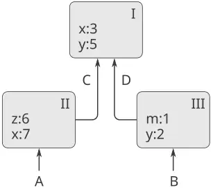

**الشكل 3.1:** بنية بيئةٍ بسيطة.

والبيئة حاسمةُ الأهمّيّة في عمليّة التقييم، لأنّها تُحدّد السياق الذي يُقيَّم فيه التعبير. ففي الحقيقة، يمكن القول إنّ التعابير في لغة البرمجة ليست لها بذاتها أيّ معنى. بل إنّ التعبير يكتسب معناه فقط بالنسبة إلى بعض البيئة التي يُقيَّم فيها. حتّى تفسير تعبيرٍ مباشرٍ كـ`(+ 1 1)` يعتمد على فهم أنّنا نعمل في سياقٍ يكون فيه `+` الرمز الدالّ على الجمع. وهكذا، في نموذجنا للتقييم سنتحدّث دائمًا عن تقييم تعبيرٍ بالنسبة إلى بيئةٍ ما. ولكي نصف التفاعلات مع المفسّر، سنفترض وجود بيئةٍ عامّة، تتكوّن من إطارٍ واحد (ليس له بيئة محيطة) يتضمّن القيم المرتبطة بالرموز المرتبطة بالإجراءات الأوّليّة. فمثلًا، فكرة أنّ `+` هو الرمز الدالّ على الجمع تُجسَّد بالقول إنّ الرمز `+` مربوطٌ في البيئة العامّة بإجراء الجمع الأوّليّ.

#### 3.2.1 قواعد التقييم

ويظلّ المواصفة الكلّيّة لكيفيّة تقييم المفسّر للتركيبات كما كانت حين قدّمناها أوّل مرّةٍ في [1.1.3](https://sarabander.github.io/sicp/html/1_002e1.xhtml#g_t1_002e1_002e3):

- ولتقييم تركيبةٍ:

1. قيّم التعابير الجزئيّة للتركيبة.[^12]
2. طبّق قيمة التعبير الجزئيّ المشغّل على قيم التعبيرات الجزئيّة العوامل.

ويحلّ نموذج البيئة للتقييم محلّ نموذج الاستبدال في تحديد معنى تطبيق إجراءٍ مركّبٍ على معطيات.

في نموذج البيئة للتقييم، الإجراء هو دائمًا زوجٌ يتكوّن من بعض الشيفرة ومؤشّر إلى بيئة. والإجراءات لا تُنشَأ إلّا بطريقةٍ واحدة: بتقييم تعبير λ. وهذا يُنتج إجراءً تُستمَدّ شيفرته من نصّ تعبير λ وتكون بيئته هي البيئة التي قُيِّم فيها تعبير λ لإنتاج الإجراء. فمثلًا، تأمّل تعريف الإجراء

```scheme
(define (square x)
  (* x x))
```

المقيَّم في البيئة العامّة. وإنّ صياغة تعريف الإجراء هي مجرّد سُكْرٌ صياغيّ (syntactic sugar) لتعبير λ ضمنيّ كامن. وكان يمكن الاكتفاء باستخدام

```scheme
(define square
  (lambda (x) (* x x)))
```

والذي يُقيّم `(lambda (x) (* x x))` ويربط `square` بالقيمة الناتجة، كلّ ذلك في البيئة العامّة.

يُظهر [الشكل 3.2](/book/sicp/c3-modularity-objects-and-state/3-2/) نتيجة تقييم تعبير `define` هذا. وكائن الإجراء زوجٌ تُحدّد شيفرته أنّ للإجراء وسيطًا شكليًّا واحدًا، هو `x`، وجسم إجراءٍ هو `(* x x)`. وجزء البيئة في الإجراء مؤشّر إلى البيئة العامّة، لأنّها البيئة التي قُيِّم فيها تعبير λ لإنتاج الإجراء. وأُضيف رابطٌ جديد، يربط كائن الإجراء بالرمز `square`، إلى الإطار العامّ. وبصورةٍ عامّة، يُنشئ `define` التعريفات بإضافة روابط إلى الأُطُر.

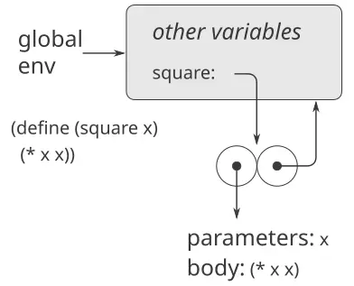

**الشكل 3.2:** بنية البيئة الناتجة عن تقييم `(define (square x) (* x x))` في البيئة العامّة.

والآن بعد أن رأينا كيف تُنشَأ الإجراءات، نستطيع وصف كيف تُطبَّق الإجراءات. ويُحدّد نموذج البيئة ما يلي: لتطبيق إجراءٍ على معطيات، أنشئ بيئةً جديدةً تحتوي إطارًا يربط الوسائط بقيم المعطيات. وبيئة هذا الإطار المحيطة هي البيئة التي يُحدّدها الإجراء. والآن، داخل هذه البيئة الجديدة، قيّم جسم الإجراء.

ولإظهار كيف يُتّبع هذا القانون، يُوضّح [الشكل 3.3](/book/sicp/c3-modularity-objects-and-state/3-2/) بنية البيئة المُنشأة بتقييم التعبير `(square 5)` في البيئة العامّة، حيث `square` هو الإجراء المُولَّد في [الشكل 3.2](/book/sicp/c3-modularity-objects-and-state/3-2/). ويُنتج تطبيق الإجراء بيئةً جديدةً، موسومةً بـE1 في الشكل، تبدأ بإطارٍ يكون `x`، الوسيط الشكليّ للإجراء، مربوطًا فيه بالمعطى 5. والمؤشّر الصاعد من هذا الإطار يُظهر أنّ بيئته المحيطة هي البيئة العامّة. وقد اختيرت البيئة العامّة هنا، لأنّها البيئة المُشار إليها كجزءٍ من كائن الإجراء `square`. وداخل E1، نُقيّم جسم الإجراء، `(* x x)`. وبما أنّ قيمة `x` في E1 هي 5، فالنتيجة هي `(* 5 5)`، أي 25.

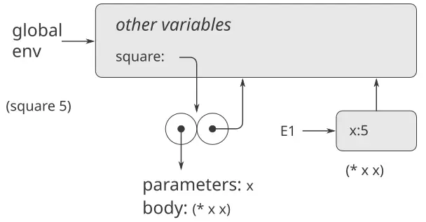

**الشكل 3.3:** البيئة المُنشأة بتقييم `(square 5)` في البيئة العامّة.

ويمكن تلخيص نموذج البيئة لتطبيق الإجراءات بقانونين:

- يُطبَّق كائن الإجراء على مجموعةٍ من المعطيات ببناء إطار، يربط الوسائط الشكليّة للإجراء بمعطيات النداء، ثمّ بتقييم جسم الإجراء في سياق البيئة الجديدة المبنيّة. وبيئة الإطار الجديد المحيطة هي جزء البيئة من كائن الإجراء المطبَّق.
- يُنشَأ الإجراء بتقييم تعبير λ بالنسبة إلى بيئةٍ معيّنة. وكائن الإجراء الناتج زوجٌ يتكوّن من نصّ تعبير λ ومؤشّر إلى البيئة التي أُنشئ فيها الإجراء.

ونُحدّد أيضًا أنّ تعريف رمزٍ باستخدام `define` يُنشئ رابطًا في إطار البيئة الحاليّة ويسند إلى الرمز القيمة المُشار إليها.[^13] وأخيرًا، نُحدّد سلوك `set!`، العمليّة التي أَجبرتنا على تقديم نموذج البيئة في المقام الأوّل. فإنّ تقييم التعبير `(set! ⟨variable⟩ ⟨value⟩)` في بيئةٍ ما يجد ربط المتغيّر في البيئة ويغيّر ذلك الربط ليشير إلى القيمة الجديدة. أي أنّه يُعثَر على أوّل إطارٍ في البيئة يحتوي على ربطٍ للمتغيّر ويُعدَّل ذلك الإطار. فإن كان المتغيّر غير مربوطٍ في البيئة، فإنّ `set!` يُشير إلى خطأ.

وهذه قواعد التقييم، وإن كانت أعقدَ كثيرًا من نموذج الاستبدال، فهي لا تزال مباشرةً إلى حدٍّ معقول. وفوق ذلك، فإنّ نموذج التقييم، وإن كان مجرّدًا، فهو يوفّر وصفًا صحيحًا لكيفيّة تقييم المفسّر للتعابير. في [الفصل 4](https://sarabander.github.io/sicp/html/Chapter-4.xhtml#Chapter-4) سنرى كيف يستطيع هذا النموذج أن يخدم بوصفه مخططًا لتنفيذ مفسّرٍ عامل. وتُطوّل الأقسام التالية شرح تفاصيل النموذج بتحليل بعض البرامج التوضيحيّة.

#### 3.2.2 تطبيق الإجراءات البسيطة

حين قدّمنا نموذج الاستبدال في [1.1.5](https://sarabander.github.io/sicp/html/1_002e1.xhtml#g_t1_002e1_002e5)، أظهرنا كيف يُقيَّم التركيب `(f 5)` إلى 136، بالتعريفات الإجرائيّة التالية:

```scheme
(define (square x)
  (* x x))
(define (sum-of-squares x y)
  (+ (square x) (square y)))
(define (f a)
  (sum-of-squares (+ a 1) (* a 2)))
```

نستطيع تحليل المثال نفسه باستخدام نموذج البيئة. يُظهر [الشكل 3.4](/book/sicp/c3-modularity-objects-and-state/3-2/) كائنات الإجراءات الثلاثة المُنشأة بتقييم تعريفات `f` و`square` و`sum-of-squares` في البيئة العامّة. ويتكوّن كلّ كائن إجراءٍ من بعض الشيفرة، مع مؤشّر إلى البيئة العامّة.

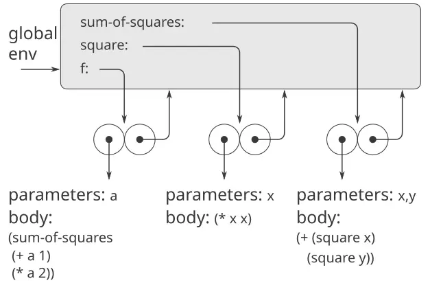

**الشكل 3.4:** كائنات الإجراءات في الإطار العامّ.

في [الشكل 3.5](/book/sicp/c3-modularity-objects-and-state/3-2/) نرى بنية البيئة المُنشأة بتقييم التعبير `(f 5)`. فإنّ نداء `f` يُنشئ بيئةً جديدةً E1 تبدأ بإطارٍ يكون فيه `a`، الوسيط الشكليّ لـ`f`، مربوطًا بالمعطى 5. وداخل E1، نُقيّم جسم `f`:

```scheme
(sum-of-squares (+ a 1) (* a 2))
```

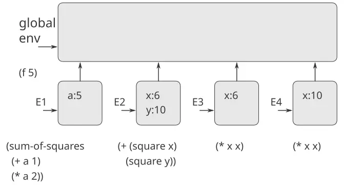

**الشكل 3.5:** البيئات المُنشأة بتقييم `(f 5)` باستخدام الإجراءات الواردة في [الشكل 3.4](/book/sicp/c3-modularity-objects-and-state/3-2/).

ولتقييم هذا التركيب، نُقيّم أوّلًا التعابير الجزئيّة. فالتعبير الجزئيّ الأوّل، `sum-of-squares`، له قيمةٌ هي كائن إجراء. (ولاحِظ كيف تُحصَل على هذه القيمة: ننظر أوّلًا في أوّل إطارٍ من E1، وهو لا يحتوي على ربطٍ لـ`sum-of-squares`. ثمّ ننتقل إلى البيئة المحيطة، أي البيئة العامّة، ونجد الربط المبيَّن في [الشكل 3.4](/book/sicp/c3-modularity-objects-and-state/3-2/).) أمّا التعبيران الجزئيّان الآخران فيُقيَّمان بتطبيق العمليّتين الأوّليّتين `+` و`*` لتقييم التركيبين `(+ a 1)` و`(* a 2)` للحصول على 6 و10 على التوالي.

والآن نطبّق كائن الإجراء `sum-of-squares` على المعطيين 6 و10. ويُنتج ذلك بيئةً جديدةً E2 يُربَط فيها الوسيطان الشكليّان `x` و`y` بالمعطيات. وداخل E2 نُقيّم التركيب `(+ (square x) (square y))`. وهذا يُفضي بنا إلى تقييم `(square x)`، حيث `square` موجودٌ في الإطار العامّ و`x` هو 6. ومرةً أخرى، نُنشئ بيئةً جديدةً، E3، يكون `x` مرتبطًا فيها بـ6، وداخلها نُقيّم جسم `square`، وهو `(* x x)`. وأيضًا كجزءٍ من تطبيق `sum-of-squares`، يجب أن نُقيّم التعبير الجزئيّ `(square y)`، حيث `y` هو 10. وهذا النداء الثاني لـ`square` يُنشئ بيئةً أخرى، E4، يكون فيها `x`، الوسيط الشكليّ لـ`square`، مربوطًا بـ10. وداخل E4 يجب أن نُقيّم `(* x x)`.

والنقطة المهمّة التي ينبغي ملاحظتها هي أنّ كلّ نداءٍ لـ`square` يُنشئ بيئةً جديدةً تحتوي على ربطٍ لـ`x`. ونستطيع أن نرى هنا كيف تخدم الأُطُر المختلفة في إبقاء المتغيّرات المحليّة المختلفة المسمّاة جميعًا `x` منفصلة. ولاحِظ أنّ كلّ إطارٍ يُنشئه `square` يُشير إلى البيئة العامّة، لأنّها البيئة المُشار إليها في كائن الإجراء `square`.

وبعد تقييم التعابير الجزئيّة، تُعاد النتائج. فالقيم المُولَّدة بالنداءين إلى `square` تُجمَع بـ`sum-of-squares`، وهذه النتيجة يُعيدها `f`. وبما أنّ تركيزنا هنا على بنى البيئة، فلن نُطِل الشرح في كيفيّة تمرير هذه القيم المُعادة من نداءٍ إلى نداء؛ غير أنّ هذا أيضًا جانبٌ مهمّ من عمليّة التقييم، وسنعود إليه بتفصيلٍ في [الفصل 5](https://sarabander.github.io/sicp/html/Chapter-5.xhtml#Chapter-5).

**التمرين 3.9:** في [1.2.1](https://sarabander.github.io/sicp/html/1_002e2.xhtml#g_t1_002e2_002e1) استخدمنا نموذج الاستبدال لتحليل إجراءين لاحتساب المضروب، إصدارٌ تعاوديّ

```scheme
(define (factorial n)
  (if (= n 1)
      1
      (* n (factorial (- n 1)))))
```

وإصدارٌ تكراريّ

```scheme
(define (factorial n)
  (fact-iter 1 1 n))

(define (fact-iter product 
                   counter 
                   max-count)
  (if (> counter max-count)
      product
      (fact-iter (* counter product)
                 (+ counter 1)
                 max-count)))
```

أظهِر بنى البيئات المُنشأة بتقييم `(factorial 6)` باستخدام كلّ إصدارٍ من إجراء `factorial`.[^14]

#### 3.2.3 الأُطُر بوصفها مستودع الحالة المحليّة

نستطيع اللجوء إلى نموذج البيئة لنرى كيف يمكن استخدام الإجراءات والإحلال لتمثيل كائناتٍ ذات حالةٍ محليّة. فمثلًا، تأمّل «معالج السحب» الوارد في [3.1.1](https://sarabander.github.io/sicp/html/3_002e1.xhtml#g_t3_002e1_002e1) والمُنشَأ بنداء الإجراء

```scheme
(define (make-withdraw balance)
  (lambda (amount)
    (if (>= balance amount)
        (begin (set! balance 
                     (- balance amount))
               balance)
        "Insufficient funds")))
```

فلْنَصِف تقييم

```scheme
(define W1 (make-withdraw 100))
```

تتبعه

```scheme
(W1 50)
50
```

يُظهر [الشكل 3.6](/book/sicp/c3-modularity-objects-and-state/3-2/) نتيجة تعريف إجراء `make-withdraw` في البيئة العامّة. وهذا يُنتج كائن إجراءٍ يحتوي على مؤشّر إلى البيئة العامّة. وحتّى الآن، لا يختلف هذا عن الأمثلة التي رأيناها سلفًا، إلّا في أنّ جسم الإجراء هو نفسه تعبير λ.

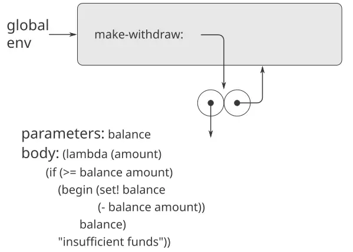

**الشكل 3.6:** نتيجة تعريف `make-withdraw` في البيئة العامّة.

ويقع الجزء المثير للاهتمام في الاحتساب حين نطبّق الإجراء `make-withdraw` على معطى:

```scheme
(define W1 (make-withdraw 100))
```

نبدأ، كالعادة، بإنشاء بيئةٍ E1 يكون فيها الوسيط الشكليّ `balance` مرتبطًا بالمعطى 100. وداخل هذه البيئة، نُقيّم جسم `make-withdraw`، أي تعبير λ. وهذا يُنشئ كائن إجراءٍ جديد، شيفرته كما يُحدّدها `lambda` وبيئته هي E1، البيئة التي قُيِّم فيها `lambda` لإنتاج الإجراء. وكائن الإجراء الناتج هو القيمة المُعادة من نداء `make-withdraw`. وهذا يُربط بـ`W1` في البيئة العامّة، إذ إنّ `define` نفسه يُقيَّم في البيئة العامّة. يُظهر [الشكل 3.7](/book/sicp/c3-modularity-objects-and-state/3-2/) بنية البيئة الناتجة.

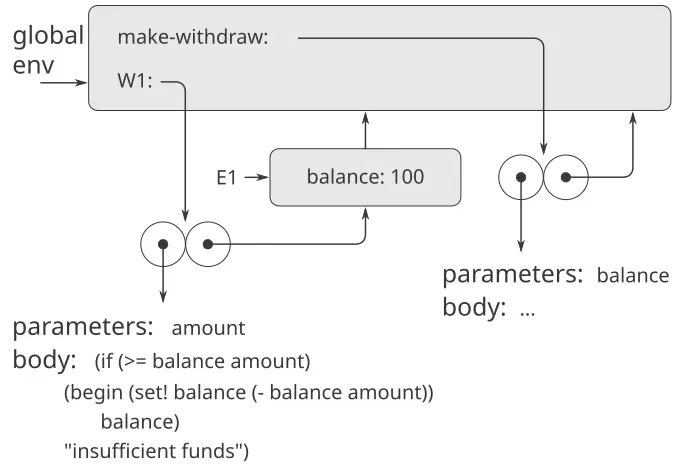

**الشكل 3.7:** نتيجة تقييم `(define W1 (make-withdraw 100))`.

والآن نستطيع تحليل ما يحدث حين يُطبَّق `W1` على معطى:

```scheme
(W1 50)
50
```

نبدأ ببناء إطارٍ يكون فيه `amount`، الوسيط الشكليّ لـ`W1`، مربوطًا بالمعطى 50. والنقطة الحاسمة التي ينبغي ملاحظتها هي أنّ بيئة هذا الإطار المحيطة ليست البيئة العامّة، بل البيئة E1، لأنّها البيئة التي يُحدّدها كائن الإجراء `W1`. وداخل هذه البيئة الجديدة، نُقيّم جسم الإجراء:

```scheme
(if (>= balance amount)
    (begin (set! balance (- balance amount))
           balance)
    "Insufficient funds")
```

وتُعرَض بنية البيئة الناتجة في [الشكل 3.8](/book/sicp/c3-modularity-objects-and-state/3-2/). والتعبير الذي يُقيَّم يُشير إلى كلٍّ من `amount` و`balance`. وسيُعثَر على `amount` في أوّل إطارٍ في البيئة، بينما سيُعثَر على `balance` باتّباع مؤشّر البيئة المحيطة إلى E1.

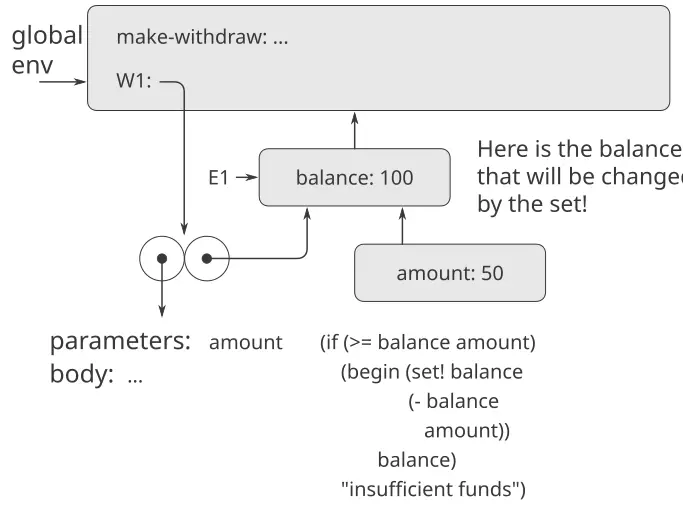

**الشكل 3.8:** البيئات المُنشأة بتطبيق كائن الإجراء `W1`.

وحين يُنفَّذ `set!`، فإنّ ربط `balance` في E1 يتغيّر. وعند انتهاء نداء `W1`، يكون `balance` هو 50، والإطار الذي يحتوي على `balance` لا يزال كائن الإجراء `W1` يُشير إليه. أمّا الإطار الذي يربط `amount` (والذي نفّذنا فيه الشيفرة التي غيّرت `balance`) فلم يبقَ ذا صلة، لأنّ نداء الإجراء الذي بناه قد انتهى، ولا توجد مؤشّرات إلى ذلك الإطار من أجزاء البيئة الأخرى. وفي المرّة التالية التي يُندى فيها `W1`، سيُبنى إطارٌ جديد يربط `amount` وبيئته المحيطة هي E1. ونرى أنّ E1 يخدم بوصفه «المكان» الذي يحتفظ بمتغيّر الحالة المحليّة لكائن الإجراء `W1`. يُظهر [الشكل 3.9](/book/sicp/c3-modularity-objects-and-state/3-2/) الوضع بعد نداء `W1`.

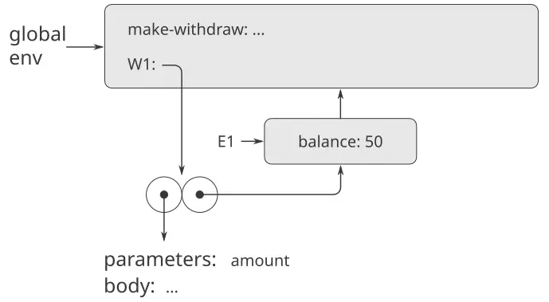

**الشكل 3.9:** البيئات بعد نداء `W1`.

ولاحِظ ما يحدث حين نُنشئ كائن «سحب» ثانيًا بإجراء نداءٍ آخر إلى `make-withdraw`:

```scheme
(define W2 (make-withdraw 100))
```

ويُنتج ذلك بنية البيئة الواردة في [الشكل 3.10](/book/sicp/c3-modularity-objects-and-state/3-2/)، التي تُظهر أنّ `W2` كائنُ إجراء، أي زوجٌ فيه بعض الشيفرة وبيئة. وقد أُنشئت البيئة E2 الخاصّة بـ`W2` بنداء `make-withdraw`. وهي تحتوي على إطارٍ له ربطه المحليّ الخاصّ بـ`balance`. ومن جانبٍ آخر، فإنّ `W1` و`W2` لهما الشيفرة نفسها: الشيفرة التي يُحدّدها تعبير λ في جسم `make-withdraw`.[^15] ونرى هنا لماذا يتصرّف `W1` و`W2` بوصفهما كائنين مستقلّين. فإنّ نداءات `W1` تُشير إلى متغيّر الحالة `balance` المخزون في E1، بينما نداءات `W2` تُشير إلى `balance` المخزون في E2. وهكذا، فإنّ تغييرات الحالة المحليّة لأحد الكائنين لا تؤثّر في الكائن الآخر.

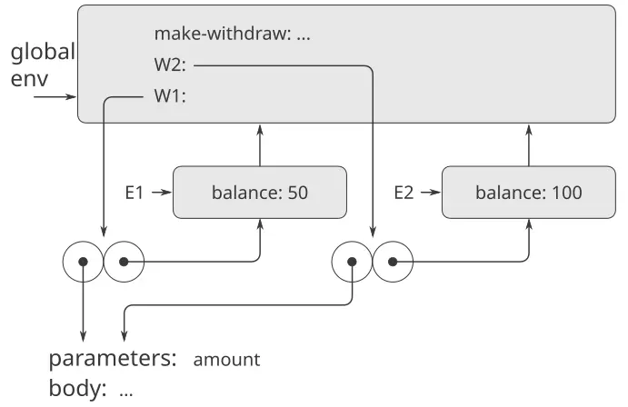

**الشكل 3.10:** استخدام `(define W2 (make-withdraw 100))` لإنشاء كائنٍ ثانٍ.

**التمرين 3.10:** في إجراء `make-withdraw`، يُنشَأ المتغيّر المحليّ `balance` بوصفه وسيطًا لـ`make-withdraw`. ونستطيع أيضًا إنشاء متغيّر الحالة المحليّة صراحةً، باستخدام `let`، كما يلي:

```scheme
(define (make-withdraw initial-amount)
  (let ((balance initial-amount))
    (lambda (amount)
      (if (>= balance amount)
          (begin (set! balance 
                       (- balance amount))
                 balance)
          "Insufficient funds"))))
```

وتذكّر من [1.3.2](https://sarabander.github.io/sicp/html/1_002e3.xhtml#g_t1_002e3_002e2) أنّ `let` هو مجرّد سُكْرٌ صياغيّ لنداء إجراء:

```scheme
(let ((⟨var⟩ ⟨exp⟩)) ⟨body⟩)
```

يُفسَّر بوصفه صياغةً بديلةً لـ

```scheme
((lambda (⟨var⟩) ⟨body⟩) ⟨exp⟩)
```

استخدم نموذج البيئة لتحليل هذا الإصدار البديل من `make-withdraw`، رسمًا أشكالًا شبيهةً بالأشكال أعلاه لتوضيح التفاعلات

```scheme
(define W1 (make-withdraw 100))
(W1 50)
(define W2 (make-withdraw 100))
```

أظهِر أنّ الإصدَرين من `make-withdraw` يُنشئان كائناتٍ لها السلوك نفسه. وكيف تختلف بنى البيئة بين الإصدَرين؟

#### 3.2.4 التعريفات الداخليّة

عرّف القسم [1.1.8](https://sarabander.github.io/sicp/html/1_002e1.xhtml#g_t1_002e1_002e8) بفكرة أنّ الإجراءات يمكن أن يكون لها تعريفاتٌ داخليّة، الأمر الذي يؤدّي إلى بنيةٍ كتليّة (block structure) كما في الإجراء التالي لاحتساب الجذور التربيعيّة:

```scheme
(define (sqrt x)
  (define (good-enough? guess)
    (< (abs (- (square guess) x)) 0.001))
  (define (improve guess)
    (average guess (/ x guess)))
  (define (sqrt-iter guess)
    (if (good-enough? guess)
        guess
        (sqrt-iter (improve guess))))
  (sqrt-iter 1.0))
```

والآن نستطيع استخدام نموذج البيئة لنرى لماذا تتصرّف هذه التعريفات الداخليّة كما هو مطلوب. يُظهر [الشكل 3.11](/book/sicp/c3-modularity-objects-and-state/3-2/) النقطة في تقييم التعبير `(sqrt 2)` حيث نُودي الإجراء الداخليّ `good-enough?` للمرّة الأولى و`guess` مساوٍ لـ1.

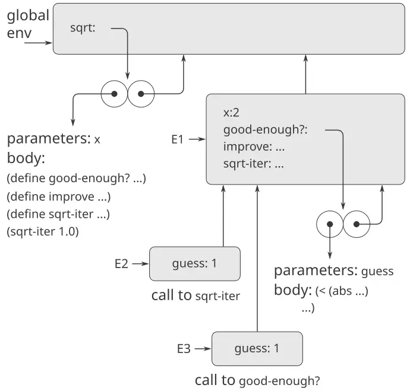

**الشكل 3.11:** إجراء `sqrt` ذو تعريفاتٍ داخليّة.

لاحِظ بنية البيئة. فإنّ `sqrt` رمزٌ في البيئة العامّة مربوطٌ بكائن إجراءٍ بيئته المرتبطة به هي البيئة العامّة. وحين نُودي `sqrt`، تكوّنت بيئةٌ جديدة E1 تابعةٌ للبيئة العامّة، يكون فيها الوسيط `x` مرتبطًا بـ2. ثمّ قُيِّم جسم `sqrt` في E1. وبما أنّ التعبير الأوّل في جسم `sqrt` هو

```scheme
(define (good-enough? guess)
  (< (abs (- (square guess) x)) 0.001))
```

فإنّ تقييم هذا التعبير عرّف الإجراء `good-enough?` في البيئة E1. وبأكثر دقّة، أُضيف الرمز `good-enough?` إلى أوّل إطارٍ من E1، مربوطًا بكائن إجراءٍ بيئته المرتبطة به هي E1. وبالمثل، عُرِّف `improve` و`sqrt-iter` بوصفهما إجراءين في E1. وللإيجاز، يُظهر [الشكل 3.11](/book/sicp/c3-modularity-objects-and-state/3-2/) كائن الإجراء الخاصّ بـ`good-enough?` فقط.

وبعد تعريف الإجراءات المحليّة، قُيِّم التعبير `(sqrt-iter 1.0)`، لا يزال في البيئة E1. فقد نُودي كائن الإجراء المربوط بـ`sqrt-iter` في E1 بالمعطى 1. وخَلَق هذا بيئةً جديدةً E2 يكون فيها `guess`، وسيط `sqrt-iter`، مرتبطًا بـ1. و`sqrt-iter` بدوره نادى `good-enough?` بقيمة `guess` (من E2) بوصفها المعطى لـ`good-enough?`. وخَلَق هذا بيئةً أخرى، E3، يكون فيها `guess` (وسيط `good-enough?`) مرتبطًا بـ1. ومع أنّ `sqrt-iter` و`good-enough?` كلاهما له وسيطٌ اسمه `guess`، فهذان متغيّران محليّان متمايزان يقعان في إطارين مختلفين. وكذلك، فإنّ E2 وE3 كلتيهما لهما E1 بوصفها بيئتهما المحيطة، لأنّ إجراءَي `sqrt-iter` و`good-enough?` كلاهما له E1 بوصفها جزء بيئته. وإحدى نتائج ذلك أنّ الرمز `x` الذي يظهر في جسم `good-enough?` سيُشير إلى ربط `x` الظاهر في E1، أي قيمة `x` التي نُودي بها إجراء `sqrt` الأصليّ.

وهكذا، يفسّر نموذج البيئة الخاصّيتين الأساسّيتين اللتين تجعلان تعريفات الإجراءات المحليّة تقنيّةً مفيدةً لوحدنة البرامج:

- إنّ أسماء الإجراءات المحليّة لا تتداخل مع الأسماء الخارجيّة للإجراء المحيط، لأنّ أسماء الإجراءات المحليّة ستُربط في الإطار الذي يُنشئه الإجراء عند تشغيله، لا في البيئة العامّة.
- إنّ الإجراءات المحليّة تستطيع الوصول إلى وسائط الإجراء المحيط، بمجرّد استخدام أسماء الوسائط بوصفها متغيّراتٍ حُرّة (free variables). ويعود ذلك إلى أنّ جسم الإجراء المحليّ يُقيَّم في بيئةٍ تابعةٍ لبيئة التقييم الخاصّة بالإجراء المحيط.

**التمرين 3.11:** في [3.2.3](/book/sicp/c3-modularity-objects-and-state/3-2/) رأينا كيف وصف نموذج البيئة سلوك الإجراءات ذات الحالة المحليّة. والآن رأينا كيف تعمل التعريفات الداخليّة. فإنّ إجراء تمرير الرسائل النموذجيّ يحتوي على هذين الجانبين معًا. تأمّل إجراء الحساب المصرفيّ الوارد في [3.1.1](https://sarabander.github.io/sicp/html/3_002e1.xhtml#g_t3_002e1_002e1):

```scheme
(define (make-account balance)
  (define (withdraw amount)
    (if (>= balance amount)
        (begin (set! balance 
                     (- balance 
                        amount))
               balance)
        "Insufficient funds"))
  (define (deposit amount)
    (set! balance (+ balance amount))
    balance)
  (define (dispatch m)
    (cond ((eq? m 'withdraw) withdraw)
          ((eq? m 'deposit) deposit)
          (else (error "Unknown request: 
                        MAKE-ACCOUNT" 
                       m))))
  dispatch)
```

أظهِر بنية البيئة المُولَّدة من تتالي التفاعلات

```scheme
(define acc (make-account 50))

((acc 'deposit) 40)
90

((acc 'withdraw) 60)
30
```

فأين تُحفَظ الحالة المحليّة الخاصّة بـ`acc`؟ فلنفترض أنّنا نُعرّف حسابًا آخر

```scheme
(define acc2 (make-account 100))
```

وكيف تُحفَظ الحالة المحليّة للحسابين منفصلة؟ وأيّ أجزاء بنية البيئة مُشترَكة بين `acc` و`acc2`؟


[^12]: هذا هو في الجوهر تنفيذ `cons` بدلالة `set-car!` و`set-cdr!`، على النحو الموصوف في [3.3.1](https://sarabander.github.io/sicp/html/3_002e3.xhtml#g_t3_002e3_002e1). والعمليّة `get-new-pair` المستخدمة في ذلك التنفيذ تُنجَز هنا بواسطة المؤشّر `free`.

[^13]: قد لا يبقى هذا صحيحًا في المستقبل، لأنّ الذاكرات قد تكبر حدًّا يستحيل معه نفاد الذاكرة الحرّة في عمر الحاسوب. ففي السنة نحو $undefined$ ميكروثانية، فلو أنّنا نُنشئ `cons` مرّةً كلّ ميكروثانية، لأضحى يلزمنا نحو $undefined$ خليّةٍ من الذاكرة لبناء آلةٍ تعمل ثلاثين سنةً دون أن تنفد ذاكرتها. وتبدو هذه الكميّة من الذاكرة سخيفةً بمعايير اليوم، لكنّها ليست مستحيلةً فيزيائيًّا. ومن جهةٍ أخرى، تصبح المعالجات أسرع فأسرع، وقد يضمّ حاسوب المستقبل أعدادًا كبيرةً من المعالجات تعمل على التوازي على ذاكرةٍ واحدة، فقد يصبح ممكنًا استهلاك الذاكرة أسرع بكثيرٍ ممّا افترضناه.

[^14]: نفترض هنا أنّ المكدس ممثَّلٌ كقائمةٍ على النحو الموضح في [5.3.1](/book/sicp/c5-computing-with-register-machines/5-3/)، بحيث تكون عناصر المكدس قابلةً للوصول عبر المؤشّر الكائن في مسجّل المكدس.

[^15]: ابتكر هذه الفكرة مينسكي ونفّذها أوّل مرّة، كجزءٍ من تنفيذ Lisp على آلة PDP-1 في مختبر أبحاث الإلكترونيات في MIT. وطوّرها [فينيتشيل ويوكيلسون (1969)](https://sarabander.github.io/sicp/html/References.xhtml#Fenichel-and-Yochelson-_00281969_0029) لاستخدامها في تنفيذ Lisp الخاصّ بنظام المشاركة الزمنيّة Multics. ثمّ طور [بايكر (1978)](https://sarabander.github.io/sicp/html/References.xhtml#Baker-_00281978_0029) نسخةً «في الزمن الحقيقي» من الطريقة، لا تتطلّب وقوف الاحتساب أثناء جمع القمامة. وامتدّت فكرة بايكر على يد هيويت وليبرمان ومون (انظر [ليبرمان وهيويت 1983](https://sarabander.github.io/sicp/html/References.xhtml#Lieberman-and-Hewitt-1983)) لتستفيد من أنّ بعض البنى أكثر تقلّبًا وبعضها الآخر أكثر ديمومة. وثمّة تقنيّة أخرى شائعة لجمع القمامة هي طريقة *الكي والمسح (mark-sweep)*. وتتمثّل في تقفّي كلّ البنى القابلة للوصول من مسجّلات الآلة ووسم كلّ زوجٍ نصل إليه. ثمّ نمسح الذاكرة كلّها، وكلّ موضعٍ غير موسومٍ «يُكنس» كانقالًا للقمامة ويُتاح لإعادة الاستخدام. ويمكن العثور على مناقشةٍ كاملةٍ لطريقة الكي والمسح في [ألين 1978](https://sarabander.github.io/sicp/html/References.xhtml#Allen-1978). أمّا خوارزميّة مينسكي-فينيتشيل-يوكيلسون فهي الخوارزميّة السائدة في الأنظمة كبيرة الذاكرة، لأنّها لا تفحص إلّا الجزء المفيد من الذاكرة. وهذا بخلاف الكي والمسح، حيث ينبغي لمرحلة الكنس أن تفحص الذاكرة كلّها. وميزةٌ ثانية لطريقة التوقّف والنسخ أنّها جامع قمامةٍ *ضاغط (compacting)*. أي أنّ البيانات المفيدة ستنُقل في نهاية مرحلة جمع القمامة إلى مواضع ذاكرةٍ متتالية، مع ضغط كلّ الأزواج النفاية خارجها. وقد يكون هذا اعتبارًا بالغ الأهميّة للأداء في الآلات ذات الذاكرة الافتراضيّة، حيث قد يتطلّب الوصول إلى عناوين ذاكرةٍ متباعدةٍ بعيدًا عمليّاتِ تبديل صفحاتٍ إضافيّة.