### 3.3 النمذجة بالبيانات القابلة للتغيير

تناول [الفصل 2](https://sarabander.github.io/sicp/html/Chapter-2.xhtml#Chapter-2) البيانات المركّبة بوصفها وسيلةً لبناء كائناتٍ حسابيّةٍ لها عدّة أجزاء، بغية نمذجة كائنات العالم الواقعيّ التي لها عدّة جهات. وفي ذلك الفصل، قدّمنا انضباط تجريد البيانات، الذي بموجبه تُحدَّد بنى البيانات بدلالة البنّاءات (constructors)، التي تُنشئ كائنات البيانات، والمُحدِّدات (selectors)، التي تصل إلى أجزاء كائنات البيانات المركّبة. لكنّنا نعلم الآن أنّ هناك جانبًا آخر من البيانات لم يتناوله الفصل 2. فإنّ الرغبة في نمذجة أنظمةٍ مركّبةٍ من كائناتٍ لها حالة متغيّرة تدفعنا إلى الحاجة إلى تعديل كائنات البيانات المركّبة، إضافةً إلى بنائها والانتقاء منها. ولكي نمثّل الكائنات المركّبة ذات الحالة المتغيّرة، سنصمّم تجريدات بياناتٍ تتضمّن، إضافةً إلى المُحدِّدات والبنّاءات، عمليّاتٍ تُسمّى *مُبدِّلات (mutators)*، تُعدّل كائنات البيانات. فمثلًا، فإنّ نمذجة نظامٍ مصرفيّ تتطلّب منّا تغيير أرصدة الحسابات. وهكذا، فقد تقبل بنية بياناتٍ لتمثيل الحسابات المصرفيّة عمليّةً من شكل

```scheme
(set-balance! ⟨account⟩ ⟨new-value⟩)
```

تُغيِّر رصيد الحساب المُعيّن إلى القيمة الجديدة المُعيّنة. وكائنات البيانات التي تُعرّف لها مُبدِّلات تُعرف بـ*كائنات البيانات القابلة للتغيير (mutable data objects)*.

قدّم الفصل 2 الأزواج بوصفها «صمغًا» عامّ الغرض لتوليف البيانات المركّبة. ونبدأ هذا القسم بتعريف مُبدِّلات أساسيّة للأزواج، حتّى تستطيع الأزواج أن تخدم بوصفها كتل بناءٍ لإنشاء كائنات بياناتٍ قابلةٍ للتغيير. وهذه المُبدِّلات تعزّز القدرة التمثيليّة للأزواج تعزيزًا كبيرًا، ممّا يتيح لنا بناء بنى بياناتٍ غير السلاسل والأشجار التي عملنا معها في [2.2](https://sarabander.github.io/sicp/html/2_002e2.xhtml#g_t2_002e2). ونُقدّم أيضًا بعض الأمثلة على المحاكاة التي تمثَّلت فيها الأنظمة المعقّدة بوصفها مجموعاتٍ من الكائنات ذات الحالة المحليّة.

#### 3.3.1 بنية القائمة القابلة للتغيير

إنّ العمليّات الأساسيّة على الأزواج —`cons` و`car` و`cdr`— يمكن استخدامها لبناء بنية القائمة ولانتقاء أجزاءً من بنية القائمة، لكنّها عاجزةٌ عن تعديل بنية القائمة. والشيء نفسه صحيحٌ بشأن عمليّات القوائم التي استخدمناها حتّى الآن، مثل `append` و`list`، إذ يمكن تعريف هذه بدلالة `cons` و`car` و`cdr`. ولكي نُعدّل بنى القوائم، نحتاج إلى عمليّاتٍ جديدة.

والمُبدِّلات الأوّليّة للأزواج هي `set-car!` و`set-cdr!`. و`set-car!` تأخذ معطيين، يجب أن يكون الأوّل منهما زوجًا. وهي تُعدّل هذا الزوج، بتحويل مؤشّر `car` إلى مؤشّرٍ إلى المعطى الثاني لـ`set-car!`.[^16]

فمثلًا، لنفترض أنّ `x` مرتبطٌ بالقائمة `((a b) c d)` و`y` بالقائمة `(e f)` كما هو موضّح في [الشكل 3.12](/book/sicp/c3-modularity-objects-and-state/3-3/). فإنّ تقييم التعبير ` (set-car! x y)` يُعدّل الزوج الذي `x` مرتبطٌ به، فيحلّ محلّ `car` فيه قيمة `y`. وتُعرَض نتيجة العمليّة في [الشكل 3.13](/book/sicp/c3-modularity-objects-and-state/3-3/). وقد عُدّلت البنية `x` وستُطبَع الآن بالشكل `((e f) c d)`. أمّا الأزواج التي تمثّل القائمة `(a b)`، والتي يُعرَف بها بالمؤشّر الذي استُبدل، فهي مفصولةٌ الآن عن البنية الأصليّة.[^17]

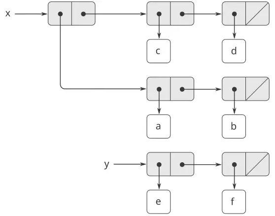

**الشكل 3.12:** القائمتان `x`: `((a b) c d)` و`y`: `(e f)`.

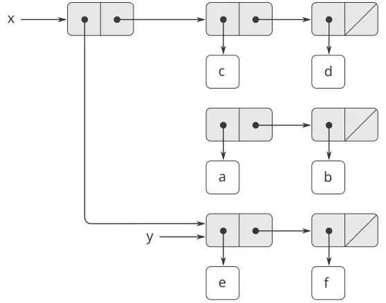

**الشكل 3.13:** أثر `(set-car! x y)` على القائمتين في [الشكل 3.12](/book/sicp/c3-modularity-objects-and-state/3-3/).

قارِن [الشكل 3.13](/book/sicp/c3-modularity-objects-and-state/3-3/) بـ[الشكل 3.14](/book/sicp/c3-modularity-objects-and-state/3-3/)، الذي يُوضّح نتيجة تنفيذ `(define z (cons y (cdr x)))` و`x` و`y` مرتبطتين بالقائمتين الأصليّتين الواردتين في [الشكل 3.12](/book/sicp/c3-modularity-objects-and-state/3-3/). والمتغيّر `z` مرتبطٌ الآن بزوجٍ جديد أنشأته عمليّة `cons`؛ والقائمة التي `x` مرتبطٌ بها لم تتغيّر.

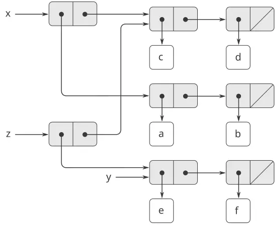

**الشكل 3.14:** أثر `(define z (cons y (cdr x)))` على القائمتين في [الشكل 3.12](/book/sicp/c3-modularity-objects-and-state/3-3/).

إنّ عمليّة `set-cdr!` شبيهةٌ بـ`set-car!`. والفرق الوحيد هو أنّ مؤشّر `cdr` للزوج، لا مؤشّر `car`، هو الذي يُستبدل. ويُعرَض أثر تنفيذ `(set-cdr! x y)` على قائمتَي [الشكل 3.12](/book/sicp/c3-modularity-objects-and-state/3-3/) في [الشكل 3.15](/book/sicp/c3-modularity-objects-and-state/3-3/). وهنا، استُبدل مؤشّر `cdr` الخاصّ بـ`x` بالمؤشّر إلى `(e f)`. وكذلك، فإنّ القائمة `(c d)`، التي كانت `cdr` الخاصّة بـ`x`، صارت مفصولةً عن البنية.

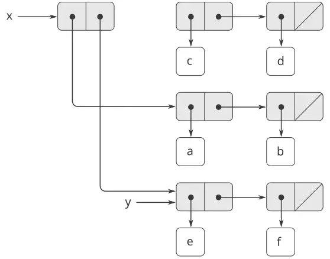

**الشكل 3.15:** أثر `(set-cdr! x y)` على قائمتَي [الشكل 3.12](/book/sicp/c3-modularity-objects-and-state/3-3/).

يُبنِي `cons` بنية قائمةٍ جديدةً بإنشاء أزواجٍ جديدة، بينما `set-car!` و`set-cdr!` تُعدّلان الأزواج القائمة. ففي الحقيقة، نستطيع تنفيذ `cons` بدلالة المُبدِّلتين، مع إجراء `get-new-pair` يُعيد زوجًا جديدًا ليس جزءًا من أيّ بنية قائمةٍ قائمة. فنحن نحصُل على الزوج الجديد، ونضبط مؤشّرَي `car` و`cdr` فيه ليشيرا إلى الكائنات المُعيّنة، ونُعيد الزوج الجديد نتيجةً لـ`cons`.[^18]

```scheme
(define (cons x y)
  (let ((new (get-new-pair)))
    (set-car! new x)
    (set-cdr! new y)
    new))
```

**التمرين 3.12:** عُرِّف الإجراء التالي لإلحاق القوائم في [2.2.1](https://sarabander.github.io/sicp/html/2_002e2.xhtml#g_t2_002e2_002e1):

```scheme
(define (append x y)
  (if (null? x)
      y
      (cons (car x) (append (cdr x) y))))
```

يُشكّل `append` قائمةً جديدةً بإجراء `cons` لعناصر `x` على `y` تباعًا. وإجراء `append!` شبيهٌ بـ`append`، لكنّه مُبدِّلٌ لا بانٍّ. وهو يُلحق القوائم بوصلها معًا، مُعدِّلًا الزوج الأخير من `x` بحيث يصير `cdr` فيه هو `y`. (واستدعاء `append!` بـ`x` فارغة خطأ.)

```scheme
(define (append! x y)
  (set-cdr! (last-pair x) y)
  x)
```

وهنا `last-pair` إجراءٌ يُعيد الزوج الأخير في معطاه:

```scheme
(define (last-pair x)
  (if (null? (cdr x))
      x
      (last-pair (cdr x))))
```

تأمّل التفاعل

```scheme
(define x (list 'a 'b))
(define y (list 'c 'd))
(define z (append x y))

z
(a b c d)

(cdr x)
⟨response⟩

(define w (append! x y))

w
(a b c d)

(cdr x)
⟨response⟩
```

ما هما الـ`⟨`response`⟩`ان الناقصان؟ ارسم مخطّطات الصناديق والمؤشّرات لتوضيح إجابتك.

**التمرين 3.13:** انظر في الإجراء `make-cycle` الآتي، الذي يستخدم الإجراء `last-pair` المعرَّف في [التمرين 3.12](/book/sicp/c3-modularity-objects-and-state/3-3/):

```scheme
(define (make-cycle x)
  (set-cdr! (last-pair x) x)
  x)
```

ارسم مخطّط صناديق ومؤشّراتٍ يُظهر البنية `z` المُنشَأة بالتعريف الآتي

```scheme
(define z (make-cycle (list 'a 'b 'c)))
```

ماذا يحدث إذا حاولنا احتساب `(last-pair z)`؟

**التمرين 3.14:** الإجراء الآتي مفيدٌ للغاية، وإن كان غامضًا:

```scheme
(define (mystery x)
  (define (loop x y)
    (if (null? x)
        y
        (let ((temp (cdr x)))
          (set-cdr! x y)
          (loop temp x))))
  (loop x '()))
```

يستخدم `Loop` المتغيّر «المؤقّت» `temp` لحفظ القيمة القديمة للـ`cdr` الخاصّ بـ`x`، إذ إنّ `set-cdr!` في السطر التالي يُدمّر الـ`cdr`. اشرح ما يفعله `mystery` بصورةٍ عامّة. لنفترض أنّ `v` معرَّفٌ بـ`(define v (list 'a 'b 'c 'd))`. ارسم مخطّط الصناديق والمؤشّرات الذي يمثّل القائمة المربوطة بـ`v`. ولنفترض أنّنا قيّنّا الآن `(define w (mystery v))`. ارسم مخطّطات الصناديق والمؤشّرات التي تُظهر البنيتين `v` و`w` بعد تقييم هذا التعبير. فما الذي سيُطبَع كقيمتَي `v` و`w`؟

#### المشاركة والهويّة

ذكرنا في [3.1.3](https://sarabander.github.io/sicp/html/3_002e1.xhtml#g_t3_002e1_002e3) المسائل النظريّة لـ«التماثل» و«التغيير» التي أثارها إدخال الإحلال. وهذه المسائل تنشأ عمليًّا حين تُشارَك أزواجٌ فرديّةٌ بين كائنات بياناتٍ مختلفة. فمثلًا، انظر في البنية المتشكّلة بـ

```scheme
(define x (list 'a 'b))
(define z1 (cons x x))
```

كما هو موضّح في [الشكل 3.16](/book/sicp/c3-modularity-objects-and-state/3-3/)، فإنّ `z1` زوجٌ يشير كلٌّ من `car` و`cdr` فيه إلى الزوج ذاته `x`. وهذه المشاركة لـ`x` من قِبَل `car` و`cdr` الخاصّين بـ`z1` نتيجةٌ للطريقة المباشرة التي يُنفَّذ بها `cons`. وبصورةٍ عامّة، فإنّ استخدام `cons` لبناء القوائم سيُنتج بنيةً متشابكةً من الأزواج تتشارك فيها بنياتٌ كثيرةٌ مختلفةٌ في أزواجٍ فرديّةٍ كثيرة.

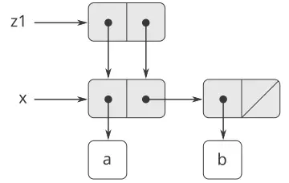

**الشكل 3.16:** القائمة `z1` المتشكّلة بـ`(cons x x)`.

وبخلاف [الشكل 3.16](/book/sicp/c3-modularity-objects-and-state/3-3/)، يُظهر [الشكل 3.17](/book/sicp/c3-modularity-objects-and-state/3-3/) البنية المُنشَأة بالتعريف الآتي

```scheme
(define z2 
  (cons (list 'a 'b) (list 'a 'b)))
```

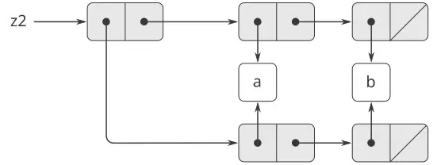

**الشكل 3.17:** القائمة `z2` المتشكّلة بـ`(cons (list 'a 'b) (list 'a 'b))`.

في هذه البنية، الأزواجُ في القائمتين `(a b)` متمايزةٌ، وإن كانت الرموزُ الفعليّةُ مُشارَكة.[^19]

فكلا `z1` و`z2` يمثّل «القائمة ذاتها»، `((a b) a b)`، إذا فكّرنا فيهما بوصفهما قائمة. وبصورةٍ عامّة، فإنّ المشاركة غيرُ قابلةٍ للكشف إطلاقًا إذا عملنا على القوائم باستخدام `cons` و`car` و`cdr` وحدها. غير أنّها تصبح ذا أهمّيّةٍ إذا سمحنا بمغيّراتٍ على بنية القائمة. ومثالٌ على الفرق الذي يمكن أن تُحدِثه المشاركة، انظر في الإجراء الآتي، الذي يُعدّل `car` البنية التي تُطبَّق عليها:

```scheme
(define (set-to-wow! x)
  (set-car! (car x) 'wow)
  x)
```

حتّى وإن كانت `z1` و`z2` «البنية ذاتها»، فإنّ تطبيق `set-to-wow!` عليهما يُنتج نتائجَ مختلفة. فمع `z1`، يُغيّر تعديل `car` الـ`cdr` أيضًا، لأنّ `z1` يتّحد فيه `car` و`cdr` في الزوج ذاته. وأمّا مع `z2`، فإنّ `car` و`cdr` متمايزان، لذا يُعدّل `set-to-wow!` الـ`car` فقط:

```scheme
z1
((a b) a b)

(set-to-wow! z1)
((wow b) wow b)

z2
((a b) a b)

(set-to-wow! z2)
((wow b) a b)
```

إحدى طرائق كشف المشاركة في بنى القوائم هي استخدام المُسَيِّم `eq?`، الذي عرّفناه في [2.3.1](https://sarabander.github.io/sicp/html/2_002e3.xhtml#g_t2_002e3_002e1) بوصفه طريقةً لاختبار تساوي رمزين. وبأكثر عموميّةٍ، يختبر `(eq? x y)` ما إذا كان `x` و`y` هما الكائن ذاته (أي ما إذا كان `x` و`y` متساويين بوصفهما مؤشّرين). وهكذا، فبـ`z1` و`z2` المعرَّفين في [الشكل 3.16](/book/sicp/c3-modularity-objects-and-state/3-3/) و[الشكل 3.17](/book/sicp/c3-modularity-objects-and-state/3-3/)، فإنّ `(eq? (car z1) (cdr z1))` صحيحة و`(eq? (car z2) (cdr z2))` خاطئة.

وكما سنرى في الأقسام التالية، يمكننا استغلال المشاركة لتوسيع ذخيرة بنيات البيانات التي يمكن تمثيلها بالأزواج توسيعًا كبيرًا. ومن جانبٍ آخر، فإنّ المشاركة يمكن أن تكون خطيرةً أيضًا، إذ إنّ التعديلات المُجرَاة على البنيات ستؤثّر في بنياتٍ أخرى تتشارك الأجزاء المُعدَّلة صدفةً. وينبغي استخدام عمليّات التغيير `set-car!` و`set-cdr!` بحذر؛ فما لم يكن لدينا فهمٌ جيّدٌ لكيفيّة مشاركة كائنات بياناتنا، فقد يؤدّي التغيير إلى نتائجَ غير متوقّعة.[^20]

> **التمرين 3.15:** ارسم مخطّطات الصناديق والمؤشّرات لتوضيح أثر `set-to-wow!` على البنيتين `z1` و`z2` أعلاه.

**التمرين 3.16:** يقرّر بن بيتدِل كتابة إجراءٍ لعدّ عدد الأزواج في أيّ بنية قوائم. «إنّه يسير»، يعلّل. «عدد الأزواج في أيّ بنيةٍ هو العدد في `car` زائد العدد في `cdr` زائد واحدٌ آخرُ لعدّ الزوج الحاليّ.» فيكتب بن الإجراء الآتي:

```scheme
(define (count-pairs x)
  (if (not (pair? x))
      0
      (+ (count-pairs (car x))
         (count-pairs (cdr x))
         1)))
```

أظهِر أنّ هذا الإجراء غيرُ صحيح. وبالتحديد، ارسم مخطّطات صناديق ومؤشّراتٍ تمثّل بنى قوائمٍ متكوّنةً من ثلاثة أزواجٍ بالضبط، يعيد إجراء بن بالنسبة إليها 3؛ ويعيد 4؛ ويعيد 7؛ ولا يعيد إطلاقًا.

> **التمرين 3.17:** ابتكر نسخةً صحيحةً من الإجراء `count-pairs` الوارد في [التمرين 3.16](/book/sicp/c3-modularity-objects-and-state/3-3/)، يعيد عدد الأزواج المتمايزة في أيّ بنية. (تلميح: اجتلِ البنية، محتفظًا ببنية بياناتٍ مساعِدةٍ تُستخدم لتتبّع الأزواج التي تمّ عدُّها سلفًا.)

> **التمرين 3.18:** اكتب إجراءً يفحص قائمةً ويحدّد ما إذا كانت تحتوي دورةً، أي ما إذا كان برنامجٌ يحاول إيجاد نهاية القائمة بأخذ `cdr`اتٍ متعاقبة سيدخل في حلقةٍ لا نهائيّة. وقد بنَت مثل هذه القوائم [التمرين 3.13](/book/sicp/c3-modularity-objects-and-state/3-3/).

> **التمرين 3.19:** أعِد [التمرين 3.18](/book/sicp/c3-modularity-objects-and-state/3-3/) باستخدام خوارزميّةٍ لا تتطلّب إلّا مقدارًا ثابتًا من المكان. (وهذا يستلزم فكرةً ذكيّةً للغاية.)

#### التغيير ليس سوى إحلال

حين عرّفنا البيانات المركّبة، لاحظنا في [2.1.3](https://sarabander.github.io/sicp/html/2_002e1.xhtml#g_t2_002e1_002e3) أنّ الأزواج يمكن تمثيلها بدلالة الإجراءات تمثيلًا محضًا:

```scheme
(define (cons x y)
  (define (dispatch m)
    (cond ((eq? m 'car) x)
          ((eq? m 'cdr) y)
          (else (error "Undefined 
                 operation: CONS" m))))
  dispatch)

(define (car z) (z 'car))
(define (cdr z) (z 'cdr))
```

والملاحظة ذاتها صحيحةٌ بالنسبة للبيانات القابلة للتغيير. فيمكننا تنفيذ كائنات البيانات القابلة للتغيير بوصفها إجراءاتٍ باستخدام الإحلال والحالة المحليّة. فمثلًا، يمكننا توسيع تنفيذ الأزواج المعطى أعلاه لمعالجة `set-car!` و`set-cdr!` بأسلوبٍ نظيرٍ للأسلوب الذي نفّذنا به الحسابات المصرفيّة باستخدام `make-account` في [3.1.1](https://sarabander.github.io/sicp/html/3_002e1.xhtml#g_t3_002e1_002e1):

```scheme
(define (cons x y)
  (define (set-x! v) (set! x v))
  (define (set-y! v) (set! y v))
  (define (dispatch m)
    (cond ((eq? m 'car) x)
          ((eq? m 'cdr) y)
          ((eq? m 'set-car!) set-x!)
          ((eq? m 'set-cdr!) set-y!)
          (else (error "Undefined 
                 operation: CONS" m))))
  dispatch)

(define (car z) (z 'car))
(define (cdr z) (z 'cdr))

(define (set-car! z new-value)
  ((z 'set-car!) new-value)
  z)

(define (set-cdr! z new-value)
  ((z 'set-cdr!) new-value)
  z)
```

إنّ الإحلال هو كلّ ما يلزم، نظريًّا، لتفسير سلوك البيانات القابلة للتغيير. فمجرّد أن نُدخل `set!` إلى لغتنا، نُثير جميع المسائل، لا مسائل الإحلال فحسب، بل مسائل البيانات القابلة للتغيير عمومًا.[^21]

**التمرين 3.20:** ارسم مخطّطات البيئات لتوضيح تقييم تتالي التعابير

```scheme
(define x (cons 1 2))
(define z (cons x x))

(set-car! (cdr z) 17)

(car x)
17
```

باستخدام تنفيذ الأزواج الإجرائيّ المعطى أعلاه. (قارن [التمرين 3.11](https://sarabander.github.io/sicp/html/3_002e2.xhtml#Exercise-3_002e11).)

#### 3.3.2 تمثيل الطوابير

إنّ المغيّرين `set-car!` و`set-cdr!` يمكّناننا من استخدام الأزواج لبناء بنيات بياناتٍ لا يمكن تشييدها بـ`cons` و`car` و`cdr` وحدها. ويُظهر هذا القسم كيف نستخدم الأزواج لتمثيل بنية بياناتٍ تُسمّى الطابور. وسيُظهر القسم [3.3.3](/book/sicp/c3-modularity-objects-and-state/3-3/) كيف نُمثّل بنيات بياناتٍ تُسمّى الجداول.

*الطابور (queue)* هو تسلسلٌ تُدرَج العناصر في أحد طرفيه (الذي يُسمّى *الخلفيّة* للطابور) وتُحذَف من الطرف الآخر (الذي يُسمّى *المقدّمة*). ويُظهر [الشكل 3.18](/book/sicp/c3-modularity-objects-and-state/3-3/) طابورًا خاليًا في بادئ الأمر تُدرَج فيه العنصران `a` و`b`. ثمّ يُحذَف `a`، ويُدرَج `c` و`d`، ويُحذَف `b`. ولأنّ العناصر تُحذَف دائمًا بالترتيب الذي أُدرِجت به، فإنّ الطابور يُسمّى أحيانًا *مِخزَن FIFO* (أي «الأوّل داخلًا هو الأوّل خارجًا»).

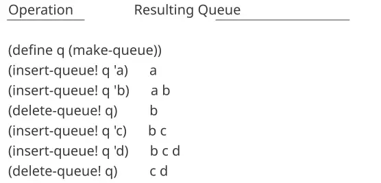

**الشكل 3.18:** عمليّات الطابور.

من حيث تجريد البيانات، يمكننا اعتبار الطابور معرَّفًا بمجموعة العمليّات الآتية:

بانٍ: `(make-queue)` يعيد طابورًا خاليًا (طابورًا لا يحتوي أيّ عناصر). محدِّدان:

```scheme
(empty-queue? ⟨queue⟩)
```

يختبر ما إذا كان الطابور خاليًا.

```scheme
(front-queue ⟨queue⟩)
```

يعيد الكائن الموجود في مقدّمة الطابور، مُعلنًا خطأً إذا كان خاليًا؛ ولا يُعدّل الطابور.

مغيّران:

```scheme
(insert-queue! ⟨queue⟩ ⟨item⟩)
```

يُدرِج العنصر في خلفيّة الطابور ويعيد الطابور المُعدَّل قيمةً له.

```scheme
(delete-queue! ⟨queue⟩)
```

يحذف العنصر الموجود في مقدّمة الطابور ويعيد الطابور المُعدَّل قيمةً له، مُعلنًا خطأً إذا كان الطابور خاليًا قبل الحذف.

ولأنّ الطابور تسلسلٌ من العناصر، فيمكننا بكلّ تأكيدٍ تمثيله بقائمةٍ اعتياديّة؛ فمقدّمة الطابور هي `car` القائمة، وإدراج عنصرٍ في الطابور يعني إلحاق عنصرٍ جديدٍ في نهاية القائمة، وحذف عنصرٍ من الطابور ليس سوى أخذ `cdr` القائمة. غير أنّ هذا التمثيل غيرُ كفؤ، لأنّ إدراج عنصرٍ يتطلّب منّا مسح القائمة حتّى نبلغ نهايتها. وبما أنّ الطريقة الوحيدة المتاحة لمسح القائمة هي بعمليّات `cdr` متعاقبة، فإنّ هذا المسح يتطلّب $Θ ( n )$ خطوةً لقائمةٍ من $n$ عنصرًا. ويغلُب تعديلٌ بسيطٌ لتمثيل القائمة على هذا العيب بالسماح بتنفيذ عمليّات الطابور بحيث تتطلّب $Θ ( 1 )$ خطوة؛ أي بحيث يكون عدد الخطوات اللازم مستقلًّا عن طول الطابور.

ينشأ الصّعب في تمثيل القائمة من الحاجة إلى المسح لإيجاد نهاية القائمة. وسبب حاجتنا إلى المسح هو أنّ الطريقة القياسيّة لتمثيل قائمةٍ بسلسلةٍ من الأزواج تُتيح لنا بسهولةٍ مؤشّرًا إلى بداية القائمة، لكنّها لا تُعطينا مؤشّرًا يسهل الوصولُ إليه إلى نهايتها. والتعديل الذي يتفادى هذا العيب هو تمثيل الطابور بقائمةٍ، مع مؤشّرٍ إضافيٍّ يُشير إلى الزوج الأخير في القائمة. وبذلك، حين نُدرِج عنصرًا، يمكننا الرجوع إلى مؤشّر الخلفيّة وتفادي مسح القائمة.

يُمثَّل الطابور، إذن، بزوجٍ من المؤشّرات، `front-ptr` و`rear-ptr`، التي تُشير، على التوالي، إلى الزوج الأوّل والزوج الأخير في قائمةٍ اعتياديّة. وبما أنّنا نودّ أن يكون الطابور كائنًا قابلًا للتمييز، فيمكننا استخدام `cons` لدمج المؤشّرين. وهكذا، سيكون الطابور نفسُه هو `cons` المؤشّرين. ويُوضيّح [الشكل 3.19](/book/sicp/c3-modularity-objects-and-state/3-3/) هذا التمثيل.

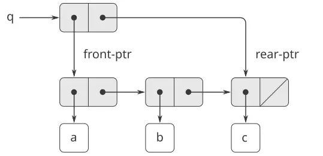

**الشكل 3.19:** تنفيذ طابورٍ بوصفه قائمةً ذات مؤشّري مقدّمةٍ وخلفيّة.

لتعريف عمليّات الطابور نستخدم الإجراءات الآتية، التي تُمكّننا من تحديد مؤشّري المقدّمة والخلفيّة للطابور وتعديلهما:

```scheme
(define (front-ptr queue) (car queue))
(define (rear-ptr queue) (cdr queue))
(define (set-front-ptr! queue item) 
  (set-car! queue item))
(define (set-rear-ptr! queue item) 
  (set-cdr! queue item))
```

يمكننا الآن تنفيذ عمليّات الطابور الفعليّة. وسنعتبر الطابور خاليًا إذا كان مؤشّر مقدّمتِه هو القائمة الخالية:

```scheme
(define (empty-queue? queue) 
  (null? (front-ptr queue)))
```

يُعيد الباني `make-queue`، بوصفه طابورًا خاليًا في بادئ الأمر، زوجًا كلٌّ من `car` و`cdr` فيه هو القائمة الخالية:

```scheme
(define (make-queue) (cons '() '()))
```

لاتّخاذ العنصر الموجود في مقدّمة الطابور، نُعيد `car` الزوج الذي يُشير إليه مؤشّر المقدّمة:

```scheme
(define (front-queue queue)
  (if (empty-queue? queue)
      (error "FRONT called with an 
              empty queue" queue)
      (car (front-ptr queue))))
```

لإدراج عنصرٍ في طابور، نتبع الطريقة التي تُشير نتيجتها في [الشكل 3.20](/book/sicp/c3-modularity-objects-and-state/3-3/). فنبدأ بإنشاء زوجٍ جديد، `car` فيه هو العنصر المُراد إدراجه و`cdr` فيه هو القائمة الخالية. فإن كان الطابور خاليًا في بادئ الأمر، نُعيّن مؤشّري مقدّمة الطابور وخلفيّته إلى هذا الزوج الجديد. وإلّا، نُعدّل الزوج الأخير في الطابور ليشير إلى الزوج الجديد، ونُعيّن مؤشّر الخلفيّة أيضًا إلى الزوج الجديد.

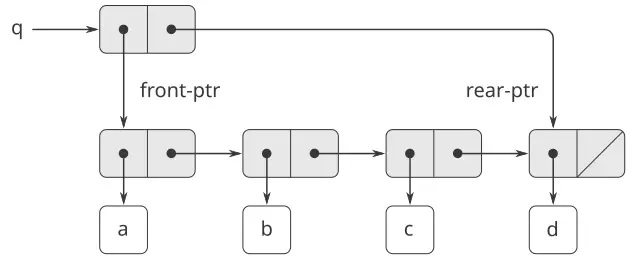

**الشكل 3.20:** نتيجة استخدام `(insert-queue! q 'd)` على الطابور في [الشكل 3.19](/book/sicp/c3-modularity-objects-and-state/3-3/).

```scheme
(define (insert-queue! queue item)
  (let ((new-pair (cons item '())))
    (cond ((empty-queue? queue)
           (set-front-ptr! queue new-pair)
           (set-rear-ptr! queue new-pair)
           queue)
          (else (set-cdr! (rear-ptr queue) 
                          new-pair)
                (set-rear-ptr! queue new-pair)
                queue))))
```

ولحذف العنصر الموجود في مقدّمة الطابور، نُعدّل مؤشّر المقدّمة فحسب بحيث يُشير الآن إلى العنصر الثاني في الطابور، والذي يمكن إيجاده باتباع مؤشّر `cdr` للعنصر الأوّل (انظر [الشكل 3.21](/book/sicp/c3-modularity-objects-and-state/3-3/)):[^22]

```scheme
(define (delete-queue! queue)
  (cond ((empty-queue? queue)
         (error "DELETE! called with 
                 an empty queue" queue))
        (else (set-front-ptr! 
               queue 
               (cdr (front-ptr queue)))
              queue)))
```

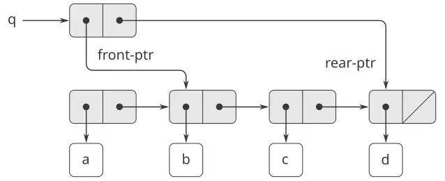

**الشكل 3.21:** نتيجة استخدام `(delete-queue! q)` على الطابور في [الشكل 3.20](/book/sicp/c3-modularity-objects-and-state/3-3/).

**التمرين 3.21:** يقرّر بن بيتدِل اختبار تنفيذ الطابور الموصوف أعلاه. فيُدخل الإجراءات إلى مفسّر Lisp ويبدأ بتجربتها:

```scheme
(define q1 (make-queue))

(insert-queue! q1 'a)
((a) a)

(insert-queue! q1 'b)
((a b) b)

(delete-queue! q1)
((b) b)

(delete-queue! q1)
(() b)
```

«كلّه خاطئ!» يشكو. «يُظهر ردّ المفسّر أنّ العنصر الأخير يُدرَج في الطابور مرّتين. وحين أحذف العنصرين كلَيهما، يبقى `b` الثاني موجودًا، فالطابور ليس خاليًا، مع أنّه من المفترض أن يكون كذلك.» وتقترح إيفا لو آتر أنّ بن قد أساء فهم ما يجري. «ليس الأمر أنّ العناصر تدخل الطابور مرّتين،» تشرح. «إنّه فقط أنّ الطابعة القياسيّة في Lisp لا تعرف كيف تُفسّر تمثيل الطابور. فإن أردت رؤية الطابور مطبوعًا بصورةٍ صحيحة، فسيلزمك تعريف إجراء طباعةٍ خاصّ بك للطوابير.» اشرح عمّا تتكلّم إيفا لو. وبالتحديد، أظهِر لماذا تُنتج أمثلة بن النتائج المطبوعة التي تُنتجها. وعرّف إجراءً `print-queue` يأخذ طابورًا مُدخَلًا ويطبع تسلسل العناصر في الطابور.

**التمرين 3.22:** بدلًا من تمثيل الطابور بزوجٍ من المؤشّرات، يمكننا بناء طابورٍ بوصفه إجراءً ذا حالةٍ محلّيّة. وستتكوّن الحالة المحليّة من مؤشّرين إلى بداية قائمةٍ اعتياديّةٍ ونهايتها. وهكذا، سيكون الإجراء `make-queue` على الصورة

```scheme
(define (make-queue)
  (let ((front-ptr … )
        (rear-ptr … ))
    ⟨definitions of internal procedures⟩
    (define (dispatch m) …)
    dispatch))
```

أكمل تعريف `make-queue` وأعطِ تنفيذ عمليّات الطابور باستخدام هذا التمثيل.

> **التمرين 3.23:** *الطابور ذو الطرفين (deque)* هو تسلسلٌ يمكن إدراج العناصر فيه وحذفها من المقدّمة أو من الخلفيّة. وعمليّات الطوابير ذوات الأطراف هي الباني `make-deque`، والمُسَيِّم `empty-deque?`، والمحدِّدات `front-deque` و`rear-deque`، والمغيّرات `front-insert-deque!` و`rear-insert-deque!` و`front-delete-deque!` و`rear-delete-deque!`. أظهِر كيف نُمثّل الطوابير ذوات الأطراف باستخدام الأزواج، وأعطِ تنفيذ العمليّات.[^23] وينبغي أن تُنجَز جميع العمليّات في $Θ ( 1 )$ خطوة.

#### 3.3.3 تمثيل الجداول

حين درسنا طرائق مختلفةً لتمثيل المجموعات في [الفصل 2](https://sarabander.github.io/sicp/html/Chapter-2.xhtml#Chapter-2)، ذكرنا في [2.3.3](https://sarabander.github.io/sicp/html/2_002e3.xhtml#g_t2_002e3_002e3) مهمّة صون جدولٍ من السجلّات مُفهرَسًا بمفاتيح تمييزٍ. وفي تنفيذ البرمجة الموجَّهة بالبيانات في [2.4.3](https://sarabander.github.io/sicp/html/2_002e4.xhtml#g_t2_002e4_002e3)، استخدمنا جداول ثنائيّة الأبعاد استخدامًا واسعًا، تُخزَّن المعلومات فيها وتُستخرَجُ باستخدام مفتاحين. وهنا نرى كيف نبني الجداول بوصفها بنى قوائمَ قابلةً للتغيير.

نبدأ بالنظر في جدولٍ أحاديّ الأبعاد، تُخزَّن فيه كلّ قيمةٍ تحت مفتاحٍ واحدٍ. ونُنفّذ الجدول بوصفه قائمةً من السجلّات، يُنفَّذ كلٌّ منها بوصفه زوجٍ متكوّنٍ من مفتاحٍ ومن القيمة المرتبطة به. وتُلصَق السجلّات معًا لتشكيل قائمةٍ بأزواجٍ لاصقةٍ يشير `car` كلٍّ منها إلى السجلّ الذي يليه. وتُسمّى هذه الأزواج اللاصقة *العمود الفقريّ (backbone)* للجدول. ولكي يكون لدينا موضعٌ يمكننا تغييره حين نُضيف سجلًّا جديدًا إلى الجدول، نبني الجدول بوصفه *قائمةً مُترَأَسة (headed list)*. وللقائمة المُترَأَسة زوجٌ خاصٌّ في رأس عمودها الفقريّ يحمل «سجلًّا» وهميًّا - وهو في هذه الحالة الرمز `*table*` المُختار اعتباطيًّا. ويُظهر [الشكل 3.22](/book/sicp/c3-modularity-objects-and-state/3-3/) مخطّط الصناديق والمؤشّرات للجدول

```scheme
a:  1
b:  2
c:  3
```

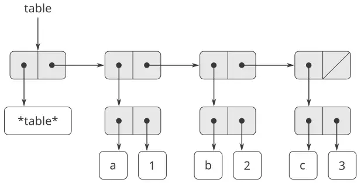

**الشكل 3.22:** جدولٌ مُمثَّلٌ بقائمةٍ مُترَأَسة.

لاستخراج المعلومات من جدولٍ نستخدم الإجراء `lookup`، الذي يأخذ مفتاحًا معطًى ويعيد القيمة المرتبطة به (أو القيمة false إن لم تُخزَّن أيّ قيمةٍ تحت ذلك المفتاح). ويُعرَّف `Lookup` بدلالة العمليّة `assoc`، التي تتوقّع مفتاحًا وقائمة سجلّاتٍ كمعطيّين. ولاحِظ أنّ `assoc` لا ترى السجلّ الوهميّ إطلاقًا. ويُعيد `Assoc` السجلّ الذي يكون المفتاح المعطى `car` فيه.[^24] ثمّ يتحقّق `Lookup` من أنّ السجلّ الناتج من `assoc` ليس false، ويعيد قيمة السجلّ (أي `cdr` فيه).

```scheme
(define (lookup key table)
  (let ((record (assoc key (cdr table))))
    (if record
        (cdr record)
        false)))

(define (assoc key records)
  (cond ((null? records) false)
        ((equal? key (caar records)) 
         (car records))
        (else (assoc key (cdr records)))))
```

لإدراج قيمةٍ في جدول تحت مفتاحٍ محدَّد، نستخدم `assoc` أوّلًا لنرى ما إذا كان هناك سجلٌّ في الجدول بهذا المفتاح سلفًا. فإن لم يكن، نُشكّل سجلًّا جديدًا بِـ`cons` المفتاح مع القيمة، ونُدرِج هذا في رأس قائمة سجلّات الجدول، بعد السجلّ الوهميّ. فإن كان هناك سجلٌّ بهذا المفتاح سلفًا، نُعيّن `cdr` هذا السجلّ إلى القيمة الجديدة المعيَّنة. ويُتيح لنا ترويسة الجدول موضعًا ثابتًا نُعدّله لإدراج السجلّ الجديد.[^25]

```scheme
(define (insert! key value table)
  (let ((record (assoc key (cdr table))))
    (if record
        (set-cdr! record value)
        (set-cdr! table
                  (cons (cons key value) 
                        (cdr table)))))
  'ok)
```

لبناء جدول جديد، نُنشئ ببساطةٍ قائمةً تحتوي الرمز `*table*`:

```scheme
(define (make-table)
  (list '*table*))
```

#### الجداول ثنائيّة الأبعاد

في الجدول ثنائيّ الأبعاد، تُفهرَس كلّ قيمةٍ بمفتاحين. فيمكننا تشييد جدولٍ كهذا بوصفه جدولًا أحاديّ الأبعاد يُحدّد كلّ مفتاحٍ فيه جدولًا فرعيًّا. ويُظهر [الشكل 3.23](/book/sicp/c3-modularity-objects-and-state/3-3/) مخطّط الصناديق والمؤشّرات للجدول

```
math:  +: 43    letters:  a: 97
       -: 45              b: 98
       *: 42
```

الذي يحتوي على جدولين فرعيّين. (ولا تحتاج الجداول الفرعيّة إلى رمز ترويسةٍ خاصّ، إذ إنّ المفتاح الذي يُحدّد الجدول الفرعيّ يؤدّي هذا الغرض.)

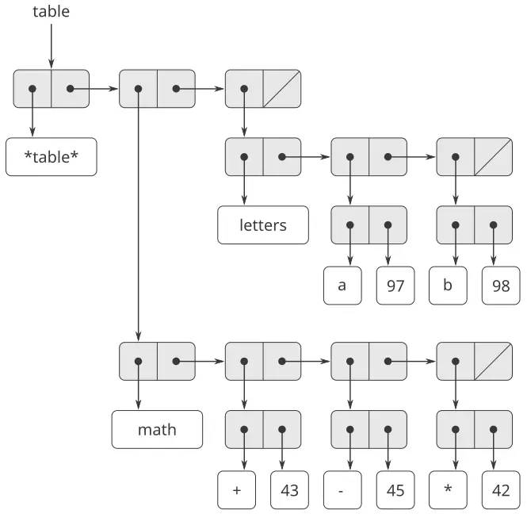

**الشكل 3.23:** جدولٌ ثنائيّ الأبعاد.

حين نبحث عن عنصر، نستخدم المفتاح الأوّل لتحديد الجدول الفرعيّ الصحيح. ثمّ نستخدم المفتاح الثاني لتحديد السجلّ داخل الجدول الفرعيّ.

```scheme
(define (lookup key-1 key-2 table)
  (let ((subtable (assoc key-1 (cdr table))))
    (if subtable
        (let ((record 
               (assoc key-2 (cdr subtable))))
          (if record (cdr record) false))
        false)))
```

لإدراج عنصرٍ جديدٍ تحت زوجٍ من المفاتيح، نستخدم `assoc` لمعرفة ما إذا كان هناك جدولٌ فرعيٌّ مخزَّنٌ تحت المفتاح الأوّل. فإن لم يكن، نبني جدولًا فرعيًّا جديدًا يحتوي السجلّ الوحيد (`key-2`، `value`) ونُدرِجه في الجدول تحت المفتاح الأوّل. فإن كان هناك جدولٌ فرعيٌّ للمفتاح الأوّل سلفًا، نُدرِج السجلّ الجديد في هذا الجدول الفرعيّ، باستخدام طريقة الإدراج للجداول أحاديّة الأبعاد الموصوفة أعلاه:

```scheme
(define (insert! key-1 key-2 value table)
  (let ((subtable (assoc key-1 (cdr table))))
    (if subtable
        (let ((record 
               (assoc key-2 (cdr subtable))))
          (if record
              (set-cdr! record value)
              (set-cdr! 
               subtable
               (cons (cons key-2 value)
                     (cdr subtable)))))
        (set-cdr! 
         table
         (cons (list key-1 (cons key-2 value))
               (cdr table)))))
  'ok)
```

#### إنشاء جداول محلّيّة

تأخذ العمليّتان `lookup` و`insert!` المعرَّفتان أعلاه الجدول معطًى. وهذا يمكّننا من استخدام برامج تصل إلى أكثر من جدول. وهناك طريقة أخرى للتعامل مع عدّة جداول، وهي تخصيص إجراءَي `lookup` و`insert!` منفصلين لكلّ جدول. ويمكننا فعل ذلك بتمثيل الجدول إجرائيًّا، بوصفه كائنًا يحافظ على جدول داخليّ كجزءٍ من حالته المحليّة. وحين يُرسَل إليه رسالةٌ مناسبة، يُتيح «كائن الجدول» هذا الإجراء الذي يُعمل به على الجدول الداخليّ. وفيما يلي مولِّدٌ للجداول ثنائيّة الأبعاد المُمثَّلة بهذه الطريقة:

```scheme
(define (make-table)
  (let ((local-table (list '*table*)))
    (define (lookup key-1 key-2)
      (let ((subtable 
             (assoc key-1 (cdr local-table))))
        (if subtable
            (let ((record 
                   (assoc key-2 
                          (cdr subtable))))
              (if record (cdr record) false))
            false)))
    (define (insert! key-1 key-2 value)
      (let ((subtable 
             (assoc key-1 (cdr local-table))))
        (if subtable
            (let ((record 
                   (assoc key-2 
                          (cdr subtable))))
              (if record
                  (set-cdr! record value)
                  (set-cdr! 
                   subtable
                   (cons (cons key-2 value)
                         (cdr subtable)))))
            (set-cdr! 
             local-table
             (cons (list key-1
                         (cons key-2 value))
                   (cdr local-table)))))
      'ok)
    (define (dispatch m)
      (cond ((eq? m 'lookup-proc) lookup)
            ((eq? m 'insert-proc!) insert!)
            (else (error "Unknown operation: 
                          TABLE" m))))
    dispatch))
```

وباستخدام `make-table`، يمكننا تنفيذ عمليّتَي `get` و`put` المستخدمتين في [2.4.3](https://sarabander.github.io/sicp/html/2_002e4.xhtml#g_t2_002e4_002e3) لأجل البرمجة الموجَّهة بالبيانات، كما يلي:

```scheme
(define operation-table (make-table))
(define get (operation-table 'lookup-proc))
(define put (operation-table 'insert-proc!))
```

يأخذ `Get` كمعطياتٍ مفتاحين، ويأخذ `put` كمعطياتٍ مفتاحين وقيمة. وتصل العمليّتان إلى الجدول المحلّيّ نفسه، المُحاط داخل الكائن المنشأ بنداء `make-table`.

> **التمرين 3.24:** في تنفيذَي الجدول المذكورين أعلاه، تُختبر مفاتيح التساوي باستخدام `equal?` (التي يناديها `assoc`). وهذا ليس الاختبار الملائم دائمًا. فإنّه قد يكون لدينا جدولٌ ذو مفاتيح عدديّة لا نحتاج فيه إلى مطابقة تامّة للعدد الذي نبحث عنه، بل فقط عددٌ يقع ضمن نطاق تحمّلٍ معيّن منه. صمّم بانِي جداول `make-table` يأخذ كمعطىً إجراء `same-key?` سيُستخدم لاختبار «تساوي» المفاتيح. وينبغي أن يُعيد `Make-table` إجراء `dispatch` يمكن استخدامه للوصول إلى إجراءَي `lookup` و`insert!` الملائمين لجدولٍ محلّيّ.

> **التمرين 3.25:** بتعميم الجداول أحاديّة وثنائيّة الأبعاد، أظهِر كيف يمكن تنفيذ جدولٍ تُخزَّن فيه القيم تحت عددٍ اعتباطيّ من المفاتيح، وقد تُخزَّن قيمٌ مختلفة تحت أعدادٍ مختلفة من المفاتيح. وينبغي أن يأخذ إجراءَا `lookup` و`insert!` كمدخلٍ قائمةً من المفاتيح تُستخدم للوصول إلى الجدول.

> **التمرين 3.26:** للبحث في جدولٍ منفَّذٍ كما هو أعلاه، يلزم المرء أن يمسح قائمة السجلّات. وهذا أساسًا هو تمثيل القائمة غير المرتّبة الوارد في [2.3.3](https://sarabander.github.io/sicp/html/2_002e3.xhtml#g_t2_002e3_002e3). فإنّ من الأنفع للجداول الكبيرة أن تُبنى بصيغةٍ مختلفة. صِف تنفيذًا لجدولٍ تُنظَّم فيه سجلّات (المفتاح، القيمة) باستخدام شجرةٍ ثنائيّة، بافتراض أنّ المفاتيح يمكن ترتيبها بطريقةٍ ما (عدديًّا أو أبجديًّا مثلًا). (قارن [التمرين 2.66](https://sarabander.github.io/sicp/html/2_002e3.xhtml#Exercise-2_002e66) من [الفصل 2](https://sarabander.github.io/sicp/html/Chapter-2.xhtml#Chapter-2).)

**التمرين 3.27:** *حفظ النتائج* (والمسمّى أيضًا *الجدولة*) تقنيّةٌ تمكّن إجراءً من تسجيل قيمٍ حُسبت سلفًا في جدولٍ محلّيّ. وهذه التقنيّة قادرةٌ على إحداث فرقٍ هائل في أداء البرنامج. فالإجراء ذو النتائج المحفوظة يحتفظ بجدولٍ تُخزَّن فيه قيم النداءات السابقة، مستخدمًا المعطيات التي أنتجت تلك القيم كمفاتيح لها. وحين يُطلَب من الإجراء ذي النتائج المحفوظة أن يحسب قيمةً، فإنّه يتحقّق أوّلًا من الجدول ليرى ما إذا كانت القيمة موجودةً فيه سلفًا، فإن كانت كذلك أعاد تلك القيمة فحسب. وإلّا، فإنّه يحسب القيمة الجديدة بالطريقة المعتادة ويخزّنها في الجدول. ومن أمثلة حفظ النتائج، تذكّر - من [1.2.2](https://sarabander.github.io/sicp/html/1_002e2.xhtml#g_t1_002e2_002e2) - العمليّة الأسّيّة لاحتساب أعداد فيبوناتشي:

```scheme
(define (fib n)
  (cond ((= n 0) 0)
        ((= n 1) 1)
        (else (+ (fib (- n 1))
                 (fib (- n 2))))))
```

والنسخة ذات النتائج المحفوظة من الإجراء نفسه هي

```scheme
(define memo-fib
  (memoize 
   (lambda (n)
     (cond ((= n 0) 0)
           ((= n 1) 1)
           (else 
            (+ (memo-fib (- n 1))
               (memo-fib (- n 2))))))))
```

وحيث إنّ مُحفِظ النتائج معرَّفٌ كما يلي:

```scheme
(define (memoize f)
  (let ((table (make-table)))
    (lambda (x)
      (let ((previously-computed-result 
             (lookup x table)))
        (or previously-computed-result
            (let ((result (f x)))
              (insert! x result table)
              result))))))
```

ارسم مخطط البيئة لتحليل احتساب `(memo-fib 3)`. فسّر لماذا يحسب `memo-fib` العدد الفيبوناتشيّ الـ$n^{th}$ بعددٍ من الخطوات يتناسب مع $n$ . فهل كان هذا المخطّط لا يزال يعمل لو كنّا قد عرّفنا `memo-fib` ببساطةٍ على أنّه `(memoize fib)`؟

#### 3.3.4 محاكي الدوائر الرقميّة

تصميم النظم الرقميّة المعقّدة، كالحواسيب مثلًا، نشاطٌ هندسيٌّ مهمّ. وتُبنى النظم الرقميّة بربط عناصر بسيطة بعضها ببعض. وعلى رغم أنّ سلوك هذه العناصر الفرديّة بسيط، فإنّ الشبكات المكوّنة منها قد يكون لها سلوكٌ معقّدٌ جدًّا. ومحاكاة تصاميم الدوائر المقترحة بالحاسوب أداةٌ مهمّةٌ يستخدمها مهندسو النظم الرقميّة. وفي هذا القسم نصمّم نظامًا لأداء محاكاة المنطق الرقميّ. وهذا النظام يمثّل نموذجًا لنوعٍ من البرامج يُسمّى *محاكاة موجَّهة بالأحداث (event-driven simulation)*، وفيه تُطلق الأفعال («الأحداث») أحداثًا أخرى تجري في وقتٍ لاحق، وهي التي تُطلق بدورها أحداثًا أكثر، وهكذا دواليك.

سيتكوّن نموذجنا الحسابيّ للدائرة من كائناتٍ تقابل المكوّنات الأوّليّة التي تُبنى منها الدائرة. فهناك *الأسلاك (wires)*، التي تحمل *الإشارات الرقميّة (digital signals)*. وقد تحمل الإشارة الرقميّة في أيّ لحظةٍ إحدى قيمتين محتملتين فقط، هما 0 و1. وهناك أيضًا أنواعٌ متعدّدةٌ من *صناديق الدوالّ (function boxes)* الرقميّة، التي تربط الأسلاك الحاملة لإشارات الدخل بأسلاك أخرى حاملة لإشارات الخرج. وهذه الصناديق تُنتج إشارات خرجٍ محسوبةً من إشارات دخلها. وتتأخّر إشارة الخرج زمنًا يعتمد على نوع صندوق الدالّة. فإنّ *العاكس (inverter)* صندوقُ دالّةٍ أوّليّ يعكس مدخله. فإن تغيّرت إشارة دخل عاكسٍ إلى 0، فإنّه - بعد تأخير عاكسٍ واحد (inverter-delay) - سيغيّر العاكس إشارة خرجه إلى 1. وإن تغيّرت إشارة دخل عاكسٍ إلى 1، فإنّه - بعد تأخير عاكسٍ واحد - سيغيّر العاكس إشارة خرجه إلى 0. ونحن نرسم العاكس رمزيًّا كما في [الشكل 3.24](/book/sicp/c3-modularity-objects-and-state/3-3/). أمّا *بوابة و (and-gate)*، الموضّحة أيضًا في الشكل 3.24، فهي صندوق دالّةٍ أوّليّ له مدخلان وخرجٌ واحد. فإنّها تضبط إشارة خرجها على قيمةٍ هي *الو المنطقيّ (logical and)* للمدخلين. أي أنّه إذا صارت إشارتا دخلها كلتاهما 1، فإنّها - بعد تأخير بوابة وٍ واحد (and-gate-delay) - ستُجبر إشارة خرجها على أن تصير 1؛ وإلّا فسيكون الخرج 0. و*بوابة أو (or-gate)* صندوق دالّةٍ أوّليّ مشابه ذو مدخلين يضبط إشارة خرجها على قيمةٍ هي *أو المنطقيّ* للمدخلين. أي أنّ الخرج سيصير 1 إذا كانت إحدى إشارتَي الدخل - على الأقلّ - تساوي 1؛ وإلّا فسيكون الخرج 0.

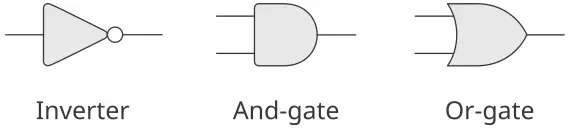

**الشكل 3.24:** الدوالّ الأوّليّة في محاكي المنطق الرقميّ.

يمكننا وصل الدوالّ الأوّليّة بعضها ببعضٍ لبناء دوالّ أكثر تعقيدًا. ولإنجاز ذلك، نوصِل مخارج بعض صناديق الدوالّ بمداخلات صناديق أخرى. فإنّ دائرة *جامع النصف (half-adder)* - مثلًا - الموضّحة في [الشكل 3.25](/book/sicp/c3-modularity-objects-and-state/3-3/) تتكوّن من بوابة أو وبوابتَي و وعاكس. وهي تأخذ إشارتَي دخل، A وB، ولها إشارتا خرج، S وC. وستصير S تساوي 1 متى كان واحدٌ فقط من A وB يساوي 1، وستصير C تساوي 1 متى كان A وB كلاهما يساوي 1. ونستطيع أن نرى من الشكل أنّ المخارج - بسبب التأخيرات الداخلة في الأمر - قد تُولَّد في أزمنةٍ مختلفة. والعديد من صعوبات تصميم الدوائر الرقميّة ينشأ من هذه الحقيقة.

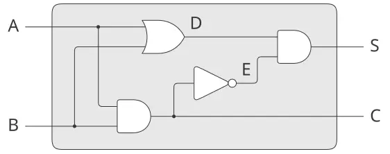

**الشكل 3.25:** دائرة جامع النصف.

سنبني الآن برنامجًا لنمذجة دوائر المنطق الرقميّ التي نريد دراستها. وسينشئ البرنامج كائناتٍ حسابيّةً تنمذج الأسلاك، وهي التي ستـ«تحتفظ» بالإشارات. وستُنمذج صناديق الدوالّ بإجراءاتٍ تفرض العلاقات الصحيحة بين الإشارات.

سيكون أحد العناصر الأساسيّة في محاكاتنا إجراءً اسمه `make-wire`، وهو الذي يبني الأسلاك. فإنّه يمكننا - مثلًا - بناء ستّة أسلاك كما يلي:

```scheme
(define a (make-wire))
(define b (make-wire))
(define c (make-wire))
(define d (make-wire))
(define e (make-wire))
(define s (make-wire))
```

نحن نُرفِق صندوق دالّةٍ بمجموعةٍ من الأسلاك بنداء إجراءٍ يبني ذلك النوع من الصناديق. ومعطيات إجراء الباني هي الأسلاك التي ستُرفَق بالصندوق. فإنّه إذا افترضنا أنّنا نستطيع بناء بوابات و وبوابات أو وعواكس، فيمكننا توصيل مكوّنات نصف الجامع الموضّح في [الشكل 3.25](/book/sicp/c3-modularity-objects-and-state/3-3/) بعضها ببعض كما يلي:

```scheme
(or-gate a b d)
ok

(and-gate a b c)
ok

(inverter c e)
ok

(and-gate d e s)
ok
```

والأفضل من ذلك، أنّنا نستطيع تسمية هذه العمليّة صراحةً بتعريف إجراءٍ اسمه `half-adder` يبني هذه الدائرة، إذا أُعطي الأسلاك الخارجيّة الأربعة التي ستُرفَق بنصف الجامع:

```scheme
(define (half-adder a b s c)
  (let ((d (make-wire)) (e (make-wire)))
    (or-gate a b d)
    (and-gate a b c)
    (inverter c e)
    (and-gate d e s)
    'ok))
```

وفائدة هذا التعريف أنّنا نستطيع استخدام `half-adder` ذاته كوحدة بناءٍ في إنشاء دوائر أكثر تعقيدًا. فإنّ [الشكل 3.26](/book/sicp/c3-modularity-objects-and-state/3-3/) - مثلًا - يُظهر *جامعًا كاملًا (full-adder)* مؤلّفًا من نصفَي جامعٍ وبوابة أو.[^26] ونستطيع بناء جامعٍ كاملٍ كما يلي:

```scheme
(define (full-adder a b c-in sum c-out)
  (let ((c1 (make-wire)) 
        (c2 (make-wire))
        (s  (make-wire)))
    (half-adder b c-in s c1)
    (half-adder a s sum c2)
    (or-gate c1 c2 c-out)
    'ok))
```

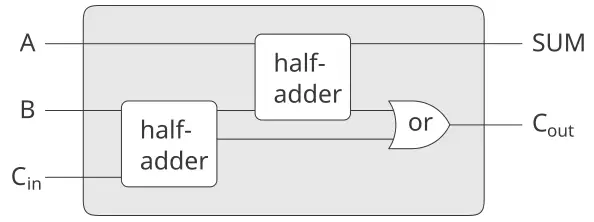

**الشكل 3.26:** دائرة جامع كامل.

وبعد أن عرّفنا `full-adder` كإجراءٍ، يمكننا الآن استخدامه كوحدة بناءٍ لإنشاء دوائر أكثر تعقيدًا بعد. (انظر [التمرين 3.30](/book/sicp/c3-modularity-objects-and-state/3-3/) مثلًا.)

في الجوهر، يزوّدنا محاكينا بالأدوات اللازمة لبناء لغة الدوائر. فإذا تبنّينا المنظور العامّ على اللغات الذي تناولنا به دراسة Lisp في [1.1](https://sarabander.github.io/sicp/html/1_002e1.xhtml#g_t1_002e1)، فإنّنا نستطيع القول إنّ صناديق الدوالّ الأوّليّة تُشكّل العناصر الأوّليّة للغة، وإنّ توصيل الصناديق بعضها ببعضٍ يُوفّر وسيلة تركيب، وإنّ تحديد أنماط التوصيل كإجراءاتٍ يؤدّي دور وسيلة تجريد.

#### صناديق الدوالّ الأوّليّة

تُنفّذ صناديق الدوالّ الأوّليّة «القوى» التي يؤثّر بوساطتها تغيّر الإشارة على سلكٍ واحدٍ في إشارات الأسلاك الأخرى. ولبناء صناديق الدوالّ، نستخدم العمليّات الآتية على الأسلاك:

- `(get-signal ⟨wire⟩)` يعيد القيمة الحاليّة للإشارة على السلك.
- `(set-signal! ⟨wire⟩ ⟨new value⟩)` يغيّر قيمة الإشارة على السلك إلى القيمة الجديدة.
- `(add-action! ⟨wire⟩ ⟨procedure of no arguments⟩)` يُقرّر أنّ الإجراء المحدَّد ينبغي أن يُنفَّذ كلّما تغيّرت قيمة الإشارة على السلك. وهذه الإجراءات هي الوسيلة التي تُنقل بها تغيّرات قيمة الإشارة على السلك إلى الأسلاك الأخرى.

وبالإضافة إلى ذلك، سنستفيد من إجراءٍ اسمه `after-delay` يأخذ تأخيرًا زمنيًّا وإجراءً يُنفَّذ، ثمّ ينفّذ الإجراء المعطى بعد التأخير المعطى.

وباستخدام هذه الإجراءات، يمكننا تعريف الدوالّ الأوّليّة للمنطق الرقميّ. ولوصْل مدخلٍ بخرجٍ بواسطة عاكس، نستخدم `add-action!` لربط سلك الدخل بإجراءٍ سيُنفَّذ كلّما تغيّرت قيمة الإشارة على سلك الدخل. وهذا الإجراء يحسب `logical-not` لإشارة الدخل، ثمّ - بعد تأخير عاكس واحد (`inverter-delay`) - يضبط إشارة الخرج لتكون هذه القيمة الجديدة:

```scheme
(define (inverter input output)
  (define (invert-input)
    (let ((new-value 
           (logical-not (get-signal input))))
      (after-delay 
       inverter-delay
       (lambda ()
         (set-signal! output new-value)))))
  (add-action! input invert-input)
  'ok)

(define (logical-not s)
  (cond ((= s 0) 1)
        ((= s 1) 0)
        (else (error "Invalid signal" s))))
```

أمّا بوابة و فأكثر تعقيدًا بعض الشيء. فينبغي أن يُنفَّذ إجراء الفعل إذا تغيّر أيٌّ من مدخلي البوابة. وهو يحسب `logical-and` (باستخدام إجراءٍ نظير `logical-not`) قيمتَي الإشارتين على سلكَي الدخل، ويُعِدّ تغيّرًا إلى القيمة الجديدة ليجري على سلك الخرج بعد تأخير بوابة وٍ واحد (`and-gate-delay`).

```scheme
(define (and-gate a1 a2 output)
  (define (and-action-procedure)
    (let ((new-value
           (logical-and (get-signal a1) 
                        (get-signal a2))))
      (after-delay 
       and-gate-delay
       (lambda ()
         (set-signal! output new-value)))))
  (add-action! a1 and-action-procedure)
  (add-action! a2 and-action-procedure)
  'ok)
```

> **التمرين 3.28:** عرّف بوابة أو كصندوق دالّةٍ أوّليّ. وينبغي أن يكون باني `or-gate` خاصّتك شبيهًا بـ`and-gate`.

> **التمرين 3.29:** ثمّة طريقةٌ أخرى لبناء بوابة أو، وهي كجهاز منطقٍ رقميّ مركّب مبنيٍّ من بوابات و وعواكس. عرّف إجراءً `or-gate` يُنجز ذلك. فما مدّة تأخير بوابة أو بدلالة `and-gate-delay` و`inverter-delay`؟

> **التمرين 3.30:** يُظهر [الشكل 3.27](/book/sicp/c3-modularity-objects-and-state/3-3/) *جامعًا تراكميّ الانتشار (ripple-carry adder)* متشكّلًا من ربط $n$ من الجامعات الكاملة بعضها في إثر بعض. وهذه هي أبسط صيغةٍ من الجامع المتوازي لجمع عددين ثنائيَّين كلٌّ منهما $n$ بِتّ. والمدخلان $A_{1}$ و$A_{2}$ و$A_{3}$ و… و$A_{n}$ و$B_{1}$ و$B_{2}$ و$B_{3}$ و… و$B_{n}$ هما العددان الثنائيّان اللذان يُجمعان (وكلٌّ من $A_{k}$ و$B_{k}$ هو 0 أو 1). والدائرة تُنتج $S_{1}$ و$S_{2}$ و$S_{3}$ و… و$S_{n}$ ، وهي بِتّات $n$ الخاصة بالمجموع، و$C$ ، وهي الحاملة الناتجة عن الجمع. اكتب إجراءً `ripple-carry-adder` يُولّد هذه الدائرة. وينبغي أن يأخذ الإجراء كمعطياتٍ ثلاث قوائم من $n$ سلكًا لكلٍّ منها - الـ$A_{k}$ والـ$B_{k}$ والـ$S_{k}$ - وسلكًا آخر $C$ . والعائق الرئيسيّ في الجامع التراكميّ الانتشار هو ضرورة انتظار انتشار إشارات الحمل. فما التأخير اللازم للحصول على الخرج الكامل من جامع تراكميّ الانتشار ذي $n$ بِتّ، معبَّرًا عنه بدلالة تأخيرات بوابات و وبوابات أو والعواكس؟

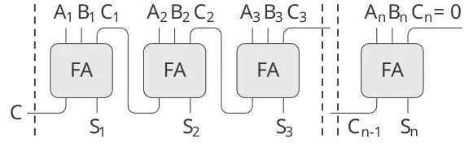

**الشكل 3.27:** جامع تراكميّ الانتشار للأعداد ذات الـ$n$ بِتّ.

#### تمثيل الأسلاك

سيكون السلك في محاكاتنا كائنًا حسابيًّا له متغيّرا حالة محلّيّان: `signal-value` (يُفترض مبدئيًّا أنّه 0) ومجموعةٌ من `action-procedures` تُنفَّذ متى تغيّرت قيمة الإشارة. ونحن نُنفّذ السلك - مستخدمين أسلوب تمرير الرسائل - كمجموعةٍ من الإجراءات المحلّيّة إلى جانب إجراء `dispatch` ينتخب العمليّة المحلّيّة الملائمة، تمامًا كما فعلنا مع كائن الحساب المصرفيّ البسيط في [3.1.1](https://sarabander.github.io/sicp/html/3_002e1.xhtml#g_t3_002e1_002e1):

```scheme
(define (make-wire)
  (let ((signal-value 0) 
        (action-procedures '()))
    (define (set-my-signal! new-value)
      (if (not (= signal-value new-value))
          (begin (set! signal-value new-value)
                 (call-each 
                  action-procedures))
          'done))
    (define (accept-action-procedure! proc)
      (set! action-procedures 
            (cons proc action-procedures))
      (proc))
    (define (dispatch m)
      (cond ((eq? m 'get-signal) 
             signal-value)
            ((eq? m 'set-signal!) 
             set-my-signal!)
            ((eq? m 'add-action!) 
             accept-action-procedure!)
            (else (error "Unknown operation: 
                          WIRE" m))))
    dispatch))
```

يختبر الإجراء المحلّيّ `set-my-signal!` ما إذا كانت قيمة الإشارة الجديدة تُغيّر الإشارة على السلك. فإن كان الأمر كذلك، فإنّه ينفّذ كلّ إجراءٍ من إجراءات الفعل، باستخدام الإجراء `call-each` الآتي، الذي ينادي كلّ عنصرٍ في قائمةٍ من الإجراءات عديمة المعطيات:

```scheme
(define (call-each procedures)
  (if (null? procedures)
      'done
      (begin ((car procedures))
             (call-each (cdr procedures)))))
```

والإجراء المحلّيّ `accept-action-procedure!` يُضيف الإجراء المعطى إلى قائمة الإجراءات التي ستُنفَّذ، ثمّ ينفّذ الإجراء الجديد مرّةً واحدة. (انظر [التمرين 3.31](/book/sicp/c3-modularity-objects-and-state/3-3/).)

وبعد إعداد إجراء `dispatch` المحلّيّ كما حُدِّد، فإنّنا نستطيع توفير الإجراءات الآتية للوصول إلى العمليّات المحلّيّة على الأسلاك:[^27]

```scheme
(define (get-signal wire)
  (wire 'get-signal))
(define (set-signal! wire new-value)
  ((wire 'set-signal!) new-value))
(define (add-action! wire action-procedure)
  ((wire 'add-action!) action-procedure))
```

والأسلاك - التي لها إشارات متغيّرة مع الزمن، وقد تُرفَق بالأجهزة تزايديًّا - نموذجيّة للكائنات القابلة للتغيير. ونحن نمذجناها كإجراءاتٍ ذات متغيّرات حالةٍ محلّيّةٍ تُعدَّل بالإحلال. وحين يُنشَأ سلكٌ جديد، فإنّ مجموعةً جديدةً من متغيّرات الحالة تُخصَّص (بتعبير `let` في `make-wire`)، ويُبنى إجراء `dispatch` جديد ويُعاد، ملتقطًا البيئة التي تحوي متغيّرات الحالة الجديدة.

والأسلاك مشتركةٌ بين الأجهزة المتعدّدة التي رُبِطت بها. وهكذا، فإنّ التغيّر الذي يُحدثه تفاعلٌ مع جهازٍ واحدٍ سيؤثّر في جميع الأجهزة الأخرى الموصولة بالسلك. والسلك يُبلّغ التغيّر إلى جيرانه بنداء إجراءات الفعل المزوَّدة به عند إنشاء الوصلات.

#### جدول الأعمال

الشيء الوحيد اللازم لإكمال المحاكي هو `after-delay`. والفكرة هنا هي أنّنا نحفظ بنية بياناتٍ، تُسمّى *جدول الأعمال (agenda)*، تحتوي جدولًا بما ينبغي أداؤه. والعمليّات الآتية معرَّفةٌ لجداول الأعمال:

- `(make-agenda)` يعيد جدول أعمالٍ جديدًا خاليًا.
- `(empty-agenda? ⟨agenda⟩)` يكون صادقًا إذا كان جدول الأعمال المحدَّد خاليًا.
- `(first-agenda-item ⟨agenda⟩)` يعيد أوّل عنصرٍ في جدول الأعمال.
- `(remove-first-agenda-item! ⟨agenda⟩)` يُعدّل جدول الأعمال بحذف أوّل عنصرٍ فيه.
- `(add-to-agenda! ⟨time⟩ ⟨action⟩ ⟨agenda⟩)` يُعدّل جدول الأعمال بإضافة إجراء الفعل المعطى ليجري في الزمن المحدَّد.
- `(current-time ⟨agenda⟩)` يعيد زمن المحاكاة الحاليّ.

وجدول الأعمال الخاصّ الذي نستخدمه يُشار إليه بـ`the-agenda`. والإجراء `after-delay` يُضيف عناصر جديدة إلى `the-agenda`:

```scheme
(define (after-delay delay action)
  (add-to-agenda! 
   (+ delay (current-time the-agenda))
   action
   the-agenda))
```

وتقود المحاكاة الإجراء `propagate`، الذي يعمل على `the-agenda` منفّذًا كلّ إجراءٍ في جدول الأعمال بالتتابع. وعمومًا، وبينما تجري المحاكاة، ستُضاف عناصر جديدة إلى جدول الأعمال، وسيواصل `propagate` المحاكاة ما دامت هناك عناصر في جدول الأعمال:

```scheme
(define (propagate)
  (if (empty-agenda? the-agenda)
      'done
      (let ((first-item 
             (first-agenda-item the-agenda)))
        (first-item)
        (remove-first-agenda-item! the-agenda)
        (propagate))))
```

#### محاكاة نموذجيّة

والإجراء الآتي، الذي يضع «مسبارًا» على سلكٍ، يُظهر المحاكي في العمل. فالمسبار يخبر السلك بأنّه - كلّما تغيّرت قيمة إشارته - ينبغي أن يطبع قيمة الإشارة الجديدة، مع الزمن الحاليّ واسمٍ يُحدِّد السلك:

```scheme
(define (probe name wire)
  (add-action! 
   wire
   (lambda ()
     (newline)
     (display name)
     (display " ")
     (display (current-time the-agenda))
     (display "  New-value = ")
     (display (get-signal wire)))))
```

نبدأ بتهيئة جدول الأعمال وتحديد التأخيرات الخاصة بصناديق الدوالّ الأوّليّة:

```scheme
(define the-agenda (make-agenda))
(define inverter-delay 2)
(define and-gate-delay 3)
(define or-gate-delay 5)
```

والآن نُعرّف أربعة أسلاك، موضعين مسابير على اثنين منها:

```scheme
(define input-1 (make-wire))
(define input-2 (make-wire))
(define sum (make-wire))
(define carry (make-wire))

(probe 'sum sum)
sum 0  New-value = 0

(probe 'carry carry)
carry 0  New-value = 0
```

ثمّ نوصّل الأسلاك في دائرة نصف جامع (كما في [الشكل 3.25](/book/sicp/c3-modularity-objects-and-state/3-3/))، ونضبط الإشارة على `input-1` لتكون 1، ثمّ نشغّل المحاكاة:

```scheme
(half-adder input-1 input-2 sum carry)
ok

(set-signal! input-1 1)
done

(propagate)
sum 8  New-value = 1
done
```

وتتغيّر إشارة `sum` إلى 1 في الزمن 8. ونكون الآن على مباعدة ثماني وحدات زمنيّة من بداية المحاكاة. وعند هذه النقطة، يمكننا ضبط الإشارة على `input-2` لتكون 1 والسماح للقيم بالانتشار:

```scheme
(set-signal! input-2 1)
done

(propagate)
carry 11  New-value = 1
sum 16  New-value = 0
done
```

ويتغيّر `carry` إلى 1 في الزمن 11، وتتغيّر `sum` إلى 0 في الزمن 16.

**التمرين 3.31:** الإجراء الداخليّ `accept-action-procedure!` المعرَّف في `make-wire` ينصّ على أنّه - متى أُضيف إجراء فعلٍ جديد إلى سلكٍ - فإنّ الإجراء يُنفَّذ فورًا. فسّر لماذا هذه التهيئة ضروريّة. وخاصّةً، تتبّع مثال نصف الجامع في الفقرات أعلاه، وقل كيف كان ردّ النظام سيختلف لو كنّا قد عرّفنا `accept-action-procedure!` كما يلي:

```scheme
(define (accept-action-procedure! proc)
  (set! action-procedures 
        (cons proc action-procedures)))
```

#### تنفيذ جدول الأعمال

وأخيرًا، نُقدّم تفاصيل بنية بيانات جدول الأعمال، التي تحتفظ بالإجراءات المُقرَّر تنفيذها مستقبلًا.

ويتكوّن جدول الأعمال من *قطاعاتٍ زمنيّة (time segments)*. وكلّ قطاعٍ زمنيٍّ زوجٌ يتألّف من عدد (الزمن) وطابور (انظر [التمرين 3.32](/book/sicp/c3-modularity-objects-and-state/3-3/)) يحتفظ بالإجراءات التي حُدِّد تنفيذها خلال ذلك القطاع الزمنيّ.

```scheme
(define (make-time-segment time queue)
  (cons time queue))
(define (segment-time s) (car s))
(define (segment-queue s) (cdr s))
```

وسنعمل على طوابير القطاعات الزمنيّة باستخدام عمليّات الطابور الموصوفة في [3.3.2](/book/sicp/c3-modularity-objects-and-state/3-3/).

وجدول الأعمال ذاته جدولٌ أحاديّ الأبعاد من القطاعات الزمنيّة. وهو يختلف عن الجداول الموصوفة في [3.3.3](/book/sicp/c3-modularity-objects-and-state/3-3/) في أنّ القطاعات ستكون مرتّبةً بترتيبٍ تصاعديّ للزمن. وبالإضافة إلى ذلك، نخزّن *الزمن الحاليّ* (أي زمن آخر فعلٍ جرىت معالجته) في رأس جدول الأعمال. وجدول الأعمال المُنشأ حديثًا لا يحتوي قطاعاتٍ زمنيّةً، وزمنه الحاليّ 0:[^28]

```scheme
(define (make-agenda) (list 0))
(define (current-time agenda) (car agenda))
(define (set-current-time! agenda time)
  (set-car! agenda time))
(define (segments agenda) (cdr agenda))
(define (set-segments! agenda segments)
  (set-cdr! agenda segments))
(define (first-segment agenda) 
  (car (segments agenda)))
(define (rest-segments agenda) 
  (cdr (segments agenda)))
```

ويكون جدول الأعمال خاليًا إذا لم يكن فيه قطاعاتٌ زمنيّة:

```scheme
(define (empty-agenda? agenda)
  (null? (segments agenda)))
```

ولإضافة فعلٍ إلى جدول أعمالٍ، نتحقّق أوّلًا مما إذا كان جدول الأعمال خاليًا. فإن كان كذلك، نُنشئ قطاعًا زمنيًّا للفعل ونُثبّته في جدول الأعمال. وإلّا، فنحن نمسح جدول الأعمال، فاحصين زمن كلّ قطاع. فإن وجدنا قطاعًا للزمن الذي حُدِّد لنا، أضفنا الفعل إلى الطابور المرتبط به. وإذا وصلنا إلى زمنٍ متأخّرٍ عن الزمن الذي حُدِّد لنا، نُدرج قطاعًا زمنيًّا جديدًا في جدول الأعمال قبله مباشرة. وإذا وصلنا إلى نهاية جدول الأعمال، فيجب أن نُنشئ قطاعًا زمنيًّا جديدًا في نهايته.

```scheme
(define (add-to-agenda! time action agenda)
  (define (belongs-before? segments)
    (or (null? segments)
        (< time 
           (segment-time (car segments)))))
  (define (make-new-time-segment time action)
    (let ((q (make-queue)))
      (insert-queue! q action)
      (make-time-segment time q)))
  (define (add-to-segments! segments)
    (if (= (segment-time (car segments)) time)
        (insert-queue! 
         (segment-queue (car segments))
         action)
        (let ((rest (cdr segments)))
          (if (belongs-before? rest)
              (set-cdr!
               segments
               (cons (make-new-time-segment 
                      time 
                      action)
                     (cdr segments)))
              (add-to-segments! rest)))))
  (let ((segments (segments agenda)))
    (if (belongs-before? segments)
        (set-segments!
         agenda
         (cons (make-new-time-segment 
                time 
                action)
               segments))
        (add-to-segments! segments))))
```

والإجراء الذي يحذف أوّل بندٍ من جدول المواعيد يحذف البند الموجود في مقدّمة الطابور في المقطع الزمنيّ الأوّل. فإن جعل هذا الحذف المقطع الزمنيّ فارغًا، أزِلْناه من قائمة المقاطع:[^29]

```scheme
(define (remove-first-agenda-item! agenda)
  (let ((q (segment-queue 
            (first-segment agenda))))
    (delete-queue! q)
    (if (empty-queue? q)
        (set-segments! 
         agenda 
         (rest-segments agenda)))))
```

ويُعثَر على أوّل بندٍ في جدول المواعيد في رأس الطابور في المقطع الزمنيّ الأوّل. وكلّما استخرجنا بندًا، نُحدّث أيضًا الزمن الحاليّ:[^30]

```scheme
(define (first-agenda-item agenda)
  (if (empty-agenda? agenda)
      (error "Agenda is empty: 
              FIRST-AGENDA-ITEM")
      (let ((first-seg 
             (first-segment agenda)))
        (set-current-time! 
         agenda 
         (segment-time first-seg))
        (front-queue 
         (segment-queue first-seg)))))
```

> **التمرين 3.32:** الإجراءات التي ينبغي تنفيذها خلال كلّ مقطعٍ زمنيٍّ من جدول المواعيد محفوظةٌ في طابور. وبالتالي، فإنّ إجراءات كلّ مقطعٍ تُنادى بالترتيب الذي أُضيفت به إلى جدول المواعيد (الأوّل دخولًا أوّل خروجًا). فسّر لماذا ينبغي استخدام هذا الترتيب. وعلى وجه الخصوص، تتبّع سلوك بوابة and تتغيّر معطياتها من 0, 1 إلى 1, 0 في المقطع نفسه، وقُل كيف كان السلوك ليختلف لو كنّا خزّنّا إجراءات المقطع في قائمةٍ اعتياديّةٍ، نُضيف الإجراءات إليها ونحذفها من المقدّمة فقط (الأخير دخولًا أوّل خروجًا).

#### 3.3.5 انتشار القيود

تُنظَّم البرامج الحاسوبيّة تقليديًّا في صورة عمليّاتٍ حسابيّةٍ أحاديّة الاتجاه، تؤدّي عمليّاتٍ على معطياتٍ محدَّدةٍ سلفًا لإنتاج المخرجات المرغوبة. ومن جانبٍ آخر، فإنّنا نمثّل النظم غالبًا بدلالة العلاقات بين الكميّات. فمثلًا، قد يتضمّن نموذجٌ رياضيٌّ لبنيةٍ ميكانيكيّةٍ المعلومات القائلة إنّ الانحراف $d$ لقضيبٍ معدنيٍّ مرتبطٌ بالقوة $F$ على القضيب، والطول $L$ للقضيب، ومساحة المقطع العرضيّ $A$ ، ومعامل المرونة $E$ ، وذلك عبر المعادلة $d A E = F L .$ ومثل هذه المعادلة ليست أحاديّة الاتجاه. فبمعلوميّة أيّ أربعٍ من الكميّات، يمكننا استخدامها لاحتساب الخامسة. غير أنّ ترجمة المعادلة إلى لغة حاسوبٍ تقليديّةٍ ستُلزمنا باختيار واحدةٍ من الكميّات لتُحتسب بدلالة الأربع الأخرى. وبالتالي، فلن يكون إجراءٌ لاحتساب المساحة $A$ قابلًا للاستخدام في احتساب الانحراف $d$ ، رغم أنّ احتساب $A$ و$d$ ينبعان من المعادلة ذاتها.[^31]

في هذا القسم، نرسم ملامح تصميم لغةٍ تُمكّننا من العمل بدلالة العلاقات ذاتها. فالعناصر الأوّليّة للغة هي *القيود الأوّليّة (primitive constraints)*، التي تنصّ على أنّ علاقاتٍ معيّنةٍ قائمةٌ بين الكميّات. فمثلًا، يحدّد `(adder a b c)` أنّ الكميّات $a$ و$b$ و$c$ ينبغي أن تكون مرتبطةً بالمعادلة $a + b = c$ ، ويعبّر `(multiplier x y z)` عن القيد $x y = z$ ، ويقول `(constant 3.14 x)` إنّ قيمة $x$ ينبغي أن تكون 3.14.

تُوفّر لغتنا وسيلةً لدمج القيود الأوّليّة للتعبير عن علاقاتٍ أكثر تعقيدًا. فنحن ندمج القيود ببناء *شبكات القيود (constraint networks)*، التي تُوصَل فيها القيود بـ*الموصّلات (connectors)*. والموصّل كائنٌ «يحتفظ» بقيمةٍ قد تشارك في قيدٍ واحدٍ أو أكثر. فمثلًا، نعلم أنّ العلاقة بين درجتَي الحرارة بالسيلسيوس وبالفهرنهايت هي $9 C = 5 ( F − 32 ) .$ ويمكن النظر إلى مثل هذا القيد على أنّه شبكةٌ متألّفةٌ من قيود جامعٍ ومضاعفٍ وثابتٍ أوّليّة ([الشكل 3.28](/book/sicp/c3-modularity-objects-and-state/3-3/)). ففي الشكل، نرى على اليسار صندوق مضاعفةٍ له ثلاثة أطراف، موسومةً بـ$m 1$ و$m 2$ و$p$ . وهذه توصِل المضاعف ببقيّة الشبكة على النحو الآتي: الطرف $m 1$ مرتبطٌ بموصّل $C$ ، الذي سيحتفظ بدرجة الحرارة بالسيلسيوس. والطرف $m 2$ مرتبطٌ بموصّل $w$ ، وهو مرتبطٌ كذلك بصندوق ثابتٍ يحتفظ بالعدد 9. والطرف $p$ ، الذي يقيّده صندوق المضاعفة بأن يكون حاصل ضرب $m 1$ و$m 2$ ، مرتبطٌ بالطرف $p$ لصندوق مضاعفةٍ آخر، $m 2$ فيه موصولٌ بثابتٍ هو 5 و$m 1$ فيه موصولٌ بأحد حدَّي مجموعٍ.

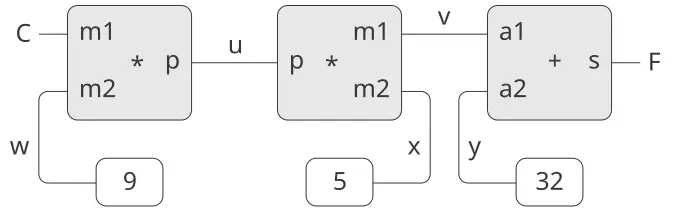

**الشكل 3.28:** العلاقة $9 C = 5 ( F − 32 )$ معبَّرًا عنها كشبكة قيود.

يجري الاحتساب بمثل هذه الشبكة على النحو الآتي: حين يُعطى موصّلٌ قيمةً (من المستخدم أو من صندوق قيدٍ مرتبطٍ به)، فإنّه يُنبّه جميع القيود المرتبطة به (باستثناء القيد الذي أنبّهه للتوّ) ليُخبرها بأنّ له قيمة. ثمّ يستطلع كلّ صندوق قيدٍ مُنبَّهٍ موصّلاته ليرى ما إذا كانت هناك معلوماتٌ كافيّةٌ لتحديد قيمةٍ لأحد الموصّلات. فإن كان الأمر كذلك، ضبط الصندوق ذلك الموصّل، الذي يُنبّه بدوره جميع القيود المرتبطة به، وهكذا دواليْك. فمثلًا، في التحويل بين السيلسيوس والفهرنهايت، تُضبط $w$ و$x$ و$y$ فورًا بصناديق الثوابت على 9 و5 و32 على الترتيب. فتنبّه الموصّلات المضاعفات والجامع، التي تحدّد أنّه لا توجد معلوماتٌ كافيّةٍ للمضيّ قدمًا. فإن ضبط المستخدم (أو جزءٌ آخر من الشبكة) $C$ على قيمةٍ (25 مثلًا)، انبعث المضاعف الأيسر، فضبط $u$ على $25 ⋅ 9 = 225$ . ثمّ أنبّه $u$ المضاعف الثاني، فضبط $v$ على 45، وأنبّه $v$ الجامع، فضبط $f$ على 77.

#### استخدام نظام القيود

لاستخدام نظام القيود لأداء العمليّة الحسابيّة لدرجات الحرارة الموصوفة أعلاه، نُنشئ أوّلًا موصّلين، `C` و`F` ، بمناداة البانيّ `make-connector` ، ونربط `C` و`F` في شبكةٍ مناسبةٍ:

```scheme
(define C (make-connector))
(define F (make-connector))
(celsius-fahrenheit-converter C F)
ok
```

والإجراء الذي يُنشئ الشبكة معرَّفٌ كما يلي:

```scheme
(define (celsius-fahrenheit-converter c f)
  (let ((u (make-connector))
        (v (make-connector))
        (w (make-connector))
        (x (make-connector))
        (y (make-connector)))
    (multiplier c w u)
    (multiplier v x u)
    (adder v y f)
    (constant 9 w)
    (constant 5 x)
    (constant 32 y)
    'ok))
```

ويُنشئ هذا الإجراء الموصّلات الداخليّة `u` و`v` و`w` و`x` و`y` ، ويربطها كما هو موضّح في [الشكل 3.28](/book/sicp/c3-modularity-objects-and-state/3-3/) باستخدام بانيات القيود الأوّليّة `adder` و`multiplier` و`constant` . فكما هو الحال في محاكي الدارات الرقميّة في [3.3.4](/book/sicp/c3-modularity-objects-and-state/3-3/)، فإنّ التعبير عن هذه التركيبات من العناصر الأوّليّة بدلالة الإجراءات يُوفّر تلقائيًّا للغتنا وسيلةَ تجريدٍ للكائنات المركّبة.

ولمراقبة الشبكة وهي تعمل، يمكننا وضع مسابير على الموصّلين `C` و`F` باستخدام إجراء `probe` شبيهٍ بالذي استخدمناه لمراقبة الأسلاك في [3.3.4](/book/sicp/c3-modularity-objects-and-state/3-3/). فإنّ وضع مِسبارٍ على موصّلٍ سيُسبّب طباعة رسالةٍ كلّما أُعطي الموصّل قيمةً:

```scheme
(probe "Celsius temp" C)
(probe "Fahrenheit temp" F)
```

ثمّ نضبط قيمة `C` على 25. (والمعطى الثالث لـ`set-value!` يخبر `C` بأنّ هذا التوجيه قادم من `user` .)

```scheme
(set-value! C 25 'user)
Probe: Celsius temp = 25
Probe: Fahrenheit temp = 77
done
```

فينبعث المِسبار على `C` ويُبلّغ عن القيمة. وينتشر `C` بقيمته عبر الشبكة كما وُصف أعلاه. وهذا يضبط `F` على 77، وهو ما يُبلّغ عنه المِسبار على `F` .

ويمكننا الآن أن نحاول ضبط `F` على قيمةٍ جديدة، 212 مثلًا:

```scheme
(set-value! F 212 'user)
Error! Contradiction (77 212)
```

ويشتكي الموصّل من أنّه أحسّ بتناقض: قيمته 77، وأحدهم يحاول ضبطها على 212. فإذا أردنا حقًّا إعادة استخدام الشبكة بقيمٍ جديدة، فيمكننا أن نطلب من `C` أن ينسى قيمته القديمة:

```scheme
(forget-value! C 'user)
Probe: Celsius temp = ?
Probe: Fahrenheit temp = ?
done
```

فيجد `C` أنّ `user` ، الذي ضبط قيمته في الأصل، يسحبها الآن، فيوافق `C` على فقدان قيمته، كما يُظهره المِسبار، ويُخبر بقيّة الشبكة بهذه الحقيقة. وهذه المعلومة تنتشر في النهاية إلى `F` ، الذي يجد الآن أنّ ليس لديه سببٌ للاستمرار في الاعتقاد بأنّ قيمته 77. وبالتالي، يتخلّى `F` أيضًا عن قيمته، كما يُظهره المِسبار.

وحيث إنّ `F` لم يعد له قيمةٌ الآن، صرنا أحرارًا في ضبطها على 212:

```scheme
(set-value! F 212 'user)
Probe: Fahrenheit temp = 212
Probe: Celsius temp = 100
done
```

وهذه القيمة الجديدة، حين تنتشر عبر الشبكة، تُلزم `C` بأن تكون له قيمة 100، وهذا ما يُسجّله المِسبار على `C` . ولاحِظ أنّ الشبكة ذاتها بالضبط تُستخدم لاحتساب `C` بمعلوميّة `F` ولاحتساب `F` بمعلوميّة `C` . وهذه اللّا اتجاهيّة للاحتساب هي السمة المميّزة للنظم المبنيّة على القيود.

#### تنفيذ نظام القيود

ويُنفَّذ نظام القيود بكائناتٍ إجرائيّةٍ ذات حالةٍ محلّيّةٍ، على نسقٍ يشبه إلى حدٍّ بعيدٍ محاكي الدارات الرقميّة في [3.3.4](/book/sicp/c3-modularity-objects-and-state/3-3/). فرغم أنّ الكائنات الأوّليّة لنظام القيود أكثر تعقيدًا بعض الشيء، فإنّ النظام الكلّيّ أبسط، إذ لا يوجد همٌّ بشأن جداول المواعيد وتأخيرات المنطق.

والعمليّات الأساسيّة على الموصّلات هي الآتية:

- `(has-value? ⟨connector⟩)` يقول ما إذا كان الموصّل يملك قيمةً.
- `(get-value ⟨connector⟩)` يعيد القيمة الحاليّة للموصّل.
- `(set-value! ⟨connector⟩ ⟨new-value⟩ ⟨informant⟩)` يشير إلى أنّ المُبلِّغ يطلب من الموصّل ضبط قيمته على القيمة الجديدة.
- `(forget-value! ⟨connector⟩ ⟨retractor⟩)` يقول للموصّل إنّ الساحب يطلب منه نسيان قيمته.
- `(connect ⟨connector⟩ ⟨new-constraint⟩)` يقول للموصّل أن يشارك في القيد الجديد.

وتتّصل الموصّلات بالقيود بواسطة الإجراءَين `inform-about-value` ، الذي يقول للقيد المعطى إنّ الموصّل يملك قيمةً، و`inform-about-no-value` ، الذي يقول للقيد إنّ الموصّل فقد قيمته.

ويُنشئ `Adder` قيدَ جمعٍ بين موصّلي حدَّي الجمع `a1` و`a2` وموصّل المجموع `sum` . ويُنفَّذ الجامع كإجراءٍ ذي حالةٍ محلّيّةٍ (الإجراء `me` أدناه):

```scheme
(define (adder a1 a2 sum)
  (define (process-new-value)
    (cond ((and (has-value? a1) 
                (has-value? a2))
           (set-value! sum
                       (+ (get-value a1) 
                          (get-value a2))
                       me))
          ((and (has-value? a1) 
                (has-value? sum))
           (set-value! a2
                       (- (get-value sum) 
                          (get-value a1))
                       me))
          ((and (has-value? a2) 
                (has-value? sum))
           (set-value! a1
                       (- (get-value sum) 
                          (get-value a2))
                       me))))
  (define (process-forget-value)
    (forget-value! sum me)
    (forget-value! a1 me)
    (forget-value! a2 me)
    (process-new-value))
  (define (me request)
    (cond ((eq? request 'I-have-a-value)
           (process-new-value))
          ((eq? request 'I-lost-my-value)
           (process-forget-value))
          (else (error "Unknown request: 
                        ADDER" request))))
  (connect a1 me)
  (connect a2 me)
  (connect sum me)
  me)
```

ويربط `Adder` الجامع الجديد بالموصّلات المعيَّنة ويعيده قيمةً له. والإجراء `me` ، الذي يمثّل الجامع، يعمل بوصفه موزّعًا إلى الإجراءات المحليّة. وتُستخدم «واجهات الصياغة» (syntax interfaces) الآتية (انظر [الحاشية 155](#Footnote-155) في [3.3.4](/book/sicp/c3-modularity-objects-and-state/3-3/)) اقترانًا مع الموزّع:

```scheme
(define (inform-about-value constraint)
  (constraint 'I-have-a-value))
(define (inform-about-no-value constraint)
  (constraint 'I-lost-my-value))
```

يُنادى الإجراء المحليّ `process-new-value` حين يُبلَّغ الجامع بأنّ أحد موصّلاته يملك قيمةً. فيتحقّق الجامع أوّلًا من كون `a1` و`a2` يملكان قيمة. فإن كانا كذلك، طلب من `sum` ضبط قيمته على مجموع الحدَّين. والمعطى `informant` لـ`set-value!` هو `me` ، وهو كائن الجامع ذاته. فإن لم يكن `a1` و`a2` يملكان كلاهما قيمة، تحقّق الجامع حينئذٍ من كون `a1` و`sum` يملكان قيمة. فإن كانا كذلك، ضبط `a2` على فرق بين هذين. وأخيرًا، إذا كان `a2` و`sum` يملكان قيمة، أعطى هذا الجامع معلوماتٍ كافيّةً لضبط `a1` . وإذا قيل للجامع إنّ أحد موصّلاته فقد قيمته، فإنّه يطلب من جميع موصّلاته أن تفقد قيمتها الآن. (والقيم التي تُفقَد فعليًّا هي تلك التي ضبطها هذا الجامع فقط.) ثمّ يُشغّل `process-new-value` . وسبب هذه الخطوة الأخيرة أنّ موصّلًا واحدًا أو أكثر قد يزال يملك قيمة (أي أنّ موصّلًا قد تكون له قيمة لم يضبطها الجامع في الأصل)، وهذه القيم قد تحتاج إلى أن تنتشر رجعةً عبر الجامع.

أمّا المضاعف فيشبه الجامع إلى حدٍّ بعيدٍ. وسيضبط حاصل الضرب `product` على 0 إذا كان أحد العاملين 0، حتّى لو كان العامل الآخر غير معروف.

```scheme
(define (multiplier m1 m2 product)
  (define (process-new-value)
    (cond ((or (and (has-value? m1) 
                    (= (get-value m1) 0))
               (and (has-value? m2) 
                    (= (get-value m2) 0)))
           (set-value! product 0 me))
          ((and (has-value? m1) 
                (has-value? m2))
           (set-value! product
                       (* (get-value m1) 
                          (get-value m2))
                       me))
          ((and (has-value? product) 
                (has-value? m1))
           (set-value! m2
                       (/ (get-value product) 
                          (get-value m1))
                       me))
          ((and (has-value? product) 
                (has-value? m2))
           (set-value! m1
                       (/ (get-value product) 
                          (get-value m2))
                       me))))
  (define (process-forget-value)
    (forget-value! product me)
    (forget-value! m1 me)
    (forget-value! m2 me)
    (process-new-value))
  (define (me request)
    (cond ((eq? request 'I-have-a-value)
           (process-new-value))
          ((eq? request 'I-lost-my-value)
           (process-forget-value))
          (else
           (error "Unknown request: 
                   MULTIPLIER" 
                  request))))
  (connect m1 me)
  (connect m2 me)
  (connect product me)
  me)
```

أمّا بانيّ `constant` فيضبط ببساطةٍ قيمة الموصّل المعيَّن. وستُنتج أيّ رسالة `I-have-a-value` أو `I-lost-my-value` تُرسَل إلى صندوق الثابت خطأً.

```scheme
(define (constant value connector)
  (define (me request)
    (error "Unknown request: CONSTANT" 
           request))
  (connect connector me)
  (set-value! connector value me)
  me)
```

وأخيرًا، يطبع المِسبار رسالةً عن ضبط الموصّل المعيَّن أو إلغاء ضبطه:

```scheme
(define (probe name connector)
  (define (print-probe value)
    (newline) (display "Probe: ")
    (display name) (display " = ")
    (display value))
  (define (process-new-value)
    (print-probe (get-value connector)))
  (define (process-forget-value)
    (print-probe "?"))
  (define (me request)
    (cond ((eq? request 'I-have-a-value)
           (process-new-value))
          ((eq? request 'I-lost-my-value)
           (process-forget-value))
          (else (error "Unknown request: 
                        PROBE" request))))
  (connect connector me)
  me)
```

#### تمثيل الموصّلات

ويُُمثَّل الموصّل بكائنٍ إجرائيٍّ ذي متغيّرات حالةٍ محلّيّةٍ هي `value` ، القيمة الحاليّة للموصّل؛ و`informant` ، الكائن الذي ضبط قيمة الموصّل؛ و`constraints` ، قائمة القيود التي يشارك فيها الموصّل.

```scheme
(define (make-connector)
  (let ((value false) 
        (informant false) 
        (constraints '()))
    (define (set-my-value newval setter)
      (cond ((not (has-value? me))
             (set! value newval)
             (set! informant setter)
             (for-each-except 
              setter
              inform-about-value
              constraints))
            ((not (= value newval))
             (error "Contradiction" 
                    (list value newval)))
            (else 'ignored)))
    (define (forget-my-value retractor)
      (if (eq? retractor informant)
          (begin (set! informant false)
                 (for-each-except 
                  retractor
                  inform-about-no-value
                  constraints))
          'ignored))
    (define (connect new-constraint)
      (if (not (memq new-constraint 
                     constraints))
          (set! constraints
                (cons new-constraint 
                      constraints)))
      (if (has-value? me)
          (inform-about-value new-constraint))
      'done)
    (define (me request)
      (cond ((eq? request 'has-value?)
             (if informant true false))
            ((eq? request 'value) value)
            ((eq? request 'set-value!) 
             set-my-value)
            ((eq? request 'forget) 
             forget-my-value)
            ((eq? request 'connect) connect)
            (else (error "Unknown operation: 
                          CONNECTOR"
                         request))))
    me))
```

ويُنادى الإجراء المحليّ الخاصّ بالموصّل `set-my-value` حين يأتي طلبٌ لضبط قيمة الموصّل. فإن لم يكن الموصّل يملك قيمةً حاليًّا، فسيضبط قيمته ويتذكّر `informant` بوصفه القيد الذي طلب ضبط القيمة.[^32] ثمّ يُخطِر الموصّل جميع القيود المشاركة له، باستثناء القيد الذي طلب ضبط القيمة. ويُنجَز هذا باستخدام المُكَرِّر (iterator) الآتي، الذي يُطبّق إجراءً معيَّنًا على جميع بنود قائمةٍ باستثناء بندٍ معطًى واحدٍ:

```scheme
(define (for-each-except exception 
                         procedure 
                         list)
  (define (loop items)
    (cond ((null? items) 'done)
          ((eq? (car items) exception) 
           (loop (cdr items)))
          (else (procedure (car items))
                (loop (cdr items)))))
  (loop list))
```

وإذا طُلب من موصّلٍ أن ينسى قيمته، فإنّه يُشغّل الإجراء المحليّ `forget-my-value` ، الذي يتحقّق أوّلًا من أنّ الطلب قادم من الكائن ذاته الذي ضبط القيمة في الأصل. فإن كان الأمر كذلك، أَخْطَر الموصّل القيود المرتبطة به بفقدان القيمة.

ويُضيف الإجراء المحليّ `connect` القيد الجديد المعيَّن إلى قائمة القيود إذا لم يكن موجودًا فيها من قبل. ثمّ، إذا كان الموصّل يملك قيمةً، يُخطِر القيد الجديد بهذه الحقيقة.

ويعمل إجراء الموصّل `me` بوصفه موزّعًا إلى الإجراءات الداخليّة الأخرى، ويمثّل الموصّل أيضًا ككائن. والإجراءات الآتية تُوفّر واجهة صياغةٍ للموزّع:

```scheme
(define (has-value? connector)
  (connector 'has-value?))
(define (get-value connector)
  (connector 'value))
(define (set-value! connector 
                    new-value 
                    informant)
  ((connector 'set-value!) 
   new-value 
   informant))
(define (forget-value! connector retractor)
  ((connector 'forget) retractor))
(define (connect connector new-constraint)
  ((connector 'connect) new-constraint))
```

> **التمرين 3.33:** باستخدام قيود المضاعف والجامع والثابت الأوّليّة، عرّف إجراءً `averager` يأخذ ثلاثة موصّلات `a` و`b` و`c` كمعطياتٍ ويُرسّخ القيد القاضي بأنّ قيمة `c` هي متوسّط قيمتَي `a` و`b` .

**التمرين 3.34:** يريد لويس ريزَنر أن يبني مربِّعًا، وهو جهاز قيدٍ ذو طرفين تتحقّق فيه أنّ قيمة الموصّل `b` على الطرف الثاني ستكون دائمًا مربّع القيمة `a` على الطرف الأوّل. وهو يقترح الجهاز البسيط الآتي المبنيّ على مضاعفٍ:

```scheme
(define (squarer a b) (multiplier a a b))
```

وهناك خللٌ خطيرٌ في هذه الفكرة. فسّره.

**التمرين 3.35:** يخبر بن بيتدِل لويس أنّ إحدى طرائق تجنّب المتعلّة الواردة في [التمرين 3.34](/book/sicp/c3-modularity-objects-and-state/3-3/) هي تعريف المربّع كقيدٍ أوّليٍّ جديد. فأكمل الأجزاء الناقصة في المخطّط الذي رسمه بن لإجراءٍ يُنفّذ مثل هذا القيد:

```scheme
(define (squarer a b)
  (define (process-new-value)
    (if (has-value? b)
        (if (< (get-value b) 0)
            (error "square less than 0: 
                    SQUARER" 
                   (get-value b))
            ⟨alternative1⟩)
        ⟨alternative2⟩))
  (define (process-forget-value) ⟨body1⟩)
  (define (me request) ⟨body2⟩)
  ⟨rest of definition⟩
  me)
```

فلنفترض أنّنا قيّمنا التتالي الآتي من التعابير في البيئة العامّة:

```scheme
(define a (make-connector))
(define b (make-connector))
(set-value! a 10 'user)
```

في وقتٍ ما أثناء تقييم `set-value!`، يُقيَّم التعبير الآتي الوارد في الإجراء المحليّ الخاصّ بالموصّل:

```scheme
(for-each-except 
  setter inform-about-value constraints)
```

ارسم مخطّطًا للبيئة يُظهر البيئة التي يُقيَّم فيها التعبير الوارد أعلاه.

**التمرين 3.37:** إنّ إجراء `celsius-fahrenheit-converter` ثقيلُ الاستعمال بالمقارنة مع أسلوب تعريفٍ أكثر توجهًا نحو التعابير، مثل

```scheme
(define (celsius-fahrenheit-converter x)
  (c+ (c* (c/ (cv 9) (cv 5))
          x)
      (cv 32)))

(define C (make-connector))
(define F (celsius-fahrenheit-converter C))
```

ها هنا `c+` و`c*` وهكذا هي صيغ «القيد» من العمليّات الحسابيّة. فمثلًا، يأخذ `c+` موصّلين كمعطيين ويعيد موصّلًا مرتبطًا بهذين بقيد جامع:

```scheme
(define (c+ x y)
  (let ((z (make-connector)))
    (adder x y z)
    z))
```

عرِّف إجراءاتٍ نظيرةً `c-`، و`c*`، و`c/`، و`cv` (قيمة ثابتة) تُمكّننا من تعريف قيودَ مركّبةٍ كما في مثال المحوِّل أعلاه.[^33]


[^16]: لا تتضمّن قائمة المسجّلات هذه المسجّلات التي يستخدمها نظام تخصيص التخزين—`root` و`the-cars` و`the-cdrs` وغيرها من المسجّلات التي ستُعرَّف في هذا القسم.

[^17]: اصطلح على مصطلح *القلب المكسور (broken heart)* ديفيد كريسي، الذي كتب جامع قمامةٍ للغة MDL، وهي لهجةٌ من Lisp طُوّرت في MIT في أوائل سبعينيّات القرن العشرين.

[^18]: يستخدم جامع القمامة المُسَيِّم منخفض المستوى `pointer-to-pair?` بدلًا من عمليّة بنية القوائم `pair?`، لأنّه قد توجد في نظامٍ حقيقيّ أمورٌ شتّى تُعامَل معاملة الأزواج لأغراض جمع القمامة. ففي نظامٍ من أنظمة Scheme مطابق لمعيار IEEE، مثلًا، قد يُنفّذ كائن الإجراء كنوعٍ خاصّ من «الزوج» لا يحقّقه المسيّم `pair?`. ولأغراض المحاكاة، يمكن تنفيذ `pointer-to-pair?` بدلالة `pair?`.

[^19]: انظر [باتالي وآخرون 1982](https://sarabander.github.io/sicp/html/References.xhtml#Batali-et-al_002e-1982) لمزيدٍ من المعلومات عن الرقاقة وعن الطريقة التي صُمّمت بها.

[^20]: في متحكّمنا، يُكتب التوزيع كسلسلةٍ من تعليمتَي `test` و`branch`. وبدلًا من ذلك، كان في الإمكان كتابته بأسلوبٍ موجَّهٍ بالبيانات (وكذلك سيكون الأمر في نظامٍ حقيقيّ على الأرجح) لتجنّب الحاجة إلى إجراء اختباراتٍ متسلسلةٍ وتسهيل تعريف أنواع تعبيراتٍ جديدة. ومن المرجّح أنّ آلةً مصمّمةً لتشغيل Lisp تتضمّن تعليمة `dispatch-on-type` تُنفّذ مثل هذه التوزيعات الموجَّهة بالبيانات بكفاءة.

[^21]: هذه نقطة مهمّةٌ وإنّما خفيّةٌ في ترجمة الخوارزميّات من لغةٍ إجرائيّة، مثل Lisp، إلى لغة آلات المسجّلات. فبدلًا من حفظ ما يلزم فقط، كان بوسعنا حفظ كلّ المسجّلات (عدا `val`) قبل كلّ نداءٍ تعاوديّ. ويُسمّى هذا نظامَ المكدس المؤطَّر. وهذا ينجح، لكنّه قد يحفظ مسجّلاتٍ أكثر من اللازم؛ وقد يكون هذا اعتبارًا مهمًّا في نظامٍ تكون فيه عمليّات المكدس مكلفة. كما أنّ حفظ مسجّلاتٍ لن تُحتاج محتوياتها لاحقًا قد يُبقي بياناتٍ لا فائدة منها كان يمكن جمعها كانقالًا، فتتفرّغ مساحتها لإعادة الاستخدام.

[^22]: نضيف إلى إجراءات بنية البيانات الخاصّة بالمُقيّم الواردة في [4.1.3](https://sarabander.github.io/sicp/html/4_002e1.xhtml#g_t4_002e1_002e3) الإجراءَين التاليين للتلاعب بقوائم المعطيات: ```scheme (define (empty-arglist) '()) (define (adjoin-arg arg arglist) (append arglist (list arg))) ```

[^23]: يُعرَف تحسين معاملة المُعامل الأخير معاملةً خاصّةً باسم *التعاوب الذيلي في evlis* (انظر [واند 1980](https://sarabander.github.io/sicp/html/References.xhtml#Wand-1980)). وكان بوسعنا أن نكون أكفأ قليلًا في حلقة تقييم المعطيات لو جعلنا تقييم المُعامل الأوّل حالةً خاصّةً أيضًا. وهو ما كان سيسمح لنا بتأجيل تهيئة `argl` حتّى بعد تقييم المُعامل الأوّل، تفاديًا لحفظ `argl` في هذه الحالة. والمصرّف الوارد في [5.5](https://sarabander.github.io/sicp/html/5_002e5.xhtml#g_t5_002e5) يُجري هذا التحسين. (قارن بإجراء `construct-arglist` الوارد في [5.5.3](https://sarabander.github.io/sicp/html/5_002e5.xhtml#g_t5_002e5_002e3).)

[^24]: يحدّد ترتيب تقييم المُعاملات في المُقيّم الحلقيّ الوسيط بترتيب تقييم معطيات `cons` في الإجراء `list-of-values` الوارد في [4.1.1](https://sarabander.github.io/sicp/html/4_002e1.xhtml#g_t4_002e1_002e1) (انظر [التمرين 4.1](https://sarabander.github.io/sicp/html/4_002e1.xhtml#Exercise-4_002e1)).

[^25]: رأينا في [5.1](https://sarabander.github.io/sicp/html/5_002e1.xhtml#g_t5_002e1) كيف نُنفّذ عمليّةً كهذه بآلة مسجّلاتٍ لا مكدس لها؛ إذ كانت حالة العمليّة تُخزَّن في مجموعةٍ ثابتةٍ من المسجّلات.

[^26]: هذا التنفيذ للتعاوب الذيلي في `ev-sequence` نوعٌ من تقنيّة تحسينٍ معروفةٍ يستخدمها كثيرٌ من المصرّفات. فعند تصريف إجراءٍ ينتهي بنداء إجراء، يمكن استبدال النداء بقفزةٍ إلى نقطة دخول الإجراء المندىّ. وبناء هذه الاستراتيجيّة في المفسّر، كما فعلنا في هذا القسم، يُوفّر التحسين بصورةٍ موحّدةٍ في اللغة كلّها.

[^27]: يمكننا تعريف `no-more-exps?` كما يلي: ```scheme (define (no-more-exps? seq) (null? seq)) ```

[^28]: هذا ليس غشًّا حقًّا. ففي تنفيذٍ فعليٍّ مبنيٍّ من الصفر، كنّا سنستخدم مُقيّمنا ذا المتحكّم الصريح لتفسير برنامج Scheme يُجري تحويلاتٍ على مستوى المصدر، مثل `cond->if`، في مرحلة صياغةٍ تجري قبل التنفيذ.

[^29]: نفترض هنا أنّ `read` ومختلف عمليّات الطباعة متاحةٌ كعمليّات آلةٍ أوّليّة، وهذا مفيدٌ لمحاكاتنا، لكنّه غير واقعيّ إطلاقًا في الممارسة. فهذه في الحقيقة عمليّات شديدة التعقيد. وفي الممارسة، كانت ستُنفّذ باستخدام عمليّات إدخالٍ وإخراجٍ منخفضة المستوى، مثل نقل محارف مفردةٍ إلى جهازٍ ومنه. ولدعم عمليّة `get-global-environment` نُعرّف ```scheme (define the-global-environment (setup-environment)) (define (get-global-environment) the-global-environment) ```

[^30]: ثمّة أخطاء أخرى نودّ أن يتعامل معها المفسّر، لكنّها ليست بهذه البساطة. انظر [التمرين 5.30](/book/sicp/c5-computing-with-register-machines/5-4/).

[^31]: كان بوسعنا إجراء تهيئة المكدس بعد الأخطاء فقط، لكنّ إجراءها في حلقة المُشغّل سيكون مريحًا لمراقبة أداء المُقيّم، كما سنُبيّن أدناه.

[^32]: للأسفّ، هذا هو الحال الطبيعيّ في أنظمة اللغات التقليديّة المبنيّة على المصرّفات، مثل C. ففي UNIX(tm) «يفرغ النظام لبَّه»، وفي DOS/Windows(tm) يصير كسولًا. أمّا Macintosh(tm) فيعرض صورة قنبلةٍ منفجرةٍ ويعرض عليك فرصة إعادة تشغيل الحاسوب—إن كنت محظوظًا.

[^33]: هذا بيانٌ نظريّ. فنحن لا ندّعي أنّ مسارات البيانات الخاصّة بالمُقيّم مجموعةٌ مناسبةٌ أو فعّالةٌ بشكلٍ خاصّ لتكون مسارات حاسوبٍ عامّ الغرض. فهي مثلًا غير جيّدةٍ لتنفيذ حسابات النقاط العائمة عالية الأداء أو الحسابات التي تتلاعب بكثافةٍ بمتجهات البتّات.