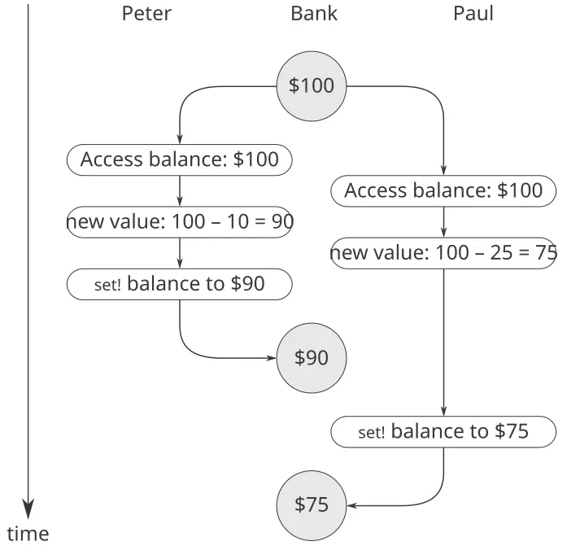
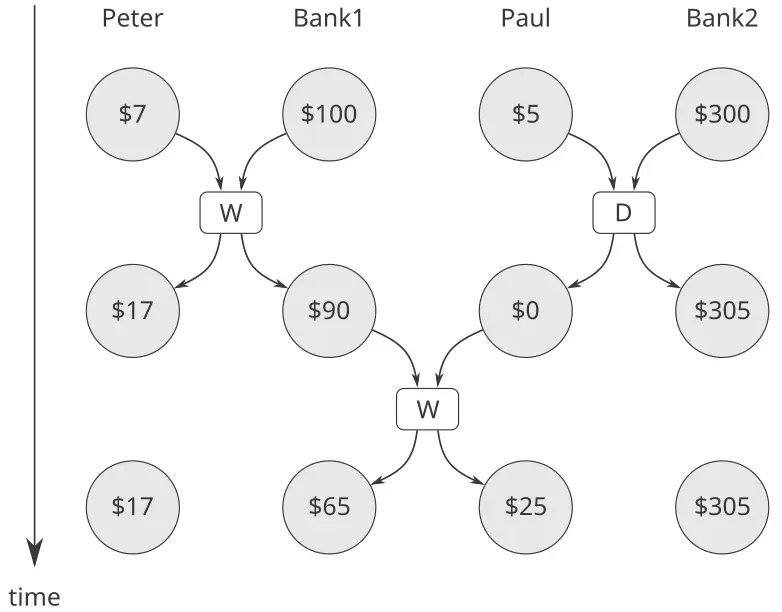

### 3.4 التزامن: الزمن أمرٌ جوهريّ

لقد رأينا قوّة الكائنات الحسابيّة ذات الحالة المحليّة بوصفها أدواتٍ للنمذجة. لكنّ هذه القوّة تُجبى بثمن، كما حذّر [3.1.3](https://sarabander.github.io/sicp/html/3_002e1.xhtml#g_t3_002e1_002e3): فقدان الشفافيّة بالرجوع، وما ينجم عن ذلك من أسئلةٍ كثيفةٍ حول التماثل والتغيّر، والحاجة إلى التخلّي عن نموذج الاستبدال للتقييم لصالح نموذج البيئة الأشدّ تعقيدًا.

والمسألة المركزيّة الكامنة خلف تعقيد الحالة والتماثل والتغيّر هي أنّ إدخال الإحلال يُجبرنا على إدخال *الزمن* إلى نماذجنا الحسابيّة. فمن قبل أن نُدخل الإحلال، كانت جميع برامجنا بلا زمن، بمعنى أنّ أيّ تعبيرٍ له قيمة له دائمًا القيمة ذاتها. وعلى النقيض من ذلك، تذكّر مثال نمذجة السحب من حسابٍ مصرفيّ وإعادة الرصيد الناتج، المقدَّم في بداية [3.1.1](https://sarabander.github.io/sicp/html/3_002e1.xhtml#g_t3_002e1_002e1):

```scheme
(withdraw 25)
75

(withdraw 25)
50
```

فإنّ التقييمات المتعاقبة للتعبير ذاته تُنتج هنا قيمًا مختلفة. وهذا السلوك ناجمٌ عن أنّ تنفيذ عبارات الإحلال (في هذه الحالة، الإحلالات على المتغيّر `balance`) يُرسّم *لحظاتٍ في الزمن* تتغيّر عندها القيم. فإنّ نتيجة تقييم تعبيرٍ ما لا تتوقّف على التعبير ذاته فحسب، بل تتوقّف أيضًا على ما إذا كان التقييم يقع قبل هذه اللحظات أم بعدها. وبناءُ النماذج بدلالة كائناتٍ حسابيّةٍ ذات حالة محلّيّة يُجبرنا على مواجهة الزمن بوصفه مفهومًا جوهريًّا في البرمجة.

ويمكننا أن نمضي أبعد من ذلك في بناء النماذج الحسابيّة بحيث تُطابق إدراكنا للعالم الماديّ. فإنّ الكائنات في العالم لا تتغيّر واحدًا تلو الآخر في تسلسل. بل نحن ندركها على أنّها تعمل *تزامنًا* — جميعها في وقتٍ واحد. ومن ثمّ، فكثيرًا ما يكون من الطبيعيّ نمذجة النظم بوصفها مجموعاتٍ من العمليّات الحسابيّة التي تُنفَّذ تزامنًا. فكما نستطيع أن نُزيد وحدانيّة برامجنا بتنظيم النماذج بدلالة كائناتٍ لها حالة محلّيّة منفصلة، فكثيرًا ما يكون من الملائم تقسيم النماذج الحسابيّة إلى أجزاءٍ تتطوّر كلٌّ على حدةٍ وتزامنًا. وحتّى لو كان مقدرًا للبرامج أن تُنفَّذ على حاسوبٍ تسلسليّ، فإنّ ممارسة كتابة البرامج كأنّها ستُنفَّذ تزامنًا تُجبر المبرمج على تجنّب القيود الزمنيّة غير الجوهريّة، وبذلك تجعل البرامج أكثر وحدانيّة.

فبالإضافة إلى زيادة وحدانيّة البرامج، فإنّ الاحتساب المتزامن قد يُوفّر ميزةً في السرعة على الاحتساب التسلسليّ. فإنّ الحواسيب التسلسليّة تُنفّذ عمليّةً واحدةً فقط في كلّ مرّة، وبذلك فإنّ مقدار الوقت الذي يتطلّبه أداء مهمّةٍ ما يتناسب مع العدد الكلّيّ للعمليّات المُنفَّذة.[^34] لكن إذا أمكن تفكيك مسألةٍ إلى أجزاءٍ مستقلّةٍ نسبيًّا ولا تحتاج إلى التواصل إلّا نادرًا، فقد يكون من الممكن تخصيص الأجزاء لمعالجات حسابيّةٍ منفصلة، مما يُنتج ميزةً في السرعة تتناسب مع عدد المعالجات المتاحة.

وللأسف، فإنّ التعقيدات التي يُدخلها الإحلال تصير أكثر إشكاليّةً بحضور التزامن. فإنّ واقع التنفيذ المتزامن، سواءً لأنّ العالم يعمل بالتوازي أو لأنّ حواسيبنا تفعل ذلك، يستتبع تعقيدًا إضافيًّا في فهمنا للزمن.

#### 3.4.1 طبيعة الزمن في النظم المتزامنة

على السطح، يبدو الزمن واضحًا ومباشرًا. فهو ترتيبٌ مفروضٌ على الأحداث.[^35] فبالنسبة لأيّ حدثين $A$ و$B$ ، إمّا أن يقع $A$ قبل $B$ ، أو يكون $A$ و$B$ متزامنين، أو يقع $A$ بعد $B$ . فمثلًا، وبعودة إلى مثال الحساب المصرفيّ، لنفترض أنّ بيتر يسحب $10 وبول يسحب $25 من حسابٍ مشتركٍ يحتوي أوّلًا على $100، فيبقى في الحساب $65. وتبعًا لترتيب السحبين، يكون تتالي الأرصدة في الحساب إمّا $100 $→$ $90 $→$ $65 وإمّا $100 $→$ $75 $→$ $65. وفي تنفيذ حاسوبيٍّ للنظام المصرفيّ، يمكن نمذجة تتالي الأرصدة المتغيّر هذا بإحلالاتٍ متعاقبةٍ على متغيّر `balance`.

غير أنّ مثل هذا النظر قد يكون مُشكِلًا في الحالات المعقّدة. فلنفترض أنّ بيتر وبول، وأناسًا آخرين كذلك، ينفذون إلى الحساب المصرفيّ ذاته عبر شبكةٍ من الأجهزة المصرفيّة الموزّعة في جميع أنحاء العالم. فإنّ تتالي الأرصدة الفعليّ في الحساب سيتوقّف بشكلٍ حاسمٍ على التوقيت المفصّل للنفاذ وعلى تفاصيل التواصل بين الأجهزة.

وإنّ عدم الحتميّة هذا في ترتيب الأحداث قد يُثير مسائل خطيرة في تصميم النظم المتزامنة. فمثلًا، لنفترض أنّ السحبين اللذين أجراهما بيتر وبول مُنفَّذان كعمليّتين منفصلتين تتشاركان متغيّرًا مشتركًا `balance`، وكلٌّ منهما محدَّدةٌ بالإجراء الوارد في [3.1.1](https://sarabander.github.io/sicp/html/3_002e1.xhtml#g_t3_002e1_002e1):

```scheme
(define (withdraw amount)
  (if (>= balance amount)
      (begin 
        (set! balance 
              (- balance amount))
        balance)
      "Insufficient funds"))
```

فإذا عملت العمليّتان باستقلالٍ إحداهما عن الأخرى، فقد يختبر بيتر الرصيد ويحاول سحب مبلغٍ مشروع. غير أنّ بول قد يسحب بعض المال في الفترة بين زمن فحص بيتر للرصيد وزمن إتمام بيتر للسحب، مما يُبطِل اختبار بيتر.

وقد تكون الأمور أسوأ من ذلك. تأمّل التعبير

```scheme
(set! balance (- balance amount))
```

الذي يُنفَّذ كجزءٍ من كلّ عمليّة سحب. وهذا يتكوّن من ثلاث خطوات: (1) النفاذ إلى قيمة متغيّر `balance`؛ (2) احتساب الرصيد الجديد؛ (3) ضبط `balance` على هذه القيمة الجديدة. فإذا نفّذ سحبا بيتر وبول هذه العبارة تزامنًا، فإنّ السحبين قد يُشابكان الترتيب الذي ينفذان به إلى `balance` ويضبطانه على القيمة الجديدة.

يُصوّر المخطّط الزمنيّ الوارد في [الشكل 3.29](/book/sicp/c3-modularity-objects-and-state/3-4/) ترتيبًا للأحداث يبدأ فيه `balance` من 100، ويسحب بيتر 10، ويسحب بول 25، ومع ذلك تكون القيمة النهائيّة لـ`balance` هي 75. وكما يظهر المخطّط، فإنّ سبب هذه الشاذّة هو أنّ إحلال بول القيمة 75 إلى `balance` يقع على افتراض أنّ قيمة `balance` التي سيُنقَص منها هي 100. غير أنّ هذا الافتراض أصبح باطلًا حين غيّر بيتر `balance` إلى 90. وهذا فشلٌ كارثيّ للنظام المصرفيّ، لأنّ المبلغ الكلّيّ للمال في النظام غير محفوظ. فقبل المعاملات، كان المبلغ الكلّيّ للمال $100. وبعدها، كان لدى بيتر $10، ولدى بول $25، ولدى المصرف $75.[^36]



**الشكل 3.29:** مخطّط زمنيّ يُظهر كيف يمكن أن يُؤدّي تشابك ترتيب الأحداث في سحبين مصرفيّين إلى رصيدٍ نهائيٍّ غير صحيح.

والظاهرة العامّة التي يُوضيحها المثال هذا هي أنّ عدّة عمليّاتٍ قد تتشارك متغيّر حالةٍ مشتركًا. وما يجعل هذا معقّدًا هو أنّ أكثر من عمليّةٍ قد تحاول التلاعب بالحالة المشتركة في الوقت ذاته. فمثلًا في مثال الحساب المصرفيّ، ينبغي أثناء كلّ معاملةٍ أن يكون كلّ زبونٍ قادرًا على التصرّف كأنّ الزبائن الآخرين غير موجودين. وحين يُبدّل زبونٌ الرصيد بطريقةٍ تتوقّف على الرصيد، ينبغي أن يكون قادرًا على افتراض أنّ الرصيد، في اللحظة السابقة للتغيير مباشرةً، لا يزال على ما كان يعتقده.

#### السلوك الصحيح للبرامج المتزامنة

إنّ المثال الوارد أعلاه نموذجٌ للعلل الخفيّة التي يمكن أن تتسرّب إلى البرامج المتزامنة. وجذر هذا التعقيد كائنٌ في الإحلالات على المتغيّرات المشتركة بين العمليّات المختلفة. ونحن نعلم بالفعل أنّ علينا أن نكون حذرين في كتابة البرامج التي تستخدم `set!`، لأنّ نتائج الاحتساب تتوقّف على الترتيب الذي تقع به الإحلالات.[^37] ومع العمليّات المتزامنة، ينبغي أن نكون حذرين على نحوٍ خاصّ حيال الإحلالات، لأنّنا قد لا نكون قادرين على التحكّم في ترتيب الإحلالات التي تجريها العمليّات المختلفة. فإذا كان من الممكن أن تقع عدّة تغييراتٍ كهذه تزامنًا (كما في حال مُودِعين ينفذان إلى حسابٍ مشترك)، فنحتاج إلى طريقةٍ ما لضمان أنّ نظامنا يسلك السلوك الصحيح. فمثلًا، في حال السحب من حسابٍ مصرفيٍّ مشترك، يجب أن نضمن حفظ المال. وحتّى تجعل البرامج المتزامنة تسلك السلوك الصحيح، قد يلزمنا أن نضع بعض القيود على التنفيذ المتزامن.

أحد القيود الممكنة على التزامن يُقرّر أنّ لا عمليّتين تُبدّلان متغيّرات حالةٍ مشتركةٍ يمكن أن تقعا في الوقت ذاته. وهذا شرطٌ صارمٌ للغاية. فبالنسبة للمصرفيّة الموزّعة، فإنّه سيلزم مُصمّم النظام بضمان ألّا تسير إلّا معاملةٌ واحدة في كلّ مرّة. وهذا سيكون غير كفؤٍ ومتحفّظًا أكثر من اللازم على حدّ سواء. يُظهر [الشكل 3.30](/book/sicp/c3-modularity-objects-and-state/3-4/) بيتر وبول يتشاركان حسابًا مصرفيًّا، حيث لدى بول أيضًا حسابٌ خاصّ. ويُوضيح المخطّط سحبين من الحساب المشترك (أحدهما لبيتر والآخر لبول) وإيداعًا في حساب بول الخاصّ.[^38] ولا يجوز أن يكون السحبان من الحساب المشترك متزامنين (إذ كلًّا منهما ينفذ إلى الحساب ذاته ويُحدّثه)، ولا يجوز أن يكون إيداع بول وسحبه متزامنين (إذ كلًّا منهما ينفذ إلى المبلغ في محفظة بول ويُحدّثه). لكن لا ينبغي أن تكون هناك مشكلة في السماح لإيداع بول في حسابه الخاصّ بأن يسير تزامنًا مع سحب بيتر من الحساب المشترك.



**الشكل 3.30:** إيداعاتٌ وسحوباتٌ متزامنة من حسابٍ مشتركٍ في Bank1 وحسابٍ خاصٍّ في Bank2.

أمّا القيد الأقلّ صرامةً على التزامن فيضمن أنّ النظام المتزامن يُنتج النتيجة ذاتها كما لو كانت العمليّات قد سارت تسلسليًّا في ترتيبٍ ما. ولهذا الشرط جانبان مهمّان. أوّلًا، هو لا يشترط أن تسير العمليّات تسلسليًّا فعلًا، بل أن تُنتج نتيجةً هي ذاتها *كأنّما* كانت قد سارت تسلسليًّا. فمثلًا في المثال الوارد في [الشكل 3.30](/book/sicp/c3-modularity-objects-and-state/3-4/)، يستطيع مُصمّم نظام الحساب المصرفيّ أن يسمح بأمانٍ بوقوع إيداع بول وسحب بيتر تزامنًا، لأنّ النتيجة الصافية ستكون هي ذاتها كما لو أنّ العمليّتين وقعتا تسلسليًّا. وثانيًا، قد يكون هناك أكثر من نتيجةٍ «صحيحة»ٍ واحدةٍ يُنتجها برنامجٌ متزامن، لأنّنا لا نشترط إلّا أن تكون النتيجة هي ذاتها كما لـ*ترتيبٍ* تسلسليٍّ ما. فمثلًا، لنفترض أنّ الحساب المشترك لبيتر وبول يبدأ بـ$100، وأنّ بيتر يُودع $40 بينما يسحب بول تزامنًا نصف المال في الحساب. فإنّ التنفيذ التسلسليّ قد يُنتج رصيدًا للحساب إمّا $70 وإمّا $90 (انظر [التمرين 3.38](/book/sicp/c3-modularity-objects-and-state/3-4/)).[^39]

وهناك شروطٌ أضعفُ بعدُ للتنفيذ الصحيح للبرامج المتزامنة. فبرنامجٌ لمحاكاة الانتشار (كجريان الحرارة في جسمٍ مثلًا) قد يتكوّن من عددٍ كبيرٍ من العمليّات، تمثّل كلٌّ منها حجمًا صغيرًا من المكان، وتُحدّث قيمها تزامنًا. وكلّ عمليّةٍ تُغيَّر قيمتها مرارًا إلى متوسّط قيمتها وقيم جيرانها. وهذه الخوارزميّة تتقارب نحو الجواب الصحيح مستقلًّا عن الترتيب الذي تُنفَّذ به العمليّات؛ فلا حاجة إلى أيّ قيودٍ على الاستخدام المتزامن للقيم المشتركة.

**التمرين 3.38:** لنفترض أنّ بيتر وبول وماري يتشاركون حسابًا مصرفيًّا مشتركًا يحتوي أوّلًا على $100. فتزامنًا، يُودع بيتر $10، ويسحب بول $20، وتسحب ماري نصف المال في الحساب، بتنفيذ الأوامر الآتية:

```
Peter: (set! balance (+ balance 10))
Paul:  (set! balance (- balance 20))
Mary:  (set! balance (- balance 
                        (/ balance 2)))
```

1. اذكر جميع القيم الممكنة المختلفة لـ`balance` بعد إتمام هذه المعاملات الثلاث، بافتراض أنّ النظام المصرفيّ يُجبر العمليّات الثلاث على السير تسلسليًّا في ترتيبٍ ما.
2. ما بعض القيم الأخرى التي يمكن أن تُنتَج إذا سمح النظام بتشابك العمليّات؟ ارسم مخطّطاتٍ زمنيّةً شبيهةً بالواردة في [الشكل 3.29](/book/sicp/c3-modularity-objects-and-state/3-4/) لتشرح كيف يمكن أن تقع هذه القيم.

#### 3.4.2 آليّات التحكّم في التزامن

لقد رأينا أنّ الصعوبة في التعامل مع العمليّات المتزامنة متأصّلةٌ في الحاجة إلى النظر في تشابك ترتيب الأحداث في العمليّات المختلفة. فمثلًا، لنفترض أنّ لدينا عمليّتين، إحداهما بثلاثة أحداثٍ مرتّبة $( a , b , c )$ والأخرى بثلاثة أحداثٍ مرتّبة $( x , y , z )$ . فإذا سارت العمليّتان تزامنًا، دون قيودٍ على كيفيّة تشابك تنفيذهما، فهناك 20 ترتيبًا ممكنًا مختلفًا للأحداث تتّسق مع الترتيبات الفرديّة للعمليّتين:

```
(a,b,c,x,y,z)  (a,x,b,y,c,z)  (x,a,b,c,y,z)  
(x,a,y,z,b,c)  (a,b,x,c,y,z)  (a,x,b,y,z,c)  
(x,a,b,y,c,z)  (x,y,a,b,c,z)  (a,b,x,y,c,z)  
(a,x,y,b,c,z)  (x,a,b,y,z,c)  (x,y,a,b,z,c)
(a,b,x,y,z,c)  (a,x,y,b,z,c)  (x,a,y,b,c,z)  
(x,y,a,z,b,c)  (a,x,b,c,y,z)  (a,x,y,z,b,c)  
(x,a,y,b,z,c)  (x,y,z,a,b,c)
```

وبصفتنا مبرمجين يُصمّمون هذا النظام، سيتعيّن علينا النظر في آثار كلّ واحدٍ من هذه الترتيبات العشرين والتحقّق من أنّ كلّ سلوكٍ منها مقبول. ومثل هذا المنهج يصير سريعًا عسيرَ التداول بازدياد أعداد العمليّات والأحداث.

وأمّا المنهج الأكثر عمليّةً لتصميم النظم المتزامنة فهو ابتكار آليّاتٍ عامّة تسمح لنا بإخضاع تشابك العمليّات المتزامنة للقيود، حتّى نستطيع أن نكون على يقينٍ من أنّ سلوك البرنامج صحيح. وقد طُوّرت آليّاتٌ كثيرةٌ لهذا الغرض. وفي هذا القسم نصف واحدةً منها، وهي *المسلسل (serializer)*.

#### تسلسل النفاذ إلى الحالة المشتركة

يُحقّق التسلسُل (serialization) الفكرة الآتية: ستُنفَّذ العمليّات تزامنًا، لكن ستكون هناك مجموعاتٌ معيّنةٌ من الإجراءات لا يمكن تنفيذها تزامنًا. وبأكثر دقّة، يُنشئ التسلسُل مجموعاتٍ مميّزةً من الإجراءات بحيث لا يُسمح إلّا بتنفيذٍ واحدٍ لإجراءٍ في كلّ مجموعةٍ مسلسَلةٍ في كلّ مرّة. فإذا كان إجراءٌ ما في المجموعة قيد التنفيذ، فإنّ عمليّةً تحاول تنفيذ أيّ إجراءٍ في المجموعة ستُجبر على الانتظار حتّى ينتهي التنفيذ الأوّل.

ويمكننا استخدام التسلسُل للتحكّم في النفاذ إلى المتغيّرات المشتركة. فمثلًا، إذا أردنا تحديث متغيّرٍ مشتركٍ بناءً على القيمة السابقة لذلك المتغيّر، فإنّا نضع النفاذ إلى القيمة السابقة للمتغيّر وإحلال القيمة الجديدة إلى المتغيّر في الإجراء ذاته. ثمّ نضمن أنّ لا إجراءً آخر يُحيل إلى المتغيّر يمكن أن يسير تزامنًا مع هذا الإجراء، بتسلسُل جميع هذه الإجراءات بالمسلسل ذاته. وهذا يضمن أنّ قيمة المتغيّر لا يمكن أن تُغيَّر بين نفاذٍ وإحلالٍ يقابله.

#### المسلسلات في Scheme

ولنجعل الآليّة الواردة أعلاه أكثر تحديدًا، لنفترض أنّنا مددنا Scheme لتشمل إجراءً يُسمّى `parallel-execute`:

```scheme
(parallel-execute ⟨p₁⟩ 
                  ⟨p₂⟩ 
                  … 
                  ⟨pₖ⟩)
```

ينبغي أن يكون كلّ `⟨`p`⟩` إجراءً بلا معطيات. يُنشئ `parallel-execute` عمليّةً منفصلةً لكلّ `⟨`p`⟩`، تُطبّق `⟨`p`⟩` (بلا معطيات). وتسير جميع هذه العمليّات تزامنًا.[^40]

وكمثالٍ على كيفيّة استخدام ذلك، تأمّل

```scheme
(define x 10)
(parallel-execute (lambda () (set! x (* x x)))
                  (lambda () (set! x (+ x 1))))
```

وهذا يُنشئ عمليّتين متزامنتين— $P_{1}$ ، التي تضبط `x` على `x` مضروبًا في `x`، و$P_{2}$ ، التي تزيد `x` بواحد. وبعد تمام التنفيذ، سيبقى `x` بأحد خمس قيمٍ ممكنة، تبعًا لتشابك أحداث $P_{1}$ و$P_{2}$ :

```python
101:  $P_{1}$  sets x to 100 and then  $P_{2}$  increments
     x to 101.
121:  $P_{2}$  increments x to 11 and then  $P_{1}$  sets
     x to x times x.
110:  $P_{2}$  changes x from 10 to 11 between the 
     two times that  $P_{1}$  accesses the value of 
     x during the evaluation of (* x x).
 11:  $P_{2}$  accesses x, then  $P_{1}$  sets x to 100, 
     then  $P_{2}$  sets x.
100:  $P_{1}$  accesses x (twice), then  $P_{2}$  sets
     x to 11, then  $P_{1}$  sets x.
```

ويمكننا إخضاع التزامن للقيود باستخدام إجراءاتٍ مسلسَلة، وهي التي تُنشَأ بواسطة *المسلسلات*. وتُبنى المسلسلات بـ`make-serializer`، الذي تنفيذه معطىٌ أدناه. ويأخذ المسلسل إجراءً كمعطىً ويعيد إجراءً مسلسَلًا يتصرّف كالإجراء الأصليّ. وجميع النداءات لمسلسلٍ معطًى تُعيد إجراءاتٍ مسلسَلةً في المجموعة ذاتها.

وبذلك، وعلى خلاف المثال الوارد أعلاه، فإنّ تنفيذ

```scheme
(define x 10)
(define s (make-serializer))
(parallel-execute 
 (s (lambda () (set! x (* x x))))
 (s (lambda () (set! x (+ x 1)))))
```

لا يُنتج إلّا قيمتين ممكنتين لـ`x`، هما 101 أو 121. أمّا الاحتمالات الأخرى فمُستَبعدة، لأنّ تنفيذ $P_{1}$ و$P_{2}$ لا يمكن تشابكه.

وها هو ذا إصدارٌ من إجراء `make-account` الوارد في [3.1.1](https://sarabander.github.io/sicp/html/3_002e1.xhtml#g_t3_002e1_002e1)، حيث الإيداعات والسحوبات مُسلسَلة:

```scheme
(define (make-account balance)
  (define (withdraw amount)
    (if (>= balance amount)
        (begin (set! balance 
                     (- balance amount))
               balance)
        "Insufficient funds"))
  (define (deposit amount)
    (set! balance (+ balance amount))
    balance)
  (let ((protected (make-serializer)))
    (define (dispatch m)
      (cond ((eq? m 'withdraw) 
             (protected withdraw))
            ((eq? m 'deposit) 
             (protected deposit))
            ((eq? m 'balance) 
             balance)
            (else (error "Unknown request: 
                          MAKE-ACCOUNT"
                         m))))
    dispatch))
```

وبهذا التنفيذ، لا يمكن لعمليّتين أن تسحبا من حسابٍ واحدٍ أو تُودعا فيه تزامنًا. وهذا يُستبعد مصدر الخطأ الموضّح في [الشكل 3.29](/book/sicp/c3-modularity-objects-and-state/3-4/)، حيث يُغيِّر بيتر رصيد الحساب بين الحين الذي ينفذ فيه بول إلى الرصيد لاحتساب القيمة الجديدة والحين الذي يُجري فيه بول الإحلال فعلًا. ومن جهةٍ أخرى، فإنّ لكلّ حسابٍ مسلسلَه الخاصّ، بحيث يمكن للإيداعات والسحوبات في حساباتٍ مختلفةٍ أن تسير تزامنًا.

**التمرين 3.39:** أيّ الاحتمالات الخمسة الواردة في التنفيذ بالتوازي الموضّح أعلاه تبقى إذا سلّسنا التنفيذ على النحو الآتي:

```scheme
(define x 10)
(define s (make-serializer))
(parallel-execute 
  (lambda () 
    (set! x ((s (lambda () (* x x))))))
  (s (lambda () (set! x (+ x 1)))))
```

**التمرين 3.40:** أعطِ جميع القيم الممكنة لـ`x` التي يمكن أن تنتج عن تنفيذ

```scheme
(define x 10)
(parallel-execute 
 (lambda () (set! x (* x x)))
 (lambda () (set! x (* x x x))))
```

أيّ هذه الاحتمالات يبقى إذا استخدمنا بدلًا من ذلك إجراءاتٍ مسلسَلة:

```scheme
(define x 10)
(define s (make-serializer))
(parallel-execute 
 (s (lambda () (set! x (* x x))))
 (s (lambda () (set! x (* x x x)))))
```

**التمرين 3.41:** يقلق بن بيتدِل من أنّ تنفيذ الحساب المصرفيّ على النحو الآتي (حيث السطر المُعلَّق عليه قد تغيّر) سيكون أفضل:

```scheme
(define (make-account balance)
  (define (withdraw amount)
    (if (>= balance amount)
        (begin 
          (set! balance 
                (- balance amount))
          balance)
        "Insufficient funds"))
  (define (deposit amount)
    (set! balance (+ balance amount))
    balance)
  (let ((protected (make-serializer)))
    (define (dispatch m)
      (cond ((eq? m 'withdraw) 
             (protected withdraw))
            ((eq? m 'deposit) 
             (protected deposit))
            ((eq? m 'balance)
             ((protected 
                (lambda () 
                  balance)))) ; serialized
            (else 
             (error 
              "Unknown request: 
               MAKE-ACCOUNT"
              m))))
    dispatch))
```

لأنّ السماح بنفاذٍ غير مسلسَلٍ إلى رصيد الحساب يمكن أن يُؤدّي إلى سلوكٍ شاذّ. فهل توافق على ذلك؟ وهل هناك أيّ سيناريو يُظهر قلق بن؟

**التمرين 3.42:** يقترح بن بيتدِل أنّ إنشاء إجراءٍ مسلسَلٍ جديدٍ استجابةً لكلّ رسالة `withdraw` و`deposit` مضيعةٌ للوقت. وهو يقول إنّه يمكن تعديل `make-account` بحيث تُجرى نداءات `protected` خارج إجراء `dispatch`. أي أنّ الحساب سيُعيد الإجراء المسلسَل ذاته (الذي أُنشئ في الوقت ذاته مع الحساب) في كلّ مرّةٍ يُطلب منه فيها إجراء السحب.

```scheme
(define (make-account balance)
  (define (withdraw amount)
    (if (>= balance amount)
        (begin (set! balance 
                     (- balance amount))
               balance)
        "Insufficient funds"))
  (define (deposit amount)
    (set! balance (+ balance amount))
    balance)
  (let ((protected (make-serializer)))
    (let ((protected-withdraw 
           (protected withdraw))
          (protected-deposit 
           (protected deposit)))
      (define (dispatch m)
        (cond ((eq? m 'withdraw) 
               protected-withdraw)
              ((eq? m 'deposit) 
               protected-deposit)
              ((eq? m 'balance) 
               balance)
              (else 
               (error "Unknown request: 
                       MAKE-ACCOUNT"
                      m))))
      dispatch)))
```

فهل هذا تغييرٌ آمن؟ وعلى وجه الخصوص، فهل هناك أيّ فرقٍ في التزامن الذي تسمح به هاتان النسختان من `make-account`؟

#### تعقيد استخدام موارد مشتركةٍ متعدّدة

تُوفّر المسلسلات تجريدًا قويًّا يساعد على عزل تعقيدات البرامج المتزامنة بحيث يمكن التعامل معها بحذرٍ و(نأمل) بصورةٍ صحيحة. لكن، مع أنّ استخدام المسلسلات مباشرٌ نسبيًّا حين لا يكون هناك إلّا موردٌ مشتركٌ واحد (كحسابٍ مصرفيٍّ واحد)، فإنّ برمجة التزامن قد تكون صعبةً بصورةٍ خادعةٍ حين تكون هناك مواردٌ مشتركةٌ متعدّدة.

ولتوضيح إحدى الصعوبات التي يمكن أن تنشأ، لنفترض أنّنا نرغب في مبادلة رصيدَي حسابين مصرفيّين. فنحن ننفذ إلى كلّ حسابٍ لإيجاد الرصيد، ونحتسب الفرق بين الرصيدين، ونسحب هذا الفرق من أحد الحسابين، ونُودعه في الحساب الآخر. ويمكننا تنفيذ ذلك على النحو الآتي:[^41]

```scheme
(define (exchange account1 account2)
  (let ((difference (- (account1 'balance)
                       (account2 'balance))))
    ((account1 'withdraw) difference)
    ((account2 'deposit) difference)))
```

يعمل هذا الإجراء حسنًا حين لا تكون إلّا عمليّةٌ واحدةٌ تحاول أداء المبادلة. لكن لنفترض أنّ بيتر وبول كلًّا منهما يستطيع النفاذ إلى الحسابات $a 1$ و$a 2$ و$a 3$ ، وأنّ بيتر يبادل $a 1$ و$a 2$ بينما يبادل بول $a 1$ و$a 3$ تزامنًا. فحتّى مع تسلسُل إيداعات الحسابات وسحوباتها للحسابات الفرديّة (كما في إجراء `make-account` الموضّح أعلاه في هذا القسم)، فإنّ `exchange` لا يزال يستطيع أن يُنتج نتائج غير صحيحة. فمثلًا، قد يحتسب بيتر الفرق بين رصيدَي $a 1$ و$a 2$ ، لكنّ بول قد يُغيّر الرصيد في $a 1$ قبل أن يتمكّن بيتر من إتمام المبادلة.[^42] ومن أجل السلوك الصحيح، يجب أن نُرتّب لأن يُقصيَ إجراءُ `exchange` أيّ نفاذٍ متزامنٍ آخر إلى الحسابات طيلة مدّة المبادلة.

إحدى الطرائق التي نستطيع بها تحقيق ذلك هي استخدام مسلسَلَي الحسابين لتسلسُل إجراء `exchange` بأكمله. ولفعل ذلك، سنُرتّب لإتاحة النفاذ إلى مسلسل الحساب. ولاحِظ أنّنا نكسر وحدانيّة كائن الحساب المصرفيّ بشكلٍ مقصودٍ بالكشف عن المسلسل. فإنّ النسخة الآتية من `make-account` مطابقةٌ للنسخة الأصليّة الواردة في [3.1.1](https://sarabander.github.io/sicp/html/3_002e1.xhtml#g_t3_002e1_002e1)، إلّا أنّ هنا يُوفَّر مسلسلٌ لحماية متغيّر الرصيد، ويُصدَّر المسلسل عبر تمرير الرسائل:

```scheme
(define (make-account-and-serializer balance)
  (define (withdraw amount)
    (if (>= balance amount)
        (begin 
          (set! balance (- balance amount))
          balance)
        "Insufficient funds"))
  (define (deposit amount)
    (set! balance (+ balance amount))
    balance)
  (let ((balance-serializer 
         (make-serializer)))
    (define (dispatch m)
      (cond ((eq? m 'withdraw) withdraw)
            ((eq? m 'deposit) deposit)
            ((eq? m 'balance) balance)
            ((eq? m 'serializer) 
             balance-serializer)
            (else (error "Unknown request: 
                          MAKE-ACCOUNT"
                         m))))
    dispatch))
```

يمكننا استخدام ذلك لأداء إيداعاتٍ وسحوباتٍ مسلسَلة. لكن، وعلى خلاف حسابنا المسلسَل السابق، فإنّ مسؤوليّة إدارة التسلسُل صراحةً تقع الآن على عاتق كلّ مستخدمٍ لكائنات الحساب المصرفيّ، كما يلي مثلًا:[^43]

```scheme
(define (deposit account amount)
  (let ((s (account 'serializer))
        (d (account 'deposit)))
    ((s d) amount)))
```

إنّ تصدير المسلسل بهذه الطريقة يمنحنا مرونةً كافيةً لتنفيذ برنامج مبادلةٍ مسلسَل. فنحن ببساطةٍ نُسلْسِل إجراء `exchange` الأصليّ بمسلسَلَي الحسابين:

```scheme
(define (serialized-exchange account1 account2)
  (let ((serializer1 (account1 'serializer))
        (serializer2 (account2 'serializer)))
    ((serializer1 (serializer2 exchange))
     account1
     account2)))
```

> **التمرين 3.43:** لنفترض أنّ أرصدة ثلاثة حسابات تبدأ بقيم $10 و$20 و$30، وأنّ عمليّاتٍ متعدّدةً تسير، مبادلةً أرصدة الحسابات. ناقش أنّ العمليّات إذا سارت تسلسليًّا، فإنّه بعد أيّ عددٍ من المبادلات المتزامنة، ينبغي أن تكون أرصدة الحسابات $10 و$20 و$30 بترتيبٍ ما. وارسم مخطّطًا زمنيًّا شبيهًا بالوارد في [الشكل 3.29](/book/sicp/c3-modularity-objects-and-state/3-4/) لتُظهر كيف يمكن أن يُخالَف هذا الشرط إذا نُفّذت المبادلات باستخدام النسخة الأولى من برنامج مبادلة الحسابات الوارد في هذا القسم. ومن جهةٍ أخرى، ناقش أنّ حتّى مع برنامج `exchange` هذا، فإنّ مجموع أرصدة الحسابات سيبقى محفوظًا. وارسم مخطّطًا زمنيًّا لتُظهر كيف يمكن أن يُخالَف حتّى هذا الشرط لو أنّنا لم نُسلْسِل المعاملات على الحسابات الفرديّة.

**التمرين 3.44:** تأمّل مسألة تحويل مبلغٍ من حسابٍ إلى آخر. يدّعي بن بيتدِل أنّ ذلك يمكن إنجازه بالإجراء الآتي، حتّى إذا كان هناك أشخاصٌ متعدّدون ينقلون مالًا بين حساباتٍ متعدّدةٍ تزامنًا، باستخدام أيّ آليّة حسابٍ تُسلْسِل معاملات الإيداع والسحب، مثل إصدار `make-account` الوارد في النصّ أعلاه.

```scheme
(define 
  (transfer from-account to-account amount)
  ((from-account 'withdraw) amount)
  ((to-account 'deposit) amount))
```

يدّعي لويس ريزنر أنّ هناك مشكلةً هنا، وأنّنا نحتاج إلى استخدام منهجٍ أكثر تطوّرًا، كالذي يلزم للتعامل مع مسألة المبادلة. فهل لويس محقّ؟ وإذا لم يكن كذلك، فما الفرق الجوهريّ بين مسألة التحويل ومسألة المبادلة؟ (وعليك أن تفترض أنّ الرصيد في `from-account` لا يقلّ عن `amount`.)

**التمرين 3.45:** يعتقد لويس ريزنر أنّ نظامنا المصرفيّ معقّدٌ وعرضةٌ للأخطاء بلا داعٍ الآن، بما أنّ الإيداعات والسحوبات لم تبقَ مُسلسَلةً تلقائيًّا. وهو يقترح أنّ `make-account-and-serializer` كان ينبغي أن يُصدّر المسلسل (لاستخدامه في إجراءاتٍ مثل `serialized-exchange`) بالإضافة إلى (بدلًا من) استخدامه لتسلسُل الحسابات والإيداعات كما فعل `make-account`. وهو يقترح إعادة تعريف الحسابات على النحو الآتي:

```scheme
(define 
  (make-account-and-serializer balance)
  (define (withdraw amount)
    (if (>= balance amount)
        (begin (set! balance 
                     (- balance amount))
               balance)
        "Insufficient funds"))
  (define (deposit amount)
    (set! balance (+ balance amount))
    balance)
  (let ((balance-serializer 
         (make-serializer)))
    (define (dispatch m)
      (cond ((eq? m 'withdraw) 
             (balance-serializer withdraw))
            ((eq? m 'deposit) 
             (balance-serializer deposit))
            ((eq? m 'balance) 
             balance)
            ((eq? m 'serializer) 
             balance-serializer)
            (else (error "Unknown request: 
                          MAKE-ACCOUNT"
                         m))))
    dispatch))
```

ثمّ تُعالَج الإيداعات كما في `make-account` الأصليّ:

```scheme
(define (deposit account amount)
  ((account 'deposit) amount))
```

اشرح ما الخطأ في استدلال لويس. وعلى وجه الخصوص، تأمّل ما يقع حين يُنادى `serialized-exchange`.

#### تنفيذ المسلسلات

نحن نُنفّذ المسلسلات بدلالة آليّة مزامنةٍ أوّليّةٍ أكثر تُسمّى *القفل الثنائيّ (mutex)*. والقفل الثنائيّ كائنٌ يدعم عمليّتين— يمكن *اكتساب (acquired)* القفل الثنائيّ، ويمكن *إطلاقه (released)*. ومتى اكتُسب قفلٌ ثنائيّ، فلا يجوز لأيّ عمليّات اكتسابٍ أخرى على ذلك القفل أن تُواصل حتّى يُطلَق القفل.[^44] وفي تنفيذنا، لكلّ مسلسلٍ قفلٌ ثنائيّ مرافق له. وبإعطائنا إجراءً `p`، يُعيد المسلسل إجراءً يكتسب القفل الثنائيّ، ويُشغّل `p`، ثمّ يُطلق القفل. وهذا يضمن أنّ إجراءً واحدًا فقط من الإجراءات التي يُنتجها المسلسل يمكن أن يكون قيد التشغيل في مرّةٍ واحدة، وهو بالضبط خاصّيّة التسلسُل التي يلزمنا أن نضمنها.

```scheme
(define (make-serializer)
  (let ((mutex (make-mutex)))
    (lambda (p)
      (define (serialized-p . args)
        (mutex 'acquire)
        (let ((val (apply p args)))
          (mutex 'release)
          val))
      serialized-p)))
```

والقفل الثنائيّ كائنٌ قابلٌ للتغيير (ها هنا سنستخدم قائمةً ذات عنصرٍ واحد، سنُشير إليها بـ*خليّة*) يمكن أن تحتفظ بالقيمة true أو false. وحين تكون القيمة false، يكون القفل الثنائيّ متاحًا لاكتسابه. وحين تكون القيمة true، يكون القفل الثنائيّ غير متاح، وأيّ عمليّةٍ تحاول اكتساب القفل يجب أن تنتظر.

يبدأ بانٍ القفل الثنائيّ `make-mutex` بتهيئة محتويات الخليّة إلى false. ولاكتساب القفل الثنائيّ، نختبر الخليّة. فإذا كان القفل الثنائيّ متاحًا، نضبط محتويات الخليّة على true ونواصل. وإلّا، فنحن ننتظر في حلقة، محاولين الاكتساب مرارًا وتكرارًا، حتّى نجد أنّ القفل الثنائيّ متاح.[^45] ولإطلاق القفل الثنائيّ، نضبط محتويات الخليّة على false.

```scheme
(define (make-mutex)
  (let ((cell (list false)))
    (define (the-mutex m)
      (cond ((eq? m 'acquire)
             (if (test-and-set! cell)
                 (the-mutex 'acquire))) ; retry
            ((eq? m 'release) (clear! cell))))
    the-mutex))
(define (clear! cell) (set-car! cell false))
```

تختبر الدالّة `test-and-set!` الخليّة وتُعيد نتيجة الاختبار. فضلًا عن ذلك، إذا كان الاختبار خاطئًا، تضبط `test-and-set!` محتويات الخليّة على القيمة true قبل إعادة القيمة false. ويمكننا التعبير عن هذا السلوك بالإجراء الآتي:

```scheme
(define (test-and-set! cell)
  (if (car cell)
      true
      (begin (set-car! cell true)
             false)))
```

غير أنّ هذا التنفيذ لـ`test-and-set!` لا يكفي كما هو. فهناك دقّةٌ حاسمةٌ هنا، وهي الموضع الجوهريّ الذي يدخل منه التحكّم في التزامن إلى النظام: ينبغي أن تُنفَّذ العمليّة `test-and-set!` *ذرّيًّا*. أي أنّه ينبغي لنا أن نضمن أنّ الخليّة، متى اختبرتها عمليّةٌ ما فوجدتها false، ستُضبط محتوياتها فعلًا على true قبل أن تستطيع أيّ عمليّةٍ أخرى اختبارها. فإن لم نتّخذ هذا الضمان، فقد يفشل القفل الثنائيّ (mutex) على نحوٍ مشابهٍ لفشل الحساب المصرفيّ الوارد في [الشكل 3.29](/book/sicp/c3-modularity-objects-and-state/3-4/). (انظر [التمرين 3.46](/book/sicp/c3-modularity-objects-and-state/3-4/).)

إنّ التنفيذ الفعليّ لـ`test-and-set!` يعتمد على تفاصيل كيفيّة تشغيل نظامنا للعمليّات المتزامنة. فقد نكون، مثلًا، نُنفّذ عمليّاتٍ متزامنةً على معالجٍ تسلسليّ باستخدام آليّة تقسيمٍ زمنيّ تتداور بين العمليّات، فتسمح لكلّ عمليّةٍ بالعمل مدّةً قصيرة قبل مقاطعتها والانتقال إلى العمليّة التالية. وفي هذه الحالة، يستطيع `test-and-set!` أن يعمل بتعطيل تقسيم الوقت أثناء الاختبار والضبط.[^46] وعلى البديل، توفّر الحواسيب متعدّدة المعالجات تعليماتٍ تدعم العمليّات الذرّيّة مباشرةً في العتاد.[^47]

> **التمرين 3.46:** لنفترض أنّنا نفّذنا `test-and-set!` بإجراءٍ اعتياديٍّ كما هو موضّح في النصّ، دون محاولةٍ لجعل العمليّة ذرّيّة. فارسم مخطّطًا زمنيًّا شبيهًا بالوارد في [الشكل 3.29](/book/sicp/c3-modularity-objects-and-state/3-4/) لتُبيّن كيف يمكن أن يفشل تنفيذ القفل الثنائيّ (mutex) بالسماح لعمليّتين باكتساب القفل في الوقت ذاته.

> **التمرين 3.47:** السيمانة (semaphore) التي حجمها $n$ تعميمٌ للقفل الثنائيّ. فمثل القفل الثنائيّ، تدعم السيمانة عمليّتَي الاكتساب والإطلاق، لكنّها أعمّ من حيث أنّ حتّى $n$ عمليّةً تستطيع اكتسابها تزامنًا. والعمليّات الإضافيّة التي تحاول اكتساب السيمانة ينبغي أن تنتظر عمليّات الإطلاق. أعطِ تنفيذاتٍ للسيمانات بدلالة الأقفال الثنائيّة
> > وبدلالة عمليّات `test-and-set!` الذرّيّة.
> > 

#### الجمود (deadlock)

والآن، بعد أن رأينا كيف تُنفَّذ المسلسلات (serializers)، نستطيع أن نرى أنّ تبادل الحسابات لا يزال يعاني من مشكلةٍ، حتّى مع الإجراء `serialized-exchange` أعلاه. فتخيّل أنّ بيتر يحاول مبادلة $a 1$ بـ$a 2$ بينما يحاول بول تزامنًا مبادلة $a 2$ بـ$a 1$ . ولنفترض أنّ عمليّة بيتر تبلغ النقطة التي تكون قد دخلت فيها إجراءً مسلسَلًا يحمي $a 1$ وأنّ عمليّة بول، عقب ذلك على الفور، تدخل إجراءً مسلسَلًا يحمي $a 2$ . فبيتر الآن لا يستطيع المواصلة (بدخول إجراءٍ مسلسَلٍ يحمي $a 2$ ) حتّى يخرج بول من الإجراء المسلسل الذي يحمي $a 2$ . وبالمثل، لا يستطيع بول المواصلة حتّى يخرج بيتر من الإجراء المسلسل الذي يحمي $a 1$ . فكلّ عمليّةٍ متوقّفةٌ إلى الأبد، تنتظر الأخرى. وتُسمّى هذه الحالَة *جمودًا*. والجمود خطرٌ دائمٌ في النظم التي تتيح وصولًا متزامنًا إلى موارد مشتركةٍ متعدّدة.

وإحدى طرائق تجنّب الجمود في هذه الحالة هي إعطاء كلّ حسابٍ رقم تعريفٍ فريدٍ وإعادة كتابة `serialized-exchange` بحيث تحاول كلّ عمليّةٍ دائمًا دخول إجراءٍ يحمي الحساب ذا الرقم الأدنى أوّلًا. وعلى الرغم من أنّ هذه الطريقة تعمل حسنًا في مسألة التبادل، فهناك حالاتٌ أخرى تتطلّب تقنيّاتٍ أكثر تطوّرًا لتجنّب الجمود، أو حيث لا يمكن تجنّب الجمود إطلاقًا. (انظر [التمرين 3.48](/book/sicp/c3-modularity-objects-and-state/3-4/) و[التمرين 3.49](/book/sicp/c3-modularity-objects-and-state/3-4/).)[^48]

> **التمرين 3.48:** اشرح بتفصيلٍ لماذا يتجنّب أسلوب تجنّب الجمود الموصوف أعلاه (أي أنّ الحسابات مُرقَّمة، وأنّ كلّ عمليّةٍ تحاول اكتساب الحساب ذي الرقم الأصغر أوّلًا) الجمودَ في مسألة التبادل. وأعِد كتابة `serialized-exchange` لتُدرج هذه الفكرة. (وأنت أيضًا محتاجٌ إلى تعديل `make-account` بحيث يُنشأ كلّ حسابٍ برقمٍ يمكن النفاذ إليه بإرسال رسالةٍ مناسبة.)

> **التمرين 3.49:** أعطِ سيناريو حيث لا تعمل آليّة تجنّب الجمود الموصوفة أعلاه. (تلميح: في مسألة التبادل، تعرف كلّ عمليّةٍ مسبقًا الحساباتَ التي سيَلزمها النفاذ إليها. فتأمّل حالَة يجب أن تنال فيها عمليّةٌ النفاذ إلى بعض الموارد المشتركة قبل أن تستطيع معرفة أيّ موارد مشتركةٍ إضافيّةٍ ستلزمها.)

#### التزامن والزمن والتواصل

لقد رأينا كيف أنّ برمجة النظم المتزامنة تتطلّب ضبط ترتيب الأحداث حين تصل عمليّاتٌ مختلفة إلى حالةٍ مشتركة، ورأينا كيف يمكن تحقيق هذا الضبط باستخدامٍ حصيفٍ للمسلسلات (serializers). لكنّ مشاكل التزامن أعمق من ذلك، لأنّه - من وجهة نظرٍ أساسيّةٍ - ليس واضحًا دائمًا ما يُقصد بـ«الحالة المشتركة».

تتطلّب آليّاتٌ مثل `test-and-set!` أن تفحص العمليّات رايةً (flag) مشتركةً عامّةً في أزمنةٍ اعتباطيّة. وهذا مُشكِلٌ وغير كفؤٍ في التنفيذ في المعالجات الحديثة السريعة، حيث - بسبب تقنيّات التحسين كالتقسيم إلى مراحل (pipelining) والذاكرة المخبئيّة (cached memory) - قد لا تكون محتويات الذاكرة في حالةٍ متّسقةٍ في كلّ لحظة. ولذلك، في النظم متعدّدة المعالجات المعاصرة، يحلّ نموذج المسلسلات بديلًا عنها مقارباتٌ جديدة للتحكّم في التزامن.[^49]

وتنشأ الجوانب المُشكِلة للحالة المشتركة أيضًا في النظم الموزعة الكبيرة. فتخيّل، مثلًا، نظامًا مصرفيًّا موزّعًا تحفظ فيه المصارف الفرعيّة الفرديّة قيمًا محلّيّةً للأرصدة وتقارنها دوريًّا بالقيم التي تحفظها الفروع الأخرى. في مثل هذا النظام، ستكون قيمة «رصيد الحساب» غير محدّدة، إلّا في الحال التي تلي المزامنة مباشرةً. فإن أودع بيتر مالًا في حسابٍ يملكه مشتركًا مع بول، فمتى ينبغي لنا أن نقول إنّ رصيد الحساب قد تغيّر — عندما يتغيّر الرصيد في الفرع المحلّيّ، أم لا إلّا بعد المزامنة؟ وإذا نال بول الحساب من فرعٍ مختلف، فما القيود المعقولة التي يلزم فرضها على النظام المصرفيّ بحيث يكون السلوك «صحيحًا»؟ والشيء الوحيد الذي قد يهمّ في الصحّة هو السلوك الذي يرصده بيتر وبول كلٌّ على حدة، و«حالة» الحساب في الحال التي تلي المزامنة مباشرةً. أمّا الأسئلة عن رصيد الحساب «الحقيقيّ» أو عن ترتيب الأحداث بين المزامنات فقد تكون بلا صلةٍ أو بلا معنى.[^50]

والظاهرة الأساسيّة هنا هي أنّ مزامنة العمليّات المختلفة، أو إقامة حالةٍ مشتركة، أو فرض ترتيبٍ على الأحداث، تتطلّب تواصلًا بين العمليّات. وفي الجوهر، ينبغي أن يكون أيّ مفهومٍ للزمن في التحكّم في التزامن مرتبطًا ارتباطًا وثيقًا بالتواصل.[^51] ومن المثير للإعجاب أنّ ارتباطًا مماثلاً بين الزمن والتواصل ينشأ أيضًا في النظريّة النسبيّة، حيث سرعة الضوء (أسرع إشارةٍ يمكن استخدامها لمزامنة الأحداث) ثابتٌ أساسيٌّ يربط الزمن بالمكان. والتعقيدات التي نواجهها في التعامل مع الزمن والحالة في نماذجنا الحسابيّة قد تعكس في الواقع تعقيدًا أساسيًّا في الكون الفيزيائيّ.


[^34]: في الواقع، بوسع الآلة التي تُشغّل الشيفرة المصرّفة أن تكون أبسط من آلة المفسّر، لأنّنا لن نستخدم المسجّلين `exp` و`unev`. فقد كان المفسّر يستخدمهما للاحتفاظ بقطعٍ من التعابير غير المُقيَّمة. أمّا مع المصرّف، فهذه التعابير تُبنى في الشيفرة المصرّفة التي ستُشغّلها آلة المسجّلات. ولغير هذا السبب، لا نحتاج إلى عمليّات الآلة التي تتعامل مع صياغة التعابير. لكنّ الشيفرة المصرّفة ستستخدم بعض عمليّات آلةٍ إضافيّة (لتمثيل كائنات الإجراءات المصرّفة) لم تظهر في آلة المُقيّم ذي المتحكّم الصريح.

[^35]: لكن لاحظ أنّ مصرّفنا برنامج Scheme، وأنّ إجراءات الصياغة التي يستخدمها للتلاعب بالتعابير هي إجراءات Scheme الفعليّة المستخدمة مع المُقيّم الحلقيّ الوسيط. أمّا في المُقيّم ذي المتحكّم الصريح، فقد افترضنا أنّ عمليّات صياغةٍ مكافئةً متاحةٌ كعمليّاتٍ لآلة المسجّلات. (وبالطبع، عندما حاكينا آلة المسجّلات في Scheme، استخدمنا إجراءات Scheme الفعليّة في محاكاة آلة المسجّلات خاصّتنا.)

[^36]: يستخدم هذا الإجراء ميزةً من Lisp تُسمّى *الاقتباس الخلفيّ (backquote)* (أو *شبه الاقتباس (quasiquote)*) وهي مفيدةٌ لبناء القوائم. فتسبيق قائمةٍ برمز الاقتباس الخلفيّ أشبه باقتباسها، إلّا أنّ أيّ شيءٍ في القائمة يُعلَّم بفاصلةٍ يُقيَّم. فمثلًا، إذا كانت قيمة `linkage` هي الرمز `branch25`، فإنّ التعبير ```scheme `((goto (label ,linkage))) ```

[^37]: لا يمكننا ببساطةٍ استخدام الأسماء `true-branch` و`false-branch` و`after-if` كما وردت أعلاه، لأنّ البرنامج قد يحوي أكثر من `if` واحد. فالمصرّف يستخدم الإجراء `make-label` لتوليد الأسماء. و`Make-label` يأخذ رمزًا كمعطىً ويُعيد رمزًا جديدًا يبدأ بالرمز المعطى. فمثلًا، كانت نداءات `(make-label 'a)` المتتالية تُعيد `a1` و`a2` وهكذا. ويمكن تنفيذ `Make-label` على نحوٍ يشبه توليد أسماء المتغيّرات الفريدة في لغة الاستعلام، كما يلي: ```scheme (define label-counter 0) (define (new-label-number) (set! label-counter (+ 1 label-counter)) label-counter) (define (make-label name) (string->symbol (string-append (symbol->string name) (number->string (new-label-number))))) ```

[^38]: نحتاج إلى عمليّات آلةٍ لتنفيذ بنية بياناتٍ لتمثيل الإجراءات المصرّفة، تقابل البنيّة الخاصّة بالإجراءات المركّبة الموصوفة في [4.1.3](https://sarabander.github.io/sicp/html/4_002e1.xhtml#g_t4_002e1_002e3): ```scheme (define (make-compiled-procedure entry env) (list 'compiled-procedure entry env)) (define (compiled-procedure? proc) (tagged-list? proc 'compiled-procedure)) (define (compiled-procedure-entry c-proc) (cadr c-proc)) (define (compiled-procedure-env c-proc) (caddr c-proc)) ```

[^39]: في الحقيقة، نُشير إلى خطأٍ عندما لا يكون الهدف `val` والوصلة `return`، إذ إنّ المكان الوحيد الذي نطلب فيه وصلات `return` هو تصريف الإجراءات، واصطلاحنا أنّ الإجراءات تُعيد قيمها في `val`.

[^40]: قد يبدو جعلُ مصرّفٍ يُنتج شيفرةً تعاوديّةً ذيليًّا فكرةً مباشرة. لكنّ معظم مصرّفات اللغات الشائعة، ومنها C وPascal، لا تفعل ذلك، ولذلك لا تستطيع هذه اللغات تمثيل العمليّات التكراريّة بالنداء الإجرائيّ وحده. وتكمُن صعوبة التعاوب الذيلي في هذه اللغات في أنّ تنفيذها تستخدم المكدس لتخزين معطيات الإجراءات ومتغيّراتها المحليّة فضلًا عن عناوين العودة. أمّا تنفيذات Scheme الموضحة في هذا الكتاب فتخزّن المعطيات والمتغيّرات في ذاكرةٍ تُجمَّع كانقالًا. والسبب في استخدام المكدس للمتغيّرات والمعطيات هو تفادي الحاجة إلى جمع القمامة في لغاتٍ لما كانت تتطلّبه لولا ذلك، ويُعتقد عمومًا أنّه أكفّ. وتستطيع مصرّفات Lisp المتطوّرة، في الواقع، استخدام المكدس للمعطيات دون أن تُفسد التعاوب الذيليّ. (انظر [هانسون 1990](https://sarabander.github.io/sicp/html/References.xhtml#Hanson-1990) لوصفٍ له.) ثمّة جدلٌ أيضًا حول ما إذا كان تخصيص المكدس أكفّ فعلًا من جمع القمامة في المقام الأوّل، لكنّ التفاصيل يبدو أنّها مرتهنةٌ بدقائق دقيقة في بنية الحاسوب. (انظر [آبل 1987](https://sarabander.github.io/sicp/html/References.xhtml#Appel-1987) و[ميلر وروزاس 1994](https://sarabander.github.io/sicp/html/References.xhtml#Miller-and-Rozas-1994) لرأيين متعارضين في هذه المسألة.)

[^41]: المتغيّر `all-regs` مربوطٌ بأسماء كلّ المسجّلات: ```scheme (define all-regs '(env proc val argl continue)) ```

[^42]: لاحظ أنّ `preserving` ينادي `append` بثلاثة معطيات. ومع أنّ تعريف `append` المعروض في هذا الكتاب لا يقبل إلّا معطيين، فإنّ Scheme يوفّر قياسيًّا إجراء `append` يأخذ عددًا اعتباطيًّا من المعطيات.

[^43]: لقد استخدمنا الرمز `+` نفسه هنا للدلالة على كلٍّ من إجراء لغة المصدر وعمليّة الآلة. وبشكلٍ عام، لن توجد مقابلةٌ واحدٌ بواحدٍ بين أوّليّات لغة المصدر وأوّليّات الآلة.

[^44]: جعل الأوّليّات كلماتٍ محجوزة هو فكرةٌ سيّئةٌ عمومًا، إذ لا يستطيع المستخدم حينها إعادة ربط هذه الأسماء بإجراءاتٍ مختلفة. والأسوأ من ذلك، أنّ إضافة كلماتٍ محجوزةً إلى مصرّفٍ قيد الاستخدام ستجعل البرامج الموجودة التي تُعرِّف إجراءاتٍ بهذه الأسماء تتوقّف عن العمل. انظر [التمرين 5.44](/book/sicp/c5-computing-with-register-machines/5-5/) لأفكارٍ عن كيفيّة تجنّب هذه المشكلة.

[^45]: لا يصحّ هذا إذا سمحنا بتعريفاتٍ داخليّة، إلّا إذا استخرجناه بالمسح. انظر [التمرين 5.43](/book/sicp/c5-computing-with-register-machines/5-5/).

[^46]: هذا هو التعديل المطلوب على البحث عن المتغيّرات إذا نُفّذت طريقة الاستخراج لإزالة التعريفات الداخليّة ([التمرين 5.43](/book/sicp/c5-computing-with-register-machines/5-5/)). وسنحتاج إلى إزالة هذه التعريفات لكي تعمل العنونة المعجميّة.

[^47]: لا يمكن استخدام العناوين المعجميّة للوصول إلى المتغيّرات في البيئة العامّة، لأنّ هذه الأسماء يمكن تعريفها وإعادة تعريفها تفاعليًّا في أيّ وقت. فمع استخراج التعريفات الداخليّة، كما في [التمرين 5.43](/book/sicp/c5-computing-with-register-machines/5-5/)، تكون التعريفات الوحيدة التي يراها المصرّف هي التعريفات على المستوى الأعلى، وهي التي تعمل على البيئة العامّة. ولا يتسبّب تصريف تعريفٍ في إدخال الاسم المعرَّف في بيئة وقت التصريف.

[^48]: وبالطبع، الإجراءات المصرّفة كالإجراءات المُفسَّرة مركّبةٌ (غير أوّليّة). واتّفاقًا مع المصطلحات المستخدمة في المُقيّم ذي المتحكّم الصريح، سنستخدم في هذا القسم «مركّب» بمعنى مُفسَّر (مقابلًا لمصرَّف).

[^49]: وحيث إنّ آلة المُقيّم تبدأ الآن بـ`branch`، ينبغي لنا دائمًا تهيئة المسجّل `flag` قبل تشغيل آلة المُقيّم. ولتشغيل الآلة على حلقة القراءة-التقييم-الطباعة المعتادة، كان بوسعنا استخدام ```scheme (define (start-eceval) (set! the-global-environment (setup-environment)) (set-register-contents! eceval 'flag false) (start eceval)) ```

[^50]: وبما أنّ الإجراء المصرّف كائنٌ قد يحاول النظام طباعته، نُعدّل أيضًا عمليّة طباعة النظام `user-print` (الواردة في [4.1.4](https://sarabander.github.io/sicp/html/4_002e1.xhtml#g_t4_002e1_002e4)) حتّى لا تحاول طباعة مكوّنات الإجراء المصرّف: ```scheme (define (user-print object) (cond ((compound-procedure? object) (display (list 'compound-procedure (procedure-parameters object) (procedure-body object) '))) ((compiled-procedure? object) (display ')) (else (display object)))) ```

[^51]: وبوسعنا أن نفعل أفضل من ذلك بتمديد المصرّف للسماح للشيفرة المصرّفة بنداء الإجراءات المُفسَّرة. انظر [التمرين 5.47](/book/sicp/c5-computing-with-register-machines/5-5/).