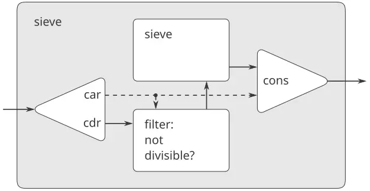
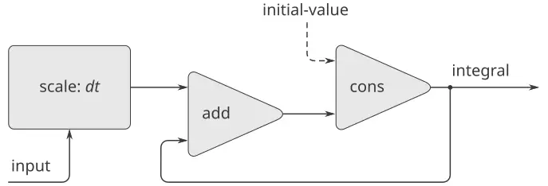
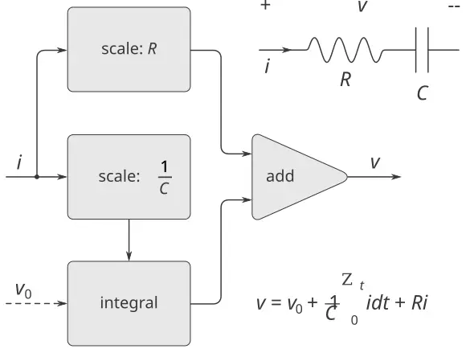
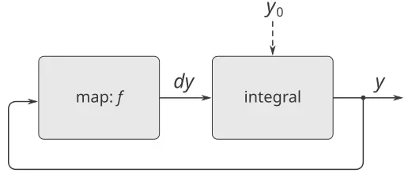
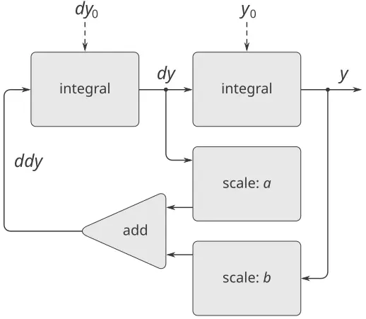
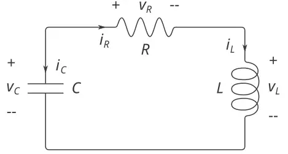
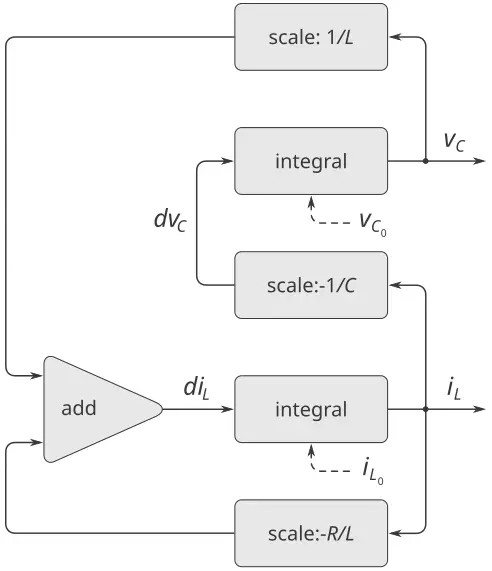
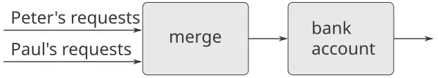

### 3.5 المجاري

لقد اكتسبنا فهمًا حسنًا للإحلال بوصفه أداةً في النمذجة، وإدراكًا للمشاكل المعقّدة التي يُثيرها الإحلال. وحان وقت التساؤل عمّا إذا كان في وسعنا أن نسير في الأمور سيرًا مختلفًا، حتّى نتجنّب بعض هذه المشاكل. وفي هذا القسم، نستكشف مقاربةً بديلةً لنمذجة الحالة، قائمةً على بنى بياناتٍ تُسمّى *المجاري (streams)*. وكما سنرى، فالمجاري قادرةٌ على تخفيف بعض تعقيد نمذجة الحالة.

دعنا نتراجع خطوةً ولنراجع من أين يأتي هذا التعقيد. ففي محاولتنا نمذجة ظواهر العالم الواقعيّ، اتّخذنا بعض القرارات التي تبدو معقولةً ظاهريًّا: فنمذّينا الأشياء الواقعيّة ذات الحالة المحلّيّة بكائناتٍ حسابيّةٍ محلّيّة المتغيّرات. وربطنا التغيّر الزمنيّ في العالم الواقعيّ بالتغيّر الزمنيّ في الحاسوب. ونفّذنا التغيّر الزمنيّ لحالات الكائنات النموذجيّة في الحاسوب بإحلالاتٍ على المتغيّرات المحلّيّة للكائنات النموذجيّة.

أهناك مقاربةٌ أخرى؟ أفيمكننا تجنّب ربط الزمن في الحاسوب بالزمن في العالم النموذجيّ؟ أينبغي لنا أن نجعل النموذج يتغيّر مع الزمن حتّى نمذّج ظواهرَ في عالمٍ متغيّر؟ فكّر في المسألة بدلالة الدوالّ الرياضيّة. فيمكننا وصف السلوك المتغيّر زمنيًّا لكمّيّةٍ $x$ كدالّ في الزمن $x ( t )$ . فإن تركّزنا على $x$ لحظةً بلحظة، فإنّا نعتبرها كمّيّةً متغيّرة. لكنّنا إن تركّزنا على التاريخ الزمنيّ الكامل للقيم، فإنّا لا نُبرز التغيّر — فإنّ الدالّ ذاتها لا تتغيّر.[^52]

فإن قُيس الزمن بخطواتٍ منفصلة، أمكننا نمذجة دالّ الزمن كتسلسلٍ (قد يكون غير منتهٍ). وفي هذا القسم، سنرى كيف ننمذج التغيّر بدلالة تسلسلاتٍ تمثّل التواريخ الزمنيّة للنظم التي نمذّجها. ولإنجاز ذلك، نُقدّم بنى بياناتٍ جديدةً تُسمّى *المجاري*. فمن وجهة نظرٍ مجرّدة، إنّ المجرى تسلسلٌ لا غير. لكنّنا سنجد أنّ التنفيذ المباشر للمجاري كقوائمَ (كما في [2.2.1](https://sarabander.github.io/sicp/html/2_002e2.xhtml#g_t2_002e2_002e1)) لا يكشف كاملًا عن قوّة معالجة المجاري. وكبديل، نُقدّم تقنيّة *التقييم المتأخّر (delayed evaluation)*، التي تُمكّننا من تمثيل تسلسلاتٍ ضخمةٍ جدًّا (حتّى غير منتهية) كمجاري.

تُتيح لنا معالجة المجاري نمذجة نظمٍ لها حالةٌ دون استخدام الإحلال أو البيانات القابلة للتغيير مطلقًا. ولهذا تبعاتٌ مهمّة، نظريّةٌ وعمليّةٌ، إذ نستطيع بناء نماذج تتجنّب العيوب الكامنة في إدخال الإحلال. ومن الجهة الأخرى، يُثير إطار المجاري صعوباتٍ خاصّةً به، والمسألةُ القائلة بأيّ تقنيّة نمذجةٍ تؤدّي إلى نظمٍ أكثر وحدانيّةً وأسهل صيانةً لا تزال مفتوحة.

#### 3.5.1 المجاري قوائمٌ متأخّرة

وكما رأينا في [2.2.3](https://sarabander.github.io/sicp/html/2_002e2.xhtml#g_t2_002e2_002e3)، فإنّ التسلسلات يمكن أن تخدم بوصفها واجهاتٍ متعارف عليها لجمع وحدات البرنامج. وقد صغنا تجريداتٍ قويّةً للتلاعب بالتسلسلات، مثل `map` و`filter` و`accumulate`، التي تستوعب تنوّعًا واسعًا من العمليّات بصورةٍ موجزةٍ وأنيقةٍ معًا.

وللأسف، فإن مثّلنا التسلسلات كقوائمَ، فإنّ هذه الأناقة تُشترى بثمن اللّاكفاءة الشديدة، فيما يتعلّق بالزمن والمكان اللذين تتطلّبهما احتساباتنا. فحين نمثّل التلاعبات على التسلسلات كتحويلاتٍ للقوائم، ينبغي لبرامجنا أن تبني بنى بياناتٍ (قد تكون ضخمة) وتنسخها عند كلّ خطوةٍ من العمليّة.

ولنرَ لماذا هذا صحيح، دعنا نقارن برنامجين لاحتساب مجموع جميع الأعداد الأوّليّة في فاصلٍ. والبرنامج الأوّل مكتوبٌ بالأسلوب التكراريّ المعياريّ:[^53]

```scheme
(define (sum-primes a b)
  (define (iter count accum)
    (cond ((> count b) accum)
          ((prime? count)
           (iter (+ count 1)
                 (+ count accum)))
          (else (iter (+ count 1) accum))))
  (iter a 0))
```

وأمّا البرنامج الثاني فيؤدّي الاحتساب نفسه باستخدام عمليّات التسلسل الواردة في [2.2.3](https://sarabander.github.io/sicp/html/2_002e2.xhtml#g_t2_002e2_002e3):

```scheme
(define (sum-primes a b)
  (accumulate 
   +
   0
   (filter prime? (enumerate-interval a b))))
```

وفي أثناء أداء الاحتساب، لا يحتاج البرنامج الأوّل إلّا إلى تخزين المجموع المتراكم. وعلى النقيض، لا يستطيع المُرَشِّح (filter) في البرنامج الثاني إجراء أيّ اختبارٍ حتّى يكون `enumerate-interval` قد بنى قائمةً كاملةً بأعداد الفاصل. ويُنتج المُرَشِّح قائمةً أخرى، تُمرَّر بدورها إلى `accumulate` قبل أن تُختزل لتكوين مجموع. ومثل هذا التخزين الوسيط الضخم غير مطلوبٍ للبرنامج الأوّل، الذي يمكننا اعتباره يعدّد الفاصل تزايديًّا، مضيفًا كلّ عددٍ أوّليّ إلى المجموع حالما يُولَّد.

وإنّ ظهور اللّاكفاءة في استخدام القوائم يصير بيّنًا بمقدارٍ مؤلمٍ إن استخدمنا نموذج التسلسل لاحتساب العدد الأوّليّ الثاني في الفاصل من 10,000 إلى 1,000,000 بتقييم التعبير

```scheme
(car (cdr 
      (filter 
       prime?
       (enumerate-interval 10000 1000000))))
```

وهذا التعبير يجد العدد الأوّليّ الثاني فعلًا، لكنّ عبء الاحتساب فادح. فنحن نبني قائمةً بما يقارب مليون عددٍ صحيحٍ، ونُرَشِّح هذه القائمة باختبار كلّ عنصرٍ لأوّليّته، ثمّ نتجاهل كلّ النتيجة تقريبًا. وفي أسلوب برمجةٍ أكثر تقليديّةً، كنّا سنُشابك العدّ بالترشيح، ونتوقّف عند بلوغ العدد الأوّليّ الثاني.

والمجاري فكرةٌ بارعةٌ تتيح للمرء أن يستخدم التلاعبات التسلسليّة دون تحمّل تكاليف التلاعب بالتسلسلات كقوائمَ. فبالمجاري نستطيع إحراز أفضل ما في العالمين: فيمكننا صياغة البرامج صياغةً أنيقةً كتلاعباتٍ تسلسليّة، مع بلوغ كفاءة الاحتساب التزايديّ. والفكرة الأساسيّة هي الترتيب لبناء المجرى بناءً جزئيًّا فقط، وتمرير البناء الجزئيّ إلى البرنامج الذي يستهلك المجرى. فإن حاول المستهلك الوصول إلى جزءٍ من المجرى لم يُبنَ بعد، فإنّ المجرى يبني تلقائيًّا ما يكفي من نفسه زيادةً على ذلك لإنتاج الجزء المطلوب، محافظًا بذلك على الوهم بأنّ المجرى كلّه موجود. وبعبارة أخرى، وعلى الرغم من أنّنا سنكتب البرامج كأنّا نعالج تسلسلاتٍ كاملةً، فإنّا نُصمّم تنفيذ المجاري بحيث يُشابك تلقائيًّا وبشفافيّةٍ بناء المجرى مع استخدامه.

وعلى السطح، إنّ المجاري مجرّد قوائمَ بأسماءٍ مختلفةٍ للإجراءات التي تتلاعب بها. فهناك بانٍ، `cons-stream`، ومحدِّدان، `stream-car` و`stream-cdr`، يحقّقان القيود

```
(stream-car (cons-stream x y)) = x
(stream-cdr (cons-stream x y)) = y
```

وهناك كائنٌ قابلٌ للتمييز، `the-empty-stream`، لا يمكن أن يكون نتيجة أيّ عمليّة `cons-stream`، ويمكن التعرّف عليه بالمسيّم `stream-null?`.[^54] وبذلك نستطيع صنع المجاري واستخدامها، بالطريقة ذاتها التي نستطيع بها صنع القوائم واستخدامها، لتمثيل بياناتٍ مجمّعةٍ مرتّبةٍ في تسلسل. وعلى وجه الخصوص، نستطيع بناء نظائر مجاري لعمليّات القوائم الواردة في [الفصل 2](https://sarabander.github.io/sicp/html/Chapter-2.xhtml#Chapter-2)، مثل `list-ref` و`map` و`for-each`:[^55]

```scheme
(define (stream-ref s n)
  (if (= n 0)
      (stream-car s)
      (stream-ref (stream-cdr s) (- n 1))))

(define (stream-map proc s)
  (if (stream-null? s)
      the-empty-stream
      (cons-stream 
       (proc (stream-car s))
       (stream-map proc (stream-cdr s)))))

(define (stream-for-each proc s)
  (if (stream-null? s)
      'done
      (begin 
        (proc (stream-car s))
        (stream-for-each proc 
                         (stream-cdr s)))))
```

`Stream-for-each` مفيدٌ لعرض المجاري:

```scheme
(define (display-stream s)
  (stream-for-each display-line s))

(define (display-line x)
  (newline)
  (display x))
```

ولجعل تنفيذ المجاري يُشابك تلقائيًّا وبشفافيّةٍ بناء المجرى مع استخدامه، سنرَتّب لأن يُقيَّم `cdr` المجرى حين يُنال به بواسطة الإجراء `stream-cdr` بدلًا من حين يُبنى المجرى بـ`cons-stream`. وهذا الخيار التنفيذيّ يذكّرنا بمناقشتنا للأعداد الكسريّة في [2.1.2](https://sarabander.github.io/sicp/html/2_002e1.xhtml#g_t2_002e1_002e2)، حيث رأينا أنّنا نستطيع أن نختار تنفيذ الأعداد الكسريّة بحيث يُجرى اختزال البسط والمقام إلى أبسط صورهما إمّا في وقت البناء وإمّا في وقت التحديد. وإنّ التنفيذين للأعداد الكسريّة يُنتجان تجريد البيانات ذاته، لكنّ الخيار يؤثّر في الكفاءة. وهناك علاقةٌ مماثلةٌ بين المجاري والقوائم الاعتياديّة. فبوصفها تجريد بيانات، إنّ المجاري هي القوائم عينها. والفرق هو الوقت الذي تُقيَّم فيه العناصر. ففي القوائم الاعتياديّة، يُقيَّم كلٌّ من `car` و`cdr` في وقت البناء. وفي المجاري، يُقيَّم `cdr` في وقت التحديد.

وسيستند تنفيذنا للمجاري إلى صيغةٍ خاصّةٍ تُسمّى `delay`. فإنّ تقييم `(delay ⟨exp⟩)` لا يُقيّم التعبير `⟨`exp`⟩`، بل يُعيد ما يُسمّى *كائنًا متأخّرًا*، نستطيع اعتباره «وعدًا» بتقييم `⟨`exp`⟩` في وقتٍ مستقبليّ. وكرفيقٍ لـ`delay`، هناك إجراءٌ يُسمّى `force` يأخذ كائنًا متأخّرًا كمعطىً ويؤدّي التقييم — مُجبرًا في الفعل `delay` على الوفاء بوعده. وسنرى أدناه كيف يمكن تنفيذ `delay` و`force`، لكنّ دعنا أوّلًا نستخدمهما في بناء المجاري.

`Cons-stream` صيغةٌ خاصّةٌ مُعرَّفةٌ بحيث

```scheme
(cons-stream ⟨a⟩ ⟨b⟩)
```

فهي مكافئةٌ لـ

```scheme
(cons ⟨a⟩ (delay ⟨b⟩))
```

ومعنى هذا أنّنا سنبني المجاري باستخدام الأزواج. لكنّنا، بدلًا من وضع قيمة بقيّة المجرى في `cdr` الزوج، سنضع هناك وعدًا باحتساب البقيّة إن طُلبت يومًا. ويمكن الآن تعريف `stream-car` و`stream-cdr` كإجراءين:

```scheme
(define (stream-car stream) 
  (car stream))

(define (stream-cdr stream) 
  (force (cdr stream)))
```

يختار `stream-car` الجزء `car` من الزوج، و`stream-cdr` يختار الجزء `cdr` من الزوج ويُقيّم التعبير المتأخّر الموجود هناك للحصول على بقيّة المجرى.[^56]

#### تنفيذ المجاري أثناء العمل

ولنرى كيف يسلك هذا التنفيذ، دعنا نحلّل الاحتساب الأوّليّ «الفادح» الذي رأيناه أعلاه، مُعادًا صياغته بدلالة المجاري:

```scheme
(stream-car 
 (stream-cdr
  (stream-filter 
   prime? (stream-enumerate-interval 
           10000 1000000))))
```

وسنرى أنّه يعمل بكفاءةٍ فعلًا.

نبدأ بنداء `stream-enumerate-interval` بالمعطيين 10,000 و1,000,000. فـ`stream-enumerate-interval` نظير `enumerate-interval` في المجاري ([2.2.3](https://sarabander.github.io/sicp/html/2_002e2.xhtml#g_t2_002e2_002e3)):

```scheme
(define (stream-enumerate-interval low high)
  (if (> low high)
      the-empty-stream
      (cons-stream
       low
       (stream-enumerate-interval (+ low 1)
                                  high))))
```

وبذلك، فإنّ النتيجة التي يُعيدها `stream-enumerate-interval`، والمكوَّنة بـ`cons-stream`، هي[^57]

```scheme
(cons 10000
      (delay 
        (stream-enumerate-interval 
         10001 
         1000000)))
```

أي أنّ `stream-enumerate-interval` يُعيد مجرى ممثَّلًا بزوجٍ `car` هو 10,000 و`cdr` هو وعدٌ بعدّ المزيد من الفاصل إن طُلب ذلك. وهذا المجرى يُرشَّح الآن للأوليّين، باستخدام نظير الإجراء `filter` في المجاري ([2.2.3](https://sarabander.github.io/sicp/html/2_002e2.xhtml#g_t2_002e2_002e3)):

```scheme
(define (stream-filter pred stream)
  (cond ((stream-null? stream) 
         the-empty-stream)
        ((pred (stream-car stream))
         (cons-stream 
          (stream-car stream)
          (stream-filter 
           pred
           (stream-cdr stream))))
        (else (stream-filter 
               pred 
               (stream-cdr stream)))))
```

يختبر `stream-filter` الجزء `stream-car` من المجرى (أي `car` الزوج، وهو 10,000). وبما أنّ هذا ليس أوّليًّا، فإنّ `stream-filter` يفحص الجزء `stream-cdr` من مجرى دخلته. ونداء `stream-cdr` يُجبر تقييم `stream-enumerate-interval` المتأخّر، الذي يُعيد الآن

```scheme
(cons 10001
      (delay 
        (stream-enumerate-interval 
         10002 
         1000000)))
```

ينظر `stream-filter` الآن إلى `stream-car` هذا المجرى، 10,001، فيرى أنّه ليس أوّليًّا هو الآخر، فيُجبر `stream-cdr` آخر، وهكذا، حتّى يُنتج `stream-enumerate-interval` العدد الأوّليّ 10,007، وعندها يُعيد `stream-filter`، وفقًا لتعريفه،

```scheme
(cons-stream 
 (stream-car stream)
 (stream-filter pred (stream-cdr stream)))
```

وهو في هذه الحالة

```scheme
(cons 10007
      (delay
        (stream-filter
         prime?
         (cons 10008
               (delay
                 (stream-enumerate-interval 
                  10009 1000000))))))
```

وهذه النتيجة تُمرَّر الآن إلى `stream-cdr` في تعبيرنا الأصليّ. وهذا يُجبر `stream-filter` المتأخّر، الذي يُجبر بدوره باستمرار `stream-enumerate-interval` المتأخّر حتّى يجد العدد الأوّليّ التالي، وهو 10,009. وأخيرًا، فإنّ النتيجة الممرَّرة إلى `stream-car` في تعبيرنا الأصليّ هي

```scheme
(cons 10009
      (delay
        (stream-filter
         prime?
         (cons 10010
               (delay
                 (stream-enumerate-interval 
                  10011 1000000))))))
```

يُعيد `stream-car` العدد 10,009، والاحتساب يكتمل. وقد اختُبر من الأعداد الصحيحة عددٌ لا يزيد على الضروريّ لإيجاد العدد الأوّليّ الثاني، وأُعدّد الفاصل بقدر ما لا يزيد على الضروريّ لإطعام المُرَشِّح الأوّليّ.

وبصورةٍ عامّة، نستطيع اعتبار التقييم المتأخّر برمجةً «مدفوعة بالطلب»، بحيث تُنشَّط كلّ مرحلةٍ في عمليّة المجرى بقدر ما يكفي لإشباع المرحلة التالية فقط. وما فعلناه هو فصل الترتيب الفعليّ للأحداث في الاحتساب عن البنية الظاهرة لإجراءاتنا. فنحن نكتب الإجراءات كأنّ المجاري موجودة «كلّها في وقتٍ واحد»، بينما يُؤدّى الاحتساب في الواقع تزايديًّا، كما في أساليب البرمجة التقليديّة.

#### تنفيذ `delay` و`force`

وعلى الرغم من أنّ `delay` و`force` قد يبدوان عمليّتين غامضتين، فإنّ تنفيذهما واضحٌ ومباشرٌ حقًّا. فينبغي لـ`delay` أن يحزّم تعبيرًا بحيث يمكن تقييمه لاحقًا عند الطلب، ونستطيع إنجاز ذلك ببساطةٍ بمعاملة التعبير كجسمٍ لإجراء. ويمكن أن تكون `delay` صيغةً خاصّةً بحيث

```scheme
(delay ⟨exp⟩)
```

فهي سكّر نحويّ لـ

```scheme
(lambda () ⟨exp⟩)
```

يستدعي `force` ببساطةٍ الإجراء (الخالي من الوسائط) الذي يُنتجه `delay`، فيمكننا تنفيذ `force` كإجراءٍ:

```scheme
(define (force delayed-object)
  (delayed-object))
```

وهذا التنفيذ يكفي لعمل `delay` و`force` كما هو معلن، لكنّ هناك تحسينًا مهمًّا يمكننا إدراجه. ففي تطبيقاتٍ كثيرة، ننتهي إلى إجبار الكائن المتأخّر عينه مرّاتٍ كثيرة. وهذا يمكن أن يؤدّي إلى لّاكفاءةٍ خطيرةٍ في البرامج التعاوديّة التي تشتمل على مجاري. (انظر [التمرين 3.57](/book/sicp/c3-modularity-objects-and-state/3-5/).) والحلّ هو بناء الكائنات المتأخّرة بحيث تخزّن، في أوّل مرّةٍ تُجبر فيها، القيمة التي تُحتسب. فإنّ الإجبارات اللاحقة ستُعيد ببساطةٍ القيمة المخزّنة دون إعادة الاحتساب. وبعبارة أخرى، ننفّذ `delay` كإجراءٍ مُحفَّظ النتائج (memoized) ذي غرضٍ خاصّ، شبيهٌ بالوارد في [التمرين 3.27](https://sarabander.github.io/sicp/html/3_002e3.xhtml#Exercise-3_002e27). وإحدى طرائق إنجاز ذلك هي استخدام الإجراء الآتي، الذي يأخذ كمعطىً إجراءً (خاليًا من الوسائط) ويُعيد نسخةً مُحفَّظة النتائج منه. فحين يُشغَّل الإجراء المُحفَّظ النتائج أوّل مرّةٍ، يحفظ النتيجة المحسوبة. وفي التقييمات اللاحقة، يُعيدها ببساطةٍ.

```scheme
(define (memo-proc proc)
  (let ((already-run? false) (result false))
    (lambda ()
      (if (not already-run?)
          (begin (set! result (proc))
                 (set! already-run? true)
                 result)
          result))))
```

ثمّ تُعرَّف `delay` بحيث يكون `(delay ⟨exp⟩)` مكافئًا لـ

```scheme
(memo-proc (lambda () ⟨exp⟩))
```

و`force` كما عُرِّف سابقًا.[^58]

**التمرين 3.50:** أكمل التعريف الآتي، الذي يُعمّم `stream-map` للسماح بإجراءاتٍ تأخذ معطياتٍ متعدّدة، على غرار `map` في [2.2.1](https://sarabander.github.io/sicp/html/2_002e2.xhtml#g_t2_002e2_002e1)، [حاشية 78](https://sarabander.github.io/sicp/html/2_002e2.xhtml#Footnote-78).

```scheme
(define (stream-map proc . argstreams)
  (if (⟨??⟩ (car argstreams))
      the-empty-stream
      (⟨??⟩
       (apply proc (map ⟨??⟩ argstreams))
       (apply stream-map
              (cons proc 
                    (map ⟨??⟩ 
                         argstreams))))))
```

**التمرين 3.51:** ولإلقاء نظرةٍ أدقّ على التقييم المتأخّر، سنستخدم الإجراء الآتي، الذي يُعيد معطاه ببساطةٍ بعد طبعه:

```scheme
(define (show x)
  (display-line x)
  x)
```

فماذا يطبع المفسّر استجابةً لتقييم كلّ تعبيرٍ في التتالي الآتي؟[^59]

```scheme
(define x 
  (stream-map 
   show 
   (stream-enumerate-interval 0 10)))

(stream-ref x 5)
(stream-ref x 7)
```

**التمرين 3.52:** تأمّل تتاليَ التعبيرات

```scheme
(define sum 0)

(define (accum x)
  (set! sum (+ x sum))
  sum)

(define seq 
  (stream-map 
   accum 
   (stream-enumerate-interval 1 20)))

(define y (stream-filter even? seq))

(define z 
  (stream-filter 
   (lambda (x) 
     (= (remainder x 5) 0)) seq))

(stream-ref y 7)
(display-stream z)
```

فما قيمة `sum` بعد تقييم كلّ واحدٍ من التعبيرات أعلاه؟ وما الاستجابة المطبوعة لتقييم تعبيرَي `stream-ref` و`display-stream`؟ أفكانت هذه الاستجابات ستختلف لو كنّا نفّذنا `(delay ⟨exp⟩)` ببساطةٍ كـ`(lambda () ⟨exp⟩)` دون استخدام التحسين الذي يوفّره `memo-proc`؟ فسّر.

#### 3.5.2 المجاري غير المنتهية

لقد رأينا كيف ندعم وهم التلاعب بالمجاري ككياناتٍ كاملةٍ، مع أنّنا في الحقيقة لا نحتسب من المجرى إلّا بقدر ما نحتاج إليه للوصول. ونستطيع استثمار هذه التقنيّة لتمثيل التسلسلات بكفاءةٍ على هيئة مجارٍ، حتّى إن كانت التسلسلات طويلةً جدًّا. والأكثر إثارةً للإعجاب أنّنا نستطيع استخدام المجاري لتمثيل تسلسلاتٍ غير منتهية الطول. فتأمّل، مثلًا، التعريف الآتي لمجرى الأعداد الصحيحة الموجبة:

```scheme
(define (integers-starting-from n)
  (cons-stream 
   n (integers-starting-from (+ n 1))))
(define integers (integers-starting-from 1))
```

وهذا ذو معنىً لأنّ `integers` سيكون زوجًا `car` هو 1 و`cdr` هو وعدٌ بإنتاج الأعداد الصحيحة ابتداءً من 2. وهذا مجرى غير منتهي الطول، لكنّا في أيّ وقتٍ معطًى نستطيع فحص جزءٍ منتهٍ منه فقط. ولذلك، فلن تعرف برامجنا يومًا أنّ المجرى اللانهائيّ كلّه غير موجود.

وباستخدام `integers` نستطيع تعريف مجاري غير منتهيةٍ أخرى، مثل مجرى الأعداد الصحيحة غير القابلة للقسمة على 7:

```scheme
(define (divisible? x y) (= (remainder x y) 0))
(define no-sevens
  (stream-filter (lambda (x) 
                   (not (divisible? x 7)))
                 integers))
```

فيمكننا إيجاد الأعداد غير القابلة للقسمة على 7 بمجرّد النفاذ إلى عناصر هذا المجرى:

```scheme
(stream-ref no-sevens 100)
117
```

وبتناظرٍ مع `integers`، نستطيع تعريف المجرى غير المنتهيّ لأعداد فيبوناتشي:

```scheme
(define (fibgen a b)
  (cons-stream a (fibgen b (+ a b))))
(define fibs (fibgen 0 1))
```

إنّ `fibs` زوجٌ `car` هو 0 و`cdr` هو وعدٌ بتقييم `(fibgen 1 1)`. وحين نُقيّم هذا `(fibgen 1 1)` المتأخّر، فإنّه سيُنتج زوجًا `car` هو 1 و`cdr` هو وعدٌ بتقييم `(fibgen 1 2)`، وهكذا.

ولنُلْقِ نظرةً على مجرى غير منتهٍ أكثر إثارةً، نستطيع تعميم مثال `no-sevens` لبناء المجرى غير المنتهيّ للأعداد الأوّليّة، باستخدام طريقةٍ تُعرف بـ*غربال إراتوستينس*.[^60] نبدأ بالأعداد الصحيحة ابتداءً من 2، وهو أوّل عددٍ أوّليّ. وللباقي من الأعداد الأوّليّة، نبدأ بترشيح مضاعفات 2 من بقيّة الأعداد الصحيحة. وهذا يُخلي مجرى يبدأ بـ3، وهو العدد الأوّليّ التالي. والآن نُرَشِّح مضاعفات 3 من بقيّة هذا المجرى. وهذا يُخلي مجرى يبدأ بـ5، وهو العدد الأوّليّ التالي، وهكذا. وبعبارة أخرى، نبني الأعداد الأوّليّة بعمليّة غربلةٍ، موصوفةٍ على النحو الآتي: لغربلة مجرى `S`، شكّل مجرى أوّلُ عنصرٍ فيه هو أوّل عنصرٍ من `S` وبقيّته مُحصَلةٌ بترشيح جميع مضاعفات أوّل عنصرٍ من `S` خارجًا من بقيّة `S` ثمّ غربلة النتيجة. وهذه العمليّة تُوصف بسهولةٍ بدلالة عمليّات المجاري:

```scheme
(define (sieve stream)
  (cons-stream
   (stream-car stream)
   (sieve (stream-filter
           (lambda (x)
             (not (divisible? 
                   x (stream-car stream))))
           (stream-cdr stream)))))

(define primes 
  (sieve (integers-starting-from 2)))
```

والآن، لإيجاد عددٍ أوّليّ معيّن، لا يحتاج الأمر إلّا إلى طلبه:

```scheme
(stream-ref primes 50)
233
```

من المثير للتأمّل نظام معالجة الإشارات الذي يُنشئه `sieve`، الموضّح في «مخطّط هندرسون» في [الشكل 3.31](/book/sicp/c3-modularity-objects-and-state/3-5/).[^61] إنّ مجرى الدخل يغذّي مُفَكِّكَ `cons` الذي يفصل أوّل عنصرٍ من المجرى عن بقيّة المجرى. وأوّل عنصرٍ يُستخدم لبناء مُرَشِّح قابلية قسمةٍ، يُمرَّر من خلاله الباقي، ومُخرَج المُرَشِّح يُغذّي صندوق غربلةٍ آخر. ثمّ يُركَّب أوّل عنصرٍ الأصليّ (`cons`) على مُخرَج الغربلة الداخليّة لتكوين مجرى المُخرَج. وهكذا، فليس المجرى وحده غير منتهٍ، بل معالج الإشارات غير منتهيّ أيضًا، لأنّ الغربال يحتوي غربالًا داخله.



**الشكل 3.31:** الغربال الأوّليّ منظورًا إليه كنظامٍ لمعالجة الإشارات.

#### تعريف المجاري ضمنيًّا

إنّ مجرْيَي `integers` و`fibs` أعلاه عُرِّفا بتحديد إجراءاتٍ «مولِّدة» تحتسب عناصر المجرى واحدًا واحدًا صراحةً. وطريقةٌ بديلةٌ لتحديد المجاري هي استغلال التقييم المتأخّر لتعريف المجاري ضمنيًّا. فالمثال الآتي، مثلًا، يعرّف المجرى `ones` كمجرى غير منتهٍ من الآحاد:

```scheme
(define ones (cons-stream 1 ones))
```

وهذا يعمل كثيرًا مثل تعريف إجراءٍ تعاوديّ: فـ`ones` زوجٌ `car` هو 1 و`cdr` هو وعدٌ بتقييم `ones`. وتقييم `cdr` يُعطينا من جديد 1 ووعدًا بتقييم `ones`، وهكذا.

ونستطيع فعل أشياء أكثر إثارةً للاهتمام بالتلاعب بالمجاري بعمليّاتٍ مثل `add-streams`، التي تُنتج مجموعًا عنصرًا بعنصرٍ لمجرَيين معطيين:[^62]

```scheme
(define (add-streams s1 s2) 
  (stream-map + s1 s2))
```

ويمكننا الآن تعريف *مجرى (stream)* الأعداد الصحيحة كما يلي:

```scheme
(define integers 
  (cons-stream 1 (add-streams ones integers)))
```

يعرّف هذا `integers` بوصفه مجرىً أوّله هو 1 وبقيّته هي مجموع `ones` و`integers`. وعليه، فإنّ العنصر الثاني من `integers` هو 1 زائد أوّل عنصر من `integers`، أي 2؛ والعنصر الثالث من `integers` هو 1 زائد العنصر الثاني من `integers`، أي 3؛ وهكذا. ويعمل هذا التعريف لأنّه، في أيّ نقطةٍ، قد أُنشئ من مجرى `integers` ما يكفي حتّى نتمكّن من إعادة إدخاله في التعريف لإنتاج العدد الصحيح التالي.

ويمكننا تعريف أعداد فيبوناتشي بالنمط نفسه:

```scheme
(define fibs 
  (cons-stream 
   0 (cons-stream
      1 (add-streams 
         (stream-cdr fibs) fibs))))
```

يقول هذا التعريف إنّ `fibs` مجرىٌ يبدأ بـ0 و1، بحيث يمكن توليد بقيّة المجرى بجمع `fibs` إلى نفسه بعد إزاحته بمقدار مكانٍ واحد:

```
    1 1 2 3 5  8 13 21 … = (stream-cdr fibs)
    0 1 1 2 3  5  8 13 … = fibs
0 1 1 2 3 5 8 13 21 34 … = fibs
```

`Scale-stream` إجراءٌ مفيدٌ آخر في صياغة تعريفات المجرى كهذه. وهو يضرب كلّ عنصرٍ في مجرىً بثابتٍ معطًى:

```scheme
(define (scale-stream stream factor)
  (stream-map
   (lambda (x) (* x factor))
   stream))
```

فعلى سبيل المثال،

```scheme
(define double 
  (cons-stream 1 (scale-stream double 2)))
```

يُنتج مجرى قوى العدد 2: 1، 2، 4، 8، 16، 32، ....

ويمكن إعطاء تعريفٍ بديلٍ لمجرى الأعداد الأوّليّة بالبدء بالأعداد الصحيحة وتصفيتها باختبار كونها أوّليّة. وسنحتاج إلى أوّل عددٍ أوّليّ، وهو 2، للانطلاق:

```scheme
(define primes
  (cons-stream
   2 (stream-filter 
      prime? (integers-starting-from 3))))
```

وهذا التعريف ليس مباشرًا إلى الحدّ الذي يبدو عليه، لأنّنا سنختبر ما إذا كان عددٌ $n$ أوّليًّا بفحص ما إذا كان $n$ قابلًا للقسمة على عددٍ أوّليّ (لا على أيّ عددٍ صحيحٍ فحسب) أصغر من أو يساوي $\sqrt{n}$ :

```scheme
(define (prime? n)
  (define (iter ps)
    (cond ((> (square (stream-car ps)) n) true)
          ((divisible? n (stream-car ps)) false)
          (else (iter (stream-cdr ps)))))
  (iter primes))
```

هذا تعريفٌ تعاوديّ، إذ يُعرَّف `primes` من حيث المُسَيِّم `prime?`، الذي يستخدم هو نفسه مجرى `primes`. وسبب عمل هذا الإجراء أنّه، في أيّ نقطةٍ، قد أُنشئ من مجرى `primes` ما يكفي لاختبار أوّليّة الأعداد التي نحتاج إلى فحصها تاليًا. أي أنّك، لكلّ $n$ نختبر أوّليّته، إمّا أن $n$ غير أوّليّ (وفي هذه الحالة هناك عددٌ أوّليّ أُنشئ سابقًا يقسمه) أو أنّ $n$ أوّليّ (وفي هذه الحالة هناك عددٌ أوّليّ أُنشئ سابقًا — أي عددٌ أوّليّ أصغر من $n$ — أكبر من $\sqrt{n}$ ).[^63]

**التمرين 3.53:** دون تشغيل البرنامج، صِف عناصر المجرى المعرَّف بـ

```scheme
(define s (cons-stream 1 (add-streams s s)))
```

**التمرين 3.54:** عرّف إجراءً `mul-streams`، مماثلًا لـ`add-streams`، يُنتج الجداء العنصريّ لمجريي مدخليه. واستخدم هذا مع مجرى `integers` لإتمام التعريف الآتي للمجرى الذي عنصره $n^{th}$ (بحساب البداية من 0) هو $n + 1$ مضروبًا:

```scheme
(define factorials 
  (cons-stream 1 (mul-streams ⟨??⟩ ⟨??⟩)))
```

> **التمرين 3.55:** عرّف إجراءً `partial-sums` يأخذ مجرىً $S$ معطًى ويعيد المجرى الذي عناصره هي $S_{0}$ ، $S_{0} + S_{1}$ ، $S_{0} + S_{1} + S_{2} , …$ . فعلى سبيل المثال، ينبغي أن يكون `(partial-sums integers)` هو المجرى 1، 3، 6، 10، 15، ....

**التمرين 3.56:** مسألةٌ شهيرةٌ، طرحها أوّلًا ر. هامينغ، هي عدّ جميع الأعداد الصحيحة الموجبة التي لا عوامل أوّليّة لها غير 2، و3، و5، بترتيبٍ تصاعديٍّ ودون تكرار. وإحدى الطرق الواضحة لفعل ذلك هي ببساطةٍ اختبار كلّ عددٍ صحيحٍ بدوره لمعرفة ما إذا كان له أيّ عوامل غير 2، و3، و5. لكنّ هذا غير كفؤٍ على الإطلاق، إذ إنّه، مع كبر الأعداد الصحيحة، يقلّ عدد تلك التي تستوفيّ الشرط تدريجيًّا. وكبديلٍ، فلنُسمّ مجرى الأعداد المطلوب `S` ولنلاحِظ الحقائق الآتية عنه:

- `S` يبدأ بالعدد 1.
- عناصر `(scale-stream S 2)` هي أيضًا عناصر من `S`.
- والأمر ذاته صحيح بالنسبة إلى `(scale-stream S 3)` و`(scale-stream S 5)`.
- وهذه هي جميع عناصر `S`.

وكلّ ما علينا فعله الآن هو دمج العناصر القادمة من هذه المصادر. ولهذا الغرض نُعرّف إجراءً `merge` يدمج مجريين مرتّبين في مجرى نتائجٍ مرتّبٍ واحد، مُقصِيًا التكرارات:

```scheme
(define (merge s1 s2)
  (cond ((stream-null? s1) s2)
        ((stream-null? s2) s1)
        (else
         (let ((s1car (stream-car s1))
               (s2car (stream-car s2)))
           (cond ((< s1car s2car)
                  (cons-stream 
                   s1car 
                   (merge (stream-cdr s1) 
                          s2)))
                 ((> s1car s2car)
                  (cons-stream 
                   s2car 
                   (merge s1 
                          (stream-cdr s2))))
                 (else
                  (cons-stream 
                   s1car
                   (merge 
                    (stream-cdr s1)
                    (stream-cdr s2)))))))))
```

ثمّ يمكن بناء *المجرى (stream)* المطلوب بـ`merge`، كما يلي:

```scheme
(define S (cons-stream 1 (merge ⟨??⟩ ⟨??⟩)))
```

املأ التعابير الناقصة في المواضع المشار إليها بـ`⟨??⟩` أعلاه.

> **التمرين 3.57:** كم عمليّة جمع تُجرى حين نحتسب العدد $n^{th}$ من أعداد فيبوناتشي باستخدام تعريف `fibs` المستند إلى الإجراء `add-streams`؟ أظهر أنّ عدد عمليّات الجمع سيكون أكبر أسّيًّا لو كنّا قد نفّذنا `(delay ⟨exp⟩)` ببساطةٍ كـ`(lambda () ⟨exp⟩)`، دون استخدام التحسين الذي يوفّره الإجراء `memo-proc` الموصوف في [3.5.1](/book/sicp/c3-modularity-objects-and-state/3-5/).[^64]

**التمرين 3.58:** أعطِ تفسيرًا للمجرى الذي يحسبه الإجراء الآتي:

```scheme
(define (expand num den radix)
  (cons-stream
   (quotient (* num radix) den)
   (expand (remainder (* num radix) den) 
           den 
           radix)))
```

(`Quotient` أوّليّ يُعيد ناتج القسمة الصحيح لعددين صحيحين.) فما العناصر المتعاقبة التي يُنتجها `(expand 1 7 10)`؟ وما الذي يُنتجه `(expand 3 8 10)`؟

**التمرين 3.59:** في [2.5.3](https://sarabander.github.io/sicp/html/2_002e5.xhtml#g_t2_002e5_002e3) رأينا كيف نُنفّئ نظامًا للحساب على كثيرات الحدود يمثّل كثيرات الحدود كقوائم من الحدود. وبطريقةٍ مشابهة، يمكننا العمل مع *متسلسلات القوى (power series)*، مثل $e^{x} = 1 + x + \frac{1}{2} x^{2} + \frac{1}{3 ⋅ 2} x^{3} + \frac{1}{4 ⋅ 3 ⋅ 2} x^{4} + … , cos ⁡ x = 1 − \frac{1}{2} x^{2} + \frac{1}{4 ⋅ 3 ⋅ 2} x^{4} − … , sin ⁡ x = x − \frac{1}{3 ⋅ 2} x^{3} + \frac{1}{5 ⋅ 4 ⋅ 3 ⋅ 2} x^{5} − …$ الممثّلة كمجاري لا نهائيّة. وسنمثّل المتسلسلة $a_{0} + a_{1} x + a_{2} x^{2} + a_{3} x^{3} + …$ بالمجرى الذي عناصره هي المعاملات $a_{0}$ ، $a_{1}$ ، $a_{2}$ ، $a_{3}$ ، ....

تكامل المتسلسلة $a_{0} + a_{1} x + a_{2} x^{2} + a_{3} x^{3} + …$ هو المتسلسلة $c + a_{0} x + \frac{1}{2} a_{1} x^{2} + \frac{1}{3} a_{2} x^{3} + \frac{1}{4} a_{3} x^{4} + … ,$ حيث $c$ ثابتٌ اعتباطيّ. عرّف إجراءً `integrate-series` يأخذ مدخلًا مجرىً $a_{0}$ ، $a_{1}$ ، $a_{2}$ ، … يمثّل متسلسلة قوى، ويعيد المجرى $a_{0}$ ، $\frac{1}{2} a_{1}$ ، $\frac{1}{3} a_{2}$ ، … من معاملات الحدود غير الثابتة لتكامل المتسلسلة. (وحيث أنّ النتيجة لا حدّ ثابت لها، فإنّها لا تمثّل متسلسلة قوى؛ وحين نستخدم `integrate-series`، فإنّنا سنُلحق (`cons`) بالثابت المناسب.) الدالّة $x ↦ e^{x}$ هي مشتقّها نفسها. وهذا يعني أنّ $e^{x}$ وتكامل $e^{x}$ هما المتسلسلة ذاتها، عدا الحدّ الثابت، وهو $e^{0} = 1$ . وبناءً على ذلك، فيمكننا توليد المتسلسلة الخاصة بـ$e^{x}$ كما يلي

```scheme
(define exp-series
  (cons-stream 
   1 (integrate-series exp-series)))
```

أظهر كيف نولّد متسلسلتي الجيب وجيب التمام، بدءًا من الحقيقة القائلة إنّ مشتقّ الجيب هو جيب التمام وإنّ مشتقّ جيب التمام هو سالب الجيب:

```scheme
(define cosine-series 
  (cons-stream 1 ⟨??⟩))

(define sine-series
  (cons-stream 0 ⟨??⟩))
```

**التمرين 3.60:** بتمثيل متسلسلات القوى كمجاري من المعاملات كما في [التمرين 3.59](/book/sicp/c3-modularity-objects-and-state/3-5/)، فإنّ جمع المتسلسلات يُنفَّذ بـ`add-streams`. أكمل تعريف الإجراء الآتي لضرب المتسلسلات:

```scheme
(define (mul-series s1 s2)
  (cons-stream ⟨??⟩ (add-streams ⟨??⟩ ⟨??⟩)))
```

يمكنك اختبار إجارتك بالتحقّق من أنّ $sin^{2} ⁡ x + cos^{2} ⁡ x = 1 ,$ باستخدام المتسلسلتين من [التمرين 3.59](/book/sicp/c3-modularity-objects-and-state/3-5/).

> **التمرين 3.61:** لتكن $S$ متسلسلة قوى ([التمرين 3.59](/book/sicp/c3-modularity-objects-and-state/3-5/)) حدّها الثابت هو 1. ولنفترض أنّنا نريد إيجاد متسلسلة القوى $1 / S$ ، أي المتسلسلة $X$ بحيث $S X = 1$ . اكتب $S = 1 + S_{R}$ حيث $S_{R}$ هو الجزء من $S$ الواقع بعد الحدّ الثابت. وبعد ذلك يمكننا حلّ المعادلة لإيجاد $X$ كما يلي: $S ⋅ X = 1 , ( 1 + S_{R} ) ⋅ X = 1 , X + S_{R} ⋅ X = 1 , X = 1 − S_{R} ⋅ X .$ وبعبارةٍ أخرى، فإنّ $X$ هي متسلسلة القوى التي حدّها الثابت هو 1 وحدودها من الرتب الأعلى تساوي سالب $S_{R}$ مضروبًا في $X$ . استخدم هذه الفكرة لكتابة إجراءٍ `invert-unit-series` يحسب $1 / S$ لمتسلسلة قوى $S$ حدّها الثابت هو 1. وسوف تحتاج إلى استخدام `mul-series` من [التمرين 3.60](/book/sicp/c3-modularity-objects-and-state/3-5/).

> **التمرين 3.62:** استخدم نتائج [التمرين 3.60](/book/sicp/c3-modularity-objects-and-state/3-5/) و[التمرين 3.61](/book/sicp/c3-modularity-objects-and-state/3-5/) لتعريف إجراءٍ `div-series` يقسم متسلسلتي قوى. وينبغي أن يعمل `div-series` مع أيّ متسلسلتين، شريطة أن تبدأ متسلسلة المقام بحدٍّ ثابتٍ لا يساوي صفرًا. (وإذا كان للمقام حدٌّ ثابتٌ يساوي صفرًا، فإنّ `div-series` ينبغي أن يُشير إلى خطأ.) وأظهر كيف تستخدم `div-series` مع نتيجة [التمرين 3.59](/book/sicp/c3-modularity-objects-and-state/3-5/) لتوليد متسلسلة قوى الدالّة المماسيّة (tangent).

#### 3.5.3 استثمار نمط المجاري

ويمكن أن تكون *المجاري (streams)* المزوّدة بالتقييم المتأخّر أداةَ نمذجةٍ قويّة، إذ توفّر العديد من فوائد الحالة المحليّة والإحلال. وهي تتجنّب، فضلًا عن ذلك، بعض التعقيدات النظريّة التي ترافق إدخال الإحلال إلى لغة البرمجة.

ويمكن أن يكون منهج المجاري مُفصِحًا لأنّه يتيح لنا بناء أنظمةٍ بحدود وحداتٍ مختلفةٍ عن تلك التي تقيمها الأنظمة المنظّمة حول إحلال القيم في متغيّرات الحالة. فنحن نستطيع مثلًا اعتبار متسلسلةً زمنيّةً كاملة (أو إشارة) محطّ اهتمامنا، بدلًا من قيم متغيّرات الحالة في لحظاتٍ مفردة. وهذا يجعل من المناسب جمع مكوّنات الحالة من لحظاتٍ مختلفةٍ ومقارنتها.

#### صياغة التكرارات كعمليّات مجاري

في القسم [1.2.1](https://sarabander.github.io/sicp/html/1_002e2.xhtml#g_t1_002e2_002e1)، عرّفنا العمليّات التكراريّة، التي تسير بتحديث متغيّرات الحالة. ونحن نعلم الآن أنّنا نستطيع تمثيل الحالة كمجرى قيمٍ «خالٍ من الزمن» بدلًا من تمثيلها كمجموعةٍ من المتغيّرات التي يُحدَّث قيمها. فلتكن لنا هذه النظرة في إعادة النظر في إجراء الجذر التربيعيّ من [1.1.7](https://sarabander.github.io/sicp/html/1_002e1.xhtml#g_t1_002e1_002e7). واذكر أنّ الفكرة هي توليد تسلسلٍ من التخمينات الأفضل فأفضل للجذر التربيعيّ لـ$x$ بتطبيق الإجراء الذي يحسّن التخمينات مرّةً بعد مرّة:

```scheme
(define (sqrt-improve guess x)
  (average guess (/ x guess)))
```

في إجراء `sqrt` الأصليّ لدينا، جعلنا هذه التخمينات هي القيم المتعاقبة لمتغيّر حالةٍ واحد. وبدلًا من ذلك، فيمكننا توليد مجرى التخمينات اللا نهائيّ، بدءًا بتخمينٍ أوّليٍّ قيمته 1:[^65]

```scheme
(define (sqrt-stream x)
  (define guesses
    (cons-stream 
     1.0 (stream-map
          (lambda (guess)
            (sqrt-improve guess x))
          guesses)))
  guesses)

(display-stream (sqrt-stream 2))
1.
1.5
1.4166666666666665
1.4142156862745097
1.4142135623746899
…
```

ويمكننا توليد المزيد من حدود المجرى للحصول على تخميناتٍ أفضل فأفضل. وإن شئنا، فيمكننا كتابة إجراءٍ يتواصل في توليد الحدود حتّى تصبح الإجابة جيّدةً بما يكفي. (انظر [التمرين 3.64](/book/sicp/c3-modularity-objects-and-state/3-5/).)

وهناك تكرارٌ آخر يمكننا معالجته بالطريقة ذاتها، وهو توليد تقريبٍ لـ$π$ ، استنادًا إلى المتسلسلة المتبادلة الإشارات التي رأيناها في [1.3.1](https://sarabander.github.io/sicp/html/1_002e3.xhtml#g_t1_002e3_002e1): $\frac{π}{4} = 1 − \frac{1}{3} + \frac{1}{5} − \frac{1}{7} + … .$ فنولّد أوّلًا مجرى حدود المتسلسلة (مقلوب الأعداد الفرديّة، بإشاراتٍ متبادلة). ثمّ نأخذ مجرى مجاميع عددٍ متزايدٍ من الحدود (باستخدام الإجراء `partial-sums` من [التمرين 3.55](/book/sicp/c3-modularity-objects-and-state/3-5/)) ونضرب النتيجة في 4:

```scheme
(define (pi-summands n)
  (cons-stream 
   (/ 1.0 n)
   (stream-map - (pi-summands (+ n 2)))))

(define pi-stream
  (scale-stream 
   (partial-sums (pi-summands 1)) 4))

(display-stream pi-stream)
4.
2.666666666666667
3.466666666666667
2.8952380952380956
3.3396825396825403
2.9760461760461765
3.2837384837384844
3.017071817071818
…
```

وهذا يعطينا مجرى تقريباتٍ أفضل فأفضل لـ$π$ ، مع أنّ التقريبات تتقارب ببطءٍ شديد. إنّ ثمانية حدودٍ من التسلسل تحدّ قيمة $π$ بين 3.284 و3.017.

حتّى الآن، فإنّ استخدامنا لمنهج *مجرى (stream)* الحالات لا يختلف كثيرًا عن تحديث متغيّرات الحالة. لكنّ المجاري تُتيح لنا فرصةَ أداء بعض الحيل الممتعة. فنحن نستطيع مثلًا تحويل مجرىٍ بـ*مسرّع تسلسلٍ (sequence accelerator)* يحوّل تسلسل التقريبات إلى تسلسلٍ جديدٍ يتقارب إلى القيمة ذاتها التي يتقارب إليها التسلسل الأصليّ، لكن بسرعةٍ أكبر.

وأحد هذه المسرّعات، الذي يعود إلى الرياضيّ السويسري ليونهارت أويلر في القرن الثامن عشر، يعمل حسنًا مع التسلسلات التي هي مجاميع جزئيّة لمتسلسلاتٍ متبادلة الإشارات (أي متسلسلات حدودها بإشاراتٍ متبادلة). وفي تقنيّة أويلر، إذا كان $S_{n}$ هو الحدّ $n^{th}$ من تسلسل المجموع الأصليّ، فإنّ التسلسل المسرَّع حدودُه هي $S_{n + 1} − \frac{( S_{n + 1} − S_{n} )^{2}}{S_{n − 1} − 2 S_{n} + S_{n + 1}} .$ وعليه، إذا مُثِّل التسلسل الأصليّ كمجرى من القيم، فإنّ التسلسل المتحوَّل يُعطى بـ

```scheme
(define (euler-transform s)
  (let ((s0 (stream-ref s 0))     ; Sₙ₋₁
        (s1 (stream-ref s 1))     ; Sₙ
        (s2 (stream-ref s 2)))    ; Sₙ₊₁
    (cons-stream 
     (- s2 (/ (square (- s2 s1))
              (+ s0 (* -2 s1) s2)))
     (euler-transform (stream-cdr s)))))
```

ويمكننا إيضاح تسريع أويلر بتسلسل تقريباتنا لـ$π$ :

```scheme
(display-stream 
 (euler-transform pi-stream))
3.166666666666667
3.1333333333333337
3.1452380952380956
3.13968253968254
3.1427128427128435
3.1408813408813416
3.142071817071818
3.1412548236077655
…
```

والأفضل من ذلك، أنّنا نستطيع تسريع التسلسل المسرَّع، ومن ثمّ تسريع المسرَّع تسريعًا تعاوديًّا، وهكذا. أي أنّنا نُنشئ مجرى مجاري (بنيةً سنُسمّيها *جدولًا (tableau)*) كلّ مجرىٍ منها هو تحوّل الذي يسبقه:

```scheme
(define (make-tableau transform s)
  (cons-stream 
   s
   (make-tableau
    transform
    (transform s))))
```

وللجدول الشكل $s_{00} s_{01} s_{02} s_{03} s_{04} … s_{10} s_{11} s_{12} s_{13} … s_{20} s_{21} s_{22} … …$ وأخيرًا، نُشكّل تسلسلًا بأخذ الحدّ الأوّل في كلّ صفٍّ من الجدول:

```scheme
(define (accelerated-sequence transform s)
  (stream-map stream-car
              (make-tableau transform s)))
```

ويمكننا إيضاح هذا النوع من «التسريع الفائق» لتسلسل $π$ :

```scheme
(display-stream 
 (accelerated-sequence euler-transform
                       pi-stream))
4.
3.166666666666667
3.142105263157895
3.141599357319005
3.1415927140337785
3.1415926539752927
3.1415926535911765
3.141592653589778
…
```

والنتيجة مذهلة. فإنّ أخذ ثمانية حدودٍ من التسلسل يُعطي القيمة الصحيحة لـ$π$ حتّى 14 منزلةً عشريّة. ولو كنّا قد استخدمنا تسلسل $π$ الأصليّ وحده، لكنّا بحاجةٍ إلى احتساب حوالي $10^{13}$ حدًّا (أي توسيع المتسلسلة إلى المدى الكافي لجعل الحدود المفردة أصغرّ من $10^{− 13}$ ) للحصول على هذا القدر من الدقّة!

وكان يمكننا تنفيذ تقنيّات التسريع هذه دون استخدام المجاري. لكنّ الصياغة بصيغة المجاري أنيقة ومناسبة على وجه الخصوص، لأنّ تسلسل الحالات بكامله يصبح متاحًا لنا بوصفه بنية بياناتٍ يمكن التلاعب بها بمجموعةٍ موحّدةٍ من العمليّات.

**التمرين 3.63:** يسأل لويس ريزنر لماذا لم يُكتَب الإجراء `sqrt-stream` بالطريقة الأكثر مباشرةً الآتية، دون المتغيّر المحليّ `guesses`:

```scheme
(define (sqrt-stream x)
  (cons-stream 
   1.0
   (stream-map (lambda (guess)
                 (sqrt-improve guess x))
               (sqrt-stream x))))
```

تردّ أليسّا هاكر بأنّ هذه النسخة من الإجراء أقلّ كفاءةً بدرجةٍ ملحوظةٍ لأنّها تؤدّي احتسابًا زائدًا. اشرح جواب أليسّا. فهل كانت النسختان ستختلفان في الكفاءة لو كان تنفيذنا لـ`delay` يستخدم `(lambda () ⟨exp⟩)` وحده دون استخدام التحسين الذي يوفّره `memo-proc` ([3.5.1](/book/sicp/c3-modularity-objects-and-state/3-5/))؟

**التمرين 3.64:** اكتب إجراءً `stream-limit` يأخذ معطيين هما مجرى وعدد (التسامح). وينبغي له أن يفحص المجرى حتّى يجد عنصرين متعاقبين يختلفان في القيمة المطلقة بأقلّ من التسامح، وأن يعيد الثاني منهما. وباستخدام هذا، يمكننا احتساب الجذور التربيعيّة حتّى تسامحٍ معطًى بـ

```scheme
(define (sqrt x tolerance)
  (stream-limit (sqrt-stream x) tolerance))
```

> **التمرين 3.65:** استخدم المتسلسلة $ln ⁡ 2 = 1 − \frac{1}{2} + \frac{1}{3} − \frac{1}{4} + …$ لاحتساب ثلاثة تسلسلاتٍ من التقريبات للوغاريتم الطبيعيّ للعدد 2، بالطريقة ذاتها التي فعلناها أعلاه لـ$π$ . فما سرعة تقارب هذه التسلسلات؟

#### مجاري الأزواج اللانهائيّة

في [2.2.3](https://sarabander.github.io/sicp/html/2_002e2.xhtml#g_t2_002e2_002e3)، رأينا كيف يتعامل نمط التسلسل مع حلقات التكرار المتداخلة التقليديّة بوصفها عمليّاتٍ معرَّفةً على تسلسلاتٍ من الأزواج. فإن عمّمنا هذه التقنيّة على مجاري لا نهائيّة، أمكننا إذن كتابة برامجٍ لا يسهل تمثيلها كحلقات تكرار، لأنّ «الحلقة» ينبغي أن تمتدّ على مجموعةٍ لا نهائيّة.

فمثلًا، لنفترض أنّنا نرغب في تعميم الإجراء `prime-sum-pairs` من [2.2.3](https://sarabander.github.io/sicp/html/2_002e2.xhtml#g_t2_002e2_002e3) لإنتاج مجرى أزواج *جميع* الأعداد الصحيحة $( i , j )$ حيث $i ≤ j$ بحيث يكون $i + j$ أوّليًّا. فإذا كان `int-pairs` هو تسلسل جميع أزواج الأعداد الصحيحة $( i , j )$ حيث $i ≤ j$ ، فإنّ مجرنا المطلوب هو ببساطةٍ[^66]

```scheme
(stream-filter 
 (lambda (pair)
   (prime? (+ (car pair) (cadr pair))))
 int-pairs)
```

ومشكلتنا إذن هي إنتاج المجرى `int-pairs`. وبصورةٍ أعمّ، لنفترض أنّ لدينا مجريين $S = ( S_{i} )$ و$T = ( T_{j} )$ ، وتخيّل المصفوفة المستطيلة اللانهائيّة $( S_{0} , T_{0} ) ( S_{0} , T_{1} ) ( S_{0} , T_{2} ) … ( S_{1} , T_{0} ) ( S_{1} , T_{1} ) ( S_{1} , T_{2} ) … ( S_{2} , T_{0} ) ( S_{2} , T_{1} ) ( S_{2} , T_{2} ) … …$ ونرغب في توليد مجرى يحتوي جميع الأزواج في المصفوفة الواقعة على القطر أو فوقه، أي الأزواج $( S_{0} , T_{0} ) ( S_{0} , T_{1} ) ( S_{0} , T_{2} ) … ( S_{1} , T_{1} ) ( S_{1} , T_{2} ) … ( S_{2} , T_{2} ) … …$ (وإذا أخذنا كلًّا من $S$ و$T$ مجرى الأعداد الصحيحة، فإنّ ذلك سيُعطينا المجرى `int-pairs` المطلوب.)

وسمّ مجرى الأزواج العامّ `(pairs S T)`، واعتبره مؤلفًا من ثلاثة أجزاء: الزوج $( S_{0} , T_{0} )$ ، وبقيّة الأزواج في الصفّ الأوّل، والأزواج الباقية:[^67] $( S_{0} , T_{0} ) ( S_{0} , T_{1} ) ( S_{0} , T_{2} ) … ( S_{1} , T_{1} ) ( S_{1} , T_{2} ) … ( S_{2} , T_{2} ) … …$ لاحِظ أنّ الجزء الثالث في هذا التفكيك (الأزواج التي ليست في الصفّ الأوّل) هو (تعاوديًّا) الأزواج المتكوّنة من `(stream-cdr S)` و`(stream-cdr T)`. ولاحِظ أيضًا أنّ الجزء الثاني (بقيّة الصفّ الأوّل) هو

```scheme
(stream-map (lambda (x) 
              (list (stream-car s) x))
            (stream-cdr t))
```

وهكذا يمكننا تشكيل مجرى الأزواج خاصّتنا كما يلي

```scheme
(define (pairs s t)
  (cons-stream
   (list (stream-car s) (stream-car t))
   (⟨combine-in-some-way⟩
    (stream-map (lambda (x) 
                  (list (stream-car s) x))
                (stream-cdr t))
    (pairs (stream-cdr s)
           (stream-cdr t)))))
```

ولإتمام الإجراء، ينبغي أن نختار نوعًا ما لدمج المجريين (streams) الداخليّين. وإحدى الأفكار هي استخدام مقابِل المجرى للإجراء `append` من [2.2.1](https://sarabander.github.io/sicp/html/2_002e2.xhtml#g_t2_002e2_002e1):

```scheme
(define (stream-append s1 s2)
  (if (stream-null? s1)
      s2
      (cons-stream 
       (stream-car s1)
       (stream-append (stream-cdr s1) s2))))
```

لكن هذا غير ملائمٍ للمجاري اللا نهائيّة، لأنّه يأخذ جميع العناصر من المجرى الأوّل قبل إدماج المجرى الثاني. وعلى وجه الخصوص، إذا حاولنا توليد جميع أزواج الأعداد الصحيحة الموجبة بـ

```scheme
(pairs integers integers)
```

فإنّ مجرى نتائجنا سيحاول أوّلًا أن يمرّ بجميع الأزواج التي أوّل عددٍ صحيحٍ فيها يساوي 1، ومن ثمّ فلن يُنتج أبدًا أزواجًا بأيّ قيمةٍ أخرى للعدد الأوّل.

ولمعالجة المجاري اللا نهائيّة، ينبغي أن نبتكر ترتيبًا للدمج يضمن أنّ كلّ عنصرٍ سيُبلَغ في النهاية إذا تركنّا برنامجنا يعمل مدّةً طويلةً كافية. وطريقةٌ أنيقةٌ لتحقيق ذلك هي بالإجراء `interleave` الآتي:[^68]

```scheme
(define (interleave s1 s2)
  (if (stream-null? s1)
      s2
      (cons-stream 
       (stream-car s1)
       (interleave s2 (stream-cdr s1)))))
```

وحيث إنّ `interleave` يأخذ العناصر بالتبادل من المجريين، فإنّ كلّ عنصرٍ من المجرى الثاني سيصل في النهاية إلى المجرى المدموج، حتّى لو كان المجرى الأوّل لا نهائيًّا.

وهكذا يمكننا توليد مجرى الأزواج المطلوب كما يلي

```scheme
(define (pairs s t)
  (cons-stream
   (list (stream-car s) (stream-car t))
   (interleave
    (stream-map (lambda (x) 
                  (list (stream-car s) x))
                (stream-cdr t))
    (pairs (stream-cdr s) (stream-cdr t)))))
```

> **التمرين 3.66:** افحص المجرى `(pairs integers integers)`. فهل يمكنك إبداء أيّ ملاحظاتٍ عامّة عن الترتيب الذي تُوضَع به الأزواج في المجرى؟ فعلى سبيل المثال، كم زوجًا تقريبًا يسبق الزوج (1, 100)؟ والزوج (99, 100)؟ والزوج (100, 100)؟ (وإذا استطعت إبداء عباراتٍ رياضيّةٍ دقيقة هنا، فذلك أفضل. لكن لا تتردّد في إعطاء إجاباتٍ أكثر كيفيّةً إذا وجدت نفسك متورّطًا في التفاصيل.)

> **التمرين 3.67:** عدّل الإجراء `pairs` حتّى يُنتج `(pairs integers integers)` مجرى *جميع* أزواج الأعداد الصحيحة $( i , j )$ (دون شرط $i ≤ j$ ). تلميح: سوف تحتاج إلى مزج مجرى إضافيّ.

**التمرين 3.68:** يظنّ لويس ريزنر أنّ بناء مجرى الأزواج من ثلاثة أجزاء أمرٌ معقّدٌ بلا داعٍ. فبدلًا من فصل الزوج $( S_{0} , T_{0} )$ عن بقيّة أزواج الصفّ الأوّل، يقترح العمل مع الصفّ الأوّل بكامله، كما يلي:

```scheme
(define (pairs s t)
  (interleave
   (stream-map
    (lambda (x) 
      (list (stream-car s) x))
    t)
   (pairs (stream-cdr s)
          (stream-cdr t))))
```

أفيعمل هذا؟ فكّر في ما يحدث إذا قيّمنا `(pairs integers integers)` باستخدام تعريف لويس لـ`pairs`.

> **التمرين 3.69:** اكتب إجراءً `triples` يأخذ ثلاثة مجاري لا نهائيّة، $S$ و$T$ و$U$ ، ويُنتج مجرى الثلاثيّات $( S_{i} , T_{j} , U_{k} )$ بحيث $i ≤ j ≤ k$ . واستخدم `triples` لتوليد مجرى جميع الثلاثيّات الفيثاغورسيّة من الأعداد الصحيحة الموجبة، أي الثلاثيّات $( i , j , k )$ بحيث $i ≤ j$ و$i^{2} + j^{2} = k^{2}$ .

> **التمرين 3.70:** لَكان من الجميل أن نكون قادرين على توليد مجاري تظهر فيها الأزواج بترتيبٍ مفيدٍ ما، بدلًا من الترتيب الناتج عن عمليّة تشبيكٍ *ارتجاليّة (ad hoc)* . ونحن نستطيع استخدام تقنيّةٍ مشابهة للإجراء `merge` من [التمرين 3.56](/book/sicp/c3-modularity-objects-and-state/3-5/)، إذا عرّفنا طريقةً للقول إنّ زوجًا من الأعداد الصحيحة «أصغرّ» من آخر. وإحدى طرائق فعل ذلك هي تعريف «دالّاة وزن» $W ( i , j )$ والنصّ على أنّ $( i_{1} , j_{1} )$ أصغرّ من $( i_{2} , j_{2} )$ إذا كان $W ( i_{1} , j_{1} ) < W ( i_{2} , j_{2} )$ . اكتب إجراءً `merge-weighted` شبيهًا بـ`merge`، باستثناء أنّ `merge-weighted` يأخذ معطًى إضافيًّا هو `weight`، وهو إجراءٌ يحسب وزن الزوج، ويُستخدم لتحديد الترتيب الذي ينبغي أن تظهر به العناصر في المجرى المدموج الناتج.[^69] وباستخدام هذا، عُمّم `pairs` إلى إجراءٍ `weighted-pairs` يأخذ مجريين، مع إجراءٍ يحسب دالّاة الأوزان، ويولّد مجرى الأزواج، مرتّبًا تبعًا للوزن. واستخدم إجارتك لتوليد مجرى جميع أزواج الأعداد الصحيحة الموجبة $( i , j )$ حيث $i ≤ j$ مرتّبةً تبعًا للمجموع $i + j$ ،
> > ومجرى جميع أزواج الأعداد الصحيحة الموجبة $( i , j )$ حيث $i ≤ j$ ، حيث لا $i$ ولا $j$ قابلٌ للقسمة على 2، أو 3، أو 5، والأزواج مرتّبةٌ تبعًا للمجموع $2 i + 3 j + 5 i j$ .
> > 

> **التمرين 3.71:** الأعداد التي يمكن التعبير عنها بمجموع مكعّبين بأكثر من طريقةٍ واحدة تُسمّى أحيانًا *أعداد رامانوجان (Ramanujan numbers)*، تكريمًا للرياضيّ سرينيفاسا رامانوجان.[^70] وإنّ مجاري الأزواج المرتّبة تُوفّر حلًّا أنيقًا لمسألة احتساب هذه الأعداد. فلكي نجد عددًا يمكن كتابته مجموع مكعّبين بطريقتين مختلفتين، لا نحتاج إلّا إلى توليد مجرى أزواج الأعداد الصحيحة $( i , j )$ موزونًا تبعًا للمجموع $i^{3} + j^{3}$ (انظر [التمرين 3.70](/book/sicp/c3-modularity-objects-and-state/3-5/))، ثمّ البحث في المجرى عن زوجين متعاقبين بالوزن ذاته. اكتب إجراءً لتوليد أعداد رامانوجان. أوّل هذه الأعداد هو 1,729. فما الأعداد الخمسة التالية؟

> **التمرين 3.72:** بطريقةٍ مشابهة لـ[التمرين 3.71](/book/sicp/c3-modularity-objects-and-state/3-5/)، ولّد مجرى جميع الأعداد التي يمكن كتابتها مجموع مربّعين بثلاث طرائق مختلفة (مُظهرًا كيف يمكن كتابتها كذلك).

#### المجاري كإشارات

بدأنا مناقشتنا للمجاري بوصفها مقابِلاتٍ حسابيّةٍ لـ«الإشارات» في نظم معالجة الإشارات. وفي الحقيقة، فإنّنا نستطيع استخدام المجاري لنمذجة نظم معالجة الإشارات بطريقةٍ مباشرةٍ جدًّا، بتمثيل قيم إشارةٍ في فتراتٍ زمنيّةٍ متعاقبة كعناصر متتاليّةٍ في مجرى. فنحن نستطيع مثلًا تنفيذ *مُكامِل (integrator)* أو *جامع (summer)* يُجمِّع، لمجرى مدخل $x = ( x_{i} )$ وقيمة أوّليّة $C$ ، وزيادةً صغيرة $d t$ ، المجموع $S_{i} = C + ∑ j = 1 i x_{j} d t$ ويعيد مجرى القيم $S = ( S_{i} )$ . والإجراء `integral` الآتي يُذكّرنا بتعريف مجرى الأعداد الصحيحة «بالنمط الضمنيّ» ([3.5.2](/book/sicp/c3-modularity-objects-and-state/3-5/)):

```scheme
(define (integral integrand initial-value dt)
  (define int
    (cons-stream 
     initial-value
     (add-streams (scale-stream integrand dt)
                  int)))
  int)
```

[الشكل 3.32](/book/sicp/c3-modularity-objects-and-state/3-5/) صورةٌ لنظام معالجة إشاراتٍ يقابل الإجراء `integral`. ويُضرب مجرى الدخل في $d t$ ويمرّ عبر جامعٍ، يُغذّى خرجه مرجعيًّا إلى الجامع ذاته. والمرجعيّة الذاتيّة في تعريف `int` تنعكس في الشكل بحلقة التغذية الراجعة التي تصل خرج الجامع بأحد مدخليه.



**الشكل 3.32:** الإجراء `integral` منظورًا إليه بوصفه نظام معالجة إشارات.

> **التمرين 3.73:** نستطيع نمذجة الدوائر الكهربائيّة باستخدام المجاري لتمثيل قيم التيّارات أو الجهود في تسلسلٍ من الأزمنة. فمثلًا، لنفترض أنّ لدينا *دائرة RC* تتكوّن من مقاومةٍ مقاومتُها $R$ ومكثّفٍ سعتُه $C$ على التوالي. وتُحدَّد استجابة الجهد $v$ للدائرة تجاه تيّارٍ محقون $i$ بالصيغة الواردة في [الشكل 3.33](/book/sicp/c3-modularity-objects-and-state/3-5/)، التي تُظهر بنيتها المخطّط المصاحب لتدفّق الإشارات.
> > 
> > **الشكل 3.33:** دائرة RC ومخطّط تدفّق الإشارات المرافق.
> > اكتب إجراءً `RC` يُمثّل هذه الدائرة. وينبغي أن يأخذ `RC` مدخلاتٍ هي قيم $R$ و$C$ و$d t$ وأن يعيد إجراءً يأخذ مدخلاتٍ هي مجرىٌ يمثّل التيّار $i$ وقيمة أوّليّة لجهد المكثّف $v_{0}$ ويُنتج مخرجًا مجرى الجهود $v$ . فعلى سبيل المثال، ينبغي أن تكون قادرًا على استخدام `RC` لنمذجة دائرة RC بمقدار $R$ = 5 أوم، و$C$ = 1 فاراد، وخطوةٍ زمنيّةٍ قيمتها 0.5 ثانيةٍ بتقييم `(define RC1 (RC 5 1 0.5))`. وهذا يُعرّف `RC1` بوصفه إجراءً يأخذ مجرىً يمثّل التسلسل الزمنيّ للتيّارات وجهد مكثّفٍ أوّليٍّ ويُنتج مجرى خرج الجهود.

**التمرين 3.74:** تُصمّم أليسّا هاكر نظامًا لمعالجة الإشارات الواردة من مستشعراتٍ فيزيائيّة. والميزة المهمّة التي ترغب في إنتاجها هي إشارةٌ تصف *تقاطعات الصفر (zero crossings)* لإشارة الدخل. أي أنّ الإشارة الناتجة ينبغي أن تكون $+ 1$ كلّما انتقلت إشارة الدخل من السالب إلى الموجب، و$− 1$ كلّما انتقلت من الموجب إلى السالب، و$0$ فيما عدا ذلك. (وافترض أنّ إشارة الدخل $0$ موجبة.) فمثلًا، ستبدو إشارة دخلٍ نموذجيّة مع إشارة تقاطعات الصفر المرافقة لها كما يلي

```scheme
… 1 2 1.5 1 0.5 -0.1 -2 -3 -2 -0.5 0.2 3 4 …
… 0 0  0  0  0   -1   0  0  0   0   1  0 0 …
```

وفي نظام أليسّا، تُُمثَّل الإشارة القادمة من المستشعر كمجرى `sense-data` ، ومجرى `zero-crossings` هو مجرى تقاطعات الصفر المقابل. وتكتب أليسّا أوّلًا إجراءً `sign-change-detector` يأخذ قيمتين كمعطيين ويقارن إشارات القيمتين لإنتاج $0$ ، أو $1$ ، أو $− 1$ المناسب. ثمّ تبني مجرى تقاطعات الصفر خاصّتها كما يلي

```scheme
(define (make-zero-crossings
         input-stream last-value)
  (cons-stream
   (sign-change-detector 
    (stream-car input-stream) 
    last-value)
   (make-zero-crossings 
    (stream-cdr input-stream)
    (stream-car input-stream))))

(define zero-crossings 
  (make-zero-crossings sense-data 0))
```

يمرّ رئيس أليسا في العمل، إيفا لو أتور، ويقترح أنّ هذا البرنامج مكافئٌ تقريبًا للبرنامج التالي، الذي يستخدم النسخة المعمّمة من `stream-map` الواردة في [التمرين 3.50](/book/sicp/c3-modularity-objects-and-state/3-5/):

```scheme
(define zero-crossings
  (stream-map sign-change-detector 
              sense-data 
              ⟨expression⟩))
```

أكمل البرنامج بتزويد `⟨`التعبير`⟩` المُشار إليه.

**التمرين 3.75:** للأسف، يتبيّن أنّ كاشف عبور الصفر الذي كتبته أليسا في [التمرين 3.74](/book/sicp/c3-modularity-objects-and-state/3-5/) غير كافٍ، لأنّ الإشارة المزعجة القادمة من المستشعر تُفضي إلى عبورٍ زائف للصفر. يقترح ليم إي. تويكيت، المتخصّص في العتاد، أن تُنعّم أليسا الإشارة لترشيح الضجيج قبل استخلاص مواضع عبور الصفر. تأخذ أليسا بنصيحته وتقرّر استخلاص عبور الصفر من الإشارة المبنيّة على حساب متوسّط كل قيمة من بيانات الاستشعار مع القيمة السابقة لها. تشرح المشكلة للويReasonير مساعدها، لويس ريزنر، الذي يحاول تنفيذ الفكرة معدِّلًا برنامج أليسا كما يلي:

```scheme
(define (make-zero-crossings 
         input-stream last-value)
  (let ((avpt 
         (/ (+ (stream-car input-stream) 
               last-value) 
            2)))
    (cons-stream 
     (sign-change-detector avpt last-value)
     (make-zero-crossings 
      (stream-cdr input-stream) avpt))))
```

لا ينفّذ هذا خطّة أليسا على نحوٍ صحيح. اعثر على الخلل الذي أدخله لويس وأصلحه دون تغيير بنية البرنامج. (تلميح: ستحتاج إلى زيادة عدد وسطاء `make-zero-crossings`.)

> **التمرين 3.76:** لدى إيفا لو أتور ملاحظة على أسلوب لويس في [التمرين 3.75](/book/sicp/c3-modularity-objects-and-state/3-5/). البرنامج الذي كتبه غير وحدانيّ، لأنّه يمزج عملية التنعيم مع عملية استخلاص عبور الصفر. فعلى سبيل المثال، لا ينبغي أن يضطرّ المُستخرِج إلى التغيير إذا وجدت أليسا طريقة أفضل لتحسين إشارة دخلها. ساعد لويس بكتابة إجراء `smooth` يأخذ مجرىً كدخل وينتج مجرىً يكون كل عنصر فيه متوسّط عنصرين متتاليين من مجرى الدخل. ثم استخدم `smooth` كمكوّنٍ لتنفيذ كاشف عبور الصفر بأسلوبٍ أكثر وحدانيةً.

#### 3.5.4 المجاري والتقييم المؤجَّل

يُظهر إجراء `integral` في نهاية القسم السابق كيف يمكننا استخدام المجاري لنمذجة أنظمة معالجة الإشارات التي تحتوي حلقات ارتجاع. حَلْقة الارتجاع الخاصة بالجامع والمُجمِّع المُبيَّنة في [الشكل 3.32](/book/sicp/c3-modularity-objects-and-state/3-5/) مُنمذَجة بحقيقة أنّ مجرى `integral` الداخلي `int` مُعرَّفٌ بدلالة نفسه:

```scheme
(define int
  (cons-stream 
   initial-value
   (add-streams 
    (scale-stream integrand dt) int)))
```

تعتمد قدرة المفسّر على التصرّف مع تعريفٍ ضمنيّ من هذا القبيل على التأخير `delay` المُدمَج في `cons-stream`. فبدون هذا `delay`، لم يكن المفسّر ليتمكّن من بناء `int` قبل تقييم كلا وسطي `cons-stream`، وهو ما كان سيستلزم أن يكون `int` مُعرَّفًا مسبقًا. وبشكلٍ عام، فإنّ التأخير `delay` حاسمٌ لاستخدام المجاري في نمذجة أنظمة معالجة الإشارات التي تحتوي حلقات. وبدون التأخير `delay`، لاضطرّت نماذجنا إلى الصياغة بحيث تُقيَّم مُدخلات أي مكوّن معالجة إشارات تقييمًا كاملًا قبل إمكان إنتاج المُخرج. وهذا يعني منع الحلقات.

للأسف، قد تستلزم نماذج المجاري للأنظمة ذات الحلقات استخدامات للتأخير `delay` تتجاووز التأخير `delay` «المُخفِي» الذي يُوفّره `cons-stream`. فعلى سبيل المثال، يُظهر [الشكل 3.34](/book/sicp/c3-modularity-objects-and-state/3-5/) نظام معالجة إشارات لحلّ المعادلة التفاضلية $d y / d t = f ( y )$ حيث $f$ دالّة معطاة. يُظهر الشكل مكوّن تعيين يُطبّق $f$ على إشارة دخله، موصولًا في حَلْقة ارتجاع بمُكمِّل تكامليّ بطريقة تشبه إلى حدٍّ كبير دوائر الحاسوب التناظريّة (analog computer) التي تُستخدم فعلًا لحلّ مثل هذه المعادلات.



**الشكل 3.34:** «دائرة حاسوب تناظريّة» تحلّ المعادلة $d y / d t = f ( y )$ .

إذا افترضنا أنّنا أُعطينا قيمةً أوّليّة $y_{0}$ لـ $y$ ، فيمكننا أن نحاول نمذجة هذا النظام باستخدام الإجراء

```scheme
(define (solve f y0 dt)
  (define y (integral dy y0 dt))
  (define dy (stream-map f y))
  y)
```

لا يعمل هذا الإجراء، لأنّه في السطر الأوّل من `solve` يتطلّب النداء إلى `integral` أن يكون الدخل `dy` مُعرَّفًا، وهذا لا يحدث إلّا في السطر الثاني من `solve`.

من ناحية أخرى، فإنّ مقصد تعريفنا وجيهٌ في الحقيقة، لأنّنا نستطيع، مبدئيًا، البدء في توليد مجرى `y` دون معرفة `dy`. وبالفعل، فإنّ `integral` وكثيرًا من عمليّات المجاري الأخرى تتمتّع بخصائص تشبه خصائص `cons-stream`، إذ نُمكنها توليد جزءٍ من الإجابة بمُجرّد معرفة جزئيّة عن الوسطاء. أمّا `integral`، فأوّل عنصر في مجرى الخرج هو `initial-value` المُحدَّد. بالتالي، نستطيع توليد أوّل عنصر من مجرى الخرج دون تقييم المكمّم `dy`. وما إن نعرف أوّل عنصر من `y`، حتّى يتمكّن `stream-map` في السطر الثاني من `solve` من البدء في العمل لتوليد أوّل عنصر من `dy`، وهو ما سيُنتج العنصر التالي من `y`، وهكذا.

للانتفاع من هذه الفكرة، سنُعيد تعريف `integral` ليتوقّع أن يكون مكمّم المجرى *وسيطًا مؤجَّلًا*. وسيقوم `integral` بإجبار `force` تقييم المكمّم فقط عندما يُطلَب توليد أكثر من أوّل عنصر من مجرى الخرج:

```scheme
(define (integral
         delayed-integrand initial-value dt)
  (define int
    (cons-stream 
     initial-value
     (let ((integrand 
            (force delayed-integrand)))
       (add-streams 
        (scale-stream integrand dt)
        int))))
  int)
```

صار بوسعنا الآن تنفيذ إجراء `solve` بتأخير تقييم `dy` في تعريف `y`:[^71]

```scheme
(define (solve f y0 dt)
  (define y (integral (delay dy) y0 dt))
  (define dy (stream-map f y))
  y)
```

وبشكلٍ عام، يجب على كل مُنادٍ لـ `integral` الآن أن يُؤخّر `delay` وسيط المكمّم. ونستطيع إثبات أنّ إجراء `solve` يعمل بتقريب $e ≈ 2.718$ عبر حساب القيمة عند $y = 1$ من حلّ المعادلة التفاضلية $d y / d t = y$ بالشرط الأوّلي $y ( 0 ) = 1$ :

```scheme
(stream-ref 
 (solve (lambda (y) y) 1 0.001) 1000)
2.716924
```

**التمرين 3.77:** كان إجراء `integral` المُستخدم أعلاه مُشابهًا للتعريف «الضمنيّ» لمجرى الأعداد الصحيحة اللانهائيّ في [3.5.2](/book/sicp/c3-modularity-objects-and-state/3-5/). وبدلًا من ذلك، نستطيع إعطاء تعريف لـ `integral` أقرب إلى `integers-starting-from` (أيضًا في [3.5.2](/book/sicp/c3-modularity-objects-and-state/3-5/)):

```scheme
(define (integral
         integrand initial-value dt)
  (cons-stream 
   initial-value
   (if (stream-null? integrand)
       the-empty-stream
       (integral 
        (stream-cdr integrand)
        (+ (* dt (stream-car integrand))
           initial-value)
        dt))))
```

عند استخدام هذا الإجراء في أنظمة ذات حلقات، يعاني من المشكلة ذاتها التي يعاني منها إصدارنا الأصلي من `integral`. عدّل الإجراء ليصبح توقّعه `integrand` كوسيطٍ مؤجَّل، ليُمكن استخدامه بالتالي في إجراء `solve` المُبيَّن أعلاه.

> **التمرين 3.78:** تأمّل مشكلة تصميم نظام معالجة إشارات لدراسة المعادلة التفاضلية الخطية المتجانسة من الرتبة الثانية $\frac{d^{2} y}{d t^{2}} − a \frac{d y}{d t} − b y = 0.$ يُولَّد مجرى الخرج، الذي ينمذج $y$ ، بواسطة شبكة تحتوي حَلْقة. وسبب ذلك أنّ قيمة $d^{2} y / d t^{2}$ تعتمد على قيمتي $y$ و $d y / d t$ ، وكلٌّ منهما تتحدّد بالتكامل على $d^{2} y / d t^{2}$ . والمخطّط الذي نودّ ترميزه مُبيَّنٌ في [الشكل 3.35](/book/sicp/c3-modularity-objects-and-state/3-5/). اكتب إجراء `solve-2nd` يأخذ كوسطاء الثوابت $a$ و $b$ و $d t$ والقيم الأوّليّة $y_{0}$ و $d y_{0}$ لـ $y$ و $d y / d t$ ، ويُولّد مجرى القيم المتعاقبة لـ $y$ .



**الشكل 3.35:** مخطّط سريان الإشارات لحلّ معادلة تفاضلية خطية من الرتبة الثانية.

> **التمرين 3.79:** عمّم إجراء `solve-2nd` من [التمرين 3.78](/book/sicp/c3-modularity-objects-and-state/3-5/) ليُمكن استخدامه في حلّ المعادلات التفاضلية العامة من الرتبة الثانية $d^{2} y / d t^{2} = f ( d y / d t , y )$ .



**الشكل 3.36:** دائرة RLC على التسلسل.

> **التمرين 3.80:** تتألّف *دائرة RLC على التسلسل* من مقاومة ومكثّف ومُحثٍّ موصولين على التسلسل، كما هو مُبيَّنٌ في [الشكل 3.36](/book/sicp/c3-modularity-objects-and-state/3-5/). فإذا كانت $R$ و $L$ و $C$ هي المقاومة والحَثّ والسعة على التوالي، فإنّ العلاقات بين الجهد $( v )$ والتيّار $( i )$ في المكوّنات الثلاثة توصف بالمعادلات $v_{R} = i_{R} R , v_{L} = L \frac{d i_{L}}{d t} , i_{C} = C \frac{d v_{C}}{d t} ,$ كما تفرض أوصال الدائرة العلاقات $i_{R} = i_{L} = − i_{C} , v_{C} = v_{L} + v_{R} .$ ويُظهر الجمع بين هذه المعادلات أنّ حالة الدائرة (المتلخّصة في $v_{C}$ ، الجهد عبر المكثّف، و $i_{L}$ ، التيّار في المُحثِّ) توصف بزوج المعادلات التفاضلية $\frac{d v_{C}}{d t} = − \frac{i_{L}}{C} , \frac{d i_{L}}{d t} = \frac{1}{L} v_{C} − \frac{R}{L} i_{L} .$ ومخطّط سريان الإشارات الذي يمثّل هذا النظام من المعادلات التفاضلية مُبيَّنٌ في [الشكل 3.37](/book/sicp/c3-modularity-objects-and-state/3-5/).



**الشكل 3.37:** مخطّط سريان إشارات لحلّ دائرة RLC على التسلسل.

> اكتب إجراء `RLC` يأخذ كوسطاء مُعامِلات الدائرة $R$ و $L$ و $C$ وفرق الزمن $d t$ . وعلى غرار ما فعله إجراء `RC` في [التمرين 3.73](/book/sicp/c3-modularity-objects-and-state/3-5/)، يجب أن يُنتج `RLC` إجراءً يأخذ القيم الأوّليّة لمتغيّرات الحالة، $v_{C_{0}}$ و $i_{L_{0}}$ ، ويُنتاج زوجًا (باستخدام `cons`) من مجرىَي الحالتين $v_{C}$ و $i_{L}$ . وباستخدام `RLC`، ولّد زوج المجاري الذي ينمذج سلوك دائرة RLC على التسلسل بـ $R$ = 1 أوم، و $C$ = 0.2 فاراد، و $L$ = 1 هنري، و $d t$ = 0.1 ثانية، وقيمتين أوّليّتين $i_{L_{0}}$ = 0 أمبير و $v_{C_{0}}$ = 10 فولت.

#### التقييم بالترتيب الاعتيادي

تُبيّن الأمثلة في هذا القسم كيف أنّ الاستخدام الصريح للتأخير `delay` والإجبار `force` يُوفّر مرونةً كبيرة في البرمجة، لكنّ الأمثلة نفسها تُظهر أيضًا كيف يُمكن أن يُزيد هذا من تعقيد برامجنا. فإجراءنا الجديد `integral`، على سبيل المثال، يمنحنا القدرة على نمذجة أنظمة ذات حلقات، لكن يتعيّن علينا الآن أن نتذكّر أنّ `integral` يجب أن يُنادى بمكمّمٍ مؤجَّل، وأنّ كل إجراء يستخدم `integral` يجب أن يكون عالمًا بذلك. في الواقع، لقد أنشأنا صِنفين من الإجراءات: الإجراءات الاعتيادية والإجراءات التي تأخذ وسطاء مؤجَّلين. وبشكلٍ عام، فإنّ إنشاء أصناف منفصلة من الإجراءات يُرغمنا على إنشاء أصناف منفصلة من الإجراءات ذات الرتبة العليا أيضًا.[^72]

إحدى طرق تجنّب الحاجة إلى صِنفين مختلفين من الإجراءات هي جعل جميع الإجراءات تأخذ وسطاء مؤجَّلين. فيُمكننا اعتماد نموذج تقييم تُؤخَّل فيه جميع وسطاء الإجراءات تلقائيًا، ولا تُجبَر إلّا عند الحاجة الفعلية إليها (على سبيل المثال، عندما تشترطها عملية أوّليّة). وهذا من شأنه تحويل لغتنا إلى استخدام التقييم بالترتيب الاعتيادي (normal-order evaluation)، الذي وصفناه أوّل مرّة عندما عرّفنا نموذج الإحلال للتقييم في [1.1.5](https://sarabander.github.io/sicp/html/1_002e1.xhtml#g_t1_002e1_002e5). والتحوّل إلى التقييم بالترتيب الاعتيادي يُوفّر طريقةً موحّدة وأنيقة لتبسيط استخدام التقييم المؤجَّل، وكانت هذه لتكون استراتيجيّة طبيعية نعتمدها لو كانت همّنا معالجة المجاري وحدها. وفي [4.2](https://sarabander.github.io/sicp/html/4_002e2.xhtml#g_t4_002e2)، بعد أن ندرس المقيّم، سنرى كيف نحوّل لغتنا بهذه الطريقة بالضبط. وللأسف، فإنّ إدراج التأجيلات في نداءات الإجراءات يُحدث فوضى عارمة في قدرتنا على تصميم برامج تعتمد على ترتيب الأحداث، كالبرامج التي تستخدم الإحلال، أو تُغيّر بيانات، أو تُنفّذ إدخالًا أو إخراجًا. وحتّى التأخير `delay` الوحيد في `cons-stream` يُمكن أن يُحدث بلبلةً كبيرة، كما تُوضّح [التمرين 3.51](/book/sicp/c3-modularity-objects-and-state/3-5/) و[التمرين 3.52](/book/sicp/c3-modularity-objects-and-state/3-5/). وعلى حدّ علم أيّ إنسان، فإنّ القابلية للتغيير والتقييم المؤجَّل لا يتناغمان جيّدًا في لغات البرمجة، وإنّ ابتكار سُبل للتصرّف معهما معًا في وقتٍ واحد مجالٌ بحثيّ نشط.

#### 3.5.5 وحدانية البرامج الوظيفية ووحدانية الكائنات

كما رأينا في [3.1.2](https://sarabander.github.io/sicp/html/3_002e1.xhtml#g_t3_002e1_002e2)، فإنّ إحدى الفوائد الكبرى لإدخال الإحلال هي قدرتنا على زيادة وحدانية أنظمتنا بتغليف أجزاء من حالة نظام كبير، أو «إخفائها»، داخل متغيّرات محلّية. وتستطيع نماذج المجاري أن تُوفّر وحدانيةً مكافئة دون استخدام الإحلال. وللتوضيح، يُمكننا إعادة تنفيذ تقدير مونت كارلو لـ $π$ ، الذي فحصناه في [3.1.2](https://sarabander.github.io/sicp/html/3_002e1.xhtml#g_t3_002e1_002e2)، من منظور معالجة المجاري.

تكمن مسألة الوحدانية الجوهريّة في أنّنا أردنا إخفاء الحالة الداخلية لمُولِّد الأعداد العشوائية عن البرامج التي تستخدم الأعداد العشوائية. بدأنا بإجراء `rand-update`، الذي كانت قيمته المتعاقبة تُزوّدنا بمخزوننا من الأعداد العشوائية، واستخدمناه لإنتاج مُولِّد أعداد عشوائية:

```scheme
(define rand
  (let ((x random-init))
    (lambda ()
      (set! x (rand-update x))
      x)))
```

في الصياغة المجريّة لا يوجد مُولِّد أعداد عشوائية *في ذاته*، بل مجرّد مجرى من الأعداد العشوائية يُنتَج بنداءات متعاقبة إلى `rand-update`:

```scheme
(define random-numbers
  (cons-stream random-init
               (stream-map rand-update 
                           random-numbers)))
```

نستخدم هذا لبناء مجرى نتائج تجربة تشيزارو (Cesàro) المُنفَّذة على الأزواج المتتالية في مجرى `random-numbers`:

```scheme
(define cesaro-stream
  (map-successive-pairs
   (lambda (r1 r2) (= (gcd r1 r2) 1))
   random-numbers))

(define (map-successive-pairs f s)
  (cons-stream
   (f (stream-car s) 
      (stream-car (stream-cdr s)))
   (map-successive-pairs 
    f (stream-cdr (stream-cdr s)))))
```

يُغذّى الآن مجرى `cesaro-stream` إلى إجراء `monte-carlo`، الذي يُنتج مجرى تقديرات للاحتمالات. ثم تُحوَّل النتائج إلى مجرى تقديرات لـ $π$ . ولا يحتاج هذا الإصدار من البرنامج إلى وسيط يُخبره بعدد التجارب التي يجب تنفيذها. إذ تُحصَل على تقديرات أفضل لـ $π$ (من تنفيذ تجارب أكثر) بالنظر أبعد في مجرى `pi` :

```scheme
(define (monte-carlo experiment-stream 
                     passed 
                     failed)
  (define (next passed failed)
    (cons-stream
     (/ passed (+ passed failed))
     (monte-carlo
      (stream-cdr experiment-stream) 
      passed 
      failed)))
  (if (stream-car experiment-stream)
      (next (+ passed 1) failed)
      (next passed (+ failed 1))))

(define pi
  (stream-map
   (lambda (p) (sqrt (/ 6 p)))
   (monte-carlo cesaro-stream 0 0)))
```

هناك وحدانيةٌ معتبَرة في هذا الأسلوب، لأنّنا نستطيع مع ذلك صياغة إجراء `monte-carlo` عامّ يُمكنه التصرّف مع تجارب اعتباطيّة. ومع ذلك، لا يوجد إحلالٌ ولا حالة محلّية.

> **التمرين 3.81:** ناقش [التمرين 3.6](https://sarabander.github.io/sicp/html/3_002e1.xhtml#Exercise-3_002e6) تعميم مُولِّد الأعداد العشوائية للسماح بإعادة ضبط تسلسل الأعداد العشوائية لإنتاج تسلسلات قابلة للتكرار من الأعداد «العشوائية». أنتج صياغةً مجريّة لهذا المولّد نفسه تعمل على مجرى دخل من الطلبات لـ `generate` عدد عشوائي جديد أو لـ `reset` التسلسل إلى قيمة مُحدَّدة، والتي تُنتج مجرى الأعداد العشوائية المرغوب. لا تستخدم الإحلال في حلّك.

> **التمرين 3.82:** أعد تنفيذ [التمرين 3.5](https://sarabander.github.io/sicp/html/3_002e1.xhtml#Exercise-3_002e5) حول تكامل مونت كارلو بدلالة المجاري. فلن يحتوي إصدار `estimate-integral` المجريّ إلى وسيط يُخبره بعدد التجارب التي يجب تنفيذها. وبدلًا من ذلك، سيُنتج مجرى تقديرات قائمة على تجارب أكثر تباعًا.

#### منظور البرمجة الوظيفية للزمن

لنَعُد الآن إلى مسائل الكائنات والحالة التي طُرحت في بداية هذا الفصل ونفحصها في ضوءٍ جديد. لقد أدخلنا الإحلال والكائنات القابلة للتغيير لتوفير آلية للبناء الوحدانيّ للبرامج التي تنمذج أنظمة ذات حالة. وبنينا كائنات حسابيّة بمتغيّرات حالة محلّية، واستخدمنا الإحلال لتعديل هذه المتغيّرات. ونمذجنا السلوك الزمانيّ للكائنات في العالم بالسلوك الزمانيّ للكائنات الحسابيّة المقابلة لها.

والآن قد رأينا أنّ المجاري تُوفّر سبيلًا بديلًا لنمذجة الكائنات ذات الحالة المحلّية. فيُمكننا نمذجة كمّيّة متغيّرة، كالحالة المحلّية لبعض الكائنات، باستخدام مجرى يمثّل التاريخ الزمانيّ للحالات المتعاقبة. في الجوهر، نحن نمثّل الزمن صراحةً، باستخدام المجاري، بحيث نفصل الزمن في عالمنا المُحاكى عن تسلسل الأحداث التي تقع أثناء التقييم. وبالفعل، فبسبب وجود التأخير `delay`، قد تكون هناك علاقة ضئيلة بين الزمن المُحاكى في النموذج وبين ترتيب الأحداث أثناء التقييم.

وللمقارنة بين هذين الأسلوبين في النمذجة، لِنُعد النظر في تنفيذ «معالج سحب» يراقب الرصيد في حساب مصرفيّ. ففي [3.1.3](https://sarabander.github.io/sicp/html/3_002e1.xhtml#g_t3_002e1_002e3) نفّذنا نسخةً مبسّطة من such a processor:

```scheme
(define (make-simplified-withdraw balance)
  (lambda (amount)
    (set! balance (- balance amount))
    balance))
```

تُنتج نداءات `make-simplified-withdraw` كائنات حسابيّة، لكلٍّ منها متغيّر حالة محلّي `balance` يتمّ إنقاصه بنداءات متعاقبة على الكائن. يأخذ الكائن وسيط `amount` ويُعيد الرصيد الجديد. ويُمكننا تخيّل مُستخدِم حساب مصرفيّ يطبع تسلسلًا من المُدخلات إلى مثل هذا الكائن، ويراقب تسلسل القيم المُعادة المُبيَّن على شاشة العرض.

و بدلًا من ذلك، يُمكننا نمذجة معالج سحب كإجراء يأخذ كدخل رصيدًا ومجرى من المبالغ المطلوب سحبها، ويُنتج مجرى الأرصدة المتعاقبة في الحساب:

```scheme
(define (stream-withdraw balance amount-stream)
  (cons-stream
   balance
   (stream-withdraw 
    (- balance (stream-car amount-stream))
    (stream-cdr amount-stream))))
```

يُنفّذ `stream-withdraw` دالّة رياضية محدَّدة تعريفًا جيّدًا، يَتْبَعُ ناتجها كليًّا من دخلها. لكن افترض، مع ذلك، أنّ الدخل `amount-stream` هو مجرى القيم المتعاقبة التي يطبعها المُستخدِم، وأنّ مجرى الأرصدة الناتج يُعرَض. فمن منظور المُستخدِم الذي يطبع القيم ويراقب النتائج، تكون للعمليّة المجريّة السلوك عينه الذي للكائن المُنشَأ بواسطة `make-simplified-withdraw`. غير أنّ في الإصدار المجريّ لا يوجد إحلال، ولا متغيّر حالة محلّي، ومن ثمّ لا شيء من الصعوبات النظريّة التي واجهناها في [3.1.3](https://sarabander.github.io/sicp/html/3_002e1.xhtml#g_t3_002e1_002e3). ومع ذلك، فللنظام حالة!

هذا لأمرٌ يُثير الدهشة حقًا. فمع أنّ `stream-withdraw` يُنفّذ دالّة رياضية محدَّدة تعريفًا جيّدًا لا يتغيّر سلوكها، فإنّ إدراك المُستخدِم هنا هو إدراك مُتفاعل مع نظام ذي حالة متغيّرة. وإحدى طرق حلّ هذا التناقض هي إدراك أنّ الوجود الزمانيّ للمُستخدِم هو الذي يفرض الحالة على النظام. فلو أمكن المُستخدِم أن يتراجع عن التفاعل ويفكّر بدلالة مجاري الأرصدة بدلًا من المعاملات الفرديّة، لبدا النظام بلا حالة.[^73]

ومن وجهة نظر جزءٍ واحد من عمليّة معقّدة، تبدو الأجزاء الأخرى وكأنّها تتغيّر مع الزمن. فلديها حالة محلّية زمنيّة متغيّرة مخفيّة. وإذا أردنا كتابة برامج تنمذج هذا النوع من التفكيك الطبيعيّ في عالمنا (كما نراه من منظورنا بوصفنا جزءًا من ذلك العالم) ببُنى في حاسوبنا، فإنّنا نُنشئ كائنات حسابيّة غير وظيفيّة — إذ لا بدّ لها أن تتغيّر مع الزمن. فنحن نمثّل الحالة بمتغيّرات حالة محلّية، ونمثّل تغيّرات الحالة بإحلالاتٍ على تلك المتغيّرات. وبفعلنا هذا، نجعل زمن تنفيذ حسبةٍ ما ينمذج الزمن في العالم الذي نحن جزء منه، ونحصل بذلك على «كائنات» في حاسوبنا.

إنّ النمذجة بالكائنات قويّة وبديهيّة، إلى حدٍّ كبير لأنّها تُطابق إدراكنا للتفاعل مع عالمٍ نحن جزء منه. لكن كما رأينا مرارًا طوال هذا الفصل، فإنّ هذه النماذج تُثير مشكلات شائكة في تقييد ترتيب الأحداث ومزامنة عمليّات متعدّدة. وقد حفّزت إمكانيّة تجنّب هذه المشكلات تطوير *لغات البرمجة الوظيفيّة*، التي لا تتضمّن أيّ إمكان للإحلال أو البيانات القابلة للتغيير. وفي مثل هذه اللغة، تُنفّذ جميع الإجراءات دوالّ رياضية محدَّدة تعريفًا جيّدًا لوسطائها، لا يتغيّر سلوكها. والأسلوب الوظيفيّ جذّاب للغاية للتصرّف مع الأنظمة المتزامنة.[^74]

من ناحية أخرى، إذا نظرنا عن كثب، نستطيع أن نرى مشكلات مرتبطة بالزمن تتسرّب إلى النماذج الوظيفيّة أيضًا. ومجالٌ مُسبِّب للمتاعب بشكل خاص يظهر عندما نرغب في تصميم أنظمة تفاعليّة، لا سيّما تلك التي تنمذج التفاعلات بين كيانات مستقلّة. فعلى سبيل المثال، تأمّل مرّة أخرى تنفيذ نظام مصرفيّ يسمح بالحسابات المصرفيّة المشتركة. ففي نظام تقليديّ يستخدم الإحلال والكائنات، كنّا لننمذج حقيقة أنّ بطرس وبولس يتشاركان حسابًا بدفع كلٍّ منهما طلبات معاملاته إلى كائن الحساب المصرفيّ نفسه، كما رأينا في [3.1.3](https://sarabander.github.io/sicp/html/3_002e1.xhtml#g_t3_002e1_002e3). أمّا من منظور المجاري، حيث لا توجد «كائنات» *في ذاتها*، فقد أشرنا سابقًا إلى أنّ الحساب المصرفيّ يُمكن نمذجته كعمليّة تعمل على مجرى طلبات المعاملات لإنتاج مجرى الاستجابات. وتبعًا لذلك، يُمكننا نمذجة حقيقة أنّ لبطرس وبولس حسابًا مصرفيًّا مشتركًا بدمج مجرى طلبات معاملات بطرس مع مجرى طلبات بولس، وتغذية الناتج إلى عمليّة مجرى الحساب المصرفيّ، كما هو مُبيَّنٌ في [الشكل 3.38](/book/sicp/c3-modularity-objects-and-state/3-5/).



**الشكل 3.38:** حساب مصرفيّ مشترك، مُنمذَج بدمج مجرىَي طلبات معاملات.

تكمُن مشكلة هذه الصياغة في فكرة *الدمج*. فلن يصلح الأمر بدمج المجريَيْن بأخذ طلب من بطرس وطلب من بولس بالتبادل ببساطة. فلنفترض أنّ بولس يصل إلى الحساب نادرًا جدًا. فهل يُعقل أن نُحتّم على بطرس الانتظار حتّى يصل بولس إلى الحساب قبل أن يُصدر معاملته الثانية؟ ومع ذلك، فأيًّا كانت طريقة تنفيذ هذا الدمج، فلا بدّ أن يشابك مجرىَي المعاملات بطريقةٍ ما مُقيَّدةٍ بـ«الزمن الحقيقيّ» كما يُدركه بطرس وبولس، بمعنى أنّ بطرس وبولس، إذا التقيا، يستطيعان الاتّفاق على أنّ معاملات مُعيَّنة عُنِيَ بمعالجتها قبل اللقاء، ومعاملات أخرى عُنِيَ بمعالجتها بعد اللقاء.[^75] وهذا هو عينُ ذلك القيد الذي اضطررنا إلى التصرّف معه في [3.4.1](https://sarabander.github.io/sicp/html/3_002e4.xhtml#g_t3_002e4_002e1)، حيث وجدنا الحاجة إلى إدخال مزامنة صريحة لضمان ترتيب «صحيح» للأحداث في المعالجة المتزامنة للكائنات ذات الحالة. وهكذا، ومحاولةً لدعم الأسلوب الوظيفيّ، فإنّ الحاجة إلى دمج المُدخلات القادمة من عملاء مختلفين تُعيد إحداث المشكلات عينها التي قصد الأسلوب الوظيفيّ إزالتها.

بدأنا هذا الفصل بهدف بناء نماذج حسابيّة تُطابق بنيتها إدراكنا للعالم الحقيقيّ الذي نحاول نمذجته. فيُمكننا نمذجة العالم كمُجمَّع من كائنات منفصلة، مُقيَّدةٍ بالزمن، متفاعلة وذات حالة، أو يُمكننا نمذجة العالم كوحدة واحدة، خالدة، بلا حالة. ولكلّ من المنظورين مزايا قويّة، لكن لا يكفي أيٌّ منهما وحده إرضاءً تامًا. ولم يظهر بعد توحيدٌ كبرى.[^76]


[^52]: مستقلًّا عن استراتيجيّة التنفيذ، نتحمّل عبئًا إضافيًّا كبيرًا إذا أصرَرنا على كشف الأخطاء التي تقع أثناء تنفيذ برنامج المستخدم والإشارة إليها، بدلًا من السّماح لها بإسقاط النظام أو إنتاج إجابات خاطئة. فمثلًا، يمكن كشف مرجع مصفوفةٍ خارج الحدود بالتحقّق من صلاحيّة المرجع قبل إجرائه. غير أنّ عبء التحقّق قد يبلغ أضعاف كلفة مرجع المصفوفة نفسه، وعلى المبرمج أن يوزن بين السرعة والأمان في تحديد مدى رغبته في مثل هذا التحقّق. وينبغي لمصرّفٍ جيّدٍ أن يكون قادرًا على إنتاج شيفرةٍ تتضمّن مثل هذه التحقّقات، وأن يتجنّب التحقّقات الزائدة، وأن يسمح للمبرمجين بالتحكّم في مدى فحوص الأخطاء ونوعها في الشيفرة المصرّفة. أمّا مصرّفات اللغات الشائعة، مثل C وC++، فلا تُدخل إلّا القليل جدًّا من عمليّات التحقّق من الأخطاء في الشيفرة العاملة، حتّى تجري الأمور بأسرع ما يمكن. ونتيجةً لذلك، يقع على عاتق المبرمجين تدبير التحقّق من الأخطاء صراحةً. ومؤسفٌ أنّ الناس يغفلون عن ذلك كثيرًا، حتّى في التطبيقات الحرجة حيث لا يكون هناك قيدٌ على السرعة. فبرامجهم تعيش حياةً سريعةً وخطرة. فمثلًا، استغلّت «الدودة» (Worm) الشهيرة التي شلّت الإنترنت عام 1988 فشل نظام التشغيل UNIX(tm) في التحقّق من أنّ مخزَن الإدخال قد فاض في عفريت finger. (انظر [سبافورد 1989](https://sarabander.github.io/sicp/html/References.xhtml#Spafford-1989).)

[^53]: وبالطبع، مع كلٍّ من استراتيجيّة التفسير واستراتيجيّة التصريف، يتحتّم علينا أيضًا أن نُنفّذ للآلة الجديدة تخصيص التخزين، والإدخال والإخراج، وكلّ العمليّات المتنوّعة التي أخذناها كـ«أوّليّات» في مناقشتنا للمُقيّم والمصرّف. وإحدى استراتيجيّات تقليل العمل هنا هي كتابة أكبر عددٍ ممكن من هذه العمليّات في Lisp ثمّ تصريفها للآلة الجديدة. وفي النهاية، يندرج كلّ شيءٍ في نواةٍ صغيرة (مثل جمع القمامة وآليّة تطبيق أوّليّات الآلة الفعليّة) تُكتب يدويًّا للآلة الجديدة.

[^54]: تؤدّي هذه الاستراتيجيّة إلى اختباراتٍ ممتعةٍ لصحّة المصرّف، مثل التحقّق ممّا إذا كان تصريف برنامجٍ على الآلة الجديدة، باستخدام المصرّف المصرَّف، مطابقًا لتصريف البرنامج على نظام Lisp الأصليّ. وتتبّع مصدر الفروقات أمرٌ ممتعٌ لكنّه مُحبطٌ غالبًا، لأنّ النتائج حسّاسةٌ للغاية حتّى لأدقّ التفاصيل.

[^55]: اخترنا تنفيذ المقيّم المتأخّر في [4.2](https://sarabander.github.io/sicp/html/4_002e2.xhtml#g_t4_002e2) بوصفه تعديلًا على المقيّم الحلقيّ الوسيط الاعتياديّ الوارد في [4.1.1](https://sarabander.github.io/sicp/html/4_002e1.xhtml#g_t4_002e1_002e1). وعلى النقيض، سنُأسيس مقيّم `amb` على المقيّم المُحلِّل الوارد في [4.1.7](https://sarabander.github.io/sicp/html/4_002e1.xhtml#g_t4_002e1_002e7)، لأنّ إجراءات التنفيذ في ذلك المقيّم تُوفّر إطارًا مريحًا لتنفيذ التتبّع الرجعيّ.

[^56]: نفترض أنّ المقيّم يدعم `let` (انظر [التمرين 4.22](https://sarabander.github.io/sicp/html/4_002e1.xhtml#Exercise-4_002e22))، التي استخدمناها في برامجنا غير الحتميّة.

[^57]: لم نقلق بشأن إلغاء التعريفات، إذ يُمكننا الافتراض بأنّ التعريفات الداخليّة مُستخرَجة بالمسح ([4.1.6](https://sarabander.github.io/sicp/html/4_002e1.xhtml#g_t4_002e1_002e6)).

[^58]: لقد نما البرمجة المنطقيّة انطلاقًا من تاريخ طويل من البحث في الإثبات الآليّ للنظريّات. فبرامج إثبات النظريّات المبكّرة لم تكن تقدر على تحقيق شيء يُذكر تقريبًا، لأنّها كانت تبحث بحثًا شاملًا في فضاء البراهين الممكنة. وكان الاختراق الكبير الذي جعل مثل هذا البحث احتمالًا هو اكتشاف *خوارزميّة التوحيد* و*مبدأ الاستنتاج* في أوائل الستينيّات ([Robinson 1965](https://sarabander.github.io/sicp/html/References.xhtml#Robinson-1965)). وقد استُخدِم الاستنتاج، على سبيل المثال، على يد [Green and Raphael (1968)](https://sarabander.github.io/sicp/html/References.xhtml#Green-and-Raphael-_00281968_0029) (انظر أيضًا [Green 1969](https://sarabander.github.io/sicp/html/References.xhtml#Green-1969)) كأساس لنظام استنتاجيّ للإجابة عن الأسئلة. وخلال معظم هذه الفترة، ركّز الباحثون على خوارزميّات يَضمَنون إيجاد برهان إن وُجد. وكان من الصعب التحكّم في مثل هذه الخوارزميّات وتوجيهها نحو برهان. وأدرك [Hewitt (1969)](https://sarabander.github.io/sicp/html/References.xhtml#Hewitt-_00281969_0029) إمكانيّة دمج بُنية التحكّم في لغة برمجة مع عمليّات نظامٍ للتلاعب المنطقيّ، وهو ما أدّى إلى العمل في البحث الآليّ المذكور في [4.3.1](https://sarabander.github.io/sicp/html/4_002e3.xhtml#g_t4_002e3_002e1) ([الحاشية 250](https://sarabander.github.io/sicp/html/4_002e3.xhtml#Footnote-250)). وفي الوقت نفسه الذي كان يُنفَّذ فيه ذلك، كان كولميرو، في مرسيليا، يُطوّر منظومات قائمة على القواعد للتلاعب باللغة الطبيعيّة (انظر [Colmerauer et al. 1973](https://sarabander.github.io/sicp/html/References.xhtml#Colmerauer-et-al_002e-1973)). وقد اخترع لغة برمجة تُسمّى Prolog لتمثيل تلك القواعد. وأدرك [Kowalski (1973; 1979)](https://sarabander.github.io/sicp/html/References.xhtml#Kowalski-_00281973_003b-1979_0029)، في إدنبرة، أنّ تنفيذ برنامج Prolog يُمكن تفسيره بأنّه إثبات للنظريّات (باستخدام تقنيّة إثبات تُسمّى الاستنتاج بجُمل هورن الخطيّة). وأدّى دمج الخيطين الأخيرين إلى حركة البرمجة المنطقيّة. وبالتالي، في إسناد الفضل في تطوير البرمجة المنطقيّة، يُمكن للفرنسيّين الإشارة إلى نشأة Prolog في جامعة مرسيليا، في حين يُمكن للبريطانيّين تسليط الضوء على العمل في جامعة إدنبرة. ووفقًا لأهل MIT، فقد طُوِّرَت البرمجة المنطقيّة على يد هذه المجموعات في محاولة لاستيعاب ما كان هيويت يتحدّث عنه في أطروحة دكتوراه بليغة لكنها غامضة. وللتاريخ البرمجة المنطقيّة، انظر [Robinson 1983](https://sarabander.github.io/sicp/html/References.xhtml#Robinson-1983).

[^59]: لرؤية التقابل بين القواعد والإجراء، دع `x` في الإجراء (حيث يكون `x` غير فارغ) يُقابِل `(cons u v)` في القاعدة. ثمّ يكون `z` في القاعدة هو `append` كُلًّا من `(cdr x)` و `y`.

[^60]: هذا لا يُخفّف بالتأكيد عن المُستخدِم مشكلة كيفيّة حساب الجواب بأكملها. فهناك العديد من مجموعات القواعد المتكافئة رياضيًّا المختلفة لصياغة علاقة `append`، لا يُمكن تحويل بعضها فقط إلى أجهزة فعّالة للحساب في أيّ اتّجاه. وبالإضافة إلى ذلك، فإنّ معلومات «ما هو» لا تُعطي أحيانًا أيّ دلالة «كيف» يُحسَب جواب. فعلى سبيل المثال، تأمّل مشكلة حساب $undefined$ بحيث $undefined$ .

[^61]: بلغ الاهتمام بالبرمجة المنطقيّة ذروته في أوائل الثمانينيّات عندما بدأت الحكومة اليابانيّة مشروعًا طموحًا يهدف إلى بناء حواسيب فائقة السرعة مُحسَّنة لتشغيل لغات البرمجة المنطقيّة. وكانت سرعة هذه الحواسيب ستُقاس بـ LIPS (الاستنتاجات المنطقيّة في الثانية) بدلًا من FLOPS (عمليّات الفاصلة العائمة في الثانية) المعتادة. وعلى الرغم من نجاح المشروع في تطوير عتادٍ وبرمجيّات كما كان مُخطَّطًا له أصلاً، فإنّ صناعة الحاسوب الدوليّة سلكت اتجاهًا مختلفًا. انظر [Feigenbaum and Shrobe 1993](https://sarabander.github.io/sicp/html/References.xhtml#Feigenbaum-and-Shrobe-1993) من أجل تقييم عامّ للمشروع اليابانيّ. وقد انتقل مُجتمَع البرمجة المنطقيّة أيضًا إلى النظر في البرمجة العلائقيّة القائمة على تقنيّات غير مطابقة الأنماط البسيطة، مثل القدرة على التصرّف مع القيود العدديّة مثل تلك المُوضيَّحة في منظومة انتشار القيود الواردة في [3.3.5](https://sarabander.github.io/sicp/html/3_002e3.xhtml#g_t3_002e3_002e5).

[^62]: هذا يستخدم صياغة الذيل المنقّط التي طُرِحَت في [التمرين 2.20](https://sarabander.github.io/sicp/html/2_002e2.xhtml#Exercise-2_002e20).

[^63]: في الواقع، هذا الوصف لـ `not` صالح للحالات البسيطة وحدها. أمّا السلوك الحقيقيّ لـ `not` فأكثر تعقيدًا. وسنفحص خصائص `not` المميّزة في [4.4.2](/book/sicp/c4-metalinguistic-abstraction/4-4/) و[4.4.3](/book/sicp/c4-metalinguistic-abstraction/4-4/).

[^64]: يجب استخدام `lisp-value` فقط لتنفيذ عمليّة غير مُوفَّرة في لغة الاستعلام. وعلى وجه الخصوص، لا يجب استخدامه لاختبار المساواة (لأنّ ذلك هو ما صُمِّمَت المطابقة في لغة الاستعلام لفعله) أو عدم المساواة (لأنّ ذلك يُمكن فعله بقاعدة `same` المُبيَّنة أدناه).

[^65]: لاحِظ أنّنا لا نحتاج إلى `same` لكي نجعل شيئَيْن متساويين: فنحن نستخدم مُتغيّر النمط نفسه لكلٍّ منهما — في الواقع، لدينا شيء واحد بدلًا من شيئين في المكان الأوّل. فعلى سبيل المثال، انظر `?town` في قاعدة `lives-near` و `?middle-manager` في قاعدة `wheel` أدناه. أمّا `same` فهي مفيدة عندما نريد إرغام شيئين على الاختلاف، مثل `?person-1` و `?person-2` في قاعدة `lives-near`. فمع أنّ استخدام مُتغيّر النمط نفسه في جزأين من استعلام يُرغم القيمة عينها على الظهور في كلا الموضعين، فإنّ استخدام مُتغيّرات نمط مختلفة لا يُرغم قيمًا مختلفة على الظهور. (وقد تكون القيم المُسنَدة إلى مُتغيّرات نمط مختلفة هي نفسها أو مختلفة.)

[^66]: سنسمح أيضًا بقواعد بلا أجساد، كما في `same`، وسنفسّر مثل هذه القاعدة بأنّها تعني أنّ استنتاج القاعدة تُرضيه أيّ قيم للمتغيّرات.

[^67]: لأنّ المطابقة مكلفة عمومًا إلى حدٍّ كبير، فنحن نرغب في تجنّب تطبيق المُطابِق الكامل على كل عنصر من قاعدة البيانات. ويُرتَّب هذا عادةً بتقسيم العمليّة إلى مطابقة سريعة خاشنة ومطابقة نهائيّة. وتُرشِّح المطابقة الخاشنة قاعدة البيانات لإنتاج مجموعة صغيرة من المرشّحين للمطابقة النهائيّة. وبعناية، يُمكننا ترتيب قاعدة بياناتنا بحيث يُمكن إنجاز بعض عمل المطابقة الخاشنة عند بناء قاعدة البيانات بدلًا من عند رغبتنا في اختيار المرشّحين. ويُسمّى هذا *الفهرسة* قاعدة بيانات. وهناك تقنيّة واسعة مبنيّة حول مخطّطات فهرسة قواعد البيانات. وهويتنا، الموصوفة في [4.4.4](/book/sicp/c4-metalinguistic-abstraction/4-4/)، تحتوي على صورة ساذجة من مثل هذا التحسين.

[^68]: ولكنّ هذا النوع من الانفجار الأُسّيّ غير شائع في استعلامات `and` لأنّ الشروط المُضافة تميل إلى تقليل عدد الإطارات المُنتَجة لا إلى توسيعه.

[^69]: هناك أدبيّات واسعة على منظومات إدارة قواعد البيانات تتعلّق بكيفيّة التصرّف الفعّال مع الاستعلامات المعقّدة.

[^70]: هناك فرق دقيق بين هذا التنفيذ المُرشِّح لـ `not` وبين المعنى المعتاد لـ `not` في المنطق الرياضيّ. انظر [4.4.3](/book/sicp/c4-metalinguistic-abstraction/4-4/).

[^71]: في مطابقة الأنماط أحاديّة الجانب، تكون جميع المعادلات التي تحتوي مُتغيّرات نمط صريحة ومحلولّة سابقًا بالنسبة للمجهول (مُتغيّر النمط).

[^72]: هناك طريقة أخرى للتفكير في التوحيد، وهي أنّه يُولّد النمط الأكثر عموميّة الذي يُخصِّص نمطَي الدخل. أي أنّه توحيد `(?x a)` و `((b ?y) ?z)` هو `((b ?y) a)`، وتوحيد `(?x a ?y)` و `(?y ?z a)`، المناقَش أعلاه، هو `(a a a)`. وفي تنفيذنا، من الأنسب التفكير في نتيجة التوحيد بوصفها إطارًا لا نمطًا.

[^73]: بما أنّ التوحيد تعميم للمطابقة، فقد نُبسّط المنظومة باستخدام المُوحِّد لإنتاج المجريَيْن. غير أنّ معالجة الحالة السهلة بالمُطابِق البسيط تُوضيح كيف يُمكن أن تكون المطابقة (بخلاف التوحيد الكامل) نافعة بذاتها.

[^74]: السبب في استخدامنا مجاري (لا قوائم) من الإطارات هو أنّ التطبيق التعاوديّ للقواعد يُمكن أن يُولّد أعدادًا لا نهائيّة من القيم التي تُرضي استعلامًا. والتقييم المؤجَّل المتجسّد في المجاري حاسم هنا: إذ سيطبع النظام الاستجابات واحدةً تلو الأخرى أثناء توليدها، سواء كان عدد الاستجابات منتهيًا أو غير منتهٍ.

[^75]: أنّ طريقة استنتاج مُعيَّنة مشروعة ليس تأكيدًا تافهًا. فيجب على المرء أن يُبرهن على أنّه إذا انطلق المرء من مُقدّمات صحيحة، فلا يُمكن استنتاج إلّا نتائج صحيحة. وطريقة الاستنتاج التي تمثّلها تطبيقات القواعد هي *modus ponens*، طريقة الاستنتاج المألوفة التي تقول بأنّه إذا كان $undefined$ صحيحًا وكانت *A يستتبع B* صحيحة، فيجوز لنا استنتاج أنّ $undefined$ صحيح.

[^76]: يجب أن نُقيّد هذا القبول باتّفاقنا على أنّنا، عند الحديث عن «الاستنتاج» التي يُنجزه برنامج منطقيّ، نفترض أنّ الحساب ينتهي. وللأسف، هذا القبول المُقيَّد باطل حتّى في تنفيذنا للغة الاستعلام (وباطل أيضًا في برامج Prolog ومعظم لغات البرمجة المنطقيّة الراهنة) بسبب استخدامنا `not` و `lisp-value`. فكما سنصف أدناه، فإنّ `not` المُنفَّذة في لغة الاستعلام غير متّسقة دائمًا مع `not` المنطق الرياضيّ، و`lisp-value` يُدخل تعقيدات إضافيّة. وقد كنّا لنُنفّذ لغةً متّسقة مع المنطق الرياضيّ بإزالة `not` و `lisp-value` ببساطة من اللغة والاتّفاق على كتابة البرامج باستخدام الاستعلامات البسيطة و `and` و `or` وحدها. لكنّ هذا من شأنه تقييد القوّة التعبيريّة للغة تقييدًا كبيرًا. وإنّ أحد الاهتمامات الكبرى للبحث في البرمجة المنطقيّة هو إيجاد سُبل لتحقيق اتّساقٍ أكبر مع المنطق الرياضيّ دون التضحية بالقوّة التعبيريّة تضحيةً غير مبرّرة.