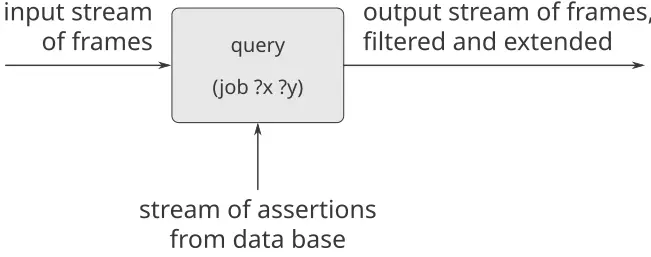
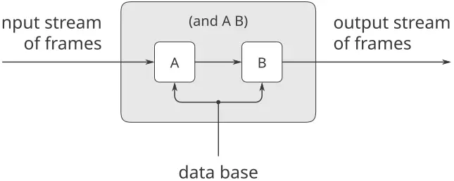
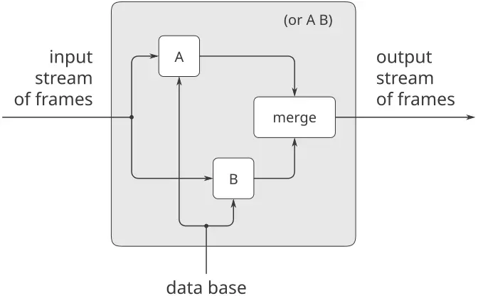

### 4.4 البرمجة المنطقيّة

في [الفصل 1](https://sarabander.github.io/sicp/html/Chapter-1.xhtml#Chapter-1) شدّدنا على أنّ علم الحاسوب يتعامل مع المعرفة الإجرائيّة (الكيفيّة)، بينما تتعرّض الرياضيّات مع المعرفة التصريحيّة (الما هو). فإنّ لغات البرمجة تتطلّب من المبرمج أن يُعبّر عن المعرفة بشكلٍ يشير إلى الطرائق الخطوة بخطوة لحلّ مسائل معيّنة. ومن جهةٍ أخرى، توفّر اللغات عالية المستوى، كجزءٍ من تنفيذ اللغة، قدرًا كبيرًا من المعرفة المنهجيّة تُحرّر المستخدم من الاهتمام بالعديد من تفاصيل كيف ستسير عمليّةٌ حسابيّةٌ محدَّدة.

معظم لغات البرمجة، بما في ذلك Lisp، مُنظّمةٌ حول احتساب قيم الدوالّ الرياضيّة. واللغات الموجَّهة بالتعابير (كالـLisp وFortran وAlgol) تستثمر «المجاز» القائل إنّ تعبيرًا يصف قيمة دالّةٍ يمكن تفسيره أيضًا بوصفه وسيلةً لاحتساب تلك القيمة. وبسبب هذا، فإنّ معظم لغات البرمجة منحازةٌ انحيازًا شديدًا نحو الاحتسابات أحاديّة الاتجاه (الاحتسابات ذات المدخلات والمخرجات المحدَّدة تحديدًا جيّدًا). ولكن ثمّة لغات برمجةٍ مختلفةٌ جذريًّا تُرخِي هذا الانحياز. وقد رأينا مثالًا على ذلك في [3.3.5](https://sarabander.github.io/sicp/html/3_002e3.xhtml#g_t3_002e3_002e5)، حيث كانت كائنات الاحتساب قيودًا حسابيّة. ففي نظام القيود، لا يكون اتجاه الاحتساب وترتيبه محدَّدين تحديدًا جيّدًا؛ وعند أداء عمليّةٍ حسابيّةٍ ينبغي إذاً للنظام أن يوفّر معرفة «كيفيّة» أكثر تفصيلًا ممّا سيكون عليه الأمر في احتسابٍ حسابيٍّ اعتياديّ. لكن هذا لا يعني أنّ المستخدم مُخَلَّصٌ كلّيًّا من مسؤوليّة توفير المعرفة الإجرائيّة. فثمّة شبكات قيودٍ كثيرةٌ تُنفّذ المجموعة ذاتها من القيود، وعلى المستخدم أن يختار من مجموعة الشبكات المتكافئة رياضيًّا شبكةً مناسبةً لتحديد عمليّةٍ حسابيّةٍ معيّنة.

إنّ مقيّم البرامج غير الحتميّ الوارد في [4.3](https://sarabander.github.io/sicp/html/4_002e3.xhtml#g_t4_002e3) يبتعد أيضًا عن الرأي القائل إنّ البرمجة تتمحور حول بناء خوارزميّاتٍ لاحتساب دوالّ أحاديّة الاتجاه. ففي لغةٍ غير حتميّةٍ، يمكن أن يكون للتعبيرات أكثر من قيمةٍ واحدة، ونتيجةً لذلك، فإنّ الاحتساب يتعامل مع العلاقات بدلًا من الدوالّ أحاديّة القيمة. وتوسّع البرمجة المنطقيّة هذه الفكرة بجمع رؤية علائقيّةٍ للبرمجة مع نوعٍ قويّ من مطابقة الأنماط الرمزيّة يُسمّى *التوحيد (unification)*.[^58]

فمثلًا، تأمّل العمليّة `append`، التي تأخذ قائمتين كمعطيين وتجمع عناصرها لتشكيل قائمةٍ واحدة. وفي لغةٍ إجرائيّةٍ مثل Lisp، كان بوسعنا تعريف `append` بدلالة بانٍ القائمة الأساسيّ `cons`، كما فعلنا في [2.2.1](https://sarabander.github.io/sicp/html/2_002e2.xhtml#g_t2_002e2_002e1):

```scheme
(define (append x y)
  (if (null? x) 
      y 
      (cons (car x) (append (cdr x) y))))
```

يمكن اعتبار هذا الإجراء ترجمةً إلى Lisp للقاعدتين التاليتين، تغطّي الأولى منهما حالة كون القائمة الأوّل فارغة، وتتولّى الثانية حالة كون القائمة غير فارغة، وهي `cons` من جزءين:

- لأيّ قائمة `y`، فإنّ القائمة الفارغة و`y` تُنتجان بـ`append` القائمة `y`.
- لأيّ `u` و`v` و`y` و`z`، فإنّ `(cons u v)` و`y` تُنتجان بـ`append` القائمة `(cons u z)` إذا كانت `v` و`y` تُنتجان بـ`append` القائمة `z`.[^59]

وباستخدام إجراء `append`، يمكننا الإجابة عن أسئلةَ مثل

> أوجد الحاصل من `append` لقائمتَي `(a b)` و`(c d)`.

لكنّ القاعدتين ذاتهما كافيتان أيضًا للإجابة عن الأنواع التالية من الأسئلة، التي لا يستطيع الإجابة عنها:

> أوجد قائمةً `y` يُلحِقها `append` مع `(a b)` لإنتاج `(a b c d)`. أوجد جميع `x` و`y` التي يُنتج `append` عليها القائمة `(a b c d)`.

في لغة البرمجة المنطقيّة، يكتب المبرمج «إجراء» `append` بالنصّ على القاعدتين المتعلّقتين بـ`append` الواردتين أعلاه. وتُوفَّر معرفة «الكيفيّة» تلقائيًّا بواسطة المفسّر للسماح باستخدام هذا الزوج الوحيد من القواعد في الإجابة عن جميع الأنواع الثلاثة من الأسئلة حول `append`.[^60]

للّغات البرمجة المنطقيّة المعاصرة (بما في ذلك اللغة التي نُنفّذها هنا) قصورٌ جوهريّ، إذ إنّ طرائقها العامّة في «الكيفيّة» قد تقودها إلى حلقاتٍ لانهائيّةٍ زائفة أو إلى سلوكيّاتٍ غير مرغوبةٍ أخرى. والبرمجة المنطقيّة مجالٌ نشطٌ للبحث في علم الحاسوب.[^61]

سبق لنا في هذا الفصل أن استكشفنا تقنيّة تنفيذ المفسّرات ووصفنا العناصر الأساسيّة لأيّ مفسّرٍ للغة شبيهة بـLisp (وبالحريّ، لأيّ مفسّرٍ لأيّ لغةٍ تقليديّة). والآن سنطبّق هذه الأفكار لمناقشة مفسّرٍ للغة البرمجة المنطقيّة. ونُسمّي هذه اللغة *لغة الاستفسار (query language)*، لأنّها مفيدةٌ للغايةٍ في استرجاع المعلومات من قواعد البيانات بصياغة *استفسارات*، أي أسئلة، معبَّرًا عنها باللغة. وحتّى وإن كانت لغة الاستفسار مختلفةً جدًّا عن Lisp، فسنرى أنّ من الملائم وصف اللغة بدلالة الإطار العامّ ذاته الذي استخدمناه طوال الوقت: كمجموعةٍ من العناصر الأوّليّة، جنبًا إلى جنبٍ مع وسائل تركيبٍ تُمكّننا من دمج عناصر بسيطةٍ لإنشاء عناصر أكثر تعقيدًا، ووسائل تجريدٍ تُمكّننا من اعتبار العناصر المعقّدة وحداتٍ مفاهيميّةً واحدة. ومفسّر لغة البرمجة المنطقيّة أعقدّ بكثيرٍ من مفسّر لغةٍ مثل Lisp. ومع ذلك، فسنرى أنّ مفسّر لغة الاستفسار لدينا يحتوي على العديد من العناصر ذاتها الموجودة في مفسّر [4.1](https://sarabander.github.io/sicp/html/4_002e1.xhtml#g_t4_002e1). وعلى وجه الخصوص، فسيكون هناك جزء «eval» يُصنّف التعابير بحسب النوع، وجزء «apply» يُنفّذ آليّة تجريد اللغة (الإجراءات في حالة Lisp، و*القواعد* في حالة البرمجة المنطقيّة). وتلعب أيضًا دورًا مركزيًّا في التنفيذ بنية بيانات الإطار، التي تُحدّد التطابق بين الرموز وقيمها المرتبطة. وجانب آخر مثيرٌ للاهتمام في تنفيذنا للغة الاستفسار هو أنّنا نستخدم المجاري استخدامًا كبيرًا، وهي التي قُدِّمت في [الفصل 3](https://sarabander.github.io/sicp/html/Chapter-3.xhtml#Chapter-3).

#### 4.4.1 الاسترجاع الاستنباطيّ للمعلومات

تتفوّق البرمجة المنطقيّة في توفير واجهاتٍ لقواعد البيانات لاسترجاع المعلومات. ولغة الاستفسار التي سنُنفّذها في هذا الفصل مصمّمةٌ للاستخدام على هذا النحو.

ولتوضيح ما يفعله نظام الاستفسار، سنُظهر كيف يمكن استخدامه لإدارة قاعدة بيانات سجلّات الموظّفين لشركة Microshaft، شركةٌ مزدهرةٌ عالية التقنيّة في منطقة بوسطن. وتوفّر اللغة وصولًا موجَّهًا بالأنماط إلى معلومات الموظّفين، ويمكنها أيضًا الاستفادة من القواعد العامّة لإجراء استنباطاتٍ منطقيّة.

#### نموذج من قاعدة بيانات

تحتوي قاعدة بيانات الموظّفين لشركة Microshaft على *تأكيدات (assertions)* حول موظّفي الشركة. وهذه معلومات عن بن بِتدل، ساحر الحاسوب المقيم:

```scheme
(address (Bitdiddle Ben) 
         (Slumerville (Ridge Road) 10))
(job (Bitdiddle Ben) (computer wizard))
(salary (Bitdiddle Ben) 60000)
```

كلّ تأكيدٍ قائمةٌ (ثلاثيّة في هذه الحالة) عناصرها قد تكون هي نفسها قوائم.

وبوصفه ساحرًا مقيمًا، يتولّى بن مسؤولية قسم الحاسوب في الشركة، وهو يشرف على مبرمجَين وفنّيٍّ واحد. وهذه معلومات عنهم:

```scheme
(address (Hacker Alyssa P) 
         (Cambridge (Mass Ave) 78))
(job (Hacker Alyssa P) (computer programmer))
(salary (Hacker Alyssa P) 40000)
(supervisor (Hacker Alyssa P) (Bitdiddle Ben))

(address (Fect Cy D) 
         (Cambridge (Ames Street) 3))
(job (Fect Cy D) (computer programmer))
(salary (Fect Cy D) 35000)
(supervisor (Fect Cy D) (Bitdiddle Ben))

(address (Tweakit Lem E) 
         (Boston (Bay State Road) 22))
(job (Tweakit Lem E) (computer technician))
(salary (Tweakit Lem E) 25000)
(supervisor (Tweakit Lem E) (Bitdiddle Ben))
```

وهناك أيضًا مبرمجٌ متدرّب، تشرف عليه أليسا:

```scheme
(address (Reasoner Louis) 
         (Slumerville (Pine Tree Road) 80))
(job (Reasoner Louis) 
     (computer programmer trainee))
(salary (Reasoner Louis) 30000)
(supervisor (Reasoner Louis) 
            (Hacker Alyssa P))
```

كلّ هؤلاء الناس في قسم الحاسوب، كما تشير إلى ذلك كلمة `computer` كونها أوّل عنصرٍ في أوصاف وظائفهم.

بن موظّفٌ عالي المستوى. ومشرفُه هو كبير الشركة نفسه:

```scheme
(supervisor (Bitdiddle Ben) (Warbucks Oliver))
(address (Warbucks Oliver) 
         (Swellesley (Top Heap Road)))
(job (Warbucks Oliver) 
     (administration big wheel))
(salary (Warbucks Oliver) 150000)
```

وإضافةً إلى قسم الحاسوب الذي يشرف عليه بن، فإنّ للشركة قسمًا للمحاسبة، يتألّف من كبير محاسبين ومساعده:

```scheme
(address (Scrooge Eben) 
         (Weston (Shady Lane) 10))
(job (Scrooge Eben) 
     (accounting chief accountant))
(salary (Scrooge Eben) 75000)
(supervisor (Scrooge Eben) (Warbucks Oliver))

(address (Cratchet Robert) 
         (Allston (N Harvard Street) 16))
(job (Cratchet Robert) (accounting scrivener))
(salary (Cratchet Robert) 18000)
(supervisor (Cratchet Robert) (Scrooge Eben))
```

وهناك أيضًا سكرتيرة لكبير الشركة:

```scheme
(address (Aull DeWitt) 
         (Slumerville (Onion Square) 5))
(job (Aull DeWitt) (administration secretary))
(salary (Aull DeWitt) 25000)
(supervisor (Aull DeWitt) (Warbucks Oliver))
```

وتحتوي قاعدة البيانات أيضًا على تأكيداتٍ حول أنواع الوظائف التي يمكن أن يؤدّيها أشخاصٌ يشغلون أنواعًا أخرى من الوظائف. فمثلًا، يمكن لساحر الحاسوب أن يؤدّي وظيفتَي مبرمج الحاسوب وفنّيّ الحاسوب كليهما:

```scheme
(can-do-job (computer wizard) 
            (computer programmer))

(can-do-job (computer wizard) 
            (computer technician))
```

يمكن لمبرمج الحاسوب أن يحلّ محلّ متدرّب:

```scheme
(can-do-job (computer programmer)
            (computer programmer trainee))
```

وكذلك، كما هو معروفٌ جيّدًا،

```scheme
(can-do-job (administration secretary)
            (administration big wheel))
```

#### الاستفسارات البسيطة

تسمح لغة الاستفسار (query language) للمستخدمين باسترجاع المعلومات من قاعدة البيانات بطرح استفساراتٍ استجابةً لإشارة النظام. فمثلًا، للعثور على جميع مبرمجي الحاسوب، يمكن للمرء أن يقول

```scheme
;;; Query input:
(job ?x (computer programmer))
```

سيستجيب النظام بالعناصر التالية:

```scheme
;;; Query results:
(job (Hacker Alyssa P) (computer programmer))
(job (Fect Cy D) (computer programmer))
```

يُحدّد الاستفسار المُدخَل أنّنا نبحث عن مدخلاتٍ في قاعدة البيانات تطابق *نمطًا* معيّنًا. وفي هذا المثال، يُحدّد النمط مدخلاتٍ متألّفة من ثلاثة عناصر، أوّلها الرمز الحرفيّ `job`، والثاني يمكن أن يكون أيّ شيء، والثالث هو القائمة الحرفيّة `(computer programmer)`. و«أيّ شيء» الذي يمكن أن يكون العنصر الثاني في القائمة المطابَقة يُحدَّد بـ*متغيّر نمط*، `?x`. والصورة العامّة لمتغيّر النمط هي رمزٌ، يُعتبر اسم المتغيّر، يسبقه علامة استفهام. وسنرى أدناه لماذا يكون من المفيد تحديد أسماء لمتغيّرات الأنماط بدلًا من مجرّد وضع `?` في الأنماط لتمثيل «أيّ شيء». ويستجيب النظام لاستفسارٍ بسيطٍ بعرض جميع المدخلات في قاعدة البيانات التي تطابق النمط المحدَّد.

ويمكن أن يكون للنمط أكثر من متغيّرٍ واحد. فمثلًا، الاستفسار

```scheme
(address ?x ?y)
```

سيسرد عناوين جميع الموظّفين.

ويمكن ألّا يحتوي النمط على أيّ متغيّرات، وفي هذه الحالة يحدّد الاستفسار ببساطة ما إذا كان ذلك النمط مدخلًا في قاعدة البيانات. فإن كان كذلك، فستكون هناك مطابقةٌ واحدة؛ وإلّا فلن تكون هناك أيّ مطابقات.

ويمكن للمتغيّر النمطيّ ذاته أن يظهر أكثر من مرّةٍ واحدة في استفسارٍ ما، مُحدّدًا أنّ «أيّ شيء» ذاته يجب أن يظهر في كلّ موضع. وهذا سبب تسمية المتغيّرات. فمثلًا،

```scheme
(supervisor ?x ?x)
```

يجد جميع الناس الذين يشرفون على أنفسهم (وإن لم يكن هناك أيّ تأكيدٍ كهذا في نموذج قاعدة بياناتنا).

الاستفسار

```scheme
(job ?x (computer ?type))
```

فإنّه يطابق جميع مدخلات الوظائف التي عنصرها الثالث قائمةٌ ثنائيّة العناصر أوّلها `computer`:

```scheme
(job (Bitdiddle Ben) (computer wizard))
(job (Hacker Alyssa P) (computer programmer))
(job (Fect Cy D) (computer programmer))
(job (Tweakit Lem E) (computer technician))
```

وهذا النمط ذاته *لا* يطابق

```scheme
(job (Reasoner Louis) 
     (computer programmer trainee))
```

لأنّ العنصر الثالث في المدخل قائمةٌ من ثلاثة عناصر، أمّا العنصر الثالث في النمط فيُحدّد أنّه ينبغي أن يكون هناك عنصران. فلو أردنا تغيير النمط بحيث يمكن أن يكون العنصر الثالث أيّ قائمةٍ تبدأ بـ`computer`، فبوسعنا أن نُحدّد[^62]

```scheme
(job ?x (computer . ?type))
```

فمثلًا،

```scheme
(computer . ?type)
```

يطابق البيان

```scheme
(computer programmer trainee)
```

بحيث يكون `?type` هو القائمة `(programmer trainee)`. وهو يطابق أيضًا البيان

```scheme
(computer programmer)
```

بحيث يكون `?type` هو القائمة `(programmer)`، ويطابق البيان

```scheme
(computer)
```

بحيث يكون `?type` هو القائمة الفارغة `()`.

ويمكننا وصف معالجة لغة الاستفسار للاستفسارات البسيطة على النحو الآتي:

- يجد النظام جميع الإحالات إلى متغيّرات نمط الاستفسار التي *تُحقّق* النمط—أي جميع مجموعات القيم للمتغيّرات بحيث إنّ *جُسِّمت* متغيّرات النماط بالقيم (أي استُبدلت بها)، كانت النتيجة في قاعدة البيانات.
- يستجيب النظام للاستفسار بسرد جميع تجسيدات نمط الاستفسار مصحوبةً بإحالات المتغيّرات التي تُحقّقه.

لاحِظ أنّ النمط إن لم يكن له متغيّرات، فإنّ الاستفسار يَنزل إلى تحديد ما إذا كان ذلك النمط في قاعدة البيانات. فإن كان كذلك، فإنّ الإحالة الفارغة، التي لا تُحيل أيّ قيمٍ إلى متغيّرات، تُحقّق ذلك النمط لتلك قاعدة البيانات.

> **التمرين 4.55:** أعطِ استفساراتٍ بسيطةً تسترجع المعلومات التالية من قاعدة البيانات: جميع الناس الذين يشرف عليهم بن بِتدل؛
> > أسماء ووظائف جميع الناس في قسم المحاسبة؛
> > أسماء وعناوين جميع الناس الذين يسكنون في سلومرفيل.
> > 

#### الاستفسارات المركّبة

تُشكّل الاستفسارات البسيطة العمليّات الأوّليّة للغة الاستفسار. ولكي تُشكَّل عمليّاتٌ مركّبة، توفّر لغة الاستفسار وسائل تركيب. وأحد ما يجعل لغة الاستفسار لغةً للبرمجة المنطقيّة هو أنّ وسائل التركيب تُعاكس وسائل التركيب المستخدمة في تشكيل التعابير المنطقيّة: `and` و`or` و`not`. (وهنا `and` و`or` و`not` ليست أوّليّات Lisp، بل عمليّاتٌ مدمجةٌ في لغة الاستفسار.)

ويمكننا استخدام `and` على النحو الآتي للعثور على عناوين جميع مبرمجي الحاسوب:

```scheme
(and (job ?person (computer programmer))
     (address ?person ?where))
```

والناتج الخارج هو

```scheme
(and (job (Hacker Alyssa P) 
          (computer programmer))
     (address (Hacker Alyssa P) 
              (Cambridge (Mass Ave) 78)))

(and (job (Fect Cy D) (computer programmer))
     (address (Fect Cy D) 
              (Cambridge (Ames Street) 3)))
```

وبصورةٍ عامّة،

```scheme
(and ⟨query₁⟩ ⟨query₂⟩ … ⟨queryₙ⟩)
```

تتحقّقه جميع مجموعات القيم لمتغيّرات النمط التي تُحقّق $⟨ q u e r y_{1} ⟩$ … $⟨ q u e r y_{n} ⟩$ في الوقت ذاته.

أمّا بالنسبة للاستعلامات البسيطة، فإنّ النظام يعالج الاستعلام المركّب بإيجاد جميع الإحالات على متغيّرات النمط التي تُحقّق الاستعلام، ثم يعرض إنشاءات الاستعلام بتلك القيم.

وثمة وسيلة أخرى لبناء استعلاماتٍ مركّبة، وهي باستخدام `or`. فمثلًا،

```scheme
(or (supervisor ?x (Bitdiddle Ben))
    (supervisor ?x (Hacker Alyssa P)))
```

وسيجد جميع الموظفين الذين يشرف عليهم بن بِتدل أو أليسا بي. هاكر:

```scheme
(or (supervisor (Hacker Alyssa P) 
                (Bitdiddle Ben))
    (supervisor (Hacker Alyssa P) 
                (Hacker Alyssa P)))

(or (supervisor (Fect Cy D) 
                (Bitdiddle Ben))
    (supervisor (Fect Cy D) 
                (Hacker Alyssa P)))

(or (supervisor (Tweakit Lem E) 
                (Bitdiddle Ben))
    (supervisor (Tweakit Lem E) 
                (Hacker Alyssa P)))

(or (supervisor (Reasoner Louis) 
                (Bitdiddle Ben))
    (supervisor (Reasoner Louis) 
                (Hacker Alyssa P)))
```

وبصورةٍ عامّة،

```scheme
(or ⟨query₁⟩ ⟨query₂⟩ … ⟨queryₙ⟩)
```

تتحقّقه جميع مجموعات القيم لمتغيّرات النمط التي تُحقّق واحدًا على الأقلّ من $⟨ q u e r y_{1} ⟩$ … $⟨ q u e r y_{n} ⟩$ .

ويمكن أيضًا تكوين استعلاماتٍ مركّبةً بـ`not`. فمثلًا،

```scheme
(and (supervisor ?x (Bitdiddle Ben))
     (not (job ?x (computer programmer))))
```

فيجد جميع الأشخاص الذين يشرف عليهم بن بِتدل وليسوا مبرمجي حاسوب. وبصورةٍ عامّة،

```scheme
(not ⟨query₁⟩)
```

تتحقّقه جميع الإحالات على متغيّرات النمط التي لا تُحقّق $⟨ q u e r y_{1} ⟩$ .[^63]

أمّا الشكل الأخير من أشكال التركيب فيُسمّى `lisp-value`. وعندما يكون `lisp-value` العنصر الأوّل في نمط، فإنّه يُحدّد أنّ العنصر التالي مُسَيِّم Lisp يُطبَّق على بقيّة العناصر (المنشأة) كمعطياتٍ. وبصورةٍ عامّة،

```scheme
(lisp-value ⟨predicate⟩ ⟨arg₁⟩ … ⟨argₙ⟩)
```

تتحقّقه الإحالات على متغيّرات النمط التي يكون فيها تطبيق `⟨`predicate`⟩` على $⟨ a r g_{1} ⟩$ … $⟨ a r g_{n} ⟩$ المنشأة صحيحًا. فمثلًا، لإيجاد جميع الأشخاص الذين راتبهم أكبر من $30,000 نستطيع كتابة[^64]

```scheme
(and (salary ?person ?amount)
     (lisp-value > ?amount 30000))
```

> **التمرين 4.56:** صِغ استعلاماتٍ مركّبةً تسترجع المعلومات التالية: أسماء جميع الأشخاص الذين يشرف عليهم بن بِتدل، مع عناوينهم؛
> > جميع الأشخاص الذين راتبهم أقلّ من راتب بن بِتدل، مع راتبهم وراتب بن بِتدل؛
> > جميع الأشخاص الذين يشرف عليهم شخصٌ ليس في قسم الحاسوب، مع اسم المشرف ومهمّته.
> > 

#### القواعد

إلى جانب الاستعلامات الأوّليّة والاستعلامات المركّبة، توفّر لغة الاستعلامات وسائلَ لتجريد الاستعلامات. وهذه تُعطى بـ*القواعد*. والقاعدة

```scheme
(rule (lives-near ?person-1 ?person-2)
      (and (address ?person-1 
                    (?town . ?rest-1))
           (address ?person-2 
                    (?town . ?rest-2))
           (not (same ?person-1 ?person-2))))
```

تُحدّد أنّ شخصين يعيشان قريبًا من بعضهما إذا كانا يعيشان في البلدة نفسها. والبند `not` الأخير يمنع القاعدة من القول إنّ جميع الناس يعيشون قريبين من ذواتهم. أمّا علاقة `same` فمعرَّفةٌ بقاعدةٍ بسيطةٍ جدًّا:[^65]

```scheme
(rule (same ?x ?x))
```

والقاعدة الآتية تُصرّح أنّ الشخص "عجلة" (wheel) في تنظيمٍ إذا كان يُشرف على شخصٍ ما هو بدوره مشرف:

```scheme
(rule (wheel ?person)
      (and (supervisor ?middle-manager 
                       ?person)
           (supervisor ?x ?middle-manager)))
```

الصورة العامّة للقاعدة هي

```scheme
(rule ⟨conclusion⟩ ⟨body⟩)
```

حيث `⟨`الخلاصة`⟩` نمطٌ و`⟨`الجسم`⟩` أيّ استعلام.[^66] ونستطيع أن نفكّر في القاعدة بوصفها تمثّل مجموعةً كبيرةً (حتّى غير منتهيةٍ) من التأكيدات، وهي جميع إنشاءات خلاصة القاعدة بإحالاتٍ على المتغيّرات تُحقّق جسم القاعدة. وحين وصفنا الاستعلامات البسيطة (الأنماط)، قلنا إنّ إحلالًا على المتغيّرات يُحقّق نمطًا إذا كان النمط المنشأ موجودًا في قاعدة البيانات. لكن ليس ضروريًّا أن يكون النمط موجودًا في قاعدة البيانات صراحةً بوصفه تأكيدًا. فقد يكون تأكيدًا ضمنيًّا تستتبعه قاعدة. فمثلًا، الاستعلام

```scheme
(lives-near ?x (Bitdiddle Ben))
```

يُنتج

```scheme
(lives-near (Reasoner Louis) (Bitdiddle Ben))
(lives-near (Aull DeWitt) (Bitdiddle Ben))
```

ولإيجاد جميع مبرمجي الحاسوب الذين يعيشون قريبين من بن بِتدل، نستطيع أن نسأل

```scheme
(and (job ?x (computer programmer))
     (lives-near ?x (Bitdiddle Ben)))
```

وكما في حالة الإجراءات المركّبة، يمكن استخدام القواعد أجزاءً من قواعد أخرى (كما رأينا مع القاعدة `lives-near` أعلاه) أو حتّى تعريفها تعاوديًّا. فمثلًا، القاعدة

```scheme
(rule (outranked-by ?staff-person ?boss)
      (or (supervisor ?staff-person ?boss)
          (and (supervisor ?staff-person 
                           ?middle-manager)
               (outranked-by ?middle-manager 
                             ?boss))))
```

تقول إنّ أحد أفراد الطاقم يعلوه رئيسٌ في التنظيم إذا كان الرئيس هو مشرف الشخص، أو (تعاوديًّا) إذا كان مشرف الشخص معلوًا بالرئيس.

> **التمرين 4.57:** عرّف قاعدةً تقول إنّ الشخص 1 يمكن أن يحلّ محلّ الشخص 2 إذا كان الشخص 1 يؤدّي المهمّة نفسها التي يؤدّيها الشخص 2، أو إذا كان من يؤدّي مهمّة الشخص 1 يستطيع أداء مهمّة الشخص 2 أيضًا، وإذا لم يكن الشخص 1 والشخص 2 الشخص نفسه. وباستخدام قاعدتك، أعطِ استعلاماتٍ تجد ما يلي: جميع الأشخاص الذين يمكنهم حلّ محلّ ساي دي. فيكت؛
> > جميع الأشخاص الذين يمكنهم حلّ محلّ شخصٍ يُدفع له أكثر مما يُدفع لهم، مع الراتبين.
> > 

> **التمرين 4.58:** عرّف قاعدةً تقول إنّ الشخص "شخصية كبيرة" (big shot) في قسمٍ إذا كان يعمل في القسم لكن ليس له مشرف يعمل في القسم.

**التمرين 4.59:** فات بن بِتدل اجتماعٌ واحد أكثر من اللازم. وخشيةً من أن تُكلّفه عادته في نسيان الاجتماعات وظيفته، قرّر بن أن يفعل شيئًا حيال ذلك. فهو يضيف جميع الاجتماعات الأسبوعيّة للشركة إلى قاعدة بيانات Microshaft بتأكيد ما يلي:

```scheme
(meeting accounting (Monday 9am))
(meeting administration (Monday 10am))
(meeting computer (Wednesday 3pm))
(meeting administration (Friday 1pm))
```

كلٌّ من التأكيدات أعلاه يخصّ اجتماع قسمٍ بكامله. ويضيف بن أيضًا مُدخلًا للاجتماع على مستوى الشركة كلّها الذي يمتدّ عبر جميع الأقسام. وجميع موظّفي الشركة يحضرون هذا الاجتماع.

```scheme
(meeting whole-company (Wednesday 4pm))
```

في صباح الجمعة، يريد بن الاستعلام من قاعدة البيانات عن جميع الاجتماعات التي تجري في ذلك اليوم. فما الاستعلام الذي ينبغي أن يستخدمه؟ أمّا أليسا بي. هاكر فغير مقتنعة. فهي تعتقد أنّه سيكون من الأنفع بكثيرٍ القدرة على السؤال عن اجتماعاتها بتحديد اسمها. ولذلك تُصمّم قاعدةً تقول إنّ اجتماعات الشخص تتضمّن جميع اجتماعات `whole-company` بالإضافة إلى جميع اجتماعات قسم ذلك الشخص. فاملأ جسم قاعدة أليسا.

```scheme
(rule (meeting-time ?person ?day-and-time)
      ⟨rule-body⟩)
```

تصل أليسا إلى العمل صباح الأربعاء وتتساءل عن الاجتماعات التي عليها حضورها في ذلك اليوم. فبعد تعريف القاعدة أعلاه، ما الاستعلام الذي ينبغي أن تضعه لمعرفة ذلك؟

**التمرين 4.60:** بإعطاء الاستعلام

```scheme
(lives-near ?person (Hacker Alyssa P))
```

تستطيع أليسا بي. هاكر إيجاد الأشخاص الذين يعيشون قريبين منها، والذين يمكنها أن تركب معهم إلى العمل. ومن جانبٍ آخر، حين تحاول إيجاد جميع أزواج الأشخاص الذين يعيشون قريبين من بعضهم بالاستعلام عن

```scheme
(lives-near ?person-1 ?person-2)
```

تلاحِظ أنّ كلّ زوجٍ من الأشخاص الذين يعيشون قريبين من بعضهم يُسجَّل مرّتين؛ فمثلًا،

```scheme
(lives-near (Hacker Alyssa P) (Fect Cy D))
(lives-near (Fect Cy D) (Hacker Alyssa P))
```

لماذا يحدث هذا؟ فهل ثمّة طريقةٌ لإيجاد قائمةٍ بالأشخاص الذين يعيشون قريبين من بعضهم، تظهر فيها كلّ زوجٍ مرّةً واحدةً فقط؟ فسّر.

#### المنطق كبرامج

ونستطيع اعتبار القاعدة نوعًا من الاستتباع المنطقيّ: *إذا* إحلالٌ للقيم على متغيّرات النمط يُحقّق الجسم، *فإنّه* يُحقّق الخلاصة. وبناءً على ذلك، نستطيع اعتبار لغة الاستعلامات ذات القدرة على أداء *الاستنتاجات المنطقيّة* استنادًا إلى القواعد. ومثالٌ على ذلك، تأمّل عمليّة `append` الموصوفة في بداية [4.4](/book/sicp/c4-metalinguistic-abstraction/4-4/). وكما قلنا، فإنّ `append` يمكن توصيفها بالقاعدتين الآتيتين:

- لأيّ قائمة `y`، فإنّ القائمة الفارغة و`y` تُلحَقَان بـ`append` لتكوين `y`.
- لأيّ `u` و`v` و`y` و`z`، فإنّ `(cons u v)` و`y` تُلحَقَان بـ`append` لتكوين `(cons u z)` إذا كانت `v` و`y` تُلحَقَان بـ`append` لتكوين `z`.

وللتعبير عن هذا في لغة الاستعلامات، نُعرّف قاعدتين لعلاقة

```scheme
(append-to-form x y z)
```

التي نستطيع تفسيرها بمعنى أنّ `x` و`y` تُلحَقَان بـ`append` لتكوين `z`:

```scheme
(rule (append-to-form () ?y ?y))
(rule (append-to-form (?u . ?v) ?y (?u . ?z))
      (append-to-form ?v ?y ?z))
```

القاعدة الأولى ليس لها جسم، ما يعني أنّ الخلاصة تتحقّق لأيّ قيمة لـ`?y`. ولاحِظ كيف تستخدم القاعدة الثانية ترميز الذيل المنقّط لتسمية `car` و`cdr` لقائمة.

وبوجود هاتين القاعدتين، نستطيع صياغة استعلاماتٍ تحتسب `append` قائمتين:

```scheme
;;; Query input:
(append-to-form (a b) (c d) ?z)

;;; Query results:
(append-to-form (a b) (c d) (a b c d))
```

والأكثر إدهاشًا، أنّنا نستطيع استخدام القواعد ذاتها لطرح السؤال: «أيّ قائمة، حين تُلحَق بـ`append` بـ`(a b)`، تُنتج `(a b c d)`؟» وهذا يُجرى على النحو الآتي:

```scheme
;;; Query input:
(append-to-form (a b) ?y (a b c d))

;;; Query results:
(append-to-form (a b) (c d) (a b c d))
```

ونستطيع أيضًا السؤال عن جميع أزواج القوائم التي تُلحَق بـ`append` لتكوين `(a b c d)`:

```scheme
;;; Query input:
(append-to-form ?x ?y (a b c d))

;;; Query results:
(append-to-form () (a b c d) (a b c d))
(append-to-form (a) (b c d) (a b c d))
(append-to-form (a b) (c d) (a b c d))
(append-to-form (a b c) (d) (a b c d))
(append-to-form (a b c d) () (a b c d))
```

قد يبدو نظام الاستعلامات وكأنّه يُظهر قدرًا لا بأس به من الذكاء في استخدامه القواعد لاستنتاج أجوبة الاستعلامات أعلاه. في الحقيقة، كما سنرى في القسم التالي، فإنّ النظام يتبع خوارزميّة محدّدة تحديدًا حسنًا في تفكيك القواعد. ولسوء الحظّ، على الرغم من أنّ النظام يعمل عملًا مُبهرًا في حالة `append`، فإنّ الطرائق العامّة قد تتعطّل في الحالات الأكثر تعقيدًا، كما سنرى في [4.4.3](/book/sicp/c4-metalinguistic-abstraction/4-4/).

**التمرين 4.61:** تُنفّذ القواعد الآتية علاقة `next-to` التي تجد العناصر المتجاورة في قائمة:

```scheme
(rule (?x next-to ?y in (?x ?y . ?u)))
(rule (?x next-to ?y in (?v . ?z))
      (?x next-to ?y in ?z))
```

فما ستكون الاستجابة للاستعلامات الآتية؟

```scheme
(?x next-to ?y in (1 (2 3) 4))
(?x next-to 1 in (2 1 3 1))
```

> **التمرين 4.62:** عرّف قواعد تُنفّذ عمليّة `last-pair` الواردة في [التمرين 2.17](https://sarabander.github.io/sicp/html/2_002e2.xhtml#Exercise-2_002e17)، والتي تُعيد قائمةً تحتوي العنصر الأخير لقائمةٍ غير فارغة. افحص قواعدك على استعلامات مثل `(last-pair (3) ?x)` و`(last-pair (1 2 3) ?x)` و`(last-pair (2 ?x) (3))`. فهل تعمل قواعدك بصورةٍ صحيحةٍ على استعلامات مثل `(last-pair ?x (3))`؟

**التمرين 4.63:** قاعدة البيانات الآتية (انظر سفر التكوين 4) تتتبّع أنساب نسْل آدا رجوعًا إلى آدم، عن طريق قابيل:

```scheme
(son Adam Cain) (son Cain Enoch)
(son Enoch Irad) (son Irad Mehujael)
(son Mehujael Methushael)
(son Methushael Lamech)
(wife Lamech Ada) (son Ada Jabal)
(son Ada Jubal)
```

صِغ قواعدً مثل «إذا كان $S$ ابنًا لـ$f$ ، وكان $f$ ابنًا لـ$G$ ، فإنّ $S$ هو حفيد $G$ » و«إذا كانت $W$ زوجةً لـ$M$ ، وكان $S$ ابنًا لـ$W$ ، فإنّ $S$ هو ابن $M$ » (وهو ما كان أكثر صدقًا في الأزمنة التوراتيّة ممّا هو عليه اليوم) ممّا يُتيح لنظام الاستعلامات إيجاد حفيد قابيل، وأبناء لامك، وأحفاد متوشائيل. (انظر [التمرين 4.69](/book/sicp/c4-metalinguistic-abstraction/4-4/) لقواعدَ تستنبط علاقاتٍ أكثر تعقيدًا.)

#### 4.4.2 كيف يعمل نظام الاستعلامات

في القسم [4.4.4](/book/sicp/c4-metalinguistic-abstraction/4-4/) سنُقدّم تنفيذًا لمفسّر الاستعلامات كمجموعةٍ من الإجراءات. وفي هذا القسم نُقدّم نظرةً عامّةً تشرح البنية العامّة للنظام مستقلّةً عن تفاصيل التنفيذ منخفضة المستوى. وبعد وصف تنفيذ المفسّر، سنكون في موضعٍ يسمح لنا بفهم بعض حدوده وبعض الطرق الدقيقة التي تختلف بها عمليّات لغة الاستعلامات المنطقيّة عن عمليّات المنطق الرياضيّ.

ينبغي أن يكون واضحًا أنّ مُقيّم الاستعلامات لا بدّ أن يجري نوعًا من البحث لكي يُطابق الاستعلامات ضدّ الحقائق والقواعد في قاعدة البيانات. وإحدى طرائق فعل ذلك هي تنفيذ نظام الاستعلامات برنامجًا غير حتميّ، باستخدام مُقيّم `amb` الخاصّ بـ[4.3](https://sarabander.github.io/sicp/html/4_002e3.xhtml#g_t4_002e3) (انظر [التمرين 4.78](/book/sicp/c4-metalinguistic-abstraction/4-4/)). وهناك احتمالٌ آخر وهو إدارة البحث بمساعدة المجاري. وتنفيذنا يتبع هذا الأسلوب الثاني.

ينظّم نظام الاستعلامات حول عمليّتين مركزيّتين تُسمّيان *مطابقة الأنماط* و*التوحيد*. فنحن نُصف مطابقة الأنماط أوّلًا ونشرح كيف تُتيح لنا هذه العمليّة، مع تنظيم المعلومات من حيث مجاري الإطارات، تنفيذ الاستعلامات البسيطة والمركّبة على حدٍّ سواء. ثم نناقش التوحيد، وهو تعميمٌ لمطابقة الأنماط يلزم لتنفيذ القواعد. وأخيرًا، نُبيّن كيف يتركّب مفسّر الاستعلامات كلَّه عبر إجراءٍ يُصنّف التعابير على نحوٍ يماثل ما يفعله `eval` من تصنيفٍ للتعابير من أجل المفسّر الموصوف في [4.1](https://sarabander.github.io/sicp/html/4_002e1.xhtml#g_t4_002e1).

#### مطابقة الأنماط

*مُطابِق الأنماط* برنامجٌ يختبر ما إذا كان معطًى ما يلائم نمطًا محدّدًا. فمثلًا، فإنّ قائمة البيانات `((a b) c (a b))` تُطابق النمط `(?x c ?x)` بمتغيّر النمط `?x` مربوطًا بـ`(a b)`. وقائمة البيانات نفسها تُطابق النمط `(?x ?y ?z)` بحيث `?x` و`?z` كلاهما مربوط بـ`(a b)` و`?y` مربوط بـ`c`. وهي تُطابق أيضًا النمط `((?x ?y) c (?x ?y))` بحيث `?x` مربوط بـ`a` و`?y` مربوط بـ`b`. لكنها لا تُطابق النمط `(?x a ?y)`، لأنّ ذلك النمط يُحدّد قائمةً عنصرها الثاني هو الرمز `a`.

يأخذ مُطابِق الأنماط المستخدم في نظام الاستعلامات كمعطياتٍ نمطًا، ومعطًى، و*إطارًا* يُحدّد روابط لمتغيّرات أنماطٍ مختلفة. وهو يفحص ما إذا كان المعطى يُطابق النمط على نحوٍ متّسقٍ مع الروابط الموجودة في الإطار أصلًا. فإن كان كذلك، أعاد الإطار المعطى مُوسَّعًا بأيّ روابطٍ قد تكون تحديدًا عن طريق المطابقة. وإلّا، أفاد بأنّ المطابقة قد فشلت.

فمثلًا، استخدام النمط `(?x ?y ?x)` لمطابقة `(a b a)` مع إطارٍ فارغ سيُعيد إطارًا يُحدّد أنّ `?x` مربوط بـ`a` و`?y` مربوط بـ`b`. ومحاولة المطابقة بالنمط نفسه، والمعطى نفسه، وإطارٌ يُحدّد أنّ `?y` مربوط بـ`a` ستفشل. ومحاولة المطابقة بالنمط نفسه، والمعطى نفسه، وإطارٌ `?y` فيه مربوط بـ`b` و`?x` غير مربوط ستُعيد الإطار المعطى مُوسَّعًا بربط `?x` بـ`a`.

إنّ مُطابِق الأنماط هو كلّ الآليّة اللازمة لمعالجة الاستعلامات البسيطة التي لا تشمل القواعد. فمثلًا، لمعالجة الاستعلام

```scheme
(job ?x (computer programmer))
```

فإنّا نمسح جميع التأكيدات في قاعدة البيانات ونختار تلك التي تُطابق النمط بالنسبة إلى إطارٍ فارغ ابتداءً. ولكلّ مطابقةٍ نجدها، نستخدم الإطار المُعاد من المطابقة لإنشاء النمط بقيمةٍ لـ`?x`.

#### مجاري الإطارات

يُنظَّم اختبار الأنماط ضدّ الإطارات باستخدام المجاري. وبإعطاء إطارٍ مفرد، تجري عمليّة المطابقة على مُدخلات قاعدة البيانات واحدًا واحدًا. ولكلّ مُدخلٍ في قاعدة البيانات، يُنتج المُطابِق إمّا رمزًا خاصًّا يُشير إلى أنّ المطابقة قد فشلت، وإمّا امتدادًا للإطار. وتُجمع النتائج الخاصّة بجميع مُدخلات قاعدة البيانات في مجرى، يُمرَّر عبر مُرشِّحٍ لتنقية الإخفاقات. والنتيجة مجرىٌ بجميع الإطارات التي تُوسّع الإطار المعطى عبر مطابقةٍ لتأكيدٍ ما في قاعدة البيانات.[^67]

في نظامنا، يأخذ الاستعلام مجرى إطاراتٍ مدخلًا ويؤدّي عمليّة المطابقة أعلاه لكلّ إطارٍ في المجرى، كما هو موضّح في [الشكل 4.4](/book/sicp/c4-metalinguistic-abstraction/4-4/). أي أنّ الاستعلام، لكلّ إطارٍ في مجرى الدخل، يُنتج مجرى جديدًا يتألّف من جميع امتدادات ذلك الإطار بواسطة مطابقاتٍ لتأكيداتٍ في قاعدة البيانات. ثم تُدمَج جميع هذه المجاري لتكوين مجرى واحدٍ هائل، يحتوي جميع الامتدادات الممكنة لكلّ إطارٍ في مجرى الدخل. وهذا المجرى هو مخرج الاستعلام.



**الشكل 4.4:** يعالج الاستعلام مجرى إطاراتٍ.

للإجابة عن استعلامٍ بسيط، نستخدم الاستعلام مع مجرى دخلٍ يتألّف من إطارٍ فارغٍ مفرد. ومجرى المخرج الناتج يحتوي جميع امتدادات الإطار الفارغ (أي جميع أجوبة استعلامنا). ثم يُستخدم مجرى الإطارات هذا لتوليد مجرى نسخٍ من نمط الاستعلام الأصليّ بالمتغيّرات منشأةً بالقيم في كلّ إطار، وهذا هو المجرى الذي يُطبع في النهاية.

#### الاستعلامات المركّبة

يبدو الأناقة الحقيقيّة لتنفيذ مجرى الإطارات واضحةً حين نتعامل مع الاستعلامات المركّبة. فمعالجة الاستعلامات المركّبة تستفيد من قدرة مُطابِقنا على المطالبة بأن تكون المطابقة متّسقةً مع إطارٍ محدّدًا. فمثلًا، للتعامل مع `and` استعلامين، مثل

```scheme
(and (can-do-job 
      ?x 
      (computer programmer trainee))
     (job ?person ?x))
```

(بصورةٍ غير رسميّة، «ابحث عن جميع الأشخاص الذين يستطيعون أداء مهمّة متدرّب مبرمج حاسوب»)، نجد أوّلًا جميع المُدخلات التي تُطابق النمط

```scheme
(can-do-job ?x (computer programmer trainee))
```

يُنتج هذا مجرى إطاراتٍ، يحتوي كلٌّ منها ربطًا لـ`?x`. ثم نجد، لكلّ إطارٍ في المجرى، جميع المُدخلات التي تُطابق

```scheme
(job ?person ?x)
```

على نحوٍ متّسقٍ مع الربط المعطى لـ`?x`. وكلّ مطابقةٍ من هذه المطابقات ستُنتج إطارًا يحتوي روابط لـ`?x` و`?person`. ويمكن النظر إلى `and` استعلامَين بوصفه تركيبًا تواليًّا للاستعلامين المركّبين، كما هو موضّح في [الشكل 4.5](/book/sicp/c4-metalinguistic-abstraction/4-4/). فالإطارات التي تمرّ عبر مرشّح الاستعلام الأوّل تُرشَّح وتُوسَّع بعدُ بالاستعلام الثاني.



**الشكل 4.5:** يُنتَج تركيب `and` لاستعلامَين بالعمل على مجرى الإطارات تواليًّا.

يُظهر [الشكل 4.6](/book/sicp/c4-metalinguistic-abstraction/4-4/) الطريقة المماثلة لاحتساب `or` استعلامَين تركيبًا توازيًّا للاستعلامين المركّبين. فمجرى الإطارات الداخل يُوسَّع على حدةٍ بواسطة كلّ استعلام. ثم يُدمَج المجريان الناتجان لإنتاج مجرى المخرج النهائيّ.



**الشكل 4.6:** يُنتَج تركيب `or` لاستعلامَين بالعمل على مجرى الإطارات توازيًّا ودمج النتائج.

وحتّى من هذا الوصف عالي المستوى، فمن الواضح أنّ معالجة الاستعلامات المركّبة قد تكون بطيئة. فحين قد يُنتج الاستعلام أكثر من إطار مخرجٍ واحدٍ لكلّ إطار دخل، وحين يحصل كلّ استعلامٍ في `and` على إطارات دخله من الاستعلام السابق، فقد يضطرّ استعلام `and`، في أسوأ الحالات، إلى أداء عددٍ من المطابقات أُسّيّ في عدد الاستعلامات (انظر [التمرين 4.76](/book/sicp/c4-metalinguistic-abstraction/4-4/)).[^68] فمع أنّ النظم التي تتعامل مع الاستعلامات البسيطة وحدها عمليّةٌ إلى حدٍّ بعيد، فإنّ التعامل مع الاستعلامات المعقّدة عسيرٌ للغاية.[^69]

ومن منظور مجرى الإطارات، يعمل `not` استعلامٍ ما بوصفه مرشّحًا يُزيل جميع الإطارات التي يمكن إشباع الاستعلام بالنسبة لها. فمثلًا، بالنظر إلى النمط

```scheme
(not (job ?x (computer programmer)))
```

فنحن نحاول، لكلّ إطارٍ في مجرى الدخل، إنتاج إطارات امتدادٍ تُشبع `(job ?x (computer programmer))`. ونُزيل من مجرى الدخل جميع الإطارات التي توجد لها امتداداتٌ كهذه. والنتيجة مجرىٌ يتألّف من الإطارات التي فيها وحدها لا يُشبع ربط `?x` الشرط `(job ?x (computer programmer))`. فمثلًا، عند معالجة الاستعلام

```scheme
(and (supervisor ?x ?y)
     (not (job ?x (computer programmer))))
```

فسيُنتج البند الأوّل إطاراتٍ بروابط لـ`?x` و`?y`. ثم سيُرشّح البند `not` هذه الإطارات بإزالة جميع الإطارات التي يُشبع فيها ربط `?x` القيد القائل إنّ `?x` مبرمج حاسوب.[^70]

وتُنفَّذ الصيغة الخاصّة `lisp-value` بوصفها مرشّحًا مماثلًا على مجاري الإطارات. فنستخدم كلّ إطارٍ في المجرى لإنشاء أيّ متغيّراتٍ في النمط، ثم نُطبّق المُسَيِّم Lisp. ونُزيل من مجرى الدخل جميع الإطارات التي يفشل فيها المُسَيِّم.

#### التوحيد

لكي نتعامل مع القواعد في لغة الاستعلامات، ينبغي أن نكون قادرين على إيجاد القواعد التي تُطابق استنتاجاتها نمط استعلامٍ معطًى. واستنتاجات القواعد تشبه التأكيدات إلّا في أنها قد تحتوي متغيّرات، لذا سنحتاج إلى تعميمٍ لمطابقة الأنماط - يُسمّى *التوحيد* - يكون فيه كلٌّ من «النمط» و«المعطى» قد يحتوي على متغيّرات.

يأخذ *الموحِّد* نمطين، كلٌّ منهما يحتوي ثوابت ومتغيّرات، ويُحدّد ما إذا كان من الممكن إحلال قيمٍ بالمتغيّرات تجعل النمطين متساويين. فإن كان ذلك ممكنًا، أعاد إطارًا يحتوي هذه الروابط. فمثلًا، توحيد `(?x a ?y)` و`(?y ?z a)` سيُحدّد إطارًا يجِب فيه ربط `?x` و`?y` و`?z` جميعًا بـ`a`. ومن الجهة الأخرى، سيُخفِق توحيد `(?x ?y a)` و`(?x b ?y)`، لأنّه لا توجد قيمة لـ`?y` تستطيع أن تجعل النمطين متساويين. (فلتساوي عنصري النمطين الثانيين، يلزم أن يكون `?y` هو `b`؛ غير أنّ تساوي عنصريهما الثالثين يقتضي أن يكون `?y` هو `a`.) والموحِّد المستخدم في نظام الاستعلامات، شأنه شأن مُطابِق الأنماط، يأخذ إطارًا مدخلًا ويُجرى توحيداتٍ متّسقةٍ مع هذا الإطار.

وخوارزميّة التوحيد هي أكثر أجزاء نظام الاستعلامات صعوبةً من الناحية الفنّيّة. ومع الأنماط المعقّدة، قد يبدو أنّ أداء التوحيد يقتضي استنباطًا. فتوحيد `(?x ?x)` و`((a ?y c) (a b ?z))`، مثلًا، يقتضي من الخوارزميّة أن تستنبط أنّ `?x` ينبغي أن يكون `(a b c)`، و`?y` ينبغي أن يكون `b`، و`?z` ينبغي أن يكون `c`. ويمكننا اعتبار هذه العمليّة حلًّا لمجموعةٍ من المعادلات بين مركّبات النمط. وبصورةٍ عامّة، هذه معادلات آنيّة، وقد تقتضي معالجةً جوهريّة للحل.[^71] فمثلًا، يمكن النظر إلى توحيد `(?x ?x)` و`((a ?y c) (a b ?z))` على أنّه تحديدٌ لمعادلات آنيّة

```scheme
?x = (a ?y c)
?x = (a b ?z)
```

وهذه المعادلات تقتضي أنّ

```scheme
(a ?y c) = (a b ?z)
```

مما يقتضي أدواره أنّ

```scheme
a = a, ?y = b, c = ?z,
```

ومن ثمّ أنّ

```scheme
?x = (a b c)
```

في مطابقة الأنماط الناجحة، تصبح جميع متغيّرات النمط مربوطة، والقيم التي تُربط بها لا تحتوي إلّا ثوابت. وهذا صحيحٌ أيضًا في جميع أمثلة التوحيد التي رأيناها حتّى الآن. وبصورةٍ عامّة، مع ذلك، قد لا يُحدّد التوحيد الناجح قيم المتغيّرات تحديدًا تامًّا؛ فقد تبقى بعض المتغيّرات غير مربوطة، وقد يُربط بعضها الآخر بقيمٍ تحتوي متغيّرات.

تأمّل توحيد `(?x a)` و`((b ?y) ?z)`. فبوسعنا أن نستنبط أنّ `?x = (b ?y)` وأنّ `a = ?z`، لكنّنا لا نستطيع الاستنباط أكثر من ذلك من أجل `?x` أو `?y`. ولا يُخفِق التوحيد، إذ من الممكن بيقينٍ جعل النمطين متساويين بإحلال قيمٍ في `?x` و`?y`. وحين لا تُقيّد هذه المطابقة بأيّ نحوٍ القيم التي يمكن أن تتّخذها `?y`، فلا يُوضع أيّ ربطٍ لـ`?y` في الإطار الناتج. غير أنّ المطابقة تُقيّد قيمة `?x`. فأيًّا كانت قيمة `?y`، ينبغي أن يكون `?x` هو `(b ?y)`. وبذلك، يُوضع في الإطار ربطٌ لـ`?x` بالنمط `(b ?y)`. وإذا حُدّدت قيمة `?y` لاحقًا وأُضيفت إلى الإطار (بمطابقة أنماطٍ أو بتوحيدٍ يلزم أن يكون متّسقًا مع هذا الإطار)، فإنّ `?x` المربوط سابقًا سيُشير إلى هذه القيمة.[^72]

#### تطبيق القواعد

والتوحيد هو مفتاح المكوّن من نظام الاستعلامات الذي يقوم بالاستنباط من القواعد. ولنرَ كيف يُنجَز هذا، تأمّل معالجة استعلامٍ يشتمل على تطبيق قاعدةٍ، مثل

```scheme
(lives-near ?x (Hacker Alyssa P))
```

ولمعالجة هذا الاستعلام، نستخدم أوّلًا إجراء مطابقة الأنماط الاعتياديّ الموصوف أعلاه لنرى ما إذا كانت هناك تأكيداتٌ في قاعدة البيانات تُطابق هذا النمط. (ولن تكون هناك أيٌّا منها في هذه الحالة، إذ إنّ قاعدة بياناتنا لا تتضمّن أيّ تأكيداتٍ مباشرةٍ عن من يسكن قرب من.) والخطوة التالية هي محاولة توحيد نمط الاستعلام مع استنتاج كلّ قاعدة. فنجد أنّ النمط يتوحّد مع استنتاج القاعدة

```scheme
(rule (lives-near ?person-1 ?person-2)
      (and (address ?person-1 
                    (?town . ?rest-1))
           (address ?person-2 
                    (?town . ?rest-2))
           (not (same ?person-1 ?person-2))))
```

مما يُنتج إطارًا يُحدّد أنّ `?person-2` مربوط بـ`(Hacker Alyssa P)` وأنّ `?x` ينبغي أن يُربط بـ`?person-1` (أي أن تكون له القيمة ذاتها). والآن، بالنسبة إلى هذا الإطار، نُقيّم الاستعلام المركّب المعطى من جسم القاعدة. والمطابقات الناجحة ستُوسّع هذا الإطار بتوفير ربطٍ لـ`?person-1`، ومن ثمّ قيمةً لـ`?x`، نستطيع استخدامها لإنشاء نمط الاستعلام الأصليّ.

وبصورةٍ عامّة، يستخدم مُقيّم الاستعلامات الطريقة الآتية لتطبيق قاعدةٍ حين يحاول إثبات نمط استعلامٍ في إطارٍ يُحدّد روابط بعض متغيّرات النمط:

- وحّد الاستعلام مع استنتاج القاعدة لتُشكَّل، في حال النجاح، امتدادٌ للإطار الأصليّ.
- وبالنسبة إلى الإطار المُوسَّع، قيّم الاستعلام المشكّل من جسم القاعدة.

لاحِظ مدى تشابه هذا مع طريقة تطبيق إجراءٍ في مُقيّم `eval`/`apply` الخاصّ بـLisp:

- اربط وسائط الإجراء بمعطياته لتُشكَّل إطارًا يُوسّع بيئة الإجراء الأصليّة.
- وبالنسبة إلى البيئة المُوسَّعة، قيّم التعبير المشكّل من جسم الإجراء.

وينبغي ألّا يكون التشابه بين المُقيّمين مُفاجئًا. فكما أنّ تعريفات الإجراءات هي وسائل التجريد في Lisp، فإنّ تعريفات القواعد هي وسائل التجريد في لغة الاستعلامات. وفي كلّ حالة، نُفكّك التجريد بإنشاء روابطَ مناسبةٍ وتقييم جسم القاعدة أو الإجراء بالنسبة إليها.

#### الاستعلامات البسيطة

رأينا سابقًا في هذا القسم كيف نُقيّم الاستعلامات البسيطة في غياب القواعد. والآن، بعد أن رأينا كيف نُطبّق القواعد، نستطيع أن نُصف كيف نُقيّم الاستعلامات البسيطة باستخدام القواعد والتأكيدات معًا.

فبالنظر إلى نمط الاستعلام ومجرى إطاراتٍ، نُنتج، لكلّ إطارٍ في مجرى الدخل، مجريين:

- مجرى إطاراتٍ مُوسَّعةٍ يُحصَل عليها بمطابقة النمط ضدّ جميع التأكيدات في قاعدة البيانات (باستخدام مُطابِق الأنماط)، و
- مجرى إطاراتٍ مُوسَّعةٍ يُحصَل عليها بتطبيق جميع القواعد الممكنة (باستخدام الموحِّد).[^73]

وإلحاق هذين المجريين يُنتج مجرىً يتألّف من جميع الطرق التي يمكن بها إشباع النمط المعطى اتّساقًا مع الإطار الأصليّ. وهذه المجاري (واحدٌ لكلّ إطارٍ في مجرى الدخل) تُدمَج الآن جميعُها لتشكيل مجرى واحدٍ هائل، يتألّف بالتالي من جميع الطرق التي يمكن بها توسيع أيّ إطارٍ من مجرى الدخل الأصليّ لإنتاج مطابقةٍ مع النمط المعطى.

#### مُقيّم الاستعلامات وحلقة المُشغّل

ومع تعقيد عمليّات المطابقة الكامنة، فإنّ النظام مُنظَّمٌ على نحوٍ يُشبه إلى حدٍّ كبيرٍ مُقيّمًا لأيّ لغة. والإجراء الذي ينسّق عمليّات المطابقة يُسمّى `qeval`، وهو يلعب دورًا يماثل دور إجراء `eval` في Lisp. و`qeval` يأخذ كمدخلاتٍ استعلامًا ومجرى إطارات. ومخرجه مجرى إطارات، يقابل المطابقات الناجحة لنمط الاستعلام، يُوسّع إطارًا ما في مجرى الدخل، كما هو موضّح في [الشكل 4.4](/book/sicp/c4-metalinguistic-abstraction/4-4/). وشأنه شأن `eval`، يُصنّف `qeval` أنواعًا مختلفةً من التعابير (الاستعلامات) ويُرسل إلى إجراءٍ مناسبٍ لكلٍّ منها. فهناك إجراءٌ لكلّ صيغةٍ خاصّة (`and` و`or` و`not` و`lisp-value`) وآخرٌ للاستعلامات البسيطة.

وحلقة المُشغّل، التي تماثل إجراء `driver-loop` الخاصّ ببقيّة المُقيّمات في هذا الفصل، تقرأ الاستعلامات من الطرفيّة. وبالنسبة إلى كلّ استعلام، تستدعي `qeval` بالاستعلام وبمجرى يتألّف من إطارٍ فارغٍ مفرد. وهذا سيُنتج مجرى جميع المطابقات الممكنة (جميع الامتدادات الممكنة للإطار الفارغ). وبالنسبة إلى كلّ إطارٍ في المجرى الناتج، تُنشئ الاستعلام الأصليّ باستخدام قيم المتغيّرات الموجودة في الإطار. ثم يُطبع مجرى الاستعلامات المنشأة هذا.[^74]

يتحقّق المُشغّل أيضًا من الأمر الخاصّ `assert!`، الذي يُشير إلى أنّ الدخل ليس استعلامًا بل هو تأكيدٌ أو قاعدةٌ يجب إضافتها إلى قاعدة البيانات. فمثلًا،

```scheme
(assert!
 (job (Bitdiddle Ben)
      (computer wizard)))

(assert!
 (rule (wheel ?person)
       (and (supervisor 
             ?middle-manager ?person)
            (supervisor
             ?x ?middle-manager))))
```

#### 4.4.3 هل البرمجة المنطقيّة منطقٌ رياضيّ؟

وسائل التركيب المستخدمة في لغة الاستعلامات قد تبدو ابتداءً مطابقةً للعمليّات `and` و`or` و`not` في المنطق الرياضيّ، وتطبيق قواعد لغة الاستعلامات يُنجَز في الحقيقة بطريقةٍ مشروعةٍ للاستنباط.[^75] غير أنّ هذا التطبيع للغة الاستعلامات على المنطق الرياضيّ ليس صالحًا حقًّا، لأنّ لغة الاستعلامات توفّر *بنية تحكّم* تفسّر العبارات المنطقيّة إجرائيًّا. ويمكننا غالبًا استثمار بنية التحكّم هذه. فمثلًا، لإيجاد جميع مشرفي المبرمجين، يمكننا صياغة استعلامٍ بأيّ من شكلين متكافئين منطقيًّا:

```scheme
(and (job ?x (computer programmer))
     (supervisor ?x ?y))
```

أو

```scheme
(and (supervisor ?x ?y)
     (job ?x (computer programmer)))
```

فإذا كانت الشركة تضمّ مشرفين أكثر كثيرًا من المبرمجين (وهي الحالة المعتادة)، فالأفضل استخدام الشكل الأوّل بدلًا من الثاني لأنّ قاعدة البيانات يجب أن تُمسح لكلّ نتيجةٍ وسيطةٍ (إطار) يُنتجها البند الأوّل من `and`.

ويهدف المنهج البرمجة المنطقيّة إلى تزويد المبرمج بتقنيّاتٍ لتفكيك مسألةٍ حسابيّةٍ إلى مسألتين منفصلتين: «ما» الذي يُحتسب، و«كيف» ينبغي أن يُحتسب. ويتحقّق ذلك باختيار مجموعةٍ جزئيّةٍ من عبارات المنطق الرياضيّ، قويّةٌ بقدرٍ يكفي لوصف أيّ شيءٍ قد يُراد احتسابه، ومع ذلك ضعيفةٌ بقدرٍ يكفي لتكون لها تفسيرٌ إجرائيٌّ قابلٌ للتحكّم. والنيّة هنا هي أنّ البرنامج المكتوب بلغة برمجةٍ منطقيّةٍ ينبغي، من جهةٍ، أن يكون برنامجًا فعّالًا يستطيع الحاسوب تنفيذه. والتحكّم («كيف» الاحتساب) يُحدث باستخدام ترتيب التقييم في اللغة. وينبغي أن نكون قادرين على ترتيب البنود وترتيب الأهداف الفرعيّة داخل كلّ بند، بحيث يُنجَز الاحتساب بترتيبٍ يُعتبر فعّالًا وكفءًا. وفي الوقت ذاته، ينبغي أن نكون قادرين على النظر إلى نتيجة الاحتساب («ما» يُحتسب) بوصفها نتيجةً بسيطةً لقوانين المنطق.

ويمكن اعتبار لغة الاستعلامات خاصّنا مجموعةً جزئيّةً كهذه من المنطق الرياضيّ، قابلةً للتفسير إجرائيًّا. فالتأكيد يمثّل حقيقةً بسيطةً (قضيّةٌ أوّليّة). والقاعدة تمثّل استلزامًا مفاده أنّ استنتاج القاعدة يصدق في الحالات التي يصدق فيها جسم القاعدة. وللقاعدة تفسيرٌ إجرائيٌّ طبيعيّ: لإثبات استنتاج القاعدة، أثبِت جسم القاعة. وبذلك، تُحدّد القواعد الاحتسابات. غير أنّّه، إذ يمكن اعتبار القواعد أيضًا عباراتٍ في المنطق الرياضيّ، فبوسعنا تبرير أيّ «استنباط» ينجزه برنامجٌ منطقيّ بالادّعاء بأنّ النتيجة ذاتها كان من الممكن الحصول عليها بالعمل كلّيًّا داخل المنطق الرياضيّ.[^76]

#### الحلقات اللانهائيّة

ومن تبعات التفسير الإجرائيّ للبرامج المنطقيّة أنّه من الممكن بناء برامج عديمة الكفاءة بصورةٍ ميؤوس منها لحلّ مسائل معيّنة. وحالةٌ قصوى من انعدام الكفاءة تقع حين يسقط النظام في حلقاتٍ لا نهائيّةٍ أثناء إجراء الاستنباطات. ففي مثالٍ بسيط، لنفترض أنّنا نُنشئ قاعدة بياناتٍ للزواجات المشهورة، تتضمّن

```scheme
(assert! (married Minnie Mickey))
```

وإذا سألنا الآن

```scheme
(married Mickey ?who)
```

فلن نحصل على أيّ ردّ، لأنّ النظام لا يعلم أنّ كوْن $A$ متزوّجًا بـ$B$ ، يقتضي أنّ $B$ متزوّج بـ$A$ . لذا نُثبّت القاعدة

```scheme
(assert! (rule (married ?x ?y)
               (married ?y ?x)))
```

ونستعلم مرّةً أخرى

```scheme
(married Mickey ?who)
```

وللأسف، فهذا سيدفع النظام إلى حلقةٍ لا نهائيّة، على النحو الآتي:

- يجد النظام أنّ القاعدة `married` قابلةٌ للتطبيق؛ أي أنّ استنتاج القاعدة `(married ?x ?y)` يتوحّد بنجاحٍ مع نمط الاستعلام `(married Mickey ?who)` لإنتاج إطارٍ يُربط فيه `?x` بـ`Mickey` و`?y` بـ`?who`. فيمضي المفسّر في تقييم جسم القاعدة `(married ?y ?x)` في هذا الإطار - أي في معالجة الاستعلام `(married ?who Mickey)` في الواقع.
- ويظهر جوابٌ واحدٌ مباشرةً بوصفه تأكيدًا في قاعدة البيانات: `(married Minnie Mickey)`.
- والقاعدة `married` قابلةٌ للتطبيق أيضًا، فيُقيّم المفسّر جسم القاعدة مرّةً أخرى، وهو المكافئ هذه المرّة لـ`(married Mickey ?who)`.

وإنّ النظام الآن في حلقةٍ لا نهائيّة. والحقيقة أنّ عثور النظام على الجواب البسيط `(married Minnie Mickey)` قبل سقوطه في هذه الحالة أم لا، يتوقّف على تفاصيل التنفيذ المتعلّقة بالترتيب الذي يفحص به النظام العناصر في قاعدة البيانات. وهذا مثالٌ في غاية البساطة على أنواع الحلقات التي يمكن أن تقع. ومجموعاتٌ من القواعد المترابطة قد تؤدّي إلى حلقاتٍ يصعب استباقها بدرجةٍ أكبر بكثير، وقد يتوقّف ظهور حلقةٍ على ترتيب البنود في `and` (انظر [التمرين 4.64](/book/sicp/c4-metalinguistic-abstraction/4-4/)) أو على تفاصيل منخفضة المستوى تتعلّق بالترتيب الذي يعالج به النظام الاستعلامات.[^77]

#### مشاكل `not`

وهناك مثيلةٌ أخرى في نظام الاستعلامات تتعلّق بـ`not`. فبالنظر إلى قاعدة البيانات الواردة في [4.4.1](/book/sicp/c4-metalinguistic-abstraction/4-4/)، تأمّل الاستعلامَين الآتيين:

```scheme
(and (supervisor ?x ?y)
     (not (job ?x (computer programmer))))

(and (not (job ?x (computer programmer)))
     (supervisor ?x ?y))
```

وهذان الاستعلامان لا يُنتجان النتيجة ذاتها. فالاستعلام الأوّل يبدأ بإيجاد جميع المُدخلات في قاعدة البيانات التي تُطابق `(supervisor ?x ?y)`، ثم يُرشّح الإطارات الناتجة بإزالة تلك التي تُشبع فيها قيمة `?x` الشرط `(job ?x (computer programmer))`. والاستعلام الثاني يبدأ بترشيح الإطارات الداخلة لإزالة تلك التي تستطيع إشباع `(job ?x (computer programmer))`. وحين الإطار الداخل الوحيد فارغ، يفحص قاعدة البيانات ليرى ما إذا كانت هناك أنماطٌ تُشبع `(job ?x (computer programmer))`. وبما أنّ هناك عادةً مُدخلاتٍ من هذا الشكل، فإنّ البند `not` يُزيل الإطار الفارغ ويُعيد مجرى إطارات فارغ. ونتيجةً لذلك، فإنّ الاستعلام المركّب كلّه يُعيد مجرى فارغ.

والمشكلة أنّ تنفيذنا لـ`not` إنّما يُقصد به حقًّا أن يكون مرشّحًا على قيم المتغيّرات. فإذا عُومل بند `not` بإطارٍ تبقى فيه بعض المتغيّرات غير مربوطة (كما هو الحال بالنسبة إلى `?x` في المثال أعلاه)، فإنّ النظام سيُنتج نتائج غير متوقّعة. ومشاكلٌ مماثلة تقع مع استخدام `lisp-value` - إذ إنّ المُسَيِّم Lisp لا يستطيع العمل إذا كانت بعض معطيته غير مربوطة. انظر [التمرين 4.77](/book/sicp/c4-metalinguistic-abstraction/4-4/).

وهناك أيضًا طريقةٌ أخطرُ كثيرًا يختلف بها `not` لغة الاستعلامات عن `not` المنطق الرياضيّ. ففي المنطق، نُفسّر العبارة «not $P$ » على أنّها تعني أنّ $P$ ليست صحيحة. غير أنّ «not $P$ » في نظام الاستعلامات تعني أنّ $P$ غير قابلةٍ للاستنباط من المعرفة في قاعدة البيانات. فمثلًا، بالنظر إلى قاعدة البيانات الخاصّة بالموظفين الواردة في [4.4.1](/book/sicp/c4-metalinguistic-abstraction/4-4/)، فإنّ النظام سيستنبط بسرورٍ جميع أنواع عبارات `not`، كأنّ بن بِتدل ليس من محبّي كرة القاعدة، وأنّ المطر لا يسقط في الخارج، وأنّ 2 + 2 ليست 4.[^78] وبعبارةٍ أخرى، فإنّ `not` لغات البرمجة المنطقيّة يعبّر عمّا يُسمّى *افتراض العالم المغلق*، وهو أنّ جميع المعلومات ذات الصلة قد أُدرجت في قاعدة البيانات.[^79]

**التمرين 4.64:** يحذف لويس ريزونر قاعدة `outranked-by` ([4.4.1](/book/sicp/c4-metalinguistic-abstraction/4-4/)) من قاعدة البيانات سهوًا. وحين يُدرك ذلك، يُعيد تثبيتها سريعًا. ولكنّ من سوء حظّه أنّه يُدخل تغييرًا طفيفًا على القاعدة، فيكتبها على النحو الآتي

```scheme
(rule (outranked-by ?staff-person ?boss)
  (or (supervisor ?staff-person ?boss)
      (and (outranked-by ?middle-manager
                         ?boss)
           (supervisor ?staff-person 
                       ?middle-manager))))
```

وبعد أن يكتب لويس هذه المعلومة في النظام مباشرةً، يأتي ديوت أول ليسأل عمّن يتفوّق على بن بِتدل. فيُصدر الاستعلام

```scheme
(outranked-by (Bitdiddle Ben) ?who)
```

وبعد الإجابة، يسقط النظام في حلقةٍ لا نهائيّة. اشرح السبب.

**التمرين 4.65:** يُعطي ساي د. فكت، وهو يتطلّع إلى اليوم الذي سيرتفع فيه في المؤسّسة، استعلامًا لإيجاد جميع العجلات (باستخدام قاعدة `wheel` الواردة في [4.4.1](/book/sicp/c4-metalinguistic-abstraction/4-4/)):

```scheme
(wheel ?who)
```

ولدهشته، يستجيب النظام

```scheme
;;; Query results:
(wheel (Warbucks Oliver))
(wheel (Bitdiddle Ben))
(wheel (Warbucks Oliver))
(wheel (Warbucks Oliver))
(wheel (Warbucks Oliver))
```

لماذا يُدرَج أوليفر واربكس أربع مرّات؟

**التمرين 4.66:** عمّم بن نظام الاستعلامات لتوفير إحصائيّات عن الشركة. فمثلًا، لإيجاد مجموع رواتب جميع مبرمجي الحاسوب، سيصير بإمكاننا أن نقول

```scheme
(sum ?amount
     (and (job ?x (computer programmer))
          (salary ?x ?amount)))
```

وبصورةٍ عامّة، يتيح نظام بن الجديد تعبيراتٍ على الصيغة

```scheme
(accumulation-function ⟨variable⟩
                       ⟨query pattern⟩)
```

حيث يمكن أن يكون `accumulation-function` أشياءً مثل `sum` أو `average` أو `maximum`. ويستنتج بن أنّ هذا ينبغي أن يكون سهل التنفيذ. فسيُمرّر نمط الاستعلام ببساطةٍ إلى `qeval`. وهذا سيُنتج مجرى إطارات. ثم سيُمرّر هذا المجرى عبر دالّة تحويلٍ تستخرج قيمة المتغيّر المعيَّن من كلّ إطارٍ في المجرى، ويُغذّي مجرى القيم الناتج إلى دالّة التجميع. وفي اللحظة التي يُكمل فيها بن التنفيذ ويكاد أن يجرّبه، يمرّ ساي، وهو ما زال يحيّره نتيجة استعلام `wheel` الواردة في [التمرين 4.65](/book/sicp/c4-metalinguistic-abstraction/4-4/). وحين يُظهر ساي لبن ردّ النظام، يئنّ بن: «لا، لا، لن تعمل خطّتي البسيطة للتجميع!»

ما الذي أدركه بن للتوّ؟ اذكر خطّةً يمكنه استخدامها لإنقاذ الموقف.

> **التمرين 4.67:** ابتكر طريقةً لتثبيت كاشف حلقاتٍ في نظام الاستعلامات لتجنّب أنواع الحلقات البسيطة الموضّحة في النصّ وفي [التمرين 4.64](/book/sicp/c4-metalinguistic-abstraction/4-4/). والفكرة العامّة هي أنّ النظام ينبغي أن يُحتفظ فيه بنوعٍ من تاريخ سلسلة الاستنباطات الحاليّة، وألّا يبدأ معالجة استعلامٍ يعمل عليه أصلًا. صِف أيّ نوعٍ من المعلومات (الأنماط والإطارات) يُدرَج في هذا التاريخ، وكيف ينبغي إجراء الفحص. (بعد أن تدرس تفاصيل تنفيذ نظام الاستعلامات الواردة في [4.4.4](/book/sicp/c4-metalinguistic-abstraction/4-4/)، قد ترغب في تعديل النظام ليضمّ كاشف الحلقات الذي ابتكرته.)

> **التمرين 4.68:** عرّف قواعد تُنفّذ عمليّة `reverse` الواردة في [التمرين 2.18](https://sarabander.github.io/sicp/html/2_002e2.xhtml#Exercise-2_002e18)، والتي تُعيد قائمةً تحتوي العناصر ذاتها الموجودة في قائمةٍ معطاةً بترتيبٍ معكوس. (تلميح: استخدم `append-to-form`.) فهل تستطيع قواعدك الإجابة عن كلٍّ من `(reverse (1 2 3) ?x)` و`(reverse ?x (1 2 3))`؟

> **التمرين 4.69:** بدءًا من قاعدة البيانات والقواعد التي صُغتها في [التمرين 4.63](/book/sicp/c4-metalinguistic-abstraction/4-4/)، ابتكر قاعدةً لإضافة «greats» إلى علاقة الحفد. وينبغي لهذا أن يمكّن النظام من استنتاج أنّ إيراد هو حفيد آدم الأكبر، أو أنّ جابل وجوبال هما حفيدا آدم الأكابر بخمس درجات. (تلميح: مثّل الحقيقة حول إيراد، مثلًا، بـ`((great grandson) Adam Irad)`. اكتب قواعدًا تُحدّد ما إذا كانت قائمة تنتهي بالكلمة `grandson`. استخدم هذا للتعبير عن قاعدةٍ تسمح باستنتاج العلاقة `((great . ?rel) ?x ?y)`، حيث `?rel` قائمة تنتهي بـ`grandson`.) افحص قواعدك على استعلامات مثل `((great grandson) ?g ?ggs)` و`(?relationship Adam Irad)`.

#### 4.4.4 تنفيذ نظام الاستعلامات

وصف القسم [4.4.2](/book/sicp/c4-metalinguistic-abstraction/4-4/) كيف يعمل نظام الاستعلامات. والآن نستكمل التفاصيل بتقديم تنفيذٍ كاملٍ للنظام.

#### 4.4.4.1 حلقة المُشغّل والإنشاء

تقرأ حلقة المُشغّل الخاصّة بنظام الاستعلامات تعابير الدخل مرارًا. فإذا كان التعبير قاعدةً أو تأكيدًا يجب إضافته إلى قاعدة البيانات، فإنّ المعلومة تُضاف. وإلّا، فُيفترض أنّ التعبير استعلام. ويُمرّر المُشغّل هذا الاستعلام إلى المُقيّم `qeval` مع مجرى إطاراتٍ ابتدائيٍّ يتألّف من إطارٍ فارغٍ مفرد. ونتيجة التقييم مجرى إطاراتٍ تُولّد بإشباع الاستعلام بقيم متغيّراتٍ موجودة في قاعدة البيانات. وهذه الإطارات تُستخدم لتشكيل مجرى جديدٍ يتألّف من نسخٍ من الاستعلام الأصليّ تكون المتغيّرات فيه منشأةً بقيمٍ يُوفّرها مجرى الإطارات، وهذا المجرى النهائيّ يُطبع في الطرفيّة:

```scheme
(define input-prompt  ";;; Query input:")
(define output-prompt ";;; Query results:")

(define (query-driver-loop)
  (prompt-for-input input-prompt)
  (let ((q (query-syntax-process (read))))
    (cond ((assertion-to-be-added? q)
           (add-rule-or-assertion! 
            (add-assertion-body q))
           (newline)
           (display 
            "Assertion added to data base.")
           (query-driver-loop))
          (else
           (newline)
           (display output-prompt)
           (display-stream
            (stream-map
             (lambda (frame)
               (instantiate
                q
                frame
                (lambda (v f)
                  (contract-question-mark v))))
             (qeval q (singleton-stream '()))))
           (query-driver-loop)))))
```

وهنا، كما في بقيّة المُقيّمات في هذا الفصل، نستخدم صياغةً مجرّدةً لتعبيرات لغة الاستعلامات. وتنفيذ صياغة التعبير، متضمّنًا المُسَيِّم `assertion-to-be-added?` والمحدِّد `add-assertion-body`، مُعطى في [4.4.4.7](/book/sicp/c4-metalinguistic-abstraction/4-4/). و`Add-rule-or-assertion!` معرَّفٌ في [4.4.4.5](/book/sicp/c4-metalinguistic-abstraction/4-4/).

وقبل إجراء أيّ معالجةٍ على تعبير دخلٍ، تُحوّله حلقة المُشغّل تحويلًا صياغيًّا إلى شكلٍ يجعل المعالجة أكفأ. وهذا يستلزم تغيير تمثيل متغيّرات الأنماط. وحين يُنشأ الاستعلام، فإنّ أيّة متغيّراتٍ تبقى غير مربوطة تُحوَّل رجوعًا إلى تمثيل الدخل قبل طباعتها. وهذه التحويلات تُجرى بإجراءَين هما `query-syntax-process` و`contract-question-mark` ([4.4.4.7](/book/sicp/c4-metalinguistic-abstraction/4-4/)).

ولإنشاء تعبيرٍ، ننسخه، مستبدلين أيّ متغيّراتٍ في التعبير بقيمها في إطارٍ معطًى. والقيم نفسها تُنشأ، إذ قد تحتوي متغيّراتٍ (فمثلًا، إذا كان `?x` في `exp` مربوطًا بـ`?y` نتيجةً للتوحيد وكان `?y` مربوطًا بدوره بـ5). والإجراء الذي يجب اتّخاذه إذا تعذّر إنشاء متغيّرٍ يُعطى بوسيطٍ إجرائيٍّ لـ`instantiate`.

```scheme
(define (instantiate 
         exp frame unbound-var-handler)
  (define (copy exp)
    (cond ((var? exp)
           (let ((binding 
                  (binding-in-frame 
                   exp frame)))
             (if binding
                 (copy 
                  (binding-value binding))
                 (unbound-var-handler 
                  exp frame))))
          ((pair? exp)
           (cons (copy (car exp)) 
                 (copy (cdr exp))))
          (else exp)))
  (copy exp))
```

والإجراءات التي تتلاعب بالروابط معرَّفةٌ في [4.4.4.8](/book/sicp/c4-metalinguistic-abstraction/4-4/).

#### 4.4.4.2 المُقيّم

وإجراء `qeval`، الذي تستدعيه `query-driver-loop`، هو المُقيّم الأساسيّ لنظام الاستعلامات. وهو يأخذ كمدخلاتٍ استعلامًا ومجرى إطارات، ويُعيد مجرى إطاراتٍ مُوسَّعة. وهو يُحدّد الصيغ الخاصّة بإرسالٍ موجَّه بالبيانات باستخدام `get` و`put`، تمامًا كما فعلنا عند تنفيذ العمليّات العامّة في [الفصل 2](https://sarabander.github.io/sicp/html/Chapter-2.xhtml#Chapter-2). وأيّ استعلامٍ لا يُحدَّد على أنّه صيغةٌ خاصّة يُفترض أنّه استعلامٌ بسيط، تُعالجه `simple-query`.

```scheme
(define (qeval query frame-stream)
  (let ((qproc (get (type query) 'qeval)))
    (if qproc
        (qproc (contents query) frame-stream)
        (simple-query query frame-stream))))
```

والإجراءان `type` و`contents`، المعرَّفان في [4.4.4.7](/book/sicp/c4-metalinguistic-abstraction/4-4/)، يُنفّذان الصياغة المجرّدة للصيغ الخاصّة.

#### الاستعلامات البسيطة

ويتعامل إجراء `simple-query` مع الاستعلامات البسيطة. فهو يأخذ كمعطياتٍ استعلامًا بسيطًا (نمطًا) مع مجرى إطاراتٍ، ويُعيد المجرى المشكّل بتوسيع كلّ إطارٍ بجميع مطابقات قاعدة البيانات للاستعلام.

```scheme
(define (simple-query query-pattern 
                      frame-stream)
  (stream-flatmap
   (lambda (frame)
     (stream-append-delayed
      (find-assertions query-pattern frame)
      (delay 
        (apply-rules query-pattern frame))))
   frame-stream))
```

بالنسبة إلى كلّ إطارٍ في مجرى الدخل، نستخدم `find-assertions` ([4.4.4.3](/book/sicp/c4-metalinguistic-abstraction/4-4/)) لمطابقة النمط ضدّ جميع التأكيدات في قاعدة البيانات، مما يُنتج مجرى إطاراتٍ مُوسَّعة، ونستخدم `apply-rules` ([4.4.4.4](/book/sicp/c4-metalinguistic-abstraction/4-4/)) لتطبيق جميع القواعد الممكنة، مما يُنتج مجرى إطاراتٍ مُوسَّعةً آخر. وهذان المجريان يُدمَجان (باستخدام `stream-append-delayed`، [4.4.4.6](/book/sicp/c4-metalinguistic-abstraction/4-4/)) لتكوين مجرى بجميع الطرق التي يمكن بها إشباع النمط المعطى اتّساقًا مع الإطار الأصليّ (انظر [التمرين 4.71](/book/sicp/c4-metalinguistic-abstraction/4-4/)). والمجاري الخاصّة بإطارات الدخل الفرديّة تُدمَج باستخدام `stream-flatmap` ([4.4.4.6](/book/sicp/c4-metalinguistic-abstraction/4-4/)) لتشكيل مجرى واحدٍ هائلٍ بجميع الطرق التي يمكن بها توسيع أيّ إطارٍ من مجرى الدخل الأصليّ لإنتاج مطابقةٍ مع النمط المعطى.

#### الاستعلامات المركّبة

وتُعالَج استعلامات `and` كما هو موضّح في [الشكل 4.5](/book/sicp/c4-metalinguistic-abstraction/4-4/) بإجراء `conjoin`. و`conjoin` يأخذ كمدخلاتٍ القيود ومجرى الإطارات، ويُعيد مجرى الإطارات المُوسَّعة. فأوّلًا، يعالج `conjoin` مجرى الإطارات لإيجاد مجرى جميع امتدادات الإطارات الممكنة التي تُشبع الاستعلام الأوّل في العطف. ثمّ، باستخدام هذا بوصفه مجرى الإطارات الجديد، يُطبّق `conjoin` تعاوديًّا على بقيّة الاستعلامات.

```scheme
(define (conjoin conjuncts frame-stream)
  (if (empty-conjunction? conjuncts)
      frame-stream
      (conjoin (rest-conjuncts conjuncts)
               (qeval 
                (first-conjunct conjuncts)
                frame-stream))))
```

والتعبير

```scheme
(put 'and 'qeval conjoin)
```

يُهيّئ `qeval` للإرسال إلى `conjoin` حين يصادف شكل `and`.

وتُعالَج استعلامات `or` على نحوٍ مماثل، كما هو موضّح في [الشكل 4.6](/book/sicp/c4-metalinguistic-abstraction/4-4/). فمجاري المخرج الخاصّة بالفصول المختلفة لـ`or` تُحتسب كلٌّ على حدةٍ ويُدمَج بعضها ببعض باستخدام إجراء `interleave-delayed` الوارد في [4.4.4.6](/book/sicp/c4-metalinguistic-abstraction/4-4/). (انظر [التمرين 4.71](/book/sicp/c4-metalinguistic-abstraction/4-4/) و[التمرين 4.72](/book/sicp/c4-metalinguistic-abstraction/4-4/).)

```scheme
(define (disjoin disjuncts frame-stream)
  (if (empty-disjunction? disjuncts)
      the-empty-stream
      (interleave-delayed
       (qeval (first-disjunct disjuncts) 
              frame-stream)
       (delay (disjoin 
               (rest-disjuncts disjuncts)
               frame-stream)))))
(put 'or 'qeval disjoin)
```

والمُسَيِّمات والمحدِّدات الخاصّة بصياغة القيود والفصول مُعطاةٌ في [4.4.4.7](/book/sicp/c4-metalinguistic-abstraction/4-4/).

#### المرشّحات

ويُعالَج `not` بالطريقة الموصوفة إجمالًا في [4.4.2](/book/sicp/c4-metalinguistic-abstraction/4-4/). فنحن نحاول توسيع كلّ إطارٍ في مجرى الدخل لإشباع الاستعلام المُنَفَّى، ولا نُدرج إطارًا معطًى في مجرى المخرج إلّا إذا تعذّر توسيعه.

```scheme
(define (negate operands frame-stream)
  (stream-flatmap
   (lambda (frame)
     (if (stream-null? 
          (qeval (negated-query operands)
                 (singleton-stream frame)))
         (singleton-stream frame)
         the-empty-stream))
   frame-stream))
(put 'not 'qeval negate)
```

و`lisp-value` مرشّحٌ مماثل لـ`not`. فكلّ إطارٍ في المجرى يُستخدم لإنشاء المتغيّرات في النمط، ويُطبَّق المُسَيِّم المُشار إليه، ثم تُرشَّح الإطارات التي يُعيد فيها المُسَيِّم القيمة خاطئة خارج مجرى الدخل. وينتج خطأٌ إذا كانت هناك متغيّرات نمطٍ غير مربوطة.

```scheme
(define (lisp-value call frame-stream)
  (stream-flatmap
   (lambda (frame)
     (if (execute
          (instantiate
           call
           frame
           (lambda (v f)
             (error 
              "Unknown pat var: LISP-VALUE" 
              v))))
         (singleton-stream frame)
         the-empty-stream))
   frame-stream))
(put 'lisp-value 'qeval lisp-value)
```

و`execute`، الذي يُطبّق المُسَيِّم على المعطيات، يلزمه أن يُقيّم تعبير المُسَيِّم بـ`eval` للحصول على الإجراء الذي سيُطبَّق. غير أنّه يلزمه ألّا يُقيّم المعطيات، إذ إنّها هي المعطيات الفعليّة أصلًا، لا تعبيراتٌ سيُنتج تقييمها (في Lisp) المعطيات. ولاحِظ أنّ `execute` مُنفَّذٌ باستخدام `eval` و`apply` من نظام Lisp الكامن.

```scheme
(define (execute exp)
  (apply (eval (predicate exp) 
               user-initial-environment)
         (args exp)))
```

والصيغة الخاصّة `always-true` تتيح استعلامًا يُشبع دائمًا. فهي تتجاهل محتواها (الذي يكون فارغًا عادةً) وتُمرّر ببساطةٍ جميع الإطارات في مجرى الدخل. و`always-true` يستخدمه المحدِّد `rule-body` ([4.4.4.7](/book/sicp/c4-metalinguistic-abstraction/4-4/)) لتوفير أجسامٍ للقواعد التي عُرِّفت دون أجسام (أي القواعد التي تُشبع استنتاجاتها دائمًا).

```scheme
(define (always-true ignore frame-stream) 
  frame-stream)
(put 'always-true 'qeval always-true)
```

والمحدِّدات التي تُحدّد صياغة `not` و`lisp-value` مُعطاةٌ في [4.4.4.7](/book/sicp/c4-metalinguistic-abstraction/4-4/).

#### 4.4.4.3 إيجاد التأكيدات بمطابقة الأنماط

و`find-assertions`، الذي تستدعيه `simple-query` ([4.4.4.2](/book/sicp/c4-metalinguistic-abstraction/4-4/))، يأخذ كمدخلٍ نمطًا وإطارًا. وهو يُعيد مجرى إطارات، كلٌّ منها يُوسّع الإطار المعطى بمطابقةٍ من قاعدة البيانات للنمط المعطى. وهو يستخدم `fetch-assertions` ([4.4.4.5](/book/sicp/c4-metalinguistic-abstraction/4-4/)) للحصول على مجرى جميع التأكيدات في قاعدة البيانات التي ينبغي فحصها لمطابقة النمط والإطار. والسبب في استخدام `fetch-assertions` هنا هو أنّنا نستطيع غالبًا تطبيق اختباراتٍ بسيطةٍ ستُقصي العديد من مُدخلات قاعدة البيانات من مجموعة المرشّحين لمطابقةٍ ناجحة. وسيظلّ النظام يعمل لو أقصينا `fetch-assertions` وفحصنا ببساطةٍ مجرى جميع التأكيدات في قاعدة البيانات، لكنّ الاحتساب سيكون أقلّ كفاءةً لأنّنا سنحتاج إلى إجراء نداءاتٍ أكثر بكثيرٍ للمُطابِق.

```scheme
(define (find-assertions pattern frame)
  (stream-flatmap 
    (lambda (datum) 
      (check-an-assertion datum pattern frame))
    (fetch-assertions pattern frame)))
```

ويأخذ `check-an-assertion` كمعطياتٍ نمطًا، وكائن بيانات (تأكيدًا)، وإطارًا، ويُعيد إمّا مجرىٌ ذو عنصرٍ واحدٍ يحتوي الإطار المُوسَّع وإمّا `the-empty-stream` إذا فشلت المطابقة.

```scheme
(define (check-an-assertion 
         assertion query-pat query-frame)
  (let ((match-result
         (pattern-match 
          query-pat assertion query-frame)))
    (if (eq? match-result 'failed)
        the-empty-stream
        (singleton-stream match-result))))
```

ويُعيد مُطابِق الأنماط الأساسيّ إمّا الرمز `failed` وإمّا امتدادًا للإطار المعطى. والفكرة الأساسيّة في المُطابِق هي فحص النمط مقابل البيانات، عنصرًا عنصر، مُتراكمًا روابط لمتغيّرات النمط. فإن كان النمط وكائن البيانات متطابقين، تنجح المطابقة ونُعيد إطار الروابط المتراكم حتّى تلك اللحظة. وإلّا، فإن كان النمط متغيّرًا فإنّنا نُوسّع الإطار الحاليّ بربط المتغيّر بالبيانات، ما دام هذا متّسقًا مع الروابط الموجودة في الإطار أصلًا. وإن كان النمط والبيانات كليهما زوجين، فإنّنا نُطابق (تعاوديًّا) `car` النمط مقابل `car` البيانات لإنتاج إطار؛ وفي هذا الإطار نُطابق بعد ذلك `cdr` النمط مقابل `cdr` البيانات. فإن لم يكن أيٌّ من هذه الحالات منطبقًا، تفشل المطابقة ونُعيد الرمز `failed`.

```scheme
(define (pattern-match pat dat frame)
  (cond ((eq? frame 'failed) 'failed)
        ((equal? pat dat) frame)
        ((var? pat) 
         (extend-if-consistent 
          pat dat frame))
        ((and (pair? pat) (pair? dat))
         (pattern-match 
          (cdr pat) 
          (cdr dat)
          (pattern-match
           (car pat) (car dat) frame)))
        (else 'failed)))
```

وها هو الإجراء الذي يُوسّع إطارًا بإضافة ربطٍ جديد، إذا كان هذا متّسقًا مع الروابط الموجودة في الإطار أصلًا:

```scheme
(define (extend-if-consistent var dat frame)
  (let ((binding (binding-in-frame var frame)))
    (if binding
        (pattern-match 
         (binding-value binding) dat frame)
        (extend var dat frame))))
```

فإذا لم يكن هناك ربطٌ للمتغيّر في الإطار، فإنّنا نُضيف ببساطةٍ ربط المتغيّر بالبيانات. وإلّا، فإنّنا نُطابق، في الإطار، البيانات مقابل قيمة المتغيّر في الإطار. فإن كانت القيمة المخزّونة لا تحتوي إلّا ثوابت، كما يلزم أن يكون الأمر إذا خُزّنت أثناء مطابقة الأنماط بـ`extend-if-consistent`، فإنّ المطابقة تختبر ببساطةٍ ما إذا كانت القيمتان المخزّونة والجديدة متطابقتين. فإن كانتا كذلك، أعادت الإطار غير المعدّل؛ وإلّا، أعادت دلالةً على الفشل. غير أنّ القيمة المخزّونة قد تحتوي متغيّرات نمطٍ إذا خُزّنت أثناء التوحيد (انظر [4.4.4.4](/book/sicp/c4-metalinguistic-abstraction/4-4/)). والمطابقة التعاوديّة للنمط المخزّون مقابل البيانات الجديدة ستُضيف روابط متغيّرات هذا النمط أو تفحصها. فمثلًا، لنفترض أنّ لدينا إطارًا يكون `?x` فيه مربوطًا بـ`(f ?y)` و`?y` غير مربوط، ونرغب في تعزيز هذا الإطار بربط `?x` بـ`(f b)`. فنبحث عن `?x` ونجد أنّه مربوط بـ`(f ?y)`. وهذا يدفعنا إلى مطابقة `(f ?y)` مقابل القيمة الجديدة المقترحة `(f b)` في الإطار ذاته. وفي نهاية المطاف، تُوسّع هذه المطابقة الإطار بإضافة ربط `?y` بـ`b`. ويظلّ `?X` مرتبطًا بـ`(f ?y)`. ونحن لا نُعدّل ربطًا مخزّونًا قطّ، ولا نخزّن أكثر من ربطٍ واحدٍ لمتغيّرٍ معطًى.

والإجراءات التي يستخدمها `extend-if-consistent` للتلاعب بالروابط معرَّفةٌ في [4.4.4.8](/book/sicp/c4-metalinguistic-abstraction/4-4/).

#### الأنماط ذات الذيول المنقّطة

فإذا احتوى نمطٌ على نقطةٍ متبوعةٍ بمتغيّر نمطٍ، فإنّ متغيّر النمط يُطابق باقي قائمة البيانات (لا العنصر التالي من قائمة البيانات)، تمامًا كما يُتوقّع مع ترميز الذيل المنقّط الموصوف في [التمرين 2.20](https://sarabander.github.io/sicp/html/2_002e2.xhtml#Exercise-2_002e20). وعلى الرغم من أنّ مُطابِق الأنماط الذي نفّذناه للتوّ لا يبحث عن النقاط، إلّا أنّه يسلك على النحو الذي نريده. وهذا لأنّ الأوّليّة `read` في Lisp، التي تستخدمها `query-driver-loop` لقراءة الاستعلام وتمثيله بوصفه بنية قائمة، تتعامل مع النقاط بطريقةٍ خاصّة.

فحين ترى `read` نقطةً، فإنّها - بدلًا من أن تجعل العنصر التالي هو العنصر التالي من قائمة (أي `car` لـ`cons` يكون `cdr` فيه هو باقي القائمة) - تجعله `cdr` بنية القائمة. فمثلًا، يمكن بناء بنية القائمة التي تُنتجها `read` للنمط `(computer ?type)` بتقييم التعبير `(cons 'computer (cons '?type '()))`، وتلك الخاصّة بالنمط `(computer . ?type)` بتقييم التعبير `(cons 'computer '?type)`.

وهكذا، فبينما تُقارن `pattern-match` تعاوديًّا بين `car`s قائمة بياناتٍ ونمطٍ كانت فيه نقطة و`cdr`sها، فإنّها في نهاية المطاف تُطابق المتغيّر الذي بعد النقطة (وهو `cdr` النمط) مقابل قائمةٍ جزئيّةٍ من قائمة البيانات، تربط المتغيّر بتلك القائمة. فمثلًا، مطابقة النمط `(computer . ?type)` مقابل `(computer programmer trainee)` ستُطابق `?type` مقابل القائمة `(programmer trainee)`.

#### 4.4.4.4 القواعد والتوحيد

و`apply-rules` هو نظير `find-assertions` ([4.4.4.3](/book/sicp/c4-metalinguistic-abstraction/4-4/)) في القواعد. فهو يأخذ كمدخلٍ نمطًا وإطارًا، ويُشكّل مجرى إطارات امتدادٍ بتطبيق قواعدٍ من قاعدة البيانات. و`stream-flatmap` يُسقط `apply-a-rule` بمجرى القواعد القابلة للتطبيق المحتملة (المختارة بواسطة `fetch-rules`، [4.4.4.5](/book/sicp/c4-metalinguistic-abstraction/4-4/)) ويُدمج مجاري الإطارات الناتجة.

```scheme
(define (apply-rules pattern frame)
  (stream-flatmap 
   (lambda (rule)
     (apply-a-rule rule pattern frame))
   (fetch-rules pattern frame)))
```

ويُطبّق `apply-a-rule` القواعد باستخدام الطريقة الموصوفة إجمالًا في [4.4.2](/book/sicp/c4-metalinguistic-abstraction/4-4/). فهو يُعزّز أوّلًا إطار وسيطه بتوحيد استنتاج القاعدة مع النمط في الإطار المعطى. فإن نجح ذلك، قيّم جسم القاعدة في هذا الإطار الجديد.

غير أنّ البرنامج - قبل حدوث أيّ من هذا - يُعيد تسمية جميع متغيّرات القاعدة بأسماءٍ جديدةٍ فريدة. والسبب في ذلك هو منع متغيّرات تطبيقات القواعد المختلفة من أن تختلط ببعضها. فمثلًا، إذا كانت قاعدتان تستخدمان كِلتاهما متغيّرًا باسم `?x`، فإنّ كلًّا منهما قد يُضيف ربطًا لـ`?x` إلى الإطار عند تطبيقه. وهذان الـ`?x` ليس بينهما أيّ صلة، ولا ينبغي أن ننخدع ونظنّ أنّ الربطين يلزم أن يكونا متّسقين. وبدلًا من إعادة تسمية المتغيّرات، كان بإمكاننا ابتكار بنية بيئةٍ أكثر ذكاءً؛ غير أنّ نهج إعادة التسمية الذي اخترناه هنا هو الأكثر مباشرةً، حتّى وإن لم يكن الأكفأ. (انظر [التمرين 4.79](/book/sicp/c4-metalinguistic-abstraction/4-4/).) وها هو الإجراء `apply-a-rule`:

```scheme
(define (apply-a-rule rule
                      query-pattern
                      query-frame)
  (let ((clean-rule 
         (rename-variables-in rule)))
    (let ((unify-result
           (unify-match query-pattern
                        (conclusion clean-rule)
                        query-frame)))
      (if (eq? unify-result 'failed)
          the-empty-stream
          (qeval (rule-body clean-rule)
                 (singleton-stream 
                  unify-result))))))
```

والمحدِّدان `rule-body` و`conclusion` اللذان يستخرجان أجزاءً من القاعدة معرَّفان في [4.4.4.7](/book/sicp/c4-metalinguistic-abstraction/4-4/).

ونُولّد أسماء متغيّراتٍ فريدةً بربط مُعرّفٍ فريد (كالعدد مثلًا) بكلّ تطبيق قاعدةٍ ودمج هذا المُعرّف مع أسماء المتغيّرات الأصليّة. فمثلًا، إذا كان مُعرّف تطبيق القاعدة هو 7، فقد نُغيِّر كلّ `?x` في القاعدة إلى `?x-7` وكلّ `?y` في القاعدة إلى `?y-7`. (و`Make-new-variable` و`new-rule-application-id` مُدرَجان مع إجراءات الصياغة في [4.4.4.7](/book/sicp/c4-metalinguistic-abstraction/4-4/).)

```scheme
(define (rename-variables-in rule)
  (let ((rule-application-id 
         (new-rule-application-id)))
    (define (tree-walk exp)
      (cond ((var? exp)
             (make-new-variable 
              exp 
              rule-application-id))
            ((pair? exp)
             (cons (tree-walk (car exp))
                   (tree-walk (cdr exp))))
            (else exp)))
    (tree-walk rule)))
```

وتُنفَّذ خوارزميّة التوحيد بوصفها إجراءً يأخذ كمدخلاتٍ نمطين وإطارًا ويُعيد إمّا الإطار المُوسَّع وإمّا الرمز `failed`. والموحِّد يشبه مُطابِق الأنماط إلّا في أنّه متناظر - إذ يُسمح بالمتغيّرات على جانبي المطابقة. و`unify-match` هو في أساسه ذاته `pattern-match`، إلّا في أنّه توجد شيفرة إضافيّة (مُعلَّمة بـ«`***`» أدناه) للتعامل مع الحالة التي يكون فيها الكائن على الجانب الأيمن من المطابقة متغيّرًا.

```scheme
(define (unify-match p1 p2 frame)
  (cond ((eq? frame 'failed) 'failed)
        ((equal? p1 p2) frame)
        ((var? p1)
         (extend-if-possible p1 p2 frame))
        ((var? p2)
         (extend-if-possible 
          p2 
          p1 
          frame))        ; ***
        ((and (pair? p1) 
              (pair? p2))
         (unify-match 
          (cdr p1) 
          (cdr p2)
          (unify-match 
           (car p1)
           (car p2)
           frame)))
        (else 'failed)))
```

في التوحيد (unification)، كما في مطابقة الأنماط أحاديّة الجانب، نريد قبول توسيعٍ مقترحٍ للإطار فقط إذا كان متّسقًا مع الروابط القائمة. والإجراء `extend-if-possible` المستخدم في التوحيد هو ذاته الإجراء `extend-if-consistent` المستخدم في مطابقة الأنماط، فيما عدا فحصين خاصّين موسومَين بـ«`***`» في البرنامج أدناه. في الحالة الأولى، إذا كان المتغيّر الذي نحاول مطابقته غير مقيّد، لكنّ القيمة التي نحاول مطابقته بها هي بدورها متغيّرٌ (مختلف)، فلا بدّ من التحقّق ممّا إذا كانت القيمة مقيّدة، وإذا كانت كذلك، فمطابقة قيمتها. أمّا إذا كان طرفا المطابقة كلاهما غير مقيّد، فيمكننا ربط أيّهما بالآخر.

يتناول الفحص الثاني محاولات ربط متغيّرٍ بنمطٍ يتضمّن ذلك المتغيّر. ومثل هذا الموقف يمكن أن يقع كلّما تكرّر متغيّرٌ في النمطين كليهما. فتأمّل، مثلًا، توحيد النمطين `(?x ?x)` و`(?y ⟨expression involving ?y`⟩) في إطارٍ يكون فيه `?x` و`?y` كلاهما غير مقيّد. أوّلًا تُطابَق `?x` مقابل `?y`، فينشأ رابطٌ يربط `?x` بـ`?y`. ثم تُطابَق `?x` ذاتها مقابل التعبير المعطى المتعلّق بـ`?y`. وبما أنّ `?x` مقيّدةٌ سلفًا بـ`?y`، فإنّ ذلك يؤدّي إلى مطابقة `?y` مقابل التعبير. فإن نظرنا إلى المُوحِّد بوصفه يجد مجموعةً من القيم لمتغيّرات النمط تجعل النمطين متطابقين، فإنّ هذين النمطين يعنيان تعليماتٍ بإيجاد `?y` بحيث تساوي `?y` التعبير المتعلّق بـ`?y`. ولا توجد طريقةٌ عامّةٌ لحلّ مثل هذه المعادلات، لذلك نرفض هذه الروابط؛ وتُتعرَّف هذه الحالات بالمسيّم `depends-on?`.[^80] ومن جهةٍ أخرى، فإنّنا لا نريد رفض محاولات ربط متغيّرٍ بذاته. فمثلًا، تأمّل توحيد `(?x ?x)` و`(?y ?y)`. إنّ المحاولة الثانية لربط `?x` بـ`?y` تُطابِق `?y` (القيمة المخزّنة لـ`?x`) مقابل `?y` (القيمة الجديدة لـ`?x`). وهذا ما تعالجه بند `equal?` من `unify-match`.

```scheme
(define (extend-if-possible var val frame)
  (let ((binding (binding-in-frame var frame)))
    (cond (binding
           (unify-match
            (binding-value binding) val frame))
          ((var? val)                   ; ***
           (let ((binding 
                  (binding-in-frame 
                   val
                   frame)))
             (if binding
                 (unify-match
                  var 
                  (binding-value binding) 
                  frame)
                 (extend var val frame))))
          ((depends-on? val var frame)  ; ***
           'failed)
          (else (extend var val frame)))))
```

إنّ `depends-on?` مسيّمٌ يختبر ما إذا كان تعبيرٌ مُقترَحٌ أن يكون قيمةَ متغيّر نمطٍ يعتمد على المتغيّر. ولا بدّ أن يُجرى ذلك نسبةً إلى الإطار الحاليّ، لأنّ التعبير قد يحتوي على حالاتٍ من متغيّرٍ له بالفعل قيمةٌ تعتمد على متغيّر اختبارنا. وبنية `depends-on?` هي مسيرةٌ شجريّةٌ تعاوديّةٌ بسيطة نستبدل فيها بقيم المتغيّرات كلّما لزم الأمر.

```scheme
(define (depends-on? exp var frame)
  (define (tree-walk e)
    (cond ((var? e)
           (if (equal? var e)
               true
               (let
                 ((b (binding-in-frame 
                      e 
                      frame)))
                  (if b
                      (tree-walk 
                       (binding-value b))
                      false))))
          ((pair? e)
           (or (tree-walk (car e))
               (tree-walk (cdr e))))
          (else false)))
  (tree-walk exp))
```

#### 4.4.4.5 صيانة قاعدة البيانات

إنّ إحدى المسائل المهمّة في تصميم لغات البرمجة المنطقيّة هي ترتيب الأمور بحيث يُفحَص أقلّ عددٍ ممكنٍ من مدخلات قاعدة البيانات (data base) غير المتعلّقة بالموضوع عند فحص نمطٍ معطى. وفي نظامنا، فبالإضافة إلى تخزين جميع التأكيدات في مجرى واحد كبير، نخزّن جميع التأكيدات التي تكون `car`s الخاصة بها رموزًا ثابتةً في مجاري منفصلة، في جدولٍ مفهرسٍ بالرمز. فحتى نحضر تأكيدًا قد يطابق نمطًا، نتحقّق أوّلًا ممّا إذا كان `car` النمط رمزًا ثابتًا. فإن كان كذلك، نُعيد (لكي يُختبر باستخدام المُطابِق) جميع التأكيدات المخزّنة التي لها `car` المطابق. وأمّا إذا لم يكن `car` النمط رمزًا ثابتًا، فنُعيد جميع التأكيدات المخزّنة. ويمكن لطرائقَ أذكى أن تستثمر المعلومات الواردة في الإطار أيضًا، أو أن تحاول تحسين الحالة التي لا يكون فيها `car` النمط رمزًا ثابتًا. ونحن نتجنّب بناء معايير الفهرسة (باستخدام `car`، ومعالجة حالة الرموز الثابتة وحدها) في البرنامج؛ وبدلًا من ذلك نستدعي مسيّماتٍ ومحدِّداتٍ تجسّد معاييرنا.

```scheme
(define THE-ASSERTIONS the-empty-stream)

(define (fetch-assertions pattern frame)
  (if (use-index? pattern)
      (get-indexed-assertions pattern)
      (get-all-assertions)))

(define (get-all-assertions) THE-ASSERTIONS)

(define (get-indexed-assertions pattern)
  (get-stream (index-key-of pattern)
              'assertion-stream))
```

يبحث الإجراء `get-stream` عن مجرى في الجدول ويُعيد مجرى فارغًا إن لم يُخزَّن هناك شيء.

```scheme
(define (get-stream key1 key2)
  (let ((s (get key1 key2)))
    (if s s the-empty-stream)))
```

وتُخزَّن القواعد على نحوٍ مماثل، باستخدام `car` استنتاج القاعدة. غير أنّ استنتاجات القواعد أنماطٌ اعتراضيّة، لذا فهي تختلف عن التأكيدات في أنّها يمكن أن تحتوي على متغيّرات. فالنمط الذي يكون `car` الخاصّ به رمزًا ثابتًا يمكن أن يطابق قواعدَ استنتاجاتها تبدأ بمتغيّرٍ فضلًا عن قواعدَ استنتاجاتها لها `car` المطابق. وبذلك، فإنّنا حين نحضر القواعد التي قد تطابق نمطًا يكون `car` الخاصّ به رمزًا ثابتًا، نحضر جميع القواعد التي استنتاجاتها تبدأ بمتغيّرٍ إضافةً إلى تلك التي استنتاجاتها لها `car` النمط المطابق. ولهذا الغرض نخزّن جميع القواعد التي استنتاجاتها تبدأ بمتغيّر في مجرى منفصل في جدولنا، مفهرسٍ بالرمز `?`.

```scheme
(define THE-RULES the-empty-stream)

(define (fetch-rules pattern frame)
  (if (use-index? pattern)
      (get-indexed-rules pattern)
      (get-all-rules)))

(define (get-all-rules) THE-RULES)

(define (get-indexed-rules pattern)
  (stream-append
   (get-stream (index-key-of pattern)
               'rule-stream)
   (get-stream '? 'rule-stream)))
```

يُستخدم الإجراء `add-rule-or-assertion!` من قِبل `query-driver-loop` لإضافة التأكيدات والقواعد إلى قاعدة البيانات. ويُخزَّن كلّ عنصر في الفهرس، إن كان مناسبًا، وفي مجرى جميع التأكيدات أو القواعد في قاعدة البيانات.

```scheme
(define (add-rule-or-assertion! assertion)
  (if (rule? assertion)
      (add-rule! assertion)
      (add-assertion! assertion)))

(define (add-assertion! assertion)
  (store-assertion-in-index assertion)
  (let ((old-assertions THE-ASSERTIONS))
    (set! THE-ASSERTIONS
          (cons-stream assertion 
                       old-assertions))
    'ok))

(define (add-rule! rule)
  (store-rule-in-index rule)
  (let ((old-rules THE-RULES))
    (set! THE-RULES
          (cons-stream rule old-rules))
    'ok))
```

لتخزين تأكيدٍ أو قاعدةٍ فعلًا، نتحقّق ممّا إذا كان يمكن فهرسته. فإن كان كذلك، نخزّنه في المجرى المناسب.

```scheme
(define (store-assertion-in-index assertion)
  (if (indexable? assertion)
      (let ((key (index-key-of assertion)))
        (let ((current-assertion-stream
               (get-stream 
                key 'assertion-stream)))
          (put key
               'assertion-stream
               (cons-stream 
                assertion
                current-assertion-stream))))))

(define (store-rule-in-index rule)
  (let ((pattern (conclusion rule)))
    (if (indexable? pattern)
        (let ((key (index-key-of pattern)))
          (let ((current-rule-stream
                 (get-stream 
                  key 'rule-stream)))
            (put key
                 'rule-stream
                 (cons-stream 
                  rule
                  current-rule-stream)))))))
```

تُعرِّف الإجراءات الآتية كيفيّة استخدام فهرس قاعدة البيانات. وسيُخزَّن النمط (تأكيدٌ أو استنتاج قاعدة) في الجدول إذا بدأ بمتغيّرٍ أو برمزٍ ثابت.

```scheme
(define (indexable? pat)
  (or (constant-symbol? (car pat))
      (var? (car pat))))
```

إنّ المفتاح الذي يُخزَّن النمط تحته في الجدول هو إمّا `?` (إذا بدأ بمتغيّر) وإمّا الرمز الثابت الذي يبدأ به.

```scheme
(define (index-key-of pat)
  (let ((key (car pat)))
    (if (var? key) '? key)))
```

وسيُستخدم الفهرس لاسترجاع العناصر التي قد تطابق نمطًا إذا بدأ النمط برمزٍ ثابت.

```scheme
(define (use-index? pat)
  (constant-symbol? (car pat)))
```

**التمرين 4.70:** ما الغرض من روابط `let` في الإجراءين `add-assertion!` و`add-rule!`؟ وما الخطأ في التنفيذ الآتي لـ`add-assertion!`؟ تلميح: تذكّر تعريف مجرى الآحاد اللانهائي الوارد في [3.5.2](https://sarabander.github.io/sicp/html/3_002e5.xhtml#g_t3_002e5_002e2): `(define ones (cons-stream 1 ones))`.

```scheme
(define (add-assertion! assertion)
  (store-assertion-in-index assertion)
  (set! THE-ASSERTIONS
        (cons-stream assertion 
                     THE-ASSERTIONS))
  'ok)
```

#### 4.4.4.6 عمليّات المجاري

يستخدم نظام الاستعلام بضعة عمليّاتٍ على المجاري لم تُعرض في [الفصل 3](https://sarabander.github.io/sicp/html/Chapter-3.xhtml#Chapter-3).

الإجراءان `stream-append-delayed` و`interleave-delayed` هما بمنزلة `stream-append` و`interleave` ([3.5.3](https://sarabander.github.io/sicp/html/3_002e5.xhtml#g_t3_002e5_002e3))، إلّا أنّهما يأخذان معطىً مؤجّلًا (كمثل الإجراء `integral` في [3.5.4](https://sarabander.github.io/sicp/html/3_002e5.xhtml#g_t3_002e5_002e4)). وهذا يؤخّر الدوران في بعض الحالات (انظر [التمرين 4.71](/book/sicp/c4-metalinguistic-abstraction/4-4/)).

```scheme
(define (stream-append-delayed s1 delayed-s2)
  (if (stream-null? s1)
      (force delayed-s2)
      (cons-stream
       (stream-car s1)
       (stream-append-delayed (stream-cdr s1)
                              delayed-s2))))

(define (interleave-delayed s1 delayed-s2)
  (if (stream-null? s1)
      (force delayed-s2)
      (cons-stream
       (stream-car s1)
       (interleave-delayed 
        (force delayed-s2)
        (delay (stream-cdr s1))))))
```

`Stream-flatmap`، الذي يُستخدم في كلّ مواضع مُقيِّم الاستعلام لإسقاط إجراءٍ على مجرى إطاراتٍ ودمج مجاري الإطارات الناتجة، هو نظير الإجراء `flatmap` بين المجاري، وهو الإجراء الذي استُحدث للقوائم الاعتياديّة في [2.2.3](https://sarabander.github.io/sicp/html/2_002e2.xhtml#g_t2_002e2_002e3). ولكن بخلاف `flatmap` الاعتياديّ، فإنّنا نُراكم المجاري بعمليّة تشابكٍ، بدلًا من إلحاقها إلحاقًا بسيطًا (انظر [التمرين 4.72](/book/sicp/c4-metalinguistic-abstraction/4-4/) و[التمرين 4.73](/book/sicp/c4-metalinguistic-abstraction/4-4/)).

```scheme
(define (stream-flatmap proc s)
  (flatten-stream (stream-map proc s)))

(define (flatten-stream stream)
  (if (stream-null? stream)
      the-empty-stream
      (interleave-delayed
       (stream-car stream)
       (delay (flatten-stream
               (stream-cdr stream))))))
```

ويستخدم المُقيِّم أيضًا الإجراء البسيط الآتي لتوليد مجرىً يتألّف من عنصرٍ وحيد:

```scheme
(define (singleton-stream x)
  (cons-stream x the-empty-stream))
```

#### 4.4.4.7 إجراءات نحو الاستعلام

الإجراءان `type` و`contents`، اللذان يستخدمهما `qeval` ([4.4.4.2](/book/sicp/c4-metalinguistic-abstraction/4-4/))، يُحدّدان أنّ الصيغة الخاصّة تُعرَف بالرمز الواقع في `car` الخاصّ بها. وهما مثلهما مثل الإجراءين `type-tag` و`contents` في [2.4.2](https://sarabander.github.io/sicp/html/2_002e4.xhtml#g_t2_002e4_002e2)، فيما عدا رسالة الخطأ.

```scheme
(define (type exp)
  (if (pair? exp)
      (car exp)
      (error "Unknown expression TYPE"
             exp)))

(define (contents exp)
  (if (pair? exp)
      (cdr exp)
      (error "Unknown expression CONTENTS"
             exp)))
```

والإجراءات الآتية، التي يستخدمها `query-driver-loop` (في [4.4.4.1](/book/sicp/c4-metalinguistic-abstraction/4-4/))، تُحدّد أنّ القواعد والتأكيدات تُضاف إلى قاعدة البيانات بتعابيرٍ على الصورة `(assert! ⟨rule-or-assertion⟩)`:

```scheme
(define (assertion-to-be-added? exp)
  (eq? (type exp) 'assert!))

(define (add-assertion-body exp)
  (car (contents exp)))
```

وها هي تعريفات النحو للصيغ الخاصّة `and` و`or` و`not` و`lisp-value` ([4.4.4.2](/book/sicp/c4-metalinguistic-abstraction/4-4/)):

```scheme
(define (empty-conjunction? exps) (null? exps))
(define (first-conjunct exps) (car exps))
(define (rest-conjuncts exps) (cdr exps))
(define (empty-disjunction? exps) (null? exps))
(define (first-disjunct exps) (car exps))
(define (rest-disjuncts exps) (cdr exps))
(define (negated-query exps) (car exps))
(define (predicate exps) (car exps))
(define (args exps) (cdr exps))
```

والإجراءات الثلاثة الآتية تُعرّف نحو القواعد:

```scheme
(define (rule? statement)
  (tagged-list? statement 'rule))

(define (conclusion rule) (cadr rule))

(define (rule-body rule)
  (if (null? (cddr rule))
      '(always-true)
      (caddr rule)))
```

يستدعي `query-driver-loop` ([4.4.4.1](/book/sicp/c4-metalinguistic-abstraction/4-4/)) الإجراء `query-syntax-process` ليحوّل متغيّرات الأنماط في التعبير، التي على الصورة `?symbol`، إلى الصيغة الداخليّة `(? symbol)`. أي أنّ نمطًا مثل `(job ?x ?y)` يمثّله النظام داخليًّا في الحقيقة على الصورة `(job (? x) (? y))`. وهذا يزيد من كفاءة معالجة الاستعلامات، إذ يعني أنّ النظام يستطيع التحقّق ممّا إذا كان التعبير متغيّر نمطٍ بفحص ما إذا كان `car` التعبير هو الرمز `?`، بدلًا من اضطراره إلى استخراج المحارف من الرمز. ويُنجَز تحويل النحو بالإجراء الآتي:[^81]

```scheme
(define (query-syntax-process exp)
  (map-over-symbols expand-question-mark exp))

(define (map-over-symbols proc exp)
  (cond ((pair? exp)
         (cons (map-over-symbols 
                proc (car exp))
               (map-over-symbols 
                proc (cdr exp))))
        ((symbol? exp) (proc exp))
        (else exp)))

(define (expand-question-mark symbol)
  (let ((chars (symbol->string symbol)))
    (if (string=? (substring chars 0 1) "?")
        (list '? (string->symbol
                  (substring
                   chars 
                   1 
                   (string-length chars))))
        symbol)))
```

وبمجرّد تحويل المتغيّرات على هذا النحو، تصير متغيّرات النمط قوائم تبدأ بـ`?`، وتكون الرموز الثابتة (التي يلزم التعرّف عليها لفهرسة قاعدة البيانات، [4.4.4.5](/book/sicp/c4-metalinguistic-abstraction/4-4/)) هي الرموز فحسب.

```scheme
(define (var? exp) (tagged-list? exp '?))
(define (constant-symbol? exp) (symbol? exp))
```

وتُبنى المتغيّرات الفريدة أثناء تطبيق القواعد (في [4.4.4.4](/book/sicp/c4-metalinguistic-abstraction/4-4/)) بوساطة الإجراءات الآتية. والمعرّف الفريد لتطبيق قاعدةٍ هو عددٌ يُزاد كلّما طُبِّقت قاعدة.

```scheme
(define rule-counter 0)

(define (new-rule-application-id)
  (set! rule-counter (+ 1 rule-counter))
  rule-counter)

(define (make-new-variable 
         var rule-application-id)
  (cons '? (cons rule-application-id
                 (cdr var))))
```

وحين يُثبِّت `query-driver-loop` الاستعلام لطباعة الجواب، فإنّه يحوّل أيّ متغيّرات أنماطٍ غير مربوطةٍ عودةً إلى الصيغة الملائمة للطبع، مستخدمًا

```scheme
(define (contract-question-mark variable)
  (string->symbol
   (string-append "?"
     (if (number? (cadr variable))
         (string-append
          (symbol->string (caddr variable))
          "-"
          (number->string (cadr variable)))
         (symbol->string (cadr variable))))))
```

#### 4.4.4.8 الإطارات والروابط

تُُمثَّل الإطارات كقوائمٍ من الروابط، والرابط زوجٌ متغيّر-قيمة:

```scheme
(define (make-binding variable value)
  (cons variable value))

(define (binding-variable binding)
  (car binding))

(define (binding-value binding)
  (cdr binding))

(define (binding-in-frame variable frame)
  (assoc variable frame))

(define (extend variable value frame)
  (cons (make-binding variable value) frame))
```

**التمرين 4.71:** يتساءل لويس ريزنر عن السبب في أنّ الإجراءين `simple-query` و`disjoin` ([4.4.4.2](/book/sicp/c4-metalinguistic-abstraction/4-4/)) نُفِّذا باستخدام عمليّات `delay` صريحة، بدلًا من تعريفهما على النحو الآتي:

```scheme
(define (simple-query 
         query-pattern frame-stream)
  (stream-flatmap
   (lambda (frame)
     (stream-append
      (find-assertions query-pattern frame)
      (apply-rules query-pattern frame)))
   frame-stream))

(define (disjoin disjuncts frame-stream)
  (if (empty-disjunction? disjuncts)
      the-empty-stream
      (interleave
       (qeval (first-disjunct disjuncts)
              frame-stream)
       (disjoin (rest-disjuncts disjuncts)
                frame-stream))))
```

هل تستطيع إعطاء أمثلةً على استعلاماتٍ تؤدّي فيها هذه التعريفات الأبسط إلى سلوكٍ غير مرغوبٍ فيه؟

> **التمرين 4.72:** لماذا يشابك `disjoin` و`stream-flatmap` المجاري بدلًا من إلحاقها إلحاقًا بسيطًا؟ أعطِ أمثلةً تُبيّن لماذا يعمل التشابك على نحوٍ أفضل. (تلميح: لماذا استخدمنا `interleave` في [3.5.3](https://sarabander.github.io/sicp/html/3_002e5.xhtml#g_t3_002e5_002e3)؟)

**التمرين 4.73:** لماذا يستخدم `flatten-stream` الإجراء `delay` صراحةً؟ وما الخطأ في تعريفه على النحو الآتي:

```scheme
(define (flatten-stream stream)
  (if (stream-null? stream)
      the-empty-stream
      (interleave (stream-car stream)
                  (flatten-stream 
                   (stream-cdr stream)))))
```

**التمرين 4.74:** تقترح أليسا ب. هاكر استخدام نسخةٍ أبسط من `stream-flatmap` في `negate` و`lisp-value` و`find-assertions`. فهي تلاحظ أنّ الإجراء الذي يُسقَط على مجرى الإطارات في هذه الحالات يُنتج دائمًا إمّا المجرى الفارغ وإمّا مجرى ذي عنصرٍ وحيد، فلا حاجة إلى التشابك عند دمج هذه المجاري.

أكمِل التعابير الناقصة في برنامج أليسا.

```scheme
(define (simple-stream-flatmap proc s)
  (simple-flatten (stream-map proc s)))

(define (simple-flatten stream)
  (stream-map ⟨??⟩
              (stream-filter ⟨??⟩ 
                             stream)))
```

هل يتغيّر سلوك نظام الاستعلام إذا غيّرناه على هذا النحو؟

**التمرين 4.75:** نفّذ للغة الاستعلام صيغةً خاصّةً جديدةً تُسمّى `unique`. وينبغي لـ`unique` أن تنجح إذا وُجد عنصرٌ واحدٌ بالضبط في قاعدة البيانات يُرضي استعلامًا معيَّنًا. فمثلًا،

```scheme
(unique (job ?x (computer wizard)))
```

ينبغي أن يطبع مجرى ذي عنصرٍ واحد

```scheme
(unique (job (Bitdiddle Ben)
             (computer wizard)))
```

إذ إنّ بن هو ساحر الحاسوب الوحيد، و

```scheme
(unique (job ?x (computer programmer)))
```

ينبغي أن يطبع المجرى الفارغ، إذ يوجد أكثر من مبرمج حاسوبٍ واحد. فضلًا عن ذلك،

```scheme
(and (job ?x ?j) 
     (unique (job ?anyone ?j)))
```

ينبغي أن يسرد جميع الوظائف التي يشغلها شخصٌ واحدٌ فقط، والأشخاص الذين يشغلونها.

ثمّة جزءان لتنفيذ `unique`. الأوّل هو كتابة إجراءٍ يتعامل مع هذه الصيغة الخاصّة، والثاني هو جعل `qeval` يُوجّه نداءاته إلى ذلك الإجراء. والجزء الثاني تافه، إذ إنّ `qeval` يؤدّي توجيهه بطريقةٍ موجَّهةٍ بالبيانات. فإذا سُمِّي إجراءك `uniquely-asserted`، فكلّ ما عليك فعله هو

```scheme
(put 'unique 'qeval uniquely-asserted)
```

وسيُوجِّهُ `qeval` إلى هذا الإجراء لكلّ استعلامٍ `type` (`car`) الخاصّ به هو الرمز `unique`.

المسألة الحقيقيّة هي كتابة الإجراء `uniquely-asserted`. وينبغي له أن يأخذ كمعطى `contents` (`cdr`) استعلام `unique`، مع مجرى إطارات. فلكلّ إطارٍ في المجرى، ينبغي له أن يستخدم `qeval` لإيجاد مجرى جميع الامتدادات للإطار التي تُرضي الاستعلام المعطى. وأيّ مجرىً لا يحوي عنصرًا واحدًا بالضبط ينبغي حذفه. وينبغي أن تُعاد المجاري الباقية لتُراكم في مجرىً كبيرٍ واحدٍ هو نتيجة استعلام `unique`. وهذا شبيهٌ بتنفيذ الصيغة الخاصّة `not`.

اختبر تنفيذك بتشكيل استعلامٍ يسرد جميع الأشخاص الذين يشرفون على شخصٍ واحدٍ بالضبط.

> **التمرين 4.76:** إنّ تنفيذنا لـ`and` بوصفه تركيبًا متسلسلًا للاستعلامات ([الشكل 4.5](/book/sicp/c4-metalinguistic-abstraction/4-4/)) أنيق، لكنّه غير كفؤ لأنّنا في معالجة الاستعلام الثاني من `and` يتعيّن علينا أن نمسح قاعدة البيانات لكلّ إطارٍ يُنتجه الاستعلام الأوّل. فإذا كانت قاعدة البيانات تحوي $n$ عنصرًا، وأنتج استعلامٌ نموذجيّ عددًا من الإطارات الناتجة متناسبًا مع $n$ (ليكن $n / k$ )، فإنّ مسح قاعدة البيانات لكلّ إطارٍ يُنتجه الاستعلام الأوّل سيتطلّب $n^{2} / k$ نداءً إلى مطابق الأنماط. وكان من شأن منهجٍ آخر أن يعالج بندَي `and` كلًّا على حدة، ثم يبحث عن جميع أزواج الإطارات الناتجة المتوافقة. فإذا أنتج كلّ استعلامٍ $n / k$ إطارًا ناتجًا، فإنّ ذلك يعني أنّ علينا أداء $n^{2} / k^{2}$ فحصًا للتوافق—أي أقلّ بمقدار عامل $k$ من عدد المطابقات التي تتطلّبها طريقتنا الحاليّة. ابتكر تنفيذًا لـ`and` يستخدم هذه الاستراتيجيّة. ويجب عليك أن تنفّذ إجراءً يأخذ إطارين كمعطيين، ويفحص ما إذا كانت الروابط في الإطارين متوافقة، وإذا كان الأمر كذلك يُنتج إطارًا يدمج مجموعتَي الروابط. وهذه العمليّة شبيهةٌ بالتوحيد.

> **التمرين 4.77:** رأينا في [4.4.3](/book/sicp/c4-metalinguistic-abstraction/4-4/) أنّ `not` و`lisp-value` قد يجعلان لغة الاستعلام تُعطي أجوبةً «خاطئة» إذا طُبِّقت هاتان عمليّتا الترشيح على إطاراتٍ متغيّراتها غير مربوطة. فكّر في طريقةٍ لعلاج هذا القصور. وإحدى الأفكار هي أداء الترشيح بطريقةٍ «مؤجّلة» بإلحاق «وعدٍ» بالترشيح بالإطار لا يُوفى به إلّا حين تُربط متغيّراتٌ بقدرٍ يكفي لجعل العمليّة ممكنة. وكان في وسعنا أن ننتظر أداء الترشيح حتّى تُؤدّى جميع العمليّات الأخرى. غير أنّنا، حرصًا على الكفاءة، نودّ أن نُؤدّي الترشيح في أسرع وقتٍ ممكنٍ حتّى نقلّل عدد الإطارات الوسيطة المتولّدة.

> **التمرين 4.78:** أعد تصميم لغة الاستعلام بوصفها برنامجًا غير حتميّ ليُنفَّذ باستخدام مُقيِّم [4.3](https://sarabander.github.io/sicp/html/4_002e3.xhtml#g_t4_002e3)، بدلًا من جعلها عمليّة مجاري. وفي هذا المنهج، سيُنتج كلّ استعلامٍ جوابًا وحيدًا (بدلًا من مجرى جميع الأجوبة) ويستطيع المستخدم أن يكتب `try-again` ليرى المزيد من الأجوبة. وينبغي أن تجد أنّ كثيرًا من الآليّة التي بنيناها في هذا القسم يستوعبه البحث غير الحتميّ والتتبّع الرجعيّ. غير أنّك ستجد على الأرجح أيضًا أنّ لغة الاستعلام الجديدة لديك لها فروقًا دقيقةً في السلوك عن تلك المنفَّذة هنا. فهل تستطيع إيجاد أمثلةٍ توضّح هذا الفرق؟

**التمرين 4.79:** حين نفّذنا مُقيّم Lisp في [4.1](https://sarabander.github.io/sicp/html/4_002e1.xhtml#g_t4_002e1)، رأينا كيف نستخدم البيئات المحلّيّة لتجنّب تعارض الأسماء بين وسائط الإجراءات. فمثلًا، في تقييم

```scheme
(define (square x) 
  (* x x))

(define (sum-of-squares x y)
  (+ (square x) (square y)))

(sum-of-squares 3 4)
```

لا يقع أيّ التباس بين `x` في `square` و`x` في `sum-of-squares`، لأنّنا نقيّم جسم كلّ إجراءٍ في بيئةٍ مبنيّةٍ خصيصًا لتحتوي روابط المتغيّرات المحلّيّة. أمّا في نظام الاستعلام، فقد استخدمنا استراتيجيّة مختلفةً لتجنّب تعارض الأسماء عند تطبيق القواعد. ففي كلّ مرّةٍ نطبّق فيها قاعدةً نُعيد تسمية المتغيّرات بأسماءٍ جديدةٍ مضمونٌ أنّها فريدة. وكانت الاستراتيجيّة المماثلة لمُقيّم Lisp هي الاستغناء عن البيئات المحلّيّة وإعادة تسمية المتغيّرات في جسم الإجراء ببساطةٍ في كلّ مرّةٍ نطبّق فيها الإجراء.

نفّذ للغة الاستعلام طريقةَ تطبيق قواعدٍ تستخدم البيئات بدلًا من إعادة التسمية. وانظر إن كنت تستطيع البناء على بنية بيئتك لإنشاء تراكيبَ في لغة الاستعلام للتعامل مع النظم الكبيرة، مثل نظير القاعدة للإجراءات المبنيّة ببنية الكتل. فهل تستطيع ربط أيّ من هذا بمسألة إجراء الاستنتاجات في سياقٍ (مثلًا، «لو افترضت أنّ $P$ صحيحة، لكنت أستطيع استنتاج $A$ و$B$ .») بوصفها طريقةً لحلّ المسائل؟ (وهذه المسألة مفتوحة النهايات. والجواب الجيّد يستحقّ على الأرجح درجة دكتوراه.)


[^58]: لقد نما البرمجة المنطقيّة انطلاقًا من تاريخ طويل من البحث في الإثبات الآليّ للنظريّات. فبرامج إثبات النظريّات المبكّرة لم تكن تقدر على تحقيق شيء يُذكر تقريبًا، لأنّها كانت تبحث بحثًا شاملًا في فضاء البراهين الممكنة. وكان الاختراق الكبير الذي جعل مثل هذا البحث احتمالًا هو اكتشاف *خوارزميّة التوحيد* و*مبدأ الاستنتاج* في أوائل الستينيّات ([Robinson 1965](https://sarabander.github.io/sicp/html/References.xhtml#Robinson-1965)). وقد استُخدِم الاستنتاج، على سبيل المثال، على يد [Green and Raphael (1968)](https://sarabander.github.io/sicp/html/References.xhtml#Green-and-Raphael-_00281968_0029) (انظر أيضًا [Green 1969](https://sarabander.github.io/sicp/html/References.xhtml#Green-1969)) كأساس لنظام استنتاجيّ للإجابة عن الأسئلة. وخلال معظم هذه الفترة، ركّز الباحثون على خوارزميّات يَضمَنون إيجاد برهان إن وُجد. وكان من الصعب التحكّم في مثل هذه الخوارزميّات وتوجيهها نحو برهان. وأدرك [Hewitt (1969)](https://sarabander.github.io/sicp/html/References.xhtml#Hewitt-_00281969_0029) إمكانيّة دمج بُنية التحكّم في لغة برمجة مع عمليّات نظامٍ للتلاعب المنطقيّ، وهو ما أدّى إلى العمل في البحث الآليّ المذكور في [4.3.1](https://sarabander.github.io/sicp/html/4_002e3.xhtml#g_t4_002e3_002e1) ([الحاشية 250](https://sarabander.github.io/sicp/html/4_002e3.xhtml#Footnote-250)). وفي الوقت نفسه الذي كان يُنفَّذ فيه ذلك، كان كولميرو، في مرسيليا، يُطوّر منظومات قائمة على القواعد للتلاعب باللغة الطبيعيّة (انظر [Colmerauer et al. 1973](https://sarabander.github.io/sicp/html/References.xhtml#Colmerauer-et-al_002e-1973)). وقد اخترع لغة برمجة تُسمّى Prolog لتمثيل تلك القواعد. وأدرك [Kowalski (1973; 1979)](https://sarabander.github.io/sicp/html/References.xhtml#Kowalski-_00281973_003b-1979_0029)، في إدنبرة، أنّ تنفيذ برنامج Prolog يُمكن تفسيره بأنّه إثبات للنظريّات (باستخدام تقنيّة إثبات تُسمّى الاستنتاج بجُمل هورن الخطيّة). وأدّى دمج الخيطين الأخيرين إلى حركة البرمجة المنطقيّة. وبالتالي، في إسناد الفضل في تطوير البرمجة المنطقيّة، يُمكن للفرنسيّين الإشارة إلى نشأة Prolog في جامعة مرسيليا، في حين يُمكن للبريطانيّين تسليط الضوء على العمل في جامعة إدنبرة. ووفقًا لأهل MIT، فقد طُوِّرَت البرمجة المنطقيّة على يد هذه المجموعات في محاولة لاستيعاب ما كان هيويت يتحدّث عنه في أطروحة دكتوراه بليغة لكنها غامضة. وللتاريخ البرمجة المنطقيّة، انظر [Robinson 1983](https://sarabander.github.io/sicp/html/References.xhtml#Robinson-1983).

[^59]: لرؤية التقابل بين القواعد والإجراء، دع `x` في الإجراء (حيث يكون `x` غير فارغ) يُقابِل `(cons u v)` في القاعدة. ثمّ يكون `z` في القاعدة هو `append` كُلًّا من `(cdr x)` و `y`.

[^60]: هذا لا يُخفّف بالتأكيد عن المُستخدِم مشكلة كيفيّة حساب الجواب بأكملها. فهناك العديد من مجموعات القواعد المتكافئة رياضيًّا المختلفة لصياغة علاقة `append`، لا يُمكن تحويل بعضها فقط إلى أجهزة فعّالة للحساب في أيّ اتّجاه. وبالإضافة إلى ذلك، فإنّ معلومات «ما هو» لا تُعطي أحيانًا أيّ دلالة «كيف» يُحسَب جواب. فعلى سبيل المثال، تأمّل مشكلة حساب $undefined$ بحيث $undefined$ .

[^61]: بلغ الاهتمام بالبرمجة المنطقيّة ذروته في أوائل الثمانينيّات عندما بدأت الحكومة اليابانيّة مشروعًا طموحًا يهدف إلى بناء حواسيب فائقة السرعة مُحسَّنة لتشغيل لغات البرمجة المنطقيّة. وكانت سرعة هذه الحواسيب ستُقاس بـ LIPS (الاستنتاجات المنطقيّة في الثانية) بدلًا من FLOPS (عمليّات الفاصلة العائمة في الثانية) المعتادة. وعلى الرغم من نجاح المشروع في تطوير عتادٍ وبرمجيّات كما كان مُخطَّطًا له أصلاً، فإنّ صناعة الحاسوب الدوليّة سلكت اتجاهًا مختلفًا. انظر [Feigenbaum and Shrobe 1993](https://sarabander.github.io/sicp/html/References.xhtml#Feigenbaum-and-Shrobe-1993) من أجل تقييم عامّ للمشروع اليابانيّ. وقد انتقل مُجتمَع البرمجة المنطقيّة أيضًا إلى النظر في البرمجة العلائقيّة القائمة على تقنيّات غير مطابقة الأنماط البسيطة، مثل القدرة على التصرّف مع القيود العدديّة مثل تلك المُوضيَّحة في منظومة انتشار القيود الواردة في [3.3.5](https://sarabander.github.io/sicp/html/3_002e3.xhtml#g_t3_002e3_002e5).

[^62]: هذا يستخدم صياغة الذيل المنقّط التي طُرِحَت في [التمرين 2.20](https://sarabander.github.io/sicp/html/2_002e2.xhtml#Exercise-2_002e20).

[^63]: في الواقع، هذا الوصف لـ `not` صالح للحالات البسيطة وحدها. أمّا السلوك الحقيقيّ لـ `not` فأكثر تعقيدًا. وسنفحص خصائص `not` المميّزة في [4.4.2](/book/sicp/c4-metalinguistic-abstraction/4-4/) و[4.4.3](/book/sicp/c4-metalinguistic-abstraction/4-4/).

[^64]: يجب استخدام `lisp-value` فقط لتنفيذ عمليّة غير مُوفَّرة في لغة الاستعلام. وعلى وجه الخصوص، لا يجب استخدامه لاختبار المساواة (لأنّ ذلك هو ما صُمِّمَت المطابقة في لغة الاستعلام لفعله) أو عدم المساواة (لأنّ ذلك يُمكن فعله بقاعدة `same` المُبيَّنة أدناه).

[^65]: لاحِظ أنّنا لا نحتاج إلى `same` لكي نجعل شيئَيْن متساويين: فنحن نستخدم مُتغيّر النمط نفسه لكلٍّ منهما — في الواقع، لدينا شيء واحد بدلًا من شيئين في المكان الأوّل. فعلى سبيل المثال، انظر `?town` في قاعدة `lives-near` و `?middle-manager` في قاعدة `wheel` أدناه. أمّا `same` فهي مفيدة عندما نريد إرغام شيئين على الاختلاف، مثل `?person-1` و `?person-2` في قاعدة `lives-near`. فمع أنّ استخدام مُتغيّر النمط نفسه في جزأين من استعلام يُرغم القيمة عينها على الظهور في كلا الموضعين، فإنّ استخدام مُتغيّرات نمط مختلفة لا يُرغم قيمًا مختلفة على الظهور. (وقد تكون القيم المُسنَدة إلى مُتغيّرات نمط مختلفة هي نفسها أو مختلفة.)

[^66]: سنسمح أيضًا بقواعد بلا أجساد، كما في `same`، وسنفسّر مثل هذه القاعدة بأنّها تعني أنّ استنتاج القاعدة تُرضيه أيّ قيم للمتغيّرات.

[^67]: لأنّ المطابقة مكلفة عمومًا إلى حدٍّ كبير، فنحن نرغب في تجنّب تطبيق المُطابِق الكامل على كل عنصر من قاعدة البيانات. ويُرتَّب هذا عادةً بتقسيم العمليّة إلى مطابقة سريعة خاشنة ومطابقة نهائيّة. وتُرشِّح المطابقة الخاشنة قاعدة البيانات لإنتاج مجموعة صغيرة من المرشّحين للمطابقة النهائيّة. وبعناية، يُمكننا ترتيب قاعدة بياناتنا بحيث يُمكن إنجاز بعض عمل المطابقة الخاشنة عند بناء قاعدة البيانات بدلًا من عند رغبتنا في اختيار المرشّحين. ويُسمّى هذا *الفهرسة* قاعدة بيانات. وهناك تقنيّة واسعة مبنيّة حول مخطّطات فهرسة قواعد البيانات. وهويتنا، الموصوفة في [4.4.4](/book/sicp/c4-metalinguistic-abstraction/4-4/)، تحتوي على صورة ساذجة من مثل هذا التحسين.

[^68]: ولكنّ هذا النوع من الانفجار الأُسّيّ غير شائع في استعلامات `and` لأنّ الشروط المُضافة تميل إلى تقليل عدد الإطارات المُنتَجة لا إلى توسيعه.

[^69]: هناك أدبيّات واسعة على منظومات إدارة قواعد البيانات تتعلّق بكيفيّة التصرّف الفعّال مع الاستعلامات المعقّدة.

[^70]: هناك فرق دقيق بين هذا التنفيذ المُرشِّح لـ `not` وبين المعنى المعتاد لـ `not` في المنطق الرياضيّ. انظر [4.4.3](/book/sicp/c4-metalinguistic-abstraction/4-4/).

[^71]: في مطابقة الأنماط أحاديّة الجانب، تكون جميع المعادلات التي تحتوي مُتغيّرات نمط صريحة ومحلولّة سابقًا بالنسبة للمجهول (مُتغيّر النمط).

[^72]: هناك طريقة أخرى للتفكير في التوحيد، وهي أنّه يُولّد النمط الأكثر عموميّة الذي يُخصِّص نمطَي الدخل. أي أنّه توحيد `(?x a)` و `((b ?y) ?z)` هو `((b ?y) a)`، وتوحيد `(?x a ?y)` و `(?y ?z a)`، المناقَش أعلاه، هو `(a a a)`. وفي تنفيذنا، من الأنسب التفكير في نتيجة التوحيد بوصفها إطارًا لا نمطًا.

[^73]: بما أنّ التوحيد تعميم للمطابقة، فقد نُبسّط المنظومة باستخدام المُوحِّد لإنتاج المجريَيْن. غير أنّ معالجة الحالة السهلة بالمُطابِق البسيط تُوضيح كيف يُمكن أن تكون المطابقة (بخلاف التوحيد الكامل) نافعة بذاتها.

[^74]: السبب في استخدامنا مجاري (لا قوائم) من الإطارات هو أنّ التطبيق التعاوديّ للقواعد يُمكن أن يُولّد أعدادًا لا نهائيّة من القيم التي تُرضي استعلامًا. والتقييم المؤجَّل المتجسّد في المجاري حاسم هنا: إذ سيطبع النظام الاستجابات واحدةً تلو الأخرى أثناء توليدها، سواء كان عدد الاستجابات منتهيًا أو غير منتهٍ.

[^75]: أنّ طريقة استنتاج مُعيَّنة مشروعة ليس تأكيدًا تافهًا. فيجب على المرء أن يُبرهن على أنّه إذا انطلق المرء من مُقدّمات صحيحة، فلا يُمكن استنتاج إلّا نتائج صحيحة. وطريقة الاستنتاج التي تمثّلها تطبيقات القواعد هي *modus ponens*، طريقة الاستنتاج المألوفة التي تقول بأنّه إذا كان $undefined$ صحيحًا وكانت *A يستتبع B* صحيحة، فيجوز لنا استنتاج أنّ $undefined$ صحيح.

[^76]: يجب أن نُقيّد هذا القبول باتّفاقنا على أنّنا، عند الحديث عن «الاستنتاج» التي يُنجزه برنامج منطقيّ، نفترض أنّ الحساب ينتهي. وللأسف، هذا القبول المُقيَّد باطل حتّى في تنفيذنا للغة الاستعلام (وباطل أيضًا في برامج Prolog ومعظم لغات البرمجة المنطقيّة الراهنة) بسبب استخدامنا `not` و `lisp-value`. فكما سنصف أدناه، فإنّ `not` المُنفَّذة في لغة الاستعلام غير متّسقة دائمًا مع `not` المنطق الرياضيّ، و`lisp-value` يُدخل تعقيدات إضافيّة. وقد كنّا لنُنفّذ لغةً متّسقة مع المنطق الرياضيّ بإزالة `not` و `lisp-value` ببساطة من اللغة والاتّفاق على كتابة البرامج باستخدام الاستعلامات البسيطة و `and` و `or` وحدها. لكنّ هذا من شأنه تقييد القوّة التعبيريّة للغة تقييدًا كبيرًا. وإنّ أحد الاهتمامات الكبرى للبحث في البرمجة المنطقيّة هو إيجاد سُبل لتحقيق اتّساقٍ أكبر مع المنطق الرياضيّ دون التضحية بالقوّة التعبيريّة تضحيةً غير مبرّرة.

[^77]: هذه ليست مشكلة في المنطق بل في التفسير الإجرائيّ للمنطق الذي يُوفّره مُفسّرنا. فقد كنّا لنكتب مُفسّرًا لا يقع في حَلْقة هنا. فعلى سبيل المثال، كنّا لنُعدّد جميع البراهين القابلة للاستنتاج من تأكيداتنا وقواعدنا بترتيب الأوسع أوّلًا بدلًا من الأعمق أوّلًا. لكنّ مثل هذه المنظومة يجعل الأمر أكثر صعوبة في الانتفاع من ترتيب الاستنتاجات في برامجنا. وهناك محاولة لبناء تحكّم متطوّر في مثل هذا البرنامج موصوفة في [deKleer et al. 1977](https://sarabander.github.io/sicp/html/References.xhtml#deKleer-et-al_002e-1977). وهناك تقنيّة أخرى، لا تؤدّي إلى مشكلات تحكّم بهذه الخطورة، وهي إدخال معرفة خاصّة، مثل كواشف أنواع مُعيَّنة من الحلقات ([التمرين 4.67](/book/sicp/c4-metalinguistic-abstraction/4-4/)). لكن لا يُمكن أن يكون هناك مخطّط عامّ لمنع منظومة بموثوقيّة من النزول في مسارات لا نهائيّة أثناء أداء الاستنتاجات. فتخيّل قاعدة شيطانيّة من صيغة «لإظهار أنّ $undefined$ صحيح، أظهر أنّ $undefined$ صحيح»، لدالّة ما مُختارة بشكلٍ مناسب $undefined$ .

[^78]: تأمّل الاستعلام `(not (baseball-fan (Bitdiddle Ben)))`. فتجد المنظومة أنّ `(baseball-fan (Bitdiddle Ben))` غير موجود في قاعدة البيانات، فلا يُرضي الإطار الفارغ النمط ولا يُرشَّح خارج مجرى الإطارات الأوّليّ. ونتيجة الاستعلام هي بالتالي الإطار الفارغ، الذي يُستخدم لإسكان الاستعلام المُدخَل لإنتاج `(not (baseball-fan (Bitdiddle Ben)))`.

[^79]: يُمكن العثور على مناقشة وتبرير لهذه المعاملة لـ `not` في المقالة التي كتبها [Clark (1978)](https://sarabander.github.io/sicp/html/References.xhtml#Clark-_00281978_0029).

[^80]: بشكل عام، فإنّ توحيد `?y` مع تعبيرٍ يَشتمل `?y` يستلزم منّا القدرة على إيجاد نقطة ثابتة للمعادلة `?y` = `⟨`تعبير يَشتمل `?y``⟩`. ويُمكن أحيانًا تكوين تعبير يبدو حلًّا للمسألة صياغيًّا. فعلى سبيل المثال، يبدو أنّ `?y` = `(f ?y)` له النقطة الثابتة `(f (f (f … )))`، التي نستطيع إنتاجها بالبدء بالتعبير `(f ?y)` واستبدال `(f ?y)` بـ `?y` تكرارًا. وللأسف، ليست كل معادلة من هذا القبيل لها نقطة ثابتة ذات مغزى. والمسائل التي تظهر هنا تشبه مسائل التلاعب بالمتسلسلات اللانهائيّة في الرياضيّات. فعلى سبيل المثال، نعلم أنّ 2 هو الحلّ للمعادلة $undefined$ . وبالبدء بالتعبير $undefined$ واستبدال $undefined$ بـ $undefined$ تكرارًا، نحصل على $undefined$ وهو ما يؤدّي إلى $undefined$ ولكن، إذا جرّبنا التلاعب نفسه بدءًا بملاحظة أنّ $undefined$ هو الحلّ للمعادلة $undefined$ ، فنحن نحصل على $undefined$ وهو ما يؤدّي إلى $undefined$ وعلى الرغم من أنّ التلاعبات الصياغيّة المُستخدمة في استنتاج هاتين المعادلتين متطابقة، فإنّ النتيجة الأولى تأكيد صحيح عن المتسلسلات اللانهائيّة أمّا الثانية فليست كذلك. وبالمثل، بالنسبة لنتائج توحيدنا، فإنّ الاستنتاج بتعبير مبنيّ صياغيًّا اعتباطيًّا قد يؤدّي إلى أخطاء.

[^81]: تُعطي معظم منظومات لisp للمُستخدِم القدرة على تعديل إجراء `read` الاعتياديّ لأداء مثل هذه التحويلات بتعريف *أحرف ماكرو القارئ*. فالتعبيرات بين علامتَي اقتباس مُعالَجة سابقًا بهذه الطريقة: إذ يُترجم القارئ `'expression` آليًّا إلى `(quote expression)` قبل أن يراه المقيّم. ويُمكننا ترتيب تحويل `?expression` إلى `(? expression)` بالطريقة نفسها؛ غير أنّنا، من أجل الوضوح، أدرجنا إجراء التحويل هنا صراحةً. ويستخدم `expand-question-mark` و `contract-question-mark` عدّة إجراءات تحتوي `string` في أسمائها. وهذه هي أوّليّات Scheme.