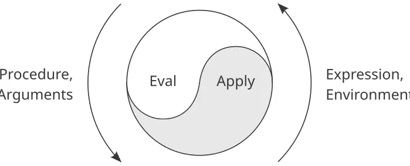
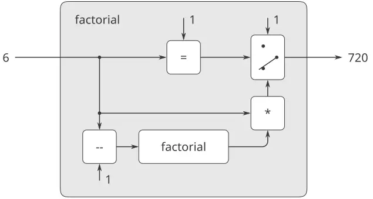
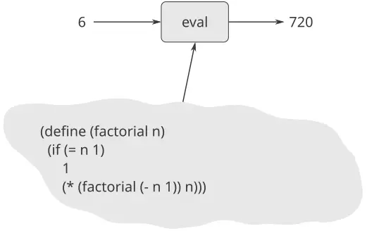

> … إنّ السحر في الكلمات: أبرا كدابرا، وافتح يا سمسم، وغيرها — لكنّ الكلمات السحريّة في حكايةٍ لا تكون سحريّةً في الحكاية التالية. والسحر الحقيقيّ هو أن تفهم أيّ الكلمات تنفع، ومتى، ولأيّ شيء؛ والخدعة هي أن تتعلّم الخدعة. … وهذه الكلمات مصنوعةٌ من حروف أبجديتنا: عشراتٌ قليلةٌ من التعرّجات التي نستطيع رسمها بالقلم. هذا هو المفتاح! والكنز أيضًا، إن استطعنا الحصول عليه بأيدينا! إنّه كأنّ — كأنّ مفتاح الكنز *هو* الكنز! — جون بارث، كيميرا

لقد رأينا في دراستنا لتصميم البرامج أنّ المبرمجين الخبيرين يضبطون تعقيد تصاميمهم بالتقنيّات العامّة ذاتها التي يستخدمها مصمّمو جميع النظم المعقّدة. فهم يجمعون العناصر الأوّليّة لتكوين كائناتٍ مركّبة، ويجرّدون الكائنات المركّبة لتكوين وحدات بناءٍ على مستوى أعلى، ويحفظون وحدانيّة تصاميمهم بتبنّي نظراتٍ واسعة النطاق مناسبةٍ لبنية النظام. ولتوضيح هذه التقنيّات، استخدمنا Lisp لغةً لوصف العمليّات ولبناء كائنات البيانات الحسابيّة والعمليّات لنمذجة الظواهر المعقّدة في العالم الواقعيّ. غير أنّنا، في مواجهتنا مسائل متزايدة التعقيد، سنجد أنّ Lisp — أو أيّ لغة برمجةٍ ثابتةٍ في الحقيقة — غير كافيةٍ لحاجاتنا. فيجب أن نلجأ باستمرارٍ إلى لغاتٍ جديدةٍ كي نُعبّر عن أفكارنا بفعّيّةٍ أكبر. وإرساء لغاتٍ جديدةٍ استراتيجيّةٌ قويّةٌ لضبط التعقيد في التصميم الهندسيّ؛ فيمكننا غالبًا أن نعزّز قدرتنا على التعامل مع مسألةٍ معقّدةٍ بتبنّي لغةٍ جديدةٍ تمكّننا من وصف المسألة (ومن ثمّ التفكير فيها) بطريقةٍ مختلفة، باستخدام أوّليّاتٍ ووسائل تركيبٍ ووسائل تجريدٍ تصلح خصوصًا للمسألة المطروحة.[^1]

البرمجة مكسوّةٌ بجموحٍ كبيرٍ من اللغات. فهناك لغات مادّيّة، كاللغات الآليّة لأجهزة حاسوبٍ معيّنة. وهذه اللغات تعنى بتمثيل البيانات والتحكّم من حيث بتّات التخزين الفرديّة وتعليمات الآلة الأوّليّة. ومبرمج اللغة الآليّة يعنى باستخدام العتاد المعطى لإقامة نظمٍ وأدواتٍ لتنفيذ الاحتسابات محدودة الموارد بكفاءة. واللغات العالية المستوى، المُقامة على أساسٍ من اللغة الآليّة، تُخفي الهموم المتعلّقة بتمثيل البيانات على أنّه مجموعاتٌ من البتّات وتمثيل البرامج على أنّه تتابعاتٌ من التعليمات الأوّليّة. وهذه اللغات لها وسائل تركيبٍ وتجريد، كتعريف الإجراءات، تصلح للتنظيم الأوسع نطاقًا للنُظم.

*التجريد فوق اللغوي (metalinguistic abstraction)* — إرساء لغاتٍ جديدةٍ — يلعب دورًا مهمًّا في جميع فروع التصميم الهندسيّ. وهو مهمٌّ بشكلٍ خاصٍّ في البرمجة الحاسوبيّة، لأنّه في البرمجة لا نستطيع صياغة لغاتٍ جديدةٍ فحسب، بل نستطيع أيضًا تنفيذ هذه اللغات ببناء مُقيّمات. و*المُقيِّم (evaluator)* (أو *المفسّر (interpreter)*) للغة برمجةٍ ما هو إجراءٌ يؤدّي، حين يُطبَّق على تعبيرٍ من اللغة، الأفعال المطلوبة لتقييم ذلك التعبير.

ولا مبالغة في اعتبار هذه أهمّ فكرةٍ في البرمجة:

> إنّ المُقيِّم، الذي يحدّد معنى التعابير في لغة برمجةٍ ما، هو بمثابة برنامجٍ آخر.

وإدراك هذه النقطة يغيّر صورنا عن أنفسنا بوصفنا مبرمجين. فنحن نأتي لأن نرى أنفسنا مصمّمين للغات، لا مستخدمين للغاتٍ يصمّمها الآخرين فحسب.

في الحقيقة، فإنّا نستطيع اعتبار أيّ برنامجٍ تقريبًا مُقيّمًا لغةٍ ما. فإنّ نظام معالجة كثيرات الحدود الوارد في [2.5.3](https://sarabander.github.io/sicp/html/2_002e5.xhtml#g_t2_002e5_002e3) يجسّد قواعد الحساب على كثيرات الحدود وينفّذها من حيث عمليّاتٍ على بياناتٍ مبنيّةٍ على القوائم. فإذا زُدنا هذا النظام إجراءاتٍ لقراءة تعابير كثيرات الحدود وطبعها، صار لدينا لبّ لغةٍ خاصّةٍ بالأغراض الخاصّة للتعامل مع مسائل الرياضيّات الرمزيّة. ومحاكي المنطق الرقميّ الوارد في [3.3.4](https://sarabander.github.io/sicp/html/3_002e3.xhtml#g_t3_002e3_002e4) وناشر القيود الوارد في [3.3.5](https://sarabander.github.io/sicp/html/3_002e3.xhtml#g_t3_002e3_002e5) لغتان مشروعتان بحقّ، لكلٍّ منهما أوّليّاتها ووسائل تركيبها ووسائل تجريدها الخاصّة بها. ورؤيةً من هذا المنظور، تتّحد تقنيّة التعامل مع النُظم الحاسوبيّة واسعة النطاق مع تقنيّة بناء لغات حاسوبيّةٍ جديدة، ويصبح علم الحاسوب نفسه لا أكثر (ولا أقلّ) من انضباط بناء اللغات الوصفيّة الملائمة.

نبدأ الآن جولةً في التقنيّة التي تُرسى بها اللغات من حيث لغاتٍ أخرى. وسنستخدم في هذا الفصل Lisp أساسًا، منفّذين المُقيّمات كإجراءات Lisp. وLisp تصلح خصوصًا لهذه المهمّة، بسبب قدرتها على تمثيل التعابير الرمزيّة والتلاعب بها. وسنخطو الخطوة الأولى في فهم كيف تُنفَّذ اللغات ببناء مُقيّمٍ لـLisp نفسها. واللغة التي ينفّذها مُقيّمنا ستكون مجموعةً جزئيّةً من لهجة Scheme من Lisp التي نستخدمها في هذا الكتاب. ورغم أنّ المُقيّم الموصوف في هذا الفصل مكتوبٌ للهجة Lisp معيّنة، فإنّه يحتوي البنية الأساسيّة لمُقيّم أيّ لغةٍ موجّهةٍ بالتعبيرات ومصمَّمةٍ لكتابة البرامج لآلةٍ تسلسليّة. (في الحقيقة، تحتوي معظم معالجات اللغات في أعماقها على مُقيّم Lisp صغير.) وقد بُسِّط المُقيّم لأغراض التوضيح والمناقشة، وحُذفت بعض الخصائص التي يكون من المهمّ تضمينها في نظام Lisp ذي جودةٍ إنتاجيّة. ومع ذلك، فإنّ هذا المُقيّم البسيط كافٍ لتنفيذ معظم البرامج في هذا الكتاب.[^2]

إحدى المزايا المهمّة لجعل المُقيّم متاحًا بوصفه برنامج Lisp هي أنّنا نستطيع تنفيذ قواعد تقييمٍ بديلةٍ بوصفها على أنّها تعديلاتٌ على برنامج المُقيّم. وأحد المواضع التي نستطيع فيها استخدام هذه القوّة على نحوٍ مفيدٍ هو كسب تحكّمٍ إضافيٍّ في الطرق التي تجسّد بها النماذج الحسابيّة مفهوم الزمن، الذي كان محوريًّا للنقاش في [الفصل 3](https://sarabander.github.io/sicp/html/Chapter-3.xhtml#Chapter-3). فهناك، خفّفنا من بعض تعقيدات الحالة والإحلال باستخدام المجاري لفصل تمثيل الزمن في العالم عن الزمن في الحاسوب. وسنغيّر في [4.2](https://sarabander.github.io/sicp/html/4_002e2.xhtml#g_t4_002e2) اللغة الأساسيّة لتوفير نهجٍ أكثر أناقة، وذلك بتعديل المُقيّم ليوفّر *التقييم بالترتيب الاعتياديّ (normal-order evaluation)*.

يُنفّذ القسم [4.3](https://sarabander.github.io/sicp/html/4_002e3.xhtml#g_t4_002e3) تغييرًا لغويًّا أكثر طموحًا، تصبح بموجبه التعابير متعدّدةَ القيم، لا ذاتَ قيمةٍ واحدةٍ فحسب. وفي لغة *الحوسبة غير الحتميّة (nondeterministic computing)* هذه، من الطبيعيّ التعبير عن عمليّاتٍ تولّد جميع القيم الممكنة للتعبيرات ثمّ تبحث عن القيم التي تُحقّق قيودًا معيّنة. ومن حيث نماذج الاحتساب والزمن، يشبه هذا أن يتشعّب الزمن إلى مجموعةٍ من «المستقبلات الممكنة» ثمّ يُبحث عن الخطوط الزمنيّة المناسبة. وباستخدام مُقيّمنا غير الحتميّ، فإنّ تتبّع القيم المتعدّدة وإجراء عمليّات البحث يُتعامل معهما تلقائيًّا بآليّة اللغة الأساسيّة.

نُنفّذ في [4.4](https://sarabander.github.io/sicp/html/4_002e4.xhtml#g_t4_002e4) لغة *برمجة منطقيّة (logic programming)* تُعبَّر فيها المعرفة من حيث العلاقات، لا من حيث الاحتسابات ذات المداخل والمخارج. ورغم أنّ هذا يجعل اللغة مختلفةً اختلافًا جذريًّا عن Lisp، أو عن أيّ لغةٍ تقليديّةٍ في الحقيقة، فإنّا سنرى أنّ مُقيّم البرمجة المنطقيّة يتشارك البنية الأساسيّة لمُقيّم Lisp.


### 4.1 المُقيّم التعاكسيّ

سيكون مُقيّمنا لـLisp منفَّذًا بوصفه برنامج Lisp. وقد يبدو الأمر دورانيًّا — التفكير في تقييم برامج Lisp باستخدام مُقيّمٍ هو نفسه منفَّذٌ بـLisp. غير أنّ التقييم عمليّةٌ، فلذا فإنّ وصف عمليّة التقييم باستخدام Lisp أمرٌ ملائم، وهي التي هي أداتنا لوصف العمليّات في النهاية.[^3] ويُقال عن المُقيّم المكتوب باللغة ذاتها التي يقيّمها إنّه *تعاكسيّ (metacircular)*.

والمُقيّم التعاكسيّ هو في جوهره صياغةٌ بـScheme لنموذج البيئة للتقييم الموصوف في [3.2](https://sarabander.github.io/sicp/html/3_002e2.xhtml#g_t3_002e2). وأذكّر أنّ النموذج له جزءان أساسيّان:

1. ولتقييم تركيبةٍ (تعبيرٌ مركّبٌ غيرُ صيغةٍ خاصّة)، قيّم التعابير الجزئيّة ثمّ طبّق قيمة التعبير الجزئيّ للمشغّل على قيم التعابير الجزئيّة للعوامل.
2. ولتطبيق إجراءٍ مركّبٍ على مجموعةٍ من المعطيات، قيّم جسم الإجراء في بيئةٍ جديدة. ولتكوين هذه البيئة، وسّع جزء البيئة من كائن الإجراء بإطارٍ تُربط فيه الوسائط الشكليّة للإجراء بالمعطيات التي يُطبَّق عليها الإجراء.

يصف هذان العصران جوهر عمليّة التقييم، دورةً أساسيّةً تُختزل فيها التعابير المطلوب تقييمها في بيئاتٍ إلى إجراءاتٍ تُطبَّق على معطيات، تُختزل بدورها إلى تعابير جديدةٍ تُقيَّم في بيئاتٍ جديدة، وهكذا، حتّى ننزل إلى رموزَ تُبحث قيمُها في البيئة، وإلى إجراءاتٍ أوّليّةٍ تُطبَّق مباشرةً (انظر [الشكل 4.1](/book/sicp/c4-metalinguistic-abstraction/index/)).[^4] وستتجسّد دورة التقييم هذه بتفاعل الإجراءين الحرجيّين في المُقيّم، وهما `eval` و`apply`، الموصوفين في [4.1.1](/book/sicp/c4-metalinguistic-abstraction/index/) (انظر [الشكل 4.1](/book/sicp/c4-metalinguistic-abstraction/index/)).



**الشكل 4.1:** تكشف دورة `eval`-`apply` عن جوهر لغة الحاسوب.

سيعتمد تنفيذ المُقيّم على إجراءاتٍ تُعرّف *الصياغة (syntax)* للتعبيرات المطلوب تقييمها. وسنستخدم تجريد البيانات لجعل المُقيّم مستقلًّا عن تمثيل اللغة. فإنّا، مثلًا، بدلًا من الالتزام بخيارٍ يقضي بأنّ الإحلال يُُمثَّل بقائمةٍ تبدأ بالرمز `set!` نستخدم مُسَيِّمًا مجرّدًا `assignment?` لاختبار الإحلال، ونستخدم محدِّدين مجرّدين `assignment-variable` و`assignment-value` للنفاذ إلى أجزاء الإحلال. وسيُوصف تنفيذ التعابير بالتفصيل في [4.1.2](/book/sicp/c4-metalinguistic-abstraction/index/). وهناك أيضًا عمليّات، موصوفةٌ في [4.1.3](/book/sicp/c4-metalinguistic-abstraction/index/)، تُحدّد تمثيل الإجراءات والبيئات. فإنّ `make-procedure` مثلًا يبني الإجراءات المركّبة، و`lookup-variable-value` ينفذ إلى قيم المتغيّرات، و`apply-primitive-procedure` يطبّق إجراءً أوّليًّا على قائمةٍ معطاةٍ من المعطيات.

#### 4.1.1 لبّ المُقيّم

يمكن وصف عمليّة التقييم على أنّها تفاعلٌ بين إجراءين: `eval` و`apply`.

#### التقييم (eval)

يأخذ `eval` تعبيرًا وبيئةً كمعطيين. وهو يُصنّف التعبير ويوجّه تقييمه. و`eval` مبنيٌّ على هيئة تحليل حالاتٍ للنوع الصياغيّ للتعبير المطلوب تقييمه. ولكي نحفظ الإجراء عامًّا، نُعبّر عن تحديد نوع التعبير تجريدًا، دون التزامٍ بأيّ تمثيلٍ معيّنٍ لأنواع التعبيرات المختلفة. ولكلّ نوعٍ من التعبيرات مُسَيِّمٌ يختبره ووسيلةٌ مجرّدةٌ لتحديد أجزائه. وهذه *الصياغة المجرّدة (abstract syntax)* تجعل من السهل رؤية كيف نستطيع تغيير صياغة اللغة باستخدام المُقيّم نفسه، لكن مع مجموعةٍ مختلفةٍ من إجراءات الصياغة.

**التعابير الأوّليّة**

- فبالنسبة للتعابير ذاتيّة التقييم، كالأعداد، يُعيد `eval` التعبير نفسه.
- ويجب على `eval` البحث عن المتغيّرات في البيئة لإيجاد قيمها.

**الصيغ الخاصّة**

- فبالنسبة للتعابير المُقتبسة، يُعيد `eval` التعبير الذي كان مُقتبَسًا.
- والإحلال إلى متغيّر (أو تعريفه) يجب أن يستدعي `eval` تعاوديًّا لحساب القيمة الجديدة التي تُربط بالمتغيّر. ويجب تعديل البيئة لتغيير (أو إنشاء) ربط المتغيّر.
- وتعبير `if` يتطلّب معالجةً خاصّةً لأجزائه، بحيث يُقيَّم الناتج إذا كان المُسَيِّم صحيحًا، ويُقيَّم البديل خلافًا لذلك.
- وتعبير `lambda` يجب أن يُحوَّل إلى إجراءٍ قابلٍ للتطبيق بحزم الوسائط والجسم اللذين يُحدّدهما تعبير `lambda` مع بيئة التقييم معًا.
- وتعبير `begin` يتطلّب تقييم تتابع تعابيره بالترتيب الذي تظهر به.
- وتحليل الحالات (`cond`) يُحوَّل إلى عشٍّ من تعابير `if` ثمّ يُقيَّم.

**التركيبات**

- وبالنسبة لتطبيق إجراءٍ، يجب على `eval` تقييم جزء المشغّل وعوامل التركيبة تعاوديًّا. والإجراء والمعطيات الناتجان يُمرَّران إلى `apply`، الذي يتعامل مع تطبيق الإجراء الفعليّ.

وها هو تعريف `eval`:

```scheme
(define (eval exp env)
  (cond ((self-evaluating? exp) 
         exp)
        ((variable? exp) 
         (lookup-variable-value exp env))
        ((quoted? exp) 
         (text-of-quotation exp))
        ((assignment? exp) 
         (eval-assignment exp env))
        ((definition? exp) 
         (eval-definition exp env))
        ((if? exp) 
         (eval-if exp env))
        ((lambda? exp)
         (make-procedure 
          (lambda-parameters exp)
          (lambda-body exp)
          env))
        ((begin? exp)
         (eval-sequence 
          (begin-actions exp) 
          env))
        ((cond? exp) 
         (eval (cond->if exp) env))
        ((application? exp)
         (apply (eval (operator exp) env)
                (list-of-values 
                 (operands exp) 
                 env)))
        (else
         (error "Unknown expression 
                 type: EVAL" exp))))
```

وللتّوضيح، نُفّذ `eval` على هيئة تحليل حالاتٍ باستخدام `cond`. وعيب هذا أنّ إجراءنا يتعامل مع أنواعٍ قليلةٍ فقط من التعابير القابلة للتمييز، ولا يمكن تعريف أنواعٍ جديدةٍ دون تعديل تعريف `eval`. وفي معظم تنفيذات Lisp، يُجرى التوجيه بحسب نوع التعبير بأسلوبٍ موجَّهٍ بالبيانات. وهذا يسمح للمستخدم بإضافة أنواعٍ جديدةٍ من التعابير يستطيع `eval` تمييزها، دون تعديل تعريف `eval` نفسه. (انظر [التمرين 4.3](/book/sicp/c4-metalinguistic-abstraction/index/).)

#### التطبيق (apply)

يأخذ `apply` معطيين، إجراءً وقائمةً من المعطيات التي يجب أن يُطبَّق عليها الإجراء. و`apply` يُصنّف الإجراءات إلى نوعين: فهو يستدعي `apply-primitive-procedure` لتطبيق الأوّليّات؛ ويطبّق الإجراءات المركّبة بتقييم التعابير التي تكوّن جسم الإجراء تِباعًا. وتُبنى البيئة لتقييم جسم إجراءٍ مركّبٍ بتوسيع البيئة الأساسيّة التي يحملها الإجراء لتضمّ إطارًا يربط وسائط الإجراء بالمعطيات التي سيُطبَّق عليها الإجراء. وها هو تعريف `apply`:

```scheme
(define (apply procedure arguments)
  (cond ((primitive-procedure? procedure)
         (apply-primitive-procedure 
          procedure 
          arguments))
        ((compound-procedure? procedure)
         (eval-sequence
           (procedure-body procedure)
           (extend-environment
             (procedure-parameters 
              procedure)
             arguments
             (procedure-environment 
              procedure))))
        (else
         (error "Unknown procedure 
                 type: APPLY" 
                procedure))))
```

#### معطيات الإجراء

حين يعالج `eval` تطبيق إجراءٍ، فإنّه يستخدم `list-of-values` لإنتاج قائمة المعطيات التي سيُطبَّق عليها الإجراء. و`list-of-values` تأخذ عوامل التركيبة معطىً واحدًا. وهي تُقيّم كلّ عاملٍ وتُعيد قائمة القيم المقابلة:[^5]

```scheme
(define (list-of-values exps env)
  (if (no-operands? exps)
      '()
      (cons (eval (first-operand exps) env)
            (list-of-values 
             (rest-operands exps) 
             env))))
```

#### التعابير الشرطيّة

يُقيّم `eval-if` جزء المُسَيِّم من تعبير `if` في البيئة المعطاة. فإن كانت النتيجة صحيحة، قيّم `eval-if` الناتج، ويُقيّم البديل خلافًا ذلك:

```scheme
(define (eval-if exp env)
  (if (true? (eval (if-predicate exp) env))
      (eval (if-consequent exp) env)
      (eval (if-alternative exp) env)))
```

يُبرز استخدام `true?` في `eval-if` مسألة الصلة بين لغةٍ منفَّذةٍ ولغة تنفيذٍ. فـ`if-predicate` يُقيَّم في اللغة التي يجري تنفيذها، لذا يُنتج قيمةً في تلك اللغة. ومُسَيِّم المفسّر `true?` يترجم تلك القيمة إلى قيمةٍ يمكن اختبارها بـ`if` في لغة التنفيذ: فإنّ تمثيل الصّحاح في المُقيّم التعاكسيّ قد لا يكون هو نفسه تمثيله في Scheme الأساسيّة.[^6]

#### التتابعات

إنّ `eval-sequence` يُستخدم من `apply` لتقييم تتابع التعابير في جسم الإجراء، ومن `eval` لتقييم تتابع التعابير في تعبير `begin`. وهو يأخذ تتابع تعابيرٍ وبيئةً كمعطيين، ويُقيّم التعابير بالترتيب الذي تقع به. والقيمة المُعادة هي قيمة التعبير الأخير.

```scheme
(define (eval-sequence exps env)
  (cond ((last-exp? exps) 
         (eval (first-exp exps) env))
        (else 
         (eval (first-exp exps) env)
         (eval-sequence (rest-exps exps) 
                        env))))
```

#### الإحلالات والتعريفات

يتعامل الإجراء التالي مع الإحلالات إلى المتغيّرات. فهو يستدعي `eval` لإيجاد القيمة التي سيُحَلّ محلًّا، وينقل المتغيّر والقيمة الناتجة إلى `set-variable-value!` ليُثبَّتا في البيئة المعيَّنة.

```scheme
(define (eval-assignment exp env)
  (set-variable-value! 
   (assignment-variable exp)
   (eval (assignment-value exp) env)
   env)
  'ok)
```

وتُعالَج تعريفات المتغيّرات بالطريقة ذاتها.[^7]

```scheme
(define (eval-definition exp env)
  (define-variable! 
    (definition-variable exp)
    (eval (definition-value exp) env)
    env)
  'ok)
```

اخترنا هنا إعادة الرمز `ok` قيمةً للإحلال أو للتعريف.[^8]

> **التمرين 4.1:** لاحِظ أنّنا لا نستطيع معرفة ما إذا كان المُقيّم التعاكسيّ يقيّم العوامل من اليسار إلى اليمين أم من اليمين إلى اليسار. فإنّ ترتيب تقييمه موروثٌ من Lisp الأساسيّة: فإن قُيّمت المعطيات الممرَّرة إلى `cons` في `list-of-values` من اليسار إلى اليمين، قيّم `list-of-values` العوامل من اليسار إلى اليمين؛ وإن قُيّمت معطيات `cons` من اليمين إلى اليسار، قيّم `list-of-values` العوامل من اليمين إلى اليسار. اكتب نسخةً من `list-of-values` تُقيّم العوامل من اليسار إلى اليمين بصرف النظر عن ترتيب التقييم في Lisp الأساسيّة. واكتب أيضًا نسخةً من `list-of-values` تُقيّم العوامل من اليمين إلى اليسار.

#### 4.1.2 تمثيل التعابير

يُشبه المُقيّم برنامج التفاضل الرمزيّ المناقَش في [2.3.2](https://sarabander.github.io/sicp/html/2_002e3.xhtml#g_t2_002e3_002e2). فكلاهما يعمل على تعابير رمزيّة. وفي كلٍّ من البرنامجين، تحديدُ نتيجة العمل على تعبيرٍ مركّبٍ يكون بالعمل تعاوديًّا على أجزاء التعبير ودمج النتائج بطريقةٍ تتوقّف على نوع التعبير. وفي كلٍّ من البرنامجين استخدمنا تجريد البيانات لفصل القواعد العامّة للعمل عن تفاصيل كيفيّة تمثيل التعابير. وفي برنامج التفاضل عنى هذا أنّ إجراء التفاضل نفسه يستطيع التعامل مع التعابير الجبريّة في الصيغة البادئة، أو في الصيغة الواسطة، أو في أيّ صيغةٍ أخرى. وبالنسبة للمُقيّم، فإنّ هذا يعني أنّ صياغة اللغة التي يجري تقييمها تُحدَّد حصرًا بالإجراءات التي تُصنّف التعابير وتستخرج أجزاءها.

وها هو توصيف صياغة لغتنا:

والعناصر ذاتيّة التقييم الوحيدة هي الأعداد والسلاسل المحرفيّة:

```scheme
(define (self-evaluating? exp)
  (cond ((number? exp) true)
        ((string? exp) true)
        (else false)))
```

والمتغيّرات يمثّلها الرموز:

```scheme
(define (variable? exp) (symbol? exp))
```

والتعبيرات المُقتبسة لها الصيغة `(quote ⟨text-of-quotation⟩)`:[^9]

```scheme
(define (quoted? exp)
  (tagged-list? exp 'quote))

(define (text-of-quotation exp)
  (cadr exp))
```

يُعرَّف `Quoted?` من حيث الإجراء `tagged-list?`، الذي يحدّد القوائم التي تبدأ برمزٍ معيَّن:

```scheme
(define (tagged-list? exp tag)
  (if (pair? exp)
      (eq? (car exp) tag)
      false))
```

تأخذ الإحلالات الصيغة `(set! ⟨var⟩ ⟨value⟩)`:

```scheme
(define (assignment? exp)
  (tagged-list? exp 'set!))

(define (assignment-variable exp) 
  (cadr exp))

(define (assignment-value exp) (caddr exp))
```

وللتعريفات الصيغة

```scheme
(define ⟨var⟩ ⟨value⟩)
```

أو الصيغة

```scheme
(define (⟨var⟩ ⟨param₁⟩ … ⟨paramₙ⟩)
  ⟨body⟩)
```

أمّا الصيغة الأخيرة (تعريف الإجراء القياسيّ) فهي سكّرٌ نحويٌّ (syntactic sugar) لِـ

```scheme
(define ⟨var⟩
  (lambda (⟨param₁⟩ … ⟨paramₙ⟩)
    ⟨body⟩))
```

وأمّا إجراءات الصياغة المقابلة فهي الآتية:

```scheme
(define (definition? exp)
  (tagged-list? exp 'define))

(define (definition-variable exp)
  (if (symbol? (cadr exp))
      (cadr exp)
      (caadr exp)))

(define (definition-value exp)
  (if (symbol? (cadr exp))
      (caddr exp)
      (make-lambda 
       (cdadr exp)   ; formal parameters
       (cddr exp)))) ; body
```

وتعبيرات `lambda` قوائمٌ تبدأ بالرمز `lambda`:

```scheme
(define (lambda? exp) 
  (tagged-list? exp 'lambda))
(define (lambda-parameters exp) (cadr exp))
(define (lambda-body exp) (cddr exp))
```

ونُوفّر أيضًا بانيًا لتعبيرات `lambda`، يُستخدم من `definition-value` الوارد أعلاه:

```scheme
(define (make-lambda parameters body)
  (cons 'lambda (cons parameters body)))
```

وتبدأ التعابير الشرطيّة بـ`if`، ولها مُسَيِّمٌ ونتيجةٌ وبديلٌ (اختياريّ). فإن لم يكن للتعبير جزءٌ بديلٌ، فإنّنا نُوفّر `false` بديلًا.[^10]

```scheme
(define (if? exp) (tagged-list? exp 'if))
(define (if-predicate exp) (cadr exp))
(define (if-consequent exp) (caddr exp))
(define (if-alternative exp)
  (if (not (null? (cdddr exp)))
      (cadddr exp)
      'false))
```

ونُوفّر أيضًا بانيًا لتعبيرات `if`، ليُستخدم من `cond->if` في تحويل تعابير `cond` إلى تعابير `if`:

```scheme
(define (make-if predicate 
                 consequent 
                 alternative)
  (list 'if 
        predicate 
        consequent 
        alternative))
```

ويحزم `begin` تتابع التعابير في تعبيرٍ واحد. ونحن نُدرج عمليّات صياغةٍ على تعابير `begin` لاستخراج التتابع الفعليّ من تعبير `begin`، فضلًا عن محدِّداتٍ تُعيد أوّل تعبيرٍ في التتابع وبقيّة تعابيره.[^11]

```scheme
(define (begin? exp) 
  (tagged-list? exp 'begin))
(define (begin-actions exp) (cdr exp))
(define (last-exp? seq) (null? (cdr seq)))
(define (first-exp seq) (car seq))
(define (rest-exps seq) (cdr seq))
```

ونُدرج أيضًا بانيًا `sequence->exp` (لاستخدامه من `cond->if`) يحوّل تتابعًا إلى تعبيرٍ واحد، مستخدمًا `begin` عند الضرورة:

```scheme
(define (sequence->exp seq)
  (cond ((null? seq) seq)
        ((last-exp? seq) (first-exp seq))
        (else (make-begin seq))))

(define (make-begin seq) (cons 'begin seq))
```

تطبيق الإجراء هو أيّ تعبيرٍ مركّبٍ ليس من أنواع التعابير المذكورة أعلاه. فإنّ `car` التعبير هو المشغّل، و`cdr` هو قائمة العوامل:

```scheme
(define (application? exp) (pair? exp))
(define (operator exp) (car exp))
(define (operands exp) (cdr exp))
(define (no-operands? ops) (null? ops))
(define (first-operand ops) (car ops))
(define (rest-operands ops) (cdr ops))
```

#### التعابير المشتقّة

بعض الصيغ الخاصّة في لغتنا يمكن تعريفها بدلالة تعابير تتضمّن صيغًا خاصّةً أخرى، بدلًا من تنفيذها مباشرةً. وأحد الأمثلة على ذلك `cond`، الذي يمكن تنفيذه كعشٍّ من تعابير `if`. فمثلًا، يمكننا اختزال مسألة تقييم التعبير

```scheme
(cond ((> x 0) x)
      ((= x 0) (display 'zero) 0)
      (else (- x)))
```

إلى مسألة تقييم التعبير الآتي الذي يتضمّن تعابير `if` و`begin`:

```scheme
(if (> x 0)
    x
    (if (= x 0)
        (begin (display 'zero) 0)
        (- x)))
```

إنّ تنفيذ تقييم `cond` على هذا النحو يُبسّط المُقيّم لأنّه يُنقص عدد الصيغ الخاصّة التي يلزم تحديد عمليّة تقييمها صراحةً.

نحن نُدرج إجراءات صياغةٍ تستخرج أجزاء تعبير `cond`، وإجراءًا `cond->if` يحوّل تعابير `cond` إلى تعابير `if`. ويبدأ تحليل الحالات بـ`cond` وله قائمةٌ من بنود المسيّم والإجراء. والبند بندُ `else` إذا كان مُسَيِّمه هو الرمز `else`.[^12]

```scheme
(define (cond? exp) 
  (tagged-list? exp 'cond))
(define (cond-clauses exp) (cdr exp))
(define (cond-else-clause? clause)
  (eq? (cond-predicate clause) 'else))
(define (cond-predicate clause) 
  (car clause))
(define (cond-actions clause) 
  (cdr clause))
(define (cond->if exp)
  (expand-clauses (cond-clauses exp)))
(define (expand-clauses clauses)
  (if (null? clauses)
      'false     ; no else clause
      (let ((first (car clauses))
            (rest (cdr clauses)))
        (if (cond-else-clause? first)
            (if (null? rest)
                (sequence->exp 
                 (cond-actions first))
                (error "ELSE clause isn't 
                        last: COND->IF"
                       clauses))
            (make-if (cond-predicate first)
                     (sequence->exp 
                      (cond-actions first))
                     (expand-clauses 
                      rest))))))
```

تُسمّى التعابير (كـ`cond`) التي نختار تنفيذها بوصفها تحويلاتٍ صياغيّةً *التعابير المشتقّة (derived expressions)*. وتعبيرات `let` مشتقّةٌ هي أيضًا (انظر [التمرين 4.6](/book/sicp/c4-metalinguistic-abstraction/index/)).[^13]

> **التمرين 4.2:** يخطط لويس ريزونر لإعادة ترتيب بنود `cond` في `eval` بحيث يظهر بند تطبيقات الإجراءات قبل بند الإحلالات. وهو يُحاجّ أنّ ذلك سيجعل المفسّر أكثر كفاءة: فإنّ البرامج تحتوي عادةً على تطبيقاتَ أكثرَ من الإحلالات والتعريفات وغيرها، وممّا يعني أنّ `eval` المعدّل سيفحص بنودًا أقلّ عادةً من `eval` الأصليّ قبل تحديد نوع التعبير. فما الخطأ في خطة لويس؟ (تلميح: ماذا سيفعل مُقيّم لويس بالتعبير `(define x 3)`؟)
> > لويس مستاءٌ لأنّ خطته لم تُجْدِ نفعًا. وهو على استعدادٍ لأن يبذل أيّ جهدٍ لجعل مُقيّمه يتعرّف على تطبيقات الإجراءات قبل أن يفحص معظم الأنواع الأخرى من التعابير. ساعده بتغيير صياغة اللغة المقيَّمة بحيث تبدأ تطبيقات الإجراءات بـ`call`. فمثلًا، بدلًا من `(factorial 3)` سنكتب الآن `(call factorial 3)`، وبدلًا من `(+ 1 2)` سنكتب `(call + 1 2)`.
> > 

> **التمرين 4.3:** أعِد كتابة `eval` بحيث يُجرى التوجيه بحسب نوع التعبير بأسلوبٍ موجَّهٍ بالبيانات. قارن ذلك بإجراء التفاضل الموجَّه بالبيانات الوارد في [التمرين 2.73](https://sarabander.github.io/sicp/html/2_002e4.xhtml#Exercise-2_002e73). (ويجوز لك استخدام `car` التعبير المركّب بوصفه نوع التعبير، كما يليق بالصياغة المنفّذة في هذا القسم.)

> **التمرين 4.4:** تذكّر تعريفات الصيغتين الخاصّتين `and` و`or` الواردة في [الفصل 1](https://sarabander.github.io/sicp/html/Chapter-1.xhtml#Chapter-1): `and`: تُقيَّم التعابير من اليسار إلى اليمين. فإن قُيِّم أيّ تعبيرٍ إلى القيمة خاطئة، أُعيدت خاطئة؛ ولا تُقيَّم أيّ من التعابير الباقية. فإن قُيِّمت جميع التعابير إلى قيمٍ صحيحة، أُعيدت قيمة التعبير الأخير. فإن لم تكن هناك تعابيرٌ، أُعيدت صحيحة.
> > `or`: تُقيَّم التعابير من اليسار إلى اليمين. فإن قُيِّم أيّ تعبيرٍ إلى قيمةٍ صحيحة، أُعيدت تلك القيمة؛ ولا تُقيَّم أيّ من التعابير الباقية. فإن قُيِّمت جميع التعابير إلى خاطئة، أو إن لم تكن هناك تعابيرٌ، أُعيدت خاطئة.
> > 
> > ثبِّت `and` و`or` بوصفهما صيغتين خاصّتين جديدتين للمقيّم، بتعريف إجراءات صياغةٍ مناسبةٍ وإجراءَي تقييمٍ `eval-and` و`eval-or`. وبدلًا من ذلك، أظهِر كيف يمكن تنفيذ `and` و`or` بوصفهما تعبيرين مشتقّين.

تسمح Scheme بصياغةٍ إضافيّةٍ لبنود `cond`، وهي `(⟨test⟩ => ⟨recipient⟩)`. فإن قُيِّم `⟨`الاختبار`⟩` إلى قيمةٍ صحيحة، قُيِّم `⟨`المستلم`⟩`. ويلزم أن تكون قيمته إجراءً بوسيطٍ واحد؛ ثمّ يُستدعى هذا الإجراء على قيمة `⟨`الاختبار`⟩`، وتُعاد النتيجة قيمةً لتعبير `cond`. فمثلًا

```scheme
(cond ((assoc 'b '((a 1) (b 2))) => cadr)
      (else false))
```

تُعيد 2. عدّل معالجة `cond` بحيث تدعم هذه الصياغة الممتدّة.

تعبيرات `let` تعبيراتٌ مشتقّة، لأنّ

```scheme
(let ((⟨var₁⟩ ⟨exp₁⟩) … (⟨varₙ⟩ ⟨expₙ⟩))
  ⟨body⟩)
```

مكافئٌ لِـ

```scheme
((lambda (⟨var₁⟩ … ⟨varₙ⟩)
   ⟨body⟩)
 ⟨exp₁⟩
 …
 ⟨expₙ⟩)
```

نفّذ تحويلًا صياغيًّا `let->combination` يُختزل به تقييم تعابير `let` إلى تقييم تركيباتٍ من النوع الموضّح أعلاه، وأضِف البند المناسب إلى `eval` ليتعامل مع تعابير `let`.

الـ`let*` شبيهٌ بـ`let`، إلّا أنّ روابط متغيّرات `let*` تُنفَّذ تتابعيًّا من اليسار إلى اليمين، وأنّ كلّ ربطٍ يُجرى في بيئةٍ تكون فيها جميع الروابط السابقة مرئيّةً. فمثلًا

```scheme
(let* ((x 3)
       (y (+ x 2))
       (z (+ x y 5)))
  (* x z))
```

فإنّه يُعيد 39. اشرح كيف يمكن إعادة كتابة تعبير `let*` مجموعةً من تعابير `let` متداخلة، واكتب إجراءً `let*->nested-lets` يُجرِي هذا التحويل. فإن كنّا قد نفّذنا `let` بالفعل ([التمرين 4.6](/book/sicp/c4-metalinguistic-abstraction/index/)) وأردنا توسيع المقيّم ليتعامل مع `let*`، فهل يكفي إضافةُ بندٍ إلى `eval` يكون فعله

```scheme
(eval (let*->nested-lets exp) env)
```

أم يلزمنا أن نوسّع `let*` صراحةً بدلالة تعابيرَ غير مشتقّة؟

**التمرين 4.8:** الـ`let` المسمّى (named let) صيغةٌ بديلةٌ من `let` له الشكل

```scheme
(let ⟨var⟩ ⟨bindings⟩ ⟨body⟩)
```

أمّا `⟨`الروابط`⟩` و`⟨`الجسم`⟩` فهما كما في `let` الاعتياديّ، إلّا أنّ `⟨`المتغيّر`⟩` يُقيَّد داخل `⟨`الجسم`⟩` بإجراءٍ جسمه هو `⟨`الجسم`⟩` ووسائطه الشكليّة هي المتغيّرات الواردة في `⟨`الروابط`⟩`. وبذلك، يمكن للمرء أن ينفّذ `⟨`الجسم`⟩` مرّاتٍ متعدّدةً بنداء الإجراء المسمّى `⟨`المتغيّر`⟩`. فعلى سبيل المثال، يمكن إعادة كتابة إجراء فيبوناتشي التكراريّ ([1.2.2](https://sarabander.github.io/sicp/html/1_002e2.xhtml#g_t1_002e2_002e2)) بـ`let` المسمّى كما يلي:

```scheme
(define (fib n)
  (let fib-iter ((a 1) (b 0) (count n))
    (if (= count 0)
        b
        (fib-iter (+ a b) 
                  a 
                  (- count 1)))))
```

عدّل `let->combination` الوارد في [التمرين 4.6](/book/sicp/c4-metalinguistic-abstraction/index/) ليدعم `let` المسمّى أيضًا.

> **التمرين 4.9:** تدعم لغاتٌ كثيرةٌ أصنافًا متنوّعةً من بنى التكرار، كـ`do` و`for` و`while` و`until`. وفي Scheme، يمكن التعبير عن العمليّات التكراريّة بدلالة نداءات إجراءاتٍ اعتياديّة، لذا فإنّ بنى التكرار الخاصّة لا تُقدّم أيّ مكسبٍ جوهريّ في القوّة الحسابيّة. ومن جهةٍ أخرى، فإنّ مثل هذه البنى ملائمةٌ غالبًا. صمّم بعض بنى التكرار، وأعطِ أمثلةً على استخدامها، وبيّن كيف يمكن تنفيذها تعابيرَ مشتقّة.

> **التمرين 4.10:** باستخدامنا تجريد البيانات، استطعنا كتابة إجراء `eval` مستقلًّا عن الصياغة الخاصّة للغة التي ستُقيَّم. ولتوضيح هذا، صمّم ونفّذ صياغةً جديدةً لـScheme بتعديل الإجراءات الواردة في هذا القسم، دون تغيير `eval` أو `apply`.

#### 4.1.3 بنيات بيانات المقيّم

فضلًا عن تحديد الصياغة الخارجيّة للتعابير، يلزم أن يحدّد تنفيذ المقيّم أيضًا بنيات البيانات التي يتلاعب بها المقيّم داخليًّا، كجزءٍ من تنفيذ البرنامج، كتمثيل الإجراءات والبيئات وتمثيل الصحيح والخاطئ.

#### اختبار المُسَيِّمات

وأمّا في التعابير الشرطيّة، فنحن نقبل بوصفها صحيحةً أيّ شيءٍ ليس هو الكائن `false` الصريح.

```scheme
(define (true? x)
  (not (eq? x false)))

(define (false? x)
  (eq? x false))
```

#### تمثيل الإجراءات

ولكي نتعامل مع الإجراءات الأوّليّة، نفترض أنّ الإجراءات الآتية متاحةٌ لدينا:

- يُطبّق `(apply-primitive-procedure ⟨proc⟩ ⟨args⟩)` الإجراء الأوّليّ المعطى على قيم المعطيات الواردة في القائمة `⟨`args`⟩` ويُعيد نتيجة التطبيق.
- يختبر `(primitive-procedure? ⟨proc⟩)` ما إذا كان `⟨`proc`⟩` إجراءً أوّليًّا.

وتوصف هذه الآليّات للتعامل مع الأوّليّات بتوسّعٍ أكثر في [4.1.4](/book/sicp/c4-metalinguistic-abstraction/index/).

وتُبنى الإجراءات المركّبة من الوسائط الشكليّة وأجساد الإجراءات والبيئات باستخدام البانيّ `make-procedure`:

```scheme
(define (make-procedure parameters body env)
  (list 'procedure parameters body env))
(define (compound-procedure? p)
  (tagged-list? p 'procedure))
(define (procedure-parameters p) (cadr p))
(define (procedure-body p) (caddr p))
(define (procedure-environment p) (cadddr p))
```

#### العمليّات على البيئات

يحتاج المقيّم إلى عمليّاتٍ للتلاعب بالبيئات. فكما هو موضّح في [3.2](https://sarabander.github.io/sicp/html/3_002e2.xhtml#g_t3_002e2)، البيئة تسلسلٌ من الإطارات، حيث كلّ إطارٍ جدولٌ من الروابط التي تربط المتغيّرات بقيمها المقابلة. ونحن نستخدم العمليّات الآتية للتلاعب بالبيئات:

- تُعيد `(lookup-variable-value ⟨var⟩ ⟨env⟩)` القيمة المربوطة بالرمز `⟨`var`⟩` في البيئة `⟨`env`⟩`، أو تشير إلى خطأٍ إذا كان المتغيّر غير مقيَّد.
- تُعيد `(extend-environment ⟨variables⟩ ⟨values⟩ ⟨base-env⟩)` بيئةً جديدةً، تتألّف من إطارٍ جديدٍ تُربط فيه الرموز الواردة في القائمة `⟨`variables`⟩` بالعناصر المقابلة في القائمة `⟨`values`⟩`، حيث البيئة المحيطة هي البيئة `⟨`base-env`⟩`.
- تُضيف `(define-variable! ⟨var⟩ ⟨value⟩ ⟨env⟩)` إلى أوّل إطارٍ في البيئة `⟨`env`⟩` ربطًا جديدًا يربط المتغيّر `⟨`var`⟩` بالقيمة `⟨`value`⟩`.
- تُغيّر `(set-variable-value! ⟨var⟩ ⟨value⟩ ⟨env⟩)` ربط المتغيّر `⟨`var`⟩` في البيئة `⟨`env`⟩` بحيث يصبح المتغيّر مقيَّدًا الآن بالقيمة `⟨`value`⟩`، أو تشير إلى خطأٍ إذا كان المتغيّر غير مقيَّد.

ولتنفيذ هذه العمليّات نُمثّل البيئة قائمةً من الإطارات. والبيئة المحيطة ببيئةٍ ما هي `cdr` القائمة. والبيئة الخالية هي ببساطةٍ القائمة الخالية.

```scheme
(define (enclosing-environment env) (cdr env))
(define (first-frame env) (car env))
(define the-empty-environment '())
```

ويُمثَّل كلّ إطارٍ من إطارات البيئة بزوجٍ من القوائم: قائمة المتغيّرات المقيَّدة في ذلك الإطار وقائمة القيم المرتبطة بها.[^14]

```scheme
(define (make-frame variables values)
  (cons variables values))
(define (frame-variables frame) (car frame))
(define (frame-values frame) (cdr frame))
(define (add-binding-to-frame! var val frame)
  (set-car! frame (cons var (car frame)))
  (set-cdr! frame (cons val (cdr frame))))
```

ولتوسيع بيئةٍ بإطارٍ جديدٍ يربط المتغيّرات بقيم، نصنع إطارًا متألّفًا من قائمة المتغيّرات وقائمة القيم، ونُضيفه إلى البيئة. ونشير إلى خطأٍ إذا كان عدد المتغيّرات لا يطابق عدد القيم.

```scheme
(define (extend-environment vars vals base-env)
  (if (= (length vars) (length vals))
      (cons (make-frame vars vals) base-env)
      (if (< (length vars) (length vals))
          (error "Too many arguments supplied" 
                 vars 
                 vals)
          (error "Too few arguments supplied" 
                 vars 
                 vals))))
```

وللنفاذ إلى متغيّرٍ في بيئةٍ، نمسح قائمة المتغيّرات في الإطار الأوّل. فإن نجد المتغيّر المطلوب، نُعِد العنصر المقابل في قائمة القيم. فإن لم نجد المتغيّر في الإطار الحاليّ، نبحث في البيئة المحيطة، وهكذا. فإن بلغنا البيئة الخالية، نشير إلى خطأ «متغيّر غير مقيَّد».

```scheme
(define (lookup-variable-value var env)
  (define (env-loop env)
    (define (scan vars vals)
      (cond ((null? vars)
             (env-loop 
              (enclosing-environment env)))
            ((eq? var (car vars))
             (car vals))
            (else (scan (cdr vars) 
                        (cdr vals)))))
    (if (eq? env the-empty-environment)
        (error "Unbound variable" var)
        (let ((frame (first-frame env)))
          (scan (frame-variables frame)
                (frame-values frame)))))
  (env-loop env))
```

ولضبط متغيّرٍ على قيمةٍ جديدةٍ في بيئةٍ محدَّدةٍ، نبحث عن المتغيّر، تمامًا كما في `lookup-variable-value`، ونُغيّر القيمة المقابلة حين نجده.

```scheme
(define (set-variable-value! var val env)
  (define (env-loop env)
    (define (scan vars vals)
      (cond ((null? vars)
             (env-loop 
              (enclosing-environment env)))
            ((eq? var (car vars))
             (set-car! vals val))
            (else (scan (cdr vars) 
                        (cdr vals)))))
    (if (eq? env the-empty-environment)
        (error "Unbound variable: SET!" var)
        (let ((frame (first-frame env)))
          (scan (frame-variables frame)
                (frame-values frame)))))
  (env-loop env))
```

ولتقييد متغيّرٍ، نبحث في الإطار الأوّل عن ربطٍ للمتغيّر، ونُغيّر الربط إذا كان موجودًا (تمامًا كما في `set-variable-value!`). فإن لم يوجد ربطٌ كهذا، نُضيف واحدًا إلى الإطار الأوّل.

```scheme
(define (define-variable! var val env)
  (let ((frame (first-frame env)))
    (define (scan vars vals)
      (cond ((null? vars)
             (add-binding-to-frame! 
              var val frame))
            ((eq? var (car vars))
             (set-car! vals val))
            (else (scan (cdr vars) 
                        (cdr vals)))))
    (scan (frame-variables frame)
          (frame-values frame))))
```

إنّ الطريقة الموصوفة هنا ليست إلّا واحدةً من طرائق متعدّدةٍ معقولةٍ لتمثيل البيئات. وبما أنّنا استخدمنا تجريد البيانات لعزل بقيّة المقيّم عن اختيار التمثيل التفصيليّ، فبوسعنا تغيير تمثيل البيئة إن أردنا. (انظر [التمرين 4.11](/book/sicp/c4-metalinguistic-abstraction/index/).) ففي نظام Lisp ذي جودةٍ إنتاجيّة، يكون لسرعة عمليّات البيئة في المقيّم - وخاصّةً عمليّة النفاذ إلى المتغيّرات - أثرٌ كبيرٌ في أداء النظام. والتمثيل الموصوف هنا، على الرغم من بساطته المفاهيميّة، غير كفؤٍ ولا يُستخدم عادةً في نظامٍ إنتاجيّ.[^15]

> **التمرين 4.11:** بدلًا من تمثيل الإطار بزوجٍ من القوائم، نستطيع تمثيله قائمةً من الروابط، حيث كلّ رابطٍ زوجٌ من الاسم والقيمة. أعِد كتابة عمليّات البيئة لتستخدم هذا التمثيل البديل.

> **التمرين 4.12:** يمكن التعبير عن الإجراءات `define-variable!` و`set-variable-value!` و`lookup-variable-value` بدلالة إجراءاتٍ أكثر تجريدًا لاجتياز بنية البيئة. عرّف تجريداتٍ تُلخّص الأنماط المشتركة، وأعِد تعريف الإجراءات الثلاثة بدلالة هذه التجريدات.

> **التمرين 4.13:** تسمح لنا Scheme بإنشاء روابط جديدة للمتغيّرات بواسطة `define`، لكنّها لا توفّر أيّ وسيلةٍ للتخلّص من الروابط. نفّذ للمقيّم صيغةً خاصّةً `make-unbound!` تُزيل ربط رمزٍ معطىً من البيئة التي يُقيَّم فيها تعبير `make-unbound!`. وهذه المسألة غير محدَّدةٍ تمامًا. فعلى سبيل المثال، هل ينبغي لنا أن نُزيل الربط الواقع في الإطار الأوّل من البيئة فقط؟ أكمل التحديد وبرّر أيّ خياراتٍ تتّخذها.

#### 4.1.4 تشغيل المقيّم بوصفه برنامجًا

بفضل المقيّم، صار بين أيدينا وصفٌ (مُعبَّرٌ عنه بـLisp) للعمليّة التي تُقيَّم بها تعابير Lisp. وإحدى مزايا التعبير عن المقيّم بوصفه برنامجًا أنّ بوسعنا تشغيل البرنامج. وهذا يُعطينا - ونحن نعمل داخل Lisp - نموذجًا عاملًا لكيفيّة تقييم Lisp ذاتها للتعابير. ويمكن أن يخدم هذا بوصفه إطارًا للتجريب بقواعد التقييم، كما سنفعل لاحقًا في هذا الفصل.

يُردّ برنامج المقيّم التعابير في آخر الأمر إلى تطبيق الإجراءات الأوّليّة. لذلك، فإنّ كلّ ما يلزمنا لتشغيل المقيّم هو خلق آليّةٍ تستدعي نظام Lisp الكامن لتحاكي تطبيق الإجراءات الأوّليّة.

ينبغي أن يكون هناك ربطٌ لكلّ اسم إجراءٍ أوّليّ، حتّى إذا قيّم `eval` مشغّل تطبيقٍ لأوّليّةٍ، يجد كائنًا ليمرّره إلى `apply`. وهكذا، نُقيم بيئةً عامّةً تربط كائناتٍ فريدةً بأسماء الإجراءات الأوّليّة التي يمكن أن تظهر في التعابير التي سنُقيّمها. وتتضمّن البيئة العامّة أيضًا روابط للرمزين `true` و`false`، حتّى يمكن استخدامهما متغيّرين في التعابير التي ستُقيَّم.

```scheme
(define (setup-environment)
  (let ((initial-env
         (extend-environment 
          (primitive-procedure-names)
          (primitive-procedure-objects)
          the-empty-environment)))
    (define-variable! 'true true initial-env)
    (define-variable! 'false false initial-env)
    initial-env))

(define the-global-environment 
  (setup-environment))
```

لا يهمّ كيف نُمثّل كائنات الإجراءات الأوّليّة، ما دام `apply` قادرًا على تمييزها وتطبيقها باستخدام الإجراءين `primitive-procedure?` و`apply-primitive-procedure`. وقد اخترنا تمثيل الإجراء الأوّليّ قائمةً تبدأ بالرمز `primitive` وتحتوي إجراءً في Lisp الكامنة يُنفّذ ذلك الأوّليّ.

```scheme
(define (primitive-procedure? proc)
  (tagged-list? proc 'primitive))

(define (primitive-implementation proc) 
  (cadr proc))
```

وسيحصل `setup-environment` على أسماء الأوّليّات وإجراءات التنفيذ من قائمة:[^16]

```scheme
(define primitive-procedures
  (list (list 'car car)
        (list 'cdr cdr)
        (list 'cons cons)
        (list 'null? null?)
        ⟨more primitives⟩ ))

(define (primitive-procedure-names)
  (map car primitive-procedures))

(define (primitive-procedure-objects)
  (map (lambda (proc) 
         (list 'primitive (cadr proc)))
       primitive-procedures))
```

ولتطبيق إجراءٍ أوّليّ، نُطبّق ببساطةٍ إجراء التنفيذ على المعطيات، باستخدام نظام Lisp الكامن:[^17]

```scheme
(define (apply-primitive-procedure proc args)
  (apply-in-underlying-scheme
   (primitive-implementation proc) args))
```

ولتسهيل تشغيل المقيّم الدائريّ (metacircular evaluator)، نُوفّر *حلقة قيادة (driver loop)* تحاكي حلقة القراءة والتقييم والطباعة (read-eval-print loop) في نظام Lisp الكامن. فهي تطبع *طلبًا (prompt)*، وتقرأ تعبيرَ إدخالٍ، وتُقيّم هذا التعبير في البيئة العامّة، وتطبع النتيجة. ونحن نُسبق كلّ نتيجةٍ مطبوعةٍ *بطلب إخراج (output prompt)* حتّى نُميّز قيمة التعبير عن أيّ مخرجاتٍ أخرى قد تُطبَع.[^18]

```scheme
(define input-prompt  ";;; M-Eval input:")
(define output-prompt ";;; M-Eval value:")

(define (driver-loop)
  (prompt-for-input input-prompt)
  (let ((input (read)))
    (let ((output 
           (eval input 
                 the-global-environment)))
      (announce-output output-prompt)
      (user-print output)))
  (driver-loop))

(define (prompt-for-input string)
  (newline) (newline) 
  (display string) (newline))

(define (announce-output string)
  (newline) (display string) (newline))
```

نستخدم إجراء طبعٍ خاصّ، `user-print`، لتجنّب طبع جزء البيئة من إجراءٍ مركّب، الذي قد يكون قائمةً طويلةً جدًّا (أو قد يحتوي حتّى دورات).

```scheme
(define (user-print object)
  (if (compound-procedure? object)
      (display 
       (list 'compound-procedure
             (procedure-parameters object)
             (procedure-body object)
             '<procedure-env>))
      (display object)))
```

والآن، فإنّ كلّ ما يلزمنا لتشغيل المقيّم هو تهيئة البيئة العامّة وبدء حلقة القيادة. وإليك تفاعلًا نموذجيًّا:

```scheme
(define the-global-environment 
  (setup-environment))

(driver-loop)

;;; M-Eval input:
(define (append x y)
  (if (null? x)
      y
      (cons (car x) (append (cdr x) y))))

;;; M-Eval value:
ok

;;; M-Eval input:
(append '(a b c) '(d e f))

;;; M-Eval value:
(a b c d e f)
```

> **التمرين 4.14:** تُجرّب إيفا لو أتور ولويس ريزونر المقيّم الدائريّ كلٌّ منهما على حدة. تكتب إيفا تعريف `map`، وتُشغّل بعض البرامج الاختباريّة التي تستخدمه. وهي تعمل حسنًا. أمّا لويس، فعلى النقيض، فقد ثبّت نسخة النظام من `map` بوصفها أوّليّةً للمقيّم الدائريّ. وحين يُجرّبه، تسوء الأمور بدرجةٍ فظيعة. اشرح لماذا يفشل `map` عند لويس مع أنّه يعمل عند إيفا.

#### 4.1.5 البيانات بوصفها برامج

عند التفكير في برنامج Lisp يُقيّم تعابير Lisp، قد يكون التشبيه مفيدًا. فأحدُ وجهات النظر التشغيليّة في معنى البرنامج أنّ البرنامج وصفٌ لآلةٍ مجرّدةٍ (كبيرةٌ إلى حدّ اللانهائية ربّما). فعلى سبيل المثال، تأمّل البرنامج المألوف لحساب العامليّات:

```scheme
(define (factorial n)
  (if (= n 1)
      1
      (* (factorial (- n 1)) n)))
```

يمكننا اعتبار هذا البرنامج وصفًا لآلةٍ تحتوي أجزاءً تُنقّص وتضرب وتختبر المساواة، إلى جانب مفتاحٍ ثنائيّ الموضع وآلة عامليّاتٍ أخرى. (وآلة العامليّات لا نهائيّةٌ لأنّها تحتوي آلة عامليّاتٍ أخرى داخلها.) و[الشكل 4.2](/book/sicp/c4-metalinguistic-abstraction/index/) مخطّط انسيابيّ لآلة العامليّات، يُظهر كيف تُوصَل الأجزاء بعضها ببعض.



**الشكل 4.2:** برنامج العامليّات، منظورًا إليه بوصفه آلةً مجرّدة.

وبطريقةٍ مماثلة، نستطيع اعتبار المقيّم آلةً خاصّةً جدًّا تأخذ وصفَ آلةٍ إدخالًا. وبإعطائها هذا الإدخال، يُهيّئ المقيّم نفسه ليحاكي الآلة الموصوفة. فعلى سبيل المثال، إذا زوّدنا مقيّمنا بتعريف `factorial`، كما هو موضّح في [الشكل 4.3](/book/sicp/c4-metalinguistic-abstraction/index/)، فسيصير المقيّم قادرًا على حساب العامليّات.



**الشكل 4.3:** المقيّم يحاكي آلة العامليّات.

من هذا المنظور، يتبيّن أنّ مقيّمنا *آلةٌ عامّة (universal machine)*. فهو يُحاكي آلاتٍ أخرى حين تُوصَف هذه الآلات ببرامج Lisp.[^19] وهذا مدهش. فحاوِل أن تتخيّل مقيّمًا مماثلاً للدوائر الكهربائيّة. سيكون هذا دائرةً تأخذ إشارةً تُرمّز مخططات دائرةٍ أخرى، كالمرشّح مثلًا، إدخالًا. فبإعطائها هذا الإدخال، سيتصرّف مقيّم الدوائر بسلوك المرشّح ذي الوصف نفسه. ومثل هذه الدائرة الكهربائيّة العامّة مركّبةٌ إلى حدّ لا يكاد يُتصوّر. ومن الجدير بالدهشة أنّ مقيّم البرامج برنامجٌ بسيطٌ إلى حدٍّ ما.[^20]

وجانبٌ آخر مدهش في المقيّم أنّه يعمل بوصفه جسرًا بين كائنات البيانات التي تتلاعب بها لغة البرمجة لدينا ولغة البرمجة ذاتها. فتخيّل أنّ برنامج المقيّم (المنفّذ بـLisp) يعمل، وأنّ مستخدمًا يكتب تعابير للمقيّم ويراقب النتائج. فمن منظور المستخدم، تعبيرُ إدخالٍ كـ`(* x x)` هو تعبيرٌ في لغة البرمجة، ينبغي للمقيّم أن ينفّذه. وأمّا من منظور المقيّم، فالتعبير ليس إلّا قائمةً (في هذه الحالة، قائمةً من ثلاثة رموز: `*` و`x` و`x`) يُتلاعب بها وفقًا لمجموعةٍ محدَّدةٍ بدقّةٍ من القواعد.

وكون برامج المستخدم بياناتِ المقيّم لا يلزم أن يكون مصدرًا للالتباس. ففي الحقيقة، يكون إهمال هذا التمييز ملائمًا أحيانًا، ومنح المستخدم القدرة على تقييم كائن بيانات صراحةً بوصفه تعبير Lisp، وذلك بجعل `eval` متاحًا للاستخدام في البرامج. فلهجات Lisp كثيرةٌ تُوفّر إجراء `eval` أوّليًّا يأخذ تعبيرًا وبيئةً معطيين ويُقيّم التعبير نسبةً إلى البيئة.[^21] وهكذا،

```scheme
(eval '(* 5 5) user-initial-environment)
```

و

```scheme
(eval (cons '* (list 5 5)) 
      user-initial-environment)
```

فكلاهما سيُعيد 25.[^22]

**التمرين 4.15:** إذا أُعطي إجراءٌ ذو وسيطٍ واحدٍ `p` وكائنٌ `a`، فإنّه يُقال إنّ `p` «يتوقّف» على `a` إذا أعاد تقييم التعبير `(p a)` قيمةً (بخلاف الانتهاء برسالة خطأٍ أو الدوران إلى الأبد). أظهر أنّ من المحال كتابة إجراءٍ `halts?` يحسم بصورةٍ صحيحةٍ ما إذا كان `p` يتوقّف على `a` لأيّ إجراءٍ `p` وأيّ كائنٍ `a`. واستخدم الاستدلال الآتي: لو كان لديك إجراءٌ `halts?` كهذا، لأمكنك تنفيذ البرنامج الآتي:

```scheme
(define (run-forever)
  (run-forever))

(define (try p)
  (if (halts? p p)
      (run-forever)
      'halted))
```

والآن، تأمّل تقييم التعبير `(try try)` وأظهر أنّ أيّ نتيجةٍ ممكنةٍ (سواءً التوقّف أو الدوران إلى الأبد) تُخالف السلوك المقصود من `halts?`.[^23]

#### 4.1.6 التعريفات الداخليّة

يُنفّذ نموذج البيئة للتقييم ومقيّمنا الدائريّ التعريفات بالتسلسل، موسِعَين إطار البيئة تعريفًا واحدًا في كلّ مرّة. وهذا ملائمٌ بوجهٍ خاصّ لتطوير البرامج التفاعليّ، حيث يلزم المبرمجَ أن يمزج بحرّيّةٍ بين تطبيق الإجراءات وبين تعريف إجراءاتٍ جديدة. غير أنّنا، إذا فكّرنا بعنايةٍ في التعريفات الداخليّة المستخدمة لتنفيذ البنية الكتليّة (المُقدَّمة في [1.1.8](https://sarabander.github.io/sicp/html/1_002e1.xhtml#g_t1_002e1_002e8))، سنجد أنّ توسيع البيئة اسمًا باسمٍ قد لا يكون أفضلَ وسيلةٍ لتقييد المتغيّرات المحلّيّة.

تأمّل إجراءً له تعريفاتٌ داخليّة، كالآتي:

```scheme
(define (f x)
  (define (even? n)
    (if (= n 0)
        true
        (odd? (- n 1))))
  (define (odd? n)
    (if (= n 0)
        false
        (even? (- n 1))))
  ⟨rest of body of f⟩)
```

وقصدنا هنا أنّ الاسم `odd?` في جسم الإجراء `even?` ينبغي أن يُشير إلى الإجراء `odd?` المُعرَّف بعد `even?`. ونطاق الاسم `odd?` هو جسم `f` كلّه، لا القسم من جسم `f` الذي يبدأ من الموضع الذي يقع فيه `define` الخاصّ بـ`odd?` فحسب. ففي الحقيقة، حين نعتبر أنّ `odd?` مُعرَّفٌ بدوره بدلالة `even?` - بحيث إنّ `even?` و`odd?` إجراءان تعاوديّان متبادلان - نرى أنّ التفسير المرضيّ الوحيد للتعريفين `define` هو اعتبارهما كأنّ الاسمين `even?` و`odd?` يُضافان إلى البيئة تزامنًا. وبصورةٍ أعمّ، في البنية الكتليّة، نطاق الاسم المحلّيّ هو جسم الإجراء كلّه الذي يُقيَّم فيه `define`.

وقد صف أنّ مفسّرنا سيُقيّم نداءات `f` بصورةٍ صحيحة، لكن لسببٍ «عرضيّ»: وذلك بأنّ تعريفات الإجراءات الداخليّة تأتي أوّلًا، فلن تُقيَّم أيّ نداءاتٍ لهذه الإجراءات حتّى تُعرَّف جميعها. ومن ثمّ، سيكون `odd?` قد عُرِّف بحين تُنفَّذ `even?`. في الواقع، وستُعطي آليّة التقييم التسلسليّ لدينا النتيجة ذاتها التي تُعطيها آليّةٌ تُنفّذ التعريف المتزامن مباشرةً، لأيّ إجراءٍ تأتي فيه التعريفات الداخليّة أوّلًا في الجسم، وحيث لا يستخدم تقييم تعابير قيم المتغيّرات المُعرَّفة أيًّا من المتغيّرات المُعرَّفة فعلًا. (ولمثالٍ على إجراءٍ لا يتّبع هذه القيود، بحيث لا يكون التعريف التسلسليّ مكافئًا للتعريف المتزامن، انظر [التمرين 4.19](/book/sicp/c4-metalinguistic-abstraction/index/).)[^24]

ثمّة، مع ذلك، طريقةٌ بسيطةٌ لمعاملة التعريفات بحيث يكون للأسماء المُعرَّفة داخليًّا نطاقٌ متزامنٌ حقًّا - وذلك ببساطةٍ بإنشاء جميع المتغيّرات المحلّيّة التي ستكون في البيئة الحاليّة قبل تقييم أيّ من تعابير القيم. وإحدى وسائل فعل ذلك هي التحويل الصياغيّ على تعابير `lambda`. فقبل تقييم جسم تعبير `lambda`، نمسح ونُزيل جميع التعريفات الداخليّة في الجسم. وسيُنشأ المتغيّرات المُعرَّفة داخليًّا بـ`let` ثمّ تُضبط على قيمها بالإحلال. فعلى سبيل المثال، الإجراء

```scheme
(lambda ⟨vars⟩
  (define u ⟨e1⟩)
  (define v ⟨e2⟩)
  ⟨e3⟩)
```

سيُحوَّل إلى

```scheme
(lambda ⟨vars⟩
  (let ((u '*unassigned*)
        (v '*unassigned*))
    (set! u ⟨e1⟩)
    (set! v ⟨e2⟩)
    ⟨e3⟩))
```

حيث `*unassigned*` رمزٌ خاصّ يجعل النفاذ إلى متغيّرٍ يُشير إلى خطأٍ إذا حُول استخدام قيمة المتغيّر الذي لم يُحلَّ بعد.

وتُبيّن [التمرين 4.18](/book/sicp/c4-metalinguistic-abstraction/index/) استراتيجيّةً بديلةً لمسح التعريفات الداخليّة. وبخلاف التحويل الموضّح أعلاه، فإنّ هذا التحويل يفرض القيد القائل إنّه يمكن تقييم قيم المتغيّرات المُعرَّفة دون استخدام أيّ من قيم المتغيّرات.[^25]

> **التمرين 4.16:** في هذا التمرين نُنفّذ الطريقة الموصوفة للتوّ لتفسير التعريفات الداخليّة. ونفترض أنّ المقيّم يدعم `let` (انظر [التمرين 4.6](/book/sicp/c4-metalinguistic-abstraction/index/)). عدّل `lookup-variable-value` ([4.1.3](/book/sicp/c4-metalinguistic-abstraction/index/)) ليُشير إلى خطأٍ إذا كانت القيمة التي يجدها هي الرمز `*unassigned*`.
> > اكتب إجراءً `scan-out-defines` يأخذ جسم إجراءٍ ويُعيد جسمًا مكافئًا له لا يحتوي تعريفاتٍ داخليّةً، بإجراء التحويل الموصوف أعلاه.
> > ثبّت `scan-out-defines` في المفسّر، إمّا في `make-procedure` وإمّا في `procedure-body` (انظر [4.1.3](/book/sicp/c4-metalinguistic-abstraction/index/)). فأيّ الموضعين أفضل؟ ولماذا؟
> > 

> **التمرين 4.17:** ارسم مخطّطات للبيئة السائدة عند تقييم التعبير `⟨`e3`⟩` في الإجراء الوارد في النصّ، مقارنًا كيف ستُنظَّم حين تُفسَّر التعريفات تسلسليًّا وكيف ستُنظَّم إذا مُسِحَت التعريفات كما هو موضّح. فلماذا هناك إطارٌ إضافيّ في البرنامج المحوَّل؟ واشرح لماذا لا يمكن لهذا الفرق في بنية البيئة أن يُحدِث فرقًا في سلوك برنامجٍ صحيحٍ أبدًا. وصمّم طريقةً تجعل المفسّر يُنفّذ قاعدة النطاق «المتزامن» للتعريفات الداخليّة دون بناء الإطار الإضافيّ.

**التمرين 4.18:** تأمّل استراتيجيّةً بديلةً لمسح التعريفات تُترجم المثال الوارد في النصّ إلى

```scheme
(lambda ⟨vars⟩
  (let ((u '*unassigned*)
        (v '*unassigned*))
    (let ((a ⟨e1⟩)
          (b ⟨e2⟩))
      (set! u a)
      (set! v b))
    ⟨e3⟩))
```

ويهدف `a` و`b` هنا إلى تمثيل أسماء متغيّراتٍ جديدة، يخلقها المفسّر، لا تظهر في برنامج المستخدم. وتأمّل الإجراء `solve` الوارد في [3.5.4](https://sarabander.github.io/sicp/html/3_002e5.xhtml#g_t3_002e5_002e4):

```scheme
(define (solve f y0 dt)
  (define y (integral (delay dy) y0 dt))
  (define dy (stream-map f y))
  y)
```

فهل يعمل هذا الإجراء إذا مُسِحَت التعريفات الداخليّة كما هو موضّح في هذا التمرين؟ وماذا لو مُسِحَت كما هو موضّح في النصّ؟ اشرح.

**التمرين 4.19:** يختلف بن بِتدل وأليسا ب. هاكر وإيفا لو أتور في النتيجة المرغوبة لتقييم التعبير

```scheme
(let ((a 1))
  (define (f x)
    (define b (+ a x))
    (define a 5)
    (+ a b))
  (f 10))
```

يؤكّد بن أنّ النتيجة ينبغي أن تُحصَل باستخدام القاعدة التسلسليّة لـ`define`: إذ يُعرَّف `b` بأنّه 11، ثمّ يُعرَّف `a` بأنّه 5، فالنتيجة 16. وتاعتراض أليسا أنّ التعاوب المتبادل يتطلّب قاعدة النطاق المتزامن للتعريفات الإجرائيّة الداخليّة، وأنّه من غير المعقول معاملة أسماء الإجراءات معاملةً مختلفةً عن الأسماء الأخرى. وبالتالي، فهي تُؤيّد الآليّة المنفّذة في [التمرين 4.16](/book/sicp/c4-metalinguistic-abstraction/index/). وهذا سيؤدّي إلى أنّ `a` غير مُحلًّ حين يُحتسب قيمة `b`. ومن ثمّ، ففي رأي أليسا ينبغي للإجراء أن يُنتج خطأً. وإلى إيفا رأيٌ ثالث. فهي تقول إنّه إذا كان المقصود من تعريفي `a` و`b` أن يكونا متزامنين حقًّا، فينبغي استخدام القيمة 5 لـ`a` في تقييم `b`. ومن ثمّ، ففي رأي إيفا ينبغي أن يكون `a` هو 5 و`b` هو 15، وأن تكون النتيجة 20. فأيّ هذه الآراء تؤيّده (إن أُيّد أيٌّ منها)؟ وهل تستطيع ابتكار طريقةٍ لتنفيذ التعريفات الداخليّة بحيث تتصرف كما تفضّل إيفا؟[^26]

**التمرين 4.20:** لأنّ التعريفات الداخليّة تبدو تسلسليّة لكنّها متزامنةٌ في الحقيقة، يفضّل بعض الناس تجنّبها كلّيًّا، واستخدام الصيغة الخاصّة `letrec` بدلًا منها. و`letrec` تُشبه `let`، فليس من المفاجئ أنّ المتغيّرات التي تربطها مربوطةٌ تزامنًا وأنّ نطاق كلٍّ منها هو النطاق ذاته. ويمكن كتابة الإجراء النموذجيّ `f` أعلاه دون تعريفاتٍ داخليّة، ولكن بالمعنى ذاته تمامًا، كما يلي:

```scheme
(define (f x)
  (letrec
      ((even?
        (lambda (n)
          (if (= n 0)
              true
              (odd? (- n 1)))))
       (odd?
        (lambda (n)
          (if (= n 0)
              false
              (even? (- n 1))))))
    ⟨rest of body of f⟩))
```

تعبيرات `Letrec`، التي لها الصيغة

```scheme
(letrec ((⟨var₁⟩ ⟨exp₁⟩) … (⟨varₙ⟩ ⟨expₙ⟩))
  ⟨body⟩)
```

هي تنويعٌ على `let` تُقيَّم فيه التعابير $⟨ e x p_{k} ⟩$ التي تُوفّر القيم الأوّليّة للمتغيّرات $⟨ v a r_{k} ⟩$ في بيئةٍ تتضمّن جميع روابط `letrec`. وهذا يسمح بالتعاود في الروابط، كالتعاود المتبادل بين `even?` و`odd?` في المثال أعلاه، أو بتقييم عامليّ العدد 10 بـ

```scheme
(letrec
    ((fact
      (lambda (n)
        (if (= n 1)
            1
            (* n (fact (- n 1)))))))
  (fact 10))
```

1. نفّذ `letrec` بوصفه تعبيرًا مشتقًّا، بتحويل تعبير `letrec` إلى تعبير `let` كما هو موضّحٌ في النصّ أعلاه أو في [التمرين 4.18](/book/sicp/c4-metalinguistic-abstraction/index/). أي أنّه ينبغي إنشاء متغيّرات `letrec` بـ`let` ثم إسناد قيمها إليها بـ`set!`.
2. لويس ريزونر في حيرةٍ من كلّ هذه الضجّة حول التعريفات الداخليّة. فكما يرى الأمر، إن كنت لا تحبّ استخدام `define` داخل إجراءٍ، فيمكنك استخدام `let` فحسب. أوضح ما هو الفضفاض في استدلاله برسم مخطّط بيئةٍ يُظهر البيئة التي يُقيَّم فيها `⟨`بقية جسم `f``⟩` أثناء تقييم التعبير `(f 5)`، إذ عُرِّف `f` كما في هذا التمرين. وارسم مخطّط بيئةٍ للتقييم ذاته، لكن باستخدام `let` بدلًا من `letrec` في تعريف `f`.

**التمرين 4.21:** من المدهون أنّ حدس لويس في [التمرين 4.20](/book/sicp/c4-metalinguistic-abstraction/index/) صحيح. فمن الممكن فعلًا تحديد إجراءاتٍ متعاودةٍ دون استخدام `letrec` (أو حتّى `define`)، مع أنّ طريقة إنجاز هذا أدقّ بكثيرٍ ممّا تصوّره لويس. والتعبير التالي يحتسب عامليّ العدد 10 بتطبيق إجراء عامليّ متعاود:[^27]

```scheme
((lambda (n)
   ((lambda (fact) (fact fact n))
    (lambda (ft k)
      (if (= k 1)
          1
          (* k (ft ft (- k 1)))))))
 10)
```

تحقّق (بتقييم التعبير) من أنّ هذا يحتسب العامليّات فعلًا. وابتكر تعبيرًا مماثلًا لاحتساب أعداد فيبوناتشي. وتأمّل الإجراء التالي، الذي يتضمّن تعريفاتٍ داخليّةً متعاودةً متبادلةً:

```scheme
(define (f x)
  (define (even? n)
    (if (= n 0)
        true
        (odd? (- n 1))))
  (define (odd? n)
    (if (= n 0)
        false
        (even? (- n 1))))
  (even? x))
```

املأ التعابير الناقصة لإتمام تعريفٍ بديلٍ لـ`f` لا يستخدم تعريفاتٍ داخليّةً ولا `letrec`:

```scheme
(define (f x)
  ((lambda (even? odd?)
     (even? even? odd? x))
   (lambda (ev? od? n)
     (if (= n 0) 
         true 
         (od? ⟨??⟩ ⟨??⟩ ⟨??⟩)))
   (lambda (ev? od? n)
     (if (= n 0) 
         false 
         (ev? ⟨??⟩ ⟨??⟩ ⟨??⟩)))))
```

#### 4.1.7 فصل تحليل الصياغة عن التنفيذ

المقيّم المنفّذ أعلاه بسيط، لكنه غير كفؤٍ على الإطلاق، لأنّ تحليل صياغة التعابير متشابكٌ مع تنفيذها. لذا فإذا نُفّذ برنامجٌ مرّاتٍ كثيرة، تُحلَّل صياغته مرّاتٍ كثيرة. فتأمّل، مثلًا، تقييم `(factorial 4)` باستخدام تعريف `factorial` التالي:

```scheme
(define (factorial n)
  (if (= n 1)
      1
      (* (factorial (- n 1)) n)))
```

في كلّ مرّةٍ يُنادى فيها `factorial`، ينبغي للمقيّم أن يحدّد أنّ الجسم تعبير `if` وأن يستخرج المسيّم. وحينئذٍ فقط يستطيع تقييم المسيّم والتصرّف بحسب قيمته. وفي كلّ مرّةٍ يقيّم فيها التعبير `(* (factorial (- n 1)) n)`، أو التعبيران الجزئيّان `(factorial (- n 1))` و`(- n 1)`، ينبغي للمقيّم أن يُجري تحليل الحالات في `eval` لتحديد أنّ التعبير تطبيق، وأن يستخرج مشغّله وعوامله. وهذا التحليل مكلف. وأداؤه مُكرَّرًا مُهدر.

يمكننا تحويل المقيّم ليكون أكفأَ بشكلٍ ملحوظٍ بترتيب الأمور بحيث لا يُجرى تحليل الصياغة إلّا مرّةً واحدة.[^28] فنحن نقسّم `eval` - الذي يأخذ تعبيرًا وبيئةً - إلى جزأين. والإجراء `analyze` يأخذ التعبير وحده، فيُجري تحليل الصياغة ويُعيد إجراءً جديدًا، هو *إجراء التنفيذ (execution procedure)*، الذي يغلّف العمل الواجب أداؤه في تنفيذ التعبير المحلَّل. وإجراء التنفيذ يأخذ بيئةً كمعطىً ويُكمل التقييم. وهذا يوفّر عملًا لأنّ `analyze` سيُنادى مرّةً واحدةً فقط على تعبيرٍ، بينما قد يُنادى إجراء التنفيذ مرّاتٍ كثيرة.

وبالفصل بين التحليل والتنفيذ، يصبح `eval` الآن

```scheme
(define (eval exp env) ((analyze exp) env))
```

إنّ نتيجة نداء `analyze` هي إجراء التنفيذ الواجب تطبيقه على البيئة. والإجراء `analyze` هو تحليل الحالات ذاته الذي يؤدّيه `eval` الأصليّ الوارد في [4.1.1](/book/sicp/c4-metalinguistic-abstraction/index/)، إلّا أنّ الإجراءات التي نُوزّع إليها تؤدّي التحليل فحسب، لا التقييم الكامل:

```scheme
(define (analyze exp)
  (cond ((self-evaluating? exp)
         (analyze-self-evaluating exp))
        ((quoted? exp) 
         (analyze-quoted exp))
        ((variable? exp) 
         (analyze-variable exp))
        ((assignment? exp) 
         (analyze-assignment exp))
        ((definition? exp) 
         (analyze-definition exp))
        ((if? exp) 
         (analyze-if exp))
        ((lambda? exp) 
         (analyze-lambda exp))
        ((begin? exp) 
         (analyze-sequence 
          (begin-actions exp)))
        ((cond? exp) 
         (analyze (cond->if exp)))
        ((application? exp) 
         (analyze-application exp))
        (else
         (error "Unknown expression 
                 type: ANALYZE" 
                exp))))
```

وها هو أبسط إجراءات تحليل الصياغة، وهو الذي يتعامل مع التعابير ذاتيّة التقييم. وهو يُعيد إجراء تنفيذٍ يتجاهل معطاه البيئيّ ويُعيد التعبير فحسب:

```scheme
(define (analyze-self-evaluating exp)
  (lambda (env) exp))
```

وبالنسبة لتعبيرٍ مُقتبَس، فيمكننا أن نكسب قليلًا من الكفاءة باستخراج نصّ الاقتباس مرّةً واحدةً فقط، في مرحلة التحليل، بدلًا من مرحلة التنفيذ.

```scheme
(define (analyze-quoted exp)
  (let ((qval (text-of-quotation exp)))
    (lambda (env) qval)))
```

أمّا البحث عن قيمة متغيّرٍ فينبغي أن يظلّ يجري في مرحلة التنفيذ، لأنّ ذلك يعتمد على معرفة البيئة.[^29]

```scheme
(define (analyze-variable exp)
  (lambda (env) 
    (lookup-variable-value exp env)))
```

وينبغي لـ`analyze-assignment` أن يؤجّل إسناد المتغيّر فعلًا حتّى التنفيذ، حين تكون البيئة قد قُدّمت. لكنّ حقيقة أنّ تعبير `assignment-value` يمكن تحليله (تعاوديًّا) أثناء التحليل هي مكسبٌ كبيرٌ في الكفاءة، لأنّ تعبير `assignment-value` سيُحلَّل الآن مرّةً واحدةً فقط. والشيء ذاته يصدق على التعريفات.

```scheme
(define (analyze-assignment exp)
  (let ((var (assignment-variable exp))
        (vproc (analyze 
                (assignment-value exp))))
    (lambda (env)
      (set-variable-value! 
       var (vproc env) env)
      'ok)))

(define (analyze-definition exp)
  (let ((var (definition-variable exp))
        (vproc (analyze 
                (definition-value exp))))
    (lambda (env)
      (define-variable! var (vproc env) env)
      'ok)))
```

وبالنسبة لتعبيرات `if`، نستخرج المسيّم والناتج والبديل ونحلّلها في وقت التحليل.

```scheme
(define (analyze-if exp)
  (let ((pproc (analyze (if-predicate exp)))
        (cproc (analyze (if-consequent exp)))
        (aproc (analyze (if-alternative exp))))
    (lambda (env)
      (if (true? (pproc env))
          (cproc env)
          (aproc env)))))
```

ويُحقّق تحليل تعبير `lambda` مكسبًا كبيرًا في الكفاءة أيضًا: فنحن نحلّل جسم `lambda` مرّةً واحدةً فقط، مع أنّ الإجراءات الناتجة عن تقييم `lambda` قد تُطبَّق مرّاتٍ كثيرة.

```scheme
(define (analyze-lambda exp)
  (let ((vars (lambda-parameters exp))
        (bproc (analyze-sequence 
                (lambda-body exp))))
    (lambda (env) 
      (make-procedure vars bproc env))))
```

أمّا تحليل تسلسل تعابير (كما في `begin` أو جسم تعبير `lambda`) فهو أكثر تعقيدًا.[^30] فكلّ تعبيرٍ في التسلسل يُحلَّل، مُنتجًا إجراء تنفيذ. وهذه الإجراءات تُدمج لإنتاج إجراء تنفيذٍ يأخذ بيئةً كمعطىً وينادي كلّ إجراء تنفيذٍ منفردٍ، بالبيئة معطىً له، تتاليًّا.

```scheme
(define (analyze-sequence exps)
  (define (sequentially proc1 proc2)
    (lambda (env) (proc1 env) (proc2 env)))
  (define (loop first-proc rest-procs)
    (if (null? rest-procs)
        first-proc
        (loop (sequentially first-proc 
                            (car rest-procs))
              (cdr rest-procs))))
  (let ((procs (map analyze exps)))
    (if (null? procs)
        (error "Empty sequence: ANALYZE"))
    (loop (car procs) (cdr procs))))
```

ولتحليل تطبيق، نُحلّل المشغّل والعوامل ونبني إجراء تنفيذٍ ينادي إجراء تنفيذ المشغّل (للحصول على الإجراء الفعليّ الواجب تطبيقه) وإجراءات تنفيذ العوامل (للحصول على المعطيات الفعليّة). ثمّ نُمرّر هذه إلى `execute-application`، وهو نظير `apply` في [4.1.1](/book/sicp/c4-metalinguistic-abstraction/index/). ويختلف `execute-application` عن `apply` في أنّ جسم الإجراء المركّب قد حُلِّل بالفعل، فلا حاجة إلى مزيدٍ من التحليل. وبدلًا من ذلك، ننادي إجراء تنفيذ الجسم على البيئة الممتدّة فحسب.

```scheme
(define (analyze-application exp)
  (let ((fproc (analyze (operator exp)))
        (aprocs (map analyze (operands exp))))
    (lambda (env)
      (execute-application 
       (fproc env)
       (map (lambda (aproc) (aproc env))
            aprocs)))))

(define (execute-application proc args)
  (cond ((primitive-procedure? proc)
         (apply-primitive-procedure proc args))
        ((compound-procedure? proc)
         ((procedure-body proc)
          (extend-environment 
           (procedure-parameters proc)
           args
           (procedure-environment proc))))
        (else (error "Unknown procedure type: 
                      EXECUTE-APPLICATION"
                     proc))))
```

ويستخدم مقيّمنا الجديد بنى البيانات ذاتها وإجراءات الصياغة وإجراءات دعم وقت التشغيل الواردة في [4.1.2](/book/sicp/c4-metalinguistic-abstraction/index/)، و[4.1.3](/book/sicp/c4-metalinguistic-abstraction/index/)، و[4.1.4](/book/sicp/c4-metalinguistic-abstraction/index/).

> **التمرين 4.22:** وسّع المقيّم الوارد في هذا القسم ليدعم الصيغة الخاصّة `let`. (انظر [التمرين 4.6](/book/sicp/c4-metalinguistic-abstraction/index/).)

**التمرين 4.23:** أليسا ب. هاكر لا تفهم لماذا يلزم أن يكون `analyze-sequence` بهذا التعقيد. فجميع إجراءات التحليل الأخرى تحويلاتٌ مباشرةٌ لإجراءات التقييم المقابلة (أو بنود `eval`) في [4.1.1](/book/sicp/c4-metalinguistic-abstraction/index/). وقد توقّعت أن يكون `analyze-sequence` على هذه الصورة:

```scheme
(define (analyze-sequence exps)
  (define (execute-sequence procs env)
    (cond ((null? (cdr procs)) 
           ((car procs) env))
          (else ((car procs) env)
                (execute-sequence 
                 (cdr procs) env))))
  (let ((procs (map analyze exps)))
    (if (null? procs)
        (error "Empty sequence: 
                ANALYZE"))
    (lambda (env) 
      (execute-sequence procs env))))
```

تشرح إيفا لو أتور لأليسا أنّ النسخة الواردة في النصّ تؤدّي المزيد من عمل تقييم التسلسل في وقت التحليل. فأمّا إجراء تنفيذ التسلسل عند أليسا، فبدلًا من أن تكون نداءات إجراءات التنفيذ المنفردة مدمجةً فيه، فإنّه يتنقّل بين الإجراءات ليناديها بالترتيب: في واقع الأمر، مع أنّ التعابير المنفردة في التسلسل قد حُلِّلَت، فإنّ التسلسل ذاته لم يُحلَّل.

قارن بين النسختين من `analyze-sequence`. فتأمّل، مثلًا، الحالة الشائعة (النموذجيّة في أجسام الإجراءات) التي يكون التسلسل فيها تعبيرًا واحدًا فحسب. فأيّ عمل سيؤدّيه إجراء التنفيذ الذي يُنتجه برنامج أليسا؟ وماذا عن إجراء التنفيذ الذي يُنتجه البرنامج الوارد في النصّ أعلاه؟ وكيف تقارن النسختان بالنسبة لتسلسلٍ من تعبيرين؟

> **التمرين 4.24:** صمّم ونفّذ بعض التجارب لمقارنة سرعة المقيّم الحَلْقيّ المُحيط (metacircular evaluator) الأصليّ بالنسخة الواردة في هذا القسم. واستخدم نتائجك لتقدير نسبة الوقت التي يُقضى في التحليل مقابل التنفيذ بالنسبة لمختلف الإجراءات.


[^1]: هذا الافتراض يُخفي جانبًا كبيرًا من التعقيد. فعادةً ما يُخصَّص جزءٌ كبيرٌ من تنفيذ نظام Lisp لجعل عمليّتي القراءة والطباعة تعملان.

[^2]: قد يُقال إنّنا لسنا بحاجةٍ إلى حفظ `n` القديمة؛ إذ يمكننا، بعد إنقاصها وحلّ المسألة الفرعيّة، أن نزيدها ببساطةٍ فنستعيد القيمة القديمة. ومع أنّ هذه الاستراتيجيّة تنجح مع المضروب (factorial)، فإنّها لا تنجح عمومًا، لأنّ القيمة القديمة لمسجّلٍ لا يمكن دائمًا استخلاصها من القيمة الجديدة.

[^3]: سنرى في [5.3](https://sarabander.github.io/sicp/html/5_002e3.xhtml#g_t5_002e3) كيف نُنفّذ المكدس باستخدام عمليّاتٍ أوّليّةٍ أكثر.

[^4]: استخدام إجراء `receive` هنا طريقةٌ لجعل `extract-labels` يُعيد فعليًّا قيمتين—`labels` و`insts`—دون أن نُشكّل صراحةً بنية بيانات مركّبةٍ للاحتفاظ بهما. ثمّة تنفيذٌ بديل يُعيد زوجًا صريحًا من القيم، وهو ```scheme (define (extract-labels text) (if (null? text) (cons '() '()) (let ((result (extract-labels (cdr text)))) (let ((insts (car result)) (labels (cdr result))) (let ((next-inst (car text))) (if (symbol? next-inst) (cons insts (cons (make-label-entry next-inst insts) labels)) (cons (cons (make-instruction next-inst) insts) labels))))))) ```

[^5]: كان بوسعنا تمثيل الذاكرة كقوائمَ من العناصر. لكن زمن الوصول لم يكن ليكون حينها مستقلًّا عن الفهرس، إذ إنّ الوصول إلى العنصر رقم $undefined$ في قائمةٍ يتطلّب $undefined$ عمليّة `cdr`.

[^6]: تكاملًا، ينبغي أن نُحدّد عمليّة `make-vector` تبني المتجهات. لكن في التطبيق الحاضر سنستخدم المتجهات فقط لنمذجة تقسيماتٍ ثابتةٍ من ذاكرة الحاسوب.

[^7]: هذه هي الفكرة عينها الخاصةّ بـ«البيانات الموسومة (tagged data)» التي أوردناها في [الفصل 2](https://sarabander.github.io/sicp/html/Chapter-2.xhtml#Chapter-2) للتعامل مع العمليّات العامّة. لكن هنا تُدرَج أنواع البيانات في مستوى الآلة الأوّليّ بدلًا من بنائها باستخدام القوائم.

[^8]: يمكن ترميز معلومات النوع بطرائق متنوّعة، حسب تفاصيل الآلة التي سيُنفّذ عليها نظام Lisp. وستعتمد كفاءة تنفيذ برامج Lisp بقوةٍ على مدى حكمة هذا الخيار، لكن من الصعب صياغة قواعد تصميمٍ عامّةٍ للخيارات الجيّدة. وأبسط طريقةٍ لتنفيذ المؤشّرات الموسومة بالنوع هي تخصيص مجموعةٍ ثابتةٍ من البتّات في كلّ مؤشّرٍ لتكون *حقل النوع* الذي يُرمز نوع البيانات. وتشمل الأسئلة المهمّة الواجب تناولها عند تصميم مثل هذا التمثيل ما يلي: كم بتّةٍ للنوع تلزم؟ وما الحجم الذي يجب أن تبلغه مؤشرات المتجهات؟ ومدى كفاءة استخدام تعليمات الآلة الأوّليّة في التلاعب بحقول نوع المؤشرات؟ وتُوصف الآلات التي تتضمّن عتادًا خاصًّا للتعامل الفعّال مع حقول النوع بأنّها *ذات بنيةٍ موسومة (tagged architectures)*.

[^9]: يحدّد هذا القصد في تمثيل الأعداد ما إذا كان يمكن استخدام `eq?`، الذي يختبر تساوي المؤشرات، لاختبار تساوي الأعداد. فإذا احتوى المؤشّر على العدد نفسه، كانت للأعداد المتساوية المؤشّر نفسه. أمّا إذا احتوى المؤشّر على فهرس موضعٍ يُخزَّن فيه العدد، فلن يكون مضمونًا أن تكون للمتساوي من الأعداد مؤشرات متساوية إلّا إذا حرصنا على ألّا نخزّن العدد نفسه في أكثر من موضعٍ واحد.

[^10]: هذا أشبه بكتابة عددٍ كتسلسلٍ من الأرقام، إلّا أنّ كلّ «رقم» هنا عددٌ يتراوح بين الصفر وأكبر عددٍ يمكن تخزينه في مؤشّرٍ واحد.

[^11]: ثمّة طرق أخرى لإيجاد مواضع تخزينٍ حرّة. فيمكننا مثلًا ربط كلّ الأزواج غير المستخدمة بعضها ببعض في *قائمةٍ حرّة (free list)*. إنّ مواضعنا الحرّة متتالية (وبالتالي يمكن الوصول إليها بزيادة مؤشّرٍ) لأنّنا نستخدم جامع قمامةٍ ضاغطًا، كما سنرى في [5.3.2](/book/sicp/c5-computing-with-register-machines/5-3/).

[^12]: هذا هو في الجوهر تنفيذ `cons` بدلالة `set-car!` و`set-cdr!`، على النحو الموصوف في [3.3.1](https://sarabander.github.io/sicp/html/3_002e3.xhtml#g_t3_002e3_002e1). والعمليّة `get-new-pair` المستخدمة في ذلك التنفيذ تُنجَز هنا بواسطة المؤشّر `free`.

[^13]: قد لا يبقى هذا صحيحًا في المستقبل، لأنّ الذاكرات قد تكبر حدًّا يستحيل معه نفاد الذاكرة الحرّة في عمر الحاسوب. ففي السنة نحو $undefined$ ميكروثانية، فلو أنّنا نُنشئ `cons` مرّةً كلّ ميكروثانية، لأضحى يلزمنا نحو $undefined$ خليّةٍ من الذاكرة لبناء آلةٍ تعمل ثلاثين سنةً دون أن تنفد ذاكرتها. وتبدو هذه الكميّة من الذاكرة سخيفةً بمعايير اليوم، لكنّها ليست مستحيلةً فيزيائيًّا. ومن جهةٍ أخرى، تصبح المعالجات أسرع فأسرع، وقد يضمّ حاسوب المستقبل أعدادًا كبيرةً من المعالجات تعمل على التوازي على ذاكرةٍ واحدة، فقد يصبح ممكنًا استهلاك الذاكرة أسرع بكثيرٍ ممّا افترضناه.

[^14]: نفترض هنا أنّ المكدس ممثَّلٌ كقائمةٍ على النحو الموضح في [5.3.1](/book/sicp/c5-computing-with-register-machines/5-3/)، بحيث تكون عناصر المكدس قابلةً للوصول عبر المؤشّر الكائن في مسجّل المكدس.

[^15]: ابتكر هذه الفكرة مينسكي ونفّذها أوّل مرّة، كجزءٍ من تنفيذ Lisp على آلة PDP-1 في مختبر أبحاث الإلكترونيات في MIT. وطوّرها [فينيتشيل ويوكيلسون (1969)](https://sarabander.github.io/sicp/html/References.xhtml#Fenichel-and-Yochelson-_00281969_0029) لاستخدامها في تنفيذ Lisp الخاصّ بنظام المشاركة الزمنيّة Multics. ثمّ طور [بايكر (1978)](https://sarabander.github.io/sicp/html/References.xhtml#Baker-_00281978_0029) نسخةً «في الزمن الحقيقي» من الطريقة، لا تتطلّب وقوف الاحتساب أثناء جمع القمامة. وامتدّت فكرة بايكر على يد هيويت وليبرمان ومون (انظر [ليبرمان وهيويت 1983](https://sarabander.github.io/sicp/html/References.xhtml#Lieberman-and-Hewitt-1983)) لتستفيد من أنّ بعض البنى أكثر تقلّبًا وبعضها الآخر أكثر ديمومة. وثمّة تقنيّة أخرى شائعة لجمع القمامة هي طريقة *الكي والمسح (mark-sweep)*. وتتمثّل في تقفّي كلّ البنى القابلة للوصول من مسجّلات الآلة ووسم كلّ زوجٍ نصل إليه. ثمّ نمسح الذاكرة كلّها، وكلّ موضعٍ غير موسومٍ «يُكنس» كانقالًا للقمامة ويُتاح لإعادة الاستخدام. ويمكن العثور على مناقشةٍ كاملةٍ لطريقة الكي والمسح في [ألين 1978](https://sarabander.github.io/sicp/html/References.xhtml#Allen-1978). أمّا خوارزميّة مينسكي-فينيتشيل-يوكيلسون فهي الخوارزميّة السائدة في الأنظمة كبيرة الذاكرة، لأنّها لا تفحص إلّا الجزء المفيد من الذاكرة. وهذا بخلاف الكي والمسح، حيث ينبغي لمرحلة الكنس أن تفحص الذاكرة كلّها. وميزةٌ ثانية لطريقة التوقّف والنسخ أنّها جامع قمامةٍ *ضاغط (compacting)*. أي أنّ البيانات المفيدة ستنُقل في نهاية مرحلة جمع القمامة إلى مواضع ذاكرةٍ متتالية، مع ضغط كلّ الأزواج النفاية خارجها. وقد يكون هذا اعتبارًا بالغ الأهميّة للأداء في الآلات ذات الذاكرة الافتراضيّة، حيث قد يتطلّب الوصول إلى عناوين ذاكرةٍ متباعدةٍ بعيدًا عمليّاتِ تبديل صفحاتٍ إضافيّة.

[^16]: لا تتضمّن قائمة المسجّلات هذه المسجّلات التي يستخدمها نظام تخصيص التخزين—`root` و`the-cars` و`the-cdrs` وغيرها من المسجّلات التي ستُعرَّف في هذا القسم.

[^17]: اصطلح على مصطلح *القلب المكسور (broken heart)* ديفيد كريسي، الذي كتب جامع قمامةٍ للغة MDL، وهي لهجةٌ من Lisp طُوّرت في MIT في أوائل سبعينيّات القرن العشرين.

[^18]: يستخدم جامع القمامة المُسَيِّم منخفض المستوى `pointer-to-pair?` بدلًا من عمليّة بنية القوائم `pair?`، لأنّه قد توجد في نظامٍ حقيقيّ أمورٌ شتّى تُعامَل معاملة الأزواج لأغراض جمع القمامة. ففي نظامٍ من أنظمة Scheme مطابق لمعيار IEEE، مثلًا، قد يُنفّذ كائن الإجراء كنوعٍ خاصّ من «الزوج» لا يحقّقه المسيّم `pair?`. ولأغراض المحاكاة، يمكن تنفيذ `pointer-to-pair?` بدلالة `pair?`.

[^19]: انظر [باتالي وآخرون 1982](https://sarabander.github.io/sicp/html/References.xhtml#Batali-et-al_002e-1982) لمزيدٍ من المعلومات عن الرقاقة وعن الطريقة التي صُمّمت بها.

[^20]: في متحكّمنا، يُكتب التوزيع كسلسلةٍ من تعليمتَي `test` و`branch`. وبدلًا من ذلك، كان في الإمكان كتابته بأسلوبٍ موجَّهٍ بالبيانات (وكذلك سيكون الأمر في نظامٍ حقيقيّ على الأرجح) لتجنّب الحاجة إلى إجراء اختباراتٍ متسلسلةٍ وتسهيل تعريف أنواع تعبيراتٍ جديدة. ومن المرجّح أنّ آلةً مصمّمةً لتشغيل Lisp تتضمّن تعليمة `dispatch-on-type` تُنفّذ مثل هذه التوزيعات الموجَّهة بالبيانات بكفاءة.

[^21]: هذه نقطة مهمّةٌ وإنّما خفيّةٌ في ترجمة الخوارزميّات من لغةٍ إجرائيّة، مثل Lisp، إلى لغة آلات المسجّلات. فبدلًا من حفظ ما يلزم فقط، كان بوسعنا حفظ كلّ المسجّلات (عدا `val`) قبل كلّ نداءٍ تعاوديّ. ويُسمّى هذا نظامَ المكدس المؤطَّر. وهذا ينجح، لكنّه قد يحفظ مسجّلاتٍ أكثر من اللازم؛ وقد يكون هذا اعتبارًا مهمًّا في نظامٍ تكون فيه عمليّات المكدس مكلفة. كما أنّ حفظ مسجّلاتٍ لن تُحتاج محتوياتها لاحقًا قد يُبقي بياناتٍ لا فائدة منها كان يمكن جمعها كانقالًا، فتتفرّغ مساحتها لإعادة الاستخدام.

[^22]: نضيف إلى إجراءات بنية البيانات الخاصّة بالمُقيّم الواردة في [4.1.3](https://sarabander.github.io/sicp/html/4_002e1.xhtml#g_t4_002e1_002e3) الإجراءَين التاليين للتلاعب بقوائم المعطيات: ```scheme (define (empty-arglist) '()) (define (adjoin-arg arg arglist) (append arglist (list arg))) ```

[^23]: يُعرَف تحسين معاملة المُعامل الأخير معاملةً خاصّةً باسم *التعاوب الذيلي في evlis* (انظر [واند 1980](https://sarabander.github.io/sicp/html/References.xhtml#Wand-1980)). وكان بوسعنا أن نكون أكفأ قليلًا في حلقة تقييم المعطيات لو جعلنا تقييم المُعامل الأوّل حالةً خاصّةً أيضًا. وهو ما كان سيسمح لنا بتأجيل تهيئة `argl` حتّى بعد تقييم المُعامل الأوّل، تفاديًا لحفظ `argl` في هذه الحالة. والمصرّف الوارد في [5.5](https://sarabander.github.io/sicp/html/5_002e5.xhtml#g_t5_002e5) يُجري هذا التحسين. (قارن بإجراء `construct-arglist` الوارد في [5.5.3](https://sarabander.github.io/sicp/html/5_002e5.xhtml#g_t5_002e5_002e3).)

[^24]: يحدّد ترتيب تقييم المُعاملات في المُقيّم الحلقيّ الوسيط بترتيب تقييم معطيات `cons` في الإجراء `list-of-values` الوارد في [4.1.1](https://sarabander.github.io/sicp/html/4_002e1.xhtml#g_t4_002e1_002e1) (انظر [التمرين 4.1](https://sarabander.github.io/sicp/html/4_002e1.xhtml#Exercise-4_002e1)).

[^25]: رأينا في [5.1](https://sarabander.github.io/sicp/html/5_002e1.xhtml#g_t5_002e1) كيف نُنفّذ عمليّةً كهذه بآلة مسجّلاتٍ لا مكدس لها؛ إذ كانت حالة العمليّة تُخزَّن في مجموعةٍ ثابتةٍ من المسجّلات.

[^26]: هذا التنفيذ للتعاوب الذيلي في `ev-sequence` نوعٌ من تقنيّة تحسينٍ معروفةٍ يستخدمها كثيرٌ من المصرّفات. فعند تصريف إجراءٍ ينتهي بنداء إجراء، يمكن استبدال النداء بقفزةٍ إلى نقطة دخول الإجراء المندىّ. وبناء هذه الاستراتيجيّة في المفسّر، كما فعلنا في هذا القسم، يُوفّر التحسين بصورةٍ موحّدةٍ في اللغة كلّها.

[^27]: يمكننا تعريف `no-more-exps?` كما يلي: ```scheme (define (no-more-exps? seq) (null? seq)) ```

[^28]: هذا ليس غشًّا حقًّا. ففي تنفيذٍ فعليٍّ مبنيٍّ من الصفر، كنّا سنستخدم مُقيّمنا ذا المتحكّم الصريح لتفسير برنامج Scheme يُجري تحويلاتٍ على مستوى المصدر، مثل `cond->if`، في مرحلة صياغةٍ تجري قبل التنفيذ.

[^29]: نفترض هنا أنّ `read` ومختلف عمليّات الطباعة متاحةٌ كعمليّات آلةٍ أوّليّة، وهذا مفيدٌ لمحاكاتنا، لكنّه غير واقعيّ إطلاقًا في الممارسة. فهذه في الحقيقة عمليّات شديدة التعقيد. وفي الممارسة، كانت ستُنفّذ باستخدام عمليّات إدخالٍ وإخراجٍ منخفضة المستوى، مثل نقل محارف مفردةٍ إلى جهازٍ ومنه. ولدعم عمليّة `get-global-environment` نُعرّف ```scheme (define the-global-environment (setup-environment)) (define (get-global-environment) the-global-environment) ```

[^30]: ثمّة أخطاء أخرى نودّ أن يتعامل معها المفسّر، لكنّها ليست بهذه البساطة. انظر [التمرين 5.30](/book/sicp/c5-computing-with-register-machines/5-4/).