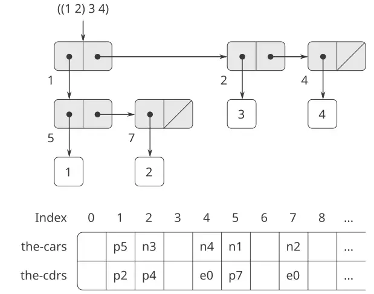
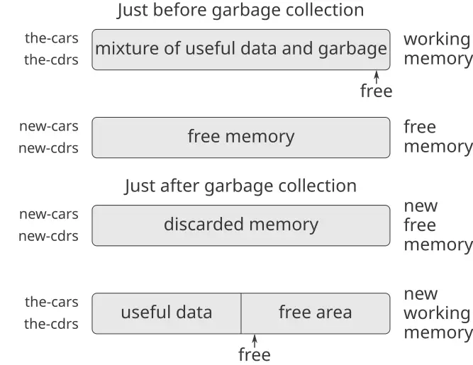

### 5.3 تخصيص التخزين وجمع القمامة

في القسم [5.4](https://sarabander.github.io/sicp/html/5_002e4.xhtml#g_t5_002e4)، سنُظهر كيف نُنفّذ مقيّم Scheme بوصفه آلة مسجّلات. ولتبسيط المناقشة، سنفترض أنّ آلات المسجّلات لدينا يمكن تجهيزها بـ*ذاكرةٍ مبنيّةٍ على القوائم (list-structured memory)*، تكون فيها العمليّات الأساسيّة للتلاعب ببياناتٍ مبنيّةٍ على القوائم أوّليّةً. وافتراض وجود مثل هذه الذاكرة تجريدٌ مفيدٌ حين يكون المرء مُركّزًا على آليّات التحكّم في مفسّر Scheme، لكنّه لا يعكس نظرةً واقعيّةً عن عمليّات البيانات الأوّليّة الفعليّة للحاسبات المعاصرة. ولكي نحصل على صورةٍ أكملَ عن كيف يعمل نظام Lisp، ينبغي أن نبحث كيف يمكن تمثيل بنية القائمة بطريقةٍ متوافقةٍ مع ذاكرات الحاسوب التقليديّة.

ثمّة اعتباران في تنفيذ بنية القائمة. أمّا الأوّل فمسألة تمثيلٍ بحتة: كيف نُمثّل بنية «الصندوق والمؤشّر» (box-and-pointer) لأزواج Lisp، باستخدام قدرات التخزين والمعننة وحدها في ذاكرات الحاسوب النموذجيّة. وأمّا الاعتبار الثاني فيتعلّق بإدارة الذاكرة بينما يمضي الاحتساب. ويعتمد عمل نظام Lisp بشكلٍ حرجيٍّ على القدرة على إنشاء كائنات بياناتٍ جديدةٍ باستمرار. وتشمل هذه كائناتٍ تُنشَأ صراحةً بواسطة إجراءات Lisp التي يجري تفسيرها، فضلًا عن بنى يُنشئها المفسّر نفسه، كالبيئات وقوائم المعطيات. وعلى الرغم من أنّ إنشاء كائنات بياناتٍ جديدةٍ باستمرارٍ لن يُشكّل مشكلةً على حاسوبٍ يمتلك مقدارًا غير محدودٍ من الذاكرة سريعة العنونة، فإنّ ذاكرات الحاسوب متوفّرةٌ بأحجامٍ محدودةٍ فقط (للأسف الشديد). ولهذا تُوفّر أنظمة Lisp تسهيلًا لـ*التخصيص التلقائيّ للتخزين (automatic storage allocation)* دعّمًا لوهم الذاكرة غير المحدودة. وحين لم يَعد كائن بياناتٍ لازماً، تُعاد الذاكرة المُخصَّصة له تلقائيًّا وتُستخدم لبناء كائنات بياناتٍ جديدة. ثمّة تقنيّاتٌ متنوّعةٌ لتوفير مثل هذا التخصيص التلقائيّ للتخزين. وأمّا الطريقة التي سنناقشها في هذا القسم فتُسمّى *جمع القمامة (garbage collection)*.

#### 5.3.1 الذاكرة كمتجهات

يمكن النظر إلى ذاكرة الحاسوب التقليديّة بوصفها مصفوفةً من الخزائن الصغيرة، كلٌّ منها يمكن أن يحتوي قطعةً من المعلومات. ولكلّ خزانةٍ صغيرةٍ اسمٌ فريد، يُسمّى *عنوانها* أو *موقعها*. وتوفّر نظم الذاكرة النموذجيّة عمليّتَين أوّليّتَين: إحداهما تجلب البيانات المخزّنة في موقعٍ محدَّدٍ، والأخرى تُحلّل بيانات جديدة إلى موقعٍ محدَّدٍ. ويمكن زيادة عناوين الذاكرة لدعم النفاذ المتسلسل إلى مجموعةٍ ما من الخزائن الصغيرة. وبصورةٍ أعمّ، فإنّ عمليّات بياناتٍ مهمّةً كثيرةً تتطلّب أن تُعامَل عناوين الذاكرة كبياناتٍ، يمكن تخزينها في مواقع الذاكرة والتلاعب بها في مسجّلات الآلة. وتمثيل بنية القائمة أحد تطبيقات ما يُعرف بـ*حساب العناوين (address arithmetic)*.

ولنمذجة ذاكرة الحاسوب، نستخدم نوعًا جديدًا من بنى البيانات يُسمّى *متجهًا (vector)*. وتجرّديًّا، المتجه كائن بياناتٍ مركّبٌ يمكن النفاذ إلى عناصره الفرديّة بواسطة فهرس (index) صحيحٍ في مقدارٍ من الزمن مستقلٌّ عن الفهرس.[^5] ولكي نوصف عمليّات الذاكرة، نستخدم إجراءَي Scheme أوّليّين للتلاعب بالمتجهات:

- يُعيد `(vector-ref ⟨vector⟩ ⟨n⟩)` العنصر رقم $n^{th}$ من المتجه.
- يضبط `(vector-set! ⟨vector⟩ ⟨n⟩ ⟨value⟩)` العنصر رقم $n^{th}$ من المتجه على القيمة المعيَّنة.

فمثلًا، إذا كان `v` متجهًا، فإنّ `(vector-ref v 5)` يُحضِر المدخل الخامس في المتجه `v` و`(vector-set! v 5 7)` يُغيّر قيمة المدخل الخامس في المتجه `v` إلى 7.[^6] أمّا في ذاكرة الحاسوب، فيمكن تنفيذ هذا النفاذ باستخدام حساب العناوين لدمج *عنوانٍ أساس (base address)* يُحدّد موقع البداية لمتجهٍ في الذاكرة مع فهرس يُحدّد إزاحة عنصرٍ معيّنٍ من المتجه.

#### تمثيل بيانات Lisp

نستطيع استخدام المتجهات لتنفيذ بنى الأزواج الأساسيّة المطلوبة لذاكرةٍ مبنيّةٍ على القوائم (list-structured memory). فلنتخيّل أنّ ذاكرة الحاسوب مقسومةٌ إلى متجهين: `the-cars` و`the-cdrs`. وسنمثّل بنية القائمة على النحو الآتي: المؤشّر إلى زوجٍ هو فهرسٌ في المتجهين. و`car` الزوج هو المدخل في `the-cars` بالفهرس المعيَّن، و`cdr` الزوج هو المدخل في `the-cdrs` بالفهرس المعيَّن. ونحتاج أيضًا إلى تمثيلٍ لكائناتٍ غير الأزواج (كالأعداد والرموز) وإلى طريقةٍ لتمييز نوع بياناتٍ عن آخر. ثمّة طرائق كثيرةٌ لإنجاز ذلك، لكنّها جميعًا تُختزل إلى استخدام *مؤشّراتٍ معمَّمة النوع (typed pointers)*، أي توسيع مفهوم «المؤشّر» ليشمل معلومات عن نوع البيانات.[^7] ويمكّن نوع البيانات النظام من تمييز مؤشّرٍ إلى زوجٍ (وهو يتألّف من نوع البيانات «زوج» وفهرسٍ في متجهي الذاكرة) عن المؤشّرات إلى أنواع البيانات الأخرى (والتي تتألّف من نوع بياناتٍ آخر وممّا يُستخدم لتمثيل بيانات ذلك النوع). ويُعتبر كائنا بياناتٍ متطابقين (`eq?`) إذا كانت مؤشّراتهما متطابقة.[^8] ويُوضيّح [الشكل 5.14](/book/sicp/c5-computing-with-register-machines/5-3/) استخدام هذه الطريقة لتمثيل القائمة `((1 2) 3 4)`، التي يُعرَض مخطّط الصندوق والمؤشّر لها أيضًا. ونستخدم بادئاتٍ حرفيّةً للدلالة على معلومات نوع البيانات. وهكذا، يُرمز إلى المؤشّر إلى الزوج ذي الفهرس 5 بـ`p5`، وتُرمَّز القائمة الخالية بمؤشّر `e0`، ويُرمز إلى المؤشّر إلى العدد 4 بـ`n4`. وفي مخطّط الصندوق والمؤشّر، أشرنا أسفل يسار كلّ زوجٍ إلى فهرس المتجه الذي يُحدّد أين تُخزَّن `car` الزوج و`cdr` الزوج. والمواقع الخالية في `the-cars` و`the-cdrs` قد تحتوي أجزاءً من بنى قوائمَ أخرى (غير ذات أهمّيّةٍ هنا).



**الشكل 5.14:** تمثيل القائمة `((1 2) 3 4)` بمخطّط الصندوق والمؤشّر وبمتجهي الذاكرة.

وقد يتألّف المؤشّر إلى عددٍ، مثل `n4`، من نوعٍ يدلّ على بيانات عدديّةٍ إلى جانب التمثيل الفعليّ للعدد 4.[^9] ولكي نتعامل مع الأعداد التي هي كبيرةٌ بحيث لا يمكن تمثيلها في المقدار الثابت من المساحة المُخصَّصة لمؤشّرٍ واحدٍ، فبوسعنا استخدام نوع بياناتٍ مستقلٍّ هو *الأعداد الضخمة (bignum)*، يكون فيه المؤشّر مُعيِّنًا لقائمةٍ تُخزَّن فيها أجزاء العدد.[^10]

وقد يُمثَّل الرمز بمؤشّرٍ معمَّم النوع يُعيِّن تسلسلًا من المحارف التي تشكّل التمثيل المطبوع للرمز. ويُنشَأ هذا التسلسل بواسطة قارئ Lisp حين تُواجَه سلسلة المحارف أوّلَ ما تُواجَه في المُدخَل. وحيث إنّا نُريد أن يُتعرَّف على نسختين من رمزٍ بوصفهما «الرمز ذاته» بواسطة `eq?`، ونُريد أن يكون `eq?` اختبارًا بسيطًا لتساوي المؤشّرات، ينبغي أن نضمن أنّ قارئ الرموز، إذا رأى سلسلة المحارف ذاتها مرّتين، سيستخدم المؤشّر ذاته (إلى تسلسل المحارف ذاته) لتمثيل الحدثين. ولكي يُنجز ذلك، يُمسك القارئ جدولًا، يُسمّى تقليديًّا *مصفوفة الرموز (obarray)*، بجميع الرموز التي واجهها قطّ. وحين يواجه القارئ سلسلة محارفٍ ويكاد يبني رمزًا، يفحص مصفوفة الرموز ليرى هل واجه سلسلة المحارف ذاتها من قبل. فإن لم يكن قد واجهها، يستخدم المحارف لبناء رمزٍ جديد (مؤشّرٌ معمَّم النوع إلى تسلسل محارفٍ جديد) ويُدخل هذا المؤشّر في مصفوفة الرموز. وإن يكون القارئ قد واجه السلسلة من قبل، يُعيد مؤشّر الرمز المخزّون في مصفوفة الرموز. وتُسمّى عمليّة استبدال سلاسل المحارف بمؤشّراتٍ فريدةٍ *إدخال الرموز (interning)*.

#### تنفيذ عمليّات القائمة الأوّليّة

وبالنظر إلى مخطّط التمثيل أعلاه، نستطيع استبدال كلّ عمليّة قائمةٍ «أوّليّة» في آلة المسجّلات بعمليّة متجهٍ أوّليّةٍ أو أكثر. وسنستخدم مسجّلين، `the-cars` و`the-cdrs`، لتعيين متجهي الذاكرة، وسنفترض أنّ `vector-ref` و`vector-set!` متوفّرتان بوصفهما عمليّتَين أوّليّتَين. ونفترض أيضًا أنّ العمليّات العدديّة على المؤشّرات (كتزييد مؤشّرٍ، أو استخدام مؤشّر زوجٍ لفهرسة متجهٍ، أو جمع عددين) لا تستخدم إلّا جزء الفهرس من المؤشّر المعمَّم النوع.

فمثلًا، نستطيع جعل آلة مسجّلاتٍ تدعم التعليمات

```scheme
(assign ⟨reg₁⟩ (op car) (reg ⟨reg₂⟩))
(assign ⟨reg₁⟩ (op cdr) (reg ⟨reg₂⟩))
```

إذا نفّذناها، على الترتيب، كـ

```scheme
(assign ⟨reg₁⟩ 
        (op vector-ref)
        (reg the-cars)
        (reg ⟨reg₂⟩))
(assign ⟨reg₁⟩
        (op vector-ref)
        (reg the-cdrs)
        (reg ⟨reg₂⟩))
```

أمّا التعليمات

```scheme
(perform (op set-car!) (reg ⟨reg₁⟩) (reg ⟨reg₂⟩))
(perform (op set-cdr!) (reg ⟨reg₁⟩) (reg ⟨reg₂⟩))
```

فمنفَّذةٌ كـ

```scheme
(perform (op vector-set!)
         (reg the-cars)
         (reg ⟨reg₁⟩)
         (reg ⟨reg₂⟩))
(perform (op vector-set!)
         (reg the-cdrs)
         (reg ⟨reg₁⟩)
         (reg ⟨reg₂⟩))
```

أمّا `cons` فيُؤدّى بتخصيص فهرسٍ غير مستخدمٍ وتخزين معطيّ `cons` في `the-cars` و`the-cdrs` في موضع المتجه المُفهرَس بذلك الفهرس. ونفترض وجود مسجّلٍ خاصٍّ، `free`، يحمل دائمًا مؤشّر زوجٍ يحتوي الفهرس المتوفّر التالي، وأنّه يمكننا تزييد جزء الفهرس من ذلك المؤشّر لإيجاد الموقع الحرّ التالي.[^11] فمثلًا، التعليمة

```scheme
(assign ⟨reg₁⟩
        (op cons)
        (reg ⟨reg₂⟩)
        (reg ⟨reg₃⟩))
```

منفَّذةٌ كتسلسل عمليّات المتجه الآتي:[^12]

```scheme
(perform (op vector-set!)
         (reg the-cars)
         (reg free)
         (reg ⟨reg₂⟩))
(perform (op vector-set!)
         (reg the-cdrs)
         (reg free)
         (reg ⟨reg₃⟩))
(assign ⟨reg₁⟩ (reg free))
(assign free (op +) (reg free) (const 1))
```

أمّا عمليّة `eq?`

```scheme
(op eq?) (reg ⟨reg₁⟩) (reg ⟨reg₂⟩)
```

فتختبر ببساطةٍ تساوي جميع الحقول في المسجّلين، والمسيّمات مثل `pair?` و`null?` و`symbol?` و`number?` لا تحتاج إلّا إلى فحص حقل النوع.

#### تنفيذ المكدسات

وعلى الرغم من أنّ آلات المسجّلات لدينا تستخدم المكدسات، فليس علينا أن نفعل شيئًا خاصًّا هنا، إذ يمكن نمذجة المكدسات من حيث القوائم. فيمكن أن يكون المكدس قائمةً بالقيم المحفوظة، يُشير إليها مسجّلٌ خاصٌّ هو `the-stack`. وهكذا، يمكن تنفيذ `(save ⟨reg⟩)` كـ

```scheme
(assign the-stack 
        (op cons)
        (reg ⟨reg⟩)
        (reg the-stack))
```

وبالمثل، يمكن تنفيذ `(restore ⟨reg⟩)` كـ

```scheme
(assign ⟨reg⟩ (op car) (reg the-stack))
(assign the-stack (op cdr) (reg the-stack))
```

و`(perform (op initialize-stack))` يمكن تنفيذه كـ

```scheme
(assign the-stack (const ()))
```

يمكن توسيع هذه العمليّات أكثر بواسطة عمليّات المتجه (vector) المعطاة أعلاه. أمّا في البُنى الحاسوبيّة التقليديّة، فمن المفيدّ عادةً تخصيص المكدّس (stack) متجهًا (vector) منفصلًا. وعندئذٍ يمكن أداء الدفع إلى المكدّس وإخراج القيم منه بزيادة فهرسٍ داخل ذلك المتجه أو إنقاصه.

**التمرين 5.20:** ارسم تمثيل الصناديق والمؤشّرات (box-and-pointer) وتمثيل متجه الذاكرة (memory-vector) (كما في [الشكل 5.14](/book/sicp/c5-computing-with-register-machines/5-3/)) لبنية القائمة (list structure) الناتجة عن

```scheme
(define x (cons 1 2))
(define y (list x x))
```

حيث يكون مؤشّر `free` في البدء عند `p1`. فما القيمة النهائيّة لـ`free`؟ وأيّ مؤشّرات تمثّل قيمتَي `x` و`y`؟

**التمرين 5.21:** نفّذ آلات مسجّلاتٍ للإجراءات الآتية. وافترض أنّ عمليّات ذاكرة بنية القوائم متاحة كأوّليّاتٍ آليّة.

نسخة تعاوديّة من `count-leaves`:

```scheme
(define (count-leaves tree)
  (cond ((null? tree) 0)
        ((not (pair? tree)) 1)
        (else 
         (+ (count-leaves (car tree))
            (count-leaves (cdr tree))))))
```

نسخة تعاوديّة من `count-leaves` بعدّاد صريح:

```scheme
(define (count-leaves tree)
  (define (count-iter tree n)
    (cond ((null? tree) n)
          ((not (pair? tree)) (+ n 1))
          (else 
           (count-iter 
            (cdr tree)
            (count-iter (car tree) 
                        n)))))
  (count-iter tree 0))
```

> **التمرين 5.22:** عرض [التمرين 3.12](https://sarabander.github.io/sicp/html/3_002e3.xhtml#Exercise-3_002e12) الوارد في [3.3.1](https://sarabander.github.io/sicp/html/3_002e3.xhtml#g_t3_002e3_002e1) إجراءَ `append` الذي يلحق قائمتين لتكوين قائمةٍ جديدة، وإجراءَ `append!` الذي يدمج قائمتين وصْلهما معًا. صمّم آلة مسجّلاتٍ لتنفيذ كلٍّ من هذين الإجراءين. وافترض أنّ عمليّات ذاكرة بنية القوائم متاحة كعمليّاتٍ أوّليّة.

#### 5.3.2 الحفاظ على وهم الذاكرة غير المحدودة

طريقة التمثيل المُوجَزة في [5.3.1](/book/sicp/c5-computing-with-register-machines/5-3/) تحلّ مسألة تنفيذ بنية القوائم، شريطةَ أن تكون لدينا ذاكرةٌ غير محدودة. أمّا مع حاسوبٍ حقيقيّ، فسينفدنا في النهاية المكان الحُرّ الذي نُبنى فيه أزواجٌ جديدة.[^13] غير أنّ معظم الأزواج المُولَّدة في احتسابٍ نموذجيٍّ لا تُستخدم إلّا للاحتفاظ بنتائج وسيطة. وبعد الاستفادة من هذه النتائج، لم تعُد الأزواج لازمةً — إنّها *قمامة* (garbage). فإنّ الاحتساب

```scheme
(accumulate 
 + 
 0
 (filter odd? (enumerate-interval 0 n)))
```

يبني قائمتين: التعداد ونتيجة ترشيح التعداد. وحين يكتمل التجميع، لم تعُد هاتان القائمتان لازمتين، ويمكن استعادة الذاكرة المخصَّصة. فإن تمكّنّا من جمع كلّ القمامة دوريًّا، وتمخّض ذلك عن إعادة تدوير الذاكرة بالسرعة ذاتها تقريبًا التي نُبنى بها أزواجٌ جديدة، فإنّنا نكون قد حافظنا على وهم وجود ذاكرةٍ غير محدودة.

وحتى نُعيد تدوير الأزواج، ينبغي أن تكون لدينا طريقةٌ لتحديد الأزواج المخصَّصة غير اللازمة (بمعنى أنّ محتوياتها لم تعُد قادرةً على التأثير في مستقبل الاحتساب). والطريقة التي سنفحصها لإنجاز ذلك تُعرف بـ*جمع القمامة* (garbage collection). ويقوم جمع القمامة على الملاحظة أنّ الكائنات الوحيدة التي يمكنها التأثير في مستقبل الاحتساب، في أيّ لحظةٍ من تأويل Lisp، هي تلك التي يمكن الوصول إليها بسلسلةٍ من عمليّات `car` و`cdr` تبدأ من المؤشّرات الموجودة حاليًّا في مسجّلات الآلة.[^14] ويمكن إعادة تدوير أيّ خليّة ذاكرةٍ غير متاحةٍ على هذا النحو.

ثمّة طرائق كثيرةٌ لأداء جمع القمامة. والطريقة التي سنفحصها هنا تُسمّى *التوقّف والنسخ* (stop-and-copy). والفكرة الأساسيّة هي تقسيم الذاكرة إلى نصفين: «ذاكرة العمل» و«الذاكرة الحُرّة». وعندما يبني `cons` أزواجًا، فإنّه يخصّصها في ذاكرة العمل. وحين تمتلئ ذاكرة العمل، نؤدّي جمع القمامة بتحديد موقع جميع الأزواج المفيدة في ذاكرة العمل ونسخها في مواضعَ متتاليةٍ في الذاكرة الحُرّة. (وتُحدَّد مواقع الأزواج المفيدة بتتبّع جميع مؤشّري `car` و`cdr`، بدءًا من مسجّلات الآلة.) وبما أنّنا لا ننسخ القمامة، فسيكون هناك - على الأرجح - ذاكرةٌ حُرّةٌ إضافيّةٌ نستطيع استخدامها لتخصيص أزواجٍ جديدة. فضلًا عن ذلك، لا شيء في ذاكرة العمل لازَمٌ، إذ إنّ جميع الأزواج المفيدة فيها قد نُسخت. وبذلك، فإنّ تبادلنا أدوار ذاكرة العمل والذاكرة الحُرّة يمكنّنا من مواصلة المعالجة؛ وسيُخصَّص الأزواج الجديدة في ذاكرة العمل الجديدة (وهي الذاكرة الحُرّة القديمة). وحين تمتلئ تلك، نستطيع نسخ الأزواج المفيدة إلى الذاكرة الحُرّة الجديدة (وهي ذاكرة العمل القديمة).[^15]

#### تنفيذ جامع قمامةٍ بطريقة التوقّف والنسخ

نستخدم الآن لغة آلات المسجّلات لوصف خوارزميّة التوقّف والنسخ بتفصيلٍ أكثر. وسنفترض وجود مسجّلٍ يُسمّى `root` يحتوي مؤشّرًا إلى بنيةٍ تُشير في النهاية إلى جميع البيانات المتاحة. ويمكن ترتيب ذلك بتخزين محتويات جميع مسجّلات الآلة في قائمةٍ مخصَّصةٍ مسبقًا يُشير إليها `root` قبيل البدء في جمع القمامة.[^16] ونفترض أيضًا أنّه - بالإضافة إلى ذاكرة العمل الحاليّة - ثمّة ذاكرةٌ حُرّةٌ متاحةٌ نستطيع نسخ البيانات المفيدة إليها. وتتألّف ذاكرة العمل الحاليّة من متجهاتٍ عناوينها الأساسيّة في مسجّلين يُسمّيان `the-cars` و`the-cdrs`، والذاكرة الحُرّة في مسجّلين يُسمّيان `new-cars` و`new-cdrs`.

يُطلَق جمع القمامة حين نستنفد الخلايا الحُرّة في ذاكرة العمل الحاليّة، أي حين تحاول عمليّة `cons` زيادة المؤشّر `free` بما يتجاوز نهاية متجه الذاكرة. وحين يكتمل عمليّة جمع القمامة، سيُشير المؤشّر `root` إلى داخل الذاكرة الجديدة، وستكون جميع الكائنات المتاحة من `root` قد نُقلت إلى الذاكرة الجديدة، وسيُحدّد المؤشّر `free` الموضع التالي في الذاكرة الجديدة حيث يمكن تخصيص زوجٍ جديد. وبالإضافة إلى ذلك، تكون أدوار ذاكرة العمل والذاكرة الجديدة قد تبادلت — وسيُبنى الأزواج الجديدة في الذاكرة الجديدة، بدءًا من الموضع الذي يُحدّده `free`، وستكون ذاكرة العمل (السابقة) متاحةً بوصفها الذاكرة الجديدة لجمع القمامة التالي. ويُظهر [الشكل 5.15](/book/sicp/c5-computing-with-register-machines/5-3/) ترتيب الذاكرة قبيل جمع القمامة وبعده بلحظة.



**الشكل 5.15:** إعادة تشكيل الذاكرة بواسطة عمليّة جمع القمامة.

تُضبَط حالة عمليّة جمع القمامة بالإبقاء على مؤشّرين: `free` و`scan`. ويُهيَّأ هذان المؤشّران ليُشيرا إلى بداية الذاكرة الجديدة. وتبدأ الخوارزميّة بنقل الزوج الذي يُشير إليه `root` إلى بداية الذاكرة الجديدة. فيُنسخ الزوج، ويُعدَّل المؤشّر `root` ليُشير إلى الموقع الجديد، وتُزاد قيمة المؤشّر `free`. وبالإضافة إلى ذلك، يُؤشَّر الموقع القديم للزوج لإظهار أنّ محتوياته قد نُقلت. ويُنجز هذا التأشير على النحو الآتي: في موضع `car`، نضع وسمًا خاصًّا يُشير إلى أنّ هذا كائنٌ قد نُقل بالفعل. (ويُسمّى مثل هذا الكائن تقليديًّا *القلب المكسور* (broken heart).)[^17] وفي موضع `cdr` نضع *عنوان إعادة التوجيه* (forwarding address) الذي يُشير إلى الموقع الذي نُقل إليه الكائن.

وبعد نقل الجذر، يدخل جامع القمامة دورته الأساسيّة. وفي كلّ خطوةٍ من الخوارزميّة، يُشير المؤشّر `scan` (الذي يُشير في البدء إلى الجذر المنقول) إلى زوجٍ نُقل إلى الذاكرة الجديدة لكنّ مؤشّريه `car` و`cdr` ما زالا يُشيران إلى كائناتٍ في الذاكرة القديمة. وتُنقل هذه الكائنات كلٌّ منها، وتُزاد قيمة المؤشّر `scan`. ولنقل كائنٍ (مثلًا الكائن الذي يُحدّده مؤشّر `car` للزوج الذي نمسحه) نتحقّق مما إذا كان الكائن قد نُقل بالفعل (كما يُبيّنه وجود وسم القلب المكسور في موضع `car` للكائن). فإن لم يكن الكائن قد نُقل بالفعل، ننسخه إلى الموضع الذي يُحدّده `free`، ونُحدّث `free`، ونُنشئ قلبًا مكسورًا في الموقع القديم للكائن، ونُحدّث المؤشّر إلى الكائن (في هذا المثال، مؤشّر `car` للزوج الذي نمسحه) ليُشير إلى الموقع الجديد. وإن كان الكائن قد نُقل بالفعل، فتُستبدل قيمة عنوان إعادة التوجيه الخاص به (الموجود في موضع `cdr` من القلب المكسور) بالمؤشّر في الزوج الذي يُمسح. وفي النهاية، ستكون جميع الكائنات المتاحة قد نُقلت ومُسحت، وعندئذٍ يفوق المؤشّر `scan` المؤشّر `free` وتنتهي العمليّة.

يمكننا تحديد خوارزميّة التوقّف والنسخ كسلسلةٍ من التعليمات لآلة مسجّلات. أمّا الخطوة الأساسيّة في نقل كائنٍ فتتمّ بروتينٍ فرعيٍّ يُسمّى `relocate-old-result-in-new`. ويحصل هذا الروتين الفرعيّ على معطاه، وهو مؤشّرٌ إلى الكائن المطلوب نقله، من مسجّلٍ يُسمّى `old`. وهو ينقل الكائن المعيَّن (بزيادة `free` أثناء ذلك)، ويضع مؤشّرًا إلى الكائن المنقول في مسجّلٍ يُسمّى `new`، ويعود بالتفرّع إلى نقطة الدخول المخزّنة في المسجّل `relocate-continue`. وللبدء في جمع القمامة، نستدعي هذا الروتين الفرعيّ لنقل مؤشّر `root`، بعد تهيئة `free` و`scan`. وحين يُنجز نقل `root`، نُنصّب المؤشّر الجديد بوصفه `root` الجديد وندخل الحلقة الرئيسيّة لجامع القمامة.

```scheme
begin-garbage-collection
  (assign free (const 0))
  (assign scan (const 0))
  (assign old (reg root))
  (assign relocate-continue 
          (label reassign-root))
  (goto (label relocate-old-result-in-new))
reassign-root
  (assign root (reg new))
  (goto (label gc-loop))
```

في الحلقة الرئيسيّة لجامع القمامة، ينبغي أن نُحدّد فيما إذا كانت ثمّة كائناتٌ أخرى تبقّى مسحها. ونفعل ذلك باختبار تطابق المؤشّر `scan` مع المؤشّر `free`. فإن كان المؤشّران متساويين، فقد نُقلت جميع الكائنات المتاحة، ونتفرّع إلى `gc-flip` الذي يُرتّب الأمور حتّى نستطيع مواصلة الاحتساب المُقاطَع. وإن كان ثمّة أزواجٌ تبقّى مسحها، نستدعي روتين النقل لنقل `car` الزوج التالي (بوضع مؤشّر `car` في `old`). ويُهيَّأ المسجّل `relocate-continue` بحيث يعود الروتين الفرعيّ لتحديث مؤشّر `car`.

```scheme
gc-loop
  (test (op =) (reg scan) (reg free))
  (branch (label gc-flip))
  (assign old 
          (op vector-ref)
          (reg new-cars)
          (reg scan))
  (assign relocate-continue 
          (label update-car))
  (goto (label relocate-old-result-in-new))
```

عند `update-car`، نُعدّل مؤشّر `car` للزوج الذي يُمسح، ثم نمضي إلى نقل `cdr` الزوج. ونعود إلى `update-cdr` حين يُنجز ذلك النقل. وبعد نقل `cdr` وتحديثه، نكون قد أنينا من مسح ذلك الزوج، فنواصل في الحلقة الرئيسيّة.

```scheme
update-car
  (perform (op vector-set!)
           (reg new-cars)
           (reg scan)
           (reg new))
  (assign  old 
           (op vector-ref)
           (reg new-cdrs)
           (reg scan))
  (assign  relocate-continue
           (label update-cdr))
  (goto (label relocate-old-result-in-new))
update-cdr
  (perform (op vector-set!)
           (reg new-cdrs)
           (reg scan)
           (reg new))
  (assign  scan (op +) (reg scan) (const 1))
  (goto (label gc-loop))
```

يُنقل الروتين الفرعيّ `relocate-old-result-in-new` الكائنات على النحو الآتي: فإن كان الكائن المطلوب نقله (الذي يُشير إليه `old`) ليس زوجًا، نُعيد المؤشّر ذاته إلى الكائن دون تغيير (في `new`). (فقد نكون مثلًا نمسح زوجًا `car` هو العدد 4. فإن مثّلنا `car` بـ`n4`، كما هو موصوف في [5.3.1](/book/sicp/c5-computing-with-register-machines/5-3/)، فنريد أن يبقى مؤشّر `car` «المنقول» هو `n4`.) وإلّا، ينبغي أن نُجري النقل. فإن احتوى موضع `car` للزوج المطلوب نقله على وسم القلب المكسور، فالزوج قد نُقل في الحقيقة بالفعل، فنستعيد عنوان إعادة التوجيه (من موضع `cdr` في القلب المكسور) ونُعيده في `new`. وإن كان المؤشّر في `old` يُشير إلى زوجٍ لم يُنقل بعد، ننقل الزوج إلى أوّل خليّة حُرّةٍ في الذاكرة الجديدة (التي يُشير إليها `free`) ونُنشئ قلبًا مكسورًا بتخزين وسم القلب المكسور وعنوان إعادة التوجيه في الموقع القديم. ويستخدم `relocate-old-result-in-new` مسجّلًا يُسمّى `oldcr` للاحتفاظ بـ`car` أو `cdr` للكائن الذي يُشير إليه `old`.[^18]

```scheme
relocate-old-result-in-new
  (test (op pointer-to-pair?) (reg old))
  (branch (label pair))
  (assign new (reg old))
  (goto (reg relocate-continue))
pair
  (assign  oldcr 
           (op vector-ref)
           (reg the-cars)
           (reg old))
  (test (op broken-heart?) (reg oldcr))
  (branch  (label already-moved))
  (assign  new (reg free)) ; new location for pair
  ;; Update free pointer.
  (assign free (op +) (reg free) (const 1))
  ;; Copy the car and cdr to new memory.
  (perform (op vector-set!)
           (reg new-cars)
           (reg new)
           (reg oldcr))
  (assign  oldcr 
           (op vector-ref)
           (reg the-cdrs)
           (reg old))
  (perform (op vector-set!)
           (reg new-cdrs)
           (reg new)
           (reg oldcr))
  ;; Construct the broken heart.
  (perform (op vector-set!)
           (reg the-cars)
           (reg old)
           (const broken-heart))
  (perform (op vector-set!)
           (reg the-cdrs)
           (reg old)
           (reg new))
  (goto (reg relocate-continue))
already-moved
  (assign  new
           (op vector-ref)
           (reg the-cdrs)
           (reg old))
  (goto (reg relocate-continue))
```

وفي نهاية عمليّة جمع القمامة تمامًا، نبادل دور الذاكرتين القديمة والجديدة بتبادل المؤشّرات: تبادل `the-cars` مع `new-cars`، و`the-cdrs` مع `new-cdrs`. وسنكون عندئذٍ على استعدادٍ لأداء جمع قمامةٍ آخر في المرّة التالية التي تنفد فيها الذاكرة.

```scheme
gc-flip
  (assign temp (reg the-cdrs))
  (assign the-cdrs (reg new-cdrs))
  (assign new-cdrs (reg temp))
  (assign temp (reg the-cars))
  (assign the-cars (reg new-cars))
  (assign new-cars (reg temp))
```


[^5]: كان بوسعنا تمثيل الذاكرة كقوائمَ من العناصر. لكن زمن الوصول لم يكن ليكون حينها مستقلًّا عن الفهرس، إذ إنّ الوصول إلى العنصر رقم $undefined$ في قائمةٍ يتطلّب $undefined$ عمليّة `cdr`.

[^6]: تكاملًا، ينبغي أن نُحدّد عمليّة `make-vector` تبني المتجهات. لكن في التطبيق الحاضر سنستخدم المتجهات فقط لنمذجة تقسيماتٍ ثابتةٍ من ذاكرة الحاسوب.

[^7]: هذه هي الفكرة عينها الخاصةّ بـ«البيانات الموسومة (tagged data)» التي أوردناها في [الفصل 2](https://sarabander.github.io/sicp/html/Chapter-2.xhtml#Chapter-2) للتعامل مع العمليّات العامّة. لكن هنا تُدرَج أنواع البيانات في مستوى الآلة الأوّليّ بدلًا من بنائها باستخدام القوائم.

[^8]: يمكن ترميز معلومات النوع بطرائق متنوّعة، حسب تفاصيل الآلة التي سيُنفّذ عليها نظام Lisp. وستعتمد كفاءة تنفيذ برامج Lisp بقوةٍ على مدى حكمة هذا الخيار، لكن من الصعب صياغة قواعد تصميمٍ عامّةٍ للخيارات الجيّدة. وأبسط طريقةٍ لتنفيذ المؤشّرات الموسومة بالنوع هي تخصيص مجموعةٍ ثابتةٍ من البتّات في كلّ مؤشّرٍ لتكون *حقل النوع* الذي يُرمز نوع البيانات. وتشمل الأسئلة المهمّة الواجب تناولها عند تصميم مثل هذا التمثيل ما يلي: كم بتّةٍ للنوع تلزم؟ وما الحجم الذي يجب أن تبلغه مؤشرات المتجهات؟ ومدى كفاءة استخدام تعليمات الآلة الأوّليّة في التلاعب بحقول نوع المؤشرات؟ وتُوصف الآلات التي تتضمّن عتادًا خاصًّا للتعامل الفعّال مع حقول النوع بأنّها *ذات بنيةٍ موسومة (tagged architectures)*.

[^9]: يحدّد هذا القصد في تمثيل الأعداد ما إذا كان يمكن استخدام `eq?`، الذي يختبر تساوي المؤشرات، لاختبار تساوي الأعداد. فإذا احتوى المؤشّر على العدد نفسه، كانت للأعداد المتساوية المؤشّر نفسه. أمّا إذا احتوى المؤشّر على فهرس موضعٍ يُخزَّن فيه العدد، فلن يكون مضمونًا أن تكون للمتساوي من الأعداد مؤشرات متساوية إلّا إذا حرصنا على ألّا نخزّن العدد نفسه في أكثر من موضعٍ واحد.

[^10]: هذا أشبه بكتابة عددٍ كتسلسلٍ من الأرقام، إلّا أنّ كلّ «رقم» هنا عددٌ يتراوح بين الصفر وأكبر عددٍ يمكن تخزينه في مؤشّرٍ واحد.

[^11]: ثمّة طرق أخرى لإيجاد مواضع تخزينٍ حرّة. فيمكننا مثلًا ربط كلّ الأزواج غير المستخدمة بعضها ببعض في *قائمةٍ حرّة (free list)*. إنّ مواضعنا الحرّة متتالية (وبالتالي يمكن الوصول إليها بزيادة مؤشّرٍ) لأنّنا نستخدم جامع قمامةٍ ضاغطًا، كما سنرى في [5.3.2](/book/sicp/c5-computing-with-register-machines/5-3/).

[^12]: هذا هو في الجوهر تنفيذ `cons` بدلالة `set-car!` و`set-cdr!`، على النحو الموصوف في [3.3.1](https://sarabander.github.io/sicp/html/3_002e3.xhtml#g_t3_002e3_002e1). والعمليّة `get-new-pair` المستخدمة في ذلك التنفيذ تُنجَز هنا بواسطة المؤشّر `free`.

[^13]: قد لا يبقى هذا صحيحًا في المستقبل، لأنّ الذاكرات قد تكبر حدًّا يستحيل معه نفاد الذاكرة الحرّة في عمر الحاسوب. ففي السنة نحو $undefined$ ميكروثانية، فلو أنّنا نُنشئ `cons` مرّةً كلّ ميكروثانية، لأضحى يلزمنا نحو $undefined$ خليّةٍ من الذاكرة لبناء آلةٍ تعمل ثلاثين سنةً دون أن تنفد ذاكرتها. وتبدو هذه الكميّة من الذاكرة سخيفةً بمعايير اليوم، لكنّها ليست مستحيلةً فيزيائيًّا. ومن جهةٍ أخرى، تصبح المعالجات أسرع فأسرع، وقد يضمّ حاسوب المستقبل أعدادًا كبيرةً من المعالجات تعمل على التوازي على ذاكرةٍ واحدة، فقد يصبح ممكنًا استهلاك الذاكرة أسرع بكثيرٍ ممّا افترضناه.

[^14]: نفترض هنا أنّ المكدس ممثَّلٌ كقائمةٍ على النحو الموضح في [5.3.1](/book/sicp/c5-computing-with-register-machines/5-3/)، بحيث تكون عناصر المكدس قابلةً للوصول عبر المؤشّر الكائن في مسجّل المكدس.

[^15]: ابتكر هذه الفكرة مينسكي ونفّذها أوّل مرّة، كجزءٍ من تنفيذ Lisp على آلة PDP-1 في مختبر أبحاث الإلكترونيات في MIT. وطوّرها [فينيتشيل ويوكيلسون (1969)](https://sarabander.github.io/sicp/html/References.xhtml#Fenichel-and-Yochelson-_00281969_0029) لاستخدامها في تنفيذ Lisp الخاصّ بنظام المشاركة الزمنيّة Multics. ثمّ طور [بايكر (1978)](https://sarabander.github.io/sicp/html/References.xhtml#Baker-_00281978_0029) نسخةً «في الزمن الحقيقي» من الطريقة، لا تتطلّب وقوف الاحتساب أثناء جمع القمامة. وامتدّت فكرة بايكر على يد هيويت وليبرمان ومون (انظر [ليبرمان وهيويت 1983](https://sarabander.github.io/sicp/html/References.xhtml#Lieberman-and-Hewitt-1983)) لتستفيد من أنّ بعض البنى أكثر تقلّبًا وبعضها الآخر أكثر ديمومة. وثمّة تقنيّة أخرى شائعة لجمع القمامة هي طريقة *الكي والمسح (mark-sweep)*. وتتمثّل في تقفّي كلّ البنى القابلة للوصول من مسجّلات الآلة ووسم كلّ زوجٍ نصل إليه. ثمّ نمسح الذاكرة كلّها، وكلّ موضعٍ غير موسومٍ «يُكنس» كانقالًا للقمامة ويُتاح لإعادة الاستخدام. ويمكن العثور على مناقشةٍ كاملةٍ لطريقة الكي والمسح في [ألين 1978](https://sarabander.github.io/sicp/html/References.xhtml#Allen-1978). أمّا خوارزميّة مينسكي-فينيتشيل-يوكيلسون فهي الخوارزميّة السائدة في الأنظمة كبيرة الذاكرة، لأنّها لا تفحص إلّا الجزء المفيد من الذاكرة. وهذا بخلاف الكي والمسح، حيث ينبغي لمرحلة الكنس أن تفحص الذاكرة كلّها. وميزةٌ ثانية لطريقة التوقّف والنسخ أنّها جامع قمامةٍ *ضاغط (compacting)*. أي أنّ البيانات المفيدة ستنُقل في نهاية مرحلة جمع القمامة إلى مواضع ذاكرةٍ متتالية، مع ضغط كلّ الأزواج النفاية خارجها. وقد يكون هذا اعتبارًا بالغ الأهميّة للأداء في الآلات ذات الذاكرة الافتراضيّة، حيث قد يتطلّب الوصول إلى عناوين ذاكرةٍ متباعدةٍ بعيدًا عمليّاتِ تبديل صفحاتٍ إضافيّة.

[^16]: لا تتضمّن قائمة المسجّلات هذه المسجّلات التي يستخدمها نظام تخصيص التخزين—`root` و`the-cars` و`the-cdrs` وغيرها من المسجّلات التي ستُعرَّف في هذا القسم.

[^17]: اصطلح على مصطلح *القلب المكسور (broken heart)* ديفيد كريسي، الذي كتب جامع قمامةٍ للغة MDL، وهي لهجةٌ من Lisp طُوّرت في MIT في أوائل سبعينيّات القرن العشرين.

[^18]: يستخدم جامع القمامة المُسَيِّم منخفض المستوى `pointer-to-pair?` بدلًا من عمليّة بنية القوائم `pair?`، لأنّه قد توجد في نظامٍ حقيقيّ أمورٌ شتّى تُعامَل معاملة الأزواج لأغراض جمع القمامة. ففي نظامٍ من أنظمة Scheme مطابق لمعيار IEEE، مثلًا، قد يُنفّذ كائن الإجراء كنوعٍ خاصّ من «الزوج» لا يحقّقه المسيّم `pair?`. ولأغراض المحاكاة، يمكن تنفيذ `pointer-to-pair?` بدلالة `pair?`.