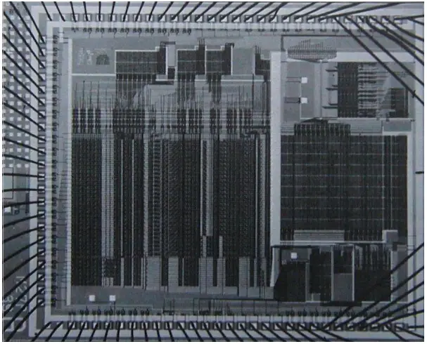

### 5.4 المقيّم ذو التحكّم الصريح

رأينا في [5.1](https://sarabander.github.io/sicp/html/5_002e1.xhtml#g_t5_002e1) كيف نحوّل برامج Scheme بسيطةً إلى أوصاف آلات مسجّلات. وسنُجري هذا التحويل الآن على برنامجٍ أكثر تعقيدًا، وهو المقيّم الاستعادي الوارد في [4.1.1](https://sarabander.github.io/sicp/html/4_002e1.xhtml#g_t4_002e1_002e1)–[4.1.4](https://sarabander.github.io/sicp/html/4_002e1.xhtml#g_t4_002e1_002e4)، الذي يُظهر كيف يمكن وصف سلوك مفسّر Scheme من حيث الإجراءين `eval` و`apply`. أمّا *المقيّم ذو التحكّم الصريح* (explicit-control evaluator) الذي نُطوّره في هذا القسم فيُظهر كيف يمكن وصف آليّات نداء الإجراءات وتمرير المعطيات الأساسيّة المستخدمة في عمليّة التقييم من حيث عمليّاتٍ على المسجّلات والمكدّس. وبالإضافة إلى ذلك، يمكن للمقيّم ذي التحكّم الصريح أن يخدم بوصفه تنفيذًا لمفسّر Scheme، مكتوبًا بلغةٍ تشبه تشابهًا شديدًا لغة الآلة الأصليّة للحواسيب التقليديّة. ويمكن تنفيذ المقيّم بواسطة محاكي آلة المسجّلات الوارد في [5.2](https://sarabander.github.io/sicp/html/5_002e2.xhtml#g_t5_002e2). وبديلًا عن ذلك، يمكن استخدامه نقطةَ بدءٍ لبناء تنفيذٍ بلغة الآلة لمقيّم Scheme، أو حتّى آلةٍ خاصّةٍ الغرض لتقييم تعابير Scheme. ويُظهر [الشكل 5.16](/book/sicp/c5-computing-with-register-machines/5-4/) تنفيذًا ماديًّا من هذا القبيل: رقاقة سيليكونيّة تعمل بوصفها مقيّمًا لـScheme. وقد بدأ مصمّمو الرقاقة بمواصفات مسار البيانات والمتحكّم لآلة مسجّلاتٍ تشبه المقيّم الموصوف في هذا القسم، واستخدموا برامج أتمتة التصميم لبناء تخطيط الدارة المتكاملة.[^19]



**الشكل 5.16:** تنفيذ لمقيّم Scheme برقاقة سيليكونيّة.

#### المسجّلات والعمليّات

عند تصميم المقيّم ذي التحكّم الصريح، ينبغي أن نُحدّد العمليّات التي ستُستخدم في آلة المسجّلات خاصّتنا. وقد وصفنا المقيّم الاستعادي من حيث صياغة مجرّدة، باستخدام إجراءاتٍ مثل `quoted?` و`make-procedure`. وعند تنفيذ آلة المسجّلات، كان بوسعنا توسيع هذه الإجراءات إلى سلاسلَ من عمليّات ذاكرة بنية القوائم الأوّليّة، وتنفيذ هذه العمليّات على آلة المسجّلات خاصّتنا. غير أنّ ذلك كان سيجعل مقيّمنا طويلًا جدًّا، بحيث تُحجب البنية الأساسيّة بالتفاصيل. ولإيضاح العرض، سنُدرج كعمليّاتٍ أوّليّةٍ لآلة المسجّلات إجراءات الصياغة المعطاة في [4.1.2](https://sarabander.github.io/sicp/html/4_002e1.xhtml#g_t4_002e1_002e2) وإجراءات تمثيل البيئات وغيرها من بيانات وقت التشغيل المعطاة في القسمين [4.1.3](https://sarabander.github.io/sicp/html/4_002e1.xhtml#g_t4_002e1_002e3) و[4.1.4](https://sarabander.github.io/sicp/html/4_002e1.xhtml#g_t4_002e1_002e4). وحتى نُحدّد تحديدًا تامًّا مقيّمًا يُمكن برمجته بلغة آليّةٍ منخفضة المستوى أو تنفيذه عتاديًّا، كنا سنستبدل هذه العمليّات بعمليّاتٍ أكثر أوّليّة، باستخدام تنفيذ بنية القوائم الذي وصفناه في [5.3](https://sarabander.github.io/sicp/html/5_002e3.xhtml#g_t5_002e3).

تتألّف آلة مسجّلات مقيّم Scheme خاصّتنا من مكدّس وسبعة مسجّلات: `exp` و`env` و`val` و`continue` و`proc` و`argl` و`unev`. ويُستخدم `exp` في الاحتفاظ بالتعبير المطلوب تقييمه، ويحتوي `env` على البيئة التي ستُجرى فيها عمليّة التقييم. وعند نهاية تقييمٍ، يحتوي `val` على القيمة المتحصّلة من تقييم التعبير في البيئة المعيَّنة. ويُستخدم المسجّل `continue` لاستيفاء التعاود، كما هو موضّح في [5.1.4](https://sarabander.github.io/sicp/html/5_002e1.xhtml#g_t5_002e1_002e4). (يحتاج المقيّم إلى نداء نفسه تعاوديًّا، إذ إنّ تقييم تعبيرٍ يتطلّب تقييم تعابيره الجزئيّة.) وتُستخدم المسجّلات `proc` و`argl` و`unev` في تقييم التركيبات.

لن نُقدّم مخطّط مسار بياناتٍ يُظهر كيف تُوصَل مسجّلات المقيّم وعمليّاته، كما أنّنا لن نُعطي القائمة التامّة لعمليّات الآلة. فهذه مستبطَنةٌ في متحكّم المقيّم، الذي سيُعرَض بتفصيلٍ.

#### 5.4.1 قلب المقيّم ذي التحكّم الصريح

العنصر المركزيّ في المقيّم هو سلسلة التعليمات التي تبدأ عند `eval-dispatch`. وهي تقابل الإجراء `eval` في المقيّم الاستعادي الموصوف في [4.1.1](https://sarabander.github.io/sicp/html/4_002e1.xhtml#g_t4_002e1_002e1). وحين يبدأ المتحكّم عند `eval-dispatch`، فهو يقيّم التعبير الذي يُحدّده `exp` في البيئة التي يُحدّدها `env`. وحين يكتمل التقييم، يذهب المتحكّم إلى نقطة الدخول المخزّنة في `continue`، ويحتفظ المسجّل `val` بقيمة التعبير. ومثلما في `eval` الاستعادي، فإنّ بنية `eval-dispatch` هي تحليل حالاتٍ على النوع الصياغيّ للتعبير المطلوب تقييمه.[^20]

```scheme
eval-dispatch
  (test (op self-evaluating?) (reg exp))
  (branch (label ev-self-eval))
  (test (op variable?) (reg exp))
  (branch (label ev-variable))
  (test (op quoted?) (reg exp))
  (branch (label ev-quoted))
  (test (op assignment?) (reg exp))
  (branch (label ev-assignment))
  (test (op definition?) (reg exp))
  (branch (label ev-definition))
  (test (op if?) (reg exp))
  (branch (label ev-if))
  (test (op lambda?) (reg exp))
  (branch (label ev-lambda))
  (test (op begin?) (reg exp))
  (branch (label ev-begin))
  (test (op application?) (reg exp))
  (branch (label ev-application))
  (goto (label unknown-expression-type))
```

#### تقييم التعابير البسيطة

الأعداد والمقاطع النصّيّة (وهي ذاتيّة التقييم)، والمتغيّرات، والاقتباسات، وتعبيرات `lambda` ليس لها تعابير جزئيّةٌ يُراد تقييمها. وبالنسبة لها، يضع المقيّم القيمة الصحيحة في المسجّل `val` ببساطة ويواصل التنفيذ عند نقطة الدخول التي يُحدّدها `continue`. ويُؤدّى تقييم التعابير البسيطة بشيفرة المتحكّم الآتية:

```scheme
ev-self-eval
  (assign val (reg exp))
  (goto (reg continue))
ev-variable
  (assign val
          (op lookup-variable-value)
          (reg exp)
          (reg env))
  (goto (reg continue))
ev-quoted
  (assign val
          (op text-of-quotation)
          (reg exp))
  (goto (reg continue))
ev-lambda
  (assign unev
          (op lambda-parameters)
          (reg exp))
  (assign exp 
          (op lambda-body)
          (reg exp))
  (assign val 
          (op make-procedure)
          (reg unev)
          (reg exp)
          (reg env))
  (goto (reg continue))
```

لاحِظ كيف يستخدم `ev-lambda` المسجّلين `unev` و`exp` للاحتفاظ بوسائط تعبير lambda وجسمه، حتّى يمكن تمريرهما إلى العمليّة `make-procedure`، إلى جانب البيئة الموجودة في `env`.

#### تقييم تطبيقات الإجراءات

يُحدَّد تطبيق الإجراء بتركيبةٍ تحتوي على مشغّلٍ وعوامل. والمشغّل تعبيرٌ جزئيّ قيمته إجراء، والعوامل تعابير جزئيّةٌ قيمُها هي المعطيات التي ينبغي تطبيق الإجراء عليها. ويعالج `eval` الاستعادي التطبيقات بنداء نفسه تعاوديًّا لتقييم كلّ عنصرٍ من التركيبة، ثم بتمرير النتائج إلى `apply` الذي يؤدّي تطبيق الإجراء الفعليّ. ويفعل المقيّم ذو التحكّم الصريح الأمر ذاته؛ وهذه النداءات التعاوديّة تُنفَّذ بتعليمات `goto`، إلى جانب استخدام المكدّس لحفظ المسجّلات التي ستُستعاد بعد عودة النداء التعاوديّ. وقبل كلّ نداءٍ، سنحرص على تحديد المسجّلات التي ينبغي حفظها (لأنّ قيمها ستكون لازمةً لاحقًا).[^21]

نبدأ تقييم تطبيقٍ بتقييم المشغّل لإنتاج إجراءٍ سيُطبَّق لاحقًا على العوامل المقيَّمة. ولتقييم المشغّل، ننقله إلى المسجّل `exp` ونذهب إلى `eval-dispatch`. والبيئة الموجودة في المسجّل `env` هي البيئة الصحيحة لتقييم المشغّل بالفعل. غير أنّنا نحفظ `env` لأنّنا سنحتاجها لاحقًا لتقييم العوامل. ونستخرج العوامل أيضًا في `unev` ونحفظ ذلك على المكدّس. ونُعِدّ `continue` بحيث يستأنف `eval-dispatch` عند `ev-appl-did-operator` بعد تقييم المشغّل. ومع ذلك، نحفظ أوّلًا القيمة القديمة لـ`continue`، التي تُبيّن للمتحكّم أين يواصل بعد التطبيق.

```scheme
ev-application
  (save continue)
  (save env)
  (assign unev (op operands) (reg exp))
  (save unev)
  (assign exp (op operator) (reg exp))
  (assign
   continue (label ev-appl-did-operator))
  (goto (label eval-dispatch))
```

وعند العودة من تقييم التعبير الجزئيّ المشغّل، نمضي إلى تقييم عوامل التركيبة وإلى تجميع المعطيات الناتجة في قائمةٍ محفوظةٍ في `argl`. ونُعيد أوّلًا العوامل غير المقيَّمة والبيئة. ونهيّئ `argl` إلى قائمةٍ خالية. ثم نُسنِد إلى المسجّل `proc` الإجراء الذي أنتجه تقييم المشغّل. فإن لم تكن ثمّة عوامل، ننتقل مباشرةً إلى `apply-dispatch`. وإلّا نحفظ `proc` على المكدّس ونبدأ حلقة تقييم المعطيات:[^22]

```scheme
ev-appl-did-operator
  (restore unev)             ; the operands
  (restore env)
  (assign argl (op empty-arglist))
  (assign proc (reg val))    ; the operator
  (test (op no-operands?) (reg unev))
  (branch (label apply-dispatch))
  (save proc)
```

تقيّم كلّ دورةٍ من حلقة تقييم المعطيات عاملًا من القائمة الموجودة في `unev` وتُجمّع النتيجة في `argl`. ولتقييم عاملٍ، نضعه في المسجّل `exp` ونذهب إلى `eval-dispatch`، بعد إعداد `continue` حتّى يستأنف التنفيذ في مرحلة تجميع المعطيات. لكنّنا نحفظ أوّلًا المعطيات المُجمَّعة حتّى الآن (المحفوظة في `argl`)، والبيئة (المحفوظة في `env`)، والعوامل الباقية المطلوب تقييمها (المحفوظة في `unev`). وتُعالَج حالةٌ خاصّةٌ لتقييم العامل الأخير، وذلك عند `ev-appl-last-arg`.

```scheme
ev-appl-operand-loop
  (save argl)
  (assign exp
          (op first-operand)
          (reg unev))
  (test (op last-operand?) (reg unev))
  (branch (label ev-appl-last-arg))
  (save env)
  (save unev)
  (assign continue 
          (label ev-appl-accumulate-arg))
  (goto (label eval-dispatch))
```

وحين يُقيَّم عاملٌ، تُجمّع القيمة في القائمة المحفوظة في `argl`. ثم يُحذَف العامل من قائمة العوامل غير المقيَّمة في `unev`، ويستمرّ تقييم المعطيات.

```scheme
ev-appl-accumulate-arg
  (restore unev)
  (restore env)
  (restore argl)
  (assign argl 
          (op adjoin-arg)
          (reg val)
          (reg argl))
  (assign unev
          (op rest-operands)
          (reg unev))
  (goto (label ev-appl-operand-loop))
```

يُعالَج تقييم المعطى الأخير معالجةً مختلفة. فلا حاجةَ إلى حفظ البيئة أو قائمة العوامل غير المقيَّمة قبل الانتقال إلى `eval-dispatch`، إذ لن تكونا مطلوبتين بعد تقييم العامل الأخير. وبناءً عليه، نعود من التقييم إلى نقطة دخولٍ خاصّةٍ هي `ev-appl-accum-last-arg`، التي تستعيد قائمة المعطيات، وتُجمّع المعطى الجديد، وتستعيد الإجراء المحفوظ، وتنطلق لأداء التطبيق.[^23]

```scheme
ev-appl-last-arg
  (assign continue 
          (label ev-appl-accum-last-arg))
  (goto (label eval-dispatch))
ev-appl-accum-last-arg
  (restore argl)
  (assign argl 
          (op adjoin-arg)
          (reg val)
          (reg argl))
  (restore proc)
  (goto (label apply-dispatch))
```

تُحدّد تفاصيل حلقة تقييم المعطيات الترتيب الذي يقيّم به المفسّر عوامل التركيبة (مثلًا، من اليسار إلى اليمين أو من اليمين إلى اليسار — انظر [التمرين 3.8](https://sarabander.github.io/sicp/html/3_002e1.xhtml#Exercise-3_002e8)). وهذا الترتيب غير محدَّدٍ في المقيّم الاستعادي، الذي يرث بنية تحكّمه من Scheme الأساس الذي نُفّذ فيه.[^24] وبما أنّ المحدِّد `first-operand` (المستخدم في `ev-appl-operand-loop` لاستخراج العوامل المتعاقبة من `unev`) مُنفَّذ بـ`car` وأنّ المحدِّد `rest-operands` مُنفَّذ بـ`cdr`، فإنّ المقيّم ذا التحكّم الصريح سيقيّم عوامل التركيبة بترتيبٍ من اليسار إلى اليمين.

#### تطبيق الإجراءات

تقابل نقطة الدخول `apply-dispatch` الإجراء `apply` في المقيّم الاستعادي. وحين نصل إلى `apply-dispatch`، يحتوي المسجّل `proc` على الإجراء المطلوب تطبيقه، ويحتوي `argl` على قائمة المعطيات المقيَّمة التي ينبغي تطبيقه عليها. وقيمة `continue` المحفوظة (المُمرَّرة أصلًا إلى `eval-dispatch` والمحفوظة عند `ev-application`)، وهي التي تُبيّن أين نعود بنتيجة تطبيق الإجراء، موجودةٌ على المكدّس. وحين يكتمل التطبيق، يُحوِّل المتحكّم إلى نقطة الدخول التي تُحدّدها `continue` المحفوظة، مع نتيجة التطبيق في `val`. ومثلما في `apply` الاستعادي، ثمّة حالتان ينبغي النظر فيهما. فالإجراء المطلوب تطبيقه إمّا أن يكون أوّليًّا وإمّا أن يكون إجراءً مركّبًا.

```scheme
apply-dispatch
  (test (op primitive-procedure?) (reg proc))
  (branch (label primitive-apply))
  (test (op compound-procedure?) (reg proc))
  (branch (label compound-apply))
  (goto (label unknown-procedure-type))
```

نفترض أنّ كلّ أوّليّةٍ مُنفَّذةٌ بحيث تحصل على معطياتها من `argl` وتضع نتيجتها في `val`. وحتى نُحدّد كيف تتناول الآلة الأوّليّات، سيتعيّن علينا أن نُقدّم سلسلةً من تعليمات المتحكّم لتنفيذ كلّ أوّليّةٍ وأن نُرتّب لـ`primitive-apply` أن يُوزّع إلى تعليمات الأوّليّة التي يُحدّدها محتوى `proc`. وبما أنّنا مهتمّون ببنية عمليّة التقييم أكثر من اهتمامنا بتفاصيل الأوّليّات، فسنستخدم بدلًا من ذلك عمليّة `apply-primitive-procedure` التي تُطبّق الإجراء الموجود في `proc` على المعطيات في `argl`. وبغرض محاكاة المقيّم بواسطة المحاكي الوارد في [5.2](https://sarabander.github.io/sicp/html/5_002e2.xhtml#g_t5_002e2)، نستخدم الإجراء `apply-primitive-procedure` الذي يستدعي نظام Scheme الأساس لأداء التطبيق، تمامًا كما فعلنا مع المقيّم الاستعادي في [4.1.4](https://sarabander.github.io/sicp/html/4_002e1.xhtml#g_t4_002e1_002e4). وبعد احتساب قيمة التطبيق الأوّليّ، نستعيد `continue` ونذهب إلى نقطة الدخول المعيَّنة.

```scheme
primitive-apply
  (assign val (op apply-primitive-procedure)
              (reg proc)
              (reg argl))
  (restore continue)
  (goto (reg continue))
```

ولتطبيق إجراءٍ مركّب، نمضي تمامًا كما فعلنا مع المقيّم الاستعادي. فنبني إطارًا يربط وسائط الإجراء بالمعطيات، ونستخدم هذا الإطار لتوسيع البيئة التي يحملها الإجراء، ونُقيّم في هذه البيئة المُوسَّعة سلسلة التعابير التي تكوّن جسم الإجراء. ويتولّى `ev-sequence`، الموصوف أدناه في [5.4.2](/book/sicp/c5-computing-with-register-machines/5-4/)، تقييم السلسلة.

```scheme
compound-apply
  (assign unev 
          (op procedure-parameters)
          (reg proc))
  (assign env
          (op procedure-environment)
          (reg proc))
  (assign env
          (op extend-environment)
          (reg unev)
          (reg argl)
          (reg env))
  (assign unev
          (op procedure-body)
          (reg proc))
  (goto (label ev-sequence))
```

إنّ `compound-apply` هو الموضع الوحيد في المفسّر الذي يُسنَد فيه إلى المسجّل `env` قيمةٌ جديدةٌ إطلاقًا. ومثلما في المقيّم الاستعادي، تُبنى البيئة الجديدة من البيئة التي يحملها الإجراء، إلى جانب قائمة المعطيات وقائمة المتغيّرات المقابلة لها التي ستُربط.

#### 5.4.2 تقييم التسلسل والتعاود الذيلي

الجزء من المقيّم ذي التحكّم الصريح عند `ev-sequence` يقابل إجراء `eval-sequence` في المقيّم الاستعادي. وهو يعالج سلاسل التعابير في أجساد الإجراءات أو في تعابير `begin` الصريحة.

تُقيَّم تعابير `begin` الصريحة بوضع سلسلة التعابير المطلوب تقييمها في `unev`، وحفظ `continue` على المكدّس، والقفز إلى `ev-sequence`.

```scheme
ev-begin
  (assign unev
          (op begin-actions)
          (reg exp))
  (save continue)
  (goto (label ev-sequence))
```

وتُعالَج السلاسل الضمنيّة في أجساد الإجراءات بالقفز إلى `ev-sequence` من `compound-apply`، وعندها يكون `continue` موجودًا بالفعل على المكدّس، بعد أن حُفظ عند `ev-application`.

تُشكّل المدخلان عند `ev-sequence` و`ev-sequence-continue` حلقةً تُقيّم كلّ تعبيرٍ في السلسلة تباعًا. وتُحفظ قائمة التعابير غير المقيَّمة في `unev`. وقبل تقييم كلّ تعبيرٍ، نتحقّق مما إذا كانت ثمّة تعابيرُ إضافيّةٌ تبقّى تقييمها في السلسلة. فإن كان الأمر كذلك، نحفظ بقيّة التعابير غير المقيَّمة (المحفوظة في `unev`) والبيئة التي ينبغي تقييمها فيها (المحفوظة في `env`) ونستدعي `eval-dispatch` لتقييم التعبير. وتُستعاد المسجّلان المحفوظان عند العودة من هذا التقييم، عند `ev-sequence-continue`.

أمّا التعبير الأخير في السلسلة فيُعالَج معالجةً مختلفة، عند نقطة الدخول `ev-sequence-last-exp`. وبما أنّ لا تعابيرَ أخرى تبقّى تقييمها بعد هذا التعبير، فلا حاجةَ إلى حفظ `unev` أو `env` قبل الانتقال إلى `eval-dispatch`. وقيمة السلسلة كلّها هي قيمة التعبير الأخير، فإنّه بعد تقييم التعبير الأخير لا يبقى شيءٌ يُفعَل إلّا المواصلة عند نقطة الدخول المحفوظة حاليًّا على المكدّس (والتي حفظها `ev-application` أو `ev-begin`.) وبدلًا من إعداد `continue` بحيث يعود `eval-dispatch` إلى هنا ثمّ استعادة `continue` من المكدّس والمواصلة عند نقطة الدخول تلك، نستعيد `continue` من المكدّس قبل الانتقال إلى `eval-dispatch`، حتّى يواصل `eval-dispatch` عند نقطة الدخول تلك بعد تقييم التعبير.

```scheme
ev-sequence
  (assign exp (op first-exp) (reg unev))
  (test (op last-exp?) (reg unev))
  (branch (label ev-sequence-last-exp))
  (save unev)
  (save env)
  (assign continue
          (label ev-sequence-continue))
  (goto (label eval-dispatch))
ev-sequence-continue
  (restore env)
  (restore unev)
  (assign unev
          (op rest-exps)
          (reg unev))
  (goto (label ev-sequence))
ev-sequence-last-exp
  (restore continue)
  (goto (label eval-dispatch))
```

#### التعاوب الذيلي

قلنا في [الفصل 1](https://sarabander.github.io/sicp/html/Chapter-1.xhtml#Chapter-1) إنّ العمليّة التي يصفها إجراءٌ مثل

```scheme
(define (sqrt-iter guess x)
  (if (good-enough? guess x)
      guess
      (sqrt-iter (improve guess x) x)))
```

عمليّةٌ تكراريّة. فرغم أنّ الإجراء تعاوديّ صياغيًّا (معرَّفٌ من حيث ذاته)، فإنّه ليس ضروريًّا منطقيًّا أن يحفظ المُقيّم معلوماتٍ عند الانتقال من نداءٍ إلى `sqrt-iter` إلى النداء التالي.[^25] ويُسمّى المُقيّم القادر على تنفيذ إجراءٍ مثل `sqrt-iter` دون أن يتطلّب مساحةً متزايدةً مع استمرار الإجراء في نداء ذاته *مُقيّمًا تعاوديًّا ذيليًّا (tail-recursive)*. أمّا تنفيذ المقيّم البعديّ الوارد في [الفصل 4](https://sarabander.github.io/sicp/html/Chapter-4.xhtml#Chapter-4) فلا يحدّد ما إذا كان المقيّم تعاوديًّا ذيليًّا، لأنّ ذلك المقيّم يرث آليّة حفظ الحالة من Scheme الأساس. غير أنّنا مع مقيّم ذي المتحكّم الصريح نستطيع تتبّع عمليّة التقييم لنرى متى تُسبّب نداءات الإجراءات تراكمًا صافيًّا للمعلومات على المكدّس.

إنّ مقيّمنا تعاوديّ الذيلي، لأنّه لتقييم التعبير الأخير في تسلسلٍ ننتقل انتقالًا مباشرًا إلى `eval-dispatch` دون حفظ أيّ معلومات على المكدّس. وبذلك، فإنّ تقييم التعبير الأخير في تسلسلٍ - حتى لو كان نداء إجراءٍ (كما في `sqrt-iter`، حيث ينتهي تعبير `if`، وهو التعبير الأخير في جسم الإجراء، إلى نداءٍ لـ`sqrt-iter`) - لن يُسبّب تراكم أيّ معلومات على المكدّس.[^26]

لو أنّنا لم نفكّر في الاستفادة من كون حفظ المعلومات غير ضروريّ في هذه الحالة، لكان ممكناً أن ننفّذ `eval-sequence` بمعاملة جميع تعابير التسلسل معاملةً واحدة - حفظ المسجّلات، وتقييم التعبير، والعودة لاستعادة المسجّلات، وتكرار ذلك حتّى يُقيَّم جميع التعبيرات:[^27]

```scheme
ev-sequence
  (test (op no-more-exps?) (reg unev))
  (branch (label ev-sequence-end))
  (assign exp (op first-exp) (reg unev))
  (save unev)
  (save env)
  (assign continue
          (label ev-sequence-continue))
  (goto (label eval-dispatch))
ev-sequence-continue
  (restore env)
  (restore unev)
  (assign unev (op rest-exps) (reg unev))
  (goto (label ev-sequence))
ev-sequence-end
  (restore continue)
  (goto (reg continue))
```

قد يبدو هذا تغييرًا طفيفًا في شيفرتنا السابقة لتقييم التسلسل: الفرق الوحيد هو أنّنا نمرّ بدورة الحفظ والاستعادة للتعبير الأخير في تسلسلٍ كما نمرّ بها لسواه. وسيظلّ المفسّر يُعطي القيمة نفسها لأيّ تعبير. لكنّ هذا التغيير قاتل بالنسبة للتنفيذ التعاوديّ الذيلي، لأنّنا نضطرّ الآن إلى العودة بعد تقييم التعبير الأخير في تسلسلٍ لكي نتراجع عن عمليّات حفظ المسجّلات (العقيمة). وهذه الحفظات الإضافيّة ستتراكم في عُشّ نداءات الإجراءات. ونتيجةً لذلك، فإنّ عمليّاتٍ مثل `sqrt-iter` ستتطلّب مساحةً متناسبةً مع عدد التكرارات بدلًا من مساحةٍ ثابتة. وهذا فرقٌ قد تكون أهمّيته كبيرة. فإنّه، مع التعاوب الذيلي، يمكن التعبير عن حلقةٍ لا نهائيّة باستخدام آليّة نداء الإجراءات وحدها:

```scheme
(define (count n)
  (newline)
  (display n)
  (count (+ n 1)))
```

وبدون التعاوب الذيلي، فإنّ إجراءً كهذا سيستنفد مكدّسه في النهاية، ولو أردنا التعبير عن تكرارٍ حقيقيّ لتطلّب ذلك آليّة تحكّمٍ أخرى غير نداء الإجراءات.

#### 5.4.3 التعابير الشرطيّة، والإحلالات، والتعريفات

كما هو الحال في المقيّم البعديّ، فإنّ الصيغ الخاصّة تُعالَج بتقييم مقاطع من التعبير انتخابًا. فبالنسبة لتعبير `if`، يجب أن نُقيّم مُسَيِّمه ونقرّر، بالاستناد إلى قيمة المسيّم، هل نُقيّم التالي أم البديل.

وقبل تقييم المسيّم، نحفظ تعبير `if` ذاته حتّى نتمكّن لاحقًا من استخراج التالي أو البديل. ونحفظ أيضًا البيئة، التي سنحتاج إليها لاحقًا لتقييم التالي أو البديل، ونحفظ `continue`، التي سنحتاج إليها لاحقًا للعودة إلى تقييم التعبير المنتظر لقيمة `if`.

```scheme
ev-if
  (save exp)   ; save expression for later
  (save env)
  (save continue)
  (assign continue (label ev-if-decide))
  (assign exp (op if-predicate) (reg exp))
  ; evaluate the predicate:
  (goto (label eval-dispatch))
```

حين نعود من تقييم المسيّم، نختبر ما إذا كانت قيمته صحيحة أم خاطئة، ووِفقًا للنتيجة نضع التالي أو البديل في `exp` قبل الانتقال إلى `eval-dispatch`. ولاحِظ أنّ استعادة `env` و`continue` هنا تُهيّئ `eval-dispatch` ليكون البيئة الصحيحة وأن يواصل في الموضع الصائب لاستلام قيمة تعبير `if`.

```scheme
ev-if-decide
  (restore continue)
  (restore env)
  (restore exp)
  (test (op true?) (reg val))
  (branch (label ev-if-consequent))
ev-if-alternative
  (assign exp (op if-alternative) (reg exp))
  (goto (label eval-dispatch))
ev-if-consequent
  (assign exp (op if-consequent) (reg exp))
  (goto (label eval-dispatch))
```

#### الإحلالات والتعريفات

تُعالَج الإحلالات بـ`ev-assignment`، الذي يُبلَغ من `eval-dispatch` وتعبير الإحلال موضوعٌ في `exp`. والشيفرة عند `ev-assignment` تُقيّم أوّلًا جزء القيمة من التعبير ثم تُثبّت القيمة الجديدة في البيئة. وتُفترض إتاحة `set-variable-value!` كعمليّة آلة.

```scheme
ev-assignment
  (assign unev 
          (op assignment-variable)
          (reg exp))
  (save unev)   ; save variable for later
  (assign exp
          (op assignment-value)
          (reg exp))
  (save env)
  (save continue)
  (assign continue
          (label ev-assignment-1))
  ; evaluate the assignment value:
  (goto (label eval-dispatch))  
ev-assignment-1
  (restore continue)
  (restore env)
  (restore unev)
  (perform (op set-variable-value!)
           (reg unev)
           (reg val)
           (reg env))
  (assign val
          (const ok))
  (goto (reg continue))
```

أمّا التعريفات فتُعالَج بطريقةٍ مماثلة:

```scheme
ev-definition
  (assign unev 
          (op definition-variable)
          (reg exp))
  (save unev)   ; save variable for later
  (assign exp 
          (op definition-value)
          (reg exp))
  (save env)
  (save continue)
  (assign continue (label ev-definition-1))
  ; evaluate the definition value:
  (goto (label eval-dispatch))  
ev-definition-1
  (restore continue)
  (restore env)
  (restore unev)
  (perform (op define-variable!)
           (reg unev)
           (reg val)
           (reg env))
  (assign val (const ok))
  (goto (reg continue))
```

> **التمرين 5.23:** وسّع المقيّم ليعامل التعابير المشتقّة مثل `cond` و`let` وما أشبه ذلك ([4.1.2](https://sarabander.github.io/sicp/html/4_002e1.xhtml#g_t4_002e1_002e2)). ويجوز لك «الغشّ» والافتراض أنّ محوّلات الصياغة مثل `cond->if` متاحةٌ كعمليّات آلة.[^28]

> **التمرين 5.24:** نفّذ `cond` كصيغةٍ خاصّةٍ أوّليّةٍ جديدة دون اختزالها إلى `if`. وسيتعيّن عليك بناء حلقةٍ تختبر مسيّمات بنود `cond` المتتالية حتّى تجد صحيحًا منها، ثم استخدام `ev-sequence` لتقييم أفعال البند.

> **التمرين 5.25:** عدّل المقيّم بحيث يستخدم التقييم بالترتيب الاعتيادي، استنادًا إلى المقيّم المتأخّر الوارد في [4.2](https://sarabander.github.io/sicp/html/4_002e2.xhtml#g_t4_002e2).

#### 5.4.4 تشغيل المقيّم

مع تنفيذ المقيّم ذي المتحكّم الصريح نصل إلى نهاية تطوّرٍ بدأ في [الفصل 1](https://sarabander.github.io/sicp/html/Chapter-1.xhtml#Chapter-1)، استكشفنا فيه نماذج متعاقبةً في الدقّة لعمليّة التقييم. فقد بدأنا بنموذج الاستبدال غير الرسميّ نسبيًّا، ثم وسّعنا هذا في [الفصل 3](https://sarabander.github.io/sicp/html/Chapter-3.xhtml#Chapter-3) إلى نموذج البيئة، الذي مكّننا من التعامل مع الحالة والتغيير. وفي المقيّم البعديّ الوارد في [الفصل 4](https://sarabander.github.io/sicp/html/Chapter-4.xhtml#Chapter-4)، استخدمنا Scheme ذاتها لغةً نجعل بها بنية البيئة المبنية أثناء تقييم تعبيرٍ أكثر وضوحًا. والآن، ومع آلات المسجّلات، ألقينا نظرةً قريبةً على آليّات المقيّم في إدارة التخزين، وتمرير المعطيات، والتحكّم. وعند كلّ مستوى جديد من الوصف، اضطررنا إلى إثارة قضايا وحلّ غموضٍ لم يكن ظاهرًا في المعاملة السابقة الأقلّ دقّة للتقييم. ولكي نفهم سلوك المقيّم ذي المتحكّم الصريح، نستطيع محاكاته ومراقبة أدائه.

وسنُثبّت حلقة قيادةٍ في آلة المقيّم لدينا. وهذه تؤدّي دور الإجراء `driver-loop` الوارد في [4.1.4](https://sarabander.github.io/sicp/html/4_002e1.xhtml#g_t4_002e1_002e4). وسيطبع المقيّم - تكراريًّا - حافزًا، ويقرأ تعبيرًا، ويُقيّمه بالانتقال إلى `eval-dispatch`، ويطبع النتيجة. والتعليمات الآتية تُشكّل بداية تسلسل متحكّم المقيّم ذي المتحكّم الصريح:[^29]

```scheme
read-eval-print-loop
  (perform (op initialize-stack))
  (perform (op prompt-for-input)
           (const ";;; EC-Eval input:"))
  (assign exp (op read))
  (assign env (op get-global-environment))
  (assign continue (label print-result))
  (goto (label eval-dispatch))
print-result
  (perform (op announce-output)
           (const ";;; EC-Eval value:"))
  (perform (op user-print) (reg val))
  (goto (label read-eval-print-loop))
```

حين نصادف خطأً في إجراءٍ (كـ«خطأ نوع إجراء غير معروف» المُشار إليه عند `apply-dispatch`)، نطبع رسالة خطأٍ ونعود إلى حلقة القيادة.[^30]

```scheme
unknown-expression-type
  (assign 
   val
   (const unknown-expression-type-error))
  (goto (label signal-error))
unknown-procedure-type
  ; clean up stack (from apply-dispatch):
  (restore continue)    
  (assign 
   val
   (const unknown-procedure-type-error))
  (goto (label signal-error))
signal-error
  (perform (op user-print) (reg val))
  (goto (label read-eval-print-loop))
```

ولأغراض المحاكاة، نُهيّئ المكدّس في كلّ مرورٍ بحلقة القيادة، إذ قد لا يكون فارغًا بعد أن يقاطع خطأٌ (كمتغيّرٍ غير معرَّف) تقييمًا.[^31]

إذا جمعنا جميع مقاطع الشيفرة المقدَّمة في [5.4.1](/book/sicp/c5-computing-with-register-machines/5-4/)–[5.4.4](/book/sicp/c5-computing-with-register-machines/5-4/)، نستطيع إنشاء نموذج آلة مقيّمٍ نستطيع تشغيله باستخدام محاكي آلات المسجّلات الوارد في [5.2](https://sarabander.github.io/sicp/html/5_002e2.xhtml#g_t5_002e2).

```scheme
(define eceval
  (make-machine
   '(exp env val proc argl continue unev)
   eceval-operations
   '(read-eval-print-loop
     ⟨entire machine controller 
      as given above⟩)))
```

ينبغي أن نُعرّف إجراءات Scheme لمحاكاة العمليّات التي يستخدمها المقيّم كأوّليّات. وهذه هي الإجراءات ذاتها التي استخدمناها للمقيّم البعديّ في [4.1](https://sarabander.github.io/sicp/html/4_002e1.xhtml#g_t4_002e1)، مع الإجراءات الإضافيّة القليلة المعرَّفة في الحواشي على امتداد [5.4](/book/sicp/c5-computing-with-register-machines/5-4/).

```scheme
(define eceval-operations
  (list (list 'self-evaluating? 
              self-evaluating)
        ⟨complete list of operations 
         for eceval machine⟩))
```

وأخيرًا، نستطيع تهيئة البيئة العامّة وتشغيل المقيّم:

```scheme
(define the-global-environment
  (setup-environment))

(start eceval)

;;; EC-Eval input:
(define (append x y)
  (if (null? x)
      y
      (cons (car x) (append (cdr x) y))))

;;; EC-Eval value:
ok

;;; EC-Eval input:
(append '(a b c) '(d e f))

;;; EC-Eval value:
(a b c d e f)
```

وبالطبع، فإنّ تقييم التعابير بهذه الطريقة سيستغرق وقتًا أطول بكثيرٍ ممّا لو كنا قد كتبناها مباشرةً في Scheme، وذلك بسبب مستويات المحاكاة المتعدّدة المتداخلة. فإنّ تعابيرنا تُقيَّم بآلة المقيّم ذي المتحكّم الصريح، وهي بدورها محاكاةٌ ببرنامج Scheme، وهو ذاته مُقيَّمٌ بمفسّر Scheme.

#### مراقبة أداء المقيّم

قد تكون المحاكاة أداةً قويّةً لتوجيه تنفيذ المقيّمات. فالمحاكاة تُسهّل - لا استكشاف متغيّرات تصميم آلة المسجّلات فحسب، بل وأيضًا مراقبة أداء المقيّم المحاكى. فإنّ أحد العوامل المهمّة في الأداء هو مدى كفاءة المقيّم في استخدامه المكدّس. ونستطيع ملاحظة عدد عمليّات المكدّس اللازمة لتقييم تعابير مختلفة بتعريف آلة مسجّلات المقيّم باستخدام نسخة المحاكي التي تجمع إحصائيّات حول استخدام المكدّس ([5.2.4](https://sarabander.github.io/sicp/html/5_002e2.xhtml#g_t5_002e2_002e4))، وبإضافة تعليمةٍ عند نقطة دخول `print-result` في المقيّم لطباعة الإحصائيّات:

```scheme
print-result
  ; added instruction:
  (perform (op print-stack-statistics))
  (perform (op announce-output)
           (const ";;; EC-Eval value:"))
  … ; same as before
```

أمّا تفاعلاتنا مع المقيّم الآن فتصير على النحو الآتي:

```scheme
;;; EC-Eval input:
(define (factorial n)
  (if (= n 1) 1 (* (factorial (- n 1)) n)))
(total-pushes = 3, maximum-depth = 3)

;;; EC-Eval value:
ok

;;; EC-Eval input:
(factorial 5)
(total-pushes = 144, maximum-depth = 28)

;;; EC-Eval value:
120
```

لاحِظ أنّ حلقة القيادة في المقيّم تُعيد تهيئة المكدّس في بداية كلّ تفاعل، حتّى تكون الإحصائيّات المطبوعة مُحيلةً فقط على عمليّات المكدّس المستخدمة في تقييم التعبير السابق.

**التمرين 5.26:** استخدم المكدّس المراقَب لاستكشاف خاصّيّة التعاوب الذيليّ في المقيّم ([5.4.2](/book/sicp/c5-computing-with-register-machines/5-4/)). شغّل المقيّم وعرّف إجراء `factorial` التكراريّ الوارد في [1.2.1](https://sarabander.github.io/sicp/html/1_002e2.xhtml#g_t1_002e2_002e1):

```scheme
(define (factorial n)
  (define (iter product counter)
    (if (> counter n)
        product
        (iter (* counter product)
              (+ counter 1))))
  (iter 1 1))
```

شغّل الإجراء ببعض القيم الصغيرة لـ$n$ . وسجّل أقصى عمقٍ للمكدّس وعدد الدفعات اللازمة لاحتساب $n !$ لكلّ واحدةٍ من هذه القيم.

1. ستجد أنّ أقصى عمقٍ لازمٍ لتقييم $n !$ مستقلٌّ عن $n$ . فما هو ذلك العمق؟
2. استخرج من بياناتك صيغةً بدلالة $n$ للعدد الإجماليّ لعمليّات الدفع المستخدمة في تقييم $n !$ لأيّ $n ≥ 1$ . ولاحِظ أنّ عدد العمليّات المستخدمة دالّةٌ خطّيّةٌ في $n$ وهو محدَّدٌ بالتالي بثابتين.

**التمرين 5.27:** للمقارنة مع [التمرين 5.26](/book/sicp/c5-computing-with-register-machines/5-4/)، استكشف سلوك الإجراء الآتي في احتساب العوامل المضروب تعاوديًّا:

```scheme
(define (factorial n)
  (if (= n 1)
      1
      (* (factorial (- n 1)) n)))
```

وبتشغيل هذا الإجراء بالمكدّس المراقَب، حدّد - كدالّةٍ في $n$ - أقصى عمقٍ للمكدّس والعدد الإجماليّ للدفعات المستخدمة في تقييم $n !$ لـ$n ≥ 1$ . (وهاتان الدالّتان خطّيّتان أيضًا.) ولخّص تجاربك بملء الجدول الآتي بالتعابير الملائمة بدلالة $n$ : $Maximum Number of depth pushes Recursive factorial Iterative factorial$ أمّا أقصى عمقٍ فهو مقياسٌ لمقدار المساحة التي يستخدمها المقيّم في إجراء الاحتساب، أمّا عدد الدفعات فيقارن جيّدًا بالوقت اللازم.

> **التمرين 5.28:** عدّل تعريف المقيّم بتغيير `eval-sequence` كما هو موصوفٌ في [5.4.2](/book/sicp/c5-computing-with-register-machines/5-4/) بحيث لا يعود المقيّم تعاوديًّا ذيليًّا. وأعد تشغيل تجاربك من [التمرين 5.26](/book/sicp/c5-computing-with-register-machines/5-4/) و[التمرين 5.27](/book/sicp/c5-computing-with-register-machines/5-4/) لتُظهر أنّ كلا النسختين من إجراء `factorial` تتطلّبان الآن مساحةً تنمو خطّيًّا مع معطاهما.

**التمرين 5.29:** راقب عمليّات المكدّس في احتساب فيبوناتشي التعاوديّ الشجريّ:

```scheme
(define (fib n)
  (if (< n 2)
      n
      (+ (fib (- n 1)) (fib (- n 2)))))
```

1. أعطِ صيغةً بدلالة $n$ لأقصى عمقٍ للمكدّس لازمٍ لاحتساب $Fib ( n )$ لـ$n ≥ 2$ . تلميح: لقد قلنا في [1.2.2](https://sarabander.github.io/sicp/html/1_002e2.xhtml#g_t1_002e2_002e2) إنّ المساحة التي تستخدمها هذه العمليّة تنمو خطّيًّا مع $n$ .
2. أعطِ صيغةً للعدد الإجماليّ للدفعات المستخدمة في احتساب $Fib ( n )$ لـ$n ≥ 2$ . ومن المفترض أن تجد أنّ عدد الدفعات (الذي يقارن جيّدًا بالوقت المستخدم) ينمو أسّيًّا مع $n$ . تلميح: لِنفترض أنّ $S ( n )$ هو عدد الدفعات المستخدمة في احتساب $Fib ( n )$ . ومن المفترض أن تتمكّن من إثبات وجود صيغةٍ تُعبِّر عن $S ( n )$ بدلالة $S ( n − 1 )$ و$S ( n − 2 )$ وثابت «عبء» ثابتٍ $k$ مستقلٍّ عن $n$ . أعطِ تلك الصيغة، وقل ما هو $k$ . ثم أظهر أنّ $S ( n )$ يمكن التعبير عنه بـ$a ⋅ Fib ( n + 1 ) + b$ وأعطِ قيمتَي $a$ و$b$ .

> **التمرين 5.30:** إنّ مقيّمنا يلتقط ويُشير حاليًّا إلى نوعين فقط من الأخطاء - أنواع التعابير غير المعروفة وأنواع الإجراءات غير المعروفة. أمّا الأخطاء الأخرى فتخرج بنا من حلقة القراءة والتقييم والطباعة للمقيّم. وحين نشغّل المقيّم باستخدام محاكي آلات المسجّلات، فإنّ هذه الأخطاء تُلتقط بنظام Scheme الأساس. وهذا يقابل انهيار الحاسوب حين يرتكب برنامج المستخدم خطأً.[^32] وإنّ جعل نظام أخطاءٍ حقيقيّ يعمل مشروعٌ كبير، لكنّ الجهد المبذول لفهم ما يقتضيه الأمر هنا جديرٌ به حقًّا. فالأخطاء التي تقع في عمليّة التقييم، كمحاولة الوصول إلى متغيّرٍ غير مربوط، يمكن التقاطها بتغيير عمليّة البحث بحيث تُعيد شيفرة شرطٍ مميّزة، لا يمكن أن تكون قيمةً ممكنةً لأيّ متغيّر مستخدم. ويستطيع المقيّم اختبار شيفرة الشرط هذه ثم فعل ما يلزم للانتقال إلى `signal-error`. اعثر على جميع الأماكن في المقيّم حيث يكون مثل هذا التغيير ضروريًّا وأصلحها. وهذا عملٌ كثير.
> > والأسوأ من ذلك مشكلة معالجة الأخطاء التي تُشير إليها تطبيقات الإجراءات الأوّليّة، كمحاولة القسمة على صفر أو محاولة استخراج `car` لرمز. ففي نظامٍ مكتوبٍ باحترافٍ وذو جودةٍ عالية، يُفحص كلّ تطبيقٍ أوّليّ من حيث السلامة كجزء من الأوّليّة ذاتها. فإنّ كلّ نداءٍ لـ`car` مثلًا قد يفحص أوّلًا أنّ المعطى زوج. وإذا لم يكن المعطى زوجًا، فإنّ التطبيق يُعيد شيفرة شرطٍ مميّزةً إلى المقيّم، والذي يُبلّغ عن الفشل بدوره. ونستطيع ترتيب هذا في محاكي آلات المسجّلات بجعل كلّ إجراءٍ أوّليّ يفحص قابليّة التطبيق ويُعيد شيفرة شرطٍ مميّزةً مناسبةً عند الفشل. وحينئذٍ تستطيع الشيفرة `primitive-apply` في المقيّم فحص شيفرة الشرط والانتقال إلى `signal-error` إذا لزم الأمر. ابنِ هذه البنية واجعلها تعمل. وهذا مشروعٌ كبير.
> >


[^19]: انظر [باتالي وآخرون 1982](https://sarabander.github.io/sicp/html/References.xhtml#Batali-et-al_002e-1982) لمزيدٍ من المعلومات عن الرقاقة وعن الطريقة التي صُمّمت بها.

[^20]: في متحكّمنا، يُكتب التوزيع كسلسلةٍ من تعليمتَي `test` و`branch`. وبدلًا من ذلك، كان في الإمكان كتابته بأسلوبٍ موجَّهٍ بالبيانات (وكذلك سيكون الأمر في نظامٍ حقيقيّ على الأرجح) لتجنّب الحاجة إلى إجراء اختباراتٍ متسلسلةٍ وتسهيل تعريف أنواع تعبيراتٍ جديدة. ومن المرجّح أنّ آلةً مصمّمةً لتشغيل Lisp تتضمّن تعليمة `dispatch-on-type` تُنفّذ مثل هذه التوزيعات الموجَّهة بالبيانات بكفاءة.

[^21]: هذه نقطة مهمّةٌ وإنّما خفيّةٌ في ترجمة الخوارزميّات من لغةٍ إجرائيّة، مثل Lisp، إلى لغة آلات المسجّلات. فبدلًا من حفظ ما يلزم فقط، كان بوسعنا حفظ كلّ المسجّلات (عدا `val`) قبل كلّ نداءٍ تعاوديّ. ويُسمّى هذا نظامَ المكدس المؤطَّر. وهذا ينجح، لكنّه قد يحفظ مسجّلاتٍ أكثر من اللازم؛ وقد يكون هذا اعتبارًا مهمًّا في نظامٍ تكون فيه عمليّات المكدس مكلفة. كما أنّ حفظ مسجّلاتٍ لن تُحتاج محتوياتها لاحقًا قد يُبقي بياناتٍ لا فائدة منها كان يمكن جمعها كانقالًا، فتتفرّغ مساحتها لإعادة الاستخدام.

[^22]: نضيف إلى إجراءات بنية البيانات الخاصّة بالمُقيّم الواردة في [4.1.3](https://sarabander.github.io/sicp/html/4_002e1.xhtml#g_t4_002e1_002e3) الإجراءَين التاليين للتلاعب بقوائم المعطيات: ```scheme (define (empty-arglist) '()) (define (adjoin-arg arg arglist) (append arglist (list arg))) ```

[^23]: يُعرَف تحسين معاملة المُعامل الأخير معاملةً خاصّةً باسم *التعاوب الذيلي في evlis* (انظر [واند 1980](https://sarabander.github.io/sicp/html/References.xhtml#Wand-1980)). وكان بوسعنا أن نكون أكفأ قليلًا في حلقة تقييم المعطيات لو جعلنا تقييم المُعامل الأوّل حالةً خاصّةً أيضًا. وهو ما كان سيسمح لنا بتأجيل تهيئة `argl` حتّى بعد تقييم المُعامل الأوّل، تفاديًا لحفظ `argl` في هذه الحالة. والمصرّف الوارد في [5.5](https://sarabander.github.io/sicp/html/5_002e5.xhtml#g_t5_002e5) يُجري هذا التحسين. (قارن بإجراء `construct-arglist` الوارد في [5.5.3](https://sarabander.github.io/sicp/html/5_002e5.xhtml#g_t5_002e5_002e3).)

[^24]: يحدّد ترتيب تقييم المُعاملات في المُقيّم الحلقيّ الوسيط بترتيب تقييم معطيات `cons` في الإجراء `list-of-values` الوارد في [4.1.1](https://sarabander.github.io/sicp/html/4_002e1.xhtml#g_t4_002e1_002e1) (انظر [التمرين 4.1](https://sarabander.github.io/sicp/html/4_002e1.xhtml#Exercise-4_002e1)).

[^25]: رأينا في [5.1](https://sarabander.github.io/sicp/html/5_002e1.xhtml#g_t5_002e1) كيف نُنفّذ عمليّةً كهذه بآلة مسجّلاتٍ لا مكدس لها؛ إذ كانت حالة العمليّة تُخزَّن في مجموعةٍ ثابتةٍ من المسجّلات.

[^26]: هذا التنفيذ للتعاوب الذيلي في `ev-sequence` نوعٌ من تقنيّة تحسينٍ معروفةٍ يستخدمها كثيرٌ من المصرّفات. فعند تصريف إجراءٍ ينتهي بنداء إجراء، يمكن استبدال النداء بقفزةٍ إلى نقطة دخول الإجراء المندىّ. وبناء هذه الاستراتيجيّة في المفسّر، كما فعلنا في هذا القسم، يُوفّر التحسين بصورةٍ موحّدةٍ في اللغة كلّها.

[^27]: يمكننا تعريف `no-more-exps?` كما يلي: ```scheme (define (no-more-exps? seq) (null? seq)) ```

[^28]: هذا ليس غشًّا حقًّا. ففي تنفيذٍ فعليٍّ مبنيٍّ من الصفر، كنّا سنستخدم مُقيّمنا ذا المتحكّم الصريح لتفسير برنامج Scheme يُجري تحويلاتٍ على مستوى المصدر، مثل `cond->if`، في مرحلة صياغةٍ تجري قبل التنفيذ.

[^29]: نفترض هنا أنّ `read` ومختلف عمليّات الطباعة متاحةٌ كعمليّات آلةٍ أوّليّة، وهذا مفيدٌ لمحاكاتنا، لكنّه غير واقعيّ إطلاقًا في الممارسة. فهذه في الحقيقة عمليّات شديدة التعقيد. وفي الممارسة، كانت ستُنفّذ باستخدام عمليّات إدخالٍ وإخراجٍ منخفضة المستوى، مثل نقل محارف مفردةٍ إلى جهازٍ ومنه. ولدعم عمليّة `get-global-environment` نُعرّف ```scheme (define the-global-environment (setup-environment)) (define (get-global-environment) the-global-environment) ```

[^30]: ثمّة أخطاء أخرى نودّ أن يتعامل معها المفسّر، لكنّها ليست بهذه البساطة. انظر [التمرين 5.30](/book/sicp/c5-computing-with-register-machines/5-4/).

[^31]: كان بوسعنا إجراء تهيئة المكدس بعد الأخطاء فقط، لكنّ إجراءها في حلقة المُشغّل سيكون مريحًا لمراقبة أداء المُقيّم، كما سنُبيّن أدناه.

[^32]: للأسفّ، هذا هو الحال الطبيعيّ في أنظمة اللغات التقليديّة المبنيّة على المصرّفات، مثل C. ففي UNIX(tm) «يفرغ النظام لبَّه»، وفي DOS/Windows(tm) يصير كسولًا. أمّا Macintosh(tm) فيعرض صورة قنبلةٍ منفجرةٍ ويعرض عليك فرصة إعادة تشغيل الحاسوب—إن كنت محظوظًا.