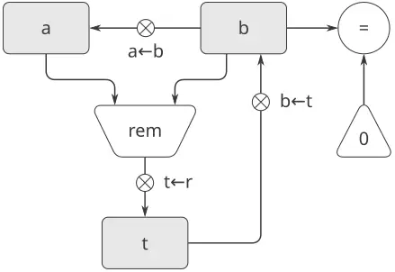
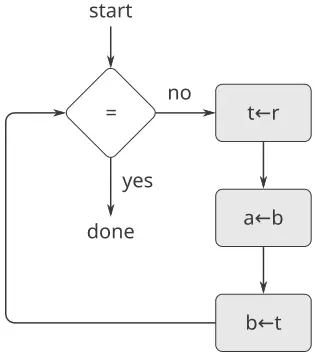
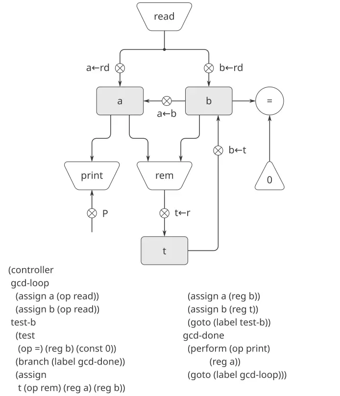
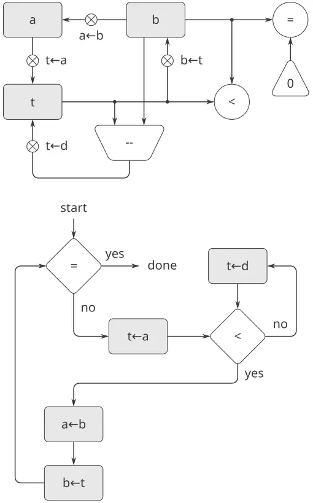
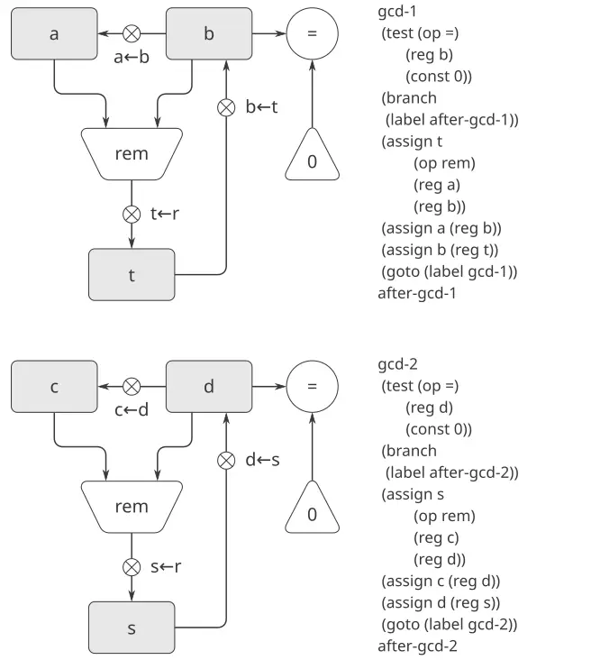
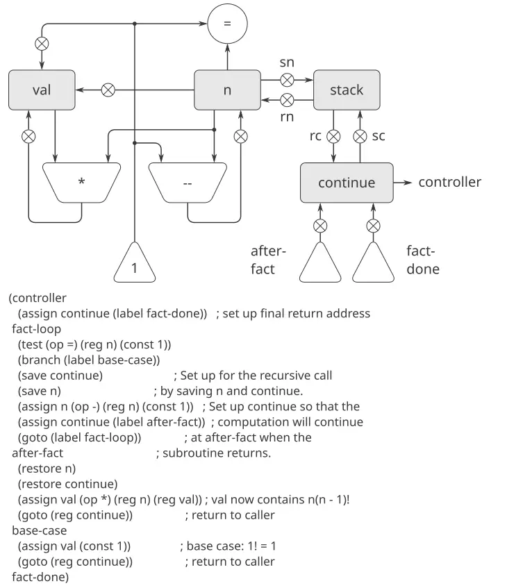

> هدفي أن أبيّن أنّ الآلة السماويّة ليست نوعًا من الكائن الإلهيّ الحيّ، بل نوعٌ من عمل الساعة (ومن يظنّ أنّ للساعة روحًا ينسب مجدَ صانعها إلى العمل)، إذ إن جميع الحركات المتعدّدة الأوجه - أو جميعها تقريبًا - ناجمةٌ عن قوّةٍ مادّيّةٍ في غاية البساطة، تمامًا كما أنّ جميع حركات الساعة ناجمةٌ عن ثقلٍ واحد. —يوهانس كيبلر (رسالة إلى هيروارت فون هوهنبورغ، 1605)

بدأنا هذا الكتاب بدراسة العمليّات وبوصفها من حيث إجراءاتٍ مكتوبةٍ بلغة Lisp. ولشرح معاني هذه الإجراءات، استخدمنا سلسلةً من نماذج التقييم: نموذج الاستبدال الوارد في [الفصل 1](https://sarabander.github.io/sicp/html/Chapter-1.xhtml#Chapter-1)، ونموذج البيئة الوارد في [الفصل 3](https://sarabander.github.io/sicp/html/Chapter-3.xhtml#Chapter-3)، والمُقيّم التعاكسيّ الوارد في [الفصل 4](https://sarabander.github.io/sicp/html/Chapter-4.xhtml#Chapter-4). لقد أزاح فحصنا للمُقيّم التعاكسيّ - على وجه الخصوص - كثيرًا من غموض كيفيّة تفسير اللغات الشبيهة بـLisp. لكن حتّى المُقيّم التعاكسيّ يترك أسئلةً مهمّةً بلا جواب، إذ إنه لا يزيح الستر عن آليّات التحكّم في نظام Lisp. فإنّ المُقيّم لا يشرح - مثلًا - كيف ينجح تقييم تعبيرٍ جزئيّ في إعادة قيمةٍ إلى التعبير الذي يستخدم هذه القيمة، كما لا يشرح كيف تُنتج بعض الإجراءات التعاوديّة عمليّاتٍ تكراريّة (أي إنها مُقيَّمةٌ باستخدام فضاءٍ ثابت) بينما تُنتج إجراءاتٌ تعاوديّةٌ أخرى عمليّاتٍ تعاوديّة. وهذه الأسئلة تبقى بلا جواب لأنّ المُقيّم التعاكسيّ هو في ذاته برنامج Lisp، ومن ثمّ فهو يرث بنية التحكّم في نظام Lisp الكامن. ولكي نوفّر وصفًا أكثر اكتمالًا لبنية التحكّم في مُقيّم Lisp، يتحتّم علينا العمل على مستوى أكثر أوّليّةً من Lisp نفسها.

سنصف في هذا الفصل العمليّات من حيث تشغيل حاسوبٍ تقليديّ خطوةً بخطوة. وحاسوبٌ كهذا، أو *آلة مسجّلات (register machine)*، ينفّذ تتابعيًّا *تعليمات (instructions)* تتلاعب بمحتويات مجموعةٍ ثابتةٍ من عناصر التخزين تُسمّى *مسجّلات (registers)*. فإنّ تعليمةً نموذجيّةً لآلة المسجّلات لتطبّق عمليّةً أوّليّةً على محتويات بعض المسجّلات وتُحيل النتيجة إلى مسجّلٍ آخر. وأوصافنا للعمليّات التي تنفّذها آلات المسجّلات ستبدو شديدة الشبه ببرامج «اللغة الآليّة» للحواسيب التقليديّة. غير أنّنا، بدلًا من التركيز على اللغة الآليّة لأيّ حاسوبٍ معيّن، سنفحص عدّة إجراءات Lisp ونُصمّم آلة مسجّلاتٍ خاصّةً لتنفيذ كلّ إجراءٍ منها. وبذلك، سنقترب من مهمّتنا من منظور مهندس عتادٍ لا من منظور مبرمجٍ بلغة آليّةٍ لحاسوب. وبتصميمنا آلات المسجّلات، سنطوّر آليّاتٍ لتنفيذ بنيات برمجةٍ مهمّةٍ كالتعاوب. وسنُقدّم أيضًا لغةً لوصف تصاميم آلات المسجّلات. وفي [5.2](https://sarabander.github.io/sicp/html/5_002e2.xhtml#g_t5_002e2) سنُنفّذ برنامج Lisp يستخدم هذه الأوصاف لمحاكاة الآلات التي نصمّمها.

معظم العمليّات الأوّليّة لآلات المسجّلات لدينا بسيطةٌ للغاية. فإنّ عمليّةً ما قد تجمع الأعداد المقروءة من مسجّلين، وتُنتج نتيجةً تُخزَّن في مسجّلٍ ثالث. ومثل هذه العمليّة يمكن أداؤها بعتادٍ سهل الوصف. غير أنّنا، لكي نتعامل مع بنية القوائم، سنستخدم أيضًا عمليّات الذاكرة `car` و`cdr` و`cons`، التي تتطلّب آليّةً بالغة التعقيد لتخصيص التخزين. ونحن ندرس في [5.3](https://sarabander.github.io/sicp/html/5_002e3.xhtml#g_t5_002e3) تنفيذها من حيث عمليّاتٍ أكثر أوّليّةً.

وفي [5.4](https://sarabander.github.io/sicp/html/5_002e4.xhtml#g_t5_002e4)، بعد أن نكون قد راكمنا خبرةً في صياغة الإجراءات البسيطة كآلات مسجّلات، سنُصمّم آلةً تُنجز الخوارزميّة التي وصفها المُقيّم التعاكسيّ الوارد في [4.1](https://sarabander.github.io/sicp/html/4_002e1.xhtml#g_t4_002e1). وسدُّ هذه الفجوة في فهمنا لكيفيّة تفسير تعابير Scheme سيتمّ بتوفير نموذجٍ صريحٍ لآليّات التحكّم في المُقيّم. وسندرس في [5.5](https://sarabander.github.io/sicp/html/5_002e5.xhtml#g_t5_002e5) مصرِّفًا بسيطًا يترجم برامج Scheme إلى تتابعاتٍ من التعليمات التي يمكن تنفيذها مباشرةً بمسجّلات آلة المُقيّم وعمليّاتها.


### 5.1 تصميم آلات المسجّلات

لتصميم آلة مسجّلات، يتحتّم أن نُصمّم *مسارات بياناتها (data paths)* (أي مسجّلاتها وعمليّاتها) و*متحكّمها (controller)* الذي يرتّب هذه العمليّات. ولتوضيح تصميم آلة مسجّلاتٍ بسيطة، دعنا نفحص خوارزميّة إقليد، التي تُستخدم لاحتساب القاسم المشترك الأكبر لعددين صحيحين. فكما رأينا في [1.2.5](https://sarabander.github.io/sicp/html/1_002e2.xhtml#g_t1_002e2_002e5)، فإنّ خوارزميّة إقليد يمكن أداؤها بعمليّةٍ تكراريّةٍ، كما يحدّده الإجراء التالي:

```scheme
(define (gcd a b)
  (if (= b 0)
      a
      (gcd b (remainder a b))))
```

فالآلة التي تُنجز هذه الخوارزميّة يتحتّم عليها تتبّع عددين، $a$ و$b$، فلْنفترض أنّ هذين العددين مخزَّنان في مسجّلين يحملان هذين الاسمين. والعمليّات الأساس المطلوبة هي اختبار ما إذا كانت محتويات المسجّل `b` صفرًا، واحتساب باقي قسمة محتويات المسجّل `a` على محتويات المسجّل `b`. وعمليّة الباقي عمليّةٌ معقّدة، لكن لنفترض للحظةٍ أنّ لدينا جهازًا أوّليًّا يحتسب البواقي. وفي كلّ دورةٍ من خوارزميّة القاسم المشترك الأكبر، يتحتّم استبدال محتويات المسجّل `a` بمحتويات المسجّل `b`، كما يتحتّم استبدال محتويات `b` بباقي قسمة محتويات `a` القديمة على محتويات `b` القديمة. ولَكان الأمر مريحًا لو أُمكن أداء هذين الاستبدالين معًا، لكنّنا في نموذجنا لآلات المسجّلات سنفترض أنّ مسجّلًا واحدًا فقط يمكن أن تُحال إليه قيمةٌ جديدة في كلّ خطوة. ولأداء الاستبدالين، ستستخدم آلتنا مسجّلًا ثالثًا «مؤقّتًا»، نُسمّيه `t`. (فأوّلًا يُوضَع الباقي في `t`، ثم تُوضَع محتويات `b` في `a`، وأخيرًا يُوضَع الباقي المخزَّن في `t` في `b`.)

يمكننا توضيح المسجّلات والعمليّات المطلوبة لهذه الآلة باستخدام مخطّط مسار البيانات الموضّح في [الشكل 5.1](/book/sicp/c5-computing-with-register-machines/index/). وفي هذا المخطّط، تُمثَّل المسجّلات (`a` و`b` و`t`) بمستطيلات. وكلّ طريقٍ لإحلال قيمةٍ في مسجّلٍ يُشار إليه بسهمٍ ذي `X` خلف رأس السهم، مشيرًا من مصدر البيانات إلى المسجّل. وبوسعنا أن نفكّر في `X` بوصفه زرًّا، إذ إنّ ضغطه يسمح للقيمة عند المصدر بأن «تتدفّق» إلى المسجّل المعيَّن. والملصق المجاور لكلّ زرّ هو الاسم الذي سنستخدمه للإشارة إلى الزرّ. والأسماء اعتراضيّة، ويمكن اختيارها لتكون ذات قيمة تذكيريّة (فمثلًا، يُشار بـ`a<-b` إلى ضغط الزرّ الذي يُحيل محتويات المسجّل `b` إلى المسجّل `a`). ومصدر البيانات لمسجّلٍ ما قد يكون مسجّلًا آخر (كما في الإحلال `a<-b`)، أو نتيجة عمليّة (كما في الإحلال `t<-r`)، أو ثابتًا (أي قيمةٌ مدمجةٌ لا يمكن تغييرها، وتُمثَّل في مخطّط مسار البيانات بمثلّثٍ يحتوي الثابت).



**الشكل 5.1:** مسارات البيانات لآلة القاسم المشترك الأكبر.

العمليّة التي تحتسب قيمةً من الثوابت ومحتويات المسجّلات تُمثَّل في مخطّط مسار البيانات بشبه منحرفٍ يحتوي اسم العمليّة. فمثلًا، يُمثّل الصندوق الموسوم بـ`rem` في [الشكل 5.1](/book/sicp/c5-computing-with-register-machines/index/) عمليّةً تحتسب باقي قسمة محتويات المسجّلين `a` و`b` المرفَقين به. والأسهم (بلا أزرار) تتّجه من مسجّلات المداخل والثوابت إلى الصندوق، والأسهم تصل قيمة مخرج العمليّة بالمسجّلات. والاختبار يُمثَّل بدائرةٍ تحتوي اسم الاختبار. فمثلًا، تحتوي آلة القاسم المشترك الأكبر لدينا على عمليّةٍ تختبر ما إذا كانت محتويات المسجّل `b` صفرًا. وللاختبار أسهمٌ أيضًا من مسجّلات مداخله وثوابته، لكنّه لا يملك أسهم مخرجات؛ فقيمته يستخدمها المتحكّم لا مسارات البيانات. وبصورةٍ عامّة، يُظهر مخطّط مسار البيانات المسجّلات والعمليّات المطلوبة للآلة وكيف يتحتّم وصلها. فإذا نظرنا إلى الأسهم بوصفها أسلاكًا وإلى أزرار `X` بوصفها مفاتيح، فإنّ مخطّط مسار البيانات يشبه إلى حدٍّ بعيدٍ مخطّط الأسلاك لآلةٍ يمكن بناؤها من مكوّنات كهربائيّة.

ولكي تحتسب مسارات البيانات القواسم المشتركة الكبرى فعلًا، يتحتّم ضغط الأزرار في التتابع الصحيح. وسنصف هذا التتابع من حيث مخطّط متحكّم، كما هو موضّح في [الشكل 5.2](/book/sicp/c5-computing-with-register-machines/index/). وتُبيّن عناصر مخطّط المتحكّم كيف ينبغي تشغيل مكوّنات مسار البيانات. فالصناديق المستطيلة في مخطّط المتحكّم تُحدّد أزرار مسار البيانات التي يتحتّم ضغطها، والأسهم تصف التتابع من خطوةٍ إلى التي تليها. والمعيّن في المخطّط يُمثّل قرارًا. وسيتبع أحد سهمي التتابع، بحسب قيمة اختبار مسار البيانات المحدَّد في المعيّن. وبوسعنا تفسير المتحكّم بالاستعانة بمجادلةٍ فيزيائيّة: فتخيّل المخطّط متاهةً تتدحرج فيها كرة رخاميّة. فحين تتدحرج الكرة إلى صندوقٍ ما، تضغط زرّ مسار البيانات الذي يسمّيه الصندوق. وحين تتدحرج الكرة إلى عقدة قرار (كالاختبار الخاصّ بـ`b` = 0)، فإنّها تترك العقدة على المسار الذي تحدّده نتيجة الاختبار المُشار إليه. ومجتمعةً، تصف مسارات البيانات والمتحكّم وصفًا كاملًا آلةً لاحتساب القواسم المشتركة الكبرى. ونبدأ المتحكّم (كرة الرخام المتدحرجة) من الموضع الموسوم بـ`start`، بعد وضع الأعداد في المسجّلين `a` و`b`. وحين يصل المتحكّم إلى `done`، سنجد قيمة القاسم المشترك الأكبر في المسجّل `a`.



**الشكل 5.2:** متحكّم آلة القاسم المشترك الأكبر.

**التمرين 5.1:** صمّم آلة مسجّلاتٍ لاحتساب العامليّات باستخدام الخوارزميّة التكراريّة التي يحدّدها الإجراء التالي. وارسم مخطّطات مسار البيانات والمتحكّم لهذه الآلة.

```scheme
(define (factorial n)
  (define (iter product counter)
    (if (> counter n)
        product
        (iter (* counter product)
              (+ counter 1))))
  (iter 1 1))
```

#### 5.1.1 لغةٌ لوصف آلات المسجّلات

مخطّطات مسار البيانات والمتحكّم كافيةٌ لتمثيل الآلات البسيطة كآلة القاسم المشترك الأكبر، لكنّها عسيرة التناول لوصف الآلات الكبيرة كمفسّر Lisp. ولكي يصبح ممكنًا التعامل مع الآلات المعقّدة، سنُنشئ لغةً تعرض، في صيغةٍ نصّيّة، جميع المعلومات التي تُعطيها مخطّطات مسار البيانات والمتحكّم. وسنبدأ بترميزٍ يعكس المخطّطات عكسًا مباشرًا.

نُعرّف مسارات بيانات آلةٍ بوصف مسجّلاتها وعمليّاتها. ولوصف مسجّلٍ، نُعطيه اسمًا ونُحدّد الأزرار التي تتحكّم في الإحلال إليه. ونُعطي كلًّا من هذه الأزرار اسمًا ونُحدّد مصدر البيانات التي تدخل المسجّل تحت تحكّم الزرّ. (والمصدر هو مسجّلٌ أو ثابتٌ أو عمليّة.) ولوصف عمليّةٍ، نُعطيها اسمًا ونُحدّد مداخلها (مسجّلات أو ثوابت).

نُعرّف متحكّم آلةٍ بوصفه تتابعًا من *التعليمات (instructions)* مع *ملصقات (labels)* تُحدّد *نقاط الدخول (entry points)* في التتابع. والتعليمة هي إحدى ما يلي:

- اسم زرّ مسار بياناتٍ يتحتّم ضغطه لإحلال قيمةٍ إلى مسجّل. (وهذا يقابل صندوقًا في مخطّط المتحكّم.)
- تعليمة `test`، تُؤدّي اختبارًا محدَّدًا.
- تفرّعٌ شرطيّ (تعليمة `branch`) إلى موضعٍ يُشار إليه بملصق متحكّم، بناءً على نتيجة الاختبار السابق. (والاختبار والتفرّع معًا يقابلان معيّنًا في مخطّط المتحكّم.) فإن كان الاختبار خاطئًا، فعلى المتحكّم أن يواصل التعليمة التالية في التتابع. وإلّا، فعلى المتحكّم أن يواصل التعليمة التي تلي الملصق.
- تفرّعٌ غير شرطيّ (تعليمة `goto`) يُسمّي ملصق متحكّمٍ يتحتّم مواصلة التنفيذ عنده.

تبدأ الآلة من بداية تتابع تعليمات المتحكّم وتتوقّف حين يصل التنفيذ إلى نهاية التتابع. وإلّا حين يُغيّر تفرّعٌ مجرى التحكّم، فإنّ التعليمات تُنفَّذ بالترتيب الذي ذُكرت به.

يُظهر [الشكل 5.3](/book/sicp/c5-computing-with-register-machines/index/) آلة القاسم المشترك الأكبر موصوفةً بهذه الطريقة. وهذا المثال لا يُلمّح إلّا إلماحًا إلى عموميّة هذه الأوصاف، إذ إنّ آلة القاسم المشترك الأكبر حالةٌ بسيطةٌ جدًّا: فلكلّ مسجّلٍ زرٌّ واحدٌ فقط، ولكلّ زرٍّ واختبارٍ استخدامٌ واحدٌ فقط في المتحكّم.

**الشكل 5.3:** $↓$ توصيف آلة القاسم المشترك الأكبر.

```scheme
(data-paths
 (registers
  ((name a)
   (buttons ((name a<-b) 
             (source (register b)))))
  ((name b)
   (buttons ((name b<-t)
             (source (register t)))))
  ((name t)
   (buttons ((name t<-r)
             (source (operation rem))))))
 (operations
  ((name rem)
   (inputs (register a) (register b)))
  ((name =)
   (inputs (register b) (constant 0)))))

(controller
 test-b                ; label
   (test =)            ; test
   (branch 
    (label gcd-done))  ; conditional branch
   (t<-r)              ; button push
   (a<-b)              ; button push
   (b<-t)              ; button push
   (goto 
    (label test-b))    ; unconditional branch
 gcd-done)             ; label
```

للأسف، من العسر قراءة وصفٍ كهذا. ولكي نفهم تعليمات المتحكّم، يتحتّم علينا أن نرجع باستمرارٍ إلى تعاريف أسماء الأزرار وأسماء العمليّات، ولكي نفهم ما تفعله الأزرار قد يلزمنا الرجوع إلى تعاريف أسماء العمليّات. وبالتالي، سنُحوّل ترميزنا ليجمع المعلومات من وصفَي مسار البيانات والمتحكّم بحيث نراها جميعها معًا.

وللحصول على هذه الصيغة من الوصف، سنستبدل أسماء الأزرار والعمليّات الاعتراضيّة بتعريفات سلوكها. أي إنّه، بدلًا من القول (في المتحكّم) «اضغط الزرّ tGCD machine is described as follows:

```scheme
(controller
 test-b
   (test (op =) (reg b) (const 0))
   (branch (label gcd-done))
   (assign t (op rem) (reg a) (reg b))
   (assign a (reg b))
   (assign b (reg t))
   (goto (label test-b))
 gcd-done)
```

هذه الصيغة من الوصف أيسرُ قراءةً من الصيغة الموضّحة في [الشكل 5.3](/book/sicp/c5-computing-with-register-machines/index/)، لكنّها تحمل أيضًا عيوبًا:

- إنّها أكثر إطنابًا في الآلات الكبيرة، لأنّ الأوصاف الكاملة لعناصر مسار البيانات تُكرَّر كلّما ذُكرت العناصر في تتابع تعليمات المتحكّم. (وهذه ليست مشكلةً في مثال القاسم المشترك الأكبر، لأنّ كلّ عمليّةٍ وزرٍّ تُستخدم مرّةً واحدةً فقط.) فضلًا عن ذلك، فإنّ تكرار أوصاف مسار البيانات يحجب بنية مسار البيانات الفعليّة للآلة؛ فليس من الواضح في آلةٍ كبيرةٍ كم عدد المسجّلات والعمليّات والأزرار وكيف تترابط.
- ولأنّ تعليمات المتحكّم في تعريف آلةٍ تبدو كتعبيرات Lisp، فمن السهل نسيان أنّها ليست تعابير Lisp اعتراضيّة. فإنّها لا تستطيع أن ترمّز إلّا عمليّات آلةٍ مشروعة. فإنّ العمليّات - مثلًا - لا تستطيع أن تعمل مباشرةً إلّا على الثوابت ومحتويات المسجّلات، لا على نتائج عمليّاتٍ أخرى.

رغم هذه العيوب، سنستخدم لغة آلات المسجّلات هذه في جميع أنحاء هذا الفصل، لأنّنا سنكون أكثر اهتمامًا بفهم المتحكّمات من اهتمامنا بفهم العناصر والوصلات في مسارات البيانات. غير أنّنا ينبغي أن نضع في أذهاننا أنّ تصميم مسار البيانات حاسمٌ في تصميم الآلات الحقيقيّة.

> **التمرين 5.2:** استخدم لغة آلات المسجّلات لوصف آلة العامليّات التكراريّة الواردة في [التمرين 5.1](/book/sicp/c5-computing-with-register-machines/index/).

#### الأفعال

لِنُعدّل آلة القاسم المشترك الأكبر بحيث نستطيع إدخال الأعداد التي نريد قاسمها المشترك الأكبر والحصول على الجواب مطبوعًا على طرفيّتنا. ولن نناقش كيف نصنع آلةً تستطيع القراءة والطباعة، بل سنفترض (كما نفعل حين نستخدم `read` و`display` في Scheme) أنّ هاتين العمليّتين متاحتان كعمليّتين أوّليّتين.[^1]

فـ`Read` تشبه العمليّات التي كنا نستخدمها في أنّها تُنتج قيمةً يمكن تخزينها في مسجّل. لكنّ `read` لا تأخذ مداخلها من أيّ مسجّل؛ فقيمتها تعتمد على شيءٍ يحدث خارج الأجزاء من الآلة التي نصمّمها. وسنسمح لعمليّات آلتنا بأن يكون لها سلوكٌ كهذا، وبذلك سنرسم ونُرمّز استخدام `read` كما نفعل مع أيّ عمليّةٍ أخرى تحتسب قيمةً.

أمّا `Print`، من جهةٍ أخرى، فتختلف عن العمليّات التي كنا نستخدمها اختلافًا أساسيًّا: فإنّها لا تُنتج قيمة مخرجةً تُخزَّن في مسجّل. وإن كان لها أثر، فهذا الأثر ليس على جزءٍ من الآلة التي نصمّمها. وسنُشير إلى هذا النوع من العمليّات بوصفه *فعلًا (action)*. وسنمثّل الفعلَ في مخطّط مسار البيانات تمامًا كما نمثّل عمليّةً تحتسب قيمةً، أي بشكل منحرفٍ يحتوي اسم الفعل. والأسهم تتّجه إلى صندوق الفعل من أيّ مداخلات (مسجّلات أو ثوابت). ونربط أيضًا زرًّا بالفعل. وضغط الزرّ يجعل الفعل يقع. ولكي نجعل متحكّمًا يضغط زرّ فعل، نستخدم نوعًا جديدًا من التعليمات يُسمّى `perform`. وبذلك، فإنّ فعل طباعة محتويات المسجّل `a` يُمثَّل في تتابع متحكّمٍ بالتعليمة

```scheme
(perform (op print) (reg a))
```

يُظهر [الشكل 5.4](/book/sicp/c5-computing-with-register-machines/index/) مسارات البيانات والمتحكّم لآلة القاسم المشترك الأكبر الجديدة. وبدلًا من أن نجعل الآلة تتوقّف بعد طباعة الجواب، فقد جعلناها تبدأ من جديد، بحيث تقرأ زوجًا من الأعداد مرّةً بعد مرّة، وتحتسب قاسمهما المشترك الأكبر، وتطبع النتيجة. وهذه البنية تشبه حلقات المُشغّل التي استخدمناها في مفسّرات [الفصل 4](https://sarabander.github.io/sicp/html/Chapter-4.xhtml#Chapter-4).



**الشكل 5.4:** آلة قاسمٍ مشترك أكبر تقرأ المداخل وتطبع النتائج.

#### 5.1.2 التجريد في تصميم الآلات

سنُعرّف غالبًا آلةً تتضمّن عمليّاتٍ «أوّليّة» هي في الواقع بالغة التعقيد. فإنّا - مثلًا - سنعامل في [5.4](https://sarabander.github.io/sicp/html/5_002e4.xhtml#g_t5_002e4) و[5.5](https://sarabander.github.io/sicp/html/5_002e5.xhtml#g_t5_002e5) عمليّات التلاعب ببيئة Scheme بوصفها أوّليّة. ومثل هذا التجريد قيّمٌ لأنّه يسمح لنا بتجاهل تفاصيل أجزاءٍ من آلةٍ حتّى نتمكّن من التركيز على جوانب أخرى من التصميم. غير أنّ كوننا قد كنسنا قدرًا كثيرًا من التعقيد تحت البساط لا يعني أنّ تصميم آلةٍ غير واقعيّ. فنستطيع دائمًا أن نستبدل «الأوّليّات» المعقّدة بعمليّاتٍ أوّليّةٍ أبسط منها.

تأمّل آلة القاسم المشترك الأكبر. ففي الآلة تعليمةٌ تحتسب باقي قسمة محتويات المسجّلين `a` و`b` وتحيل النتيجة إلى المسجّل `t`. فإذا أردنا بناء آلة القاسم المشترك الأكبر دون استخدام عمليّة باقٍ أوّليّة، يتحتّم علينا أن نُحدّد كيف تُحتسب البواقي من حيث عمليّاتٍ أبسط، كالطرح. وفي الواقع، نستطيع كتابة إجراء Scheme يجد البواقي بهذه الطريقة:

```scheme
(define (remainder n d)
  (if (< n d) n (remainder (- n d) d)))
```

وبوسعنا بذلك أن نستبدل عمليّة الباقي في مسارات بيانات آلة القاسم المشترك الأكبر بعمليّة طرحٍ واختبار مقارنة. يُظهر [الشكل 5.5](/book/sicp/c5-computing-with-register-machines/index/) مسارات البيانات والمتحكّم للآلة المطوّرة. والتعليمة

```scheme
(assign t (op rem) (reg a) (reg b))
```

الواردة في تعريف متحكّم القاسم المشترك الأكبر تُستبدل بتتابعٍ من التعليمات يحتوي حلقة، كما هو موضّح في [الشكل 5.6](/book/sicp/c5-computing-with-register-machines/index/).



**الشكل 5.5:** مسارات البيانات والمتحكّم لآلة القاسم المشترك الأكبر المطوّرة.

**الشكل 5.6:** $↓$ تتابع تعليمات المتحكّم الخاصّ بآلة القاسم المشترك الأكبر الواردة في [الشكل 5.5](/book/sicp/c5-computing-with-register-machines/index/).

```scheme
(controller
 test-b
   (test (op =) (reg b) (const 0))
   (branch (label gcd-done))
   (assign t (reg a))
 rem-loop
   (test (op <) (reg t) (reg b))
   (branch (label rem-done))
   (assign t (op -) (reg t) (reg b))
   (goto (label rem-loop))
 rem-done
   (assign a (reg b))
   (assign b (reg t))
   (goto (label test-b))
 gcd-done)
```

**التمرين 5.3:** صمّم آلةً لاحتساب الجذور التربيعيّة باستخدام طريقة نيوتن، كما هي موصوفةٌ في [1.1.7](https://sarabander.github.io/sicp/html/1_002e1.xhtml#Sec_002e1_002e1_002e7):

```scheme
(define (sqrt x)
  (define (good-enough? guess)
    (< (abs (- (square guess) x)) 0.001))
  (define (improve guess)
    (average guess (/ x guess)))
  (define (sqrt-iter guess)
    (if (good-enough? guess)
        guess
        (sqrt-iter (improve guess))))
  (sqrt-iter 1.0))
```

ابدأ بافتراض أنّ عمليّتَي `good-enough?` و`improve` متاحتان كأوّليّتين. ثم أظهر كيف يُمكن توسيع هاتين من حيث العمليّات الحسابيّة. واصف كلّ نسخةٍ من تصميم آلة `sqrt` برسم مخطّط مسار بياناتٍ وكتابة تعريف متحكّمٍ بلغة آلات المسجّلات.

#### 5.1.3 الروتينات الفرعيّة

عند تصميم آلةٍ تؤدّي احتسابًا ما، كثيرًا ما نُفضّل أن نُرتّب أن تتقاسم أجزاءٌ مختلفةٌ من الاحتساب المكوّنات بدلًا من مضاعفتها. تأمّل آلةً تتضمّن احتسابين للقاسم المشترك الأكبر، أحدهما يجد القاسم المشترك الأكبر لمحتويات المسجّلين `a` و`b`، والآخر يجد القاسم المشترك الأكبر لمحتويات المسجّلين `c` و`d`. وقد نبدأ بافتراض أنّ لدينا عمليّة `gcd` أوّليّة، ثم نُوسّع نسختَي `gcd` من حيث عمليّاتٍ أكثر أوّليّةً. يُظهر [الشكل 5.7](/book/sicp/c5-computing-with-register-machines/index/) أجزاء القاسم المشترك الأكبر وحدها من مسارات بيانات الآلة الناتجة، دون أن يُظهر كيف تتّصل ببقيّة الآلة. ويُظهر الشكل أيضًا الأجزاء المقابلة من تتابع متحكّم الآلة.



**الشكل 5.7:** أجزاء من مسارات البيانات وتتابع المتحكّم لآلةٍ ذات احتسابين للقاسم المشترك الأكبر.

لهذه الآلة صندوقا عمليّة باقٍ وصندوقا اختبار تساو. فإن كانت المكوّنات المضاعفة معقّدة، كما هو حال صندوق الباقي، فلن تكون هذه طريقةً اقتصاديّةً لبناء الآلة. ونستطيع تجنّب مضاعفة مكوّنات مسار البيانات باستخدام المكوّنات ذاتها لاحتسابَي القاسم المشترك الأكبر، بشرط ألّا يؤثّر ذلك في بقيّة احتساب الآلة الكبرى. فإذا لم تكن القيم في المسجّلين `a` و`b` مطلوبةً بحلول الوقت الذي يصل فيه المتحكّم إلى `gcd-2` (أو إذا أُمكن نقل هذه القيم إلى مسجّلاتٍ أخرى لحفظها)، فنستطيع تغيير الآلة بحيث تستخدم المسجّلين `a` و`b`، بدلًا من المسجّلين `c` و`d`، في احتساب القاسم المشترك الأكبر الثاني كما الأوّل. فإن فعلنا ذلك، حصلنا على تتابع المتحكّم الموضّح في [الشكل 5.8](/book/sicp/c5-computing-with-register-machines/index/).

**الشكل 5.8:** $↓$ أجزاء من تتابع المتحكّم لآلةٍ تستخدم مكوّنات مسار البيانات ذاتها لاحتسابَي قاسمٍ مشترك أكبر مختلفين.

```scheme
gcd-1
 (test (op =) (reg b) (const 0))
 (branch (label after-gcd-1))
 (assign t (op rem) (reg a) (reg b))
 (assign a (reg b))
 (assign b (reg t))
 (goto (label gcd-1))
after-gcd-1
  …
gcd-2
 (test (op =) (reg b) (const 0))
 (branch (label after-gcd-2))
 (assign t (op rem) (reg a) (reg b))
 (assign a (reg b))
 (assign b (reg t))
 (goto (label gcd-2))
after-gcd-2
```

لقد أزلنا مكوّنات مسار البيانات المضاعفة (بحيث صارت مسارات البيانات كما في [الشكل 5.1](/book/sicp/c5-computing-with-register-machines/index/) من جديد)، لكنّ المتحكّم يملك الآن تتابعَي قاسمٍ مشترك أكبر يختلفان في ملصقي نقطة دخولهما فقط. وكان الأفضل أن نستبدل هذين التتابعين بتفرّعاتٍ إلى تتابعٍ واحدٍ - وهو *روتين فرعيّ (subroutine)* باسم `gcd` - وفي نهايته نتفرّع عائدين إلى الموضع الصحيح في تتابع التعليمات الرئيس. ونستطيع إنجاز هذا على النحو الآتي: قبل التفرّع إلى `gcd`، نضع قيمةً مميّزة (مثل 0 أو 1) في مسجّلٍ خاصّ، هو `continue`. وعند نهاية الروتين الفرعيّ `gcd` نعود إمّا إلى `after-gcd-1` وإمّا إلى `after-gcd-2`، بحسب قيمة المسجّل `continue`. ويُظهر [الشكل 5.9](/book/sicp/c5-computing-with-register-machines/index/) الجزء المعنيّ من تتابع المتحكّم الناتج، الذي يتضمّن نسخةً واحدةً فقط من تعليمات `gcd`.

**الشكل 5.9:** $↓$ استخدام مسجّل `continue` لتجنّب تتابع المتحكّم المضاعف الوارد في [الشكل 5.8](/book/sicp/c5-computing-with-register-machines/index/).

```scheme
gcd
 (test (op =) (reg b) (const 0))
 (branch (label gcd-done))
 (assign t (op rem) (reg a) (reg b))
 (assign a (reg b))
 (assign b (reg t))
 (goto (label gcd))
gcd-done
 (test (op =) (reg continue) (const 0))
 (branch (label after-gcd-1))
 (goto (label after-gcd-2))
  …
;; Before branching to gcd from
;; the first place where it is needed,
;; we place 0 in the continue register
 (assign continue (const 0))
 (goto (label gcd))
after-gcd-1
  …
;; Before the second use of gcd, 
;; we place 1 in the continue register
 (assign continue (const 1))
 (goto (label gcd))
after-gcd-2
```

هذا منهجٌ معقولٌ لمعالجة المسائل الصغيرة، لكنّه سيكون عسيرًا لو كانت هناك نسخٌ كثيرةٌ من احتسابات القاسم المشترك الأكبر في تتابع المتحكّم. فلكي نقرّر أين نواصل التنفيذ بعد الروتين الفرعيّ `gcd`، كنّا سنحتاج إلى اختباراتٍ في مسار البيانات وتعليمات تفرّعٍ في المتحكّم لجميع المواضع التي تستخدم `gcd`. وأقوى منهجٍ لتنفيذ الروتينات الفرعيّة هو أن نُجعل المسجّل `continue` يحمل ملصق نقطة الدخول في تتابع المتحكّم التي ينبغي مواصلة التنفيذ عندها حين ينتهي الروتين الفرعيّ. وإنّ تنفيذ هذه الاستراتيجيّة يتطلّب نوعًا جديدًا من الوصل بين مسار البيانات ومتحكّم آلة المسجّلات: فيتحتّم أن تكون هناك طريقةٌ لإحلال ملصقٍ من تتابع المتحكّم في مسجّلٍ، بحيث يمكن جلب هذه القيمة من المسجّل واستخدامها لمواصلة التنفيذ عند نقطة الدخول المعيّنة.

ولتعكس هذه القدرة، سنُوسّع تعليمة `assign` في لغة آلات المسجّلات لتسمح بأن يُحال إلى مسجّلٍ قيمةُ ملصقٍ من تتابع المتحكّم (كنوعٍ خاصٍّ من الثوابت). وسنُوسّع أيضًا تعليمة `goto` لتسمح بأن يواصل التنفيذ عند نقطة الدخول التي تصفها محتويات مسجّلٍ، لا عند نقطة الدخول التي يصفها ملصقٌ ثابتٌ فقط. وباستخدام هذين البناءين الجديدين نستطيع إنهاء الروتين الفرعيّ `gcd` بتفرّعٍ إلى الموضع المخزَّن في المسجّل `continue`. وهذا يؤدّي إلى تتابع المتحكّم الموضّح في [الشكل 5.10](/book/sicp/c5-computing-with-register-machines/index/).

**الشكل 5.10:** $↓$ إنّ إحلال الملصقات إلى المسجّل `continue` يُبسّط الاستراتيجيّة الموضّحة في [الشكل 5.9](/book/sicp/c5-computing-with-register-machines/index/) ويُعمّمها.

```scheme
gcd
 (test (op =) (reg b) (const 0))
 (branch (label gcd-done))
 (assign t (op rem) (reg a) (reg b))
 (assign a (reg b))
 (assign b (reg t))
 (goto (label gcd))
gcd-done
 (goto (reg continue))
  …
;; Before calling gcd, 
;; we assign to continue the label
;; to which gcd should return.
 (assign continue (label after-gcd-1))
 (goto (label gcd))
after-gcd-1
  …
;; Here is the second call to gcd,
;; with a different continuation.
 (assign continue (label after-gcd-2))
 (goto (label gcd))
after-gcd-2
```

والآلة التي لها أكثر من روتينٍ فرعيٍّ قد تستخدم مسجّلات استمرارٍ متعدّدة (مثلًا `gcd-continue` و`factorial-continue`)، أو يمكننا أن نجعل جميع الروتينات الفرعيّة تتقاسم مسجّل `continue` واحدًا. والتقاسم أكثر اقتصاديّة، لكن يتحتّم علينا أن نكون حذرين إذا كان لدينا روتين فرعيّ (`sub1`) ينادي روتينًا فرعيًّا آخر (`sub2`). فما لم يحفظ `sub1` محتويات `continue` في مسجّلٍ آخر قبل تهيئة `continue` للنداء إلى `sub2`، فلن يعرف `sub1` إلى أين يذهب حين ينتهي. والآليّة التي نُطوّرها في القسم التالي لمعالجة التعاوب تُوفّر أيضًا حلًّا أفضل لهذه مسألة نداءات الروتينات الفرعيّة المتداخلة.

#### 5.1.4 استخدام مكدسٍ لتنفيذ التعاوب

بالأفكار التي شُرِّحت حتّى الآن، نستطيع تنفيذ أيّ عمليّةٍ تكراريّةٍ بتحديد آلة مسجّلاتٍ لها مسجّلٌ يقابل كلّ متغيّر حالةٍ في العمليّة. فإنّ الآلة تُنفّذ مرّةً بعد مرّةٍ حلقة متحكّم، غالبةً محتويات المسجّلات، حتّى يتحقّق شرطٌ ما للإنهاء. وفي كلّ نقطةٍ في تتابع المتحكّم، تكون حالة الآلة (الممثّلة لحالة العمليّة التكراريّة) محدّدةً تمامًا بمحتويات المسجّلات (أي قيم متغيّرات الحالة).

أمّا تنفيذ العمليّات التعاوديّة فيتطلّب آليّةً إضافيّة. تأمّل الطريقة التعاوديّة التالية لاحتساب العامليّات، التي فحصناها أوّل مرّةٍ في [1.2.1](https://sarabander.github.io/sicp/html/1_002e2.xhtml#g_t1_002e2_002e1):

```scheme
(define (factorial n)
  (if (= n 1) 
      1
      (* (factorial (- n 1)) n)))
```

فكما نرى من الإجراء، فإنّ احتساب $n !$ يتطلّب احتساب $( n − 1 ) !$ . وأمّا آلة القاسم المشترك الأكبر لدينا، المأخوذة نموذجها من الإجراء

```scheme
(define (gcd a b)
  (if (= b 0) 
      a
      (gcd b (remainder a b))))
```

فكان عليها بالمثل أن تحتسب قاسمًا مشتركًا أكبر آخر. لكن هناك فرقًا مهمًّا بين إجراء `gcd`، الذي يُختزل به الاحتساب الأصليّ إلى احتساب قاسمٍ مشترك أكبر جديد، و`factorial`، الذي يتطلّب احتساب عامليّاتٍ أخرى كمسألةٍ جزئيّة. أمّا في القاسم المشترك الأكبر فجواب احتساب القاسم المشترك الأكبر الجديد هو جواب المسألة الأصليّة. فلاحتساب القاسم المشترك الأكبر التالي، نضع ببساطة المعطيات الجديدة في مسجّلات مداخل آلة القاسم المشترك الأكبر ونعيد استخدام مسارات بيانات الآلة بتنفيذ تتابع المتحكّم ذاته. وحين تنتهي الآلة من حلّ مسألة القاسم المشترك الأكبر النهائيّة، تكون قد أكملت الاحتساب كلّه.

أمّا في حالة العامليّات (أو أيّ عمليّةٍ تعاوديّة) فجواب مسألة العامليّات الجزئيّة الجديدة ليس جواب المسألة الأصليّة. فإنّ القيمة المتحصّلة لـ$( n − 1 ) !$ يتحتّم ضربها في $n$ للحصول على الجواب النهائيّ. فإذا حاولنا محاكاة تصميم القاسم المشترك الأكبر، وحلّلنا مسألة العامليّات الجزئيّة بإنقاص المسجّل `n` وإعادة تشغيل آلة العامليّات، فلن تعود لدينا القيمة القديمة للمسجّل `n` التي تضرب النتيجة فيها. وبذلك، نحتاج إلى آلة عامليّاتٍ ثانيةٍ تعمل على المسألة الجزئيّة. وهذه الآلة الثانية للعامليّات يتحتّم لها هي ذاتها مسألة عامليّاتٍ جزئيّة، تتطلّب آلة عامليّاتٍ ثالثة، وهكذا. وبما أنّ كلّ آلة عامليّاتٍ تحتوي آلة عامليّاتٍ أخرى داخلها، فإنّ الآلة الكلّيّة تحتوي عشًّا لانهائيًّا من آلاتٍ ممائلة، ومن ثمّ فلا يمكن بناؤها من عددٍ ثابتٍ محدودٍ من الأجزاء.

ومع ذلك، نستطيع تنفيذ عمليّة العامليّات كآلة مسجّلاتٍ إذا أمكننا أن نُرتّب استخدام المكوّنات ذاتها لكلّ نسخةٍ متداخلةٍ من الآلة. وتحديدًا، فإنّ الآلة التي تحتسب $n !$ ينبغي أن تستخدم المكوّنات ذاتها للعمل على مسألة احتساب $( n − 1 ) !$ الجزئيّة، وعلى مسألة احتساب $( n − 2 ) !$ الجزئيّة، وهكذا. وهذا أمرٌ معقول، لأنّ عمليّة العامليّات وإن كانت تقتضي أنّ عددًا غير محدودٍ من نسخ الآلة ذاتها لازمٌ لأداء احتسابٍ ما، فإنّ واحدةً فقط من هذه النسخ يلزم أن تكون نشطةً في أيّ لحظةٍ معيّنة. فحين تواجه الآلة مسألةً تعاوديّةً جزئيّة، فيمكنها أن تُعلّق العمل على المسألة الرئيسة، وأن تعيد استخدام الأجزاء المادّيّة ذاتها للعمل على المسألة الجزئيّة، ثم تواصل الاحتساب المعلّق.

وفي المسألة الجزئيّة، ستكون محتويات المسجّلات مختلفةً عمّا كانت عليه في المسألة الرئيسة. (وفي هذه الحالة، يُنقَص المسجّل `n`.) ولكي يصبح ممكنًا مواصلة الاحتساب المعلّق، يتحتّم على الآلة أن تحفظ محتويات أيّ مسجّلاتٍ ستكون مطلوبةً بعد حلّ المسألة الجزئيّة، بحيث يمكن استعادتها لمواصلة الاحتساب المعلّق. وفي حالة العامليّات، سنحفظ القيمة القديمة للمسجّل `n`، لتُستعاد حين ننتهي من احتساب عامليّات المسجّل `n` المنقوص.[^2]

وبما أنّ ليس هناك حدٌّ *أوّليّ (a priori)* لعمق نداءات التعاوب المتداخلة، فقد نحتاج إلى حفظ عددٍ اعتباطيٍّ من قيم المسجّلات. وهذه القيم يتحتّم استعادتها بالعكس من الترتيب الذي حُفظت به، إذ في عشّ التعاوبات تكون المسألة الجزئيّة الأخيرة دخولًا أوّلها انتهاءً. وهذا يمليّ استخدام *مكدس (stack)*، أو بنية بيانات «آخر داخل، أوّل خارج»، لحفظ قيم المسجّلات. ونستطيع توسيع لغة آلات المسجّلات لتتضمّن مكدسًا بإضافة نوعين من التعليمات: فالقيم تُوضَع على المكدس باستخدام تعليمة `save` وتُستعاد من المكدس باستخدام تعليمة `restore`. وبعد أن يكون تتابعٌ من القيم قد حُفظ بـ`save` على المكدس، فإنّ تتابعًا من تعليمات `restore` سيسترجع هذه القيم بالترتيب العكسيّ.[^3]

وبمعونة المكدس، نستطيع إعادة استخدام نسخةٍ واحدةٍ من مسارات بيانات آلة العامليّات لكلّ مسألة عامليّاتٍ جزئيّة. وهناك مسألة تصميمٍ ممائلة في إعادة استخدام تتابع المتحكّم الذي يُشغّل مسارات البيانات. فلإعادة تنفيذ احتساب العامليّات، لا يستطيع المتحكّم أن يعود إلى البداية بمجرّد حلقةٍ، كما في العمليّة التكراريّة، لأنّه بعد حلّ مسألة $( n − 1 ) !$ الجزئيّة ينبغي أن تضرب الآلة النتيجة في $n$ بعد. ويتحتّم على المتحكّم أن يُعلّق احتسابه لـ$n !$ ، وأن يحلّ مسألة $( n − 1 ) !$ الجزئيّة، ثم يواصل احتسابه لـ$n !$ . وهذه النظرة إلى احتساب العامليّات تُشير إلى استخدام آليّة الروتينات الفرعيّة الموصوفة في [5.1.3](/book/sicp/c5-computing-with-register-machines/index/)، التي تجعل المتحكّم يستخدم مسجّل `continue` للانتقال إلى الجزء من التتابع الذي يحلّ مسألةً جزئيّة ثم يواصل من حيث توقّف عن المسألة الرئيسة. ونستطيع بذلك أن نصنع روتينًا فرعيًّا للعامليّات يعود إلى نقطة الدخول المخزَّنة في المسجّل `continue`. وفي حوالي كلّ نداءٍ للروتين الفرعيّ، نحفظ `continue` ونستعيده كما نفعل مع المسجّل `n`، إذ إنّ كلّ «مستوى» من احتساب العامليّات سيستخدم المسجّل `continue` ذاته. أي إنّ الروتين الفرعيّ للعامليّات يتحتّم أن يضع قيمةً جديدة في `continue` حين ينادي ذاته من أجل مسألةٍ جزئيّة، لكنّه سيحتاج إلى القيمة القديمة لكي يعود إلى الموضع الذي ناداه لحلّ مسألةٍ جزئيّة.

يُظهر [الشكل 5.11](/book/sicp/c5-computing-with-register-machines/index/) مسارات البيانات والمتحكّم لآلةٍ تُنفّذ إجراء `factorial` التعاوديّ. وللآلة مكدسٌ وثلاثة مسجّلات، تُسمّى `n` و`val` و`continue`. ولكي نبسّط مخطّط مسار البيانات، لم نُسمِّ أزرار إحلال المسجّلات، بل أزرار عمليّات المكدس وحدها (`sc` و`sn` لحفظ المسجّلات، `rc` و`rn` لاستعادتها). ولتشغيل الآلة، نضع في المسجّل `n` العدد الذي نريد احتساب عامليّاته ونُشغّل الآلة. وحين تصل الآلة إلى `fact-done`، يكون الاحتساب قد انتهى وسيوجد الجواب في المسجّل `val`. وفي تتابع المتحكّم، يُحفظ المسجّلان `n` و`continue` قبل كلّ نداءٍ تعاوديّ ويُستعادان عند العودة من النداء. وتتمّ العودة من نداءٍ بالتفرّع إلى الموضع المخزَّن في `continue`. ويُهيَّأ المسجّل `Continue` عند بدء تشغيل الآلة بحيث تكون العودة الأخيرة إلى `fact-done`. وأمّا المسجّل `val`، الذي يحمل نتيجة احتساب العامليّات، فلا يُحفظ قبل النداء التعاوديّ، لأنّ المحتويات القديمة للمسجّل `val` غير مفيدةٍ بعد عودة الروتين الفرعيّ. والقيمة الجديدة وحدها، وهي القيمة التي يُنتجها الاحتساب الجزئيّ، هي المطلوبة.



**الشكل 5.11:** آلة عامليّاتٍ تعاوديّة.

ومع أنّ احتساب العامليّات يتطلّب من حيث المبدأ آلةً لانهائيّة، فإنّ الآلة الواردة في [الشكل 5.11](/book/sicp/c5-computing-with-register-machines/index/) محدودةٌ فعلًا ما عدا المكدس، الذي هو غير محدودٍ على نحوٍ محتمل. غير أنّ أيّ تنفيذٍ مادّيٍّ معيّنٍ للمكدس سيكون محدود الحجم، وهذا سيحدّ من عمق نداءات التعاوب التي تستطيع الآلة معالجتها. وهذا التنفيذ للعامليّات يوضّح الاستراتيجيّة العامّة لتحقيق الخوارزميّات التعاوديّة كآلات مسجّلاتٍ عاديّةٍ معزَّزةٍ بمكادس. فحين تُواجَه مسألةٌ تعاوديّةٌ جزئيّة، نحفظ على المكدس المسجّلات التي ستكون قيمُها الحالية مطلوبةً بعد حلّ المسألة الجزئيّة، ونحلّ المسألة التعاوديّة الجزئيّة، ثم نستعيد المسجّلات المحفوظة ونواصل التنفيذ على المسألة الرئيسة. ومسجّل `continue` يتحتّم حفظه دائمًا. وأمّا ما إذا كانت هناك مسجّلاتٌ أخرى يلزم حفظها فيعتمد على الآلة المعيّنة، إذ إنّ ليست جميع الاحتسابات التعاوبيّة تحتاج القيم الأصليّة للمسجّلات التي تُغيَّر أثناء حلّ المسألة الجزئيّة (انظر [التمرين 5.4](/book/sicp/c5-computing-with-register-machines/index/)).

#### تعاوبٌ مزدوج

لِنفحص عمليّةً تعاوديّةً أكثر تعقيدًا، وهي الاحتساب التعاوديّ الشجريّ لأعداد فيبوناتشي، الذي عرّفناه في [1.2.2](https://sarabander.github.io/sicp/html/1_002e2.xhtml#g_t1_002e2_002e2):

```scheme
(define (fib n)
  (if (< n 2) 
      n 
      (+ (fib (- n 1)) (fib (- n 2)))))
```

تمامًا كما هو الحال مع العامليّات، نستطيع تنفيذ الاحتساب التعاوديّ لفيبوناتشي كآلة مسجّلاتٍ ذات مسجّلات `n` و`val` و`continue`. والآلة أكثر تعقيدًا من آلة العامليّات، لأنّه هناك موضعان في تتابع المتحكّم نحتاج فيهما إلى أداء نداءات تعاوديّة - مرّةً لاحتساب $Fib ( n − 1 )$ ومرّةً لاحتساب $Fib ( n − 2 )$ . ولكي نتهيّأ لكلّ نداءٍ من هذين النداءين، نحفظ المسجّلات التي ستكون قيمُها مطلوبةً لاحقًا، ونضع المسجّل `n` على العدد الذي نحتاج إلى احتساب Fib له تعاوديًّا ( $n − 1$ أو $n − 2$ )، ونُحيل إلى `continue` نقطة الدخول في التتابع الرئيس التي نعود إليها (`afterfib-n-1` أو `afterfib-n-2`، على الترتيب). ثم نذهب إلى `fib-loop`. وحين نعود من النداء التعاوديّ، يكون الجواب في `val`. ويُظهر [الشكل 5.12](/book/sicp/c5-computing-with-register-machines/index/) تتابع المتحكّم لهذه الآلة.

**الشكل 5.12:** $↓$ متحكّم آلةٍ لاحتساب أعداد فيبوناتشي.

```scheme
(controller
   (assign continue (label fib-done))
 fib-loop
   (test (op <) (reg n) (const 2))
   (branch (label immediate-answer))
   ;; set up to compute Fib(n − 1)
   (save continue)
   (assign continue (label afterfib-n-1))
   (save n)           ; save old value of n
   (assign n 
           (op -)
           (reg n)
           (const 1)) ; clobber n to n-1
   (goto 
    (label fib-loop)) ; perform recursive call
 afterfib-n-1 ; upon return, val contains Fib(n − 1)
   (restore n)
   (restore continue)
   ;; set up to compute Fib(n − 2)
   (assign n (op -) (reg n) (const 2))
   (save continue)
   (assign continue (label afterfib-n-2))
   (save val)         ; save Fib(n − 1)
   (goto (label fib-loop))
 afterfib-n-2 ; upon return, val contains Fib(n − 2)
   (assign n 
           (reg val)) ; n now contains Fib(n − 2)
   (restore val)      ; val now contains Fib(n − 1)
   (restore continue)
   (assign val        ; Fib(n − 1) + Fib(n − 2)
           (op +) 
           (reg val)
           (reg n))
   (goto              ; return to caller,
    (reg continue))   ; answer is in val
 immediate-answer
   (assign val 
           (reg n))   ; base case: Fib(n) = n
   (goto (reg continue))
 fib-done)
```

**التمرين 5.4:** حدّد آلات مسجّلاتٍ تُنفّذ كلّ إجراءٍ من الإجراءات التالية. ولكلّ آلةٍ، اكتب تتابع تعليمات متحكّمٍ وارسم مخطّطًا يُظهر مسارات البيانات.

الرفع التعاوديّ إلى قوّة:

```scheme
(define (expt b n)
  (if (= n 0)
      1
      (* b (expt b (- n 1)))))
```

الرفع التكراريّ إلى قوّة:

```scheme
(define (expt b n)
  (define (expt-iter counter product)
    (if (= counter 0)
        product
        (expt-iter (- counter 1)
                   (* b product))))
  (expt-iter n 1))
```

> **التمرين 5.5:** حاكِ آلة العامليّات وآلة فيبوناتشي يدويًّا، مستخدِمًا مدخلًا غير تافه (يتطلّب تنفيذ نداءٍ تعاوديّ واحدٍ على الأقلّ). وأظهر محتويات المكدس عند كلّ نقطةٍ هامّةٍ في التنفيذ.

> **التمرين 5.6:** يلاحظ بن بِتدل أنّ تتابع متحكّم آلة فيبوناتشي يملك `save` زائدةً و`restore` زائدة، يمكن إزالتهما لجعل الآلة أسرع. فأين هاتان التعليمتان؟

#### 5.1.5 ملخّص التعليمات

التعليمة المتحكِّمة في لغة آلات المسجّلات لدينا تأخذ إحدى الصيغ التالية، حيث كلّ $⟨ i n p u t_{i} ⟩$ هو إمّا `(reg ⟨register-name⟩)` وإمّا `(const ⟨constant-value⟩)`. وقد طُرحت هذه التعليمات في [5.1.1](/book/sicp/c5-computing-with-register-machines/index/):

```scheme
(assign ⟨register-name⟩ (reg ⟨register-name⟩))
(assign ⟨register-name⟩ 
        (const ⟨constant-value⟩))
(assign ⟨register-name⟩ 
        (op ⟨operation-name⟩) 
        ⟨input₁⟩ … ⟨inputₙ⟩)
(perform (op ⟨operation-name⟩) 
         ⟨input₁⟩ 
         … 
         ⟨inputₙ⟩)
(test (op ⟨operation-name⟩) 
      ⟨input₁⟩ 
      … 
      ⟨inputₙ⟩)
(branch (label ⟨label-name⟩))
(goto (label ⟨label-name⟩))
```

وقد طُرح استخدام المسجّلات لحفظ الملصقات في [5.1.3](/book/sicp/c5-computing-with-register-machines/index/):

```scheme
(assign ⟨register-name⟩ (label ⟨label-name⟩))
(goto (reg ⟨register-name⟩))
```

وقد طُرحت تعليمات استخدام المكدس في [5.1.4](/book/sicp/c5-computing-with-register-machines/index/):

```scheme
(save ⟨register-name⟩)
(restore ⟨register-name⟩)
```

أمّا النوع الوحيد من `⟨`constant-value`⟩` الذي رأيناه حتّى الآن فهو العدد، لكنّنا سنستخدم لاحقًا السلاسل والرموز والقوائم. فمثلًا، `(const "abc")` هو السلسلة `"abc"`، و`(const abc)` هو الرمز `abc`، و`(const (a b c))` هو القائمة `(a b c)`، و`(const ())` هو القائمة الخالية.


[^1]: هذا الافتراض يُخفي جانبًا كبيرًا من التعقيد. فعادةً ما يُخصَّص جزءٌ كبيرٌ من تنفيذ نظام Lisp لجعل عمليّتي القراءة والطباعة تعملان.

[^2]: قد يُقال إنّنا لسنا بحاجةٍ إلى حفظ `n` القديمة؛ إذ يمكننا، بعد إنقاصها وحلّ المسألة الفرعيّة، أن نزيدها ببساطةٍ فنستعيد القيمة القديمة. ومع أنّ هذه الاستراتيجيّة تنجح مع المضروب (factorial)، فإنّها لا تنجح عمومًا، لأنّ القيمة القديمة لمسجّلٍ لا يمكن دائمًا استخلاصها من القيمة الجديدة.

[^3]: سنرى في [5.3](https://sarabander.github.io/sicp/html/5_002e3.xhtml#g_t5_002e3) كيف نُنفّذ المكدس باستخدام عمليّاتٍ أوّليّةٍ أكثر.